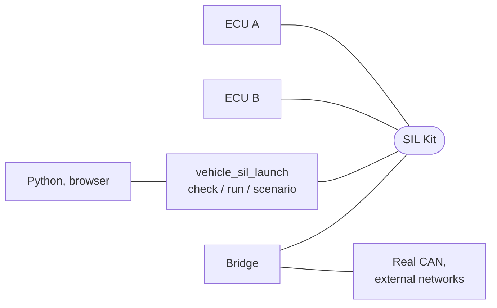
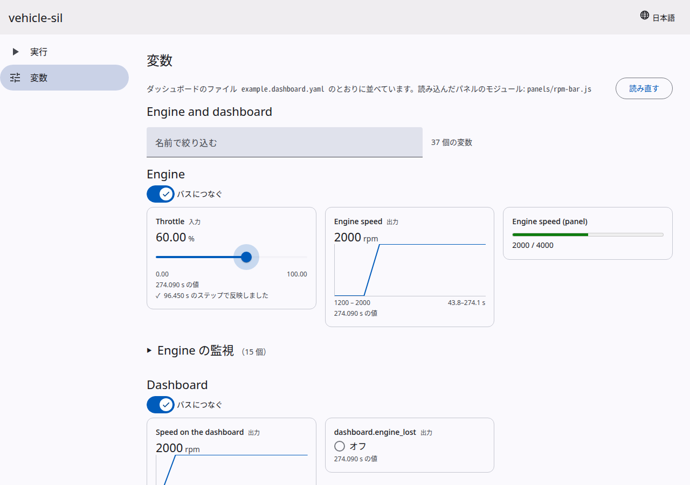

# vehicle-sil

[日本語](README.ja.md)

A set of tools for simulating vehicle ECUs (electronic control units) in software. You connect several ECUs, run them together on a computer and test them. You write each ECU in C++20. [Vector SIL Kit](https://github.com/vectorgrp/sil-kit) carries the communication between the ECUs and keeps their time in sync. All ECUs follow one shared simulation time (virtual time) instead of the wall clock, so repeated runs give the same result. The tools run on Linux and on Windows (MinGW).

> [!NOTE]
> While the version is 0.x, the public API can change incompatibly.

## What you can do

| Goal | Use | Documentation |
|---|---|---|
| Build your own ECU | One C++ class plus a one-line call to `ecu_main()` gives you an ECU executable. | [Create your first ECU](docs/howto/first-ecu.md) |
| Make ECUs communicate | ECUs send and receive J1939 (CAN), LIN and raw Ethernet frames. | [j1939-guide.md](docs/j1939-guide.md), [lin-guide.md](docs/lin-guide.md), [examples/ethernet](examples/ethernet) |
| Plan how to split ECUs and what to name things, before you start | Guidance on choosing what goes on the bus and what becomes a variable, network names, addresses and more. | [Decisions to make before you start](docs/howto/design-choices.md) |
| Run several ECUs as one simulation | `vehicle_sil_launch` checks a YAML configuration file against each ECU for mismatches (`check`), and starts and runs everything (`run`). | [Integrate and run several ECUs](docs/howto/integrate-ecus.md) |
| Write tests and run them automatically | A YAML scenario lists steps that set values, wait and check the results. | [Write tests with scenarios](docs/howto/scenario-tests.md) |
| Read and write values of a running simulation from Python | The Control API (gRPC) and its Python client. | [Read and write signals from outside](docs/howto/operate-signals.md) |
| Watch and change values in a browser | `vehicle-sil-gui` shows variables as sliders and charts. | [gui.md](docs/gui.md) |
| Connect to real CAN hardware or real networks | Bridges relay frames between a simulated bus and a real one. There is one for Vector XL CAN (Windows), one for SocketCAN (Linux) and one for Ethernet. | Vector XL (Windows): [bridges.md](docs/bridges.md); SocketCAN (Linux): [socketcan-bridge.md](docs/socketcan-bridge.md); Ethernet: [ethernet-bridge.md](docs/ethernet-bridge.md); to write a bridge of your own, [bridge-contract.md](docs/bridge-contract.md) |
| Let ECUs on other computers join | In the configuration file, give the address of the SIL Kit registry (the server that introduces participants to each other) and list the ECUs that the people on the other computers start themselves. | [Run on several computers](docs/howto/multi-pc.md) |



Each line in the diagram is a connection. The ECUs, `vehicle_sil_launch` and the bridges connect through SIL Kit. Python and the browser connect to `vehicle_sil_launch` to read and write values.

Each ECU is a separate executable. Different people can build ECUs separately, and someone who does not know their internals can list them in a configuration file and run them. For the overall architecture, see [docs/architecture.md](docs/architecture.md). For examples sorted by task, see [examples/README.md](examples/README.md).

## Example

The example has 2 ECUs. The engine ECU sets the engine speed from the throttle position and sends it over J1939. The dashboard ECU receives the speed and displays it. This configuration file puts both into one simulation ([examples/ecu_main/simulation.yaml](examples/ecu_main/simulation.yaml), comments removed). Each entry in `participants` is one ECU executable.

```yaml
vehicle_sil_simulation: 1
stop_at_ms: 1000
networks:
  - name: J1939_CAN
    kind: can
participants:
  - name: Engine
    command: [engine/vehicle_sil_engine_ecu]
    step_ms: 10
  - name: Dashboard
    command: [dashboard/vehicle_sil_dashboard_ecu]
    step_ms: 5
```

These commands need a build. First build as described in "[Quick start](#quick-start)", then run the commands below in `build/linux-gcc-control/examples/ecu_main`, where the build puts the configuration file and the ECUs. The `run` output shown is an excerpt: it leaves out the lines about starting the registry and the ECUs, and the lines that the ECUs print (`[Dashboard] t=…`).

| Command | What it does | What it starts |
|---|---|---|
| `vehicle_sil_launch check simulation.yaml` | Has each ECU print its own configuration and checks the configuration file against it. | Each ECU with `--describe` only. No simulation runs. |
| `vehicle_sil_launch run simulation.yaml` | Runs the simulation until `stop_at_ms`. | The SIL Kit registry and every ECU. It ends them when the run is over. |
| `vehicle_sil_launch run simulation.yaml --scenario scenarios/throttle_step.yaml` | Sets and checks values as the steps of the scenario say. | The same processes. The exit code is 0 if every step passes. |
| `vehicle-sil-gui simulation.live.yaml` | Runs the same 2 ECUs until you stop them, with a configuration file that has no time limit (next to `simulation.yaml`). You watch and change values in a browser. | The GUI server. Click **Start** in the GUI to start the simulation. In "Quick start", `scripts/run-gui.py` runs this command for you. |

The `check` output:

```text
simulation.yaml: 2 participants, 1 network

participant  step   networks
Engine       10 ms  J1939_CAN (j1939 0x00)
Dashboard    5 ms   J1939_CAN (j1939 0x28)

network    kind  participants
J1939_CAN  can   Engine, Dashboard

passed: 0 errors, 0 warnings, 0 notes
```

The scenario sets the throttle to 50 % and waits until the engine speed rises and the dashboard ECU receives it. The end of the `run --scenario` output:

```text
scenario scenarios/throttle_step.yaml (throttle step): passed, 6 of 6 steps passed

line  step                                                              result  at
8     set Engine.engine.throttle = 50                                   ok      0 ms
10    wait_until Engine.engine.speed ge 1700 (timeout 500 ms)           ok      330 ms
12    expect Engine.engine.speed near 1800 (tolerance 10) (for 100 ms)  ok      490 ms
15    expect Dashboard.dashboard.engine_speed ge 1700 (within 200 ms)   ok      490 ms
17    ramp Engine.engine.throttle to 0 over 200 ms                      ok      700 ms
18    expect Engine.engine.speed le 1000 (within 100 ms)                ok      700 ms

participant  required  ended
Engine       yes       exit code 0
Dashboard    yes       exit code 0

traffic: J1939_CAN: 1 participant sent, 1 received (2 counted) (steps before 705 ms)

network    participant  sent  received
J1939_CAN  Engine          8         0
J1939_CAN  Dashboard       0         8

passed: 0 errors, 0 warnings, 0 notes
```

Before anything runs, `check` reports each mismatch with its location, how to fix it and a finding code. Try it on a copy of the configuration file with a mistyped network name:

```sh
sed 's/name: J1939_CAN/name: Vehicle_CAN/' simulation.yaml > mistake.yaml
vehicle_sil_launch check mistake.yaml
```

The check reports 3 findings and exits with code 1. Below are one of the 3 findings and the last line; the other 2 findings are left out. The line number counts the full file, comments included.

```text
error: mistake.yaml:11: participant 'Engine': the executable uses the network 'J1939_CAN' (j1939), which is not in networks: add it to networks with kind: can, or have the ECU's author correct the name in its code [unknown-network]
failed: 2 errors, 1 warning, 0 notes
```

In the browser GUI, moving the throttle slider changes the engine speed.



## Quick start

| Way to start | Suited to | Requirements | What you get |
|---|---|---|---|
| [Build from the repository](#build-from-the-repository) | Trying it out right away; developing vehicle-sil itself | The tools in the next table | The examples, the tests and all the tools, built by you |
| [Use the template and the prebuilt tools](#use-the-template-and-the-prebuilt-tools) | Writing your own ECUs; integrating and running ECUs | A compiler, CMake, Ninja, Git and Python | A project with 2 ECUs, and tools that need no build |

### Build from the repository

| Requirement | Version | Used for |
|---|---|---|
| C++ compiler | GCC or Clang with C++20 support | Every build |
| CMake | 3.21 or later (3.28 or later to build gRPC) | Configuring and building |
| Ninja, Git | Any | Building, and fetching SIL Kit |
| [uv](https://docs.astral.sh/uv/) | Any | Installing the Python (3.11 or later) and the packages that the build and the GUI use |
| Node.js, npm | 24.15 or later, 11.12 or later | Building the web front end of the GUI |

The commands below build the repository, run the example above and start the GUI. The first configure and build download and compile SIL Kit (and gRPC, if your computer does not have it). This needs a network connection and takes from a few minutes to more than 10 minutes. The commands are for Linux. For Windows, other presets and running the tests, see [docs/build.md](docs/build.md).

```sh
git clone --recursive https://github.com/rahanahu/vehicle-sil.git
cd vehicle-sil
scripts/doctor.py                    # one line per requirement. MISSING: needed to build (exit code 1); absent: needed only for the GUI or another part
uv sync                              # installs the Python packages that the build and the GUI use
cmake --preset linux-gcc-control     # with the Control API server (needed to read and write values from Python and the GUI)
cmake --build --preset linux-gcc-control   # slow the first time: compiles SIL Kit (and gRPC, if the computer does not have it)

# reproduce the output shown in "Example"
export PATH="$PWD/build/linux-gcc-control/tools/launch:$PATH"
cd build/linux-gcc-control/examples/ecu_main
vehicle_sil_launch check simulation.yaml
vehicle_sil_launch run simulation.yaml --scenario scenarios/throttle_step.yaml

# browser GUI: go back to the repository root, build the web front end and start the GUI
# (if something is missing, run-gui.py prints the command that builds it)
cd ../../../..
npm --prefix gui/web ci
npm --prefix gui/web run build
scripts/run-gui.py                   # opens a browser (add --no-browser to only print the URL); Ctrl+C stops it
```

The `scripts/run-gui.py` script starts the GUI server with `examples/ecu_main/simulation.live.yaml` from the build and opens a browser. To start it without a browser, add `--no-browser`; the terminal prints the URL. To stop the GUI, press Ctrl+C in that terminal, or run `kill <PID>` (SIGTERM) from another terminal. Either way, a running simulation stops too.

### Use the template and the prebuilt tools

With this approach you do not build the repository. The [releases page](https://github.com/rahanahu/vehicle-sil/releases) provides these release assets:

| Release asset | Contents |
|---|---|
| Template | A starting-point ECU project with the same 2 ECUs as the example above, configuration files and a scenario (the same as [template/](template/)). |
| Prebuilt tools | `vehicle_sil_launch`, the browser GUI and the Python client, in one archive per OS. |
| GUI client | The npm package `vehicle-sil-gui-client-<version>.tgz` for your own screen (see [gui/client](gui/client/README.md)). The prebuilt tools contain the same file. |
| `SHA256SUMS` | The SHA-256 checksums of the other assets. |

Use the assets of one release together. The launcher refuses an ECU executable whose description it cannot read (built with another vehicle-sil), and the GUI client refuses a GUI server that speaks another version of the GUI protocol.

In the directory where you extracted the template, run these commands in order:

```sh
python3 get_tools.py             # downloads the prebuilt tools and prints the command that adds them to PATH
cmake --preset linux             # Windows (MSYS2 UCRT64): cmake --preset windows
cmake --build --preset linux     # Windows: cmake --build --preset windows
vehicle_sil_launch check simulation.yaml
vehicle_sil_launch run simulation.yaml --scenario scenarios/throttle_step.yaml
vehicle-sil-gui simulation.live.yaml
```

The template's [README](template/README.md) lists the required versions and explains each step. [CHANGELOG.md](CHANGELOG.md) lists the changes in each version.

## Writing an ECU

An ECU is an ordinary class that takes a `vehicle_sil::Ecu&`. Here are the class and `main()` of the engine ECU from the example, as they appear in [examples/ecu_main/engine/main.cpp](examples/ecu_main/engine/main.cpp) without the `#include` lines and the namespace declarations:

```cpp
class Engine
{
public:
    explicit Engine(vehicle_sil::Ecu& ecu) :
      node_(ecu.j1939("J1939_CAN").add_node(
          {.address = 0x00, .name = j1939::Name{}.set_identity_number(1).set_manufacturer_code(0x7F0)}))
    {
        ecu.input("engine.throttle", &throttle_,
                  {.unit = "%", .min = 0.0, .max = 100.0, .description = "accelerator pedal position"});
        ecu.output("engine.speed", &rpm_, {.unit = "rpm"});
        // The model: the speed moves towards 800 rpm plus 20 rpm per percent of throttle.
        ecu.every(10ms, [this](vehicle_sil::SimTime) {
            const int target = 800 + static_cast<int>(throttle_ * 20.0);
            rpm_ += rpm_ < target ? 50 : rpm_ > target ? -50 : 0;
        });
        ecu.every(100ms, [this](vehicle_sil::SimTime) {
            static_cast<void>(node_.send(ecu_main_example::kEngineSpeed, ecu_main_example::encode_speed(rpm_)));
        });
    }

private:
    j1939::Node& node_;
    double throttle_ = 20.0;
    int rpm_ = 0;
};
```

```cpp
int main(int argc, char** argv)
{
    return vehicle_sil::ecu_main<Engine>(argc, argv, {.name = "Engine", .step = 10ms});
}
```

| Code | What it does | Details |
|---|---|---|
| `ecu.j1939("J1939_CAN")` | Connects to the network of the same name in `networks` of the configuration file. If the names do not match, `check` reports the error shown above. | [j1939-guide.md](docs/j1939-guide.md) |
| `ecu.input()`, `ecu.output()` | Declare the variables that scenarios, Python and the GUI read and write. | "ECU variables" in [control-api.md](docs/control-api.md#ecu-variables) |
| `ecu.every()` | Updates the model and sends the message periodically, in virtual time. | [Create your first ECU](docs/howto/first-ecu.md) |
| `node_.send()` | Sends the message defined in [engine_speed.hpp](examples/ecu_main/engine_speed.hpp), next to this file. | [j1939-codec.md](docs/j1939-codec.md) (define signals in YAML and generate types from them) |
| `ecu_main<Engine>()` | Makes an executable that takes the same arguments as every other ECU (`--describe`, `--local --run-for-ms 1000` and others). | [ecu-executable.md](docs/ecu-executable.md) |

You can also run several ECUs in one process. This runs without SIL Kit, which makes it a good way to try ECU logic on your own ([examples/getting_started](examples/getting_started)).

## Known limitations

| Area | Limitation | Notes and workarounds |
|---|---|---|
| CAN | Classic CAN (8 bytes or less) only. | RTR, CAN FD and CAN XL frames are dropped on reception and counted. |
| J1939 | No ETP (messages longer than 1785 bytes). | For the other limitations and for what is not verified for conformance to the standard, see "Known J1939 limitations" and the individual sections in [docs/internals/j1939.md](docs/internals/j1939.md#known-j1939-limitations). |
| LIN | Runs in virtual time only. | A real-time `Peer` throws `std::logic_error`. |
| LIN | Uses experimental SIL Kit APIs, such as LIN dynamic response. | — |
| LIN | A slave that runs on SIL Kit needs a step size shorter than the slot length of the frames it responds to. | Set the step size with `step_ms` in the configuration file. |
| LIN | A LIN network cannot be connected to a real bus: there is no LIN bridge, and `--connect` takes CAN and Ethernet networks. | Use the LIN network inside the simulation. |
| LIN | A slave receives only the frames that the master sends. | On the virtual LIN bus, a slave cannot receive the responses of other slaves. On SIL Kit, it receives them for the IDs it subscribes to, but the step and the time at which it receives them are not deterministic. |
| Ethernet | Raw frames only; there is no TCP/IP stack. | Connect to external networks with the bridge described in [ethernet-bridge.md](docs/ethernet-bridge.md). |
| Time and control | There is no operation that restarts a simulation from the beginning (reset). | Stop the simulation and run `run` again. |
| Time and control | `vehicle_sil_sim_controller` cannot pause virtual time or step it. | The C++ API (the time gate of `SimulationController`), the stdin commands of `vehicle_sil_launch run` and the Control API (`--control`) can. |
| Time and control | If the DLL of an existing ECU uses real time internally (sleeping, reading the clock), vehicle-sil cannot replace it with virtual time. | — |
| Tools and build | The test library (`vehicle_sil::testkit`) has no LIN fault injection or recording. | To record, observe the virtual LIN bus. To disconnect a single ECU, use `ecu.connected`. |
| Tools and build | The APIs of `LocalBench` (`vehicle_sil::local`), `vehicle_sil::testkit` and `vehicle_sil::spy` are not stable. | — |
| Tools and build | `install()` and packaging (`find_package`) are not supported. | Include vehicle-sil with FetchContent or `add_subdirectory` (see "Use from another project (FetchContent)" in [docs/build.md](docs/build.md#use-from-another-project-fetchcontent)). |
| OS and hardware | Windows 10 is not verified. | Verified on Windows 11 with MSYS2 UCRT64. |
| OS and hardware | The Vector XL CAN Bridge handles classic CAN only. | For how to use it and how it behaves, see [bridges.md](docs/bridges.md). |
| OS and hardware | The Vector XL CAN Bridge is not verified with other physical CAN setups or devices. | Verified with Vector Virtual CAN and with a physical loopback on a VN5620. |

## Contributing

To work on vehicle-sil itself, read [AGENTS.md](AGENTS.md) first. It sets the rules for documentation, commit messages and the verification scripts. [docs/code-map.md](docs/code-map.md) describes how the source code is organized.

## License

The project is released under the MIT License ([LICENSE](LICENSE)). Only the files of the template, `template/`, are under MIT-0 ([template/LICENSE](template/LICENSE)): a project you create by copying them does not have to keep the license notice. [THIRD_PARTY_NOTICES.md](THIRD_PARTY_NOTICES.md) lists the licenses of the dependencies.

This is an independent project, not affiliated with Vector Informatik or SAE International. Product names and names of standards belong to their respective owners.
