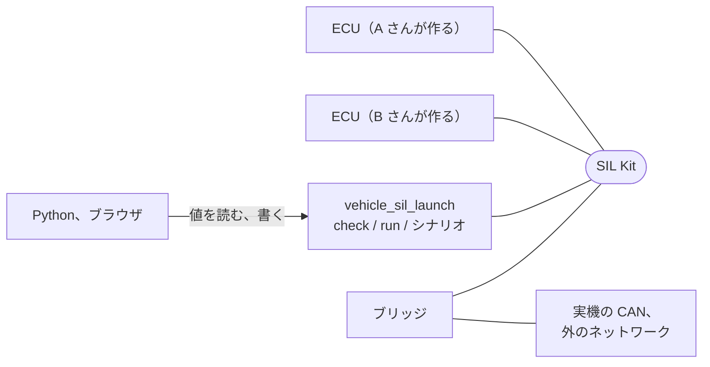

# vehicle-sil

vehicle-sil は、車の ECU（電子制御ユニット）をソフトウェアでシミュレートし、複数の ECU をつないで PC 上で動かしてテストするためのツール一式です。ECU は C++20 で書きます。ECU の間の通信と時刻の同期には [Vector SIL Kit](https://github.com/vectorgrp/sil-kit) を使います。Linux と Windows（MinGW）で動きます。

> [!NOTE]
> 最初のリリース（0.1.0）の前です。公開 API は、互換性を保たずに変わることがあります。

## できること

| やりたいこと | 使うもの | ドキュメント |
|---|---|---|
| 自分の ECU を作る | C++ のクラス 1 つと `ecu_main()` の 1 行で、ECU が実行ファイルになります。 | [最初の ECU を作る](docs/howto/first-ecu.md) |
| ECU に通信させる | J1939（CAN）、LIN、生のイーサネットのフレームを送受信できます。 | [j1939-guide.md](docs/j1939-guide.md)、[lin-guide.md](docs/lin-guide.md)、[examples/ethernet](examples/ethernet) |
| 複数の ECU をつないで 1 つのシミュレーションとして動かす | `vehicle_sil_launch` が、YAML の設定ファイルと各 ECU の不整合を検出し（`check`）、すべてを起動して実行します（`run`）。 | [ECU をまとめて動かす](docs/howto/integrate-ecus.md) |
| テストを書いて自動で実行する | YAML のシナリオに、値の設定、待機、確認の手順を書きます。 | [シナリオでテストを書く](docs/howto/scenario-tests.md) |
| 動いているシミュレーションの値を Python から読み書きする | Control API（gRPC）と、その Python のクライアントを使います。 | [信号を外から操作する](docs/howto/operate-signals.md) |
| ブラウザで値を見て操作する | `vehicle-sil-gui` が、変数をスライダーやグラフで表示します。 | [gui.md](docs/gui.md) |
| 実機の CAN やネットワークにつなぐ | Vector XL の CAN とのブリッジと、イーサネットのブリッジがあります。 | [bridges.md](docs/bridges.md)、[ethernet-bridge.md](docs/ethernet-bridge.md) |
| ほかの PC の ECU を参加させる | 設定ファイルに、SIL Kit の registry のアドレスと、相手が自分で起動する ECU を書きます。 | [複数の PC で動かす](docs/howto/multi-pc.md) |



ECU は 1 つずつ別の実行ファイルです。何人かが別々に作った ECU を、内部を知らない人が設定ファイルに並べて動かせます。全体の構成は [docs/architecture.md](docs/architecture.md) に、やりたいこと別のサンプルは [examples/README.md](examples/README.md) にあります。

## 動かすとこう見える

例は 2 つの ECU です。エンジンの ECU は、スロットルの値に合わせて回転数を変え、J1939 で送ります。表示の ECU は、それを受信して表示します。次の設定ファイルで、2 つを 1 つのシミュレーションにまとめます（[examples/ecu_main/simulation.yaml](examples/ecu_main/simulation.yaml)。コメントは省いています）。`participants` の 1 項目が、1 つの ECU の実行ファイルに対応します。

```yaml
vehicle_sil_simulation: 1
stop_at_ms: 1000
networks:
  - name: J1939_CAN
    kind: can
participants:
  - name: Engine
    command: [engine/vehicle_sil_engine_ecu]
    step_ms: 10
  - name: Dashboard
    command: [dashboard/vehicle_sil_dashboard_ecu]
    step_ms: 5
```

| コマンド | 動作 | 起動するもの |
|---|---|---|
| `vehicle_sil_launch check simulation.yaml` | 各 ECU に自身の構成を出力させて、設定ファイルと照合します。 | 各 ECU を `--describe` で起動するだけで、シミュレーションは実行しません。 |
| `vehicle_sil_launch run simulation.yaml` | シミュレーションを `stop_at_ms` まで実行します。 | SIL Kit の registry とすべての ECU を起動し、終わったら終了させます。 |
| `vehicle_sil_launch run simulation.yaml --scenario scenarios/throttle_step.yaml` | シナリオの手順どおりに値を設定して確認します。 | 同じものを起動し、すべての手順が成功すれば終了コード 0 で終わります。 |
| `vehicle-sil-gui simulation.live.yaml` | 停止するまで実行し、ブラウザで値を見て操作します。 | GUI サーバーを起動し、画面の「開始」でシミュレーションを起動します。 |

`check` の出力です。

```text
simulation.yaml: 2 participants, 1 network

participant  step   networks
Engine       10 ms  J1939_CAN (j1939 0x00)
Dashboard    5 ms   J1939_CAN (j1939 0x28)

network    kind  participants
J1939_CAN  can   Engine, Dashboard

passed: 0 errors, 0 warnings, 0 notes
```

`run --scenario` の出力の最後です。スロットルを 50 % にして、回転数が上がり、表示の ECU に届くのを待つシナリオです。

```text
scenario scenarios/throttle_step.yaml (throttle step): passed, 6 of 6 steps passed

line  step                                                              result  at
8     set Engine.engine.throttle = 50                                   ok      0 ms
10    wait_until Engine.engine.speed ge 1700 (timeout 500 ms)           ok      330 ms
12    expect Engine.engine.speed near 1800 (tolerance 10) (for 100 ms)  ok      490 ms
15    expect Dashboard.dashboard.engine_speed ge 1700 (within 200 ms)   ok      490 ms
17    ramp Engine.engine.throttle to 0 over 200 ms                      ok      700 ms
18    expect Engine.engine.speed le 1000 (within 100 ms)                ok      700 ms

participant  required  ended
Engine       yes       exit code 0
Dashboard    yes       exit code 0

passed: 0 errors, 0 warnings, 0 notes
```

不整合は、実行する前に `check` が、場所、修正方法、指摘のコードを付けて報告します。設定ファイルのネットワーク名を書き間違えたコピーで確認します。

```sh
sed 's/name: J1939_CAN/name: Vehicle_CAN/' simulation.yaml > mistake.yaml
vehicle_sil_launch check mistake.yaml
```

終了コードは 1 で、指摘は 3 件です。次は、そのうちの 1 件と最後の行です（行番号は、コメントを含むファイルのもの）。

```text
error: mistake.yaml:11: participant 'Engine': the executable uses the network 'J1939_CAN' (j1939), which is not in networks: add it to networks with kind: can, or have the ECU's author correct the name in its code [unknown-network]
failed: 2 errors, 1 warning, 0 notes
```

ブラウザの GUI でスロットルのスライダーを動かすと、回転数が変わります。


## 始める

| 始め方 | 使える時期 | 向いている人 | 必要なもの | 得られるもの |
|---|---|---|---|---|
| [リポジトリから動かす](#リポジトリから動かす) | いま使えます。 | すぐ試す人と、vehicle-sil 自体を開発する人です。 | 下の表のものです。 | サンプル、テスト、すべてのツールを自分でビルドしたものです。 |
| [テンプレートとビルド済みのツールから](#テンプレートとビルド済みのツールからリリース後) | リリース後です（まだリリースしていません）。 | 自分の ECU を作る人と、ECU をつないで動かす人です。 | コンパイラ、CMake、Ninja、Git、Python です。 | 2 つの ECU のプロジェクトと、ビルド不要のツールです。 |

### リポジトリから動かす

| 必要なもの | バージョン | 用途 |
|---|---|---|
| C++ のコンパイラ | C++20 に対応した GCC か Clang | すべてのビルドに使います。 |
| CMake | 3.21 以上（gRPC をビルドするときは 3.28 以上） | configure とビルドに使います。 |
| Ninja、Git | 指定なし | ビルドと、SIL Kit の取得に使います。 |
| [uv](https://docs.astral.sh/uv/) | 指定なし | ビルドと GUI が使う Python（3.11 以上）とパッケージをインストールします。 |
| Node.js、npm | 24.15 以上、11.12 以上 | GUI の画面のビルドに使います。 |

リポジトリをビルドして、上の例を実行し、GUI を起動します。コマンドは Linux のものです。Windows の手順、ほかのプリセット、テストの実行方法は [docs/build.md](docs/build.md) にあります。

```sh
git clone --recursive https://github.com/rahanahu/vehicle-sil.git
cd vehicle-sil
scripts/doctor.py                    # 必要なものがそろっているかを 1 行ずつ表示する（uv、Node.js、npm は absent でも終了コード 0 なので、行を見る）
uv sync                              # ビルドと GUI が使う Python のパッケージをインストールする
cmake --preset linux-gcc-control     # Control API のサーバーつき（Python と GUI から値を読み書きするのに必要）
cmake --build --preset linux-gcc-control   # 最初は SIL Kit（PC に gRPC がなければ gRPC も）をコンパイルするので時間がかかる

# 「動かすとこう見える」の出力を得る
export PATH="$PWD/build/linux-gcc-control/tools/launch:$PATH"
cd build/linux-gcc-control/examples/ecu_main
vehicle_sil_launch check simulation.yaml
vehicle_sil_launch run simulation.yaml --scenario scenarios/throttle_step.yaml

# ブラウザの GUI: リポジトリのルートに戻り、画面をビルドして起動する（Ctrl+C で終了）
cd ../../../..
npm --prefix gui/web ci
npm --prefix gui/web run build
scripts/run-gui.py                   # 足りないものがあれば、それをビルドするコマンドを表示する
```

### テンプレートとビルド済みのツールから（リリース後）

リリース後は、リポジトリをビルドする必要がありません。[リリースのページ](https://github.com/rahanahu/vehicle-sil/releases)で次の 2 つを配布します。

| 配布物 | 内容 |
|---|---|
| テンプレート | 上の例と同じ 2 つの ECU、設定ファイル、シナリオが入った、出発点になる ECU のプロジェクトです（[template/](template/) と同じもの）。 |
| ビルド済みのツール | `vehicle_sil_launch`、ブラウザの GUI、Python のクライアントを、OS ごとに 1 つのアーカイブにまとめたものです。 |

テンプレートを展開したディレクトリで、次の順に実行します。

```sh
python3 get_tools.py             # ビルド済みのツールをダウンロードし、PATH に追加するコマンドを表示する
cmake --preset linux             # Windows（MSYS2 UCRT64）: cmake --preset windows
cmake --build --preset linux     # Windows: cmake --build --preset windows
vehicle_sil_launch check simulation.yaml
vehicle_sil_launch run simulation.yaml --scenario scenarios/throttle_step.yaml
vehicle-sil-gui simulation.live.yaml
```

必要なもののバージョンと各ステップの説明は、テンプレートの [README](template/README.md) にあります。バージョンごとの変更は [CHANGELOG.md](CHANGELOG.md) にあります。

## ECU はこう書く

ECU は、`vehicle_sil::Ecu&` を受け取る普通のクラスです。上の例のうち、エンジンの ECU のクラスと `main()` をそのまま載せます（[examples/ecu_main/engine/main.cpp](examples/ecu_main/engine/main.cpp)。`#include` と名前空間の宣言は省いています）。

```cpp
class Engine
{
public:
    explicit Engine(vehicle_sil::Ecu& ecu) :
      node_(ecu.j1939("J1939_CAN").add_node(
          {.address = 0x00, .name = j1939::Name{}.set_identity_number(1).set_manufacturer_code(0x7F0)}))
    {
        ecu.input("engine.throttle", &throttle_,
                  {.unit = "%", .min = 0.0, .max = 100.0, .description = "accelerator pedal position"});
        ecu.output("engine.speed", &rpm_, {.unit = "rpm"});
        // The model: the speed moves towards 800 rpm plus 20 rpm per percent of throttle.
        ecu.every(10ms, [this](vehicle_sil::SimTime) {
            const int target = 800 + static_cast<int>(throttle_ * 20.0);
            rpm_ += rpm_ < target ? 50 : rpm_ > target ? -50 : 0;
        });
        ecu.every(100ms, [this](vehicle_sil::SimTime) {
            static_cast<void>(node_.send(ecu_main_example::kEngineSpeed, ecu_main_example::encode_speed(rpm_)));
        });
    }

private:
    j1939::Node& node_;
    double throttle_ = 20.0;
    int rpm_ = 0;
};
```

```cpp
int main(int argc, char** argv)
{
    return vehicle_sil::ecu_main<Engine>(argc, argv, {.name = "Engine", .step = 10ms});
}
```

| コード | 意味 | 詳細 |
|---|---|---|
| `ecu.j1939("J1939_CAN")` | 設定ファイルの `networks` と同じ名前のネットワークに接続し、名前が一致しなければ上の `check` のエラーになります。 | [j1939-guide.md](docs/j1939-guide.md) |
| `ecu.input()`、`ecu.output()` | シナリオ、Python、GUI から読み書きする変数を宣言します。 | [control-api.md](docs/control-api.md) の「ECU の変数」 |
| `ecu.every()` | 仮想時間の周期ごとに、モデルを更新し、メッセージを送信します。 | [最初の ECU を作る](docs/howto/first-ecu.md) |
| `node_.send()` | 隣の [engine_speed.hpp](examples/ecu_main/engine_speed.hpp) で定義したメッセージを送信します。 | [j1939-codec.md](docs/j1939-codec.md)（信号の定義を YAML に書いて型を生成する） |
| `ecu_main<Engine>()` | どの ECU も同じ引数（`--describe`、`--local --run-for-ms 1000` など）を持つ実行ファイルにします。 | [ecu-executable.md](docs/ecu-executable.md) |

複数の ECU を 1 つのプロセスで動かす書き方もあります。SIL Kit なしで動くので、ECU のロジックを 1 人で試すのに向いています（[examples/getting_started](examples/getting_started)）。

## 既知の制限

| 分野 | 制限 | 補足、代わりの方法 |
|---|---|---|
| CAN | クラシック CAN（8 バイト以下）だけです。 | RTR、CAN FD、CAN XL のフレームは、受信時に破棄して件数を数えます。 |
| J1939 | ETP（1785 バイトを超えるメッセージ）はありません。 | ほかの制限と、規格との一致を確認していない点は [docs/internals/j1939.md](docs/internals/j1939.md) の「J1939 の既知の制限」と各節にあります。 |
| LIN | 仮想時間だけで動きます。 | 実時間の `Peer` では `std::logic_error` になります。 |
| LIN | LIN の dynamic response など、SIL Kit の experimental API を使っています。 | — |
| LIN | SIL Kit で動かす Slave は、応答するフレームのスロット長より短いステップ幅で動かす必要があります。 | ステップ幅は、設定ファイルの `step_ms` で指定します。 |
| LIN | Slave が受信できるのは、Master が送るフレームだけです。 | ほかの Slave の応答は、仮想 LIN バスでは受信できず、SIL Kit では購読した ID なら受信できますが、受信するステップと時刻は決定論的ではありません。 |
| イーサネット | 生のフレームだけで、TCP/IP のスタックはありません。 | 外部のネットワークとは [ethernet-bridge.md](docs/ethernet-bridge.md) のブリッジで接続します。 |
| 時間と操作 | シミュレーションを最初からやり直す操作（リセット）はありません。 | 停止してから `run` を実行し直します。 |
| 時間と操作 | `vehicle_sil_sim_controller` からは、仮想時間の一時停止とステップ実行ができません。 | C++ の API（`SimulationController` の時間ゲート）、`vehicle_sil_launch run` の標準入力の命令、Control API（`--control`）からできます。 |
| 時間と操作 | CAN と LIN のチャネルやデバイスは、Control API、設定ファイル、GUI からは選択できません。 | Vector XL CAN Bridge のチャネルは、起動時の引数で指定します。 |
| 時間と操作 | 既存 ECU の DLL が内部で実時間（スリープ、時刻の取得）を使っている場合、vehicle-sil はそれを仮想時間に置き換えられません。 | — |
| ツールとビルド | テスト用のライブラリ（`vehicle_sil::testkit`）に、LIN の故障注入と記録の機能はありません。 | 記録は仮想 LIN バスの観測、ECU ごとの通信断は `ecu.connected` でできます。 |
| ツールとビルド | `LocalBench`（`vehicle_sil::local`）と `vehicle_sil::testkit` の API は安定していません。 | — |
| ツールとビルド | `install()` とパッケージ化（`find_package`）には未対応です。 | FetchContent か `add_subdirectory` で組み込みます（[docs/build.md](docs/build.md) の「外部プロジェクトから使う（FetchContent）」）。 |
| OS と機器 | Windows 10 は未確認です。 | Windows 11 の MSYS2 UCRT64 で確認しています。 |
| OS と機器 | Vector XL CAN Bridge が扱うのは、クラシック CAN だけです。 | 使い方と仕様は [bridges.md](docs/bridges.md) にあります。 |
| OS と機器 | Vector XL CAN Bridge は、ほかの物理 CAN の構成や機器では未確認です。 | Vector Virtual CAN と VN5620 の物理ループバックで確認しています。 |

## 開発に参加する

vehicle-sil 自体を開発するときは、先に [AGENTS.md](AGENTS.md) を読みます。ドキュメントの管理、コミットメッセージ、検証用スクリプトのルールがあります。ソースコードの構成は [docs/code-map.md](docs/code-map.md) にあります。

## ライセンス

vehicle-sil は MIT License で公開しています（[LICENSE](LICENSE)）。テンプレート `template/` のファイルだけは MIT-0（[template/LICENSE](template/LICENSE)）で、コピーして作ったプロジェクトにライセンス表示を残す必要はありません。依存ライブラリのライセンスは [THIRD_PARTY_NOTICES.md](THIRD_PARTY_NOTICES.md) にあります。

vehicle-sil は、Vector Informatik や SAE International とは関係のない、独立したプロジェクトです。文中の製品名と規格名は、それぞれの権利者に帰属します。
