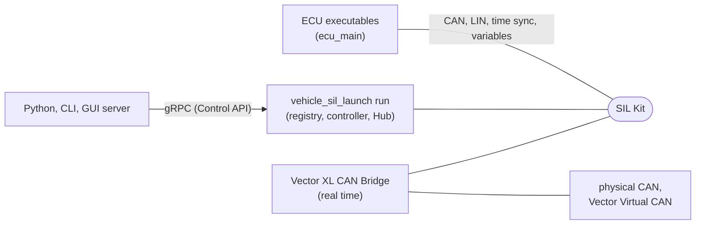

# アーキテクチャ

ECU を作る人、ECU をまとめる人、vehicle-sil 自体を直す人が、最初に全体の形をつかむための文書です。中の仕組み（スレッド、順序、不変条件）は、下の「[中の仕組み](#中の仕組み)」に挙げた文書に分けています。直す人は、[code-map.md](code-map.md)（どこに何があるか）の次にこれを読み、その後に [dependencies.md](dependencies.md) と、変える場所の中の仕組みの文書を読みます。

vehicle-sil は、Vector SIL Kit の上で車載通信のシミュレーションピアを作るためのライブラリ群と道具です。対象は CAN（J1939 と生の CAN）と LIN です。ピアは Windows（MinGW）または Linux の上で、独立したプロセスとして動きます。同じ ECU のコードを、SIL Kit を使わないプロセス内の仮想バスでも動かせます。

## 全体の形

ECU ごとに実行ファイルを作り（`ecu_main()`）、まとめる人が構成ファイルで 1 つのシミュレーションにします（`vehicle_sil_launch run`）。ランチャーは SIL Kit の registry と controller を自分のプロセスに持ち、ECU の実行ファイルを子プロセスで起動します（`manual` の participant は利用者が起動します）。



- バスと仮想時間は SIL Kit が運びます。ECU の変数（Control Agent）も SIL Kit の publish/subscribe でランチャーの Hub に届きます（[internals/control.md](internals/control.md)）。
- 外からの操作は Control API（gRPC）で、ランチャーの Control Server（`run --control`）が受けます（[control-api.md](control-api.md)）。
- GUI は別のプロセスです。GUI サーバー（`gui/server`）がランチャーを動かし、Control API のクライアントになって、ブラウザの画面に中継します（[gui.md](gui.md)）。
- 実機の CAN には、Vector XL CAN Bridge が実時間でつなぎます（[bridges.md](bridges.md)）。
- SIL Kit の Ethernet と外のイーサネットの間でフレームを運ぶ部品は、ライブラリとしてあります（[ethernet-bridge.md](ethernet-bridge.md)）。

## 構成

```
vehicle-sil/
├── libs/core/        vehicle_sil::core   SIL Kit participant、lifecycle、他参加者の監視、時間ゲート、ホストを participant のステップにつなぐ bind_host()
├── libs/step/        vehicle_sil::step   参加者のプロトコル処理をステップで回す仕組み（ホスト、仮想時間と実時間のドライバー、時計。バスの種類と SIL Kit に依存しない）
├── libs/lin/         vehicle_sil::lin    LIN の Master と Slave（スケジュールテーブル、フレームの送受信、診断フレーム、Sleep/Wakeup）、LIN のポートの抽象、プロセス内の仮想 LIN バス（SIL Kit と J1939 に依存しない）
├── libs/lin_silkit/  vehicle_sil::lin_silkit  vehicle_sil::lin のポートの SIL Kit 実装（仮想時間）
├── libs/can/         vehicle_sil::can    バックエンドに依存しない CAN の基盤（フレーム、ポート、vehicle_sil::step の上のホスト、仮想バス。SIL Kit に依存しない）
├── libs/can_silkit/  vehicle_sil::can_silkit  vehicle_sil::can のポートの SIL Kit 実装（仮想時間と実時間）
├── libs/can_netsim/  vehicle_sil::can_netsim  簡易 CAN Network Simulator（SIL Kit の Network Simulator API）
├── libs/eth_link/    vehicle_sil::eth_link  イーサネットのブリッジの外の側: 外のインターフェースの口、絞り込み、輪を防ぐ MAC の表（SIL Kit に依存しない）
├── libs/j1939/       vehicle_sil::j1939  J1939 スタック（vehicle_sil::can の上。SIL Kit に依存しない）と、そのプロトコル部品（parts/）、型付きメッセージ（codec/）
├── libs/ecu/         vehicle_sil::ecu    ECU のアプリケーションを組み立てる入口 Ecu（変数の宣言と、自己申告 describe() とその JSON を含む。SIL Kit に依存しない）
├── libs/local/       vehicle_sil::local  プロセス内の仮想 CAN バスと仮想 LIN バスの上で ECU を仮想時間で回す LocalBench（SIL Kit に依存しない）
├── libs/testkit/     vehicle_sil::testkit  LocalBench の上の J1939 の試験の記録と故障注入（SIL Kit に依存しない）
├── libs/peer/        vehicle_sil::peer   1 つの participant と、その J1939、生の CAN、LIN のノード、Control Agent（監視の出力を含む）の組み立てと実行。Ecu の実装
├── libs/simulation/  vehicle_sil::simulation  ECU を仮想バスか SIL Kit で動かす Simulation と、ECU の実行ファイルの main()（ecu_main）
├── libs/process/     vehicle_sil::process  子プロセス（ログファイルへの出力、標準出力と標準エラーの取り込みと時間切れ、行ごとの受け渡しと止める要求とプロセスの木ごとの終了。POSIX と Win32。内部用）
├── libs/launch/      vehicle_sil::launch  シミュレーションの構成ファイル、ECU の実行ファイルの自己申告との照合、シミュレーション全体の実行（内部用）
├── libs/control/     vehicle_sil::control  Control Agent と Control Server の中核（Hub）、両者の間のメッセージのバイト列の形式。通信と SIL Kit に依存しない
├── libs/control_silkit/ vehicle_sil::control_silkit  Agent と Hub の間を SIL Kit の publish/subscribe で運ぶ層（AgentTransport、HubTransport）
├── libs/control_grpc/ vehicle_sil::control_grpc  Control API の gRPC の層（クライアント向けの ControlServer。VEHICLE_SIL_BUILD_CONTROL_SERVER のときだけ）
├── proto/            Control API の定義（vehicle_sil/control/v1/control.proto）
├── python/vehicle_sil_control/ Control API の Python クライアントと CLI、`vehicle_sil_launch run --control` を子プロセスで動かす助け
├── bridges/common/  ブリッジの実行ファイルが共有する run_bridge()（止め方、監視のループ、止める順、終了コード。内部用）
├── bridges/vector-xl/ Vector XL CAN Bridge（転送のコアは移植可能、XL バックエンドと実行ファイルは Windows 専用）
├── bridges/ethernet/ イーサネットのブリッジ（SIL Kit の Ethernet と外のインターフェースの間の転送、統計、引数の解釈。プラットフォームに依存しない）
├── tools/common/     実行ファイル共通のコマンドライン解析、終了コード、ログ出力（内部用、ヘッダーのみ）
├── tools/sim_controller/ 仮想時間のシミュレーションを開始・停止する system controller（vehicle_sil_sim_controller）
├── tools/can_bus_simulator/ 簡易 CAN Network Simulator の実行ファイル（vehicle_sil_can_bus_simulator）
├── tools/launch/     構成ファイルの照合とシミュレーション全体の実行をする vehicle_sil_launch
├── tools/j1939_codegen/ YAML の定義から J1939 の型付きメッセージ（C++ のヘッダー）を作る生成器（Python。ビルドのときに vehicle_sil_add_j1939_codec() が呼ぶ）
├── examples/getting_started/ 最初の例: Ecu& を受け取る 2 つの ECU を Simulation で動かす
├── examples/         やりたいこと別のサンプル（typed_messages、pid_stream、fault_injection、vehicle、low_level など。索引は examples/README.md）
├── examples/j1939/   部品で作った 2 つの ECU（ecu_pair。Simulation で動かし、試験も同じコードを使う）、独自プロトコルのパラメーターサービス（param_service）と、最小ピア（実時間の Peer で送る sender と、SIL Kit の CAN で直接受けて照合する receiver）
├── examples/virtual_time/ 仮想時間のピア（Peer の上の物理モデル、tick() 型の既存 ECU を載せた J1939 ECU、LIN Master と Slave）
├── examples/lin/     LIN クラスタのピア（Master と、役割の違う Slave。フレームの送受信と Sleep/Wakeup）
├── examples/ecu_main/ ECU ごとの実行ファイル（ecu_main）と、それをまとめる構成ファイル、シナリオ、ダッシュボード
├── examples/launch_control/ ランチャーの Control Server に Python からつなぐ例（write_before_start.py、pause_and_step.py）
├── examples/gui_client/ GUI サーバーの口を JavaScript から使う例
├── examples/gui_starter/ GUI サーバーに配らせる自分の画面のひな形
├── examples/fetchcontent_consumer/   外部プロジェクトからの利用例
├── tests/            ユニットテスト、統合テスト、FetchContent テスト、XL ドライバのフェイク（tests/vector_xl/fake_xl）
├── external/         SIL Kit（サブモジュール）
├── patches/          SIL Kit へのパッチ（ビルドツリーのコピーに当てる。上流への提出用の形式）
├── gui/server/       ブラウザの GUI のサーバー（Python、vehicle-sil-gui。ランチャーを動かし、HTTP と WebSocket の口を出す）
├── gui/protocol/     GUI サーバーの HTTP と WebSocket の口の契約と例
├── gui/client/       GUI サーバーのクライアントのライブラリ（TypeScript）
├── gui/web/          サンプルの画面（Angular）
├── template/         ECU のプロジェクトのひな形（ビルド済みの道具を取ってくる get_tools.py を含む）
├── scripts/          開発と CI のスクリプト（verify.py、package.py など。AGENTS.md の「検証とスクリプト」）
├── cmake/            依存の取り込み、試験の登録、境界の検査
└── docs/
```

空のディレクトリや空のターゲットは作りません。

区分は、どこから使い始めるかの目安です。利用者向けは、ECU を書く人と ECU をまとめる人が直接使うライブラリで、入口は `vehicle_sil::Ecu` と `vehicle_sil::Simulation` です。土台は利用者向けのライブラリを通して使うもので、直接も使えますが、API は上の層の必要に合わせて変わります。試験用は、試験とサンプルのための道具です。実行ファイル、生成コード、CAN ブリッジは区分に入れていません（「—」）。

各ターゲットがリンクするもの（依存の向き）は、[code-map.md](code-map.md) の「依存の向き」の図にあります。

| ターゲット | 区分 | 内容 |
|---|---|---|
| `vehicle_sil::sim_base` | 土台 | `SimTime` と `SimDuration`、`StepInbox`、`periodic()` と `once_at()`（ヘッダーのみ。SIL Kit なしで使う） |
| `vehicle_sil::core` | 土台 | `vehicle_sil::ParticipantRuntime`（SIL Kit の participant、lifecycle、他参加者の状態、仮想時間のステップを RAII で管理する）、`SimulationController`（仮想時間のシミュレーションの開始と停止、一時停止、ステップ実行、速度）、`TickScheduler`、`RealTimePacer`、`step::Host` を participant のステップにつなぐ `vehicle_sil::bind_host()`。プロトコルに依存しない。`sim_base` の型（`SimTime`、`StepInbox`）も使える |
| `vehicle_sil::step` | 土台 | 1 つの参加者のプロトコル処理をステップで回す仕組み。ステップの参加者 `Member`、それを段の順に回す `Host`、仮想時間の `StepDriver`、実時間の `RealTimeDriver`、時計（`SteadyRealTimeClock`、試験用の `ManualRealTimeClock`）、時間の領域 `TimeDomain`。バスの種類にも SIL Kit にも依存しない（[internals/can.md](internals/can.md) のホストと駆動の節） |
| `vehicle_sil::lin` | 土台 | `vehicle_sil::lin::LinMaster`（スケジュールテーブル、Master が送るフレーム、マスターリクエスト、go-to-sleep と wakeup）と `vehicle_sil::lin::LinSlave`（ステップで設定した値で応答、スレーブレスポンス、Master のフレームの受信、休止と起床）、バスへの口 `LinPort` と、プロセス内の仮想 LIN バス `VirtualLinBus`。仮想時間で使う。SIL Kit にも J1939 にも依存しない。ふつうは `Ecu::lin_master()` と `Ecu::lin_slave()` から使う。ほかに `LinScheduleTable`、`validate_schedule()`（[internals/lin.md](internals/lin.md)） |
| `vehicle_sil::lin_silkit` | 土台 | `vehicle_sil::lin` のポートの SIL Kit 実装 `vehicle_sil::lin::SilKitLinPort`（`Peer` が使う） |
| `vehicle_sil::can` | 土台 | バックエンドに依存しない CAN の基盤。フレームの型、ポートの契約、複数のプロトコル処理をステップで回す `Host`（`step::Host` の上。`StepDriver`、`RealTimeDriver`、時計は `vehicle_sil::step` のものを同じ名前で使える）、テスト用の仮想バス（調停と送信時間の模擬、故障注入、ECU 単位の通信断を選べる）、生フレームを読み取り専用で観測する `TapPort`。SIL Kit に依存しない。J1939 スタックの土台。ほかに `vehicle_sil::can::Frame`、`Port`、`Steppable`、`VirtualCanBus`、`CanBusModel`（[internals/can.md](internals/can.md)） |
| `vehicle_sil::can_silkit` | 土台 | `vehicle_sil::can` のポートの SIL Kit 実装（仮想時間と、時刻同期なしの実時間）。`core` の `bind_host()` を `vehicle_sil::can::bind_host` の名前でも使える。ほかに `vehicle_sil::can::SilKitCanPort` |
| `vehicle_sil::can_netsim` | 土台 | 簡易 CAN Network Simulator: SIL Kit の Network Simulator API で、CAN の調停、送信時間、バスの占有を仮想時間で模擬する（`CanBusSimulator`）。Vector SIL Kit Network Simulator と共用の設定ファイルの読み込み（[internals/can.md](internals/can.md)） |
| `vehicle_sil::j1939` | 利用者向け | J1939 スタック（名前空間 `vehicle_sil::j1939`、ヘッダー `vehicle_sil/j1939/`）。単一フレームの送受信、Request、Acknowledgement、NAME と Address Claim（要求、競合、Cannot Claim、任意アドレスの選択、アドレス表、アドレス違反、Commanded Address の処理、状態の通知）、トランスポートプロトコル（BAM、RTS/CTS）、部品を作る道具箱（`Subscription`、`Timer`、`Node::attach`）、読み取り専用の観測口（`Observer`）。SIL Kit に依存しない。ほかに `vehicle_sil::j1939::Network`、`Node`、`Pgn`、`Identifier`（[internals/j1939.md](internals/j1939.md)） |
| `vehicle_sil::j1939_broadcast_suppression`、`vehicle_sil::j1939_diagnostics` | 利用者向け | `vehicle_sil::j1939` の公開 API と道具箱だけで作ったプロトコル部品。DM13 による放送の抑制、DTC と DM1/DM2/DM3/DM11/DM22、識別情報（ソフトウェア ID、ECU ID、製品 ID、診断プロトコル ID）。ほかに `BroadcastSuppression`、`Diagnostics`、`Identification`（[internals/j1939.md](internals/j1939.md)） |
| `vehicle_sil::j1939_periodic_sender`、`vehicle_sil::j1939_requester`、`vehicle_sil::j1939_monitor`、`vehicle_sil::j1939_address_commander`、`vehicle_sil::j1939_exchange` | 利用者向け | ECU アプリ向けの部品（同じく公開 API と道具箱だけで作る）。PG の周期送信（`PeriodicSender`）、Request の送信と応答・ACK・時間切れの報告（`Requester`）、受信の最新値と途絶（`Monitor`）、Commanded Address の送信（`AddressCommander`）、独自プロトコルのコマンドと応答（`Exchange`。例は [examples/j1939/param_service](../examples/j1939/param_service)）。使い方は [docs/j1939-guide.md](j1939-guide.md)（[internals/j1939.md](internals/j1939.md)、[j1939-guide.md](j1939-guide.md)） |
| `vehicle_sil::j1939_codec`（ヘッダーのみ） | 利用者向け | J1939 の型付きメッセージ。YAML で PG と信号（位置、符号、スケーリング、範囲、列挙、Proprietary A/B、名前を付けた特別な値とそのプロファイル、埋め値）を定義すると、`vehicle_sil_add_j1939_codec()` がビルドのときに C++ の型を生成する。ビット操作を書かずに、信号を値として送受信する。使い方は [docs/j1939-codec.md](j1939-codec.md)。ほかに `codec.hpp`、`PeriodicSender`、`codec_node.hpp`、`vehicle_sil::j1939_codec`（[internals/j1939.md](internals/j1939.md)、[j1939-codec.md](j1939-codec.md)） |
| `vehicle_sil::ecu` | 利用者向け | ECU のアプリケーションを組み立てる入口 `vehicle_sil::Ecu`: J1939 の `Network`、生の CAN チャネル（J1939 でないプロトコル用の `can::RawChannel`）、LIN の Master と Slave（`lin_master()`、`lin_slave()`）、外から読み書きする変数（`input`、`output`、ECU の Control Agent `agent()`）、ステップごとの処理（`on_step`、`every`、ある時刻に 1 回の `at`）、ECU が持つオブジェクト（`emplace`）。`Peer` と `LocalBench` の ECU が実装するので、`Ecu&` を受け取るクラスは仮想バスでも SIL Kit でも同じコードで動く。ECU の構成の自己申告（`describe()`、JSON）。SIL Kit に依存しない。ほかに `EcuDescription`、`to_json()`、`detail::OwnedObjects`、`detail::EcuAgent`（[internals/execution.md](internals/execution.md)、[ecu-executable.md](ecu-executable.md)） |
| `vehicle_sil::local` | 土台 | SIL Kit なしでプロセス内の仮想バスに ECU を載せて回す `vehicle_sil::LocalBench`: 仮想バスの上の ECU（`Ecu`）とその `Network` を名前で組み立て、呼んだスレッドで仮想時間で進める。`Simulation` のローカルの実行もこれを使う（[internals/execution.md](internals/execution.md)） |
| `vehicle_sil::testkit` | 試験用 | `LocalBench` の上の J1939 の試験の道具: 出来事と生フレームの記録（`J1939Events`、`FrameLog`）、故障注入の関数（`faults`）。`testkit::LocalCan` は `LocalBench` の別名（[internals/execution.md](internals/execution.md)） |
| `vehicle_sil::peer` | 土台 | 1 つの SIL Kit participant と、その J1939 の `Network`（SIL Kit の CAN か外部のポート）、生の CAN、LIN の Master/Slave、Control Agent（J1939 の通信状態の監視の出力を含む）をまとめて作り、仮想時間か実時間で動かす `vehicle_sil::Peer`。`Ecu` を実装する。ほかに `start_together()`（[internals/execution.md](internals/execution.md)） |
| `vehicle_sil::simulation` | 利用者向け | `vehicle_sil::Simulation`: ECU をプロセス内の仮想バスか、SIL Kit の participant として仮想時間で動かし、失敗を例外で報告する。動かす場所はコンストラクターで選ぶ（SIL Kit では、registry をプロセス内に立てられる）。入門は [examples/getting_started](../examples/getting_started)。ECU のクラスを 1 つの実行ファイルにする `ecu_main()`（どの ECU も同じ引数: `--describe`、`--registry-uri`、`--local`。[docs/ecu-executable.md](ecu-executable.md)）。ほかに `SilKitOptions`、`SimulationError`、`EcuMainOptions`（[internals/execution.md](internals/execution.md)、[ecu-executable.md](ecu-executable.md)） |
| `vehicle_sil_sim_controller`（実行ファイル） | — | system controller の CLI |
| `vehicle_sil::process`（内部用） | — | 子プロセス: `ChildProcess`（ログファイルへ）、`run_captured()`（標準出力と標準エラーを別々に取り込み、時間切れで止める）、`Process`（標準出力と標準エラーを行ごとに渡す。作業ディレクトリ、止める要求、起動したプロセスごとの終了）。`run_captured()` と `Process` の子は、自分のプロセスグループ（Windows ではプロセスグループとジョブオブジェクト）で動き、標準の 3 つのほかにハンドルを受け継がず、Linux では呼んだスレッドが終わると SIGKILL を受けます。POSIX は `fork` と `exec`（`ChildProcess` は `posix_spawn`）、Windows は `CreateProcessW`（パスと引数は UTF-8 から変換する） |
| `vehicle_sil::launch`（内部用。SIL Kit をサブモジュールからビルドしたとき） | — | 構成ファイルの読み込み、`--describe` の JSON の読み込み、照合の規則（プロセスを起動しない関数）、実行（registry と `SimulationController` をプロセスの中に持ち、participant を子プロセスで動かす。実行の判定はプロセスを起動しない関数）、人向けと JSON の出力（[simulation-config.md](simulation-config.md)） |
| `vehicle_sil_launch`（実行ファイル） | — | `vehicle_sil_launch check`、`vehicle_sil_launch run`（[simulation-config.md](simulation-config.md)、[simulation-check.md](simulation-check.md)、[simulation-run.md](simulation-run.md)）。`-DVEHICLE_SIL_BUILD_CONTROL_SERVER=ON` のビルドでは `run --control` の Control Server も持つ |
| `vehicle_sil::control` | 利用者向け | ECU の Control Agent（型・範囲・単位つきの変数の公開、外からの書き込みを仮想時刻を指定してステップの中で反映。固定容量のキュー）と、Control Server の中核の `Hub`。Agent は ECU が持って動かす（`Ecu::input()`、`output()` で変数を宣言する）。ほかに `vehicle_sil::control::Agent`、`wire`（[internals/control.md](internals/control.md)） |
| `vehicle_sil::control_silkit` | 利用者向け | Control Agent と `Hub` の間を SIL Kit の publish/subscribe で運ぶ層（`AgentTransport`、`HubTransport`）。`ecu_main()` で作った ECU と `vehicle_sil_launch run` が使う。gRPC は要らない。ほかに `vehicle_sil::control_silkit::AgentTransport`（[internals/control.md](internals/control.md)） |
| `vehicle_sil::control_proto`（`VEHICLE_SIL_BUILD_CONTROL_SERVER` のとき） | — | `control.proto` から生成したコード（`control_grpc` の内部） |
| `vehicle_sil::control_grpc`（同上） | 利用者向け | Control API（gRPC）の Server（クライアント向け。ECU の Agent は SIL Kit の `vehicle_sil::control_silkit` でつながる）。認証（TLS、トークン、役割）。`vehicle_sil_launch run --control` が使う。[使い方](control-api.md)。ほかに `vehicle_sil::control_grpc::ControlServer`、`time_control_of()` |
| `vehicle_sil::bridge_runtime`（内部用） | — | ブリッジの実行ファイルが準備の後に呼ぶ `vehicle_sil::bridge_runtime::run_bridge()`: 止める要求の受け方（シグナル、Windows のコンソールを閉じたとき）、監視のループ（participant の状態の判定、外の側の失敗、警告、監視の行）、止める順（統計を SIL Kit の participant の停止より先に出す）、終了コード。ブリッジごとの部分は `BridgeHooks` で渡す。プラットフォームに依存しない（[bridges.md](bridges.md)） |
| `vehicle_sil::vector_xl_bridge_core` | — | CAN ブリッジのコア（`vehicle_sil::vector_xl::CanBridge` など）と、外部 CAN ポートを `vehicle_sil::can` の実時間のポートにする `ExternalPortAdapter`。プラットフォームに依存しない。ほかに `ExternalCanPort` |
| `vehicle_sil::vector_xl`（Windows のみ） | — | Vector XL Driver のバックエンド（`XlDriver`、`XlCanPort`）。Windows 専用で、XL Driver Library が必要。ほかに `vehicle_sil::vector_xl::XlDriver` |
| `vehicle_sil_vector_xl_bridge`（Windows のみ、実行ファイル） | — | ブリッジの CLI |
| `vehicle_sil::eth_link` | — | イーサネットのブリッジの外の側: 外のインターフェースの口 `vehicle_sil::eth_link::ExternalLink`、絞り込み `FrameFilter`、輪を防ぐ `MacSideTable`。SIL Kit に依存しない（[ethernet-bridge.md](ethernet-bridge.md)） |
| `vehicle_sil::ethernet_bridge_core` | — | SIL Kit の `IEthernetController` と `ExternalLink` の間でフレームを運ぶ `vehicle_sil::ethernet_bridge::EthernetBridge`、統計と監視の行、引数の解釈。プラットフォームに依存しない |

利用側は必要なターゲットだけをリンクします。依存ライブラリは `EXCLUDE_FROM_ALL` で追加しているので、リンクしないものはビルドされません（外部プロジェクトから取り込んだときは vehicle-sil のライブラリも同じです）。

主なクラスは次のとおりです。

| クラス | 責務 |
|---|---|
| `vehicle_sil::ParticipantRuntime` | SIL Kit の participant、lifecycle（autonomous または coordinated）、SystemMonitor、時刻同期（任意）を RAII で所有する。他参加者の状態（Running か、終了したか）を待てる |
| `vehicle_sil::SimulationController` | coordinated で起動するシミュレーションの system controller。必要な参加者がそろったら一斉に開始させ、指定した仮想時刻で停止させる |
| `vehicle_sil::StepInbox` | SIL Kit のスレッドで届いたメッセージをステップの境界までため、決まった順序で渡す |
| `vehicle_sil::TickScheduler` | 1 つの participant の中で、固定周期のタスク（既存 ECU の `tick()` など）をステップから呼ぶ |
| `vehicle_sil::RealTimePacer` | 仮想時間を壁時計に一定の比率で結合するための待ち時間を計算する |
| `vehicle_sil::Ecu` | ECU のアプリケーションを組み立てる入口（J1939 の `Network`、生の CAN、LIN の Master と Slave、ステップごとの処理、ECU が持つオブジェクト）。`Peer` と `LocalBench` の ECU が実装する（[internals/execution.md](internals/execution.md)） |
| `vehicle_sil::Simulation` | `Ecu` を仮想バスか SIL Kit の仮想時間で動かし、失敗を `SimulationError` で報告する（[internals/execution.md](internals/execution.md)） |
| `vehicle_sil::Peer` | 1 つの participant と、その J1939 の `Network`、LIN の Master と Slave、ステップごとのアプリの処理を組み立てて動かし、正しい順序で片付ける。`Ecu` を実装する（[internals/execution.md](internals/execution.md)） |
| `vehicle_sil::lin::LinMaster` | LIN のスケジュールテーブルを仮想時間で実行し、ヘッダーごとの結果（応答の衝突は Error）を返す。Master が送るフレーム、診断のマスターリクエスト、go-to-sleep コマンド、wakeup パルスを送る |
| `vehicle_sil::lin::LinSlave` | ステップで設定された値で Master のヘッダーに応答し（診断のスレーブレスポンスは 1 回だけ）、Master が送るフレームを受信する。休止と起床の状態を管理する |
| `vehicle_sil::lin::LinPort` | LIN のノードがバスに触れる唯一の口。実装は `VirtualLinBus` のエンドポイントと `SilKitLinPort` |
| `vehicle_sil::lin::VirtualLinBus` | プロセス内の LIN バス。送った側の呼び出しの中で、同期に配る。`LocalBench` が LIN のネットワーク名ごとに 1 つ作る |

`ParticipantRuntime` の契約、所有と終了の順序、スレッドとキューは [internals/core.md](internals/core.md) にあります。

### 共通化の規則

- `core` に置くのは、どのプロトコルでも同じになる処理だけです。具体的には、SIL Kit への接続、lifecycle、他参加者の監視、仮想時間（ステップ、受信のバッファ、周期タスク、実時間との結合、時間ゲート）、失敗の判定（`FailureCheck`）です。外部操作（Control Agent と Hub）は `control` にあります。Control API の時間の操作は `core` の時間ゲートを使います。
- `core` は CAN、LIN、J1939 に依存しません。バスのコントローラ（`ICanController` など）は、利用側が `ParticipantRuntime::participant()` から SIL Kit の API で作ります。
- J1939 と LIN のプロトコル処理は共通化しません。
- ステップを回す仕組み（ホスト、ドライバー、時計、時間の領域）は、バスの種類によらない `step` に置きます。バスごとのライブラリ（`can`）は、自分のプロトコル処理とポートの組を `step::Member` にしてホストに載せます。
- LIN はホストに載せません。いまの 1 ステップの順序は「アプリケーション → LIN の `step(now)` → 変数の読み出し → CAN の送信」で、LIN をホストの送信の段に移すと、LIN のハンドラが書いた値を読み出す時点が 1 ステップずれるためです。LIN のポートは受け箱を持たず、仮想時間だけで動きます。
- 将来のためだけの抽象クラスや空の実装は作りません。

## 設計の決まり

### 時間の扱い

- 実時間（壁時計）とシミュレーション時間（SIL Kit の仮想時刻）を、型と名前で区別します（`SimTime`）。
- 時間管理は `core` に置きます。J1939 や LIN の内部には埋め込みません。
- 一時停止とステップ実行は、`SimulationController` の時間ゲートで行います（[internals/virtual-time.md](internals/virtual-time.md) の「一時停止、ステップ実行、速度（時間ゲート）」）。Control API はこれを操作します。
- 受信ハンドラから反応的に送ったメッセージは、SIL Kit の到着保証の対象外です。新しいプロトコルを仮想時間に載せるときは、送信をステップの中で行うか、LIN と同じように到着の上限を示してから使います。

### 実行モードと通信バックエンド

- 実行モード（仮想時間か実時間か。`PeerOptions::virtual_time`）と、バスの口（SIL Kit のポートか、利用者が渡すポート。Vector XL の `ExternalPortAdapter` など）は、別々に選びます。
- 実時間でも、SIL Kit の中だけで動かせます（J1939 の最小ピア `examples/j1939/sender`）。
- 仮想時間を壁時計に合わせるのは、ピアの `VirtualTimeOptions::real_time_factor` か、時間ゲートの速度です（[internals/virtual-time.md](internals/virtual-time.md) の「実時間との結合」）。
- 物理 CAN と Vector Virtual CAN は実時間で動かします。仮想時間のシミュレーションには参加させません（[bridges.md](bridges.md) の「物理 CAN と仮想時間」）。

## 中の仕組み

vehicle-sil 自体を直す人と、契約や制限を確かめたい人が、必要なものだけを読みます。

| 文書 | 内容 |
|---|---|
| [internals/core.md](internals/core.md) | `ParticipantRuntime` の契約、所有と終了の順序、スレッドとキュー、実時間モードの時刻 |
| [internals/can.md](internals/can.md) | CAN の共通基盤: ポート、事象、`Steppable`、ホスト、ドライバー、仮想バス、`TapPort`、SIL Kit のポート、バスのタイミング、簡易 CAN Network Simulator |
| [internals/j1939.md](internals/j1939.md) | J1939 スタック: エンジン、Address Claim、トランスポートプロトコル、道具箱、プロトコル部品、型付きメッセージ、`Observer`、資源の上限、既知の制限 |
| [internals/lin.md](internals/lin.md) | LIN の Master と Slave、スケジュール、診断フレーム、休止と起床、ポートと仮想 LIN バス |
| [internals/execution.md](internals/execution.md) | `Ecu`、`Simulation`、`Peer`、`LocalBench` と試験キット（1 ステップの順序、所有と破棄、バスからの切り離し） |
| [internals/virtual-time.md](internals/virtual-time.md) | 共通仮想時間: 進み方、実時間との結合、時間ゲート（一時停止、ステップ実行、速度、遅れ）、受信の順序、固定周期 `tick()` の統合 |
| [internals/control.md](internals/control.md) | Control API の中: Control Agent、Hub、SIL Kit の上の運び手、Control Server、ランチャーの Control Server、シナリオ |
| [bridges.md](bridges.md) | Vector XL CAN Bridge: 使い方、転送の契約、バスの監視、スレッド、検証の範囲 |
| [ethernet-bridge.md](ethernet-bridge.md) | イーサネットのブリッジ: 外のインターフェースの口、転送、絞り込み、輪の防ぎ方、統計と監視の行、引数 |
