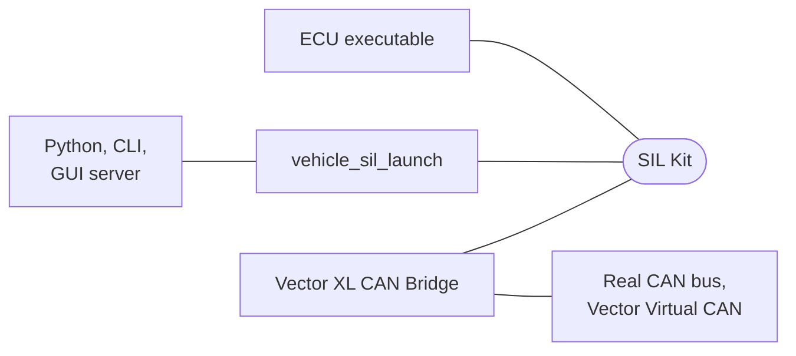
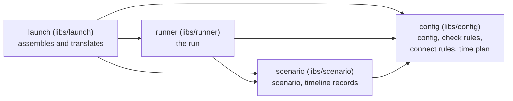
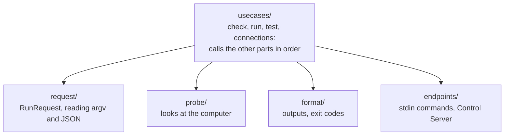
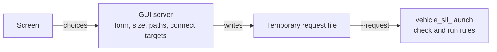

# Architecture

[日本語](ja/architecture.md)

This page describes the overall structure of vehicle-sil (the processes and how they connect), lists the directories and targets, and explains the main classes and the design rules. For threads, ordering, invariants and other details, see the documents in the table under "[Internals](#internals)".

| To find | See |
|---|---|
| Which processes there are and how they connect | [Overview](#overview) |
| What each directory and target contains | [Directories and targets](#directories-and-targets) |
| What the main classes are responsible for | [Main classes](#main-classes) |
| Where code goes, and how time and execution modes are handled | [Design rules](#design-rules) |
| Behavior, threads and ordering in detail | [Internals](#internals) |

## Overview

vehicle-sil is a set of libraries and tools for building peers that simulate in-vehicle communication on Vector SIL Kit. It covers CAN (J1939 and raw CAN), LIN and Ethernet (raw frames). Peers run as separate processes on Windows (MinGW) or Linux. The same ECU code also runs on an in-process virtual bus without SIL Kit.

You build one executable per ECU (`ecu_main()`) and combine the executables into one simulation with a configuration file (`vehicle_sil_launch run`). The launcher hosts the SIL Kit registry and controller in its own process and starts the ECU executables as child processes. You start `manual` participants yourself.



Each line in the diagram is a connection. The table lists what each one carries.

| Connection | What it carries | Details |
|---|---|---|
| ECU and SIL Kit | SIL Kit carries the buses (CAN, LIN, Ethernet) and the synchronization of virtual time. | — |
| ECU variables and the launcher | The ECU's variables (Control Agent) go to the launcher's Hub over SIL Kit publish/subscribe. | [internals/control.md](internals/control.md) |
| Python, CLI and the launcher | The launcher's Control Server (`run --control`) receives operations from outside the simulation through the Control API (gRPC). | [control-api.md](control-api.md) |
| GUI server and the launcher | The GUI server (`gui/server`), a separate process, starts the launcher and, as a Control API client, relays it to the browser screens. | [gui.md](gui.md) |
| Vector XL CAN Bridge and the real CAN bus | The bridge connects them in real time. | [bridges.md](bridges.md) |
| Ethernet Bridge and external Ethernet | `vehicle_sil_ethernet_bridge` forwards frames between SIL Kit Ethernet and external Ethernet. The external interfaces are TAP devices, packet sockets and libpcap on Linux, and Npcap on Windows. | [ethernet-bridge.md](ethernet-bridge.md) |

## Directories and targets

### Directories

```
vehicle-sil/
├── libs/core/        vehicle_sil::core   SIL Kit participant, lifecycle, monitoring of other participants, time gate, bind_host() that connects a host to the participant's steps
├── libs/step/        vehicle_sil::step   Runs a participant's protocol processing in steps (host, virtual-time and real-time drivers, clocks; independent of the bus type and of SIL Kit)
├── libs/lin/         vehicle_sil::lin    LIN master and slave (schedule tables, frame transmission and reception, diagnostic frames, sleep/wakeup), LIN port abstraction, in-process virtual LIN bus (independent of SIL Kit and J1939)
├── libs/lin_silkit/  vehicle_sil::lin_silkit  SIL Kit implementation of the vehicle_sil::lin port (virtual time)
├── libs/can/         vehicle_sil::can    Backend-independent CAN foundation (frames, ports, host on top of vehicle_sil::step, virtual bus; independent of SIL Kit)
├── libs/can_silkit/  vehicle_sil::can_silkit  SIL Kit implementation of the vehicle_sil::can port (virtual time and real time)
├── libs/can_netsim/  vehicle_sil::can_netsim  Simple CAN Network Simulator (SIL Kit Network Simulator API)
├── libs/eth/         vehicle_sil::eth    Foundation for raw Ethernet frames (frames, ports, channel on top of vehicle_sil::step, virtual network; independent of SIL Kit)
├── libs/eth_silkit/  vehicle_sil::eth_silkit  SIL Kit implementation of the vehicle_sil::eth port (virtual time)
├── libs/eth_link/    vehicle_sil::eth_link  External side of the Ethernet Bridge: external interface abstraction, filter, MAC table against loops, Linux TAP devices and packet sockets, pcap libraries loaded at run time (Npcap, libpcap) (independent of SIL Kit)
├── libs/j1939/       vehicle_sil::j1939  J1939 stack (on top of vehicle_sil::can; independent of SIL Kit), its protocol parts (parts/) and typed messages (codec/)
├── libs/ecu/         vehicle_sil::ecu    Ecu, the class that ECU applications are built with (includes variable declarations and describe(), which describes the ECU's configuration, with its JSON; independent of SIL Kit)
├── libs/local/       vehicle_sil::local  LocalBench, which runs ECUs in virtual time on in-process virtual CAN and LIN buses and a virtual Ethernet network (independent of SIL Kit)
├── libs/testkit/     vehicle_sil::testkit  J1939 test recording and fault injection on top of LocalBench (independent of SIL Kit)
├── libs/peer/        vehicle_sil::peer   Setup and execution of one participant with its J1939, raw CAN and LIN nodes and its Control Agent (including the monitoring outputs); implements Ecu
├── libs/simulation/  vehicle_sil::simulation  Simulation, which runs ECUs on a virtual bus or on SIL Kit, and main() for ECU executables (ecu_main)
├── libs/spy/         vehicle_sil::spy  Spy, with which a listen-only participant writes what it hears on J1939 to ECU variables (independent of SIL Kit)
├── libs/process/     vehicle_sil::process  Child processes (output to a log file, capture of stdout and stderr with a timeout, line-by-line delivery, stop requests, ending a whole process tree; POSIX and Win32; internal)
├── libs/config/      vehicle_sil::config  Simulation configuration file and its check against the --describe output of the ECU executables (pure: no process, no SIL Kit; internal)
├── libs/scenario/    vehicle_sil::scenario  Scenario: its file, the engine that steps through it, the timeline record (pure: no process, no SIL Kit; internal)
├── libs/runner/      vehicle_sil::runner  The run of the whole simulation: registry, controller, child processes, Hub, the scenario's steps, time and stop commands (uses SIL Kit and the processes; internal)
├── libs/launch/      vehicle_sil::launch  The use cases of check, run and test, the request, the output of check and run (internal)
├── libs/control/     vehicle_sil::control  Core of the Control Agent and the Control Server (Hub), byte format of the messages between them; independent of the transport and of SIL Kit
├── libs/control_silkit/ vehicle_sil::control_silkit  Layer that carries messages between Agent and Hub over SIL Kit publish/subscribe (AgentTransport, HubTransport)
├── libs/control_grpc/ vehicle_sil::control_grpc  gRPC layer of the Control API (ControlServer for clients; only with VEHICLE_SIL_BUILD_CONTROL_SERVER)
├── proto/            Control API definition (vehicle_sil/control/v1/control.proto)
├── python/vehicle_sil_control/ Python client and CLI for the Control API, helpers that run `vehicle_sil_launch run --control` as a child process
├── bridges/common/  run_bridge(), shared by the bridge executables (stopping, monitoring loop, stop order, exit codes; internal)
├── bridges/can/     CanBridge (shared by the CAN bridges) and ExternalPortAdapter (a target of its own) (portable; internal)
├── bridges/vector-xl/ Vector XL CAN Bridge (channel selection and arguments everywhere; XL backend and executable for Windows only)
├── bridges/ethernet/ Ethernet Bridge (forwarding between SIL Kit Ethernet and the external interface, statistics, argument parsing, executable; built on every platform)
├── tools/common/     Command-line parsing, exit codes and logging shared by the executables (internal, header-only)
├── tools/sim_controller/ System controller that starts and stops virtual-time simulations (vehicle_sil_sim_controller)
├── tools/can_bus_simulator/ Executable of the simple CAN Network Simulator (vehicle_sil_can_bus_simulator)
├── tools/launch/     vehicle_sil_launch, which checks configuration files and runs whole simulations
├── tools/j1939_codegen/ Generator that turns YAML definitions into J1939 typed messages (C++ headers) (Python; vehicle_sil_add_j1939_codec() calls it at build time)
├── examples/getting_started/ First example: two ECUs that take Ecu&, run with Simulation
├── examples/         Examples by task (typed_messages, pid_stream, fault_injection, vehicle, low_level and others; index in examples/README.md)
├── examples/j1939/   Two ECUs built from protocol parts (ecu_pair; runs with Simulation, and the tests use the same code), a parameter service with a custom protocol (param_service) and minimal peers (sender, which sends with a real-time Peer, and receiver, which receives directly with SIL Kit CAN and checks)
├── examples/virtual_time/ Virtual-time peers (physical model on top of Peer, J1939 ECU that hosts an existing tick()-style ECU, LIN master and slave)
├── examples/lin/     LIN cluster peers (a master and slaves with different roles; frame transmission and reception, sleep/wakeup)
├── examples/ethernet/ Two ECUs that send and receive raw Ethernet frames (an example that runs both in one process, and ecu_main executables, a configuration file and a scenario)
├── examples/ecu_main/ One executable per ECU (ecu_main), with a configuration file, scenarios and a dashboard that combine them into one simulation
├── examples/launch_control/ Connecting to the launcher's Control Server from Python (write_before_start.py, pause_and_step.py)
├── examples/gui_client/ Using the GUI server's API from JavaScript
├── examples/gui_starter/ Template for your own screen, served by the GUI server
├── examples/fetchcontent_consumer/   Use from an external project
├── tests/            Unit tests, integration tests, FetchContent tests, fake XL driver (tests/vector_xl/fake_xl)
├── external/         SIL Kit (submodule)
├── patches/          Patches to SIL Kit (applied to the copy in the build tree; in the form for submission upstream)
├── gui/server/       Browser GUI server (Python, vehicle-sil-gui; runs the launcher and provides the HTTP and WebSocket API)
├── gui/protocol/     Specification and examples of the GUI server's HTTP and WebSocket API
├── gui/client/       Client library for the GUI server (TypeScript)
├── gui/web/          Sample screens (Angular)
├── template/         ECU project template (includes get_tools.py, which downloads the prebuilt tools)
├── scripts/          Development and CI scripts (verify.py, package.py and others; "Verification and scripts" in AGENTS.md)
├── cmake/            Dependency inclusion, test registration, boundary checks
└── docs/
```

Do not create empty directories or empty targets.

### Targets

The category tells you where to start.

| Category | Meaning |
|---|---|
| User-facing | Libraries you use directly to write ECUs and to combine them into one simulation. Start with the classes `vehicle_sil::Ecu` and `vehicle_sil::Simulation`. |
| Foundation | Libraries you use through the user-facing libraries. You can also use them directly, but their API changes with the needs of the layers above. |
| Testing | Tools for tests and examples. |
| — | Executables, generated code and the CAN bridge have no category. |

For what each target links (the dependency direction), follow the area-specific dependency diagrams from [code-map.md](code-map.md#find-by-kind-of-information).

| Target | Category | Description | Main types and features | Details |
|---|---|---|---|---|
| `vehicle_sil::sim_base` (header-only) | Foundation | Basic types and functions for virtual time, and whether a registry URI is a loopback address. Used without SIL Kit. | `SimTime`, `SimDuration`, `StepInbox`, `periodic()`, `once_at()`, `is_loopback_registry_uri()` | — |
| `vehicle_sil::core` | Foundation | Manages the SIL Kit participant, the lifecycle, the status of other participants and the virtual-time steps with RAII. Independent of protocols. | `vehicle_sil::ParticipantRuntime`, `SimulationController` (start, stop, pause, single-step and speed of virtual-time simulations), `TickScheduler`, `RealTimePacer`, `vehicle_sil::bind_host()` (connects a `step::Host` to the participant's steps), the `sim_base` types (`SimTime`, `StepInbox`) | [internals/core.md](internals/core.md) |
| `vehicle_sil::step` | Foundation | Runs the protocol processing of one participant in steps. Independent of the bus type and of SIL Kit. | `Member` (one member of a step), `Host` (runs the `Member`s in stage order), `StepDriver` (virtual time), `RealTimeDriver` (real time), clocks (`SteadyRealTimeClock`, and `ManualRealTimeClock` for tests), `TimeDomain` (time domain) | The sections on the host and on driving in [internals/can.md](internals/can.md) |
| `vehicle_sil::lin` | Foundation | LIN master and slave, the interface to the bus and an in-process virtual LIN bus. Used in virtual time. Independent of SIL Kit and J1939. You usually use it through `Ecu::lin_master()` and `Ecu::lin_slave()`. | `vehicle_sil::lin::LinMaster` (schedule tables, frames the master sends, master requests, go-to-sleep and wakeup), `vehicle_sil::lin::LinSlave` (responds with the values set in a step, slave responses, reception of the master's frames, sleep and wakeup), `LinPort`, `VirtualLinBus`, `LinScheduleTable`, `validate_schedule()` | [internals/lin.md](internals/lin.md) |
| `vehicle_sil::lin_silkit` | Foundation | SIL Kit implementation of the `vehicle_sil::lin` port. `Peer` uses it. | `vehicle_sil::lin::SilKitLinPort` | — |
| `vehicle_sil::can` | Foundation | Backend-independent CAN foundation (the layer below the J1939 stack). Independent of SIL Kit. | `vehicle_sil::can::Frame`, `Port` (the port contract), `Steppable`, `Host` (runs several protocol handlers in steps; built on `step::Host`, and the `StepDriver`, `RealTimeDriver` and clocks of `vehicle_sil::step` are available under the same names), a virtual bus for tests (optional simulation of arbitration and transmission time, fault injection and disconnection per ECU), `VirtualCanBus`, `CanBusModel`, `TapPort` (read-only observation of raw frames) | [internals/can.md](internals/can.md) |
| `vehicle_sil::can_silkit` | Foundation | SIL Kit implementation of the `vehicle_sil::can` port (virtual time, and real time without time synchronization). | `vehicle_sil::can::SilKitCanPort`, `vehicle_sil::can::bind_host` (an alias of `bind_host()` in `core`) | — |
| `vehicle_sil::can_netsim` | Foundation | Simple CAN Network Simulator. Uses the SIL Kit Network Simulator API to simulate CAN arbitration, transmission time and bus load in virtual time. | `CanBusSimulator`, reading of a configuration file shared with the Vector SIL Kit Network Simulator | [internals/can.md](internals/can.md) |
| `vehicle_sil::eth` | Foundation | Foundation for raw Ethernet frames (from the destination address to the end of the payload, without FCS). Does not interpret the EtherType or the payload. Independent of SIL Kit. | Frame and MAC address types, the port contract, `Channel` (a `step::Member` through which the application sends and receives within a step; orders frames of the same time by source address), `VirtualEthernetBus` (an in-process virtual network that behaves as a hub) | [internals/ethernet.md](internals/ethernet.md) |
| `vehicle_sil::eth_silkit` | Foundation | SIL Kit implementation of the `vehicle_sil::eth` port (virtual time). | `vehicle_sil::eth::SilKitEthPort` | — |
| `vehicle_sil::j1939` | User-facing | The J1939 stack (namespace `vehicle_sil::j1939`, headers in `vehicle_sil/j1939/`). Independent of SIL Kit. | Single-frame transmission and reception, Request, Acknowledgement, NAME and Address Claim (claiming, contention, Cannot Claim, choice of an arbitrary address, address table, address violation, handling of Commanded Address, status notification), transport protocol (BAM, RTS/CTS), the toolbox for building protocol parts (`Subscription`, `Timer`, `Node::attach`), read-only observation (`Observer`), `vehicle_sil::j1939::Network`, `Node`, `Pgn`, `Identifier` | [internals/j1939.md](internals/j1939.md) |
| `vehicle_sil::j1939_broadcast_suppression`, `vehicle_sil::j1939_diagnostics` | User-facing | Protocol parts built only from the public API and the toolbox of `vehicle_sil::j1939`. | Broadcast suppression with DM13, DTCs and DM1/DM2/DM3/DM11/DM22, identification (software ID, ECU ID, product ID, diagnostic protocol ID), `BroadcastSuppression`, `Diagnostics`, `Identification` | [internals/j1939.md](internals/j1939.md) |
| `vehicle_sil::j1939_periodic_sender`, `vehicle_sil::j1939_requester`, `vehicle_sil::j1939_monitor`, `vehicle_sil::j1939_address_commander`, `vehicle_sil::j1939_exchange` | User-facing | Protocol parts for ECU applications, also built only from the public API and the toolbox. | `PeriodicSender` (periodic transmission of a PG), `Requester` (sends a Request and reports the response, ACK or timeout), `Monitor` (latest received value and message loss), `AddressCommander` (sends Commanded Address), `Exchange` (commands and responses of a custom protocol; for an example, see [examples/j1939/param_service](../examples/j1939/param_service)) | Usage: [j1939-guide.md](j1939-guide.md); internals: [internals/j1939.md](internals/j1939.md) |
| `vehicle_sil::j1939_codec` (header-only) | User-facing | J1939 typed messages. From PGs and signals defined in YAML, `vehicle_sil_add_j1939_codec()` generates C++ types at build time, so you send and receive signals as values without writing bit operations. | What you can define (position, sign, scaling, range, enumerations, Proprietary A/B, named special values and their profiles, fill values), `codec.hpp`, `PeriodicSender`, `codec_node.hpp` | Usage: [j1939-codec.md](j1939-codec.md); internals: [internals/j1939.md](internals/j1939.md) |
| `vehicle_sil::ecu` | User-facing | `vehicle_sil::Ecu`, the class that ECU applications are built with. `Peer` and the ECUs of `LocalBench` implement it, so a class that takes `Ecu&` runs with the same code on a virtual bus and on SIL Kit. Independent of SIL Kit. | The J1939 `Network`, raw CAN channels (`can::RawChannel`, for protocols other than J1939), LIN master and slave (`lin_master()`, `lin_slave()`), channels for raw Ethernet frames (`ethernet()`; `eth::Channel`), variables that are read and written from outside the simulation (`input`, `output`, the ECU's Control Agent `agent()`), per-step work (`on_step`, `every`, and `at` for a one-time action at a given time), objects the ECU owns (`emplace`), the JSON that describes the ECU's configuration (`describe()`; the `--describe` output), `EcuDescription`, `to_json()`, `detail::OwnedObjects`, `detail::EcuAgent` | [internals/execution.md](internals/execution.md), [ecu-executable.md](ecu-executable.md) |
| `vehicle_sil::local` | Foundation | `vehicle_sil::LocalBench` runs ECUs without SIL Kit on in-process virtual buses (CAN, LIN, Ethernet) and advances virtual time on the calling thread. The local execution of `Simulation` uses it too. | `LocalBench` (sets up ECUs (`Ecu`) on virtual buses and their `Network`s by name) | [internals/execution.md](internals/execution.md) |
| `vehicle_sil::testkit` | Testing | J1939 test tools on top of `LocalBench`. | Recording of events and raw frames (`J1939Events`, `FrameLog`), fault injection functions (`faults`), `testkit::LocalCan` (an alias of `LocalBench`) | [internals/execution.md](internals/execution.md) |
| `vehicle_sil::peer` | Foundation | `vehicle_sil::Peer` creates one SIL Kit participant with its nodes and runs it in virtual time or in real time. Implements `Ecu`. | The J1939 `Network` (SIL Kit CAN or an external port), raw CAN, LIN master/slave, Ethernet channels (SIL Kit Ethernet; virtual time only), the Control Agent (including the monitoring outputs of the J1939 communication status), `start_together()` | [internals/execution.md](internals/execution.md) |
| `vehicle_sil::simulation` | User-facing | `vehicle_sil::Simulation`, which runs ECUs in virtual time on an in-process virtual bus or as SIL Kit participants and reports failures as exceptions, and `ecu_main()`, which turns an ECU class into an executable. | The constructor selects where to run (with SIL Kit, the registry can run in the same process), every ECU takes the same `ecu_main()` arguments (`--describe`, `--registry-uri`, `--local`), `SilKitOptions`, `SimulationError`, `EcuMainOptions` | Introduction: [examples/getting_started](../examples/getting_started); [ecu-executable.md](ecu-executable.md), [internals/execution.md](internals/execution.md) |
| `vehicle_sil::spy` | User-facing | `vehicle_sil::spy::Spy`, with which a listen-only participant writes what it hears on J1939 to ECU variables. Built only from the public APIs of `vehicle_sil::j1939` and `vehicle_sil::ecu`. Independent of SIL Kit. | Creates a `j1939::Listener` on a `Network` (or borrows one), passes a `spy::Scope` (variable prefix, registering and removing handlers, the step time) to the watcher classes that you write, and also writes the counts of missed traffic to variables | [j1939-guide.md](j1939-guide.md#listen-only-participants) |
| `vehicle_sil_sim_controller` (executable) | — | CLI of the system controller. | — | — |
| `vehicle_sil::process` (internal) | — | Starts and manages child processes (see the paragraph below the table). | `ChildProcess` (output to a log file), `run_captured()` (captures stdout and stderr separately and stops the child on timeout), `Process` (delivers stdout and stderr line by line; working directory, stop requests, ending the started process and every process of its group (on Windows, its job)) | — |
| `vehicle_sil::launch` (internal; when SIL Kit is built from the submodule) | — | The core of the launcher: reads configuration files, checks them and runs whole simulations. | Reading of the `--describe` JSON, check rules (functions that start no process), running (hosts the registry and `SimulationController` in its own process and runs the participants as child processes; the decisions about the run are functions that start no process), human-readable and JSON output | [simulation-config.md](simulation-config.md) |
| `vehicle_sil_launch` (executable) | — | `vehicle_sil_launch check` and `vehicle_sil_launch run`. A build with `-DVEHICLE_SIL_BUILD_CONTROL_SERVER=ON` also has the Control Server of `run --control`. | — | [simulation-config.md](simulation-config.md), [simulation-check.md](simulation-check.md), [simulation-run.md](simulation-run.md) |
| `vehicle_sil::control` | User-facing | The ECU's Control Agent, and `Hub`, the core of the Control Server. | `vehicle_sil::control::Agent` (exposes variables with type, range and unit; applies writes from outside the simulation within a step, at a specified virtual time; fixed-capacity queues; the ECU owns and runs it and declares variables with `Ecu::input()` and `output()`), `Hub`, `wire` | [internals/control.md](internals/control.md) |
| `vehicle_sil::control_silkit` | User-facing | The layer that carries messages between the Control Agent and `Hub` over SIL Kit publish/subscribe. ECUs built with `ecu_main()` and `vehicle_sil_launch run` use it. It needs no gRPC. | `vehicle_sil::control_silkit::AgentTransport`, `HubTransport` | [internals/control.md](internals/control.md) |
| `vehicle_sil::control_proto` (with `VEHICLE_SIL_BUILD_CONTROL_SERVER`) | — | Code generated from `control.proto` (internal to `control_grpc`). | — | — |
| `vehicle_sil::control_grpc` (same condition) | User-facing | The Control API (gRPC) server, for clients. ECU Agents connect through SIL Kit with `vehicle_sil::control_silkit`. `vehicle_sil_launch run --control` uses it. | `vehicle_sil::control_grpc::ControlServer`, `time_control_of()`, authentication (TLS, tokens, roles) | [control-api.md](control-api.md) |
| `vehicle_sil::bridge_runtime` (internal) | — | `vehicle_sil::bridge_runtime::run_bridge()`, which the bridge executables call after their setup. Platform-independent. | How stop requests are received (signals, closing the Windows console), the monitoring loop (evaluating the participant status, failures of the external side, warnings, health lines), the stop order (statistics are printed before the SIL Kit participant stops), exit codes, `BridgeHooks` (passes in the parts specific to each bridge) | [bridges.md](bridges.md) |
| `vehicle_sil::can_bridge_core` | — | The part of a CAN bridge that does not depend on its external side. Platform-independent. | `vehicle_sil::can_bridge::CanBridge` and others, `ExternalCanPort` | — |
| `vehicle_sil::can_external` | `vehicle_sil::can_bridge_core`, `vehicle_sil::can`, `vehicle_sil::can_silkit` | `ExternalPortAdapter` for a protocol stack placed directly on an external CAN port. The CAN bridges do not link it. Platform-independent. | `vehicle_sil::can_bridge::ExternalPortAdapter` (turns an external CAN port into a real-time `vehicle_sil::can` port) | — |
| `vehicle_sil::vector_xl` (Windows only) | — | The Vector XL Driver backend. Windows only; requires the XL Driver Library. | `vehicle_sil::vector_xl::XlDriver`, `XlCanPort` | — |
| `vehicle_sil_vector_xl_bridge` (Windows only, executable) | — | CLI of the bridge. | — | — |
| `vehicle_sil::eth_link` | — | The external side of the Ethernet Bridge. Independent of SIL Kit. | `vehicle_sil::eth_link::ExternalLink` (external interface abstraction), `FrameFilter` (filter), `MacSideTable` (loop prevention), `make_tap_link()` and `make_packet_link()` (OS interfaces; Linux only), `make_pcap_link()` (pcap libraries; loads Npcap on Windows and libpcap on Linux at run time) | [ethernet-bridge.md](ethernet-bridge.md) |
| `vehicle_sil::ethernet_bridge_core` | — | `vehicle_sil::ethernet_bridge::EthernetBridge`, which carries frames between SIL Kit's `IEthernetController` and an `ExternalLink`. Platform-independent. | Statistics and health lines, argument parsing, the startup line | — |
| `vehicle_sil_ethernet_bridge` (executable) | — | CLI of the Ethernet Bridge. Built on every platform. The external interfaces are `tap`, `packet` and `pcap` on Linux, and `npcap` on Windows. | — | — |

The children of `run_captured()` and `Process` in `vehicle_sil::process` run in their own process group (on Windows, a process group and a job object) and inherit no handles other than the three standard ones. On Linux they receive SIGKILL when the calling thread ends. Processes are started with `fork` and `exec` on POSIX (`posix_spawn` for `ChildProcess`) and with `CreateProcessW` on Windows (paths and arguments are converted from UTF-8).

Consumers link only the targets they need. Dependencies are added with `EXCLUDE_FROM_ALL`, so a library you do not link is not built. This also applies to the vehicle-sil libraries when you include vehicle-sil from an external project.

## Main classes

| Class | Responsibility |
|---|---|
| `vehicle_sil::ParticipantRuntime` | Owns the SIL Kit participant, the lifecycle (autonomous or coordinated), SystemMonitor and time synchronization (optional) with RAII. It can wait until other participants reach a status (Running, or ended). |
| `vehicle_sil::SimulationController` | System controller for simulations started in coordinated mode. It starts all participants together once the required participants are present, and stops them at a given virtual time. |
| `vehicle_sil::StepInbox` | Holds messages received on the SIL Kit thread until the step boundary and delivers them in a fixed order. |
| `vehicle_sil::TickScheduler` | Calls fixed-period tasks (such as the `tick()` of an existing ECU) from the steps of one participant. |
| `vehicle_sil::RealTimePacer` | Computes the wait that couples virtual time to the wall clock at a fixed ratio. |
| `vehicle_sil::Ecu` | The class that ECU applications are built with (J1939 `Network`, raw CAN, LIN master and slave, per-step work, objects the ECU owns). `Peer` and the ECUs of `LocalBench` implement it ([internals/execution.md](internals/execution.md)). |
| `vehicle_sil::Simulation` | Runs `Ecu`s on a virtual bus or in SIL Kit virtual time and reports failures with `SimulationError` ([internals/execution.md](internals/execution.md)). |
| `vehicle_sil::Peer` | Sets up and runs one participant with its J1939 `Network`, LIN master and slave and per-step application work, and tears them down in the correct order. Implements `Ecu` ([internals/execution.md](internals/execution.md)). |
| `vehicle_sil::lin::LinMaster` | Executes a LIN schedule table in virtual time and returns the result of each header (colliding responses are Error). Sends the master's own frames, diagnostic master requests, go-to-sleep commands and wakeup pulses. |
| `vehicle_sil::lin::LinSlave` | Responds to the master's headers with the values set in a step (a diagnostic slave response only once), receives the frames the master sends, and manages the sleep and wakeup state. |
| `vehicle_sil::lin::LinPort` | The only interface through which a LIN node accesses the bus. Its implementations are the endpoint of `VirtualLinBus` and `SilKitLinPort`. |
| `vehicle_sil::lin::VirtualLinBus` | An in-process LIN bus. It delivers synchronously within the sender's call. `LocalBench` creates one for each LIN network name. |

For the guarantees of `ParticipantRuntime`, the order of ownership and shutdown, and threads and queues, see [internals/core.md](internals/core.md).

## Design rules

### Rules for shared code

Which library each kind of processing goes into:

| Processing | Where it goes |
|---|---|
| Processing that is the same for every protocol (connection to SIL Kit, lifecycle, monitoring of other participants, virtual time (steps, receive buffering, periodic tasks, coupling to real time, time gate), the failure check `FailureCheck`) | `core` |
| External operation (Control Agent and Hub) | `control` (the time operations of the Control API use the time gate in `core`) |
| The machinery that runs steps (host, drivers, clocks, time domains) | `step`, which does not depend on the bus type |
| The protocol processing of each bus, together with its port | The library of that bus (`can`, `eth`), as a `step::Member` on the host (`eth::Channel` is itself a `step::Member`) |
| Bus controllers (`ICanController` and others) | The consumer creates them with the SIL Kit API from `ParticipantRuntime::participant()`. |
| J1939 and LIN protocol processing | Not shared. |

`core` does not depend on CAN, LIN or J1939.

LIN is not on the host. The order within one step is currently "application → LIN `step(now)` → variable reads → CAN transmission". If LIN moved to the transmit stage of the host, the values written by LIN handlers would be read one step later. LIN ports have no receive buffer and run in virtual time only.

Do not create abstract classes or empty implementations only for future use.

### How time is handled

- Real time (wall clock) and simulation time (SIL Kit virtual time) are distinguished by type and name (`SimTime`).
- Time management lives in `core`. It is not embedded in the J1939 or LIN internals.
- Pause and single-step use the time gate of `SimulationController`, and the Control API operates that gate (see "Pause, step and speed (time gate)" in [internals/virtual-time.md](internals/virtual-time.md#pause-step-and-speed-time-gate)).

Messages sent reactively from a receive handler are outside SIL Kit's delivery guarantee. To run a new protocol in virtual time, send within the step, or, as LIN does, establish an upper bound on arrival before you rely on it.

### Execution modes and communication backends

- The execution mode (virtual time or real time; `PeerOptions::virtual_time`) and the bus connection (a SIL Kit port, or a port you pass in, such as `ExternalPortAdapter` of Vector XL) are chosen independently.
- Real time also works entirely within SIL Kit (the minimal J1939 peer `examples/j1939/sender`).
- To pace virtual time to the wall clock, use the peer's `VirtualTimeOptions::real_time_factor` or the speed of the time gate (see "Coupling to real time" in [internals/virtual-time.md](internals/virtual-time.md#coupling-to-real-time)).
- Physical CAN and Vector Virtual CAN run in real time and do not take part in virtual-time simulations (see "Physical CAN and virtual time" in [bridges.md](bridges.md#physical-can-and-virtual-time)).

### Layers in `libs/launch`

`libs/launch` assembles and translates: it calls the layers below it in order and writes what they found as output. It holds no judgement (whether a configuration is valid, whether something can be done now, whether a run passed); that lives in `config`, `scenario` and `runner`. The libraries and the parts of `launch` are drawn apart, one picture each.

The four libraries (`process`, `control_grpc` and the others are left out):



The five parts of `libs/launch/src` (the public headers in `include/vehicle_sil/launch/` stay flat and belong to the part that implements them: `request.hpp` to `request/`, `probe.hpp` to `probe/`, `events.hpp`, `error_result.hpp` and `timeline_format.hpp` to `format/`, `command_input.hpp` to `endpoints/`, and `run.hpp`, `checked.hpp`, `connections.hpp` and `test.hpp` to `usecases/`):



| Part | Holds | Does not include |
|---|---|---|
| `usecases/` | `check_file()`, `list_connections()`, `run_file()`, `run_tests()`: probe, then the rules, then the plan, then the runner, then the output | (no limit) |
| `request/` | `RunRequest`, reading a request file, the rules about fields that do not go together | `runner`, `scenario`, `process`, SIL Kit, any other part, the headers of the use cases |
| `probe/` | Looking at the computer (files, environment, the tools it starts); returns values. Also the file of saved descriptions that `check --write-descriptions` writes | `runner`, SIL Kit, the outputs, the endpoints, the use cases |
| `format/` | The outputs of check, run, test, events, timeline and connections (JSON and text), the table of exit codes | `probe.hpp`, SIL Kit, `control_grpc`, the endpoints, the use cases |
| `endpoints/` | The commands on standard input and the Control Server, as calls on the run's controls | `probe.hpp`, the outputs of check, run and timeline (`*_format.hpp`) |

- `endpoints/` may read the configuration's value types and its YAML reader (`config/detail/`): the commands on standard input are YAML or JSON, and `parse_command()` in `command_input.cpp` reads them there, not in `format/` (which writes). The Control Server uses the run's controller and SIL Kit's types, because it stops the simulation and checks failures; only the Control Server's file does, and only with `VEHICLE_SIL_BUILD_CONTROL_SERVER`.
- What the launcher finds out from the computer (the file system, the environment, the output of the processes it runs) goes into `probe/`. The use cases call it and pass what it found to the rules as values or as functions. The runner does not use `probe` (it takes the check that passed).
- One test for each of `request/`, `probe/`, `format/` and `endpoints/` guards the direction: `launch.request_boundary`, `launch.probe_boundary`, `launch.format_boundary` and `launch.endpoints_boundary` (`cmake/VehicleSilCheckIncludes.cmake` with `DIR`, `FORBIDDEN_PREFIXES` and `ONLY_PREFIXES`, in `tests/launch/CMakeLists.txt`). They read the files of the part and its public headers, and the headers those include. The private headers between the parts are included with the part's directory (`"format/check_format.hpp"`), so a forbidden prefix ending in `/` names a part. `launch.parts_include_check_rejects_a_forbidden_include` shows that the check rejects a file that reaches a forbidden header, also through a private header of another part. A new file goes into the directory of its part and needs no entry; a file that would break the direction is moved or split, not listed as an exception.
- The configuration and its check are the library `vehicle_sil::config` (`libs/config`). It links neither `core` nor `control_silkit`, includes nothing of `vehicle_sil/launch/`, nor `process.hpp` or `child_process.hpp` of `process`. The link does not show all of that (a header of `core` that needs no SIL Kit compiles, and `process` is linked for `paths.hpp`), so two tests read the directory: `config.no_silkit_boundary` (`cmake/VehicleSilCheckNoSilKit.cmake`) and `config.includes_no_runtime` (`cmake/VehicleSilCheckIncludes.cmake` with `DIR` and `FORBIDDEN_PREFIXES`). A new file in `libs/config` needs no entry.
- The scenario is the library `vehicle_sil::scenario` (`libs/scenario`). It links `config`, `control` and `sim_base`, and neither `core` nor `control_silkit`. It is guarded the same way (`scenario.no_silkit_boundary`, `scenario.includes_no_runtime`: no header under `vehicle_sil/launch/`, no `child_process.hpp` or `process.hpp`), and `config.includes_no_runtime` also keeps `libs/config` from including `vehicle_sil/scenario/`.
- The run is the library `vehicle_sil::runner` (`libs/runner`). It links `scenario`, `config`, `control`, `process` and `sim_base` publicly, and `core` and `control_silkit` privately: the SIL Kit parts of a run are behind `RunnerImpl`, so no public header of the library (`vehicle_sil/runner/`) reaches SIL Kit, and `launch` links `core` only for the Control Server. It includes nothing of `vehicle_sil/launch/`, which depends on it. Two tests read the directories: `runner.public_headers_need_no_silkit` (`cmake/VehicleSilCheckNoSilKit.cmake` on `libs/runner/include`) and `runner.includes_no_launcher` (`cmake/VehicleSilCheckIncludes.cmake` with `ONLY_PREFIXES`, because the runner itself uses the process and SIL Kit headers that the check forbids by default). `runner.pure_files_include_no_runtime` keeps the plain data and rules of a run (`command.hpp`, `traffic.hpp`, `control_rules.*`) free of SIL Kit, process, run and event headers. `config.includes_no_runtime` and `scenario.includes_no_runtime` also keep their libraries from including `vehicle_sil/runner/`.
- The namespace of a library has the name of the library: `vehicle_sil::config`, `vehicle_sil::scenario`, `vehicle_sil::runner` and `vehicle_sil::launch` (what the scenario file reader keeps for itself is `vehicle_sil::scenario::reader`). A type tells which layer it belongs to by its name, and a layer above names what a layer below declares with the namespace (`config::SimulationConfig`). Headers write no `using namespace`; a test file may add one line for the unit it tests. A function found through the type of its argument (`operator==`, `to_string()`) is called without the namespace.
- The check of the configuration (`config/check.hpp`, `CheckReport`) does not know the scenario: the scenario depends on the configuration, not the other way round. What `check --scenario` read is `ScenarioCheck` (`scenario/scenario_check.hpp`), and `check_file()` returns it with the `CheckReport` as `Checked` (a `CheckReport` plus the scenario; copying it into a `CheckReport` drops the scenario, so take the result as a `Checked`) (`launch/checked.hpp`). The test `launch.config_files_do_not_reach_the_scenario` keeps `connections.hpp` from including the scenario, and `launch.request_boundary` does the same for the request.
- One exception is left: `bridge_working_directory()` in `connect.cpp` makes a relative directory absolute.
- Do not add code that looks at the computer outside `probe/`. Put it there and pass the result in. The files of each part are listed in [code-map-launcher.md](code-map-launcher.md).

### How a run is planned, observed and closed

The details of each part are in [code-map-launcher.md](code-map-launcher.md); this section keeps the shape and the promises.

- A run has two stages. `Runner::prepare()` checks for an interruption, opens the logs and the timeline, and returns the Hub of the run (or nothing, if the run cannot go on). Between the stages `run_file()` starts the Control Server (`ControlEndpoint::start()`, only when the run has one) on that Hub, so that it listens before the registry does. `Runner::run()` goes from the registry to the end.
- The run makes the Hub and the SIL Kit parts (registry, controller, transport) and closes them as one connection, in the reverse order of making: the transport, the controller, then the registry. The Control Server only borrows the Hub (it holds a `std::shared_ptr` and does not own the SIL Kit parts). A closing thread that was left at its limit therefore reaches only the connection, and the `Runner` can be destroyed as after any other run.
- `run_file()` sees the `Runner` through `runner/detail/runner.hpp`, which reaches no SIL Kit header, no header of the controller (`core/simulation_controller.hpp`) and none of the run's private headers: the parts of the run are behind a pointer (`RunnerImpl`, `src/runner_impl.hpp`).
- What `run_file()` gives to a run is of three kinds:
  - `RunPlan`: values, made by the pure `plan_run()` from the check that passed, its scenario, what was chosen for the run (`RunChoices`, which `run_choices()` copies from the request) and `RunLimits`. `plan_run()` does not know the request (`RunRequest`) or `check_file()`'s result type (`Checked`). The run does not write to the plan.
  - `RunObservers`: the caller's functions that the run calls back (lines, the name of an interruption, `before_start`).
  - `RunControls`: what the run borrows (the stop requests, the time commands) or makes for itself.

  The stream of the events (`RunLent::events`) is `run_file()`'s: it writes the check there itself, and the phases and the state when it makes its own controls (with lent controls, the caller's observers write them), and gives the run only the interface the run knows (`RunEvents`).
- What a check, a run or a test is asked to do is one value, `RunRequest` (`launch/request.hpp`), in two parts: the user's choices (`RunIntent`) and the caller's (`RunHost`: where the tools and logs are, the limits, whether it asks for a Control Server or for commands on standard input). `check_file()`, `run_file()` and `test_file()` take it; the command line and a request file are two ways to fill it. `validate_request()` (pure) is the one place for the rules about fields that do not go together. `tools/launch` only turns arguments into fields, so a `cli::UsageError` there means a malformed argument, never a rule about meaning.
- `--request <file>` reads the intent from a JSON file (`schema/run-request.schema.json`). There is one reader of the format (`read_request_file()`); an argument wins over the file field by field. Messages name the file when a value came from it.
- The bridges that `--connect` adds are marked in the plan (`RunMember::outside`, one `RunMember` for each participant). `ParticipantConfig` keeps only what the file says. The step plan is made from the configuration of the file, before the bridges are added.
- What a run saw is a `RunOutcome` in parts: `setup`, `start`, `end`, `control`, `scenario` and `close`, then `timing`, `participants` and the rest. Its shape is not the shape of the JSON output: `format_run_json()` writes the JSON, and `assess_run()` judges the outcome. Why the run ended is `end_reason()` of the outcome (`EndReason`: what asked first to stop decides between stopped and interrupted). The exit code and whether the result is a success come from one table (`libs/launch/src/format/exit_codes.hpp`, used by `RunReport::exit_code()`, `RunReport::ok()`, `check_exit_code()` and `ConnectionsReport::exit_code()`); the sentence for people is `RunReport::message()`, next to `RunReport::result()` in `libs/launch/src/format/run_report.cpp`.
- The exit codes: 0 for a pass or a stop by the operator, 1 for a failure, 3 for an unreadable file or a setup that failed, 4 for a usage error (also a request file that cannot be read), a code of its own for a scenario that was cut short and for an interruption.
- The code of the Control Server is in `libs/launch` (`src/endpoints/control_server.cpp`, built only with `VEHICLE_SIL_BUILD_CONTROL_SERVER=ON`; no public header of the library includes gRPC's). `run_file()` makes the server from what the request names for `--control` (`RunHost::control`), starts it and ends it; the caller destroys it after the result. `tools/launch` only copies the arguments into the request.

### How the GUI server hands a run to the launcher



- The GUI server writes the choices of the screen as a request file (readable by the user only, removed when the launcher has ended) and starts `check` or `run` with `--request`. It builds no other launcher option for them.
- The server checks only the form and size of a field, that a path stays under its root, and that a `connect` target was listed as usable by `POST api/connections` (`target-not-listed`). Every rule about meaning (the variant exists, the participant exists, the fields go together) is the launcher's check, and the server shows its findings.
- `POST api/connections` runs `connections --json` for one network of a file and keeps the usable targets. This list is what a later check or run may name, so a screen cannot pass a device that the launcher did not find on this computer.

## Internals

When you change vehicle-sil, or look up behavior and limitations, read only the document that covers it.

| Document | Contents |
|---|---|
| [internals/core.md](internals/core.md) | Guarantees of `ParticipantRuntime`, order of ownership and shutdown, threads and queues, time in real-time mode |
| [internals/can.md](internals/can.md) | CAN foundation: ports, events, `Steppable`, host, drivers, virtual bus, `TapPort`, SIL Kit port, bus timing, simple CAN Network Simulator |
| [internals/j1939.md](internals/j1939.md) | J1939 stack: engine, Address Claim, transport protocol, toolbox, protocol parts, typed messages, `Observer`, resource limits, known limitations |
| [internals/lin.md](internals/lin.md) | LIN master and slave, schedules, diagnostic frames, sleep and wakeup, ports and the virtual LIN bus |
| [internals/ethernet.md](internals/ethernet.md) | Ethernet foundation: frames, ports, channels (receive order, time, limits, filter), virtual network, SIL Kit port (senders without time synchronization), unverified values |
| [internals/execution.md](internals/execution.md) | `Ecu`, `Simulation`, `Peer`, `LocalBench` and the test kit (order within one step, ownership and destruction, disconnection from the bus) |
| [internals/virtual-time.md](internals/virtual-time.md) | Shared virtual time: how it advances, coupling to real time, time gate (pause, single-step, speed, lateness), receive order, integration of fixed-period `tick()` |
| [internals/control.md](internals/control.md) | Internals of the Control API: Control Agent, Hub, the SIL Kit transport, Control Server, the launcher's Control Server, scenarios |
| [bridge-contract.md](bridge-contract.md) | What the launcher and every bridge agree on: arguments, `--describe`, lists of devices, exit codes, the lines a bridge prints, the mark on a device, a bridge of your own |
| [bridges.md](bridges.md) | Vector XL CAN Bridge: first connection, forwarding behavior, bus monitoring, threads, test coverage |
| [ethernet-bridge.md](ethernet-bridge.md) | Ethernet Bridge: first connection, backends (`tap`, `packet`, `pcap`, `npcap`) and permissions, external interfaces, forwarding, filter, loop prevention, statistics and health lines, arguments, what was verified |

## See also

- Where things are: [code-map.md](code-map.md)
- SIL Kit pinning, patches, upstream behavior, gRPC: [dependencies.md](dependencies.md)
- Building, and including vehicle-sil in your own CMake project: [build.md](build.md)
