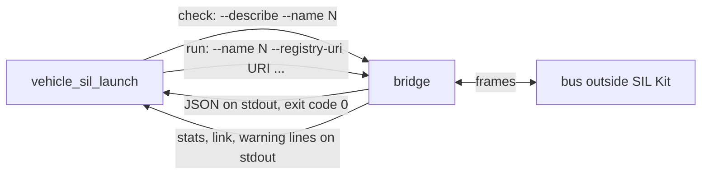

# Bridge process contract

[日本語](ja/bridge-contract.md)

A bridge is a process that joins one SIL Kit network to a bus outside SIL Kit. `vehicle_sil_launch` starts the bridges of this repository when you give it `--connect`, and starts a bridge of your own when the configuration file lists it with `role: bridge`. This page is what the launcher and a bridge agree on: the arguments, `--describe`, the lists of devices, the exit codes, the lines the bridge prints, and the mark that tells other bridges a device is in use. Each bridge's own page says only what is particular to that bridge.

| You want to | Read |
|---|---|
| Write a bridge of your own | All of this page, then "[Starting a bridge of your own](#starting-a-bridge-of-your-own-role-bridge)" first |
| Write a script that reads a bridge's output | "[Lines the bridge prints](#lines-the-bridge-prints)" and "[Lists of devices](#lists-of-devices)" |
| Change one of the three bridges | This page and the page of that bridge; `bridges/common` holds the code they share (see [code-map-bridges.md](code-map-bridges.md)) |

| Executable | Network kind | Page | Tag of its lines | Key of its link line |
|---|---|---|---|---|
| `vehicle_sil_ethernet_bridge` | `ethernet` | [ethernet-bridge.md](ethernet-bridge.md) | `[eth-bridge]` | `link` |
| `vehicle_sil_vector_xl_bridge` | `can` | [bridges.md](bridges.md) | `[bridge]` | `bus` |
| `vehicle_sil_socketcan_bridge` | `can` | [socketcan-bridge.md](socketcan-bridge.md) | `[bridge]` | `bus`, `link` |



What the launcher does with what it reads (the counts, the findings, the times) is in [simulation-run.md](simulation-run.md#connecting-a-bus-outside---connect). This page does not repeat it.

## Arguments

The launcher passes these. A bridge takes them whatever else it takes.

| Argument | When | Meaning |
|---|---|---|
| `--network <name>` | `--connect` | The SIL Kit network the bridge joins. For a `role: bridge` participant the launcher does not add it: write it in `command`. |
| `--name <name>` | `--describe` and run | The participant name. With `--connect` it is `bridge.<network>`; for a `role: bridge` participant it is the name in the file. `--participant <name>` is the same (give one of them). |
| `--registry-uri <uri>` | Run | The SIL Kit registry. `--describe` and the lists do not need it. |
| `--start-timeout-ms <ms>` | Run | How long `start()` waits for the participant to reach Running (1 to 10^12, default 15000). Past it, the bridge ends with exit code 3 and the line `FAIL setup: SIL Kit lifecycle of '<name>' did not reach Running within <ms> ms, state: <state>`. This is not the 15000 ms of "[Participant state while running](#participant-state-while-running)", which is fixed. |
| `--stats-every-ms <ms>` | Run with `--connect` (1000) | Print the statistics line while running (100 to 3600000). See "[Statistics line](#statistics-line)". |
| `--describe` | `check` | Write what the bridge is and exit. See "[`--describe`](#--describe)". |
| `--list-interfaces --backend <backend> --json` | `connections`, Ethernet | The list of devices. `--backend` is optional by hand: without it the bridge takes the default of the OS (`packet` on Linux, `npcap` on Windows). The launcher always gives it. |
| `--list-channels --json` | `connections`, CAN | The list of devices. |
| The arguments of the device | `--connect` | Which device to open, for each bridge as in the table below. See the page of the bridge, and "[The arguments that the launcher gives the bridge](simulation-config.md#--connect)". |

What `--connect` gives each bridge for the device, after `--network <name>`:

| Executable | Arguments for the device |
|---|---|
| `vehicle_sil_ethernet_bridge` | `--backend <backend> --interface <name>`, then one filter: `--all-frames`, or `--ethertype <list>`, or else `--src-mac <list>` (the MAC addresses of the network's nodes; left out when there are none) |
| `vehicle_sil_vector_xl_bridge` | `--xl-target <target> --xl-channel <number>`, and `--bitrate <bit/s>` when the network has one |
| `vehicle_sil_socketcan_bridge` | `--interface <name>`, and `--bitrate <bit/s>` when the network has one |

An argument error ends the bridge with exit code 4 and 2 lines on stderr: `error: <what is wrong and how to fix it>`, then `Run '<executable> --help' for the options.` `--help` prints the full usage. The launcher shows the line that starts with `error:` or `FAIL` as the reason in its finding `connect-tool-failed`.

## `--describe`

`--describe` writes what the bridge is, as the JSON that an `ecu_main` executable writes for `--describe` (see "[JSON format](ecu-executable.md#json-format)" in [ecu-executable.md](ecu-executable.md)), and exits with code 0. It checks its arguments as for a run (an error is exit code 4), but it opens no device, loads no device library and does not connect to SIL Kit, so `check` works on a computer without the device.

```json
{
  "vehicle_sil_ecu": 1,
  "vehicle_sil": "<version>",
  "name": "bridge.ETH_EXT",
  "step_ns": null,
  "networks": [
    {
      "name": "ETH_EXT",
      "kind": "ethernet",
      "use": "ethernet",
      "nodes": [],
      "mac": null
    }
  ],
  "variables": [],
  "control": null,
  "features": []
}
```

| Key | Value for a bridge |
|---|---|
| `vehicle_sil` | The version of vehicle-sil the bridge was built from. |
| `name` | The `--name` it was given. |
| `step_ns` | `null`: a bridge runs in real time and takes no part in time synchronization. |
| `networks` | One network, the one of `--network`. `kind` is `can` or `ethernet`; `use` is `raw` for `can` and `ethernet` for `ethernet`; `nodes` is empty and `mac` is `null`. |
| `variables`, `features` | Empty arrays. |
| `control` | `null`. |

The launcher requires only `vehicle_sil_ecu` (it must be 1), `name`, `step_ns` and `networks`, and in each network `name`, `kind`, `use` and `nodes`. `vehicle_sil` is needed for a bridge from `--connect` (below). The other keys may be left out; a bridge of your own can print just these.

A bridge started by `--connect` must say its version: the launcher compares `vehicle_sil` with its own, and a bridge built from another vehicle-sil, or one that gives no version, is the error `connect-tool-failed` (`<tool> was built from vehicle-sil <X>; this launcher is <Y>`, with `unknown` for no version). This is how a launcher and a bridge of different releases stop each other before a run. A `role: bridge` participant is not compared: it is yours and may come from another release. `check` also reports `describe-failed` for a bridge that exits with an error, and (Windows) for one that cannot start because a DLL it needs is missing.

## Lists of devices

`--list-interfaces` (Ethernet) and `--list-channels` (CAN) print the devices the bridge can open and exit. Without `--json` the text is for people and its layout may change. With `--json`, programs get one JSON object on stdout, in UTF-8, followed by a line break. `vehicle_sil_launch connections` reads these lists (see "[Where a network can be connected](simulation-run.md#where-a-network-can-be-connected-vehicle_sil_launch-connections)" in simulation-run.md). With `--request <file>` it also says whether the targets of a request file are in these lists and can be used.

```json
{
  "vehicle_sil_targets": 1,
  "tool": "vehicle_sil_socketcan_bridge",
  "backend": null,
  "source": null,
  "targets": [
    {
      "value": "vcan0",
      "label": "vcan0",
      "detail": "virtual CAN, up",
      "usable": true,
      "reason": null,
      "in_use": false,
      "in_use_by": [],
      "in_use_count": 0,
      "can": {
        "kind": "vcan",
        "up": true,
        "bitrate": null,
        "state": null,
        "restart_ms": null
      }
    }
  ],
  "notes": [],
  "error": null
}
```

| Key | Content |
|---|---|
| `vehicle_sil_targets` | The version of this form (1). |
| `tool` | The executable's name. |
| `backend` | The backend the list is for (Ethernet: `--backend`, or the default of the OS). `null` for a bridge with one way to open a device. |
| `source` | Where the list comes from, when it has a version to report (`npcap`, `pcap`: the library's). Otherwise `null`. |
| `targets` | One object for each device, in the order of the text. |
| `targets[].value` | What to give the bridge to open this device, exactly (`--interface` for Ethernet and SocketCAN; for the XL bridge `<target>:<number>`, the part before `:` for `--xl-target` and the number for `--xl-channel`). |
| `targets[].label` | The name to show. |
| `targets[].detail` | What the line of the text says after the name, its parts separated by `; `. |
| `targets[].usable` | `false` where the bridge cannot use the device; `reason` then says why. |
| `targets[].reason` | Why the device cannot be used, or `null`. |
| `targets[].in_use`, `in_use_by`, `in_use_count` | Whether vehicle-sil bridges use the device now, from their device marks: `in_use_by` the process IDs in ascending order (empty on Windows), `in_use_count` how many bridges (also on Windows). `detail` then ends with `in use by a vehicle-sil bridge (process 4321)`. `usable` does not change. A list places no mark. See "[Device in use by another bridge](#device-in-use-by-another-bridge)". |
| `targets[].ethernet`, `targets[].can` | What the backend reports of the device. The keys are in the page of the bridge. |
| `notes` | Explanations of the text's last line, one sentence each. Mostly empty. |
| `error` | `null`, or the error when the list could not be made. |

When the list cannot be made, the bridge still writes the JSON, with no targets and an `error` of `code` and `message`, and exits with code 3. The `FAIL setup: ...` line that goes to stdout without `--json` goes to stderr with it, so that stdout holds the JSON alone. `error.message` is the message of that line. The codes (`library-missing`, `driver-missing`, `permission-denied`, `backend-unavailable`, `failed`) are listed in the page of each bridge. A program that reads a list must skip keys it does not know.

## Exit codes

| Exit code | Meaning |
|---|---|
| 0 | Stopped by a stop request (Ctrl+C, Ctrl+Break, SIGTERM and, on Windows, closing the console window). Also 0 when `--list-*`, `--describe` or `--help` finishes. |
| 1 | Failure while running. |
| 3 | Failure during setup. |
| 4 | Argument error. |

Exit code 1 is the case where

- the SIL Kit participant went into a stopping or ended state (the registry stopped, or the connection was lost);
- the participant was still in a starting state 15000 ms after the monitoring began (a fixed limit, not `--start-timeout-ms`; see the table below);
- the device became unusable (it was removed, or the interface is gone).

Exit code 3 is a failure before forwarding: a device or library that is missing, the device refused, no answer from the registry, the participant not at Running within `--start-timeout-ms`, a list that could not be made. The page of each bridge names its causes. The line that says it starts with `FAIL setup:`.

A bridge ends in order when it is asked to stop, and the launcher asks the bridges it started when the run ends: on Linux with SIGTERM, on Windows with Ctrl+Break. A bridge that does not end within the time limit is killed (see "[Stopping a run](simulation-run.md#stopping-a-run)" in simulation-run.md).

### Participant state while running

| State | Handling | Output |
|---|---|---|
| A stopping or ended state (Stopping, Stopped, Error, ShuttingDown, Shutdown, Aborting) | Failure (exit code 1). | `FAIL: SIL Kit participant left Running (state <state>)` |
| The same states, reached before Running | Failure (exit code 1). | `FAIL: SIL Kit participant stopped before it reached Running (state <state>)` |
| A starting state (ReadyToRun and others), 1 second after monitoring began | Not a failure. | `waiting for the SIL Kit participant to reach Running (state <state>; at most 15000 ms)`, once |
| Still in a starting state 15000 ms after monitoring began | Failure (exit code 1). | `FAIL: SIL Kit participant did not reach Running within 15000 ms (state <state>); its SIL Kit log may say why` |
| Paused | Not a failure. | None |

The bridges never pause on their own. The 15000 ms is fixed in `run_bridge()` and does not follow `--start-timeout-ms`. That one is the wait of `start()`, which comes before this monitoring: when it runs out, the bridge ends with exit code 3 (above). The 15000 ms rarely matters, because `start()` has already waited for Running when the monitoring begins.

### Closing the console window (Windows)

When you close the console window on Windows (and also on logoff or shutdown), the `SetConsoleCtrlHandler` handler requests a stop, waits up to 4 seconds for the bridge to finish stopping (which includes printing the statistics), then ends the process with the bridge's exit code. The handler waits because Windows ends the process as soon as the handler returns, and gives the handler only about 5 seconds. Those 5 seconds cannot be changed, so the bridge prints the statistics before it stops the SIL Kit participant, and waits at most 2 seconds for the participant to stop. If it still takes longer than 4 seconds, Windows ends the process and the exit code is not 0 (the statistics are already printed by then).

### Code shared by the bridge executables

The three executables share the following through `run_bridge()` (`vehicle_sil::bridge_runtime`) in `bridges/common`:

- How stop requests are received
- The monitoring loop and the judgment of the participant state above
- The stop sequence: `stopping`, the warnings raised just before the stop, the statistics and `last error: <text>` if there was an error, all before the SIL Kit participant is stopped, then `stopped`
- The exit codes
- The 4-second wait when the console window is closed
- The statistics line while running (`--stats-every-ms`; `BridgeHooks::statistics_line()`)
- The link line and the health line, once a second
- The hint that nothing came from a device (`NothingCameHint`): once, 10 seconds after the first frame the bridge sent out, unless a frame from a device has come (`ext_from_devices` is still 0). The text is that of each bridge: a `warning:` line that says no frame has come from a device. A bus on which no other device answers also gets it, so take it as a reason to check the cable, the device and the channel, not as proof of a fault.

## Lines the bridge prints

Every line is one line of text in UTF-8: `[<tag>] <text>`. The tag of the three bridges of this repository is `bridge` (Vector XL, SocketCAN) or `eth-bridge` (Ethernet). A bridge of your own may use any tag of this form, or none, because the launcher does not read its lines; `bridge` is the one to take if you want your script to read the lines of all bridges alike. A program that reads the lines takes off the tag (`[`, a word without a space, `] `, if the line has it) and a `\r` at the end, and then looks at the start of the text.

| Text starts with | Meaning | The launcher reads it |
|---|---|---|
| `stats ` | The counts. "[Statistics line](#statistics-line)" | Yes |
| `link ` | The state of the connection to the device. "[Link line](#link-line)" | Yes |
| `warning: ` | Something a person should look at, once per cause. | Only the warning that the device is in use by another bridge (see "[Device in use by another bridge](#device-in-use-by-another-bridge)") |
| `FAIL: ` | The bridge ends with exit code 1. | Its text, as the reason |
| `FAIL setup: ` | Setup failed; exit code 3. | Its text, as the reason |
| `error: ` | An argument error; exit code 4 (on stderr, with no tag). | Its text, as the reason |
| `stopping`, `stopped` | The stop sequence began, and ended. | No |
| Anything else (the start line, health lines, `waiting for ...`) | For people. The wording may change. | No |

The launcher reads the `stats`, `link` and `warning:` lines of the three bridges of this repository, by the name of the executable it started with `--connect`. The output of a `role: bridge` participant is not read; a bridge of your own can print the same lines for a script of yours.

A program that reads these lines must skip a line, a key or a value that it does not know: the bridges add keys and values over time.

### Statistics line

`stats`, then one ` <key>=<count>` for each key of the table below, in the order of the table, on one line. The bridge prints the line when it stops, and with `--stats-every-ms <ms>` also while it runs: at the first interval, then at each interval where the line differs from the last one printed. The counts are totals since the start, each read on its own (one line need not show one instant). The keys and their order are fixed by this page for programs that read the line, and the tests hold them.

```
stats silkit_to_ext=0 ext_to_silkit=0 ext_from_devices=0 own_tx_dropped=0 error_frames=0 overruns=0 silkit_rejected=0 ext_rejected=0 ext_queue_full=0 ext_tx_failures=0 silkit_tx_failures=0 ext_tx_dropped=0 ext_tx_unsent=0
```

```
stats silkit_to_ext=0 ext_to_silkit=0 ext_from_devices=0 own_tx_dropped=0 loop_suspected=0 mac_unguarded=0 filtered_to_ext=0 filtered_from_ext=0 oversize=0 malformed=0 ext_overruns=0 ext_queue_full=0 ext_tx_failures=0 silkit_tx_failures=0 ext_checksum_incomplete=0
```

The first line is that of the Vector XL and SocketCAN bridges, the second that of the Ethernet bridge.

| Key | Counts | In | Health line |
|---|---|---|---|
| `silkit_to_ext` | Frames sent from SIL Kit to the outside (CAN: handed to the transmit queue of the device) | All | No |
| `ext_to_silkit` | Frames passed from the outside to SIL Kit | All | No |
| `ext_from_devices` | Frames that a device on the bus sent (not the bridge's own, not this computer's own). The key the launcher reads as the frames from a device | All | No |
| `own_tx_dropped` | The bridge's own frames that came back: CAN, the receipts of its transmissions; Ethernet, frames the external link echoes (none of the links of vehicle-sil does) | All | No |
| `error_frames` | Error frames of the CAN controller | CAN | Yes |
| `overruns` | Overflows of the receive queue | CAN | Yes |
| `silkit_rejected` | Frames from SIL Kit that are not forwarded (CAN FD, CAN XL, invalid ID or DLC) | CAN | Yes |
| `ext_rejected` | Frames from the device that are not forwarded (a DLC above 15) | CAN | Yes |
| `ext_tx_dropped` | Frames dropped by `--tx-timeout-ms` while the bus was congested | CAN | Yes |
| `ext_tx_unsent` | Frames handed to the device that were lost without going out on the bus | CAN | No |
| `loop_suspected` | Frames whose source address is on both sides | Ethernet | Yes |
| `mac_unguarded` | Frames that did not fit in the MAC table and passed without the loop check | Ethernet | Yes |
| `filtered_to_ext`, `filtered_from_ext` | Frames that the filter did not pass, per direction | Ethernet | No |
| `oversize` | Frames longer than the maximum length | Ethernet | Yes |
| `malformed` | Frames shorter than the Ethernet header | Ethernet | Yes |
| `ext_overruns` | Frames that the OS dropped before they were read | Ethernet | Yes |
| `ext_checksum_incomplete` | Frames passed to SIL Kit with an incomplete UDP or TCP checksum | Ethernet | Yes |
| `ext_queue_full` | Frames lost because the transmit queue of the device was full | All | Yes |
| `ext_tx_failures` | Other transmit failures on the device | All | Yes |
| `silkit_tx_failures` | Frames for which `SendFrame()` threw, or that SIL Kit confirmed it could not send | All | Yes |

"In" says which bridges print the key: CAN is the Vector XL and the SocketCAN bridge. The order of the keys is that of the two lines above. The keys that both lines have (`silkit_to_ext`, `ext_to_silkit`, `ext_from_devices`, `own_tx_dropped`, `ext_queue_full`, `ext_tx_failures`, `silkit_tx_failures`) are named the same and mean the same. What a key counts exactly in one bridge is in its page.

A bridge of your own that prints a `stats` line for a script should use these names for the same things, and add its own keys at the end. The launcher reads a line only if it is one line of `stats` and ` <key>=<count>` pairs, with no key twice and each count a decimal number up to 2^63 - 1; otherwise it shows the line as any other.

### Link line

`link`, then one ` <key>=<value>` for each key, with no space in a key or a value, then the keys of the device mark (`device`, `marked`, `shared`, and `peers` on Linux; see "[Device in use by another bridge](#device-in-use-by-another-bridge)").

```
[eth-bridge] link link=up device=af3d43e7e4b8883a marked=1 shared=0
[bridge] link bus=active device=552dd508e2f03efe marked=1 shared=1 peers=4321
[bridge] link bus=active link=up device=552dd508e2f03efe marked=1 shared=0
```

| Key | Value | Meaning |
|---|---|---|
| `link` | `up`, `down`, `unknown` | The link of the interface: up with a carrier, down, or not known yet or not known at all (the `npcap` backend never knows). The Ethernet and the SocketCAN bridge |
| `bus` | `active`, `passive`, `bus-off`, `unknown` | The error state of the CAN controller. `unknown` is until the first answer, or always where no answer comes (a vcan interface, `--no-bus-monitor`). The CAN bridges |

- The first line is printed once the device is open, before the bridge starts the SIL Kit lifecycle (before the participant can be Running). A value that is not known then is `unknown`.
- Every line carries all its keys: `link` or `bus` (or both, as the table says), `device`, `marked` and `shared`. Only `peers` can be missing: it is left out when no other bridge shares the device, and always on Windows. A line without `peers` means that there is none.
- After that, the bridge looks once a second, and prints a line only when a value or a key of the device mark has changed. The same line is never printed twice in a row.
- No line comes when the bridge ends (`FAIL:`, a stop): the state of the participant says it.
- The launcher takes the first of a key that is repeated, and skips a part that is not `<key>=<value>`, a key it does not know and a value it does not know.
- What each value means for one bridge (what `down` is on an adapter, when `bus` changes) is in the page of the bridge.

### Health lines and warnings

A health line (`[<tag>] <text>`, for people; the launcher does not read it) comes at most once a second when the state of the device changed or a count marked "Yes" in the column "Health line" above grew. It names what grew (`since the last report: ext_tx_failures +12`). The next check with no growth prints one line that says `no new problems since the last report`: that line is the sign that the trouble is over. The form of each bridge is in its page.

A `warning: <text>` line says something to check once: a promiscuous mode that is off, a device that is used by another bridge, nothing from a device. A `FAIL: <reason>` line says why the bridge ends; it comes before the stop sequence, and the exit code is 1. These lines are for people. The launcher shows the reason in its own finding.

### Message when the registry is unreachable

If a bridge cannot connect to the registry, it prints one line with the address it tried and what to do next, and exits with code 3. `registry_failure_message()` in `bridges/common` builds the message.

```
[bridge] FAIL setup: cannot connect to the SIL Kit registry at <uri> (<SIL Kit text>). Start the registry first ('sil-kit-registry --listen-uri <uri>'), or give the address it listens at with --registry-uri.
```

The part after `(<SIL Kit text>).` depends on the address. The host is compared case-insensitively.

| Host in `--registry-uri` | What the message tells you |
|---|---|
| A loopback address of this computer (`localhost`, `127.x.y.z`, `::1`), or an address that cannot be parsed | As in the line above: start the registry first, or give the address it listens at. |
| Any other host | On the computer with the registry, check that the registry runs and listens on an address reachable from here, and check its firewall. |
| `0.0.0.0` and `::` (`[::]`) | These are addresses to listen on and cannot be connected to. Give the address of the computer the registry runs on. |

The text for "any other host" is below. The bridge does not determine whether the address belongs to another computer or is a LAN address of this one, so the text claims neither.

```
... <host> is not the loopback address of this computer: check that the registry runs on the computer with that address (which may be this one), that it listens on an address reached from here ('sil-kit-registry --listen-uri silkit://0.0.0.0:<port>' there listens on all of its addresses, not only on its loopback), and that its firewall lets port <port> through.
```

The text for `0.0.0.0` and `::` (`[::]`):

```
... 0.0.0.0 stands for every address of a computer: a registry listens on it, a participant cannot connect to it. Give --registry-uri the address of the computer the registry runs on (silkit://127.0.0.1:<port> if it runs on this one).
```

If the address has no port, `<port>` in these texts is 8500 (the port of a registry started without one). The Ethernet bridge writes the same message with the tag `[eth-bridge]`.

### Output encoding

The bridges and `vehicle_sil_can_bus_simulator` write their stdout and stderr text in UTF-8. On Windows, how they write depends on where the output goes (`cli::write_text()` in `tools/common`; `vehicle_sil_launch` writes the same way).

| Output goes to | How it is written |
|---|---|
| A console (Command Prompt, PowerShell) | As UTF-16 (`WriteConsoleW`). |
| A file or a pipe | As UTF-8 bytes. |

- In a console, non-ASCII characters (a `--name`, the name of a network connection) are readable whatever the code page (932 on Japanese Windows). The bridges do not change the code page, and you do not need `chcp`.
- An MSYS2 terminal (mintty) counts as a pipe, so it receives UTF-8 bytes. Have it read them as UTF-8.
- In Windows PowerShell 5.1, `>` and `|` re-decode the bytes they receive with `[Console]::OutputEncoding` (by default the console code page), which garbles non-ASCII characters. Run `[Console]::OutputEncoding = [Text.Encoding]::UTF8` first, or use `>` in Command Prompt.
- SIL Kit's own log is not written this way.

## Device in use by another bridge

Two bridges that open the same device receive each other's frames: two networks, or two runs, mix there. Each bridge puts a mark on the device it opens and counts the marks of the other vehicle-sil bridges on it, once at startup and then once a second while it runs, so a bridge started later is found by the one that was there first, too. The mark excludes nobody: a bridge that finds others warns and goes on. A bridge of your own should place the same mark and count the same way, so that the three bridges of this repository find it and it finds them.

```
[bridge] link bus=active device=552dd508e2f03efe marked=1 shared=1 peers=4321
[bridge] warning: XL 'Virtual Channel 1' (Vector Virtual CAN, whose channels are all one bus) is also used by another vehicle-sil bridge (process 4321): the frames of both mix there: if that is not meant, connect them to different devices, or stop a bridge left over from an earlier run
```

| Key of the link line | Meaning |
|---|---|
| `device` | The device, as 16 lowercase hexadecimal digits of a hash (see `<device>` below): the same in every bridge on the device, whatever its backend |
| `marked` | `1`: the bridge placed its mark. `0`: it could not, and said why in a warning; the other bridges cannot find it, but it still finds them |
| `shared` | How many other bridges have marked the device now |
| `peers` | Their process IDs, separated by `,` (Linux only; left out where there are none) |

- The first count is in the first link line (before the SIL Kit lifecycle starts). The warning comes whenever a new bridge came (`shared` grows, or a process ID that was not there before appears, also when the count stayed because another bridge ended), with the process IDs of the bridges that came, and has the words ` is also used by another vehicle-sil bridge` (the launcher finds the warning by them); a link line comes whenever a key changes, also when another bridge ends.
- The lists say `in_use: true`, `in_use_by` and `in_use_count` for a device with marks (see "[Lists of devices](#lists-of-devices)").
- The device is the port to a bus: an Ethernet interface, a CAN interface, a CAN channel of Vector hardware, or Vector Virtual CAN (all its channels are one device). Two channels of one Vector device are two devices.

| The mark finds | The mark does not find |
|---|---|
| vehicle-sil bridges on this computer: of another run, of another user, started by hand, and bridges of your own that place the same mark | Programs outside vehicle-sil that open the device (Wireshark, candump, CANoe): they are the outside the bridge connects to |
| | On Linux, bridges in another network namespace (they see other interfaces) |
| | On Windows, bridges in another session, where the marks are in the session's namespace (`Local\`, below) |

On Linux a process ID in `peers` is the one in the PID namespace of the bridge that placed the mark: a bridge in a container with its own PID namespace (and the same network namespace) shows its number in the container.

`vehicle_sil_launch run --connect` reads these keys. It takes the bridges of its own run out of `shared` (by their process IDs in `peers`, on Windows by their number), shows the bridge's warning as one line of its own with the process ID, and makes the finding `outside-device-shared` of what is left; with `--strict` it does not start a run on a shared device, and stops one that shares it for 3 s (see "[A device that another run uses too](simulation-run.md#a-device-that-another-run-uses-too)" in simulation-run.md).

### How the mark is placed

| OS | Mark |
|---|---|
| Linux | A Unix socket (close-on-exec) bound to the abstract name `vehicle-sil/device/<kind>/<identity>/<pid>/<random>`, kept open while the bridge runs. Counting reads `/proc/net/unix` for the names that begin with `vehicle-sil/device/<kind>/<identity>/` (the `@` that `/proc/net/unix` puts before an abstract name is left out, see below) |
| Windows | A named mutex `Global\vehicle-sil-device-<device>-<n>`, not owned and not inherited, with the first free `<n>` from 0 to 15, kept open while the bridge runs; its security descriptor lets everyone open it with `SYNCHRONIZE`. Where this user may not create global names, the marks go to `Local\` (this session). Counting opens the other numbers in both and closes them at once |

- In `sockaddr_un`, the first byte of `sun_path` is a NUL and the name follows it; the length given to `bind` is the offset of `sun_path`, plus 1, plus the length of the name. `/proc/net/unix` shows the NUL as `@`. That `@` is not part of the name: the prefixes in this section start after it.
- `<kind>` is `ethernet` or `can`.
- `<pid>` is the process ID in decimal digits. `<random>` is exactly 16 lowercase hexadecimal digits (`0-9`, `a-f`), and another one is tried where the name is taken. A name under the same prefix whose `<pid>/<random>` is not of this form is not a mark: counting leaves it out, so a bridge of your own that uses uppercase digits or another length is not found.
- `<identity>` names the device:

  | Device | `<identity>` |
  |---|---|
  | Ethernet interface | The interface's name (Linux), the pcap name (Npcap). `packet` and `pcap` on one interface are the same device |
  | SocketCAN interface | The interface's name |
  | Channel of Vector hardware | `xl-<hwType>-<hwIndex>-<serial>-<hwChannel>`, as the XL driver reports them |
  | Vector Virtual CAN | `xl-virtual` |

  Where the identity has a character other than ASCII letters, digits and `._:@+-`, or the whole name would exceed 107 bytes, `<identity>` is the `device` hash instead. The 107 bytes are the name without the NUL in front (`sun_path` has 108). They count the whole name `vehicle-sil/device/<kind>/<identity>/<pid>/<random>`, with `<pid>` taken as 10 digits whatever the process ID is, so that the form of the name does not depend on the process ID. The identity is used as it is only when `len("vehicle-sil/device/<kind>/") + len(<identity>) + 1 + 27 <= 107`.
- `<device>` is the `device` key: the 64-bit FNV-1a hash of the bytes of the string `<kind>/<identity>` (UTF-8; an identity is ASCII in practice), with the usual offset basis `0xcbf29ce484222325` and prime `0x100000001b3` (for each byte: XOR it in, then multiply, modulo 2^64). It is written as the 64-bit value itself in 16 lowercase hexadecimal digits with leading zeros (`%016llx`), the most significant digit first.
- The C++ bridges use `bridge_runtime::DeviceMark` and `DeviceShareWatch` (`bridges/common`). A bridge of another language places the mark by the table above.
- The bridges built for the tests mark their fake devices per process, so that tests that run at the same time do not find each other; a test that wants two of them to share a device gives both the same `VEHICLE_SIL_FAKE_DEVICE_SCOPE`.

## Starting a bridge of your own (`role: bridge`)

`vehicle_sil_launch` can start a bridge with the other participants of a simulation. Write it in the configuration file like an ECU (`describe: true`, the default), with `role: bridge` and `required: false`:

```yaml
participants:
  - name: MyBridge
    role: bridge
    required: false
    command: [my_bridge, --network, VehicleCAN]
```

The network (`VehicleCAN`) must be in `networks`, with the `kind` that the bridge's `--describe` says.

| Command | Arguments that `vehicle_sil_launch` adds |
|---|---|
| `check` | `--describe --name MyBridge` |
| `run` | `--name MyBridge --registry-uri <URI> --start-timeout-ms <ms>` |

- Write `--network <name>` in `command`; the launcher does not add it. Do not write `--name`, `--participant` or `--registry-uri` there: the launcher adds them (`{registry_uri}` and `{name}` in this `command` are an error). The URI is the real one: a port 0 in the file's `registry_uri` has already been replaced by the port the run chose.
- `--start-timeout-ms` is `start_timeout_ms` + `stop_timeout_ms` + 10000 (at most 10^12), so that the bridge does not give up before the launcher does. `--stats-every-ms` is not added.
- `check` runs `--describe`. An argument error (exit code 4) is reported as `describe-failed` with the bridge's message. `check` knows from the output which network the bridge carries (see "[Test participants and bridges (`role`)](simulation-config.md#test-participants-and-bridges-role)" in simulation-config.md). The bridge has no MAC address of its own, so it does not cause the note `ethernet-mac-unknown`.
- `required: false`: the simulation does not wait for the bridge, and when the run ends, the launcher asks it to stop (above). For frames sent before the bridge joins, see "[Startup order](bridges.md#startup-order)" in bridges.md.
- A `role: bridge` participant that ends by itself during the run, with exit code 1, 3 or any other, does not stop the run (only a bridge of `--connect` does). With `required: false` the launcher reports the finding `exit-code` as a warning and the simulation goes on without the bridge; the exit code of `run` becomes nonzero for it only with `--strict`.
- All the launcher needs of a bridge is that it takes the arguments above, says in `--describe` the network it carries, and ends with exit code 0 when it is asked to stop (SIGTERM, Ctrl+Break). The lines above are for scripts, and the device mark is for the other bridges.

To have the launcher start a bridge of this repository without an entry in the file, give `--connect <network>=<target>` to `check` and `run` (see "[`--connect`](simulation-config.md#--connect)" in simulation-config.md).
