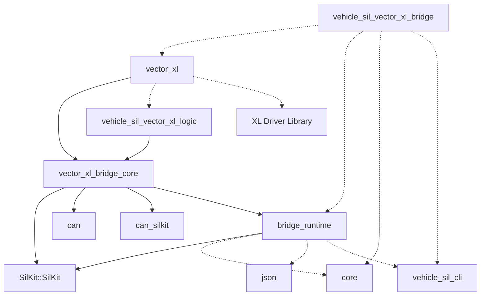
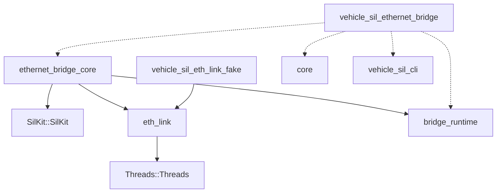

# Vector XL and Ethernet bridges

[日本語](ja/code-map-bridges.md)

This is the map for changes in this area. Start at [code-map.md](code-map.md); common test rules are in [code-map-testing.md](code-map-testing.md).

Related specifications and change areas: [bridges.md](bridges.md) / [ethernet-bridge.md](ethernet-bridge.md) / [CAN, Ethernet and LIN buses](code-map-buses.md) / [Launcher, process, configuration and run](code-map-launcher.md)

## Test labels

### `vector_xl`

Tests of the CAN bridge. On every platform, they run the production code against a fake XL driver made for the tests.

| Kind of test | Details |
|---|---|
| Unit tests | CanBridge |
| XL backend tests | The XL backend |
| In-process tests | Use the real SIL Kit |
| E2E tests | Use the bridge executable |

What the E2E tests check:

- A round trip with an echo node (Virtual CAN, and physical CAN with a configured bit rate)
- Loop prevention when transmit receipts come back
- `--list-channels`, a channel that does not exist, argument errors
- A registry that cannot be reached, a missing driver
- The statistics line and exit code 0 after a stop request (skipped on Windows when there is no shared console)
- The statistics line while running (`--stats-every-ms`) on a channel where nothing answers (`no-answers`)

### `eth_link` / `ethernet_bridge`

Tests of the Ethernet Bridge (all platforms). The `unit` label is also set.

| Test | Details |
|---|---|
| `eth_link.*` | Without SIL Kit, checks MAC addresses, filters (EtherType, behind a VLAN tag, MAC, maximum length), the MAC table and a fake external link |
| `eth_link.pcap_*` | Checks the message texts of the pcap external link, how the interface is chosen, and transmission, reception and failures with a fake pcap library loaded at run time |
| `eth_link.fake_pcap_imports.*` | On Windows, checks that the DLLs the fake library uses are only those in the places where the bridge looks |
| `eth_link.boundary` | Checks that `libs/eth_link` has no SIL Kit include |
| `ethernet_bridge.*` | Checks the bridge's behavior and output with a fake SIL Kit controller and a fake external link |
| `ethernet_bridge.silkit_*` | Checks the real SIL Kit side with an in-process registry (on a free port) |
| `ethernet_bridge.integration.*` (`integration` label) | Runs an executable linked with a fake external link as a process, and checks round trips, exit codes and shutdown |
| `ethernet_bridge.integration.pcap-*` | Checks the same with the executable for the OS external link, made to load a fake pcap library; `pcap-describe` checks `--describe`, and `pcap-launcher` starts the bridge with an ECU from a configuration file of `vehicle_sil_launch` |
| `ethernet_bridge.netns.*` (Linux only, `integration` label) | Checks `tap`, `packet` and `pcap` (the real libpcap) of the real executable, and `launch` (`vehicle_sil_launch run --connect` starting it), with TAP devices and veth in a namespace |

`ethernet_bridge.*` checks forwarding, filters, the bridge's own frames coming back, loops through 2 bridges (frame orders in which the loop stops and in which it does not), lost frames, `Fault`, warnings, the statistics and health lines, and the message texts of argument errors. `ethernet_bridge.netns.*` is skipped where a namespace cannot be created and where libpcap is missing.

### `bridge_runtime`

Tests of `run_bridge()`, which the bridge executables share (all platforms). The `unit` label is also set.

With fake `hooks` and a fake participant whose states are scripted, they check:

- Exit codes
- The shutdown order (the statistics are printed before the SIL Kit participant stops)
- `fault()` and participant failures
- Warnings and health lines
- The statistics line while running (`RunBridgeOptions::statistics_interval`): the first, then only where it changed
- A state in the middle of startup is not treated as a failure; the startup limit

The rule of the hint that nothing came from a device (`NothingCameHint`) is checked with the time given by the test.

The device mark (`bridge_runtime.device_mark_*`): the names, the hash, reading `/proc/net/unix` and the texts with given values, and real marks of the test process on Linux and Windows (each test on a device of its own).

One test uses a real participant with an in-process registry (on a free port). The message for a registry that cannot be reached (`registry_failure_message()`) is also checked with the text that SIL Kit actually throws.

`describe_json()` (what a bridge writes for `--describe`) is compared byte for byte with `to_json()` of `libs/ecu` and read with the reader of `vehicle_sil_launch` (`read_description()`), so the bridges keep the form of an ecu_main executable without linking `libs/ecu`.

## Code and tests by directory

### `bridges/vector-xl`

| Name | Location |
|---|---|
| `CanBridge` | `vector_xl/can_bridge.hpp` |
| `ExternalPortAdapter` | `vector_xl/external_port_adapter.hpp` |
| `XlDriver`, `XlCanPort` | `vector_xl/xl_driver.hpp` |

- Tests: `tests/vector_xl` (the fake XL driver is in `tests/vector_xl/fake_xl`)
- `ctest -R`: `^vector_xl\.`

### `bridges/common`

| Name | Location |
|---|---|
| `run_bridge()`, `BridgeHooks`, `judge_participant_state()`, `request_stop()`, `finish_console_close()` | `bridge_runtime/run_bridge.hpp` |
| `registry_failure_message()` | `bridge_runtime/registry_failure.hpp` |
| `describe_json()`, `BridgeDescription` (`--describe` of a bridge) | `bridge_runtime/describe.hpp` |
| `NothingCameHint`, `kNothingCameAfter` (when a bridge says that nothing came from a device) | `bridge_runtime/nothing_came_hint.hpp` |
| `DeviceMark`, `look_for_marks()`, `DeviceShareWatch` (the mark on a bridge's device and the other bridges it counts; [bridges.md](bridges.md#device-in-use-by-another-bridge)) | `bridge_runtime/device_mark.hpp` (OS parts in `src/device_mark_os.cpp`) |

- Threads: the counts of a bridge are atomics that the receive threads (the external link's, SIL Kit's) add to. Only the thread of `run_bridge()` reads them, for the statistics line (`BridgeHooks::statistics_line()`) and the hint (`take_warnings()`); `NothingCameHint` has no lock for that reason. `DeviceShareWatch` has none either: the executable places the mark and counts once on the main thread, and then `run_bridge()` (on the same thread) counts in `link_line()`.
- Tests: `tests/bridge_runtime`, the E2E tests of the bridge executable (`integration.*` in `tests/vector_xl`)
- `ctest -R`: `^bridge_runtime\.`, `^vector_xl\.integration\.`

### `libs/eth_link`, `bridges/ethernet`

In this entry, "external link" means a connection to an interface outside SIL Kit (`ExternalLink`).

| Name | Location |
|---|---|
| `ExternalLink`, `LinkEvent`, `LinkError`, `Promiscuous` | `eth_link/external_link.hpp` |
| `FrameFilter` | `eth_link/frame_filter.hpp` |
| `MacSideTable` | `eth_link/mac_side_table.hpp` |
| `MacAddress` | `eth_link/mac_address.hpp` |
| `make_tap_link()`, `make_packet_link()`, `list_interfaces()` | `eth_link/os_links.hpp` (implemented in `libs/eth_link/src/linux`) |
| `make_pcap_link()`, `pcap_interfaces()`, `format_pcap_interface_list()`, `pcap_interface_argument()` | `eth_link/pcap_link.hpp` (implemented in `libs/eth_link/src/pcap`) |
| `EthernetBridge` | `ethernet_bridge/ethernet_bridge.hpp` |
| `parse_bridge_options()` | `ethernet_bridge/bridge_options.hpp` |
| `format_start_line()`, `backend_unavailable()`, `PromiscuousHint`, `nothing_came_warning()` | `ethernet_bridge/bridge_app.hpp` |
| The text and the JSON of `--list-interfaces` (`pcap_interfaces_json()` and others) | `ethernet_bridge/interface_list.hpp` |
| Executable | `bridges/ethernet/app/main.cpp` |
| Where external links are created | `app/link_factory.hpp`, `app/os_link_factory.cpp` |
| Location of the pcap library, the default of `--backend`, the identity of the device mark | `app/pcap_library.hpp` |

Contents of `libs/eth_link/src/pcap`:

| File | Details |
|---|---|
| `pcap_api.hpp` | Function table |
| `pcap_link.cpp` | External link |
| `pcap_errors.cpp` | Error messages |
| `pcap_loader_win.cpp`, `pcap_loader_posix.cpp` | Loading the library |

- Tests: `tests/eth_link`, `tests/ethernet_bridge`
- `ctest -R`: `^eth_link\.`, `^ethernet_bridge\.`

| Used by the tests | Location |
|---|---|
| Fake external link | `tests/eth_link/fake_link` |
| Fake pcap library | `tests/eth_link/fake_pcap` |
| Executable with the fake external link | `fake_link_factory.cpp` in `tests/ethernet_bridge` |
| Executable that loads the fake pcap library | `fake_pcap_library.cpp` in `tests/ethernet_bridge` |
| Namespace tests | `bridge_netns.py` in `tests/ethernet_bridge` |
| The device mark of the fake devices per process (`VEHICLE_SIL_FAKE_DEVICE_SCOPE`) | `fake_device_scope.hpp` in `tests/ethernet_bridge`; for the fake XL driver `mark_identity()` in `tests/vector_xl/fake_xl` |
| ECU of the test that starts the bridge from a configuration file (`pcap-launcher`) | `eth_bridge_it_ecu.cpp` in `tests/ethernet_bridge` |

## Dependency direction

See the [diagram legend and layers](code-map-core.md#dependency-direction) and [boundary tests](code-map-testing.md#boundary-tests).

### Vector XL CAN Bridge

| Target | Built when |
|---|---|
| `vector_xl`, `vehicle_sil_vector_xl_bridge` | Only on Windows, when the XL Driver Library is available |
| `bridge_runtime` (`bridges/common`) | On every platform |

`bridge_runtime` keeps the shutdown, the monitoring loop, the statistics line while running, the hint that nothing came from a device, the exit codes and the `--describe` output of the bridge executables in one place.

### Ethernet Bridge

An "external link" is a connection to an interface outside SIL Kit (`ExternalLink`). There are 3 kinds: `tap`, `packet` and pcap.

| Target | Details |
|---|---|
| `eth_link` | Does not use SIL Kit and links no other vehicle-sil library (`eth_link.boundary`). |
| `ethernet_bridge_core`, the executable `vehicle_sil_ethernet_bridge` | Built on every platform. |
| `vehicle_sil_eth_link_fake` (`tests/eth_link`) | The fake external link that the tests link. |
| `vehicle_sil_ethernet_bridge_on_fake` | The executable for the process tests: the same `main.cpp`, combined with `fake_link_factory.cpp`, which creates a fake external link instead of the OS external link. |
| `vehicle_sil_ethernet_bridge_on_fake_pcap` | `main.cpp` and `os_link_factory.cpp` unchanged; only the location of the pcap library is replaced with `fake_pcap_library.cpp` (environment variable `VEHICLE_SIL_TEST_PCAP_LIBRARY`). |
| `vehicle_sil_fake_pcap`, `vehicle_sil_fake_pcap_old` | Fake pcap libraries (`_old` lacks one function). They are MODULE libraries, so nothing links them. |

Differences between platforms:

- The OS external links `tap` and `packet` are implemented only on Linux.
- The pcap external link exists on Windows and Linux. The library is loaded at run time, so it is not linked.
- On Windows, `iphlpapi` is linked for adapter names.
- On other platforms, `${CMAKE_DL_LIBS}` is linked for `dlopen`.

## What to update together

### Bridge shutdown and exit codes

Where to change:

- The bridge shutdown, the judgment of participant state (`judge_participant_state()`), the shutdown order, the exit codes and the health line output (`bridges/common/src/run_bridge.cpp`)

Documentation to update:

- "[Exit codes](bridges.md#exit-codes)" and "[Participant state while running](bridges.md#participant-state-while-running)" in [bridges.md](bridges.md)

Tests:

- `bridge_runtime.*` compares the printed messages.
- `vector_xl.integration.stop-request` and `device-lost` also check the shutdown order and exit codes.
- No automated test checks what happens when the console window is closed (4 s). If you change it, check it by hand on Windows.

### Ethernet Bridge output

Where to change:

- The statistics keys, the health line, the one-line start message, warnings, argument and error messages, the message when an external link cannot be opened (`bridges/ethernet/src`, `libs/eth_link/src`)

Documentation to update:

- [ethernet-bridge.md](ethernet-bridge.md): copies of the messages (not compared; keep them in sync by hand)

Code to update:

- `tests/ethernet_bridge/bridge_netns.py` also has a copy of the message for an external link that cannot be opened.

Tests:

- `ethernet_bridge.*`, `eth_link.os_link_*` and `eth_link.pcap_*` compare the messages.
