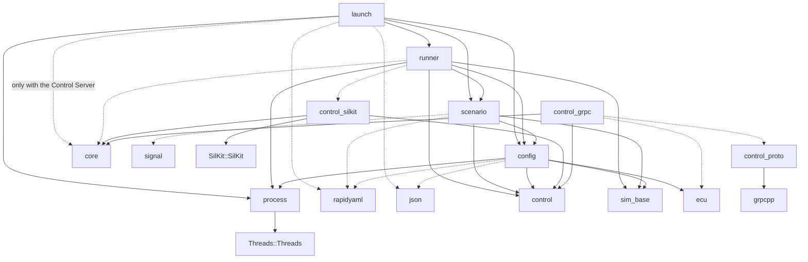

# Control API, gRPC and launcher Control Server

[日本語](ja/code-map-control.md)

This is the map for changes in this area. Start at [code-map.md](code-map.md); common test rules are in [code-map-testing.md](code-map-testing.md).

Related specifications and change areas: [internals/control.md](internals/control.md) / [control-api.md](control-api.md) / [Launcher, process, configuration and run](code-map-launcher.md) / [Scenarios, timelines and batch runs](code-map-scenario.md) / [Browser GUI, protocol, client and screen examples](code-map-gui.md) / [ECU, Peer, local execution and Simulation](code-map-execution.md)

**On this page:** [Test labels](#test-labels) / [Code and tests by directory](#code-and-tests-by-directory) / [Dependency direction](#dependency-direction) / [What to update together](#what-to-update-together)

**Change topics:** [Variable maps](#variable-maps) / [`control.proto`](#controlproto) / [The launcher's Control Server](#the-launchers-control-server) / [The Control Server during a scenario](#the-control-server-during-a-scenario) / [Reading time and values together](#reading-time-and-values-together) / [Messages between Agent and Hub](#messages-between-agent-and-hub) / [The SIL Kit transport and the start window](#the-sil-kit-transport-and-the-start-window)

## Test labels

### `control`

Tests of the Control Agent (`control.*`). The `unit` label is also set. The `control_server` tests have this label too.

- Tests that run the Agent directly, without a transport
- Timed writes to variables declared with `Ecu` are applied in the same step and read at the same time on the virtual bus and on SIL Kit
- The Agent of a `Peer` (as a SIL Kit participant: where writes are applied, real time, monitoring output)
- A `Hub` connected within the process
- A transport that outlives its ECU stops the process

### `control_server`

Registered only when `VEHICLE_SIL_BUILD_CONTROL_SERVER=ON` (preset `linux-gcc-control`). CI also runs this preset, and the GUI server tests run with this launcher.

What the Control Server tests (`control_server.*`; the `unit` and `control` labels are also set) check:

- The generated gRPC code and calls
- End to end in one process (a Hub that the Agents of 2 J1939 `Peer` objects connect to over SIL Kit, the time gate, a gRPC client)
- Authentication, roles, TLS and the audit log
- Which role can call which RPC (and that the RPCs in the proto match the table of rules)
- Message conversion, limits and input checks
- `SimulationMonitor`

If a Python with grpcio and grpcio-tools is available, the following tests are registered too. All have the `control` and `python` labels.

| Test | Details | Other labels |
|---|---|---|
| `control_server.python_client` | Runs the Python client and CLI against `vehicle_sil_launch run --control` | |
| `control_server.launcher` | Runs `vehicle_sil_launch run --control` with the ECUs of `examples/ecu_main` | `integration` |
| `control_server.example_write_before_start`, `control_server.example_pause_and_step` | Runs `examples/launch_control` | `examples` |
| `control_server.guide_operate_signals` | Compares the marked blocks of the guide [Read and write signals from outside](howto/operate-signals.md) with the output of the same example, the CLI and the stdin commands | `examples` |

`control_server.launcher` checks writes before the start, commands from both stdin and the Control Server, how the run ends, authentication, TLS and auditing, and the CLI with a token.

## Code and tests by directory

### `libs/control`

| Name | Location |
|---|---|
| `Agent` | `control/agent.hpp` |
| `Hub` | `control/hub.hpp` |
| The variable map `MappedSchema` | `control/variable_map.hpp` |
| Encoding and decoding of the messages between Agent and Hub | `control/wire.hpp` |

- Tests: `tests/control`
- `ctest -R`: `^control\.` (`^control\.wire_` for `wire.hpp`; the variable map is in `test_variable_map.cpp`)

### `libs/control_silkit`

| Name | Location |
|---|---|
| `AgentTransport` | `control_silkit/agent_transport.hpp` |
| `HubTransport` | `control_silkit/hub_transport.hpp` |
| Topic names | `src/topics.hpp` |

- Tests: `tests/control_silkit`, `tests/launch` (the start window across processes)
- `ctest -R`: `^control_silkit\.`, `^launch_control\.`

### `libs/control_grpc`, `proto/`, `python/`

| Name | Location |
|---|---|
| `ControlServer` | `control_grpc/server.hpp` |
| Python client | `python/vehicle_sil_control/client.py` |
| Helper that starts the launcher | `python/vehicle_sil_control/launcher.py` |

- Tests: `tests/control_server` (only when `VEHICLE_SIL_BUILD_CONTROL_SERVER=ON`)
- `ctest -R`: `^control_server\.`

| Test file or test | Covers |
|---|---|
| `test_launcher.py` | The launcher's Control Server (also authentication, TLS, roles and auditing) |
| `test_python_client.py` | The Python client and CLI |
| `control_server.example_write_before_start`, `control_server.example_pause_and_step` | `examples/launch_control` |
| `test_guide_operate_signals.py` | Compares the guide `docs/howto/operate-signals.md` with the example, the CLI and the stdin commands (for the markers, see "[Documentation examples and tests](code-map-testing.md#documentation-examples-and-tests)") |

### `examples/launch_control` (example for the guide "Read and write signals from outside")

- Tests: `control_server.example_write_before_start` and `control_server.example_pause_and_step` run the example.
- Tests: `control_server.guide_operate_signals` (`test_guide_operate_signals.py` in `tests/control_server`) compares the marked blocks of the guide [howto/operate-signals.md](howto/operate-signals.md) with the output of the example, the CLI and the stdin commands.
- `ctest -R`: `^control_server\.example_write_before_start`, `^control_server\.example_pause_and_step`, `^control_server\.guide_operate_signals`

All of them are registered only in a build with the Control Server, and only when a Python with grpcio and grpcio-tools is available.

## Dependency direction

See the [diagram legend and layers](code-map-core.md#dependency-direction) and [boundary tests](code-map-testing.md#boundary-tests).

### launch and the Control API

| Target | Built when |
|---|---|
| `control_proto`, `control_grpc` | Only when `VEHICLE_SIL_BUILD_CONTROL_SERVER=ON` |
| `launch` | Only when SIL Kit is built from the submodule (when `rapidyaml` is available) |

`grpcpp` is the gRPC C++ library (`cmake/VehicleSilGrpc.cmake`).

- `launch`, `ecu` and `json`: the launcher writes its JSON with the same writer as the `--describe` output, `vehicle_sil/json/json_writer.hpp` (`json`), and repeats the variables of `--describe` with `vehicle_sil/ecu/describe_json.hpp`. `launch` includes no internal header of `ecu`.

## What to update together

### Variable maps

`participants[].variables` of the configuration file.

Where to change:

| What | Location |
|---|---|
| The code that reads it | `read_variables()` in `libs/config/src/config.cpp` |
| Rules and conversion | `MappedSchema` in `libs/control/src/variable_map.cpp` |
| Where the conversion is applied | `control::Hub` (`set_variable_map()`) |
| Where it is passed to the Hub | `RunControl::shared_hub()` in `libs/runner/src/run_control.cpp` |
| Check | `seen_variables()` in `seen_ecu.cpp` (`SeenEcu::variables()`), `variable_map_code()` in `check_rules.cpp` |

Documentation to update:

- "[Matching variable names and values (`variables`)](simulation-config.md#matching-variable-names-and-values-variables)" in [simulation-config.md](simulation-config.md) (the table of forms, how values appear)
- [simulation-check.md](simulation-check.md): `variable-map-*`, and `variables` and `variable_map` in the JSON
- [simulation-run.md](simulation-run.md): `variable-map-not-applied`
- [control-api.md](control-api.md): `source` (`VariableInfo.source` in `control.proto`, `Variable.source` in Python)
- [internals/control.md](internals/control.md): the Hub's "[Variable map (`set_variable_map()`)](internals/control.md#variable-map-set_variable_map)" (the 4 places where the conversion is applied, and their order)

Rules:

- Conversion happens only inside the Hub (do not add it to the read API or the communication layer).
- Whether a value can be written is decided in one place, `MappedSchema::to_actual()`. The scenario check uses the same decision through `in_range()` (`libs/scenario/src/scenario_values.cpp`).
- A mapping name that did not match cannot be written (`not_writable()`).
- Values are converted before the Hub stores them (so that the read and write paths cannot disagree).
- Writes are converted in the same place as the checks of `write()`.
- The check and the run use the same `MappedSchema::make()`.

Tests:

- `^control\.` (`test_variable_map.cpp`)
- `^launch\.` (reading, rules, JSON)
- `launch_run.variable_map`: a scenario through a variable map advances at the same times as without one
- `control_server.control_server_peer_info_names_the_source_of_a_mapped_variable`

### `control.proto`

Where to change:

- `proto/vehicle_sil/control/v1/control.proto`

Code and documentation to update:

- `libs/control_grpc/src` (`convert.hpp`, `control_service.cpp`)
- When you add a service, also update `rpc_rules()` in `auth.cpp` and `test_authorization*.cpp`.
- `python/vehicle_sil_control/client.py`
- [control-api.md](control-api.md)

The Python stubs are generated in the test build (`python -m vehicle_sil_control.generate`).

### The launcher's Control Server

Where to change:

- `libs/launch/src/endpoints/control_server.cpp`: reads and checks what the request names for `--control` (`RunHost::control` in `launch/request.hpp`; the usage errors), and the server, made from the checked `ServerOptions`. `tools/launch/main.cpp` only copies the arguments into the request; in a build without the Control Server it refuses `--control`, and the library has `src/control_server_none.cpp` instead
- `launch::ControlEndpoint` (`launch/run.hpp`); `run_file()` in `libs/launch/src/usecases/run_file.cpp` makes the Server before the check (`make_control_server_of_run()` in `src/run_control_server.hpp`), starts it between `Runner::prepare()` and `Runner::run()`, and ends it when it returns; the caller destroys it after the result (`RunReport::ended_control_server`). `RunLent::control_endpoint` lends a server of the caller's own instead (the tests')
- `hold_before_start()`, `inspect()` and `wait_paused()` of `TimeCommands`
- `ServerOptions::external_hub`
- `python/vehicle_sil_control/launcher.py`

Documentation to update:

- "[Connect to the launcher](control-api.md#connect-to-the-launcher)" in [control-api.md](control-api.md) (writing before the start, stdin and client commands, authentication)
- [simulation-config.md](simulation-config.md): the table of arguments
- [simulation-events.md](simulation-events.md): the `control_server` event, `source` and `at_ms` of `command`, `control-server` of `features` (`kControlServerFeature`)
- "[The launcher's Control Server (`vehicle_sil_launch run --control`)](internals/control.md#the-launchers-control-server-vehicle_sil_launch-run---control)" in [internals/control.md](internals/control.md) (threads, the order of stdin and client commands, pausing before the start, how the run ends)

Only a build with the Control Server prints `control-server` in `features`. It is therefore not in the `version --json` example, and `launch_cli.docs` leaves this name out when it compares.

Rules:

- The gRPC threads operate the controller only inside `TimeCommands`, because the controller is destroyed after `detach()`.
- Do not add anything inside `run_file()` that waits for gRPC.

Tests:

- `control_server.launcher`, `control_server.example_write_before_start`, `control_server.example_pause_and_step`
- `^launch\.` (`TimeCommands`)
- `launch_run.time_usage` (argument errors)

### The Control Server during a scenario

While a scenario runs, the Control Server refuses writes. Its clients read, move time and stop.

Where to change:

- `ServerOptions::observe_only` and its scope (`ObserveOnly::Refuses`: every change, or the writes alone)
- The rule that the launcher asks: the row `scenario-running` and `always_refused()` in `libs/runner/src/control_rules.cpp`
- `Effect` in `libs/control_grpc/src/auth.hpp`, and `rpc_rules()` in `auth.cpp`
- The code that rejects calls: `guarded()` in `control_service.cpp`
- The code that sets it up: `libs/launch/src/endpoints/control_server.cpp`

Documentation to update:

- "[Watching variables during a run (`--control`)](scenario.md#watching-variables-during-a-run---control)" in [scenario.md](scenario.md) (the table of calls, the reason `scenario-running`, the promise that time calls do not change the result)
- "[Connect to the launcher](control-api.md#connect-to-the-launcher)" in [control-api.md](control-api.md), and `ControlError.reason`
- [simulation-config.md](simulation-config.md): the table of arguments
- [simulation-events.md](simulation-events.md): `scenario-control` and `scenario-time` of `features` (`kScenarioControlFeature`, `kScenarioTimeFeature`)
- "[The launcher's Control Server (`vehicle_sil_launch run --control`)](internals/control.md#the-launchers-control-server-vehicle_sil_launch-run---control)" in [internals/control.md](internals/control.md)

Like `control-server`, `scenario-control` and `scenario-time` are printed only by builds that have them. When you add an RPC, write its kind in its row of the `rpc_rules()` table: an RPC that changes what the participants get is `Effect::Write`, one that only moves time is `Effect::Time`.

Rules:

- Calls are rejected in one place, before the body of the RPC.
- A call that can change the result of a scenario (what a participant gets, or at which virtual time) is `Effect::Write`, and is refused during a scenario. A time call must not change what happens at a virtual time.
- Do not add a path by which a client call operates the run's tap (`RunSamples`), the writes or the guard.
- Do not add anything that waits to the Hub's subscriptions or tap.

Tests:

- `control_server.control_server_observe_only_*`, `control_server.control_server_that_only_observes_*`, `control_server.control_server_that_refuses_writes_alone_*` (the tests also contain a table per call)
- `control_server.launcher`: the scenario's result is the same whether or not a client reads, and whether or not a client moves time; a write is refused. The run ends even with a client that does not read.
- `launch_run.scenario_time_commands_same`: the scenario's result, its `scenario_step` events and its timeline file are the same, byte for byte, with and without time commands (from stdin). `launch_run.scenario_paused_timeout`: a scenario left paused until `--timeout-ms` is incomplete.
- `launch.control_rules_*`: the rows (a scenario changes no answer to a time command; both entries get the same answer)
- `control.control_hub_readers_that_never_read_*`

### Reading time and values together

For response shape changes, see [control.proto](#controlproto); for launcher integration, [the launcher's Control Server](#the-launchers-control-server); for the GUI consumer, [GUI implementation and tests](code-map-gui.md#guiserver-guiprotocol-guiclient-guiweb).

`GetSnapshot`.

Where to change:

- `libs/control_grpc/src/control_service.cpp`
- `Hub::latest_of()` and `none_after()`
- `Control.snapshot()`

Documentation to update:

- The comment of `GetSnapshotReply` in `control.proto`: the guarantees
- "[Read time and values together (`snapshot()`)](control-api.md#read-time-and-values-together-snapshot)" in [control-api.md](control-api.md) (the guarantees)
- "[Control Server and communication layer (`vehicle_sil::control_grpc`)](internals/control.md#control-server-and-communication-layer-vehicle_silcontrol_grpc)" in [internals/control.md](internals/control.md) (the read order and locks)

Rules:

- Keep the order: read the time state first, then the values. In the opposite order, a value can be older than the time.

Tests:

- `^control_server\.control_server_snapshot`
- `control_silkit.the_time_and_then_all_values_` (the same read order without gRPC)
- `control_server.launcher` (pause, write, step, read together)

### Messages between Agent and Hub

Where to change:

- `libs/control/src/wire.cpp`

Rules:

- Both sides write `kVersion` and read only `kVersion`. A hello of another version is reported (its participant name is read) and makes no peer; any other message of another version is dropped. `vehicle_sil_launch` compares what `--describe` announces with `kVersion` (`libs/config/src/check_rules.cpp`, `run_control.cpp`), and `control_version_fix()` in `libs/config/include/vehicle_sil/config/detail/check_words.hpp` says which side to build again.
- Which writes of a command took effect, and which write a refusal is about, travel as numbers (`CommandResult::applied_writes`, `SubmitResult::failed_write`, and the Hub's `TargetResult` with the same two names). Do not read a `reason` for them (see "[Control Server core (`vehicle_sil::control::Hub`)](internals/control.md#control-server-core-vehicle_silcontrolhub)" in [internals/control.md](internals/control.md)).
- To add a field, put it at the end of its element (a variable, write, result or event), or at the end of the message if it belongs to the message. Raise `kRevision` in `control/wire.hpp` by one, and read the field only from a writer of that revision or later. The decoder of an older build skips it.
- A change that a reader must not skip (a field moved or removed, a new enumerator sent to a reader that does not know it) needs a new version. Raise `kVersion`: ECUs and launchers of different versions then cannot read and write variables together (the check says `control-link-version`).
- `result_bytes()` and `event_bytes()` must return exactly what `write_result()` and `write_event()` write. `encode_step()` splits by them, so a value that is too small makes a message larger than its limit.
- `kLeast` is the smallest size of each element. The decoder checks a count against it before it reads anything. Update it when an element gets a field.
- `--describe` announces `kRevision` as `control.wire_revision`, and the check notes an ECU of an older revision (`control-link-revision` in `libs/config/src/check_rules.cpp`). When you raise `kRevision`, say in that note what the older revision is missing.
- The availability (revision 1) is the last part of a step message, behind the values, and is read by its flag (`kStepAvailability`), never by the bytes left. `AgentTransport` reads `Agent::availability()` in its step sink: the states have no other way to the transport thread, and need none.
- If you only add a kind that the other side can safely ignore, raise neither the version nor the revision. Unknown kinds are discarded (`Kind::LastWordReceived`, the reply to the last word, is an example).
- Never change the eight bytes of the header, the participant name right after the header of a hello, or the session right after the header of every other message, in any version. This lets a peer with a different version read the name, and lets an ECU see whom a message is for.

Documentation to update:

- "[Transport over SIL Kit (`vehicle_sil::control_silkit`)](internals/control.md#transport-over-sil-kit-vehicle_silcontrol_silkit)" in [internals/control.md](internals/control.md) (the size limits `kMaxMessageBytes`, `kMaxHelloBytes` and `kMaxTextBytes`, and how messages are split)

Tests:

- `^control\.wire_`: truncation one byte at a time, corrupted fields, random input. A read outside the bounds fails in the sanitizer presets.
- `^control\.wire_v2_`: version 2 (its messages are also written out by hand in `tests/control/test_wire_v2.cpp`), that an older or newer version is not read, what the decoder skips from a newer revision and refuses from its own, element sizes, and that a step message is filled exactly to its limit.
- `^control\.wire_building_`: building the step messages of a step allocates nothing once the buffer has grown (a binary of its own, `tests/control/test_wire_allocation.cpp`).
- `^control\.wire_v2_revision_0_`: the bytes of version 2, revision 0, written out by hand in `tests/control/wire_v2_golden.hpp`. When you add a field, add the bytes of the new revision beside them and leave these as they are.
- `^control\.wire_v2_revision_1_`: the bytes that revision 1 added (the availability), in the same file.
- `control_silkit.a_hello_of_another_version_is_reported_and_makes_no_peer`, `control_silkit.an_agent_does_not_answer_what_is_written_to_it_in_another_version`: an older and a newer version, on each side.

### The SIL Kit transport and the start window

Where to change:

- The transport over SIL Kit (`libs/control_silkit/src`)
- The start window: `run_window()` and `cancel_window()` in `libs/core/src/simulation_controller.cpp`
- The start window: `set_communication_ready_handler_async()` in `libs/core/src/participant_runtime.cpp`
- Where `ecu_main()` attaches the transport (`libs/simulation/src/ecu_main.cpp`)
- The launcher's Hub: `RunStartWindow::run()` in `libs/runner/src/run_start.cpp`, `RunControl::note_links()` in `run_control.cpp`

Documentation to update:

- "[Transport over SIL Kit (`vehicle_sil::control_silkit`)](internals/control.md#transport-over-sil-kit-vehicle_silcontrol_silkit)" in [internals/control.md](internals/control.md) (threads, the guarantee of receive order, the wait before the first step, the end of a connection and the reply to the last word, the absence of authentication)
- [internals/control.md](internals/control.md): the limits in the same section (when you change `kMaxVariables`, `kMaxNameBytes` or `HubTransportOptions::max_links`)
- "[Upstream behavior the implementation relies on](dependencies.md#upstream-behavior-the-implementation-relies-on)" in [dependencies.md](dependencies.md) (the SIL Kit behavior it depends on)
- "[Connection to ECU variables (`control_link`)](simulation-run.md#connection-to-ecu-variables-control_link)" and its table in [simulation-run.md](simulation-run.md) (the launcher output listed below)
- "[JSON format](ecu-executable.md#json-format)" in [ecu-executable.md](ecu-executable.md) (`control` of `--describe`)

The specification is in the class comments of `agent_transport.hpp` and `hub_transport.hpp`. Make internals/control.md match them.

The launcher output described in simulation-run.md:

- The `control_link` event
- `participants[].control_link` of the result
- `participants[].control` of the check JSON
- The findings `control-link-no-hello`, `control-link-version`, `control-link-revision`, `control-link-late-values`, `control-link-dropped`, `control-link-not-offered`, `before-start`

The code that handles `control` of `--describe`:

- The code that prints it: `libs/ecu/src/describe.cpp`
- The code that adds it: `ecu_main`
- The code that reads it: `libs/config/src/describe_read.cpp`

Rules:

- The destructor of `AgentTransport` waits for the Hub's reply (`AgentTransportOptions::last_word_wait`).
- A change that lengthens or removes this wait changes how late the ECU ends and the final result of the run (Cancelled or Unknown).
- Values and results are sent from the step thread right after the values are read. Handing them to another thread breaks the order guarantee (`HubTransportStats::late_messages` counts such cases).
- The availability is sent again each second of step time (`kAvailabilityResend` in `agent_transport.cpp`) for a Hub that connected late (`control_silkit.the_availability_is_said_again_each_second_of_step_time`, `control_silkit.a_hub_that_comes_late_gets_the_availability_the_ecu_has_now`).
- Commands go out on the publisher of the Agent's group (`command_group()` and `kCommandGroups` in `topics.hpp`), and the probe on the same one. A change of the hash or of the number of groups makes a Hub and Agents of different builds miss each other's commands: when you change either, raise `wire::kVersion` too, so that the version check reports the mismatch (`control_silkit.the_group_of_a_participant_is_a_fixed_hash_of_its_name`, `control_silkit.a_command_reaches_the_agents_of_its_group_only_and_in_the_order_written`).
- Do not add anything that waits, or heavy processing, to the receive handlers on the Hub side. The whole simulation would wait for it.

Tests:

- `^control_silkit\.`, `^core\.`, `^launch_control\.`
- `launch_run.control`
- `simulation.ecu_main_offers_its_variables_to_the_simulation_unless_no_control`
