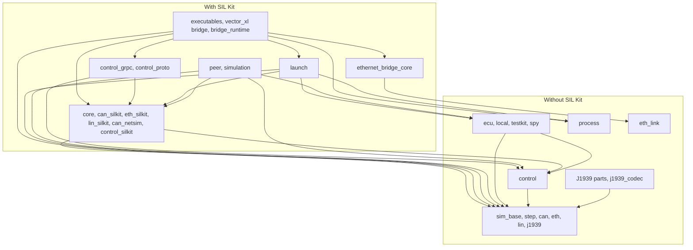
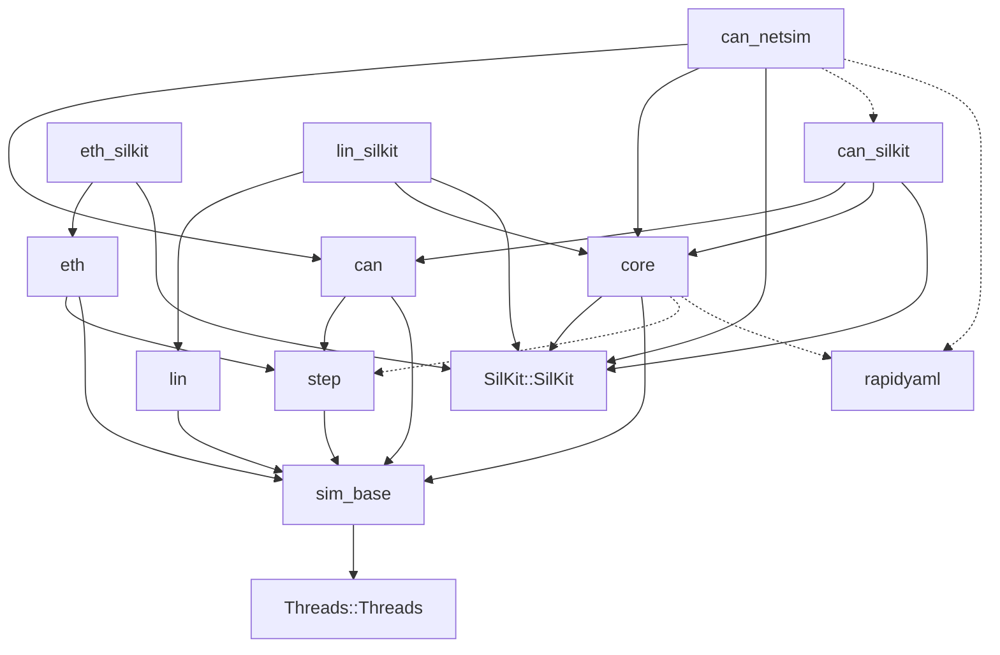

# Core, step, signal and SIL Kit defaults

[日本語](ja/code-map-core.md)

<!-- Style: write each entry as a short block of the same shape (a subheading, a bullet list with one fact per line, a table whose cells are one sentence each). Do not pack several facts into one cell or one bullet: the line gets long and unrelated changes hit the same line. -->

This is the map for changes in this area. Start at [code-map.md](code-map.md); common test rules are in [code-map-testing.md](code-map-testing.md).

Related specifications and change areas: [internals/core.md](internals/core.md) / [internals/virtual-time.md](internals/virtual-time.md)

## Test labels

### `step`

Unit tests of `vehicle_sil::step` (built without CAN and SIL Kit). The `unit` label is also set.

With a non-CAN test participant (`Member`), they check:

- The order of the phases
- That `start()` is called exactly once, before the first step
- Rejection of mixed time domains (host and driver)
- Failure handling
- `post()` and how the host is woken, `next_deadline()`
- `StepDriver` in virtual time
- `RealTimeDriver` on a substituted clock (woken by deadlines and arrivals)

`step.boundary` checks that `libs/step` includes no SIL Kit header, directly or indirectly.

### `signal`

Unit tests of the waveform functions of `vehicle_sil::signal` (built with the standard library only). The `unit` label is also set.

- Values compared with a table of times (period edges, phase, duty 0 and 100)
- The random sequence has the same values on every platform
- Random noise and chatter depend only on the time
- The chirp's phase does not jump
- Interpolation of a list of points

`signal.boundary` checks that `libs/signal` includes no SIL Kit header.

### `core` / `lin`

Unit tests of virtual time. The `unit` label is also set.

With an in-process registry, they check:

- Synchronization of participants with different step sizes, waiting for the slowest participant, coupling to real time
- `TickScheduler`, `StepInbox`
- LIN schedules, responses, reception of master frames, sleep and wake-up, schedule switching

| LIN test | Details |
|---|---|
| `lin_local.*` | Checks the main scenarios on the virtual LIN bus too |
| `lin_bus.*` | Tests of the virtual LIN bus only |
| `lin.boundary` | Checks that `vehicle_sil::lin` does not include SIL Kit |

### `lin` (`lin_cluster.*`)

Runs a registry, a controller, a LIN master and 2 slaves (5 / 2 / 4 ms) as separate processes. The `integration` label is also set.

- Compares traces to check the schedule, frames in both directions, and sleep and wake-up by the master, by a slave and by bus idle.
- Confirms that the traces still match when one slave is coupled to real time.

## Code and tests by directory

### `libs/core`

| Name | Location |
|---|---|
| `ParticipantRuntime` | `vehicle_sil/core/participant_runtime.hpp` |
| `default_participant_configuration()`, `merged_participant_configuration()` | `core/participant_configuration.hpp` |
| `SimulationController`, `StartWindow` | `core/simulation_controller.hpp` |
| `TickScheduler` | `core/tick_scheduler.hpp` |
| `bind_host()` | `core/bind_host.hpp` |
| `SimTime` (`sim_base`) | `core/sim_time.hpp` |
| `StepInbox` (`sim_base`) | `core/step_inbox.hpp` |
| `periodic()` (`sim_base`) | `core/periodic.hpp` |

- Tests: `tests/core`
- `ctest -R`: `^core\.`

### `libs/step`

| Name | Location |
|---|---|
| `Member`, `Host` | `step/host.hpp` |
| `StepDriver` | `step/step_driver.hpp` |
| `RealTimeDriver` | `step/real_time_driver.hpp` |
| `RealTimeClock`, `ManualRealTimeClock` | `step/real_time_clock.hpp` |
| `TimeDomain`, `Wakeup` | `step/time_domain.hpp` |
| `SinkRef` | `step/sink_ref.hpp` |
| `OverflowCollector` (each bus names its instance: `can::OverflowCollector`, `eth::OverflowCollector`) | `step/overflow_collector.hpp` |

- Tests: `tests/step`
- `ctest -R`: `^step\.`

### `libs/signal`

| Name | Location |
|---|---|
| Waveforms as functions of time: `sine()`, `triangle()`, `sawtooth()`, `square()`, `noise_uniform()`, `noise_gaussian()`, `chirp()`, `lag()`, `chatter()`, `points_linear()`, `points_hold()` | `signal/waveform.hpp` |
| The random sequence `unit_random()` | `signal/waveform.hpp` |

Header-only; it links nothing. Both the scenario's `wave` and the user's C++ code use it.

- Tests: `tests/signal`
- `ctest -R`: `^signal\.`

### `libs/json`

The JSON writer that the output of `--describe` and the JSON of `vehicle_sil_launch` share (target `vehicle_sil::json`, header only).

| Name | Location |
|---|---|
| `JsonWriter`, `hex64()` | `vehicle_sil/json/json_writer.hpp` |

- Tests: through the JSON of `--describe` (`tests/ecu`) and of the launcher (`tests/launch`)
- `ctest -R`: `^ecu\.`, `^launch`

## Dependency direction

See [code-map.md](code-map.md#dependency-direction) for the diagram legend and shared boundary tests.

### Layers

A box is a group of targets. An arrow between boxes stands for one or more links of the later diagrams, and does not distinguish public from private.

The targets that do not use SIL Kit are `sim_base`, `step`, `can`, `eth`, `lin`, `control`, `j1939` and its protocol parts, `j1939_codec`, `ecu`, `local`, `testkit`, `spy`, `process`, `eth_link`, `signal` and `json`. `signal` and `json` are header-only and use no other vehicle-sil library either (they are not in the diagram).

### Foundation and SIL Kit implementations

## What to update together

### SIL Kit configuration defaults

Where to change:

- `default_participant_configuration()` and related functions in `libs/core/src/participant_configuration.cpp` (the listen address, TCP on Windows, TCP for the registry on every OS)
- `merged_participant_configuration()`, which overlays a given configuration, and `--silkit-config` of ecu_main
- Users of the defaults: the controller in `libs/launch/src/run.cpp`, and the lines addressed to other computers
- Users of the defaults: the environment variables in `run_participants.cpp`, `environment` of the manual command
- Users of the defaults: the note `registry-on-network` in `config.cpp`, and `inherited_listen_variable()` (the note `listen-variable-ignored`)

Documentation to update:

- "[SIL Kit configuration defaults](internals/core.md#sil-kit-configuration-defaults)" in [internals/core.md](internals/core.md)
- "[Listen addresses](simulation-run.md#listen-addresses)" in [simulation-run.md](simulation-run.md)
- [simulation-check.md](simulation-check.md): the table of findings
- [dependencies.md](dependencies.md): the SIL Kit (Windows) section
- "[Passing a SIL Kit configuration file (`--silkit-config`)](ecu-executable.md#passing-a-sil-kit-configuration-file---silkit-config)" in [ecu-executable.md](ecu-executable.md)
- [howto/multi-pc.md](howto/multi-pc.md): `examples/ecu_main/simulation.two-pcs.yaml` and the block of its `check` output (compared by `multi_host.docs`)

Tests:

- `core.a_participant_*`, `core.a_configuration_*`, `core.a_registry_uri_*`
- `simulation.ecu_main_*silkit_configuration*`
- `launch_run.network`, `launch_run.busy_port`
- `multi_host.two_hosts`, `multi_host.docs`
- `core.silkit_configuration_defaults`
