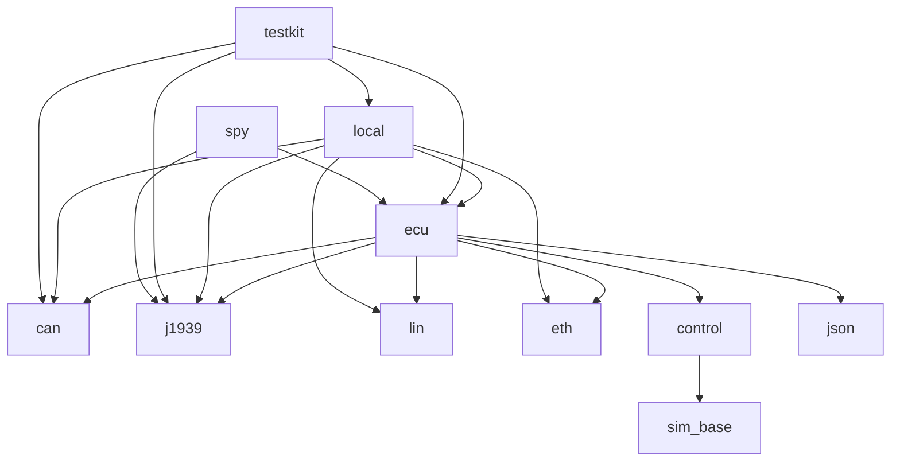
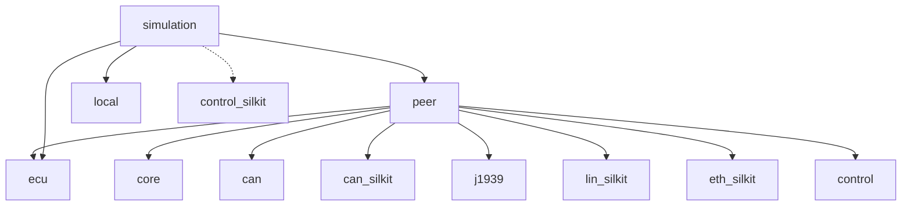

# ECU, Peer, local execution and Simulation

[日本語](ja/code-map-execution.md)

This is the map for changes in this area. Start at [code-map.md](code-map.md); common test rules are in [code-map-testing.md](code-map-testing.md).

Related specifications and change areas: [internals/execution.md](internals/execution.md) / [internals/virtual-time.md](internals/virtual-time.md) / [ecu-executable.md](ecu-executable.md)

**On this page:** [Test labels](#test-labels) / [Code and tests by directory](#code-and-tests-by-directory) / [Dependency direction](#dependency-direction) / [What to update together](#what-to-update-together)

**Change topics:** [The `--describe` JSON](#the---describe-json) / [Network name mapping](#network-name-mapping) / [`ecu_main` arguments and exit codes](#ecu_main-arguments-and-exit-codes) / [Disconnecting an ECU from the bus](#disconnecting-an-ecu-from-the-bus) / [Add a network kind or use](#add-a-network-kind-or-use) / [The template and the ECU API](#the-template-and-the-ecu-api)

## Test labels

### `peer` / `testkit`

| Test | Details | Labels |
|---|---|---|
| `peer.*` | Runs `Peer` with an in-process registry | `peer`, `unit`, `j1939` |
| `testkit.*` | Tests of the test kit | `testkit`, `unit`, `j1939` |
| `ecu_api.*` | Runs ECUs written the way a user writes them, on the virtual bus | `testkit`, `unit`, `j1939` |
| `param_service.*` | Runs the custom protocol of `examples/j1939/param_service` on the virtual bus | `testkit`, `unit`, `j1939` |

What each one checks:

- `peer.*`: 3 participants with J1939 and LIN, the same result as the virtual bus, real time and external ports, setup errors, failure reporting
- `peer.*j1939_nodes*`: `PeerOptions::j1939_nodes` applies to a renamed network and to a network on an external port, not to nodes added after `start()`; the reason for a line that applied to no node and the message of `start()` (also for a node added after the first step run through `host()`); `start_together` refuses with the same message and starts no `Peer`; `node_overrides` passed by the code is refused
- `testkit.*`: loss of an address, a missing Address Claimed, a missing TP packet, disconnection, injection of raw frames, results that do not depend on the receiver's step size or on whether recording is on
- `ecu_api.*`: `examples/j1939/ecu_pair`, a custom protocol built with the toolbox and `Requester`, tests that check communication with `Monitor`, `Observer` and a tap
- `param_service.*`: the normal flow, session expiry, a second tool, an ECU that does not respond, address change and loss, rejection, destruction of a running protocol part
- `param_service.boundary`: the example uses only the public API
- `param_service.demo`: runs the example

The checks that the engine's internals are not used (`peer.boundary`, `testkit.boundary`, `local.boundary`) are listed under `j1939`.

### `ecu`

Unit tests of the JSON of an ECU's `--describe` output (`to_json(EcuDescription)`), without SIL Kit. The `unit` label is also set.

- The full text when empty and when every field is set, the key order, numbers, 64-bit enumeration values, the NAME string, string escaping, the version
- `ecu.no_silkit_boundary`, `ecu.simulation_headers_boundary`: `libs/ecu` and `libs/simulation/include` include no SIL Kit header, directly or indirectly
- `ecu.boundary_check_*`: tests of that check itself
- `ecu.j1939_node_argument*`: the round trip of the functions that write and read the value of the argument `--j1939-node`, the message for each wrong value, the checks between the lines of one ECU

### `simulation` / `examples`

| Test | Details | Labels |
|---|---|---|
| `simulation.*` | Tests of `Simulation` | `unit` and `simulation` |
| Example runs | Each example checks its own result and exits with a non-zero code if it is wrong | `examples` and `simulation` (`low_level.demo` has `examples` only) |
| `ecu_main.*` | Runs the ECU executables of `examples/ecu_main` as processes | `integration` and `simulation` |

What `simulation.*` checks:

- The same ECU leaves the same record on the virtual bus and on SIL Kit
- Destruction of the objects that an ECU owns
- A failed step comes back as a `SimulationError`
- Usage errors (both implementations reject the same input, exceptions from the `App` constructor)
- A run that ends with `request_stop`, failure of another participant, a start timeout
- ECUs added from `local()`, use together with a controller or participants in other processes
- A gateway with 2 networks, raw CAN, LIN master and slave, and an Ethernet channel give the same result on both
- `Ecu::describe()`
- The arguments and exit codes of `ecu_main()` called as a function
- `simulation.*j1939_nodes*`: `SilKitOptions::j1939_nodes` applies only to the ECU it names (2 copies of the same ECU code), and the name of an ECU that does not exist or a line that applied to no node is refused before the start
- `simulation.ecu_main_j1939_node*`: `--j1939-node` of `ecu_main()` gives the node the values of the line (also on a renamed network), the message for a line that applies to no node (exit code 3), a node added in a step keeps the values of the code; the usage errors of its value are in `simulation.ecu_main_refuses_bad_command_lines`

For the Ethernet channel (`test_ethernet.cpp`), the tests check reception in the next step, the order at the same time, filters, that no frame is dropped up to `receive_capacity` frames per step, the message text of a rejection, and the reference to `LocalBench`.

Examples that are run:

- `vehicle_sil_getting_started` (virtual bus and `--silkit`)
- `typed_messages`, `pid_stream`, `fault_injection`, `low_level`
- `vehicle` (SIL Kit and `--local`)
- `vehicle_sil_ethernet_example` (virtual network and `--silkit`, another EtherType, argument errors)

What `ecu_main.*` checks:

- The `--describe` JSON is compared byte for byte with the example in [ecu-executable.md](ecu-executable.md), except for the vehicle-sil version
- `--local`
- 2 ECUs on SIL Kit under `vehicle_sil_sim_controller`
- 2 copies of the engine, the second with `--j1939-node` (`ecu_main.j1939_node`: the addresses in the monitoring output)
- Usage, stop requests

### `virtual_time`

Runs a registry, a controller and 4 peers (1 / 2 / 5 / 10 ms, all on `Peer`) as separate processes. The `integration` label is also set.

- Compares traces to confirm that data passes between the peers at the predicted virtual times.
- Confirms that a J1939 ECU starts transmitting 250 ms after its Address Claim.
- Confirms that the traces match when running as fast as possible, with a slow `tick()`, at 4x speed and at 0.5x speed, and that the wall-clock duration is shorter or longer than real time accordingly.
- `peer-failure`: confirms that the controller detects a peer that fails midway and aborts, and that every process ends with exit code 1.

## Code and tests by directory

### `libs/ecu`

| Name | Location |
|---|---|
| `Ecu` | `ecu/ecu.hpp` |
| `EcuDescription`, `to_json()` | `ecu/describe.hpp` |
| The names and the `variables` array of `to_json()`, for a tool that reads or repeats them (`value_type_name()`, `causality_name()`, `write_variables()`) | `ecu/describe_json.hpp` |
| The lists of network kinds and uses, `kNetworkKinds` and `kNetworkUses` | `ecu/describe.hpp` |
| The contract between ECU executables and the launcher (arguments, exit codes, `kMaxMillis`) | `ecu/executable.hpp` |
| The functions that write and read the value of the argument `--j1939-node`, `J1939NodeOverride` | `ecu/j1939_node_argument.hpp` |
| The names of a `Peer`'s monitoring outputs (`peer.*`, `j1939.<network>.*`), which `Peer` registers and the launcher reads | `ecu/monitor_names.hpp` |
| `BusConnection`, `GatedCanPort`, `GatedLinPort` and `GatedEthPort` for disconnecting from the bus (`ecu.connected`) | `ecu/detail/bus_connection.hpp` |

- Tests: `tests/ecu`, `tests/simulation` (`test_disconnect.cpp`)
- `ctest -R`: `^ecu\.`, `^simulation\.disconnect`

### `libs/local`

| Name | Location |
|---|---|
| `LocalBench` | `local/local_bench.hpp` |

- Tests: `tests/testkit`, `tests/lin`
- `ctest -R`: `^testkit\.`, `^lin_local\.`, `^local\.`

### `libs/testkit`

| Name | Location |
|---|---|
| `J1939Events`, `FrameLog` | `testkit/recorders.hpp` |
| `faults` | `testkit/faults.hpp` |
| `LocalCan` | `testkit/local_can.hpp` |

- Tests: `tests/testkit`
- `ctest -R`: `^testkit\.`, `^ecu_api\.`, `^param_service\.`

### `libs/peer`

| Name | Location |
|---|---|
| `Peer`, `PeerOptions`, `start_together()` | `peer/peer.hpp` |
| Monitoring output | `src/peer_monitor.cpp` |

- Tests: `tests/peer`
- `ctest -R`: `^peer\.`

### `libs/simulation`

| Name | Location |
|---|---|
| `Simulation`, `SilKitOptions`, `SimulationError` | `simulation/simulation.hpp` |
| `ecu_main()`, `EcuMainOptions` | `simulation/ecu_main.hpp` |
| `ecu_main()`'s steps: set-up, `--describe`, run, exit codes | `src/ecu_main.cpp` |
| `ecu_main()`'s command line: reading the arguments, the usage text | `src/ecu_main_command_line.*` |
| `--describe`'s JSON and the usage text on stdout | `src/ecu_main_describe_stdout.*` |
| Stopping on a signal or a console event (`--registry-uri`) | `src/ecu_main_stop_on_signal.*` |
| Text that the parts of `ecu_main()` share in their messages | `src/ecu_main_text.*` |

- Tests: `tests/simulation`
- `ctest -R`: `^simulation\.`, `^ecu_main\.` (the processes of `examples/ecu_main`)
- The tests that run the examples start with `getting_started.`, `typed_messages.`, `pid_stream.`, `fault_injection.`, `vehicle.`, `low_level.` and `ethernet_example.`.

### `tools/sim_controller`

| Name | Location |
|---|---|
| `vehicle_sil_sim_controller` | `main.cpp` |

- Tests: no tests of its own; the process tests use it.
- `ctest -R`: `^virtual_time\.`, `^ecu_main\.`, `^lin_cluster\.`

### `examples/virtual_time`

- Tests: `tests/virtual_time`
- `ctest -R`: `^virtual_time\.`

### `examples/first_ecu` (example for the guide "Create your first ECU")

The ECU that the guide [howto/first-ecu.md](howto/first-ecu.md) adds to the template. The files have the same content as the guide's code blocks; users write them themselves by following the guide.

| File | Details |
|---|---|
| `cooler/main.cpp` | The ECU `Cooler` |
| `CMakeLists.txt` | The 4 lines added to the template's `CMakeLists.txt` |
| `simulation.yaml` | The template's 2 ECUs and `Cooler` |
| `read_cooler.py` | The script that reads and writes from Python |

- Build: `tests/template` adds `cooler_ecu` to the template project (`build/<preset>/tests/template/project/bin/`). A build with only `VEHICLE_SIL_BUILD_EXAMPLES` does not include it.
- `ctest -R`: `^template\.first_ecu`, `^control_server\.example_first_ecu`

| Test | Compares |
|---|---|
| `template.first_ecu` (`tests/template/first_ecu.cmake`) | The 4 files with the guide's blocks |
| Same as above | The keys of the `--describe` excerpt, `--local` |
| Same as above | The `check` and `run` output with 3 ECUs |
| Same as above | The output with a wrong `step_ms`, and the output of `--disable Dashboard` |
| `control_server.example_first_ecu` | The output of `read_cooler.py` |

`control_server.example_first_ecu` is registered only in a build with the Control Server, and only when a Python with gRPC is available.

## Dependency direction

See the [diagram legend and layers](code-map-core.md#dependency-direction) and [boundary tests](code-map-testing.md#boundary-tests).

### ECU and local execution (without SIL Kit)

### Peer and Simulation

## What to update together

### The `--describe` JSON

For changes to the consumer, see [launcher implementation](code-map-launcher.md#libslaunch-toolslaunch) and [check rules](code-map-launcher.md#check-rules-and-code).

Where to change:

- `libs/ecu/src/describe.cpp`
- The ECU in `examples/ecu_main/engine`

Documentation to update:

- [ecu-executable.md](ecu-executable.md): the code block after `<!-- vehicle_sil_engine_ecu --describe -->` (compared by `ecu_main.describe`)
- "[JSON format](ecu-executable.md#json-format)" in [ecu-executable.md](ecu-executable.md)

Code to update:

- `read_description()`, which reads the JSON (`libs/config/src/describe_read.cpp`)
- The format version `kEcuDescriptionFormat` (`ecu/describe.hpp`)

### Network name mapping

Where to change:

- The code that creates SIL Kit controllers (`libs/peer/src/peer.cpp`, also when you add a network use)
- The network name mapping (`PeerOptions::network_names`, `SilKitOptions::network_names`, `--map-network`)

Rules:

- Create every controller on the network named by `Peer::simulation_name(<code name>)`, the only function that looks up the mapping. `peer.controllers_are_made_on_the_simulation_name` (`cmake/VehicleSilCheckControllerNetworks.cmake`) reads the lines with `Create(Can|Lin|Ethernet|Flexray)Controller(` in `libs/` to confirm this.
- The names of the monitoring output (`libs/peer/src/peer_monitor.cpp`) go through the same function.
- Only `ecu_main` treats an unused mapping as an error. `Peer` and `Simulation` do not, because the same mapping can be given to several ECUs.

Documentation to update:

- "[Renaming networks (`--map-network`)](ecu-executable.md#renaming-networks---map-network)" in [ecu-executable.md](ecu-executable.md)
- "[Peer monitoring](internals/control.md#peer-monitoring)" in [internals/control.md](internals/control.md)

Tests:

- `speak_on()` and `hear_on()` in `tests/simulation/test_network_kinds.cpp`: for each network use, a renamed network reaches only the simulation's name, on SIL Kit. Add a new network use here.
- `peer.controllers_are_made_on_the_simulation_name`

### `ecu_main` arguments and exit codes

Where to change:

- `libs/simulation/src/ecu_main_command_line.cpp` (the arguments, the usage text)
- `libs/simulation/src/ecu_main.cpp` (what each argument does)

Code to update (`libs/ecu/include/vehicle_sil/ecu/executable.hpp`; the launcher and `ecu_main` share it):

- `ecu_executable::kLauncherArguments` (the arguments that cannot be written in `command` of the configuration file; `--map-network` comes from `network_names` and `--j1939-node` from `j1939_nodes`, and the message is in `check_arguments()` of `config.cpp`)
- Exit codes, `kMaxMillis`

Documentation to update:

- "[Arguments and exit codes](ecu-executable.md#arguments-and-exit-codes)" in [ecu-executable.md](ecu-executable.md)

Tests:

- `simulation.ecu_main_takes_every_argument_the_launcher_gives`: confirms that `ecu_main` knows every entry of `kLauncherArguments`.

### Disconnecting an ECU from the bus

`ecu.connected`.

Where to change:

- `libs/ecu/src/bus_connection.cpp`
- The code that puts ports behind the gate: `libs/peer/src/peer.cpp` and `libs/local/src/local_bench.cpp`
- The code that creates the variable: `detail::EcuAgent::get()`
- The choice on reconnecting in J1939: `j1939::NetworkOptions::on_reconnect`

Documentation to update:

- "[Disconnecting from the bus (`ecu.connected`)](internals/execution.md#disconnecting-from-the-bus-ecuconnected)" under "The `Ecu` class" in [internals/execution.md](internals/execution.md) (when it takes effect, CAN, reconnecting in J1939, LIN)
- "[Disconnect an ECU from the bus (`ecu.connected`)](j1939-guide.md#disconnect-an-ecu-from-the-bus-ecuconnected)" in [j1939-guide.md](j1939-guide.md)
- "[Disconnecting an ECU from the bus](scenario.md#disconnecting-an-ecu-from-the-bus)" in [scenario.md](scenario.md), and the example `examples/ecu_main/scenarios/engine_disconnect.yaml`

Rules:

- Decide reception by the time of the event. It must not depend on the ECU's own steps or on the order in which events are received.

Tests:

- `simulation.disconnect_*`: the same record for both orders of 2 ECUs on the virtual bus and on SIL Kit, disconnecting a LIN master in the middle of a slot, address contention on reconnecting
- `launch_run.scenario_disconnect`

### Add a network kind or use

`NetworkKind` and `NetworkUse`. This entry gives the steps, and the comment in `ecu/describe.hpp` points here.

1. Add the kind or use to `kNetworkKinds` or `kNetworkUses` in `ecu/describe.hpp`, and to the `switch` statements for names, `kind_of()` and wording (`detail::network_kind_label()`, `network_kind_calls()`).
2. Add it where a `switch` requires it.
3. Add it in the places that do not fail the build but fail `test_network_kinds.cpp`.
4. Update by hand the places that no test checks.

If you forget something in step 1, the build fails: a `switch` without `default` is always `-Werror=switch` in the vehicle-sil targets, and `static_assert` checks the lists.

Places in step 2 where a `switch` requires it:

- The rules per kind in `libs/config/src/check_rules.cpp` (`check_network()`)
- `put_on()` in `tests/simulation/test_network_kinds.cpp` (the Ecu calls)

Places to add to in step 3:

- The container of the new kind
- `detail::network_kind()` in `libs/peer/src/peer.cpp`, which returns the kind of a name
- `Peer::require_can_name()`, `require_lin_name()` and `require_ethernet_name()`, which check a name (add one of the same shape for the new kind)
- `bus_kind()` in `libs/local/src/local_bench.cpp` (returns the kind of a name; `require_name()` uses it)
- `describe()` of `Peer` and `LocalBench`

`detail::network_kind()` tells whether a name belongs to another kind. The rejection message is built from the table, so only the name lookup needs changing (the kind's name with an article comes from `detail::network_kind_with_article()`).

Places to update by hand in step 4:

- [simulation-config.md](simulation-config.md): `networks[].kind` in the configuration table
- The description of `networks` and the `networks[].use` table in "[JSON format](ecu-executable.md#json-format)" in [ecu-executable.md](ecu-executable.md)
- [simulation-check.md](simulation-check.md): the `code` table (when you add a rule for a kind)
- `libs/config/include/vehicle_sil/config/check.hpp`: the description of `check_participants()` (which rule applies to which kind)

The code that reads configuration files and `--describe`, and the lists in error messages, are built from the table and need no change.

### The template and the ECU API

Where to change:

- `template/`
- The ECU API

Documentation to update:

- "[Add J1939 communication](howto/first-ecu.md#add-j1939-communication)" in [howto/first-ecu.md](howto/first-ecu.md) (refers to the template's code by line number; not compared, so keep it in sync by hand)
- [howto/first-ecu.md](howto/first-ecu.md): the output blocks of the template alone (`template.check_and_run` compares them with the template's output)
- `template/README.md`

The ECU that the guide adds to the template (`examples/first_ecu`):

- This example continues the template's `simulation.yaml` and `CMakeLists.txt`. If `template.first_ecu` fails, bring the example and the guide in line.
- If you change the number of comment lines in the template's `simulation.yaml`, give the example's file of the same name the same number of lines, because the line numbers in the output change.
- The template's 2 ECUs have the same names, networks, addresses and step sizes as in `examples/ecu_main`, so the guide's output is the same for both.
