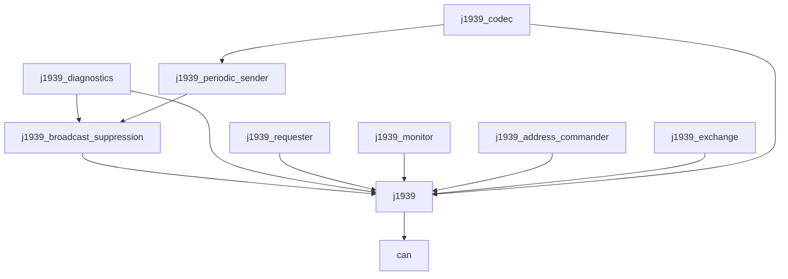

# J1939 engine, parts, codec and spy

[日本語](ja/code-map-j1939.md)

This is the map for changes in this area. Start at [code-map.md](code-map.md); common test rules are in [code-map-testing.md](code-map-testing.md).

Related specifications and change areas: [internals/j1939.md](internals/j1939.md) / [j1939-codec.md](j1939-codec.md) / [j1939-guide.md](j1939-guide.md)

## Test labels

### `j1939`

| Test | Covers | Labels |
|---|---|---|
| `j1939.*` | Unit tests of `vehicle_sil::j1939` (built without SIL Kit) | `unit` too |
| `j1939_silkit.*` | Tests on SIL Kit | `unit` too |
| `j1939_parts.*` | Protocol parts | |
| `j1939_codec.*` | Typed messages | |
| `j1939_spy.*` | `Spy` (`tests/spy`) | `unit` too |
| `local.boundary`, `testkit.boundary`, `peer.boundary`, `simulation.boundary`, `ecu.boundary` | The sources of each directory do not use the engine's internals | `unit` and `j1939` |

What they check in the engine:

- PGNs and identifiers, single-frame transmission and reception, dispatch by destination, local loopback
- The order of frames with the same time and the firing of timers do not depend on step size or arrival order
- Responses to a Request, and ACK/NACK
- NAME and Address Claim (including contention between several nodes and several networks, picking an arbitrary address, the address table, address violations and Commanded Address)
- Several networks on one host (gateways, failure of one of them)
- Reentrancy and failures, step size checks, resource limits
- No memory allocation in steady-state steps
- On a virtual bus with timing, the protocol results do not change. Congestion delays transfers, and a saturated bus leads to timeouts.
- TP timeouts and recovery when one ECU is disconnected from the bus (receive only, and both transmit and receive)
- Resolution of a hidden address conflict
- Real-time behavior on SIL Kit without time synchronization
- The toolbox (reentrancy of release and destruction, destruction after the `Network`, the origin and scheduling of timers)
- `j1939.seat_*`: the listener seat, an internal interface of the engine (what it hears, its order against the `Observer`, handlers and timers, that it is read-only, that having it or not changes no trace)
- `j1939.sniffer_*`: `TransferSniffer`, with the rules on hand-written frames and agreement with the receiving node of an engine that got the same frames (transfers between engines, fault injection with a fixed seed); `j1939.sniffer_boundary` checks that it does not depend on `Network`
- `j1939.listener_*`: `Listener`: what it overhears from exchanges between engines matches the receiver, transmissions of nodes of the same `Network` are not passed, how node addresses are handled, the order of handlers, that it is read-only, construction and destruction; `j1939.sniffer_boundary` also checks that `listener.cpp` uses no engine internals other than the seat
- Overrides of a node's address and NAME (`NetworkOptions::node_overrides`): the functions that apply them and the round trip of the text form, claiming with the changed values, what is refused and its message, nodes added after the start closed it keeping the values of the code, 2 copies of the same node code on one bus, and the changed values after a lost claim, a Request and a Commanded Address (`j1939.*override*`)

Virtual bus and SIL Kit give the same result:

- With an in-process registry, the trace of the same scenario is the same on the virtual bus and on SIL Kit (also with the simple CAN Network Simulator)
- `j1939_silkit.listen_only_participants_*`: adding listen-only participants (raw CAN, a `Network` without nodes, the same with a `Listener`, various step sizes) does not change a single line of each ECU's received data, the frames passed to its port, or its transmit acknowledgements and statistics
- In the same test, the listen-only participants send nothing (on both the virtual bus and SIL Kit)

Protocol parts (`j1939_parts.*`):

- DM13, diagnostics, identification, transmit contention, deferred ACK, results that do not depend on step size
- `j1939_parts.boundary`: the protocol parts do not use the engine's internals

Typed messages (`j1939_codec.*`):

- The bit layout is compared with a bit-by-bit implementation
- Conversion between raw and physical values, rounding and range edges
- Special values (the J1939 profile, user profiles, inheritance and overriding, Proprietary B that uses every bit pattern as a value, keeping the raw value)
- Enumerations, selectors, fill values, lengths
- A round trip of every raw value of small signals
- Transmission and reception on a node
- `j1939_codec.generator`: the generator rejects wrong definitions

`Spy` (`j1939_spy.*`), on an ECU of `LocalBench`:

- The names and values of the watchers' variables, and the order in which watchers are called
- Getters run after the handlers of their step, and what `Scope::now()` returns in a handler and in a getter
- The destruction order (the handlers are removed, then the watchers are destroyed, and the `Listener` last), watchers added by a watcher, `Scope::on_step`
- If a `Spy` that wrote variables is destroyed before its ECU, the next step stops (on the virtual bus and on SIL Kit)
- The breakdown and the sum of the missed-traffic variables, and the error messages
- `watch<M>()` with generated and hand-written types: each signal (integer or real), its state, `count`, `last_ms`, `period_ms`, `size`, `invalid`, `stale`, the `from` and `to` filters, a message older than the latest one, two messages with the same time, a 64-bit counter beyond `std::int64_t` (a real number), a name the ECU has already (no variable published), and the error messages
- `j1939_spy.watch_of_a_signal_named_count_does_not_build`: a signal named like an item of the watch is a build error (it builds a target outside the build, `vehicle_sil_spy_watch_clash`, by running the build tool in the build tree: do not build in the same tree at the same time). Not registered when vehicle-sil is a subproject or with a generator of several configurations (configure says so)
- With a `Spy`, the records of the other ECUs do not change, and the `Spy` sends nothing
- No memory allocation in steady-state steps
- The examples in the guide (`tests/spy/guide_example.hpp`, `guide_analysis.hpp`, `cal_messages.yaml`); `j1939_spy.guide_example_is_the_guides`: the guide shows these files unchanged. `j1939_spy.analysis_example_judges_each_write_by_its_answer`: the analysis example with an answer that matches, no answer, a different value, an answer over a connection and a second Write before the answer
- `j1939_spy.boundary`: `libs/spy` does not use the engine's internals. `j1939.sniffer_boundary` also checks that the engine does not know `vehicle_sil::spy`

## Code and tests by directory

### `libs/j1939` (engine)

For NodeOverride or the address/NAME text format, see [launcher j1939_nodes](code-map-launcher.md#j1939_nodes-in-the-configuration-file) for the matching rules, ECU executable argument format and tests.

| Name | Location |
|---|---|
| `Network`, `Node` | `j1939/network.hpp` |
| `Pgn`, `Identifier` | `j1939/types.hpp` |
| `Name` | `j1939/name.hpp` |
| Overrides of a node's address and NAME: `NodeOverride`, `apply_node_overrides()`, the conversion to and from text (used by `Network` and by tools that check beforehand) | `j1939/node_override.hpp` |
| `Subscription`, `Timer` | `j1939/toolbox.hpp` |
| `Observer` | `j1939/observer.hpp` |
| `TransferSniffer` (follows the transfers between other ECUs from the frames; does not depend on `Network`) | `j1939/transfer_sniffer.hpp` |
| `Listener`, `ListenerSubscription` (hears the messages of other participants, whatever their destination; the subscription holds a handler registration and removes it when destroyed) | `j1939/listener.hpp` |
| Address Claim and Request | `src/node.cpp` |
| Transport protocol | `src/transport.cpp` |
| Transfer sniffer | `src/transfer_sniffer.cpp` |
| The frame layout that the transport protocol and the sniffer both read (control bytes, checks on the form of an announcement; the timeouts are `ProtocolTiming` in `types.hpp`) | `src/transport_wire.hpp` |
| Listener seat (internal interface) | `src/frame_seat.hpp` |
| `Listener`, which sits in the seat | `src/listener.cpp` |

- Tests: `tests/j1939`
- `ctest -R`: `^j1939\.`, `^j1939_silkit\.`

### `libs/j1939/parts/<part>`

Each protocol part has one directory and one target.

Main classes and functions:

- `PeriodicSender` (`j1939/periodic_sender.hpp`)
- `Requester`, `Monitor`, `AddressCommander`, `Exchange`, `BroadcastSuppression`, `Diagnostics`, `Identification`
- `parse_dtc_list` (reads a received DM1 or DM2)

- Tests: `tests/j1939`
- `ctest -R`: `^j1939_parts\.`

### `libs/j1939/codec`, `tools/j1939_codegen`

| Name | Location |
|---|---|
| Signal types | `j1939/codec.hpp` |
| `attach_sender()`, `on_message()` | `j1939/codec_node.hpp` |
| Generator | `j1939_codegen.py` |
| `vehicle_sil_add_j1939_codec()` | `cmake/VehicleSilJ1939Codec.cmake` |

- Tests: `tests/j1939`
- `ctest -R`: `^j1939_codec\.`

### `libs/spy`

| Name | Location |
|---|---|
| `Spy`, `Scope`, `SpyOptions` (a listen-only participant writes what it hears to ECU variables; a watcher is a class that takes a `Scope&`), `WatchOptions` | `spy/spy.hpp` |
| `Spy::watch<M>()`, `Watch<M>` (a typed message as variables; needs `vehicle_sil::j1939_codec`) | `spy/watch.hpp` |

- Tests: `tests/spy`
- `ctest -R`: `^j1939_spy\.`

### `examples/j1939` (sender and receiver)

- Tests: `tests/integration`
- `ctest -R`: `^integration\.`

## Dependency direction

See the [diagram legend and layers](code-map-core.md#dependency-direction) and [boundary tests](code-map-testing.md#boundary-tests).

### J1939 engine and protocol parts

## What to update together

### Add a J1939 protocol part

Where to add:

- `libs/j1939/parts/<part>/`
- `add_subdirectory` in `libs/j1939/CMakeLists.txt`
- Tests: `SOURCES` and `LINK` of `vehicle_sil_j1939_parts_tests` in `tests/j1939/CMakeLists.txt`

Documentation to update:

- "[Directories and targets](architecture.md#directories-and-targets)" in [architecture.md](architecture.md)
- "[Protocol parts (`libs/j1939/parts`)](internals/j1939.md#protocol-parts-libsj1939parts)" in [internals/j1939.md](internals/j1939.md)
