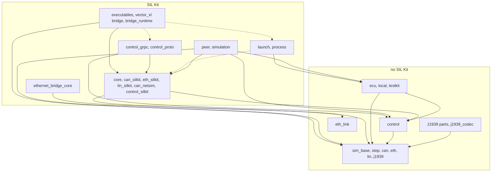
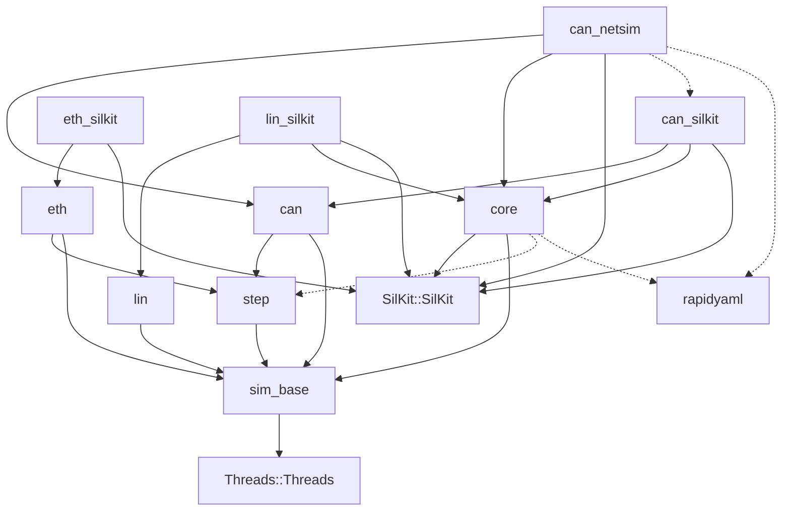
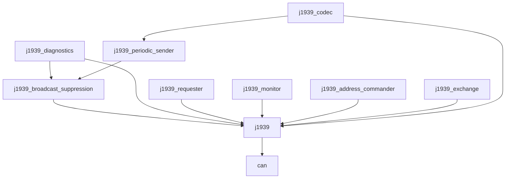
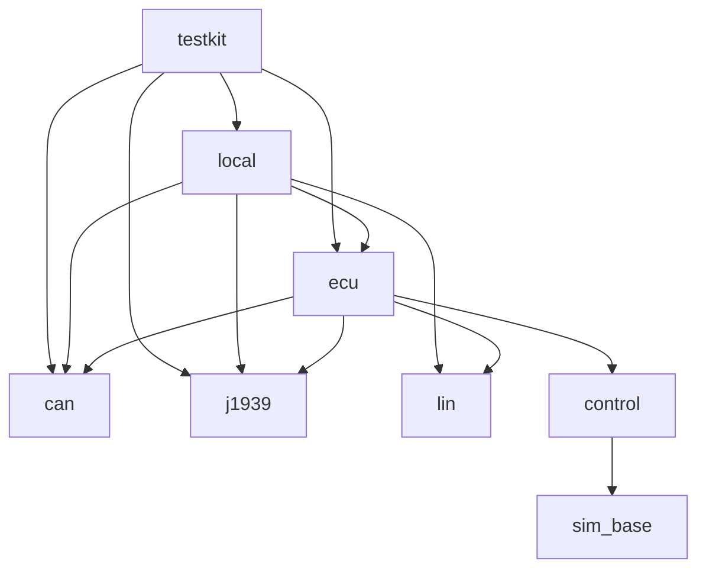
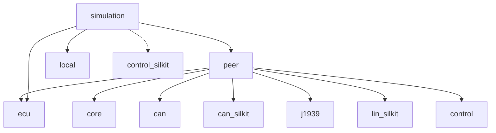
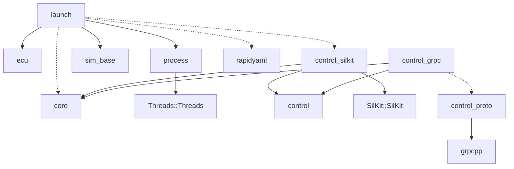
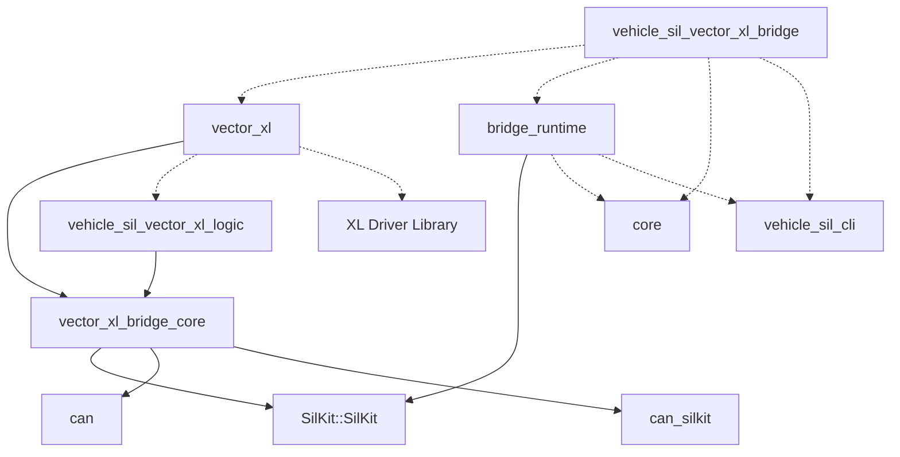
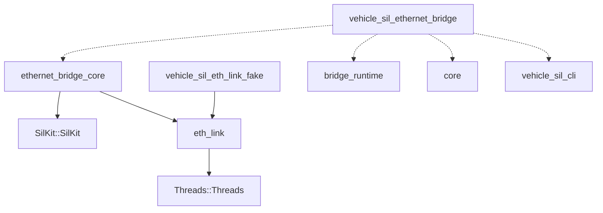

# コードの地図

<!-- 書き方: 「試験のラベル」「ディレクトリごとの場所と試験」「これを変えるならここも」は、1 文を 1 行に書きます（改行 1 つは同じ段落）。項目は小見出しか、空行で区切った箇条書きにします。表にすると 1 行が長くなり、別々の変更が同じ行に当たるためです。 -->

vehicle-sil 自体を直す人と AI エージェント向けです。変える場所、その試験、試験だけを回す方法を、探さずに見つけるための地図です。先に [AGENTS.md](../AGENTS.md)（文書の管理、コミット、検証のスクリプト）を読みます。次は [architecture.md](architecture.md)（全体の形）で、中の仕組みは変える場所の [internals/](architecture.md#中の仕組み) の文書にあります。

各ディレクトリと各ターゲットの内容は [architecture.md](architecture.md) の「構成」にあります。ここには書きません。

## 試験の名前と回し方

- 試験の名前は `<前置き>.<名前>` です。前置きは `tests/<領域>/CMakeLists.txt` の `PREFIX` です。
- `tests/` の直下の、`CMakeLists.txt` のあるディレクトリは、名前の順に自動で加わります（`tests/CMakeLists.txt` に行を足しません）。条件のある領域（`control_server`、`fetchcontent`、`integration`、`virtual_time` など）は、自分の `CMakeLists.txt` の先頭で条件を見て `return()` します。領域は、ほかの領域のターゲットを `if(TARGET ...)` で確かめません（順に頼るため）。
- CMake の一覧（`add_subdirectory`、ソース、シナリオ）は、1 行に 1 つ、名前の順に書きます。順に意味がある所は、コメントに書いてあります。
- 試験の実行ファイルの試験は、ソースの `TEST_CASE(名前)` から設定時に登録されます（`vehicle_sil_add_harness_tests()`、`cmake/VehicleSilTestHelpers.cmake`）。既存のソースに `TEST_CASE` を足すときは、CMake を書き換えません。新しいソースのファイルは、その `CMakeLists.txt` の `SOURCES` に足します。マクロ（`TEST_CASE`、`CHECK`、`CHECK_EQ`）は `tests/unit/test_harness.hpp` にあります。
- 1 つの試験は、試験の実行ファイルに名前を渡すと動きます（`<実行ファイル> <名前>`。ctest もそうしています）。
- プロセスを起動する試験（シナリオ）は `vehicle_sil_add_scenario_tests()` で登録し、名前は `<前置き>.<シナリオ>` です。シナリオの一覧は `CMakeLists.txt` の `SCENARIOS`、中身は同じディレクトリの `*launcher.cpp`（`tests/integration/launcher.cpp`、`tests/launch/launch_run_launcher.cpp` など）です。共通の部品は `tests/integration/launcher_support.hpp` にあります。
- 試験は決まったポートで待ち受けません。registry はポート 0（`RegistryProcess`、`registry_uri` を書かない構成ファイル）、Control Server は `--control 0`、GUI サーバーは `--port 0` か、e2e が起動のたびに選ぶ空いているポートです（`multi_host.two_hosts` の 18500 は、試験が作る network namespace の中）。同じ PC で、別の作業ツリーのビルドの試験と同時に回せます。文書が示す決まったポート（`manual` の 8500 など）が要るシナリオは、`vehicle_sil_add_scenario_tests()` の `MACHINE_LOCK` で PC 全体のロック（`/tmp` のファイルに `flock`。`cmake/vehicle_sil_machine_lock.sh`。Windows ではなし）を取り、順に回ります。待つ間は 1 行出し、待った時間はその試験の CTest の `TIMEOUT` に数えます。ロックのファイルを開けないとき（別の利用者のファイルなど）は、1 行言ってロックなしで回ります。
- 前置きだけを回すときは、`\.` まで書きます。`^j1939` は `j1939_parts.`、`j1939_codec.`、`j1939_silkit.` にも当たります。
- 起きるはずのことは、`eventually(条件, 上限)`（`test_harness.hpp`）か、起きたことを知らせる手段で待ちます。決まった時間だけ眠って「進んだはず」としません。
  - 待ちの上限には倍率が掛かります。倍率は、試験を動かすときの環境変数 `VEHICLE_SIL_TEST_TIMEOUT_SCALE`、なければビルドの既定（CMake のキャッシュ変数 `VEHICLE_SIL_TEST_TIMEOUT_SCALE_DEFAULT`。既定は 1、TSan のプリセットは 4）です。値は数字と小数点 1 つだけで書き、0 より大きくします（`3`、`2.5`）。ほかの書き方（空白、指数、16 進）は、C++ の試験、GUI サーバーの試験、e2e が変数の名前と直し方を言って止まります。CI は 3 を与えます（TSan のジョブは与えずに、プリセットの既定を使います。`.github/workflows/ci.yml`）。
  - 倍率を掛けるかどうかは、値の種類で決まります。
    1. 起きるはずのことを待つ上限には掛けます。上限として製品に渡す時間（ランチャーが製品の `--timeout-ms` に渡す値など）も同じです。通る試験は待つものが起きた時点で進むので、倍率を上げても遅くなりません。
    2. 時間切れになることを確かめる値のうち、時間切れの前に子プロセスや別のスレッドが何かを終えていなければならないもの（子が 1 行書いてから打ち切られる、など）には掛けます。期待の文に出る数も同じ値から作ります。この試験は、倍率の分だけ必ず長くなります。
    3. 「起きないこと」を確かめる待ち、周期、時間切れの値そのものを確かめる試験の値（`receiver-timeout` の 1500 ms など）には掛けません。掛けると、試験が確かめることが変わります。
  - 関数に上限を渡すときは `scaled_timeout(20s)`（`tests/unit/test_timeout_scale.hpp`。GUI サーバーの試験は `conftest.py` の `scaled()`、e2e は `scaled()`）を通します。上限を受け取って中で倍率を掛ける関数（`eventually`、`tests/process/spawn_sleeper.hpp` の待ち、シナリオのランチャーの `--timeout-ms` など）は、そのドキュメントコメントに「scaled」と書きます。そうした関数に渡す値には、呼ぶ側で掛けません。
  - ハーネスの試験とシナリオの試験の CTest の `TIMEOUT` は、構成のときの倍率（環境変数、なければビルドの既定。切り上げた整数）で伸びます（`cmake/VehicleSilTestHelpers.cmake`）。構成の後で倍率を大きくしたら、構成し直します。そのままだと、止まった試験は自分で失敗を言う前に CTest に止められます。ハーネスとランチャーは、そのときに `warning: ... configure the build again ...` の 1 行を出します。

```sh
ctest --preset linux-gcc-debug -R '^launch\.'
scripts/verify.py linux-gcc-debug --tests '^launch_run\.'
```

## 試験のラベル

各プロセスのログは `build/<preset>/tests/` の下の `integration/<シナリオ>/`、`virtual_time/<シナリオ>/`、`lin_cluster/<シナリオ>/`、`vector_xl/integration/<シナリオ>/` に残ります。失敗したときは、ランチャーがすべてのログを出力します。

- テストケースの登録漏れは、テスト実行ファイルごとの `<ラベル>.registration` テストが検出します（実行ファイルの `--list` と登録した名前を比べる）。
- クロスビルドでは、`CMAKE_CROSSCOMPILING_EMULATOR`（たとえば `wine`）を指定すると、`ctest` がテストの実行ファイルをそれで動かします（`registration` テストも含む）。Windows の DLL（MinGW の実行時ライブラリ）は、実行ファイルの隣に置くなどして見つかるようにしてください。
- テストプリセットは 8 並列で実行します。`scripts/verify.py` は、CPU がそれより少ない PC では CPU の数だけ並べます。壁時計の所要時間を測るテスト（`virtual_time.*`、`core.virtual_time_*`、LIN の速度のテスト）は単独で実行されます。

```sh
ctest --preset linux-gcc-release -L integration
# FetchContent テスト（依存ライブラリを一から再ビルドするので時間がかかる）
cmake --preset linux-gcc-release -DVEHICLE_SIL_TEST_FETCHCONTENT=ON
ctest --preset linux-gcc-release -L fetchcontent
```

### `unit`

コマンドライン解析（`unit.*`）。
`core`、`lin`、`step`、`can`、`eth`、`j1939`、`peer`、`testkit`、`ecu`、`simulation`、`control`、`control_server`、`launch`、`process`、`vector_xl` の単体テストと境界の検査にもこのラベルが付く。
`template.get_tools`（ひな形の `get_tools.py` と `scripts/package.py` の `template`、`version` を、手元で作った圧縮ファイルで確かめる）にも付く。
付かないのは、プロセスを起動するシナリオの試験（`integration`）、サンプルの実行（`examples`。
ただし `param_service.demo` には付く）、Python のクライアントの試験（`python`）、`fetchcontent`

### `integration`

`sil-kit-registry`、receiver、sender（実時間の `Peer` と J1939 スタック）を別プロセスで起動し、終了コードで判定する。
`address-claim-and-pgn` は Address Claim と PGN の CAN ID とペイロードの一致を、`receiver-timeout` はタイムアウト処理を検証する。
`receiver-detects-wrong-name` と `receiver-detects-wrong-payload` は、receiver が誤った NAME と壊れたペイロードを失敗として報告することを確かめる（`integration.*`）。
このラベルは、プロセスを起動するほかのシナリオの試験にも付く: `virtual_time.*`、`lin_cluster.*`、`launch_cli.*`、`launch_run.*`、`ecu_main.*`、`vector_xl.integration.*`、`control_server.launcher`（それぞれの項目）、`template.check_and_run`（ひな形の ECU を本体のビルドで作り、ランチャーで照合、実行、シナリオ。
照合と実行の出力を手引き「最初の ECU を作る」と照合）

### `vector_xl`

CAN ブリッジのテスト。
全プラットフォームで、テスト専用の XL ドライバのフェイクに対して本番のコードを動かす。
CanBridge の単体テスト、XL バックエンドのテスト、実際の SIL Kit を使うプロセス内のテスト、ブリッジの実行ファイルを使う E2E テストがある。
E2E では、エコーノードとの往復（Virtual CAN と、ビットレートを設定する物理 CAN）、送信レシートが返ってくる場合のループ防止、`--list-channels`、存在しないチャネル、引数の誤り、registry につながらない場合、ドライバがない場合、止める要求で止めたときの統計の 1 行と終了コード 0（Windows では共有するコンソールがなければ飛ばす）を確かめる

### `step`

`vehicle_sil::step` の単体テスト（CAN と SIL Kit なしでビルドする）。
CAN でない試験用の参加者（`Member`）で、段の順序、`start()` が 1 回だけ最初のステップの前に呼ばれること、時間の領域の混在の拒否（ホストとドライバー）、失敗の扱い、`post()` と起こし方、`next_deadline()`、仮想時間の `StepDriver`、差し替えた時計の上の `RealTimeDriver`（締め切りと到着で起きる）を確かめる。
`step.boundary` は `libs/step` が SIL Kit のヘッダーを直接にも間接にも含まないことを検査する（`unit` ラベルも付く）

### `can`

`vehicle_sil::can` の単体テスト（SIL Kit なしでビルドする）、SIL Kit のポートのテスト（`can_silkit.*`）、簡易 CAN Network Simulator のテスト（`can_netsim.*`）。
フレームの検証、仮想バスの受信順序とあふれ、ホストの段階の順序と失敗、ステップドライバーの順序、送信時間と調停（11 ビット / 29 ビット）、混雑、送信キュー、受信側のステップ幅によらないこと、ポートの事象（送信の結果、受け箱のあふれ、バス状態、エラーフレーム）、故障注入と ECU 単位の通信断、`post()`、時間の領域の混在の拒否、実時間のドライバー（差し替えた時計での決定的な試験と、壁時計での到着と順序）を確かめる。
簡易 CAN Network Simulator では、プロセス内の participant と実行ファイルの両方で、仮想バスと同じ受信の時刻になること、繰り返しても同じ結果になること、送信時刻のない送信者、コントローラーのモード（始めていないコントローラーの送信を捨てること、`Reset()` での送信の取り消し、止めたコントローラーへの配送）、設定ファイルの読み込みを確かめる。
プロセス内のレジストリで、同じシナリオのトレースが仮想バスと SIL Kit で一致すること（ステップ幅の組み合わせを変えて）と、送信の続く中で participant を決まった順序で止めて破棄できることを確かめる（`unit` ラベルも付く）

### `eth`

`vehicle_sil::eth` の単体テスト（`eth.*`。
SIL Kit なしでビルドする）と SIL Kit のポートのテスト（`eth_silkit.*`）。
フレームと MAC アドレスの型、仮想ネットワーク（ハブとしての配り方、次のステップに届くこと、短いフレームの埋め、自分のフレームを受けないこと、時刻の順、あふれ）、チャネル（`step::Host` と `StepDriver` の上で回ること、ゲートウェイ、同じ時刻のフレームを送り元のアドレスで並べること、`on_frame()` と `receive()`、送信の段、上限、絞り込み、ポートの事象、選択肢の誤り、ステップの中で確保しないこと（`eth.steps_do_not_allocate`。
専用の実行ファイル））、偽のコントローラーに対するポート（時刻同期していない送り手のフレームの時刻、あふれた送信の確認を含む）、プロセス内のレジストリで同じシナリオの記録が仮想ネットワークと SIL Kit で一致すること（ステップ幅の組み合わせを変えて。
3 つの送り手が同じ時刻に送る場合を含む。
アドレスを登録の順とずらし、仮想ネットワークの側でもアドレスの順を確かめる）。
`eth.boundary` は `libs/eth` が SIL Kit のヘッダーを直接にも間接にも含まないことを検査する（`unit` ラベルも付く）

### `j1939`

`vehicle_sil::j1939` の単体テスト（SIL Kit なしでビルドする）と SIL Kit 上の試験（`j1939_silkit.*`）。
PGN と識別子、単一フレームの送受信、宛先の振り分け、ローカル折り返し、同じ時刻のフレームの順序とタイマーの発火がステップ幅と到着順によらないこと、Request への応答と ACK/NACK、NAME と Address Claim（複数ノードと複数 Network の競合、任意アドレスの選択、アドレス表、アドレス違反、Commanded Address を含む）、1 つのホストの複数の Network（ゲートウェイ、片方の失敗）、再入と失敗、ステップ幅の検査、資源の上限、定常状態のステップでメモリを確保しないことを確かめる。
プロセス内のレジストリで、同じシナリオのトレースが仮想バスと SIL Kit で一致することも確かめる（簡易 CAN Network Simulator ありでも。
`unit` ラベルも付く）。
聞くだけの participant（生の CAN、ノードのない `Network`。ステップ幅はいろいろ）を足しても、各 ECU の受信、ポートに渡したフレーム、送信確認と統計が 1 行も変わらず、聞くだけの participant が何も送らないことも、仮想バスと SIL Kit で確かめる（`j1939_silkit.listen_only_participants_*`）。
タイミングありの仮想バスで、プロトコルの結果が変わらないこと、混雑で転送が遅れ、バスが飽和すると時間切れになることも確かめる。
1 つの ECU がバスから切り離されたとき（受信だけ、送受信とも）の TP の時間切れと回復、隠れていたアドレスの衝突の解決、時刻同期なしの SIL Kit での実時間の動作も確かめる。
道具箱（解除と破棄の再入、Network の後の破棄、タイマーの起点と予約）とプロトコル部品（`j1939_parts.*`: DM13、診断、識別情報、送信の競合、後で返す ACK、ステップ幅によらない結果）も確かめ、`j1939_parts.boundary` が部品がエンジンの内部を使っていないことを検査する。
型付きメッセージ（`j1939_codec.*`）は、ビット配置をビットごとの実装と照合し、raw 値と物理値の変換、丸めと範囲の端、特別な値（J1939 のプロファイル、利用者のプロファイル、継承と上書き、すべてのビットパターンを値として使う Proprietary B、raw 値の保持）、列挙、セレクター、埋め値、長さ、小さい信号のすべての raw 値の往復、ノードでの送受信を確かめる。
`j1939_codec.generator` は生成器が誤った定義を止めることを確かめる。
`local.boundary`、`testkit.boundary`、`peer.boundary`、`simulation.boundary`、`ecu.boundary` も、それぞれのディレクトリのソースがエンジンの内部を使っていないことを検査する（ラベルは `unit` と `j1939`）

### `peer` / `testkit`

`Peer` をプロセス内のレジストリで動かす試験（J1939 と LIN の 3 つの participant、仮想バスと同じ結果、実時間と外部ポート、組み立ての誤り、失敗の報告）と、試験キットの試験（アドレスの喪失、Address Claimed の欠落、TP のパケットの欠落、通信断、生フレームの注入、受信側のステップ幅と記録の有無によらない結果）。
`ecu_api.*` は、利用者が書く形の ECU（`examples/j1939/ecu_pair`、道具箱と `Requester` で作る独自のプロトコル、`Monitor` と `Observer` と tap で通信を確かめる試験）を仮想バスで動かす。
`param_service.*` は、`examples/j1939/param_service` の独自プロトコルを仮想バスで動かし（正常な流れ、セッションの期限切れ、2 つ目のツール、応答しない ECU、アドレスの変化と喪失、拒否、動作中の部品の破棄）、`param_service.boundary` は例が公開 API だけを使うことを、`param_service.demo` は例の実行を確かめる。
`ecu_api.*` と `param_service.*` のラベルは `testkit` で、`peer.*`、`testkit.*`、`ecu_api.*`、`param_service.*` には `unit` と `j1939` のラベルも付く。
エンジンの内部を使っていないことの検査（`peer.boundary`、`testkit.boundary`、`local.boundary`）は `j1939` の行

### `ecu`

ECU の自己申告の JSON（`to_json(EcuDescription)`）の単体テスト（SIL Kit なし。
空と全部入りの全文、キーの順、数値、64 ビットの列挙の値、NAME の文字列、文字列のエスケープ、版）。
`ecu.no_silkit_boundary` と `ecu.simulation_headers_boundary` は、`libs/ecu` と `libs/simulation/include` が SIL Kit のヘッダーを直接にも間接にも含まないことを、`ecu.boundary_check_*` はその検査自体を確かめる（`unit` ラベルも付く）

### `simulation` / `examples`

`Simulation` の試験（同じ ECU が仮想バスと SIL Kit で同じ記録を残すこと、ECU が持つオブジェクトの破棄、ステップの失敗が `SimulationError` になって戻ること、使い方の誤り（同じ入力を両方の実装で拒否すること、`App` のコンストラクターの例外）、`request_stop` で終わる実行、ほかの participant の失敗、開始の時間切れ、`local()` から足した ECU、別プロセスの controller や participant との併用、2 つのネットワークを持つゲートウェイ、生の CAN、LIN の Master と Slave、イーサネットのチャネル（`test_ethernet.cpp`: 次のステップで届くこと、同じ時刻の順、絞り込み、1 ステップに `receive_capacity` までのフレームを落とさないこと、断る文言、`LocalBench` の参照）が両方で同じ結果になること、`Ecu::describe()`、関数として呼んだ `ecu_main()` の引数と終了コード）と、サンプルの実行（`vehicle_sil_getting_started`（仮想バスと `--silkit`）、`typed_messages`、`pid_stream`、`fault_injection`、`vehicle`（SIL Kit と `--local`）、`low_level`、`vehicle_sil_ethernet_example`（仮想ネットワークと `--silkit`、別の EtherType、引数の誤り））。
サンプルは自分で結果を検査し、違えば 0 以外で終わる。
`ecu_main.*` は `examples/ecu_main` の ECU の実行ファイルをプロセスとして動かす（`--describe` の JSON を [docs/ecu-executable.md](ecu-executable.md) の例と、vehicle-sil の版を除いてバイト単位で照合、`--local`、`vehicle_sil_sim_controller` の下の SIL Kit での 2 つの ECU、使い方、止める要求）。
ラベルは、`simulation.*` が `unit` と `simulation`、サンプルの実行が `examples` と `simulation`（`low_level.demo` は `examples` だけ）、`ecu_main.*` が `integration` と `simulation`

### `core` / `lin`

仮想時間の単体テスト。
プロセス内のレジストリで、ステップ幅の違う参加者の同期、最も遅い参加者を待つこと、実時間への結合、`TickScheduler`、`StepInbox`、LIN のスケジュール、応答、Master のフレームの受信、休止と起床、スケジュールの切り替えを確かめる。
LIN は主なシナリオを仮想 LIN バスの上でも確かめ（`lin_local.*`）、仮想 LIN バスだけの試験（`lin_bus.*`）と、`vehicle_sil::lin` が SIL Kit を含まないことの検査（`lin.boundary`）もある（`unit` ラベルも付く）

### `virtual_time`

registry、controller、4 つのピア（1 / 2 / 5 / 10 ms。
どれも `Peer` の上）を別プロセスで動かす。
トレースを照合して、データがピアの間を予測どおりの仮想時刻で渡ること、J1939 の ECU が Address Claim の 250 ms 後から送ることを確かめる。
全速、遅い `tick()`、4 倍速、0.5 倍速の各条件でトレースが一致し、壁時計の所要時間が実時間より速い・遅いことも確かめる。
`peer-failure` は、途中で失敗したピアを controller が検出して中断し、全プロセスが終了コード 1 で終わることを確かめる（`integration` ラベルも付く）

### `lin`（`lin_cluster.*`）

registry、controller、LIN の Master と 2 つの Slave（5 / 2 / 4 ms）を別プロセスで動かす。
トレースを照合して、スケジュール、両方向のフレーム、Master・Slave・bus idle による休止と起床を確かめる。
Slave の 1 つを実時間に結合してもトレースが一致することも確かめる（`integration` ラベルも付く）

### `launch` / `process`

構成ファイルの読み込みと照合の規則（プロセスを起動しない試験。
各規則の通る例と落ちる例を、文言と行番号まで照合する）、人向けと JSON の出力。
`launch_cli.*` は `vehicle_sil_launch check` を実行ファイルとして動かす（[docs/simulation-config.md](simulation-config.md) の例とバイト単位で照合、`--describe` に失敗する実行ファイル、`--strict`、読めないファイル、引数の誤り）。
`launch_run.*` は `vehicle_sil_launch run` を実行ファイルとして動かす（docs の例との照合、失敗する ECU、そろわない participant、終わらない participant、残されたプロセス、中断、ランチャーが落ちたとき、速さと一時停止とステップ送り、実時間への遅れ、`examples/ethernet` の 2 つの ECU の照合とシナリオ（`launch_run.ethernet`）、`vehicle_sil_launch test`（`launch_run.test_command`、`launch_run.test_interrupt`））。
`process.*` は子プロセスの試験（標準出力と標準エラーの取り込み、行ごとの受け渡し、時間切れ、空の標準入力、作業ディレクトリ、受け継がないハンドル、止める要求、起動したプロセスごとの終了、空白と ASCII 以外の文字を含むパスと引数）

### `control`

Control Agent の試験（`control.*`）。
転送なしで Agent を直接動かす試験、`Ecu` で宣言した変数への時刻つきの書き込みが仮想バスと SIL Kit で同じステップに反映され、同じ時刻に読み出されること、`Peer` の Agent（SIL Kit の participant で、反映の位置、実時間、監視の出力）、プロセス内でつないだ `Hub`、ECU より長く残った転送がプロセスを止めること（`unit` ラベルも付く）。
`control_server` の試験にもこのラベルが付く

### `control_server`

`VEHICLE_SIL_BUILD_CONTROL_SERVER=ON` のときだけ（プリセット `linux-gcc-control`。
CI もこれで回し、GUI サーバーの試験もこのランチャーで回す）。
Control Server の試験（`control_server.*`）: gRPC の生成コードと呼び出し、1 つのプロセスで端から端まで（2 つの J1939 の Peer の Agent が SIL Kit でつながる Hub、時間ゲート、gRPC のクライアント）、認証と役割と TLS と監査ログ、どの役割がどの RPC を呼べるか（proto の RPC と規則の表の対応も）、メッセージの変換、上限と入力の検査、`SimulationMonitor`（`unit` と `control` のラベルも付く）。
grpcio と grpcio-tools のある Python があれば、`control_server.python_client` が Python のクライアントと CLI を `vehicle_sil_launch run --control` に対して動かし、`control_server.launcher` が `vehicle_sil_launch run --control` と `examples/ecu_main` の ECU を動かし（始まる前の書き込み、2 つの口の命令、終わり方、認証と TLS と監査、トークンつきの CLI）、`control_server.example_write_before_start` と `control_server.example_pause_and_step` が `examples/launch_control` を動かす（どれも `control` と `python` のラベル。
`launcher` には `integration` も、例には `examples` も付く）

### `eth_link` / `ethernet_bridge`

イーサネットのブリッジの試験（全プラットフォーム。
`unit` ラベルも付く）。
`eth_link.*` は SIL Kit なしで、MAC アドレス、絞り込み（EtherType、VLAN タグの先、MAC、最大長）、MAC の表、偽の口、pcap の口（`eth_link.pcap_*`: 文、インターフェースの選び方、実行時に読み込んだ偽の pcap のライブラリでの送受信と失敗。
Windows では `eth_link.fake_pcap_imports.*` が、偽のライブラリの使う DLL がブリッジの探させる場所にあるものだけかを見る）を確かめ、`eth_link.boundary` が `libs/eth_link` に SIL Kit の include がないことを確かめる。
`ethernet_bridge.*` は、偽の SIL Kit のコントローラーと偽の口で転送、絞り込み、自分のフレームの戻り、2 つのブリッジを通る輪（止まる順序と止まらない順序）、失ったフレーム、`Fault`、警告を、ほかに統計と監視の行、引数の誤りの文言を確かめる。
`ethernet_bridge.silkit_*` はプロセス内のレジストリ（空いているポート）で本物の SIL Kit の側を確かめる。
`ethernet_bridge.integration.*`（`integration` ラベル）は、偽の口をリンクした実行ファイルをプロセスとして動かし、往復、終了コード、止め方を確かめる。
`ethernet_bridge.integration.pcap-*` は、OS の口の実行ファイルに偽の pcap のライブラリを読み込ませて同じことを確かめる。
`ethernet_bridge.netns.*`（Linux だけ、`integration` ラベル）は、名前空間の中の TAP デバイスと veth で、本物の実行ファイルの `tap`、`packet`、`pcap`（本物の libpcap）を確かめる（作れない所、libpcap がない所では飛ばす）

### `bridge_runtime`

ブリッジの実行ファイルが共有する `run_bridge()` の試験（全プラットフォーム。
`unit` ラベルも付く）。
偽の `hooks` と状態を決めた偽の participant で、終了コード、止める順（統計を SIL Kit の participant の停止より先に出す）、`fault()` と participant の失敗、警告と監視の行、起動の途中の状態を失敗にしないこと、起動の上限を確かめる。
1 つはプロセス内のレジストリ（空いているポート）で本物の participant を使う。
registry につながらないときの文（`registry_failure_message()`）は、SIL Kit が実際に投げる文でも確かめる

### `fetchcontent`

既定では無効。
このリポジトリのコミットを FetchContent で取り込み、利用例をビルドして実行する。
`fetchcontent.template` は、ひな形を別のディレクトリに写し、いまの作業ツリーを FetchContent で取り込んでビルドし、照合と実行とシナリオを通す

## ディレクトリごとの場所と試験

ヘッダーは `include/` の下のパスです。

### `libs/core`

- 主なクラス・関数（ヘッダー）: `ParticipantRuntime`（`vehicle_sil/core/participant_runtime.hpp`）、`SimulationController`、`StartWindow`（`core/simulation_controller.hpp`）、`TickScheduler`（`core/tick_scheduler.hpp`）、`bind_host()`（`core/bind_host.hpp`）。
  `sim_base` の `SimTime`（`core/sim_time.hpp`）、`StepInbox`（`core/step_inbox.hpp`）、`periodic()`（`core/periodic.hpp`）
- 試験: `tests/core`
- `ctest -R`: `^core\.`

### `libs/step`

- 主なクラス・関数（ヘッダー）: `Member`、`Host`（`step/host.hpp`）、`StepDriver`（`step/step_driver.hpp`）、`RealTimeDriver`（`step/real_time_driver.hpp`）、`RealTimeClock`、`ManualRealTimeClock`（`step/real_time_clock.hpp`）、`TimeDomain`、`Wakeup`（`step/time_domain.hpp`）、`SinkRef`（`step/sink_ref.hpp`）
- 試験: `tests/step`
- `ctest -R`: `^step\.`

### `libs/can`

- 主なクラス・関数（ヘッダー）: `Frame`（`can/frame.hpp`）、`Port`（`can/port.hpp`）、`Host`、`Steppable`（`can/host.hpp`。
  `Host` は `step::Host` の上）、`StepDriver`、`RealTimeDriver`、時計（`can/step_driver.hpp`、`can/real_time_driver.hpp`、`can/real_time_clock.hpp`。
  `vehicle_sil::step` のものの別名）、`RealTimeReceiver`（`can/real_time_receiver.hpp`）、`VirtualCanBus`（`can/virtual_can_bus.hpp`）、`CanBusModel`（`can/bus_model.hpp`）、`TapPort`（`can/tap_port.hpp`）、`RawChannel`（`can/raw_channel.hpp`）
- 試験: `tests/can`
- `ctest -R`: `^can\.`

### `libs/can_silkit`

- 主なクラス・関数（ヘッダー）: `SilKitCanPort`、`bind_host()` の別名（`can_silkit/silkit_can_port.hpp`。
  本体は `core/bind_host.hpp`）
- 試験: `tests/can`
- `ctest -R`: `^can_silkit\.`

### `libs/can_netsim`、`tools/can_bus_simulator`

- 主なクラス・関数（ヘッダー）: `CanBusSimulator`（`can_netsim/can_bus_simulator.hpp`）、`NetworkSimulatorConfig`（`can_netsim/network_simulator_config.hpp`）
- 試験: `tests/can`
- `ctest -R`: `^can_netsim\.`

### `libs/eth`、`libs/eth_silkit`

- 主なクラス・関数（ヘッダー）: `Frame`、`MacAddress`（`eth/frame.hpp`）、`Port`、`PortEvent`（`eth/port.hpp`）、`Channel`（`eth/channel.hpp`）、`VirtualEthernetBus`（`eth/virtual_ethernet_bus.hpp`）、`SilKitEthPort`（`eth_silkit/silkit_eth_port.hpp`）
- 試験: `tests/eth`
- `ctest -R`: `^eth\.`、`^eth_silkit\.`

### `libs/lin`、`libs/lin_silkit`

- 主なクラス・関数（ヘッダー）: `LinMaster`（`lin/lin_master.hpp`）、`LinSlave`（`lin/lin_slave.hpp`）、`LinPort`（`lin/lin_port.hpp`）、`VirtualLinBus`（`lin/virtual_lin_bus.hpp`）、`SilKitLinPort`（`lin_silkit/silkit_lin_port.hpp`）
- 試験: `tests/lin`
- `ctest -R`: `^lin_bus\.`（仮想 LIN バス）、`^lin_local\.`（`LocalBench` の上）、`^lin\.`（SIL Kit の上）、`^lin_cluster\.`（`examples/lin` のプロセス）

### `libs/j1939`（エンジン）

- 主なクラス・関数（ヘッダー）: `Network`、`Node`（`j1939/network.hpp`）、`Pgn`、`Identifier`（`j1939/types.hpp`）、`Name`（`j1939/name.hpp`）、`Subscription`、`Timer`（`j1939/toolbox.hpp`）、`Observer`（`j1939/observer.hpp`）。
  Address Claim と Request は `src/node.cpp`、トランスポートプロトコルは `src/transport.cpp`
- 試験: `tests/j1939`
- `ctest -R`: `^j1939\.`、`^j1939_silkit\.`

### `libs/j1939/parts/<部品>`

- 主なクラス・関数（ヘッダー）: 部品ごとに 1 つのディレクトリとターゲット。
  `PeriodicSender`（`j1939/periodic_sender.hpp`）、`Requester`、`Monitor`、`AddressCommander`、`Exchange`、`BroadcastSuppression`、`Diagnostics`、`Identification`
- 試験: `tests/j1939`
- `ctest -R`: `^j1939_parts\.`

### `libs/j1939/codec`、`tools/j1939_codegen`

- 主なクラス・関数（ヘッダー）: `j1939/codec.hpp`（信号の型）、`j1939/codec_node.hpp`（`attach_sender()`、`on_message()`）、生成器 `j1939_codegen.py`、`vehicle_sil_add_j1939_codec()`（`cmake/VehicleSilJ1939Codec.cmake`）
- 試験: `tests/j1939`
- `ctest -R`: `^j1939_codec\.`

### `libs/ecu`

- 主なクラス・関数（ヘッダー）: `Ecu`（`ecu/ecu.hpp`）、`EcuDescription`、`to_json()`、ネットワークの種類と使い方の一覧 `kNetworkKinds`・`kNetworkUses`（`ecu/describe.hpp`）、ECU の実行ファイルとランチャーの約束（引数、終了コード、`kMaxMillis`。
  `ecu/executable.hpp`）、バスからの切り離し（`ecu.connected`。
  `BusConnection`、`GatedCanPort`、`GatedLinPort`、`GatedEthPort`、`ecu/detail/bus_connection.hpp`）
- 試験: `tests/ecu`、`tests/simulation`（`test_disconnect.cpp`）
- `ctest -R`: `^ecu\.`、`^simulation\.disconnect`

### `libs/local`

- 主なクラス・関数（ヘッダー）: `LocalBench`（`local/local_bench.hpp`）
- 試験: `tests/testkit`、`tests/lin`
- `ctest -R`: `^testkit\.`、`^lin_local\.`、`^local\.`

### `libs/testkit`

- 主なクラス・関数（ヘッダー）: `J1939Events`、`FrameLog`（`testkit/recorders.hpp`）、`faults`（`testkit/faults.hpp`）、`LocalCan`（`testkit/local_can.hpp`）
- 試験: `tests/testkit`
- `ctest -R`: `^testkit\.`、`^ecu_api\.`、`^param_service\.`

### `libs/peer`

- 主なクラス・関数（ヘッダー）: `Peer`、`PeerOptions`、`start_together()`（`peer/peer.hpp`）。
  監視の出力は `src/peer_monitor.cpp`
- 試験: `tests/peer`
- `ctest -R`: `^peer\.`

### `libs/simulation`

- 主なクラス・関数（ヘッダー）: `Simulation`、`SilKitOptions`、`SimulationError`（`simulation/simulation.hpp`）、`ecu_main()`、`EcuMainOptions`（`simulation/ecu_main.hpp`）
- 試験: `tests/simulation`
- `ctest -R`: `^simulation\.`、`^ecu_main\.`（`examples/ecu_main` のプロセス）、サンプルの実行は `getting_started.`、`typed_messages.`、`pid_stream.`、`fault_injection.`、`vehicle.`、`low_level.`、`ethernet_example.` で始まる

### `libs/control`

- 主なクラス・関数（ヘッダー）: `Agent`（`control/agent.hpp`）、`Hub`（`control/hub.hpp`）、変数の対応表 `MappedSchema`（`control/variable_map.hpp`）、Agent と Hub の間のメッセージの符号化と復号（`control/wire.hpp`）
- 試験: `tests/control`
- `ctest -R`: `^control\.`（`wire.hpp` は `^control\.wire_`、対応表は `test_variable_map.cpp`）

### `libs/control_silkit`

- 主なクラス・関数（ヘッダー）: `AgentTransport`（`control_silkit/agent_transport.hpp`）、`HubTransport`（`control_silkit/hub_transport.hpp`）。
  トピックの名前は `src/topics.hpp`
- 試験: `tests/control_silkit`、`tests/launch`（プロセスをまたぐ窓）
- `ctest -R`: `^control_silkit\.`、`^launch_control\.`

### `libs/control_grpc`、`proto/`、`python/`

- 主なクラス・関数（ヘッダー）: `ControlServer`（`control_grpc/server.hpp`）、Python のクライアント（`python/vehicle_sil_control/client.py`）とランチャーを起動する助け（`python/vehicle_sil_control/launcher.py`）
- 試験: `tests/control_server`（`VEHICLE_SIL_BUILD_CONTROL_SERVER=ON` のときだけ。
  `test_launcher.py` がランチャーの Control Server（認証、TLS、役割、監査も）、`test_python_client.py` が Python のクライアントと CLI、`control_server.example_write_before_start` と `control_server.example_pause_and_step` が `examples/launch_control`）
- `ctest -R`: `^control_server\.`

### `libs/process`

- 主なクラス・関数（ヘッダー）: `ChildProcess`、`run_captured()`（`process/child_process.hpp`）、`Process`（`process/process.hpp`）
- 試験: `tests/process`
- `ctest -R`: `^process\.`

### `libs/launch`、`tools/launch`

- 主なクラス・関数（ヘッダー）: `read_config()`（`launch/config.hpp`）、`check_file()`（`launch/check.hpp`）、`run_file()`、`TimeCommands`（`launch/run.hpp`）、`EventStream`、`parse_command()`（`launch/events.hpp`）、シナリオの `read_scenario()`（`launch/scenario.hpp`）と `ScenarioEngine`（`launch/scenario_run.hpp`）。
  照合は `src/check.cpp`（段取り）、`src/describe_read.cpp`（`--describe` の JSON を読む）、`src/check_rules.cpp`（規則。
  ネットワークは種類ごとの関数）、`src/check_format.cpp`（出力）、構成とシナリオの読み手の共通の部分は `src/yaml_reader.hpp`、`run` は `src/run.cpp`（段取り）と部品の `src/run_*.cpp`、`src/time_commands.cpp`、このコンピューターのアドレス（ほかのコンピューターに示す URI）は `src/host_addresses.cpp`、仮想時間が進まないことを言う `StandStill` は `src/run_watch.cpp`（部品の分担と、どのスレッドがどの状態をどのロックで触るかは、`run.cpp` の先頭のコメントと各 `run_*.hpp` のクラスのコメント）、コマンドラインと標準入力・標準出力のスレッドは `tools/launch/main.cpp`、`run --control` の Control Server は `tools/launch/control_server.cpp`（`VEHICLE_SIL_BUILD_CONTROL_SERVER=ON` のときだけ）
- 試験: `tests/launch`、`tests/multi_host`（2 つのコンピューター: Linux のネットワーク名前空間。
  作れない所では理由を出して飛ばす。
  `VEHICLE_SIL_REQUIRE_MULTI_HOST=1` なら失敗）
- `ctest -R`: `^launch\.`（プロセスなし）、`^launch_cli\.`（`check`）、`^launch_run\.`（`run`）、`^multi_host\.`

### `tools/common`

- 主なクラス・関数（ヘッダー）: 実行ファイル共通のコマンドライン処理（`vehicle_sil/cli/args.hpp`、`vehicle_sil/cli/console.hpp`、引数とパスを UTF-8 で扱う `vehicle_sil/cli/utf8.hpp`。
  ターゲット `vehicle_sil_cli`）
- 試験: `tests/unit`
- `ctest -R`: `^unit\.`

### `tools/sim_controller`

- 主なクラス・関数（ヘッダー）: `vehicle_sil_sim_controller`（`main.cpp`）
- 試験: 専用の試験はなく、プロセスの試験が使う
- `ctest -R`: `^virtual_time\.`、`^ecu_main\.`、`^lin_cluster\.`

### `bridges/vector-xl`

- 主なクラス・関数（ヘッダー）: `CanBridge`（`vector_xl/can_bridge.hpp`）、`ExternalPortAdapter`（`vector_xl/external_port_adapter.hpp`）、`XlDriver`、`XlCanPort`（`vector_xl/xl_driver.hpp`）
- 試験: `tests/vector_xl`（XL ドライバのフェイクは `tests/vector_xl/fake_xl`）
- `ctest -R`: `^vector_xl\.`

### `bridges/common`

- 主なクラス・関数（ヘッダー）: `run_bridge()`、`BridgeHooks`、`judge_participant_state()`、`request_stop()`、`finish_console_close()`（`bridge_runtime/run_bridge.hpp`）、`registry_failure_message()`（`bridge_runtime/registry_failure.hpp`）
- 試験: `tests/bridge_runtime`、ブリッジの実行ファイルの E2E（`tests/vector_xl` の `integration.*`）
- `ctest -R`: `^bridge_runtime\.`、`^vector_xl\.integration\.`

### `libs/eth_link`、`bridges/ethernet`

- 主なクラス・関数（ヘッダー）: `ExternalLink`、`LinkEvent`、`LinkError`（`eth_link/external_link.hpp`）、`FrameFilter`（`eth_link/frame_filter.hpp`）、`MacSideTable`（`eth_link/mac_side_table.hpp`）、`MacAddress`（`eth_link/mac_address.hpp`）、`make_tap_link()`、`make_packet_link()`、`list_interfaces()`（`eth_link/os_links.hpp`。
  中身は `libs/eth_link/src/linux`）、`make_pcap_link()`、`pcap_interface_list()`（`eth_link/pcap_link.hpp`。
  中身は `libs/eth_link/src/pcap`: 関数の表 `pcap_api.hpp`、口 `pcap_link.cpp`、文 `pcap_errors.cpp`、読み込み `pcap_loader_win.cpp` と `pcap_loader_posix.cpp`）、`EthernetBridge`（`ethernet_bridge/ethernet_bridge.hpp`）、`parse_bridge_options()`（`ethernet_bridge/bridge_options.hpp`）、`format_start_line()`、`backend_unavailable()`、`PromiscuousHint`（`ethernet_bridge/bridge_app.hpp`）、実行ファイル（`bridges/ethernet/app/main.cpp`。
  口を作る所は `app/link_factory.hpp` と `app/os_link_factory.cpp`、pcap のライブラリの場所は `app/pcap_library.hpp`）
- 試験: `tests/eth_link`（偽の口は `tests/eth_link/fake_link`、偽の pcap のライブラリは `tests/eth_link/fake_pcap`）、`tests/ethernet_bridge`（偽の口の実行ファイルは `fake_link_factory.cpp`、偽の pcap のライブラリを読む実行ファイルは `fake_pcap_library.cpp`、名前空間の試験は `bridge_netns.py`）
- `ctest -R`: `^eth_link\.`、`^ethernet_bridge\.`

### `examples/j1939`（sender と receiver）

- 試験: `tests/integration`
- `ctest -R`: `^integration\.`

### `examples/virtual_time`

- 試験: `tests/virtual_time`
- `ctest -R`: `^virtual_time\.`

### FetchContent での利用

- 主なクラス・関数（ヘッダー）: `examples/fetchcontent_consumer`
- 試験: `tests/fetchcontent`（`VEHICLE_SIL_TEST_FETCHCONTENT=ON` のときだけ）
- `ctest -R`: `^fetchcontent\.`

### `template`（ECU のプロジェクトのひな形）、`scripts/package.py`（ビルド済みの道具とひな形の圧縮ファイル）

- 主なクラス・関数（ヘッダー）: `template/get_tools.py`（道具を取ってくる）
- 試験: `tests/template`（ひな形を本体のビルドに入れて照合と実行。
  `get_tools.py` と `package.py template`、`version` を手元の圧縮ファイルで）、`fetchcontent.template`（写して FetchContent で、opt-in）、`scripts/package.py verify`（道具の圧縮ファイルを使う人の手順で）
- `ctest -R`: `^template\.`

### `gui/server`、`gui/protocol`、`gui/client`、`gui/web`

- 主なクラス・関数（ヘッダー）: GUI サーバー（`gui/server/src/vehicle_sil_gui/`。
  Control Server につなぐのは `control.py`）、口の契約と例（`gui/protocol`）、クライアントのライブラリ（`gui/client/src`）、サンプルの画面（`gui/web/src/app`）。
  案内は [gui.md](gui.md)
- 試験: `gui/server/tests`（pytest）、`gui/client/src` と `gui/web/src/app` の単体試験、`gui/web/e2e`（Playwright）
- `ctest -R`: CTest には入っていません。
  `scripts/verify-gui.py`（`-k` でサーバーの試験を絞る、`--skip-web`）と `scripts/verify-web.py`

### `examples/gui_client`、`examples/gui_starter`

- 主なクラス・関数（ヘッダー）: 画面のない道具の例（`run.mjs`、`run-with-library.mjs`、`variables.mjs`）、自分の画面のひな形
- 試験: `gui/server/tests/test_example_client.py`、`gui/web/e2e/starter.spec.ts`
- `ctest -R`: CTest には入っていません。
  `scripts/verify-gui.py`

### `scripts/`

- 主なクラス・関数（ヘッダー）: 開発と CI のスクリプト（[AGENTS.md](../AGENTS.md) の「検証とスクリプト」）
- 試験: `scripts/verify-python.py`（各スクリプトの `--help`）、`tests/template/test_get_tools.py`（`package.py template`、`version`）
- `ctest -R`: `^template\.get_tools`

### `patches/sil-kit`

- 主なクラス・関数（ヘッダー）: SIL Kit に当てるパッチ（構成のときに、ビルドのディレクトリの写しに当てる。
  `cmake/VehicleSilDependencies.cmake`）。
  書き方は [patches/README.md](../patches/README.md)
- 試験: 構成が通ること

### `cmake/`

- 主なクラス・関数（ヘッダー）: 依存の取り込み（`VehicleSilDependencies.cmake`、`VehicleSilGrpc.cmake`）、試験の登録（`VehicleSilTestHelpers.cmake`）、境界の検査（`VehicleSilCheck*.cmake`）

## 依存の向き

矢印は「リンクする」（`target_link_libraries`）です。点線は非公開（`PRIVATE`）のリンクで、実線は `PUBLIC` と `INTERFACE` のリンクです。ノードの名前はターゲットの名前で、`vehicle_sil::` を省きます。逆向きの依存は作りません。

全体の層です。箱はターゲットのまとまりで、箱の間の矢印は、下の図の 1 本以上のリンクをまとめたものです。



SIL Kit を使わないのは `sim_base`、`step`、`can`、`eth`、`lin`、`control`、`j1939` とその部品、`j1939_codec`、`ecu`、`local`、`testkit`、`process` です（`process` は「launch, process」の箱にありますが、SIL Kit を使いません）。

### 土台と SIL Kit の実装



### J1939 のエンジンと部品



### ECU とローカルの実行（SIL Kit なし）



### Peer と Simulation



### launch と Control API

`control_proto` と `control_grpc` は `VEHICLE_SIL_BUILD_CONTROL_SERVER=ON` のときだけ、`launch` は SIL Kit をサブモジュールからビルドしたとき（`rapidyaml` があるとき）だけ作ります。`grpcpp` は gRPC の C++ ライブラリです（`cmake/VehicleSilGrpc.cmake`）。



### Vector XL CAN Bridge

`vector_xl` と `vehicle_sil_vector_xl_bridge` は Windows で、XL Driver Library があるときだけ作ります。`bridge_runtime`（`bridges/common`）は、ブリッジの実行ファイルの止め方、監視のループ、終了コードを 1 か所に置いたもので、どのプラットフォームでも作ります。



### Ethernet Bridge

`eth_link` は SIL Kit を使わず、vehicle-sil のほかのライブラリもリンクしません（`eth_link.boundary`）。`ethernet_bridge_core` と実行ファイル `vehicle_sil_ethernet_bridge` はどのプラットフォームでも作ります（OS の口 `tap` と `packet` の中身は Linux だけ。pcap の口は Windows と Linux で、ライブラリは実行時に読み込むのでリンクしません。Windows では接続の名前のために `iphlpapi` を、ほかでは `dlopen` のために `${CMAKE_DL_LIBS}` をリンクします）。試験は `tests/eth_link` の偽の口（`vehicle_sil_eth_link_fake`）をリンクします。プロセスの試験の実行ファイル `vehicle_sil_ethernet_bridge_on_fake` は、同じ `main.cpp` に、OS の口の代わりに偽の口を作る `fake_link_factory.cpp` を組み合わせたものです。`vehicle_sil_ethernet_bridge_on_fake_pcap` は、`main.cpp` と `os_link_factory.cpp` はそのままで、pcap のライブラリの場所だけを `fake_pcap_library.cpp`（環境変数 `VEHICLE_SIL_TEST_PCAP_LIBRARY`）に差し替えたものです。偽の pcap のライブラリ（`vehicle_sil_fake_pcap`、関数が 1 つ足りない `vehicle_sil_fake_pcap_old`）は MODULE で、どこにもリンクしません。



### ほかの実行ファイル

どれも非公開で `vehicle_sil_cli`（`tools/common`、ヘッダーのみ）をリンクします。ほかにリンクするのは、`vehicle_sil_sim_controller` が `core`、`vehicle_sil_can_bus_simulator` が `can_netsim`、`vehicle_sil_launch` が `launch` と `process`（Windows では `shell32` も。`VEHICLE_SIL_BUILD_CONTROL_SERVER=ON` では `control_grpc` と `core` も）です。

## 境界を検査する試験

次の試験は、ソースの `#include` などを読んで、層の境界を検査します。内部のヘッダーや SIL Kit のヘッダーを足すと落ちます。

| 試験 | 検査すること |
|---|---|
| `j1939_parts.boundary` | `libs/j1939/parts` が、エンジンの公開 API と道具箱だけを使い、`vehicle_sil::j1939` とほかの部品だけをリンクする |
| `local.boundary`、`testkit.boundary`、`peer.boundary`、`ecu.boundary`、`simulation.boundary`、`j1939_codec.boundary`、`param_service.boundary` | そのディレクトリのソースが、エンジンの内部を使わない（`cmake/VehicleSilCheckJ1939Parts.cmake`） |
| `ecu.no_silkit_boundary`、`ecu.simulation_headers_boundary`、`lin.boundary`、`step.boundary`、`eth.boundary` | `libs/ecu`、`libs/simulation/include`、`libs/lin`、`libs/step`、`libs/eth` が、SIL Kit のヘッダーを直接にも間接にも含まない（`cmake/VehicleSilCheckNoSilKit.cmake`） |
| `core.silkit_configuration_defaults` | `libs/`、`tools/`、`bridges/`、`tests/`（`tests/core/configuration_fixtures` を除く）が文字列から作る SIL Kit の構成は、vehicle-sil の既定（`default_participant_configuration()` など）を通る（`cmake/VehicleSilCheckSilKitConfiguration.cmake`） |
| `j1939_codec.independent_of_the_engine` | `codec.hpp` が含む vehicle-sil のヘッダーは `j1939/types.hpp`（値の型）だけで、`Network` と `Node` を含まない |
| `eth_link.boundary` | `libs/eth_link` が、SIL Kit のヘッダーを直接にも間接にも含まない（`cmake/VehicleSilCheckNoSilKit.cmake`） |

## これを変えるならここも

- 変えるもの: SIL Kit の構成の既定（`libs/core/src/participant_runtime.cpp` の `default_participant_configuration()` など: 待ち受けるアドレス、Windows の TCP、registry はどの OS でも TCP。
  渡された構成に重ねる `merged_participant_configuration()` と、ecu_main の `--silkit-config`）、それを使う所（`libs/launch/src/run.cpp` の controller とほかのコンピューターへの行、`run_participants.cpp` の環境変数、`config.cpp` の注記 `registry-on-network` と `inherited_listen_variable()`（注記 `listen-variable-ignored`）、manual のコマンドの `environment`）

  合わせて直すもの: [internals/core.md](internals/core.md) の「SIL Kit の構成の既定」、[simulation-run.md](simulation-run.md) の「待ち受けるアドレス」、[simulation-check.md](simulation-check.md) の所見の表、[dependencies.md](dependencies.md) の SIL Kit（Windows）の節、[ecu-executable.md](ecu-executable.md) の「SIL Kit の構成を渡す」。
  試験は `core.a_participant_*`、`core.a_configuration_*`、`simulation.ecu_main_*silkit_configuration*`、`core.a_registry_uri_*`、`launch_run.network`、`launch_run.busy_port`、`multi_host.two_hosts`、`core.silkit_configuration_defaults`。
  手引きは [howto/multi-pc.md](howto/multi-pc.md)

- 変えるもの: `vehicle_sil_launch check` と `run` の出力（`libs/launch/src`）、`examples/ecu_main/simulation.yaml`

  合わせて直すもの: [simulation-config.md](simulation-config.md)、[simulation-check.md](simulation-check.md)、[simulation-run.md](simulation-run.md)、[simulation-events.md](simulation-events.md) の、`<!-- ... -->` の行の直後のコードブロック。
  `launch_cli.docs` と `launch_run.docs` が、vehicle-sil の版を除いてバイト単位で照合します。
  GUI の試験が流し直す録画（`gui/server/tests/recordings/`）も、`gui/server/tests/record_launcher.py --launcher <vehicle_sil_launch>` で録り直します（`scripts/verify-gui.py --launcher <path>` が、録画と本物のランチャーの食い違いを見つけます）

- 変えるもの: 同じ出力と、`examples/ecu_main`（`scenarios/` を含む）・`examples/launch_control` のコード

  合わせて直すもの: [howto/](howto/) の手引きにある写し（出力のコードブロックは、`docs/` の直下の文書（simulation-*.md と [scenario.md](scenario.md)）の同じ印の例の写しです。
  `launch_cli.docs`（`check` の印）と `launch_run.docs`（`run` の印）が、手引きの同じ印のブロックが写しのとおりかを照合します。
  コードは例のファイルと行を書いて引いています。
  コードの写しは照合しないので、手で合わせます）

- 変えるもの: `template/`（ひな形）、ECU の API

  合わせて直すもの: [howto/first-ecu.md](howto/first-ecu.md)（ひな形のコードを行の番号で引いている。
  出力のブロックは `template.check_and_run` がひな形の出力とも照合）、`template/README.md`。
  ひな形の 2 つの ECU は `examples/ecu_main` と同じ名前、ネットワーク、アドレス、ステップ幅にしてあり、手引きの出力は両方で同じです

- 変えるもの: 版の番号（ルートの `CMakeLists.txt` の `project(... VERSION)`）

  合わせて直すもの: [CHANGELOG.md](../CHANGELOG.md) に書いてある場所（`pyproject.toml`、`gui/server/pyproject.toml`、`template/get_tools.py`、`template/CMakeLists.txt` の `GIT_TAG`、`template/README.md` の版、`CHANGELOG.md` の見出し）。
  `scripts/package.py version`（と `template.get_tools`）が食い違いを見つけます

- 変えるもの: `VEHICLE_SIL_STATIC`（`cmake/VehicleSilDependencies.cmake` の SIL Kit の取り込みと、`SilKit::SilKit` に付ける静的なリンクの指定）

  合わせて直すもの: [build.md](build.md) の「1 つの実行ファイルにする（`VEHICLE_SIL_STATIC`）」、[dependencies.md](dependencies.md) の「取り込み方」の表、[THIRD_PARTY_NOTICES.md](../THIRD_PARTY_NOTICES.md) の「Distributing executables built with `VEHICLE_SIL_STATIC`」。
  プリセット `linux-gcc-static`、`windows-mingw-static`（CI は linux-gcc-static だけ）。
  道具の圧縮ファイルのランチャーも、これで作ります

- 変えるもの: 道具の圧縮ファイルの中身（`scripts/package.py tools`）

  合わせて直すもの: 同じ中身を書いた [THIRD_PARTY_NOTICES.md](../THIRD_PARTY_NOTICES.md)（同梱する物とライセンスの文の場所）、[build.md](build.md) の「ビルド済みの道具」、`.github/workflows/release.yml`。
  gRPC の版を変えたら、`package.py` の `GRPC_LICENSES` と、THIRD_PARTY_NOTICES.md の表のライセンスの名前（gRPC が取り込む物のライセンスは版で変わる）

- 変えるもの: `run --events` の事象、`--stdin-commands` の命令、`version --json`（`libs/launch/src/events.cpp`、`tools/launch/main.cpp`）

  合わせて直すもの: [simulation-events.md](simulation-events.md) の「機械から使う」（事象と `state` の表、命令の表、`features` の表、事象の例は `launch_run.events` が置き換えの後にバイト単位で照合）。
  事象やキーを足したら `features` に名前を足すか決め、意味を変えるなら `kEventsFormat` を上げます。
  `events.hpp` の `kFeatures` と、この表の `features` は手で合わせます。
  事象を書くスレッドと待ち行列の不変条件（事象を作るスレッドは読む側を待たない、捨ててよいのは `log` だけ、読まない読む側を見切る時間）は `events.hpp` の `EventStream` のコメントが正本で、変えたら「読む側が遅いとき、読まないとき」も直します。
  見切る時間は `--events-stall-ms`（`tools/launch/main.cpp` の `events_stall_timeout()` と `kMinEventsStallMs`、既定は `EventStreamOptions::stall_timeout`）で、引数の表と合わせます。
  `participant` の `state` を足したら `state` の表に足し、所見を足したら `detail::settled_findings()`（途中で流してよいか）を見直します。
  試験は `^launch\.`（`test_events.cpp`）と `launch_run.events_stalled`、`events_slow`、`events_nonblocking`

- 変えるもの: `run` の時間（速さ、一時停止、ステップ送り、遅れ。
  `libs/launch/src/time_commands.cpp` の `TimeCommands`、`run_assess.cpp` の `detail::plan_time_step()`（controller の刻みの既定）と `RunTiming::actual_speed()`、`run_notes.cpp` の `RunNotes::note_time()`（`time` の `paused` の決め方は `run_notes.hpp` の `detail::noted_paused()`）、`run_watch.cpp` の `RunWatch::note_timing()`。
  時間のゲートは `libs/core/src/simulation_controller.cpp`、その状態と遅れの計算は `libs/core/src/time_gate.cpp`（時計を持たない）、期限までの待ちは `libs/core/src/deadline_waiter.cpp`）

  合わせて直すもの: [simulation-run.md](simulation-run.md) の「等速で動かす」（遅れの定義、遅れたときに起きること、刻みと ECU のステップ）、構成のキーの表、`time` と `command` の事象、命令の表、`timing` の表、所見の表（`behind-real-time`、`coarse-time-step`）、`features` の表。
  遅れの定義の正本は `TimeControlOptions` のコメント（`simulation_controller.hpp`）で、変えたら [internals/virtual-time.md](internals/virtual-time.md) の「一時停止、ステップ実行、速度（時間ゲート）」と simulation-config.md も合わせます。
  命令は標準入力を読むスレッドがゲートに渡す（待たない）ので、`TimeCommands` のロックの中で待つものを足しません。
  遅れの数は、時刻を決めた例の試験 `core.time_gate_model_*` で確かめます（実時間を使う試験は片側の検査だけにします）。
  ほかの試験は `core.virtual_time_gate_*`、`core.*deadline_waiter*`、`^launch\.`、`launch_run.realtime`、`on_time`、`late`、`stall`、`speed_change`、`step_width`、`pause_step`、`paused_failures`、`time_usage`

- 変えるもの: `--describe` の JSON（`libs/ecu/src/describe.cpp`）、`examples/ecu_main/engine` の ECU

  合わせて直すもの: [ecu-executable.md](ecu-executable.md) の `<!-- vehicle_sil_engine_ecu --describe -->` の後のコードブロック（`ecu_main.describe` が照合）と「JSON の形式」。
  JSON を読む側の `read_description()`（`libs/launch/src/describe_read.cpp`）。
  形式の版は `kEcuDescriptionFormat`（`ecu/describe.hpp`）

- 変えるもの: ECU のバスからの切り離し（`ecu.connected`。
  `libs/ecu/src/bus_connection.cpp`、ポートをゲートの後ろに置くのは `libs/peer/src/peer.cpp` と `libs/local/src/local_bench.cpp`、変数を作るのは `detail::EcuAgent::get()`、J1939 で戻ったときの選択は `j1939::NetworkOptions::on_reconnect`）

  合わせて直すもの: [internals/execution.md](internals/execution.md) の「ECU の入口」の「バスからの切り離し」（効く時点、CAN、J1939 で戻ったとき、LIN）、[j1939-guide.md](j1939-guide.md) の「ECU をバスから外す」、[scenario.md](scenario.md) の「ECU をバスから外す」と例 `examples/ecu_main/scenarios/engine_disconnect.yaml`。
  受信の判定は事象の時刻で行い、ECU 自身のステップと事象の届く順に頼りません。
  試験は `simulation.disconnect_*`（仮想バスの 2 つの ECU の順と SIL Kit で同じ記録、LIN の Master をスロットの途中で切る、戻したときのアドレスの競合）、`launch_run.scenario_disconnect`

- 変えるもの: `ecu_main` の引数と終了コード（`libs/simulation/src/ecu_main.cpp`）

  合わせて直すもの: `ecu_executable::kLauncherArguments`、終了コード、`kMaxMillis`（`libs/ecu/include/vehicle_sil/ecu/executable.hpp`。
  ランチャーと `ecu_main` が同じものを使う。
  `kLauncherArguments` は構成ファイルの `command` に書けない引数で、`simulation.ecu_main_takes_every_argument_the_launcher_gives` が `ecu_main` が全部を知っているかを確かめる）と、[ecu-executable.md](ecu-executable.md) の「引数」

- 変えるもの: ランチャーの上限（`kMaxMillis`、`kMinSpeed`、`kMaxSpeed`。
  `libs/launch/include/vehicle_sil/launch/config.hpp`）

  合わせて直すもの: GUI の写し（`gui/server/src/vehicle_sil_gui/launcher.py`、`variables.py`、`gui/client/src/client.ts`、`protocol.ts`、`gui/web/src/app/run/speed-picker.ts`）。
  `launch.the_gui_takes_the_launchers_limits` が食い違いを見つけます。
  ほかの道具の終了コードと上限（`tools/common/include/vehicle_sil/cli/args.hpp`）は、同じ試験のファイルの `static_assert` が見ます

- 変えるもの: ネットワークの種類か使い方を足す（`NetworkKind`、`NetworkUse`）

  合わせて直すもの: 手順の正本はこの項目です（`ecu/describe.hpp` のコメントがここを指す）。
  1. `ecu/describe.hpp` の `kNetworkKinds`・`kNetworkUses`、名前・`kind_of()`・文言（`detail::network_kind_label()`、`network_kind_calls()`）の `switch`。
     足し忘れはビルドで落ちます（`default` のない `switch` は vehicle-sil のターゲットでは常に `-Werror=switch`、一覧は `static_assert`）。
  2. `switch` が求める所: `libs/launch/src/check_rules.cpp` の種類ごとの規則（`check_network()`）、`tests/simulation/test_network_kinds.cpp` の `put_on()`（Ecu の呼び出し）。
  3. ビルドでは落ちず、`test_network_kinds.cpp` で落ちる所: 新しい種類の入れ物と、名前の種類を答える `libs/peer/src/peer.cpp` の `detail::network_kind()`、名前を確かめる `Peer::require_can_name()`・`require_lin_name()`・`require_ethernet_name()`（新しい種類にも同じ形のものを足す。
     ほかの種類の名前かどうかは `detail::network_kind()` が答える）、`libs/local/src/local_bench.cpp` の `bus_kind()`（名前の種類を答える。
     `require_name()` が使う）、両方の `describe()`。
     断る文言は表から作るので（冠詞つきの種類の名前は `detail::network_kind_with_article()`）、直すのは名前を探す所だけです。
  4. 試験が見ない所（手で合わせる）: [simulation-config.md](simulation-config.md) の構成の表の `networks[].kind`、[ecu-executable.md](ecu-executable.md) の「JSON の形式」の `networks` の説明と `networks[].use` の表、[simulation-check.md](simulation-check.md) の `code` の表（種類ごとの規則を足したとき）、`libs/launch/include/vehicle_sil/launch/check.hpp` の `check_participants()` の説明（どの規則がどの種類に効くか）。
     構成と `--describe` の読み手、誤りの文言の一覧は表から作るので、直しは要りません

- 変えるもの: 自分で起動する participant（`manual`、`--manual`。
  読むのは `libs/launch/src/config.cpp`、起動の代わりにコマンドを書くのは `libs/launch/src/run_participants.cpp` の `RunParticipants::show_manual()` と `detail::shell_command_line()`、開始の待ちは `run_start.cpp` の `RunStart::wait_for_start()`、終わりは `RunParticipants::end_manual()`）

  合わせて直すもの: [simulation-config.md](simulation-config.md) の「participant を自分で起動する」と、その例（`launch_run.manual` が照合。
  標準エラーの 2 行は [howto/first-ecu.md](howto/first-ecu.md) の「デバッガーから動かす」に写し）、事象 `participant` の `manual`、`features` の `manual-participants`。
  開始の上限、ECU に渡す `--start-timeout-ms`（`detail::ecu_start_timeout_ms()`）、registry の既定のポート（`kManualRegistryUri`）を変えたら、同じ節と [internals/control.md](internals/control.md) の「ランチャーの Control Server」の開始の期限も直します。
  `run` はそのプロセスを持たないので、失敗はシミュレーションから抜けたことでだけわかります。
  試験は `launch_run.manual`（docs の例）と `launch_run.manual_*`（場面ごと。
  `ctest -R '^launch_run\.manual'`）、`launch.a_participant_started_by_hand_from_the_file_or_the_command_line`、`launch.the_command_to_start_a_participant_by_hand_is_quoted_for_the_shell`

- 変えるもの: 照合の規則と `code`（`libs/launch/src/check_rules.cpp`、構成の読み手は `config.cpp`）

  合わせて直すもの: [simulation-check.md](simulation-check.md) の「照合」の `code` の表。
  試験はこの表を照合しないので、手で合わせます

- 変えるもの: 変数の対応表（構成ファイルの `participants[].variables`。
  読むのは `libs/launch/src/config.cpp` の `read_variables()`、規則と変換は `libs/control/src/variable_map.cpp` の `MappedSchema`、掛けるのは `control::Hub`（`set_variable_map()`）、渡すのは `libs/launch/src/run_control.cpp` の `RunControl::hub()`、照合は `check_rules.cpp` の `seen_variables()` と `variable_map_code()`）

  合わせて直すもの: [simulation-config.md](simulation-config.md) の「変数の名前と値を合わせる」（形の表、見え方）、[simulation-check.md](simulation-check.md) の `variable-map-*` と JSON の `variables`、`variable_map`、[simulation-run.md](simulation-run.md) の `variable-map-not-applied`、[control-api.md](control-api.md) の `source`（`control.proto` の `VariableInfo.source`、Python の `Variable.source`）、[internals/control.md](internals/control.md) の Hub の「変数の対応表」（変換が掛かる 4 か所と順序）。
  守ること: 変換は Hub の中だけ（読む口や通信の層に足さない）。
  書ける値かどうかの判定は `MappedSchema::to_actual()` の 1 か所（シナリオの照合は `in_range()` で同じ判定を聞く。
  `libs/launch/src/scenario.cpp`）。
  当たらなかった対応の名前には書かせない（`not_writable()`）。
  値は Hub が持つ前に直す（口による食い違いを作らない）。
  書き込みは `write()` の検査と同じ所で直す。
  照合と実行は同じ `MappedSchema::make()` を使う。
  試験は `^control\.`（`test_variable_map.cpp`）、`^launch\.`（読み方、規則、JSON）、`launch_run.variable_map`（対応表を通したシナリオが、対応表なしと同じ時刻に進む）、`control_server.control_server_peer_info_names_the_source_of_a_mapped_variable`

- 変えるもの: J1939 の部品を足す

  合わせて直すもの: `libs/j1939/parts/<部品>/` と、`libs/j1939/CMakeLists.txt` の `add_subdirectory`。
  試験は `tests/j1939/CMakeLists.txt` の `vehicle_sil_j1939_parts_tests` の `SOURCES` と `LINK`。
  [architecture.md](architecture.md) の「構成」と [internals/j1939.md](internals/j1939.md) の「プロトコル部品」

- 変えるもの: `libs/` にライブラリを足す

  合わせて直すもの: ルートの `CMakeLists.txt` の `add_subdirectory`、[architecture.md](architecture.md) の「構成」

- 変えるもの: `proto/vehicle_sil/control/v1/control.proto`

  合わせて直すもの: `libs/control_grpc/src`（`convert.hpp`、`control_service.cpp`。
  サービスを足したら `auth.cpp` の `rpc_rules()` と `test_authorization*.cpp` も）、`python/vehicle_sil_control/client.py`、[control-api.md](control-api.md)。
  Python のスタブは試験のビルドで生成します（`python -m vehicle_sil_control.generate`）

- 変えるもの: 使う SIL Kit の API、上流の挙動への前提

  合わせて直すもの: [dependencies.md](dependencies.md) の「使っている API」と「実装が前提にしている上流の挙動」

- 変えるもの: ブリッジの止め方、participant の状態の判定（`judge_participant_state()`）、止める順、終了コード、監視の行の出し方（`bridges/common/src/run_bridge.cpp`）

  合わせて直すもの: [bridges.md](bridges.md) の「接続先とチャネルの選択（CLI）」の終了コードと participant の状態の扱い。
  出す文言は `bridge_runtime.*` が照合します。
  止める順と終了コードは `vector_xl.integration.stop-request` と `device-lost` も確かめます。
  コンソールのウィンドウを閉じたときの扱い（4 秒）を確かめる自動の試験はないので、変えたら Windows で手で確かめます

- 変えるもの: イーサネットのブリッジの統計のキー、監視の行、起動の 1 行、警告、引数と誤りの文、口が開けないときの文（`bridges/ethernet/src`、`libs/eth_link/src`）

  合わせて直すもの: [ethernet-bridge.md](ethernet-bridge.md) にある写し。
  文言は試験 `ethernet_bridge.*`、`eth_link.os_link_*`、`eth_link.pcap_*` が照合しますが、文書の写しは照合しないので、手で合わせます。
  口が開けないときの文は `tests/ethernet_bridge/bridge_netns.py` にも写しがあります

- 変えるもの: ランチャーの Control Server（`tools/launch/control_server.cpp`、`RunOptions::serve_control`、`TimeCommands` の `hold_before_start()`、`inspect()`、`wait_paused()`、`ServerOptions::external_hub`）、`python/vehicle_sil_control/launcher.py`

  合わせて直すもの: [control-api.md](control-api.md) の「ランチャーにつなぐ」（始まる前に書く、2 つの口の命令、認証）、[simulation-config.md](simulation-config.md) の事象 `control_server`、`command` の `source` と `at_ms`、引数の表、`features` の `control-server`（`kControlServerFeature`。
  この名前は Control Server を持つビルドだけが出すので、`version --json` の例には入れず、`launch_cli.docs` が除いて照合します）、[internals/control.md](internals/control.md) の「ランチャーの Control Server」（スレッド、2 つの口の順序、始まる前の窓で止めること、終わり方）。
  gRPC のスレッドから controller に触れるのは `TimeCommands` の中だけにします（`detach()` の後に controller が壊れるため）。
  `run_file()` の中で gRPC を待つものを足しません。
  試験は `control_server.launcher`、`control_server.example_write_before_start`、`control_server.example_pause_and_step`、`^launch\.`（`TimeCommands`）、`launch_run.time_usage`（引数の誤り）

- 変えるもの: Agent と Hub の間のメッセージ（`libs/control/src/wire.cpp`）

  合わせて直すもの: 並びを変えたら `control/wire.hpp` の `kVersion` を上げます（復号は自分の版だけを受け付けます）。
  相手が知らなくても困らない種類を足すだけなら上げません（知らない種類は捨てられます。
  最後の知らせへの返事 `Kind::LastWordReceived` がそうです）。
  hello の先頭から participant 名までは、どの版でも変えません（版の違う相手の名前を読むため）。
  大きさの上限（`kMaxMessageBytes`、`kMaxHelloBytes`、`kMaxTextBytes`）と分け方は [internals/control.md](internals/control.md) の「SIL Kit の上の運び手」。
  試験は `^control\.wire_`（1 バイトずつ切る、欄を壊す、乱数の入力。
  境界の外を読むと sanitizer のプリセットが落とします）

- 変えるもの: SIL Kit の上の運び手（`libs/control_silkit/src`）、始まる前の窓（`libs/core/src/simulation_controller.cpp` の `run_window()` と `cancel_window()`、`libs/core/src/participant_runtime.cpp` の `set_communication_ready_handler_async()`）、`ecu_main()` が運び手を付ける所（`libs/simulation/src/ecu_main.cpp`）、ランチャーの Hub（`libs/launch/src/run_start.cpp` の `RunStartWindow::run()`、`run_control.cpp` の `RunControl::note_links()`）

  合わせて直すもの: 契約の正本は `agent_transport.hpp` と `hub_transport.hpp` のクラスのコメントで、[internals/control.md](internals/control.md) の「SIL Kit の上の運び手」（スレッド、届く順序の約束、窓、接続の終わりと最後の知らせへの返事、認証がないこと）を合わせます。
  `AgentTransport` のデストラクターは Hub の返事を待ちます（`AgentTransportOptions::last_word_wait`）。
  待ちを長くする・なくす変更は、ECU の終わりの遅れと、実行の終わりの結果（Cancelled か Unknown か）を変えます。
  頼っている SIL Kit の挙動は [dependencies.md](dependencies.md) の「実装が前提にしている上流の挙動」。
  値と結果は、ステップのスレッドから、値を読んだ直後に送ります（別のスレッドに渡すと、順序の約束がなくなります。
  `HubTransportStats::late_messages` が数えます）。
  Hub の側の受信のハンドラーには、待つもの・重い処理を足しません（シミュレーション全体が待ちます）。
  ランチャーの出力（事象 `control_link`、結果の `participants[].control_link`、照合の JSON の `participants[].control`、所見 `control-link-no-hello`、`control-link-version`、`control-link-late-values`、`control-link-dropped`、`control-link-not-offered`、`before-start`）は [simulation-run.md](simulation-run.md) の「変数を読み書きする口」と表。
  ECU の自己申告（`--describe` の `control`。
  `libs/ecu/src/describe.cpp`、足すのは `ecu_main`、読むのは `libs/launch/src/describe_read.cpp`）は [ecu-executable.md](ecu-executable.md) の「JSON の形式」。
  上限（`kMaxVariables`、`kMaxNameBytes`、`HubTransportOptions::max_links`）を変えたら internals/control.md の同じ節。
  試験は `^control_silkit\.`、`^core\.`、`^launch_control\.`、`launch_run.control`、`simulation.ecu_main_offers_its_variables_to_the_simulation_unless_no_control`

- 変えるもの: 機種とシナリオのパラメーター（構成ファイルの `variants` と `params`、`--variant`、`--param`、シナリオの `params`・`${名前}`・`only`、`absent: true` の変数や機種が外した participant の変数を使う手順の飛ばし。
  構成の側は `libs/launch/src/config.cpp` の `read_variants()`、`kVariantKeys`・`kVariantParticipantKeys`（機種で変えられるキーの一覧）、`apply_variant()`、`choose_variant()`。
  `params` の読み方は `yaml_reader.hpp` の `read_params()`。
  シナリオの側は `scenario.cpp` の `take_params()`、`resolve_params()`、`read_only()`、`skip()`、渡すのは `check.cpp` の `ScenarioContext`、飛ばすのは `scenario_run.cpp` の `issue_step()`（`StepStatus::Skipped`）、引数は `tools/launch/main.cpp` の `common()`）

  合わせて直すもの: [simulation-config.md](simulation-config.md) の「機種」と「シナリオのパラメーター」、[scenario.md](scenario.md) の「機種とパラメーター」と `code` の表、[simulation-check.md](simulation-check.md) の `code` の表と JSON のキー（`variant`、`variants`、`params`）、[simulation-run.md](simulation-run.md)、[simulation-events.md](simulation-events.md) の「実行に進まないときの事象」。
  機種で変えられる項目を足すときは、キーの一覧、`VariantParticipant`、`read_variant_participants()`、`apply_variant()` と、simulation-config.md の表を一緒に直します。
  試験は `launch.a_variant_*`、`launch.every_variant_*`、`launch.scenario_parameter*`、`launch.scenario_only_*`、`launch.scenario_steps_that_use_*`、`launch.scenario_times_are_the_same_*`、`launch.scenario_that_checks_nothing_*`、`launch_run.variants`

- 変えるもの: シナリオをまとめて回す（`vehicle_sil_launch test`。
  `libs/launch/include/vehicle_sil/launch/test.hpp` と `src/test.cpp` の `list_scenarios()`（ディレクトリの拾い方と順）、`test_file()`（組ごとに `run_file()`。
  その前に構成を読み、機種を確かめ、どのシナリオにもない `--param` と、有効で manual の participant を断る）、`format_test_text()`（1 組だけを回し直すコマンドに並べる引数は `TestArguments`）、`format_test_json()`（`kTestFormat`）、`TestReport::remarks()`（`test` 全体の所見 `test-nothing-run`、`test-runs-left`。
  結果と終了コードは `TestReport::result()`）。
  `only` に合わない組を `skipped` にするのは `ScenarioCheck::not_for_variant`、`--param` を緩めるのは `CheckOptions::params_for_many`、構成だけ読むのは `CheckOptions::file_only`。
  引数は `tools/launch/main.cpp` の `test()` と `spread_scenarios()`）

  合わせて直すもの: [simulation-run.md](simulation-run.md) の「シナリオをまとめて回す」（表、終了コード、JSON のキー）、[simulation-config.md](simulation-config.md) の引数の表と終了コードの表、`vehicle_sil_launch` の使い方の文（`kUsage`）。
  1 組の中身は `run` のままなので、`run --json` を変えたら `runs[].run` も変わります。
  試験は `launch.the_scenarios_of_a_directory_*`、`launch.a_test_*`、`launch.the_report_of_a_test_*`、`launch.the_command_of_one_run_alone_*`（`tests/launch/test_batch.cpp`。
  プロセスを起動しない）、`launch_run.test_command`、`launch_run.test_interrupt`

- 変えるもの: シナリオ（`run --scenario`、`check --scenario`。
  読み方と照合は `libs/launch/src/scenario.cpp`、手順を進める機械は `libs/launch/src/scenario_run.cpp`、ランチャーへのつなぎ込みは `libs/launch/src/run_scenario.cpp` の `RunScenario`（`begin()`、`loop()`、`finish()`）、時間のゲートのガードは `SimulationController::guard_from()` と `wait_guarded()`、全サンプルを受ける口は `control::Hub::set_values_tap()`）

  合わせて直すもの: [scenario.md](scenario.md)（形式、時刻、値の見え方、書き込み、結果、所見の `code` の表、出力）と、その例（`<!-- vehicle_sil_launch run simulation.yaml --scenario ... -->` の後のブロックを `launch_run.scenario` がバイト単位で照合。
  例のファイルは `examples/ecu_main/scenarios/throttle_step.yaml`。
  誤りのある例と失敗する例は、ファイルも scenario.md のブロック（`<!-- throttle_mistakes.yaml -->`、`<!-- throttle_response.yaml -->`）で、同じ試験が書き出して、`check --scenario` の出力、`run --scenario` の出力と `--json` の `scenario` を照合）、[simulation-config.md](simulation-config.md) の引数の表、事象 `scenario_step`、`features` の `scenario`、[internals/control.md](internals/control.md) の「シナリオ」。
  約束の正本は `scenario_run.hpp` の `ScenarioEngine` のコメントです。
  守ること: 判定に使うのは仮想時刻だけ（実時間の待ちと時間切れで結果を決めない）。
  controller のステップ P では、P より前に始まったステップのサンプルと結果だけを見る（P 以降のものは、届いていても次に回す）。
  時刻 T の書き込みは、T より前の controller のステップを止めている間に積む（時刻 0 は開始前の窓）。
  シナリオのある実行の controller の刻みは速さによらない（`detail::plan_time_step()` の `fine`）。
  Hub の tap は controller の SIL Kit のスレッドで Hub のロックの中から呼ばれるので、待つもの・Hub を呼ぶものを足さない。
  試験は `^launch\.scenario_`（偽の ECU のモデル。
  届く順を変えても結果が同じ）、`launch_run.scenario`、`scenario_same`（最速、等速、遅い ECU、一時停止で同じ結果。
  書き込みが効いたステップを ECU が申告する）、`scenario_failures`、`core.time_gate_model_the_guard_*`、`core.virtual_time_gate_guard_*`、`control.control_hub_tap_*`

- 変えるもの: シナリオの実行中の Control Server（見るだけ。
  `ServerOptions::observe_only`、`libs/control_grpc/src/auth.hpp` の `Effect` と `auth.cpp` の `rpc_rules()`、断る所は `control_service.cpp` の `guarded()`、付けるのは `tools/launch/control_server.cpp`）

  合わせて直すもの: [scenario.md](scenario.md) の「実行中に変数を見る」（断る呼び出しの表、理由 `scenario-running`）、[control-api.md](control-api.md) の「ランチャーにつなぐ」と `ControlError.reason`、[simulation-config.md](simulation-config.md) の `features` の `scenario-control`（`kScenarioControlFeature`。
  `control-server` と同じく、持つビルドだけが出す）と引数の表、[internals/control.md](internals/control.md) の「ランチャーの Control Server」。
  RPC を足したら、表の行に種類を書きます（変えるものは `Effect::Change`）。
  守ること: 断るのは本体に入る前の 1 か所。
  クライアントの呼び出しから、シナリオの tap、書き込み、ガードに触る道を足さない。
  Hub の購読と tap に、待つものを足さない。
  試験は `control_server.control_server_observe_only_*`、`control_server.control_server_that_only_observes_*`（呼び出しごとの表は試験の側にも書いてある）、`control_server.launcher`（読み手あり・なしでシナリオの結果が同じ、読まない読み手がいても終わる）、`control.control_hub_readers_that_never_read_*`

- 変えるもの: 時刻と値をまとめて読む（`GetSnapshot`。
  `libs/control_grpc/src/control_service.cpp`、`Hub::latest_of()` と `none_after()`、`Control.snapshot()`）

  合わせて直すもの: 約束は `control.proto` の `GetSnapshotReply` のコメントと [control-api.md](control-api.md) の「時刻と値をまとめて読む」、読む順とロックは [internals/control.md](internals/control.md) の「Control Server と通信の層」。
  時間の状態を先に、値を後に読む順を変えません（逆にすると、値が時刻より古くなりえます）。
  試験は `^control_server\.control_server_snapshot`、`control_silkit.the_time_and_then_all_values_`（gRPC なしで同じ読み方）、`control_server.launcher`（止める、書く、ステップ送り、まとめて読む）
