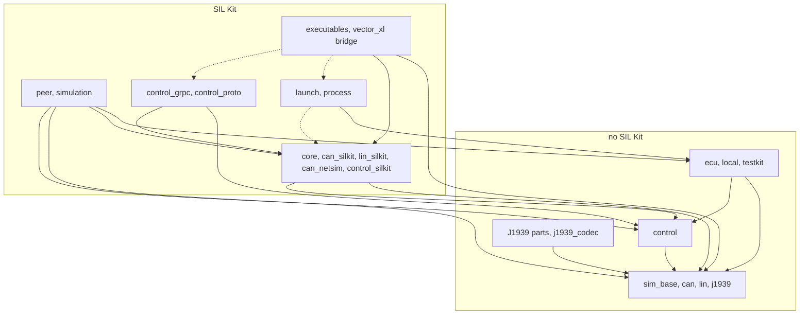
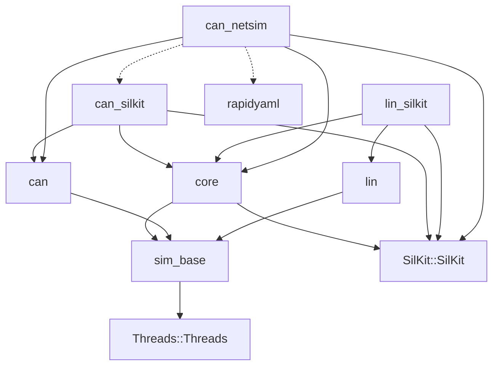
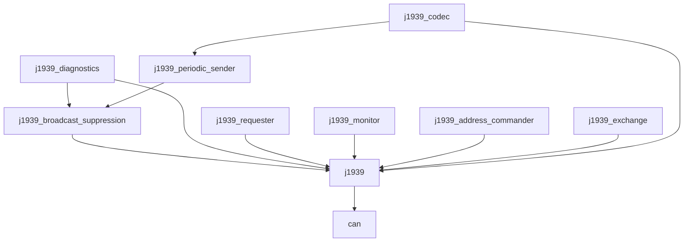
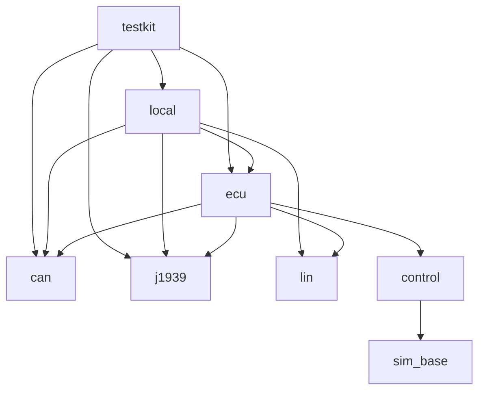
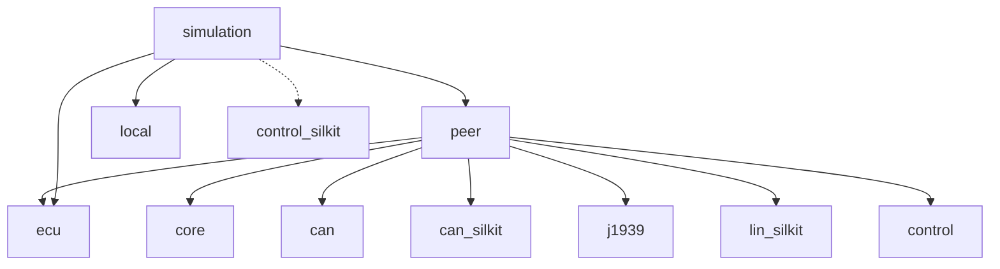
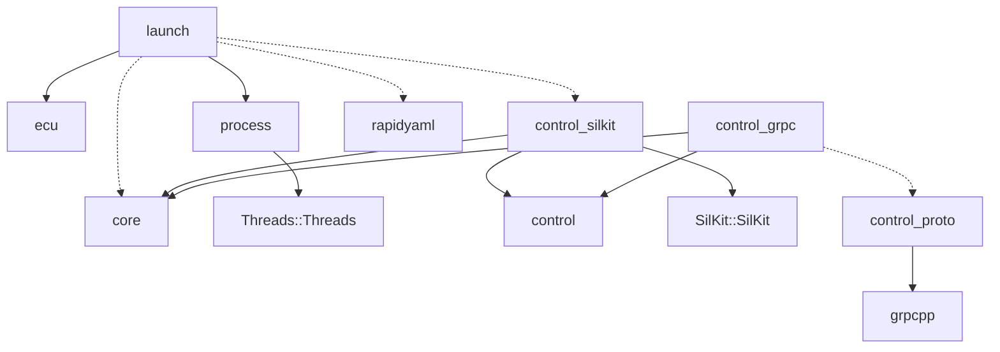
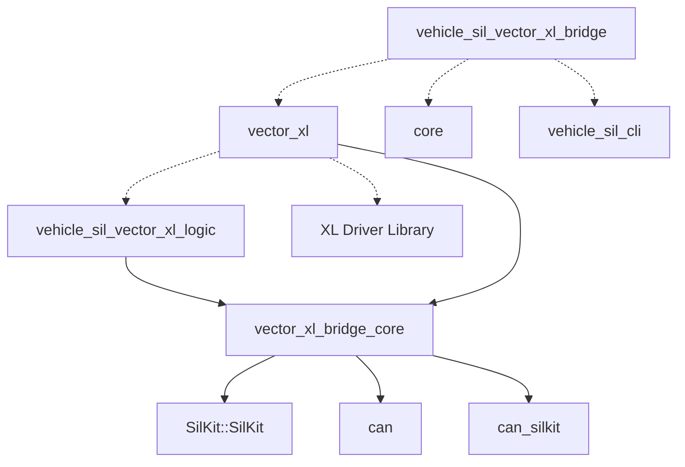

# コードの地図

vehicle-sil 自体を直す人と AI エージェント向けです。変える場所、その試験、試験だけを回す方法を、探さずに見つけるための地図です。先に [AGENTS.md](../AGENTS.md)（文書の管理、コミット、検証のスクリプト）を読みます。次は [architecture.md](architecture.md) です。

各ディレクトリの内容は README の「[構成](../README.md#構成)」に、各ターゲットの内容は [architecture.md](architecture.md) の「構成」にあります。ここには書きません。

## 試験の名前と回し方

- 試験の名前は `<前置き>.<名前>` です。前置きは `tests/<領域>/CMakeLists.txt` の `PREFIX` です。
- 試験の実行ファイルの試験は、ソースの `TEST_CASE(名前)` から設定時に登録されます（`vehicle_sil_add_harness_tests()`、`cmake/VehicleSilTestHelpers.cmake`）。既存のソースに `TEST_CASE` を足すときは、CMake を書き換えません。新しいソースのファイルは、その `CMakeLists.txt` の `SOURCES` に足します。マクロ（`TEST_CASE`、`CHECK`、`CHECK_EQ`）は `tests/unit/test_harness.hpp` にあります。
- 1 つの試験は、試験の実行ファイルに名前を渡すと動きます（`<実行ファイル> <名前>`。ctest もそうしています）。
- プロセスを起動する試験（シナリオ）は `vehicle_sil_add_scenario_tests()` で登録し、名前は `<前置き>.<シナリオ>` です。シナリオの一覧は `CMakeLists.txt` の `SCENARIOS`、中身は同じディレクトリの `*launcher.cpp`（`tests/integration/launcher.cpp`、`tests/launch/launch_run_launcher.cpp` など）です。共通の部品は `tests/integration/launcher_support.hpp` にあります。
- 前置きだけを回すときは、`\.` まで書きます。`^j1939` は `j1939_parts.`、`j1939_codec.`、`j1939_silkit.` にも当たります。

```sh
ctest --preset linux-gcc-debug -R '^launch\.'
scripts/verify.py linux-gcc-debug --tests '^launch_run\.'
```

## ディレクトリごとの場所と試験

ヘッダーは `include/` の下のパスです。

| ディレクトリ | 主なクラス・関数（ヘッダー） | 試験 | `ctest -R` |
|---|---|---|---|
| `libs/core` | `ParticipantRuntime`（`vehicle_sil/core/participant_runtime.hpp`）、`SimulationController`、`StartWindow`（`core/simulation_controller.hpp`）、`TickScheduler`（`core/tick_scheduler.hpp`）。`sim_base` の `SimTime`（`core/sim_time.hpp`）、`StepInbox`（`core/step_inbox.hpp`）、`periodic()`（`core/periodic.hpp`） | `tests/core` | `^core\.` |
| `libs/can` | `Frame`（`can/frame.hpp`）、`Port`（`can/port.hpp`）、`Host`、`Steppable`（`can/host.hpp`）、`StepDriver`（`can/step_driver.hpp`）、`RealTimeDriver`（`can/real_time_driver.hpp`）、`VirtualCanBus`（`can/virtual_can_bus.hpp`）、`CanBusModel`（`can/bus_model.hpp`）、`TapPort`（`can/tap_port.hpp`）、`RawChannel`（`can/raw_channel.hpp`） | `tests/can` | `^can\.` |
| `libs/can_silkit` | `SilKitCanPort`、`bind_host()`（`can_silkit/silkit_can_port.hpp`） | `tests/can` | `^can_silkit\.` |
| `libs/can_netsim`、`tools/can_bus_simulator` | `CanBusSimulator`（`can_netsim/can_bus_simulator.hpp`）、`NetworkSimulatorConfig`（`can_netsim/network_simulator_config.hpp`） | `tests/can` | `^can_netsim\.` |
| `libs/lin`、`libs/lin_silkit` | `LinMaster`（`lin/lin_master.hpp`）、`LinSlave`（`lin/lin_slave.hpp`）、`LinPort`（`lin/lin_port.hpp`）、`VirtualLinBus`（`lin/virtual_lin_bus.hpp`）、`SilKitLinPort`（`lin_silkit/silkit_lin_port.hpp`） | `tests/lin` | `^lin_bus\.`（仮想 LIN バス）、`^lin_local\.`（`LocalBench` の上）、`^lin\.`（SIL Kit の上）、`^lin_cluster\.`（`examples/lin` のプロセス） |
| `libs/j1939`（エンジン） | `Network`、`Node`（`j1939/network.hpp`）、`Pgn`、`Identifier`（`j1939/types.hpp`）、`Name`（`j1939/name.hpp`）、`Subscription`、`Timer`（`j1939/toolbox.hpp`）、`Observer`（`j1939/observer.hpp`）。Address Claim と Request は `src/node.cpp`、トランスポートプロトコルは `src/transport.cpp` | `tests/j1939` | `^j1939\.`、`^j1939_silkit\.` |
| `libs/j1939/parts/<部品>` | 部品ごとに 1 つのディレクトリとターゲット。`PeriodicSender`（`j1939/periodic_sender.hpp`）、`Requester`、`Monitor`、`AddressCommander`、`Exchange`、`BroadcastSuppression`、`Diagnostics`、`Identification` | `tests/j1939` | `^j1939_parts\.` |
| `libs/j1939/codec`、`tools/j1939_codegen` | `j1939/codec.hpp`（信号の型）、`j1939/codec_node.hpp`（`attach_sender()`、`on_message()`）、生成器 `j1939_codegen.py`、`vehicle_sil_add_j1939_codec()`（`cmake/VehicleSilJ1939Codec.cmake`） | `tests/j1939` | `^j1939_codec\.` |
| `libs/ecu` | `Ecu`（`ecu/ecu.hpp`）、`EcuDescription`、`to_json()`（`ecu/describe.hpp`） | `tests/ecu` | `^ecu\.` |
| `libs/local` | `LocalBench`（`local/local_bench.hpp`） | `tests/testkit`、`tests/lin` | `^testkit\.`、`^lin_local\.`、`^local\.` |
| `libs/testkit` | `J1939Events`、`FrameLog`（`testkit/recorders.hpp`）、`faults`（`testkit/faults.hpp`）、`LocalCan`（`testkit/local_can.hpp`） | `tests/testkit` | `^testkit\.`、`^ecu_api\.`、`^param_service\.` |
| `libs/peer` | `Peer`、`PeerOptions`、`start_together()`（`peer/peer.hpp`）。監視の出力は `src/peer_monitor.cpp` | `tests/peer` | `^peer\.` |
| `libs/simulation` | `Simulation`、`SilKitOptions`、`SimulationError`（`simulation/simulation.hpp`）、`ecu_main()`、`EcuMainOptions`（`simulation/ecu_main.hpp`） | `tests/simulation` | `^simulation\.`、`^ecu_main\.`（`examples/ecu_main` のプロセス）、サンプルの実行は `getting_started.`、`typed_messages.`、`pid_stream.`、`fault_injection.`、`vehicle.`、`low_level.` で始まる |
| `libs/control` | `Agent`（`control/agent.hpp`）、`Hub`（`control/hub.hpp`）、Agent と Hub の間のメッセージの符号化と復号（`control/wire.hpp`） | `tests/control` | `^control\.`（`wire.hpp` は `^control\.wire_`） |
| `libs/control_silkit` | `AgentTransport`（`control_silkit/agent_transport.hpp`）、`HubTransport`（`control_silkit/hub_transport.hpp`）。トピックの名前は `src/topics.hpp` | `tests/control_silkit`、`tests/launch`（プロセスをまたぐ窓） | `^control_silkit\.`、`^launch_control\.` |
| `libs/control_grpc`、`tools/control_server`、`proto/`、`python/` | `ControlServer`（`control_grpc/server.hpp`）、`AgentClient`（`control_grpc/agent_client.hpp`）、Python のクライアント（`python/vehicle_sil_control/client.py`） | `tests/control_server`（`VEHICLE_SIL_BUILD_CONTROL_SERVER=ON` のときだけ） | `^control_server\.` |
| `libs/process` | `ChildProcess`、`run_captured()`（`process/child_process.hpp`）、`Process`（`process/process.hpp`） | `tests/process` | `^process\.` |
| `libs/launch`、`tools/launch` | `read_config()`（`launch/config.hpp`）、`check_file()`（`launch/check.hpp`）、`run_file()`、`TimeCommands`（`launch/run.hpp`）、`EventStream`、`parse_command()`（`launch/events.hpp`）。照合の規則は `src/check.cpp`、コマンドラインと標準入力・標準出力のスレッドは `tools/launch/main.cpp` | `tests/launch` | `^launch\.`（プロセスなし）、`^launch_cli\.`（`check`）、`^launch_run\.`（`run`） |
| `tools/common` | 実行ファイル共通のコマンドライン処理（`vehicle_sil/cli/args.hpp`、`vehicle_sil/cli/console.hpp`。ターゲット `vehicle_sil_cli`） | `tests/unit` | `^unit\.` |
| `tools/sim_controller` | `vehicle_sil_sim_controller`（`main.cpp`） | 専用の試験はなく、プロセスの試験が使う | `^virtual_time\.`、`^ecu_main\.`、`^lin_cluster\.` |
| `bridges/vector-xl` | `CanBridge`（`vector_xl/can_bridge.hpp`）、`ExternalPortAdapter`（`vector_xl/external_port_adapter.hpp`）、`XlDriver`、`XlCanPort`（`vector_xl/xl_driver.hpp`） | `tests/vector_xl`（XL ドライバのフェイクは `tests/vector_xl/fake_xl`） | `^vector_xl\.` |
| `examples/j1939`（sender と receiver） | | `tests/integration` | `^integration\.` |
| `examples/virtual_time` | | `tests/virtual_time` | `^virtual_time\.` |
| FetchContent での利用 | `examples/fetchcontent_consumer` | `tests/fetchcontent`（`VEHICLE_SIL_TEST_FETCHCONTENT=ON` のときだけ） | `^fetchcontent\.` |
| `cmake/` | 依存の取り込み（`VehicleSilDependencies.cmake`、`VehicleSilGrpc.cmake`）、試験の登録（`VehicleSilTestHelpers.cmake`）、境界の検査（`VehicleSilCheck*.cmake`） | | |

## 依存の向き

矢印は「リンクする」（`target_link_libraries`）です。点線は非公開（`PRIVATE`）のリンクで、実線は `PUBLIC` と `INTERFACE` のリンクです。ノードの名前はターゲットの名前で、`vehicle_sil::` を省きます。逆向きの依存は作りません。

全体の層です。箱はターゲットのまとまりで、箱の間の矢印は、下の図の 1 本以上のリンクをまとめたものです。



SIL Kit を使わないのは `sim_base`、`can`、`lin`、`control`、`j1939` とその部品、`j1939_codec`、`ecu`、`local`、`testkit`、`process` です（`process` は「launch, process」の箱にありますが、SIL Kit を使いません）。

### 土台と SIL Kit の実装



### J1939 のエンジンと部品



### ECU とローカルの実行（SIL Kit なし）



### Peer と Simulation



### launch と Control API

`control_proto` と `control_grpc` は `VEHICLE_SIL_BUILD_CONTROL_SERVER=ON` のときだけ、`launch` は SIL Kit をサブモジュールからビルドしたとき（`rapidyaml` があるとき）だけ作ります。`grpcpp` は gRPC の C++ ライブラリです（`cmake/VehicleSilGrpc.cmake`）。



### Vector XL CAN Bridge

`vector_xl` と `vehicle_sil_vector_xl_bridge` は Windows で、XL Driver Library があるときだけ作ります。



### ほかの実行ファイル

どれも非公開で `vehicle_sil_cli`（`tools/common`、ヘッダーのみ）をリンクします。ほかにリンクするのは、`vehicle_sil_sim_controller` が `core`、`vehicle_sil_can_bus_simulator` が `can_netsim`、`vehicle_sil_launch` が `launch` と `process`（Windows では `shell32` も）、`vehicle_sil_control_server` が `control_grpc` と `core` です。

## 境界を検査する試験

次の試験は、ソースの `#include` などを読んで、層の境界を検査します。内部のヘッダーや SIL Kit のヘッダーを足すと落ちます。

| 試験 | 検査すること |
|---|---|
| `j1939_parts.boundary` | `libs/j1939/parts` が、エンジンの公開 API と道具箱だけを使い、`vehicle_sil::j1939` とほかの部品だけをリンクする |
| `local.boundary`、`testkit.boundary`、`peer.boundary`、`ecu.boundary`、`simulation.boundary`、`j1939_codec.boundary`、`param_service.boundary` | そのディレクトリのソースが、エンジンの内部を使わない（`cmake/VehicleSilCheckJ1939Parts.cmake`） |
| `ecu.no_silkit_boundary`、`ecu.simulation_headers_boundary`、`lin.boundary` | `libs/ecu`、`libs/simulation/include`、`libs/lin` が、SIL Kit のヘッダーを直接にも間接にも含まない（`cmake/VehicleSilCheckNoSilKit.cmake`） |
| `j1939_codec.independent_of_the_engine` | `codec.hpp` が含む vehicle-sil のヘッダーは `j1939/types.hpp`（値の型）だけで、`Network` と `Node` を含まない |

## これを変えるならここも

| 変えるもの | 合わせて直すもの |
|---|---|
| `vehicle_sil_launch check` と `run` の出力（`libs/launch/src`）、`examples/ecu_main/simulation.yaml` | [simulation-config.md](simulation-config.md) の、`<!-- ... -->` の行の直後のコードブロック。`launch_cli.docs` と `launch_run.docs` が、vehicle-sil の版を除いてバイト単位で照合します |
| `run --events` の事象、`--stdin-commands` の命令、`version --json`（`libs/launch/src/events.cpp`、`tools/launch/main.cpp`） | [simulation-config.md](simulation-config.md) の「機械から使う」（事象と `state` の表、命令の表、`features` の表、事象の例は `launch_run.events` が置き換えの後にバイト単位で照合）。事象やキーを足したら `features` に名前を足すか決め、意味を変えるなら `kEventsFormat` を上げます。`events.hpp` の `kFeatures` と、この表の `features` は手で合わせます。事象を書くスレッドと待ち行列の不変条件（事象を作るスレッドは読む側を待たない、捨ててよいのは `log` だけ、読まない読む側を見切る時間）は `events.hpp` の `EventStream` のコメントが正本で、変えたら「読む側が遅いとき、読まないとき」も直します。見切る時間は `--events-stall-ms`（`tools/launch/main.cpp` の `events_stall_timeout()` と `kMinEventsStallMs`、既定は `EventStreamOptions::stall_timeout`）で、引数の表と合わせます。`participant` の `state` を足したら `state` の表に足し、所見を足したら `detail::settled_findings()`（途中で流してよいか）を見直します。試験は `^launch\.`（`test_events.cpp`）と `launch_run.events_stalled`、`events_slow`、`events_nonblocking` |
| `run` の時間（速さ、一時停止、ステップ送り、遅れ。`libs/launch/src/run.cpp` の `TimeCommands`、`RunTiming`、`detail::plan_time_step()`（controller の刻みの既定）、`Runner::note_time()`、`note_timing()`。時間のゲートは `libs/core/src/simulation_controller.cpp`、その状態と遅れの計算は `libs/core/src/time_gate.cpp`（時計を持たない）、期限までの待ちは `libs/core/src/deadline_waiter.cpp`） | [simulation-config.md](simulation-config.md) の「等速で動かす」（遅れの定義、遅れたときに起きること、刻みと ECU のステップ）、構成のキーの表、`time` と `command` の事象、命令の表、`timing` の表、所見の表（`behind-real-time`、`coarse-time-step`）、`features` の表。遅れの定義の正本は `TimeControlOptions` のコメント（`simulation_controller.hpp`）で、変えたら [architecture.md](architecture.md) の「一時停止、ステップ実行、速度（時間ゲート）」と simulation-config.md も合わせます。命令は標準入力を読むスレッドがゲートに渡す（待たない）ので、`TimeCommands` のロックの中で待つものを足しません。遅れの数は、時刻を決めた例の試験 `core.time_gate_model_*` で確かめます（実時間を使う試験は片側の検査だけにします）。ほかの試験は `core.virtual_time_gate_*`、`core.*deadline_waiter*`、`^launch\.`、`launch_run.realtime`、`on_time`、`late`、`stall`、`speed_change`、`step_width`、`pause_step`、`paused_failures`、`time_usage` |
| `--describe` の JSON（`libs/ecu/src/describe.cpp`）、`examples/ecu_main/engine` の ECU | [ecu-executable.md](ecu-executable.md) の `<!-- vehicle_sil_engine_ecu --describe -->` の後のコードブロック（`ecu_main.describe` が照合）と「JSON の形式」。JSON を読む側の `read_description()`（`libs/launch/src/check.cpp`）。形式の版は `kEcuDescriptionFormat`（`ecu/describe.hpp`） |
| `ecu_main` の引数（`libs/simulation/src/ecu_main.cpp`） | `kLauncherArguments`（`libs/launch/include/vehicle_sil/launch/config.hpp`。構成ファイルの `command` に書けない引数）と、[ecu-executable.md](ecu-executable.md) の「引数」 |
| 照合の規則と `code`（`libs/launch/src/check.cpp`） | [simulation-config.md](simulation-config.md) の「照合」の `code` の表。試験はこの表を照合しないので、手で合わせます |
| J1939 の部品を足す | `libs/j1939/parts/<部品>/` と、`libs/j1939/CMakeLists.txt` の `add_subdirectory`。試験は `tests/j1939/CMakeLists.txt` の `vehicle_sil_j1939_parts_tests` の `SOURCES` と `LINK`。README の「ライブラリ」と [architecture.md](architecture.md) の「プロトコル部品」 |
| `libs/` にライブラリを足す | ルートの `CMakeLists.txt` の `add_subdirectory`、README の「構成」と「ライブラリ」、[architecture.md](architecture.md) の「構成」 |
| `proto/vehicle_sil/control/v1/control.proto` | `libs/control_grpc/src`（`convert.hpp`、`control_service.cpp`、`agent_service.cpp`、`agent_client.cpp`）、`python/vehicle_sil_control/client.py`、[control-api.md](control-api.md)。Python のスタブは試験のビルドで生成します（`python -m vehicle_sil_control.generate`） |
| 使う SIL Kit の API、上流の挙動への前提 | [dependencies.md](dependencies.md) の「使っている API」と「実装が前提にしている上流の挙動」 |
| Agent と Hub の間のメッセージ（`libs/control/src/wire.cpp`） | 並びを変えたら `control/wire.hpp` の `kVersion` を上げます（復号は自分の版だけを受け付けます）。hello の先頭から participant 名までは、どの版でも変えません（版の違う相手の名前を読むため）。大きさの上限（`kMaxMessageBytes`、`kMaxHelloBytes`、`kMaxTextBytes`）と分け方は [architecture.md](architecture.md) の「SIL Kit の上の運び手」。試験は `^control\.wire_`（1 バイトずつ切る、欄を壊す、乱数の入力。境界の外を読むと sanitizer のプリセットが落とします） |
| SIL Kit の上の運び手（`libs/control_silkit/src`）、始まる前の窓（`libs/core/src/simulation_controller.cpp` の `run_window()` と `cancel_window()`、`libs/core/src/participant_runtime.cpp` の `set_communication_ready_handler_async()`）、`ecu_main()` が運び手を付ける所（`libs/simulation/src/ecu_main.cpp`）、ランチャーの Hub（`libs/launch/src/run.cpp` の `start_window()`、`note_control()`） | 契約の正本は `agent_transport.hpp` と `hub_transport.hpp` のクラスのコメントで、[architecture.md](architecture.md) の「SIL Kit の上の運び手」（スレッド、届く順序の約束、窓、接続の終わり、認証がないこと）を合わせます。頼っている SIL Kit の挙動は [dependencies.md](dependencies.md) の「実装が前提にしている上流の挙動」。値と結果は、ステップのスレッドから、値を読んだ直後に送ります（別のスレッドに渡すと、順序の約束がなくなります。`HubTransportStats::late_messages` が数えます）。Hub の側の受信のハンドラーには、待つもの・重い処理を足しません（シミュレーション全体が待ちます）。ランチャーの出力（事象 `control_link`、結果の `participants[].control_link`、照合の JSON の `participants[].control`、所見 `control-link-no-hello`、`control-link-version`、`control-link-late-values`、`control-link-dropped`、`control-link-not-offered`、`before-start`）は [simulation-config.md](simulation-config.md) の「変数を読み書きする口」と表。ECU の自己申告（`--describe` の `control`。`libs/ecu/src/describe.cpp`、足すのは `ecu_main`、読むのは `libs/launch/src/check.cpp`）は [ecu-executable.md](ecu-executable.md) の「JSON の形式」。上限（`kMaxVariables`、`kMaxNameBytes`、`HubTransportOptions::max_links`）を変えたら architecture.md の同じ節。試験は `^control_silkit\.`、`^core\.`、`^launch_control\.`、`launch_run.control`、`simulation.ecu_main_offers_its_variables_to_the_simulation_unless_no_control` |
