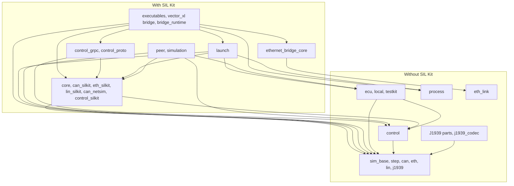
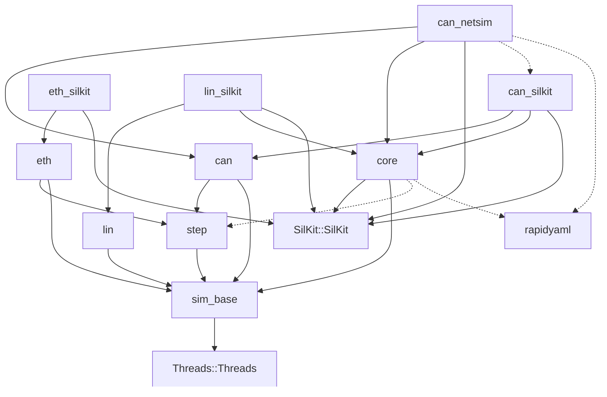
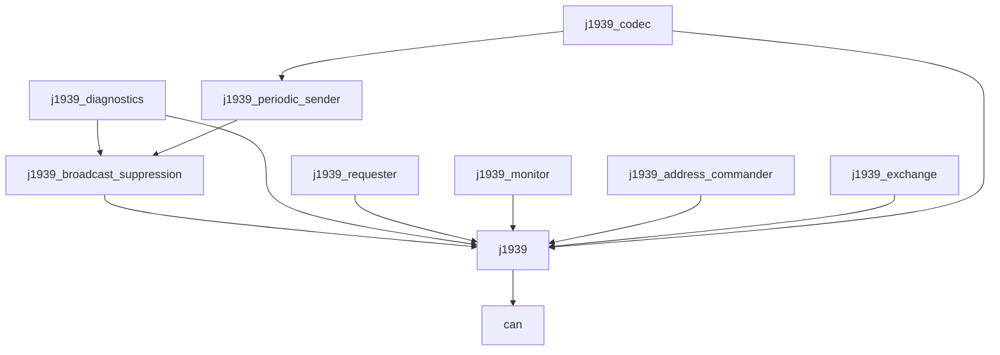
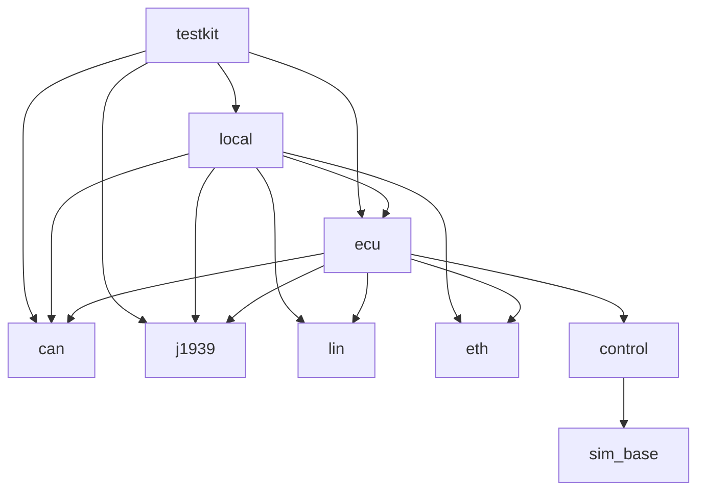
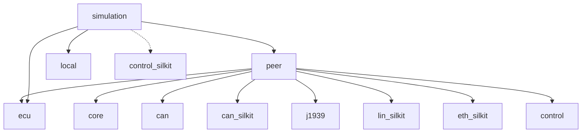
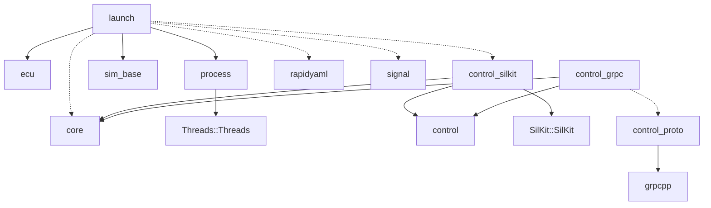
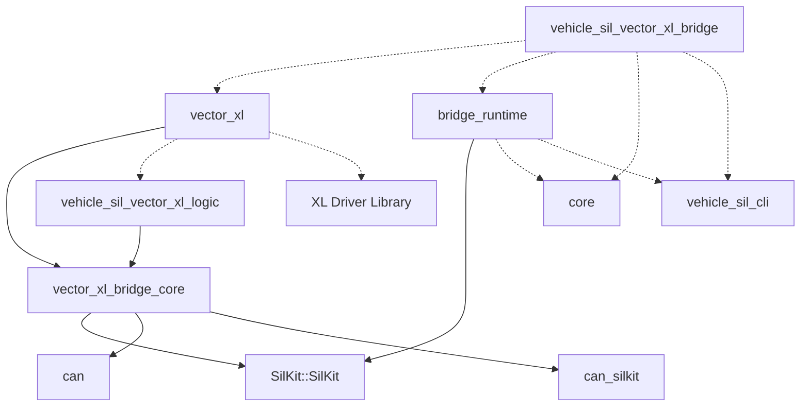
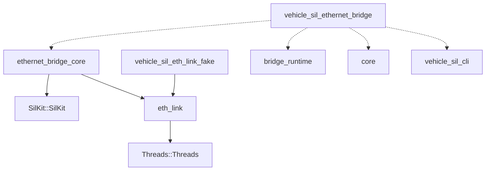

# Code map

[日本語](ja/code-map.md)

<!-- Style: write each entry as a short block of the same shape (a subheading, a bullet list with one fact per line, a table whose cells are one sentence each). Do not pack several facts into one cell or one bullet: the line gets long and unrelated changes hit the same line. -->

Use this map when you develop vehicle-sil itself: it shows where to make a change, which tests cover it, how to run only those tests and what else to update with it. It does not describe what each directory and target contains; see "[Directories and targets](architecture.md#directories-and-targets)" in [architecture.md](architecture.md).

| To find | See |
|---|---|
| How tests are named, how to run a subset, rules for ports and timeouts | [Test names and how to run tests](#test-names-and-how-to-run-tests) |
| What the tests of each label cover | [Test labels](#test-labels) |
| Classes, headers, tests and the `ctest -R` regular expression of each directory | [Code and tests by directory](#code-and-tests-by-directory) |
| Tests that compare the examples in the documentation, and their markers | [Documentation examples and tests](#documentation-examples-and-tests) |
| What each target links | [Dependency direction](#dependency-direction) |
| Tests that check the boundaries between layers | [Boundary tests](#boundary-tests) |
| Documentation, code and tests to update with a change | [What to update together](#what-to-update-together) |

## Test names and how to run tests

```sh
ctest --preset linux-gcc-debug -R '^launch\.'
scripts/verify.py linux-gcc-debug --tests '^launch_run\.'
```

### Naming and registration

A test is named `<prefix>.<name>`. The prefix is `PREFIX` in `tests/<area>/CMakeLists.txt`.

| Kind of test | Name | Registration |
|---|---|---|
| Test in a test executable (harness) | `<prefix>.<TEST_CASE name>` | Registered at configure time from `TEST_CASE(name)` in the source (`vehicle_sil_add_harness_tests()`, `cmake/VehicleSilTestHelpers.cmake`). |
| Test that starts processes (scenario) | `<prefix>.<scenario>` | Registered with `vehicle_sil_add_scenario_tests()`. |

To add a harness test:

- To add a `TEST_CASE` to an existing source file, do not change CMake.
- Add a new source file to `SOURCES` in its `CMakeLists.txt`.
- The macros (`TEST_CASE`, `CHECK`, `CHECK_EQ`) are in `tests/unit/test_harness.hpp`.

Where scenario tests live:

- `SCENARIOS` in `CMakeLists.txt` lists the scenarios.
- Their code is in `*launcher.cpp` in the same directory (`tests/integration/launcher.cpp`, `tests/launch/launch_run_launcher.cpp` and others).
- The shared code is in `tests/integration/launcher_support.hpp`.

Rules for areas (the directories directly under `tests/`):

- Every directory with a `CMakeLists.txt` is added automatically, in name order (do not add a line to `tests/CMakeLists.txt`).
- An area with a condition (`control_server`, `fetchcontent`, `integration`, `virtual_time` and others) checks the condition at the top of its own `CMakeLists.txt` and calls `return()`.
- An area does not test for another area's targets with `if(TARGET ...)`. That would make it depend on the order in which areas are added.
- Write CMake lists (`add_subdirectory`, sources, scenarios) one entry per line, in name order. Where the order matters, a comment says so.

### Run a subset of tests

- To run one test, pass its name to the test executable (`<executable> <name>`). ctest does the same.
- To select by prefix only, include the `\.`. `^j1939` also matches `j1939_parts.`, `j1939_codec.` and `j1939_silkit.`.
- To select by label, use `-L` (see [Test labels](#test-labels)).

### Ports and locks

Tests do not listen on fixed ports. They can run on the same computer at the same time as the tests of a build in another work tree.

| What listens | How the port is chosen |
|---|---|
| registry | Port 0 (`RegistryProcess`, a configuration file without `registry_uri`) |
| Control Server | `--control 0` |
| GUI server | `--port 0`, or a free port that the e2e tests pick at each start |
| 18500 of `multi_host.two_hosts` | Inside a network namespace that the test creates |

A scenario that needs a fixed port shown in the documentation (such as 8500 for `manual`) takes a lock for the whole computer with `MACHINE_LOCK` of `vehicle_sil_add_scenario_tests()`, and such scenarios run one at a time.

- The lock is an `flock` on a file in `/tmp` (`cmake/vehicle_sil_machine_lock.sh`; there is no lock on Windows).
- While it waits, the test prints one line. The time it waits counts toward the test's CTest `TIMEOUT`.
- If the test cannot open the lock file (for example, it belongs to another user), it prints one line and runs without the lock.

### Timeouts and the scale factor

Wait for something that is expected to happen with `eventually(condition, limit)` (`test_harness.hpp`) or with a means that signals that it happened. Do not sleep for a fixed time and assume that things have progressed.

Wait limits are multiplied by a scale factor.

| Topic | Details |
|---|---|
| How the factor is chosen | The environment variable `VEHICLE_SIL_TEST_TIMEOUT_SCALE` when the tests run; without it, the build's default. |
| Build default | The CMake cache variable `VEHICLE_SIL_TEST_TIMEOUT_SCALE_DEFAULT`. The default is 1, and 4 for the TSan presets. |
| How to write the value | Digits and at most one decimal point, greater than 0 (`3`, `2.5`). |
| Other forms (spaces, exponents, hexadecimal) | The C++ tests, the GUI server tests and the e2e tests stop and print the variable's name and how to fix it. |
| CI | Sets 3. The TSan jobs do not set it and use the preset's default (`.github/workflows/ci.yml`). |

Whether a value is scaled depends on its kind.

| Kind of value | Scaled | Reason and caution |
|---|---|---|
| A limit for waiting for something that is expected to happen. The same applies to a time passed to the product as a limit (such as the value that a launcher passes to the product's `--timeout-ms`). | Yes | A passing test moves on as soon as what it waits for happens, so a larger factor does not slow it down. |
| A value that checks a timeout, where a child process or another thread must finish something before the timeout (for example, a child writes one line and is then cut off) | Yes | Build the numbers in the expected text from the same value. Such a test always takes longer by the factor. |
| A wait that checks that something does not happen, a period, or the value in a test that checks the timeout value itself (such as the 1500 ms of `receiver-timeout`) | No | Scaling it changes what the test checks. |

Rules for writing limits:

- When you pass a limit to a function, pass it through `scaled_timeout(20s)` (`tests/unit/test_timeout_scale.hpp`). The GUI server tests use `scaled()` in `conftest.py`, and the e2e tests use `scaled()`.
- A function that takes a limit and scales it internally (`eventually`, the waits in `tests/process/spawn_sleeper.hpp`, `--timeout-ms` of a scenario launcher and others) says "scaled" in its documentation comment.
- Do not scale a value on the caller's side when you pass it to such a function.

The CTest `TIMEOUT`:

- The `TIMEOUT` of harness tests and scenario tests is extended by the factor at configure time (the environment variable, or without it the build's default, rounded up to an integer) (`cmake/VehicleSilTestHelpers.cmake`).
- If you raise the factor after configuring, configure again. Otherwise CTest kills a stuck test before the test can report its own failure.
- When that happens, the harness and the launcher print a line `warning: ... configure the build again ...`.

## Test labels

```sh
ctest --preset linux-gcc-release -L integration
# FetchContent test (slow: it rebuilds the dependencies from scratch)
cmake --preset linux-gcc-release -DVEHICLE_SIL_TEST_FETCHCONTENT=ON
ctest --preset linux-gcc-release -L fetchcontent
```

For every label:

- The log of each process stays under `build/<preset>/tests/`, in `integration/<scenario>/`, `virtual_time/<scenario>/`, `lin_cluster/<scenario>/` and `vector_xl/integration/<scenario>/`. When a test fails, the launcher prints all the logs.
- The `<label>.registration` test of each test executable detects test cases that are not registered (it compares the executable's `--list` with the registered names).
- In a cross build, if you set `CMAKE_CROSSCOMPILING_EMULATOR` (for example `wine`), `ctest` runs the test executables with it (the `registration` tests included). Make the Windows DLLs (the MinGW runtime libraries) findable, for example by placing them next to the executables.
- The test presets run 8 tests in parallel. On a computer with fewer CPUs, `scripts/verify.py` runs as many as there are CPUs.
- Tests that measure wall-clock duration (`virtual_time.*`, `core.virtual_time_*`, the LIN speed tests) run alone.

### `unit`

Set on the tests of command-line parsing and of writing to stdout and stderr (`unit.*`).

| Also set on | Details |
|---|---|
| `core`, `lin`, `step`, `can`, `eth`, `j1939`, `peer`, `testkit`, `ecu`, `simulation`, `control`, `control_server`, `launch`, `process`, `vector_xl` | Unit tests and boundary checks |
| `template.get_tools` | Tests the template's `get_tools.py`, and `template` and `version` of `scripts/package.py`, with locally built archives |
| `param_service.demo` | The only example run that has it |

It is not set on the scenario tests that start processes (`integration`), the example runs (`examples`), the Python client tests (`python`) or `fetchcontent`.

### `integration`

`integration.*` starts `sil-kit-registry`, a receiver and a sender (the real-time `Peer` and the J1939 stack) as separate processes, and judges the result by their exit codes.

| Scenario | What it checks |
|---|---|
| `address-claim-and-pgn` | Address Claim, and that the CAN ID and payload of the PGN match |
| `receiver-timeout` | Timeout handling |
| `receiver-detects-wrong-name`, `receiver-detects-wrong-payload` | The receiver reports a wrong NAME and a corrupted payload as failures |

The label is also set on the other scenario tests that start processes.

- `virtual_time.*`, `lin_cluster.*`, `launch_cli.*`, `launch_run.*`, `ecu_main.*`, `vector_xl.integration.*`, `control_server.launcher` (for what they cover, see the entry of each label)
- `template.check_and_run`: builds the template's ECUs with the main build and confirms that the launcher's check, run and scenario pass. It compares the check and run output with the guide "Create your first ECU".

### `vector_xl`

Tests of the CAN bridge. On every platform, they run the production code against a fake XL driver made for the tests.

| Kind of test | Details |
|---|---|
| Unit tests | CanBridge |
| XL backend tests | The XL backend |
| In-process tests | Use the real SIL Kit |
| E2E tests | Use the bridge executable |

What the E2E tests check:

- A round trip with an echo node (Virtual CAN, and physical CAN with a configured bit rate)
- Loop prevention when transmit receipts come back
- `--list-channels`, a channel that does not exist, argument errors
- A registry that cannot be reached, a missing driver
- The statistics line and exit code 0 after a stop request (skipped on Windows when there is no shared console)

### `step`

Unit tests of `vehicle_sil::step` (built without CAN and SIL Kit). The `unit` label is also set.

With a non-CAN test participant (`Member`), they check:

- The order of the phases
- That `start()` is called exactly once, before the first step
- Rejection of mixed time domains (host and driver)
- Failure handling
- `post()` and how the host is woken, `next_deadline()`
- `StepDriver` in virtual time
- `RealTimeDriver` on a substituted clock (woken by deadlines and arrivals)

`step.boundary` checks that `libs/step` includes no SIL Kit header, directly or indirectly.

### `signal`

Unit tests of the waveform functions of `vehicle_sil::signal` (built with the standard library only). The `unit` label is also set.

- Values compared with a table of times (period edges, phase, duty 0 and 100)
- The random sequence has the same values on every platform
- Random noise and chatter depend only on the time
- The chirp's phase does not jump
- Interpolation of a list of points

`signal.boundary` checks that `libs/signal` includes no SIL Kit header.

### `can`

The `unit` label is also set.

| Test | Covers |
|---|---|
| `can.*` | Unit tests of `vehicle_sil::can` (built without SIL Kit) |
| `can_silkit.*` | The SIL Kit port |
| `can_netsim.*` | The simple CAN Network Simulator |

What they check:

- Frame validation
- Receive order and overflow on the virtual bus
- The order of the host's phases and its failures, the order of the step driver
- Transmission time and arbitration (11-bit / 29-bit), congestion, the transmit queue
- Independence from the receiver's step size
- Port events (transmit results, receive queue overflow, bus state, error frames)
- Fault injection and disconnection of a single ECU
- `post()`, rejection of mixed time domains
- The real-time driver (deterministic tests on a substituted clock, and arrival and order on the wall clock)

For the simple CAN Network Simulator, they check the following both with in-process participants and with executables:

- The receive times are the same as on the virtual bus
- Repeated runs give the same result
- A sender without transmit times
- Controller modes (frames sent by a controller that has not started are dropped, `Reset()` cancels transmissions, delivery to a stopped controller)
- Loading the configuration file

With an in-process registry, they check:

- The trace of the same scenario is the same on the virtual bus and on SIL Kit (for several combinations of step sizes)
- Participants can be stopped and destroyed in a fixed order while transmissions continue

### `eth`

The `unit` label is also set.

| Test | Covers |
|---|---|
| `eth.*` | Unit tests of `vehicle_sil::eth` (built without SIL Kit) |
| `eth_silkit.*` | The SIL Kit port |
| `eth.steps_do_not_allocate` | No memory allocation inside a step (an executable of its own) |
| `eth.boundary` | `libs/eth` includes no SIL Kit header, directly or indirectly |

What they check:

- The frame and MAC address types
- Virtual network: delivery of frames as a hub, reception in the next step, padding of short frames, no reception of a node's own frames, time order, overflow
- Channel: runs on `step::Host` and `StepDriver`, gateways, frames with the same time ordered by source address
- Channel: `on_frame()` and `receive()`, the transmit phase, limits, filters, port events, option errors
- The port against a fake controller (including frame times from a sender without time synchronization, and the acknowledgement of a transmission that overflowed)
- With an in-process registry, the record of the same scenario is the same on the virtual network and on SIL Kit (for several combinations of step sizes)

The last item includes 3 senders that send at the same time. Their addresses are in a different order from their registration order, and the test checks the address order on the virtual network as well.

### `j1939`

| Test | Covers | Labels |
|---|---|---|
| `j1939.*` | Unit tests of `vehicle_sil::j1939` (built without SIL Kit) | `unit` too |
| `j1939_silkit.*` | Tests on SIL Kit | `unit` too |
| `j1939_parts.*` | Protocol parts | |
| `j1939_codec.*` | Typed messages | |
| `local.boundary`, `testkit.boundary`, `peer.boundary`, `simulation.boundary`, `ecu.boundary` | The sources of each directory do not use the engine's internals | `unit` and `j1939` |

What they check in the engine:

- PGNs and identifiers, single-frame transmission and reception, dispatch by destination, local loopback
- The order of frames with the same time and the firing of timers do not depend on step size or arrival order
- Responses to a Request, and ACK/NACK
- NAME and Address Claim (including contention between several nodes and several networks, picking an arbitrary address, the address table, address violations and Commanded Address)
- Several networks on one host (gateways, failure of one of them)
- Reentrancy and failures, step size checks, resource limits
- No memory allocation in steady-state steps
- On a virtual bus with timing, the protocol results do not change. Congestion delays transfers, and a saturated bus leads to timeouts.
- TP timeouts and recovery when one ECU is disconnected from the bus (receive only, and both transmit and receive)
- Resolution of a hidden address conflict
- Real-time behavior on SIL Kit without time synchronization
- The toolbox (reentrancy of release and destruction, destruction after the network, the origin and scheduling of timers)

Virtual bus and SIL Kit give the same result:

- With an in-process registry, the trace of the same scenario is the same on the virtual bus and on SIL Kit (also with the simple CAN Network Simulator)
- `j1939_silkit.listen_only_participants_*`: adding listen-only participants (raw CAN, a `Network` without nodes, various step sizes) does not change a single line of each ECU's received data, the frames passed to its port, or its transmit acknowledgements and statistics
- In the same test, the listen-only participants send nothing (on both the virtual bus and SIL Kit)

Protocol parts (`j1939_parts.*`):

- DM13, diagnostics, identification, transmit contention, deferred ACK, results that do not depend on step size
- `j1939_parts.boundary`: the protocol parts do not use the engine's internals

Typed messages (`j1939_codec.*`):

- The bit layout is compared with a bit-by-bit implementation
- Conversion between raw and physical values, rounding and range edges
- Special values (the J1939 profile, user profiles, inheritance and overriding, Proprietary B that uses every bit pattern as a value, keeping the raw value)
- Enumerations, selectors, fill values, lengths
- A round trip of every raw value of small signals
- Transmission and reception on a node
- `j1939_codec.generator`: the generator rejects wrong definitions

### `peer` / `testkit`

| Test | Details | Labels |
|---|---|---|
| `peer.*` | Runs `Peer` with an in-process registry | `peer`, `unit`, `j1939` |
| `testkit.*` | Tests of the test kit | `testkit`, `unit`, `j1939` |
| `ecu_api.*` | Runs ECUs written the way a user writes them, on the virtual bus | `testkit`, `unit`, `j1939` |
| `param_service.*` | Runs the custom protocol of `examples/j1939/param_service` on the virtual bus | `testkit`, `unit`, `j1939` |

What each one checks:

- `peer.*`: 3 participants with J1939 and LIN, the same result as the virtual bus, real time and external ports, setup errors, failure reporting
- `testkit.*`: loss of an address, a missing Address Claimed, a missing TP packet, disconnection, injection of raw frames, results that do not depend on the receiver's step size or on whether recording is on
- `ecu_api.*`: `examples/j1939/ecu_pair`, a custom protocol built with the toolbox and `Requester`, tests that check communication with `Monitor`, `Observer` and a tap
- `param_service.*`: the normal flow, session expiry, a second tool, an ECU that does not respond, address change and loss, rejection, destruction of a running protocol part
- `param_service.boundary`: the example uses only the public API
- `param_service.demo`: runs the example

The checks that the engine's internals are not used (`peer.boundary`, `testkit.boundary`, `local.boundary`) are listed under `j1939`.

### `ecu`

Unit tests of the JSON of an ECU's `--describe` output (`to_json(EcuDescription)`), without SIL Kit. The `unit` label is also set.

- The full text when empty and when every field is set, the key order, numbers, 64-bit enumeration values, the NAME string, string escaping, the version
- `ecu.no_silkit_boundary`, `ecu.simulation_headers_boundary`: `libs/ecu` and `libs/simulation/include` include no SIL Kit header, directly or indirectly
- `ecu.boundary_check_*`: tests of that check itself

### `simulation` / `examples`

| Test | Details | Labels |
|---|---|---|
| `simulation.*` | Tests of `Simulation` | `unit` and `simulation` |
| Example runs | Each example checks its own result and exits with a non-zero code if it is wrong | `examples` and `simulation` (`low_level.demo` has `examples` only) |
| `ecu_main.*` | Runs the ECU executables of `examples/ecu_main` as processes | `integration` and `simulation` |

What `simulation.*` checks:

- The same ECU leaves the same record on the virtual bus and on SIL Kit
- Destruction of the objects that an ECU owns
- A failed step comes back as a `SimulationError`
- Usage errors (both implementations reject the same input, exceptions from the `App` constructor)
- A run that ends with `request_stop`, failure of another participant, a start timeout
- ECUs added from `local()`, use together with a controller or participants in other processes
- A gateway with 2 networks, raw CAN, LIN master and slave, and an Ethernet channel give the same result on both
- `Ecu::describe()`
- The arguments and exit codes of `ecu_main()` called as a function

For the Ethernet channel (`test_ethernet.cpp`), the tests check reception in the next step, the order at the same time, filters, that no frame is dropped up to `receive_capacity` frames per step, the message text of a rejection, and the reference to `LocalBench`.

Examples that are run:

- `vehicle_sil_getting_started` (virtual bus and `--silkit`)
- `typed_messages`, `pid_stream`, `fault_injection`, `low_level`
- `vehicle` (SIL Kit and `--local`)
- `vehicle_sil_ethernet_example` (virtual network and `--silkit`, another EtherType, argument errors)

What `ecu_main.*` checks:

- The `--describe` JSON is compared byte for byte with the example in [ecu-executable.md](ecu-executable.md), except for the vehicle-sil version
- `--local`
- 2 ECUs on SIL Kit under `vehicle_sil_sim_controller`
- Usage, stop requests

### `core` / `lin`

Unit tests of virtual time. The `unit` label is also set.

With an in-process registry, they check:

- Synchronization of participants with different step sizes, waiting for the slowest participant, coupling to real time
- `TickScheduler`, `StepInbox`
- LIN schedules, responses, reception of master frames, sleep and wake-up, schedule switching

| LIN test | Details |
|---|---|
| `lin_local.*` | Checks the main scenarios on the virtual LIN bus too |
| `lin_bus.*` | Tests of the virtual LIN bus only |
| `lin.boundary` | Checks that `vehicle_sil::lin` does not include SIL Kit |

### `virtual_time`

Runs a registry, a controller and 4 peers (1 / 2 / 5 / 10 ms, all on `Peer`) as separate processes. The `integration` label is also set.

- Compares traces to confirm that data passes between the peers at the predicted virtual times.
- Confirms that a J1939 ECU starts transmitting 250 ms after its Address Claim.
- Confirms that the traces match at full speed, with a slow `tick()`, at 4x speed and at 0.5x speed, and that the wall-clock duration is shorter or longer than real time accordingly.
- `peer-failure`: confirms that the controller detects a peer that fails midway and aborts, and that every process ends with exit code 1.

### `lin` (`lin_cluster.*`)

Runs a registry, a controller, a LIN master and 2 slaves (5 / 2 / 4 ms) as separate processes. The `integration` label is also set.

- Compares traces to check the schedule, frames in both directions, and sleep and wake-up by the master, by a slave and by bus idle.
- Confirms that the traces still match when one slave is coupled to real time.

### `launch` / `process`

| Test | Details |
|---|---|
| `launch.*` | Loading of configuration files, the check rules, human-readable and JSON output (starts no processes) |
| `launch_cli.*` | Runs `vehicle_sil_launch check` as an executable |
| `launch_run.*` | Runs `vehicle_sil_launch run` as an executable |
| `process.*` | Tests of child processes |

`launch.*` compares a passing and a failing example of each rule, down to the message text and line numbers.

What `launch_cli.*` checks:

- Byte-for-byte comparison with the examples in [docs/simulation-config.md](simulation-config.md)
- An executable whose `--describe` fails, `--strict`, an unreadable file, argument errors

What `launch_run.*` checks:

- Comparison with the examples in docs
- A failing ECU, participants that do not all join, a participant that does not end, processes left behind, interruption, an abnormal exit of the launcher
- Speed, pause and stepping, lateness behind real time
- `launch_run.ethernet`: the check and scenario of the 2 ECUs of `examples/ethernet`
- `launch_run.test_command`, `launch_run.test_interrupt`: `vehicle_sil_launch test`
- `launch_run.live`: the check of `simulation.live.yaml`, the example configuration file that runs until stopped, and a run that goes past 1000 ms before it is stopped

What `process.*` checks:

- Capture of stdout and stderr, passing on line by line, timeouts
- Empty stdin, the working directory, handles that are not inherited
- Stop requests, ending each process that was started
- Paths and arguments that contain spaces and non-ASCII characters

### `control`

Tests of the Control Agent (`control.*`). The `unit` label is also set. The `control_server` tests have this label too.

- Tests that run the Agent directly, without a transport
- Timed writes to variables declared with `Ecu` are applied in the same step and read at the same time on the virtual bus and on SIL Kit
- The Agent of a `Peer` (as a SIL Kit participant: where writes are applied, real time, monitoring output)
- A `Hub` connected within the process
- A transport that outlives its ECU stops the process

### `control_server`

Registered only when `VEHICLE_SIL_BUILD_CONTROL_SERVER=ON` (preset `linux-gcc-control`). CI also runs this preset, and the GUI server tests run with this launcher.

What the Control Server tests (`control_server.*`; the `unit` and `control` labels are also set) check:

- The generated gRPC code and calls
- End to end in one process (a Hub that the Agents of 2 J1939 peers connect to over SIL Kit, the time gate, a gRPC client)
- Authentication, roles, TLS and the audit log
- Which role can call which RPC (and that the RPCs in the proto match the table of rules)
- Message conversion, limits and input checks
- `SimulationMonitor`

If a Python with grpcio and grpcio-tools is available, the following tests are registered too. All have the `control` and `python` labels.

| Test | Details | Other labels |
|---|---|---|
| `control_server.python_client` | Runs the Python client and CLI against `vehicle_sil_launch run --control` | |
| `control_server.launcher` | Runs `vehicle_sil_launch run --control` with the ECUs of `examples/ecu_main` | `integration` |
| `control_server.example_write_before_start`, `control_server.example_pause_and_step` | Runs `examples/launch_control` | `examples` |
| `control_server.guide_operate_signals` | Compares the marked blocks of the guide [Read and write signals from outside](howto/operate-signals.md) with the output of the same example, the CLI and the stdin commands | `examples` |

`control_server.launcher` checks writes before the start, commands from both stdin and the Control Server, how the run ends, authentication, TLS and auditing, and the CLI with a token.

### `eth_link` / `ethernet_bridge`

Tests of the Ethernet Bridge (all platforms). The `unit` label is also set.

| Test | Details |
|---|---|
| `eth_link.*` | Without SIL Kit, checks MAC addresses, filters (EtherType, behind a VLAN tag, MAC, maximum length), the MAC table and a fake external link |
| `eth_link.pcap_*` | Checks the message texts of the pcap external link, how the interface is chosen, and transmission, reception and failures with a fake pcap library loaded at run time |
| `eth_link.fake_pcap_imports.*` | On Windows, checks that the DLLs the fake library uses are only those in the places where the bridge looks |
| `eth_link.boundary` | Checks that `libs/eth_link` has no SIL Kit include |
| `ethernet_bridge.*` | Checks the bridge's behavior and output with a fake SIL Kit controller and a fake external link |
| `ethernet_bridge.silkit_*` | Checks the real SIL Kit side with an in-process registry (on a free port) |
| `ethernet_bridge.integration.*` (`integration` label) | Runs an executable linked with a fake external link as a process, and checks round trips, exit codes and shutdown |
| `ethernet_bridge.integration.pcap-*` | Checks the same with the executable for the OS external link, made to load a fake pcap library |
| `ethernet_bridge.netns.*` (Linux only, `integration` label) | Checks `tap`, `packet` and `pcap` (the real libpcap) of the real executable with TAP devices and veth in a namespace |

`ethernet_bridge.*` checks forwarding, filters, the bridge's own frames coming back, loops through 2 bridges (orders that stop and orders that do not), lost frames, `Fault`, warnings, the statistics and health lines, and the message texts of argument errors. `ethernet_bridge.netns.*` is skipped where a namespace cannot be created and where libpcap is missing.

### `bridge_runtime`

Tests of `run_bridge()`, which the bridge executables share (all platforms). The `unit` label is also set.

With fake `hooks` and a fake participant whose states are scripted, they check:

- Exit codes
- The shutdown order (the statistics are printed before the SIL Kit participant stops)
- `fault()` and participant failures
- Warnings and health lines
- A state in the middle of startup is not treated as a failure, the startup limit

One test uses a real participant with an in-process registry (on a free port). The message for a registry that cannot be reached (`registry_failure_message()`) is also checked with the text that SIL Kit actually throws.

### `fetchcontent`

Disabled by default.

- Pulls in a commit of this repository with FetchContent, then builds and runs a usage example.
- `fetchcontent.template`: copies the template to another directory, pulls in the current work tree with FetchContent, builds it and confirms that the check, run and scenario pass.

## Code and tests by directory

Each entry gives, in this order, a table of the main classes and functions (headers as paths under `include/`), the test directory and the regular expression to pass to `ctest -R`.

### `libs/core`

| Name | Location |
|---|---|
| `ParticipantRuntime` | `vehicle_sil/core/participant_runtime.hpp` |
| `SimulationController`, `StartWindow` | `core/simulation_controller.hpp` |
| `TickScheduler` | `core/tick_scheduler.hpp` |
| `bind_host()` | `core/bind_host.hpp` |
| `SimTime` (`sim_base`) | `core/sim_time.hpp` |
| `StepInbox` (`sim_base`) | `core/step_inbox.hpp` |
| `periodic()` (`sim_base`) | `core/periodic.hpp` |

- Tests: `tests/core`
- `ctest -R`: `^core\.`

### `libs/step`

| Name | Location |
|---|---|
| `Member`, `Host` | `step/host.hpp` |
| `StepDriver` | `step/step_driver.hpp` |
| `RealTimeDriver` | `step/real_time_driver.hpp` |
| `RealTimeClock`, `ManualRealTimeClock` | `step/real_time_clock.hpp` |
| `TimeDomain`, `Wakeup` | `step/time_domain.hpp` |
| `SinkRef` | `step/sink_ref.hpp` |

- Tests: `tests/step`
- `ctest -R`: `^step\.`

### `libs/signal`

| Name | Location |
|---|---|
| Waveforms as functions of time: `sine()`, `triangle()`, `sawtooth()`, `square()`, `noise_uniform()`, `noise_gaussian()`, `chirp()`, `lag()`, `chatter()`, `points_linear()`, `points_hold()` | `signal/waveform.hpp` |
| The random sequence `unit_random()` | `signal/waveform.hpp` |

Header-only; it links nothing. Both the scenario's `wave` and the user's C++ code use it.

- Tests: `tests/signal`
- `ctest -R`: `^signal\.`

### `libs/can`

| Name | Location |
|---|---|
| `Frame` | `can/frame.hpp` |
| `Port` | `can/port.hpp` |
| `Host`, `Steppable` | `can/host.hpp` |
| `StepDriver`, `RealTimeDriver`, clocks | `can/step_driver.hpp`, `can/real_time_driver.hpp`, `can/real_time_clock.hpp` |
| `RealTimeReceiver` | `can/real_time_receiver.hpp` |
| `VirtualCanBus` | `can/virtual_can_bus.hpp` |
| `CanBusModel` | `can/bus_model.hpp` |
| `TapPort` | `can/tap_port.hpp` |
| `RawChannel` | `can/raw_channel.hpp` |

`Host` is built on `step::Host`. `StepDriver`, `RealTimeDriver` and the clocks are aliases of those in `vehicle_sil::step`.

- Tests: `tests/can`
- `ctest -R`: `^can\.`

### `libs/can_silkit`

| Name | Location |
|---|---|
| `SilKitCanPort`, the alias of `bind_host()` | `can_silkit/silkit_can_port.hpp` |

The body of `bind_host()` is in `core/bind_host.hpp`.

- Tests: `tests/can`
- `ctest -R`: `^can_silkit\.`

### `libs/can_netsim`, `tools/can_bus_simulator`

| Name | Location |
|---|---|
| `CanBusSimulator` | `can_netsim/can_bus_simulator.hpp` |
| `NetworkSimulatorConfig` | `can_netsim/network_simulator_config.hpp` |

- Tests: `tests/can`
- `ctest -R`: `^can_netsim\.`

### `libs/eth`, `libs/eth_silkit`

| Name | Location |
|---|---|
| `Frame`, `MacAddress` | `eth/frame.hpp` |
| `Port`, `PortEvent` | `eth/port.hpp` |
| `Channel` | `eth/channel.hpp` |
| `VirtualEthernetBus` | `eth/virtual_ethernet_bus.hpp` |
| `SilKitEthPort` | `eth_silkit/silkit_eth_port.hpp` |

- Tests: `tests/eth`
- `ctest -R`: `^eth\.`, `^eth_silkit\.`

### `libs/lin`, `libs/lin_silkit`

| Name | Location |
|---|---|
| `LinMaster` | `lin/lin_master.hpp` |
| `LinSlave` | `lin/lin_slave.hpp` |
| `LinPort` | `lin/lin_port.hpp` |
| `VirtualLinBus` | `lin/virtual_lin_bus.hpp` |
| `SilKitLinPort` | `lin_silkit/silkit_lin_port.hpp` |

- Tests: `tests/lin`
- `ctest -R`: `^lin_bus\.` (virtual LIN bus), `^lin_local\.` (on `LocalBench`), `^lin\.` (on SIL Kit), `^lin_cluster\.` (the processes of `examples/lin`)

### `libs/j1939` (engine)

| Name | Location |
|---|---|
| `Network`, `Node` | `j1939/network.hpp` |
| `Pgn`, `Identifier` | `j1939/types.hpp` |
| `Name` | `j1939/name.hpp` |
| `Subscription`, `Timer` | `j1939/toolbox.hpp` |
| `Observer` | `j1939/observer.hpp` |
| Address Claim and Request | `src/node.cpp` |
| Transport protocol | `src/transport.cpp` |

- Tests: `tests/j1939`
- `ctest -R`: `^j1939\.`, `^j1939_silkit\.`

### `libs/j1939/parts/<part>`

Each protocol part has one directory and one target.

Main classes and functions:

- `PeriodicSender` (`j1939/periodic_sender.hpp`)
- `Requester`, `Monitor`, `AddressCommander`, `Exchange`, `BroadcastSuppression`, `Diagnostics`, `Identification`
- `parse_dtc_list` (reads a received DM1 or DM2)

- Tests: `tests/j1939`
- `ctest -R`: `^j1939_parts\.`

### `libs/j1939/codec`, `tools/j1939_codegen`

| Name | Location |
|---|---|
| Signal types | `j1939/codec.hpp` |
| `attach_sender()`, `on_message()` | `j1939/codec_node.hpp` |
| Generator | `j1939_codegen.py` |
| `vehicle_sil_add_j1939_codec()` | `cmake/VehicleSilJ1939Codec.cmake` |

- Tests: `tests/j1939`
- `ctest -R`: `^j1939_codec\.`

### `libs/ecu`

| Name | Location |
|---|---|
| `Ecu` | `ecu/ecu.hpp` |
| `EcuDescription`, `to_json()` | `ecu/describe.hpp` |
| The lists of network kinds and uses, `kNetworkKinds` and `kNetworkUses` | `ecu/describe.hpp` |
| The contract between ECU executables and the launcher (arguments, exit codes, `kMaxMillis`) | `ecu/executable.hpp` |
| `BusConnection`, `GatedCanPort`, `GatedLinPort` and `GatedEthPort` for disconnecting from the bus (`ecu.connected`) | `ecu/detail/bus_connection.hpp` |

- Tests: `tests/ecu`, `tests/simulation` (`test_disconnect.cpp`)
- `ctest -R`: `^ecu\.`, `^simulation\.disconnect`

### `libs/local`

| Name | Location |
|---|---|
| `LocalBench` | `local/local_bench.hpp` |

- Tests: `tests/testkit`, `tests/lin`
- `ctest -R`: `^testkit\.`, `^lin_local\.`, `^local\.`

### `libs/testkit`

| Name | Location |
|---|---|
| `J1939Events`, `FrameLog` | `testkit/recorders.hpp` |
| `faults` | `testkit/faults.hpp` |
| `LocalCan` | `testkit/local_can.hpp` |

- Tests: `tests/testkit`
- `ctest -R`: `^testkit\.`, `^ecu_api\.`, `^param_service\.`

### `libs/peer`

| Name | Location |
|---|---|
| `Peer`, `PeerOptions`, `start_together()` | `peer/peer.hpp` |
| Monitoring output | `src/peer_monitor.cpp` |

- Tests: `tests/peer`
- `ctest -R`: `^peer\.`

### `libs/simulation`

| Name | Location |
|---|---|
| `Simulation`, `SilKitOptions`, `SimulationError` | `simulation/simulation.hpp` |
| `ecu_main()`, `EcuMainOptions` | `simulation/ecu_main.hpp` |

- Tests: `tests/simulation`
- `ctest -R`: `^simulation\.`, `^ecu_main\.` (the processes of `examples/ecu_main`)
- The tests that run the examples start with `getting_started.`, `typed_messages.`, `pid_stream.`, `fault_injection.`, `vehicle.`, `low_level.` and `ethernet_example.`.

### `libs/control`

| Name | Location |
|---|---|
| `Agent` | `control/agent.hpp` |
| `Hub` | `control/hub.hpp` |
| The variable map `MappedSchema` | `control/variable_map.hpp` |
| Encoding and decoding of the messages between Agent and Hub | `control/wire.hpp` |

- Tests: `tests/control`
- `ctest -R`: `^control\.` (`^control\.wire_` for `wire.hpp`; the variable map is in `test_variable_map.cpp`)

### `libs/control_silkit`

| Name | Location |
|---|---|
| `AgentTransport` | `control_silkit/agent_transport.hpp` |
| `HubTransport` | `control_silkit/hub_transport.hpp` |
| Topic names | `src/topics.hpp` |

- Tests: `tests/control_silkit`, `tests/launch` (the start window across processes)
- `ctest -R`: `^control_silkit\.`, `^launch_control\.`

### `libs/control_grpc`, `proto/`, `python/`

| Name | Location |
|---|---|
| `ControlServer` | `control_grpc/server.hpp` |
| Python client | `python/vehicle_sil_control/client.py` |
| Helper that starts the launcher | `python/vehicle_sil_control/launcher.py` |

- Tests: `tests/control_server` (only when `VEHICLE_SIL_BUILD_CONTROL_SERVER=ON`)
- `ctest -R`: `^control_server\.`

| Test file or test | Covers |
|---|---|
| `test_launcher.py` | The launcher's Control Server (also authentication, TLS, roles and auditing) |
| `test_python_client.py` | The Python client and CLI |
| `control_server.example_write_before_start`, `control_server.example_pause_and_step` | `examples/launch_control` |
| `test_guide_operate_signals.py` | Compares the guide `docs/howto/operate-signals.md` with the example, the CLI and the stdin commands (for the markers, see "[Documentation examples and tests](#documentation-examples-and-tests)") |

### `libs/process`

| Name | Location |
|---|---|
| `ChildProcess`, `run_captured()` | `process/child_process.hpp` |
| `Process` | `process/process.hpp` |

- Tests: `tests/process`
- `ctest -R`: `^process\.`

### `libs/launch`, `tools/launch`

Public headers:

| Name | Location |
|---|---|
| `read_config()` | `launch/config.hpp` |
| `check_file()` | `launch/check.hpp` |
| `run_file()`, `TimeCommands` | `launch/run.hpp` |
| `EventStream`, `parse_command()` | `launch/events.hpp` |
| `read_scenario()` for scenarios, the interface of time functions `Waveform` | `launch/scenario.hpp` |
| `ScenarioEngine` | `launch/scenario_run.hpp` |

Implementation:

| What | Location |
|---|---|
| The overall flow of the check | `src/check.cpp` |
| Reading the `--describe` JSON | `src/describe_read.cpp` |
| The check rules (one function per network kind) | `src/check_rules.cpp` |
| The check output | `src/check_format.cpp` |
| Code shared by the readers of configuration files and scenarios | `src/yaml_reader.hpp` |
| The overall flow of `run` | `src/run.cpp` |
| The classes that share the work of `run` | `src/run_*.cpp`, `src/time_commands.cpp` |
| This computer's addresses (the URI shown to other computers) | `src/host_addresses.cpp` |
| `StandStill`, which reports that virtual time does not advance | `src/run_watch.cpp` |
| The command line, and the stdin and stdout threads | `tools/launch/main.cpp` |
| The Control Server of `run --control` (only when `VEHICLE_SIL_BUILD_CONTROL_SERVER=ON`) | `tools/launch/control_server.cpp` |

The comment at the top of `run.cpp` and the class comments in each `run_*.hpp` describe the role of each class that shares the work of `run`, and which thread handles which state under which lock.

- Tests: `tests/launch`, `tests/multi_host`
- `ctest -R`: `^launch\.` (no processes), `^launch_cli\.` (`check`), `^launch_run\.` (`run`), `^multi_host\.`

`tests/multi_host` creates 2 computers with Linux network namespaces. Where it cannot create them, it prints the reason and skips. With `VEHICLE_SIL_REQUIRE_MULTI_HOST=1`, it fails instead of skipping.

### `tools/common`

Command-line handling shared by the executables (target `vehicle_sil_cli`).

| What | Location |
|---|---|
| Argument handling | `vehicle_sil/cli/args.hpp` |
| `write_text()`, which writes UTF-8 text to stdout and stderr (UTF-16 to a Windows console) | `vehicle_sil/cli/console.hpp` |
| Handling arguments and paths as UTF-8 | `vehicle_sil/cli/utf8.hpp` |

- Tests: `tests/unit`
- `ctest -R`: `^unit\.`

### `tools/sim_controller`

| Name | Location |
|---|---|
| `vehicle_sil_sim_controller` | `main.cpp` |

- Tests: no tests of its own; the process tests use it.
- `ctest -R`: `^virtual_time\.`, `^ecu_main\.`, `^lin_cluster\.`

### `bridges/vector-xl`

| Name | Location |
|---|---|
| `CanBridge` | `vector_xl/can_bridge.hpp` |
| `ExternalPortAdapter` | `vector_xl/external_port_adapter.hpp` |
| `XlDriver`, `XlCanPort` | `vector_xl/xl_driver.hpp` |

- Tests: `tests/vector_xl` (the fake XL driver is in `tests/vector_xl/fake_xl`)
- `ctest -R`: `^vector_xl\.`

### `bridges/common`

| Name | Location |
|---|---|
| `run_bridge()`, `BridgeHooks`, `judge_participant_state()`, `request_stop()`, `finish_console_close()` | `bridge_runtime/run_bridge.hpp` |
| `registry_failure_message()` | `bridge_runtime/registry_failure.hpp` |

- Tests: `tests/bridge_runtime`, the E2E tests of the bridge executable (`integration.*` in `tests/vector_xl`)
- `ctest -R`: `^bridge_runtime\.`, `^vector_xl\.integration\.`

### `libs/eth_link`, `bridges/ethernet`

In this entry, "external link" means a connection to an interface outside SIL Kit (`ExternalLink`).

| Name | Location |
|---|---|
| `ExternalLink`, `LinkEvent`, `LinkError` | `eth_link/external_link.hpp` |
| `FrameFilter` | `eth_link/frame_filter.hpp` |
| `MacSideTable` | `eth_link/mac_side_table.hpp` |
| `MacAddress` | `eth_link/mac_address.hpp` |
| `make_tap_link()`, `make_packet_link()`, `list_interfaces()` | `eth_link/os_links.hpp` (implemented in `libs/eth_link/src/linux`) |
| `make_pcap_link()`, `pcap_interface_list()` | `eth_link/pcap_link.hpp` (implemented in `libs/eth_link/src/pcap`) |
| `EthernetBridge` | `ethernet_bridge/ethernet_bridge.hpp` |
| `parse_bridge_options()` | `ethernet_bridge/bridge_options.hpp` |
| `format_start_line()`, `backend_unavailable()`, `PromiscuousHint` | `ethernet_bridge/bridge_app.hpp` |
| Executable | `bridges/ethernet/app/main.cpp` |
| Where external links are created | `app/link_factory.hpp`, `app/os_link_factory.cpp` |
| Location of the pcap library | `app/pcap_library.hpp` |

Contents of `libs/eth_link/src/pcap`:

| File | Details |
|---|---|
| `pcap_api.hpp` | Function table |
| `pcap_link.cpp` | External link |
| `pcap_errors.cpp` | Error messages |
| `pcap_loader_win.cpp`, `pcap_loader_posix.cpp` | Loading the library |

- Tests: `tests/eth_link`, `tests/ethernet_bridge`
- `ctest -R`: `^eth_link\.`, `^ethernet_bridge\.`

| Used by the tests | Location |
|---|---|
| Fake external link | `tests/eth_link/fake_link` |
| Fake pcap library | `tests/eth_link/fake_pcap` |
| Executable with the fake external link | `fake_link_factory.cpp` in `tests/ethernet_bridge` |
| Executable that loads the fake pcap library | `fake_pcap_library.cpp` in `tests/ethernet_bridge` |
| Namespace tests | `bridge_netns.py` in `tests/ethernet_bridge` |

### `examples/j1939` (sender and receiver)

- Tests: `tests/integration`
- `ctest -R`: `^integration\.`

### `examples/virtual_time`

- Tests: `tests/virtual_time`
- `ctest -R`: `^virtual_time\.`

### `examples/fetchcontent_consumer` (use through FetchContent)

- Tests: `tests/fetchcontent` (only when `VEHICLE_SIL_TEST_FETCHCONTENT=ON`)
- `ctest -R`: `^fetchcontent\.`

### `template` (ECU project template), `scripts/package.py` (archives of the prebuilt tools and the template)

| Name | Details |
|---|---|
| `template/get_tools.py` | Downloads the tools |

| Test | Details |
|---|---|
| `tests/template` | Adds the template to the main build, then checks and runs it |
| Same as above | Tests `get_tools.py`, and `template` and `version` of `package.py`, with local archives |
| `fetchcontent.template` | Copies the template and pulls vehicle-sil in with FetchContent (opt-in) |
| `scripts/package.py verify` | Tests the tools archive by following the user's steps |

- `ctest -R`: `^template\.`

### `examples/first_ecu` (example for the guide "Create your first ECU")

The ECU that the guide [howto/first-ecu.md](howto/first-ecu.md) adds to the template. The files have the same content as the guide's code blocks; users write them themselves by following the guide.

| File | Details |
|---|---|
| `cooler/main.cpp` | The ECU `Cooler` |
| `CMakeLists.txt` | The 4 lines added to the template's `CMakeLists.txt` |
| `simulation.yaml` | The template's 2 ECUs and `Cooler` |
| `read_cooler.py` | The script that reads and writes from Python |

- Build: `tests/template` adds `cooler_ecu` to the template project (`build/<preset>/tests/template/project/bin/`). A build with only `VEHICLE_SIL_BUILD_EXAMPLES` does not include it.
- `ctest -R`: `^template\.first_ecu`, `^control_server\.example_first_ecu`

| Test | Compares |
|---|---|
| `template.first_ecu` (`tests/template/first_ecu.cmake`) | The 4 files with the guide's blocks |
| Same as above | The keys of the `--describe` excerpt, `--local` |
| Same as above | The `check` and `run` output with 3 ECUs |
| Same as above | The output with a wrong `step_ms`, and the output of `--disable Dashboard` |
| `control_server.example_first_ecu` | The output of `read_cooler.py` |

`control_server.example_first_ecu` is registered only in a build with the Control Server, and only when a Python with gRPC is available.

### `examples/scenario_tests` (example for the guide "Write tests with scenarios")

The files that the guide [howto/scenario-tests.md](howto/scenario-tests.md) has users write. The files have the same content as the guide's blocks; users write them themselves, following the guide, in the build directory of `examples/ecu_main`.

| File | Details |
|---|---|
| `my_tests/throttle_up.yaml`, `my_tests/response_time.yaml`, `my_tests/throttle_motion.yaml`, `my_tests/dashboard_speed.yaml` | 4 scenarios |
| `simulation.variants.yaml` | A configuration file with 2 added variants |

The comments at the top of the files are not in the guide's blocks. The line numbers in the guide's output are those of the files without the comments.

- Build: none (the executables are the 2 of `examples/ecu_main`).
- `ctest -R`: `^launch_run\.scenario_guide`

`launch_run.scenario_guide` (`tests/launch/scenario_guide.cmake`) does the following in a working directory, in the order of the guide:

- Compares each file with the guide's block, then writes it
- Compares the output and exit codes of `check`, `run` and `test`
- Compares the keys of the `test --json` excerpt
- Also compares the blocks and output of `throttle_step.yaml` and `engine_disconnect.yaml` in `examples/ecu_main/scenarios`

### `examples/integrate_ecus` (example for the guide "Integrate and run several ECUs")

| File | Details |
|---|---|
| `dashboard_v1/main.cpp` | The same code as the dashboard ECU of `examples/ecu_main`, except that the network name is `VehicleCAN` |
| `simulation.yaml` | The engine and this ECU (`check` reports `unknown-network`) |
| `simulation.two-buses.yaml` | `VehicleCAN` added to `networks` |
| `simulation.fixed.yaml` | The dashboard ECU replaced with the one of `examples/ecu_main` |
| `scenarios/engine_speed.yaml` | Scenario |

- Build: with `VEHICLE_SIL_BUILD_EXAMPLES`, the executable and the YAML files go to `build/<preset>/examples/integrate_ecus/`. The engine and the rebuilt dashboard ECU are used from the neighboring `examples/ecu_main/` through relative paths.
- `ctest -R`: `^launch_docs\.`

What `launch_docs.integrate_ecus` (`tests/launch/integrate_ecus.cmake`) compares:

- The files with the guide's blocks
- The keys of the `--describe` and `check --json` excerpts
- `check` of the 3 configuration files, `--disable Dashboard`
- The result of `run` and the output of the dashboard ECU
- `run` with a scenario

### `simulation.two-pcs.yaml` in `examples/ecu_main` (example for the guide "Run on several computers")

- Tests: `multi_host.docs` compares this file and its `check` output with the blocks of the guide [howto/multi-pc.md](howto/multi-pc.md).
- `ctest -R`: `^multi_host\.docs`

### `examples/launch_control` (example for the guide "Read and write signals from outside")

- Tests: `control_server.example_write_before_start` and `control_server.example_pause_and_step` run the example.
- Tests: `control_server.guide_operate_signals` (`test_guide_operate_signals.py` in `tests/control_server`) compares the marked blocks of the guide [howto/operate-signals.md](howto/operate-signals.md) with the output of the example, the CLI and the stdin commands.
- `ctest -R`: `^control_server\.example_write_before_start`, `^control_server\.example_pause_and_step`, `^control_server\.guide_operate_signals`

All of them are registered only in a build with the Control Server, and only when a Python with grpcio and grpcio-tools is available.

### `schema/` (JSON Schemas for configuration files and scenarios)

| File | Details |
|---|---|
| `schema/simulation.schema.json` | Configuration file |
| `schema/scenario.schema.json` | Scenario |
| `gui/protocol/dashboard.schema.json` | Dashboard |

The schemas are for completion and checking in editors; the launcher does not read them. The code that the launcher uses to read files is `libs/launch/src/config.cpp` and `scenario.cpp`.

| Where the copies are | Details |
|---|---|
| `template/schema/` | Copies of the 3 schemas |
| `schema/` in the tools archive | The same 3 (`template/get_tools.py` copies them to the project's `schema/`) |
| Build directory | Copied at configure time when the examples are built (top-level `CMakeLists.txt`) |

Line 1 of an example YAML file copied to the build directory points to the schema copied there.

- Tests: `tests/schema/test_schemas.py`
- `ctest -R`: `^schema\.` (the part that needs no launcher also runs in `schema` of `scripts/verify-python.py`)

What `test_schemas.py` checks:

- The YAML files of the examples, the template and the documentation pass the schemas
- Passing and failing samples are run through both the schemas and `check`
- The keys of each mapping, the network kinds and the step kinds are the same as those that the launcher's error messages list
- The keys are in the tables of the documentation
- The template's copies are identical
- Line 1 of the example and template YAML files points to a schema
- A schema copy exists where line 1 of an example copied to the build directory points

This test needs a Python with PyYAML and jsonschema (`uv sync`; on Windows, `mingw-w64-ucrt-x86_64-python-jsonschema` of MSYS2). Without them, configure prints the reason and does not register the test. CI confirms that `schema.files_and_launcher` is registered in `linux-gcc-debug`.

### `gui/server`, `gui/protocol`, `gui/client`, `gui/web`

For an introduction, see [gui.md](gui.md).

| What | Location |
|---|---|
| GUI server | `gui/server/src/vehicle_sil_gui/` (`control.py` connects to the Control Server) |
| API specification and examples | `gui/protocol` |
| Client library | `gui/client/src` |
| Sample screens | `gui/web/src/app` |

- Tests: `gui/server/tests` (pytest), the unit tests of `gui/client/src` and `gui/web/src/app`, `gui/web/e2e` (Playwright)
- `ctest -R`: not in CTest. Run them with `scripts/verify-gui.py` (`-k` narrows the server tests; `--skip-web`) and `scripts/verify-web.py`.

### `examples/gui_client`, `examples/gui_starter`

| What | Location |
|---|---|
| Examples of tools without a screen | `run.mjs`, `run-with-library.mjs` and `variables.mjs` in `examples/gui_client` |
| Template for your own screen | `examples/gui_starter` |

- Tests: `gui/server/tests/test_example_client.py`, `gui/web/e2e/starter.spec.ts`
- `ctest -R`: not in CTest. Run them with `scripts/verify-gui.py`.

### `scripts/`

Scripts for development and CI. For the list, see "Verification and scripts" in [AGENTS.md](../AGENTS.md).

| Test | Covers |
|---|---|
| `scripts/verify-python.py` | `--help` of each script |
| `tests/scripts/test_run_gui.py` | `scripts/run-gui.py`: how the launcher is chosen, the message for each missing item |
| `tests/scripts/test_job_summary.py` | `scripts/job_summary.py`: what it writes to the Summary of a GitHub Actions job, and when it writes nothing |
| `tests/scripts/test_check_docs.py` | `scripts/check-docs.py`: pairs of English and Japanese pages (headings, code blocks, links), pages without an English edition yet |
| `tests/template/test_get_tools.py` | `package.py template`, `version` |

- `ctest -R`: `^template\.get_tools`, `^scripts\.`

### `patches/sil-kit`

Patches applied to SIL Kit. At configure time, they are applied to the copy in the build directory (`cmake/VehicleSilDependencies.cmake`). For how to write them, see [patches/README.md](../patches/README.md).

- Tests: configure succeeds

### `cmake/`

| What | Location |
|---|---|
| Pulling in dependencies | `VehicleSilDependencies.cmake`, `VehicleSilGrpc.cmake` |
| Test registration | `VehicleSilTestHelpers.cmake` |
| Boundary checks | `VehicleSilCheck*.cmake` |

## Documentation examples and tests

Among the examples in the documentation (configuration files, code, command output), a code block that directly follows a `<!-- ... -->` marker line is compared with the real thing by a test. The tests below fail when you change a marker or its block.

- The tests compare the pages in the directory named by `VEHICLE_SIL_TESTED_DOCS` in `tests/CMakeLists.txt` (the Japanese pages in `docs/ja/` until the English pages in `docs/` are complete). `scripts/check-docs.py` protects the pages of the other language by comparing code blocks (the English and Japanese pages have the same number, order and language tags of blocks, and a block without Japanese is the same byte for byte).
- Tests that look at the pages themselves (`tests/schema/test_schemas.py`, the GUI server tests, `gui/client/pack.mjs`, `scripts/package.py version`) read the pages of both languages.

### Reference examples

| Document | Marker, block | Test that compares it |
|---|---|---|
| [simulation-config.md](simulation-config.md), [simulation-check.md](simulation-check.md), [simulation-run.md](simulation-run.md), [simulation-events.md](simulation-events.md) | `check` markers | `launch_cli.docs` |
| Same as above | `run` markers | `launch_run.docs` |
| [simulation-events.md](simulation-events.md) | The event examples of "Programmatic use" | `launch_run.events` |
| [simulation-config.md](simulation-config.md) | The examples of "[Starting a participant yourself (`manual`, `--manual`)](simulation-config.md#starting-a-participant-yourself-manual---manual)" | `launch_run.manual` |
| [ecu-executable.md](ecu-executable.md) | `<!-- vehicle_sil_engine_ecu --describe -->` | `ecu_main.describe` |
| [scenario.md](scenario.md) | `<!-- vehicle_sil_launch run simulation.yaml --scenario ... -->` | `launch_run.scenario` |
| [scenario.md](scenario.md) | `<!-- throttle_mistakes.yaml -->`, `<!-- throttle_response.yaml -->` | `launch_run.scenario` |
| YAML in the documentation, and the key tables | No marker | `schema.files_and_launcher` (`tests/schema/test_schemas.py`) |

- `launch_cli.docs` and `launch_run.docs` compare byte for byte, except for the vehicle-sil version.
- `launch_run.events` compares byte for byte after substitution.
- The examples with errors (`two-engines.yaml`, `engine-alone.yaml`, and the scenarios `throttle_mistakes.yaml` and `throttle_response.yaml`) come from the blocks in the documentation; the test writes them to its own working directory.
- The working directory is under `build/<preset>/tests/launch/` and holds copies of the examples and links to the ECUs. The examples with errors are not placed in the directory of the working examples (`build/<preset>/examples/ecu_main/`).

### Guide examples

| Guide | Marker | Test that compares it |
|---|---|---|
| [howto/first-ecu.md](howto/first-ecu.md) | `<!-- examples/first_ecu/... -->`, `<!-- first ECU: ... -->`, `<!-- cooler_ecu --describe: an excerpt -->` | `template.first_ecu`, `control_server.example_first_ecu` |
| Same as above | Output blocks of the template alone | `template.check_and_run` |
| [howto/scenario-tests.md](howto/scenario-tests.md) | `<!-- examples/scenario_tests/... -->`, `<!-- examples/ecu_main/scenarios/... -->`, `<!-- scenario guide: ... -->` | `launch_run.scenario_guide` |
| [howto/integrate-ecus.md](howto/integrate-ecus.md) | `<!-- examples/integrate_ecus/... -->`, `<!-- integrate ECUs: ... -->` | `launch_docs.integrate_ecus` |
| [howto/multi-pc.md](howto/multi-pc.md) | `<!-- examples/ecu_main/simulation.two-pcs.yaml -->`, `<!-- multi-pc guide: ... -->` | `multi_host.docs` |
| [howto/operate-signals.md](howto/operate-signals.md) | `<!-- examples/launch_control/... -->`, `<!-- vehicle_sil_control ... -->`, `<!-- standard input of run --start-paused --stdin-commands: ... -->`, `<!-- examples/ecu_main/dashboard/main.cpp: an excerpt -->` | `control_server.guide_operate_signals` |
| All guides in [howto/](howto/) | The same `check` and `run` markers as the reference | `launch_cli.docs`, `launch_run.docs` |

- The `check` and `run` output blocks in the guides are copies of the examples with the same markers in the documents directly under `docs/` (simulation-*.md and [scenario.md](scenario.md)). `launch_cli.docs` and `launch_run.docs` compare the guides' blocks with what they copy.
- One `<!-- vehicle_sil_launch run ... -->` in howto/scenario-tests.md is a copy of the same block in scenario.md, and `launch_run.scenario` also compares it.
- For the locations of the example files and what their tests cover, see the `examples/` entries in "[Code and tests by directory](#code-and-tests-by-directory)".

### What the tests do not compare

No test compares the following. Keep them in sync by hand.

| Document | Not compared |
|---|---|
| The guides in [howto/](howto/) | Code quoted without a marker |
| "[Add J1939 communication](howto/first-ecu.md#add-j1939-communication)" in [howto/first-ecu.md](howto/first-ecu.md) | Places that refer to the template's code by line number |
| "[Run the ECU from a debugger](howto/first-ecu.md#run-the-ecu-from-a-debugger)" in [howto/first-ecu.md](howto/first-ecu.md) | The stderr lines and result table, the same as in the `launch_run.manual` example, shown with the name `Cooler` |
| [simulation-check.md](simulation-check.md) | The table of `code` values in "Checks" |
| [simulation-events.md](simulation-events.md) | The `features` table, and `kFeatures` in `events.hpp` |
| [ethernet-bridge.md](ethernet-bridge.md) | Copies of the bridge's output and error messages |

## Dependency direction

In every diagram, an arrow means "links" (`target_link_libraries`). Do not create dependencies in the opposite direction.

| In the diagrams | Meaning |
|---|---|
| Solid arrow | `PUBLIC` or `INTERFACE` link |
| Dotted arrow | Private (`PRIVATE`) link |
| Node name | Target name (without `vehicle_sil::`) |

### Layers

A box is a group of targets. An arrow between boxes stands for one or more links of the later diagrams, and does not distinguish public from private.



The targets that do not use SIL Kit are `sim_base`, `step`, `can`, `eth`, `lin`, `control`, `j1939` and its protocol parts, `j1939_codec`, `ecu`, `local`, `testkit`, `process`, `eth_link` and `signal`. `signal` is header-only and uses no other vehicle-sil library either (it is not in the diagram).

### Foundation and SIL Kit implementations



### J1939 engine and protocol parts



### ECU and local execution (without SIL Kit)



### Peer and Simulation



### launch and the Control API

| Target | Built when |
|---|---|
| `control_proto`, `control_grpc` | Only when `VEHICLE_SIL_BUILD_CONTROL_SERVER=ON` |
| `launch` | Only when SIL Kit is built from the submodule (when `rapidyaml` is available) |

`grpcpp` is the gRPC C++ library (`cmake/VehicleSilGrpc.cmake`).



### Vector XL CAN Bridge

| Target | Built when |
|---|---|
| `vector_xl`, `vehicle_sil_vector_xl_bridge` | Only on Windows, when the XL Driver Library is available |
| `bridge_runtime` (`bridges/common`) | On every platform |

`bridge_runtime` keeps the shutdown, the monitoring loop and the exit codes of the bridge executables in one place.



### Ethernet Bridge



An "external link" is a connection to an interface outside SIL Kit (`ExternalLink`). There are 3 kinds: `tap`, `packet` and pcap.

| Target | Details |
|---|---|
| `eth_link` | Does not use SIL Kit and links no other vehicle-sil library (`eth_link.boundary`). |
| `ethernet_bridge_core`, the executable `vehicle_sil_ethernet_bridge` | Built on every platform. |
| `vehicle_sil_eth_link_fake` (`tests/eth_link`) | The fake external link that the tests link. |
| `vehicle_sil_ethernet_bridge_on_fake` | The executable for the process tests: the same `main.cpp`, combined with `fake_link_factory.cpp`, which creates a fake external link instead of the OS external link. |
| `vehicle_sil_ethernet_bridge_on_fake_pcap` | `main.cpp` and `os_link_factory.cpp` unchanged; only the location of the pcap library is replaced with `fake_pcap_library.cpp` (environment variable `VEHICLE_SIL_TEST_PCAP_LIBRARY`). |
| `vehicle_sil_fake_pcap`, `vehicle_sil_fake_pcap_old` | Fake pcap libraries (`_old` lacks one function). They are MODULE libraries, so nothing links them. |

Differences between platforms:

- The OS external links `tap` and `packet` are implemented only on Linux.
- The pcap external link exists on Windows and Linux. The library is loaded at run time, so it is not linked.
- On Windows, `iphlpapi` is linked for adapter names.
- On other platforms, `${CMAKE_DL_LIBS}` is linked for `dlopen`.

### Other executables

Each one links `vehicle_sil_cli` (`tools/common`, header-only) privately.

| Executable | Also links |
|---|---|
| `vehicle_sil_sim_controller` | `core` |
| `vehicle_sil_can_bus_simulator` | `can_netsim` |
| `vehicle_sil_launch` | `launch` and `process` |
| `vehicle_sil_launch` (Windows) | `shell32` too |
| `vehicle_sil_launch` (`VEHICLE_SIL_BUILD_CONTROL_SERVER=ON`) | `control_grpc` and `core` too |

## Boundary tests

These tests read the sources' `#include` lines and similar, and check the boundaries between layers. They fail when you add an internal header or a SIL Kit header.

| Test | What it checks |
|---|---|
| `j1939_parts.boundary` | `libs/j1939/parts` uses only the engine's public API and the toolbox, and links only `vehicle_sil::j1939` and other protocol parts |
| `local.boundary`, `testkit.boundary`, `peer.boundary`, `ecu.boundary`, `simulation.boundary`, `j1939_codec.boundary`, `param_service.boundary` | The sources of that directory do not use the engine's internals (`cmake/VehicleSilCheckJ1939Parts.cmake`) |
| `ecu.no_silkit_boundary`, `ecu.simulation_headers_boundary`, `lin.boundary`, `step.boundary`, `eth.boundary`, `signal.boundary` | `libs/ecu`, `libs/simulation/include`, `libs/lin`, `libs/step`, `libs/eth` and `libs/signal` include no SIL Kit header, directly or indirectly (`cmake/VehicleSilCheckNoSilKit.cmake`) |
| `core.silkit_configuration_defaults` | Every SIL Kit configuration that `libs/`, `tools/`, `bridges/` and `tests/` (except `tests/core/configuration_fixtures`) build from a string goes through the vehicle-sil defaults (`default_participant_configuration()` and others) (`cmake/VehicleSilCheckSilKitConfiguration.cmake`) |
| `j1939_codec.independent_of_the_engine` | The only vehicle-sil header that `codec.hpp` includes is `j1939/types.hpp` (the value types); it does not include `Network` or `Node` |
| `eth_link.boundary` | `libs/eth_link` includes no SIL Kit header, directly or indirectly (`cmake/VehicleSilCheckNoSilKit.cmake`) |

## What to update together

Each entry lists, in this order, where to change, the documentation to update with it, the code to update with it, the rules to keep and the tests (headings that do not apply are left out). Items marked "keep in sync by hand" are not compared by any test.

| Area | What you change | Entry |
|---|---|---|
| Launcher | SIL Kit configuration defaults, the listen address | [SIL Kit configuration defaults](#sil-kit-configuration-defaults) |
| Launcher | The output of `check` and `run`, `examples/ecu_main/simulation.yaml` | [`check` and `run` output](#check-and-run-output) |
| Launcher | The example code and its copies in the guides | [Output and code copied into the guides](#output-and-code-copied-into-the-guides) |
| Launcher | Check rules and `code` | [Check rules and `code`](#check-rules-and-code) |
| Launcher | Configuration file or scenario keys, the schemas | [Configuration file or scenario keys](#configuration-file-or-scenario-keys) |
| Launcher | `run --events`, `--stdin-commands`, `version --json` | [Events, stdin commands, `version --json`](#events-stdin-commands-version---json) |
| Launcher | Speed, pause, stepping, lateness | [Timing of `run`](#timing-of-run) |
| Launcher | `manual`, `--manual` | [Participants you start yourself](#participants-you-start-yourself) |
| Launcher | `variants`, `params`, `--variant`, `--param`, `only` | [Variants and scenario parameters](#variants-and-scenario-parameters) |
| Launcher | `run --scenario`, `check --scenario`, waveforms | [Scenarios](#scenarios) |
| Launcher | `vehicle_sil_launch test` | [Running several scenarios](#running-several-scenarios) |
| Launcher | `kMaxMillis`, `kMinSpeed`, `kMaxSpeed` | [Launcher limits](#launcher-limits) |
| ECU | The `--describe` JSON | [The `--describe` JSON](#the---describe-json) |
| ECU | `ecu_main` arguments and exit codes | [`ecu_main` arguments and exit codes](#ecu_main-arguments-and-exit-codes) |
| ECU | `ecu.connected` | [Disconnecting an ECU from the bus](#disconnecting-an-ecu-from-the-bus) |
| ECU | `NetworkKind`, `NetworkUse` | [Add a network kind or use](#add-a-network-kind-or-use) |
| ECU | `template/`, the ECU API | [The template and the ECU API](#the-template-and-the-ecu-api) |
| Control API | `participants[].variables` | [Variable maps](#variable-maps) |
| Control API | `control.proto` | [`control.proto`](#controlproto) |
| Control API | `run --control` | [The launcher's Control Server](#the-launchers-control-server) |
| Control API | Read-only access while a scenario runs | [The Control Server during a scenario](#the-control-server-during-a-scenario) |
| Control API | `GetSnapshot` | [Reading time and values together](#reading-time-and-values-together) |
| Control API | `wire.cpp`, `kVersion` | [Messages between Agent and Hub](#messages-between-agent-and-hub) |
| Control API | `control_silkit`, the start window | [The SIL Kit transport and the start window](#the-sil-kit-transport-and-the-start-window) |
| Bridges | Shutdown, exit codes, health lines | [Bridge shutdown and exit codes](#bridge-shutdown-and-exit-codes) |
| Bridges | Output and error messages of the Ethernet Bridge | [Ethernet Bridge output](#ethernet-bridge-output) |
| Build and release | `project(... VERSION)` | [Version numbers](#version-numbers) |
| Build and release | `VEHICLE_SIL_STATIC` | [`VEHICLE_SIL_STATIC`](#vehicle_sil_static) |
| Build and release | `scripts/package.py tools` | [Contents of the tools archive](#contents-of-the-tools-archive) |
| Build and release | The SIL Kit APIs in use | [Assumptions about SIL Kit APIs and upstream behavior](#assumptions-about-sil-kit-apis-and-upstream-behavior) |
| Additions | A J1939 protocol part | [Add a J1939 protocol part](#add-a-j1939-protocol-part) |
| Additions | A library in `libs/` | [Add a library to `libs/`](#add-a-library-to-libs) |

### SIL Kit configuration defaults

Where to change:

- `default_participant_configuration()` and related functions in `libs/core/src/participant_runtime.cpp` (the listen address, TCP on Windows, TCP for the registry on every OS)
- `merged_participant_configuration()`, which overlays a given configuration, and `--silkit-config` of ecu_main
- Users of the defaults: the controller in `libs/launch/src/run.cpp`, and the lines addressed to other computers
- Users of the defaults: the environment variables in `run_participants.cpp`, `environment` of the manual command
- Users of the defaults: the note `registry-on-network` in `config.cpp`, and `inherited_listen_variable()` (the note `listen-variable-ignored`)

Documentation to update:

- "[SIL Kit configuration defaults](internals/core.md#sil-kit-configuration-defaults)" in [internals/core.md](internals/core.md)
- "[Listen addresses](simulation-run.md#listen-addresses)" in [simulation-run.md](simulation-run.md)
- [simulation-check.md](simulation-check.md): the table of findings
- [dependencies.md](dependencies.md): the SIL Kit (Windows) section
- "[Passing a SIL Kit configuration file (`--silkit-config`)](ecu-executable.md#passing-a-sil-kit-configuration-file---silkit-config)" in [ecu-executable.md](ecu-executable.md)
- [howto/multi-pc.md](howto/multi-pc.md): `examples/ecu_main/simulation.two-pcs.yaml` and the block of its `check` output (compared by `multi_host.docs`)

Tests:

- `core.a_participant_*`, `core.a_configuration_*`, `core.a_registry_uri_*`
- `simulation.ecu_main_*silkit_configuration*`
- `launch_run.network`, `launch_run.busy_port`
- `multi_host.two_hosts`, `multi_host.docs`
- `core.silkit_configuration_defaults`

### `check` and `run` output

Where to change:

- The output of `vehicle_sil_launch check` and `run` (`libs/launch/src`)
- `examples/ecu_main/simulation.yaml`

Documentation to update:

- [simulation-config.md](simulation-config.md), [simulation-check.md](simulation-check.md), [simulation-run.md](simulation-run.md), [simulation-events.md](simulation-events.md): the code blocks directly after a `<!-- ... -->` line (compared by `launch_cli.docs` and `launch_run.docs`)
- The guides in [howto/](howto/): the copies of the blocks with the same markers (next entry)

Code and files to update:

- `examples/ecu_main/simulation.live.yaml` (no `stop_at_ms`, `speed: 1`; the configuration file for working from the GUI): `launch_run.live` confirms that it has the same participants and networks as `simulation.yaml`.
- `template.check_and_run` confirms the same file of the template.
- `simulation.live.dashboard.yaml` in the build directory is a copy of `simulation.dashboard.yaml` made by CMake.
- The recordings of launcher output that the GUI tests replay (`gui/server/tests/recordings/`): record them again with `gui/server/tests/record_launcher.py --launcher <vehicle_sil_launch>`.
- `scripts/verify-gui.py --launcher <path>` finds mismatches between the recordings and the real launcher.

For how the blocks are compared and where the examples with errors are placed, see "[Documentation examples and tests](#documentation-examples-and-tests)".

### Output and code copied into the guides

Where to change:

- The output of `check` and `run` (same as the previous entry)
- The code of `examples/ecu_main` (including `scenarios/`) and `examples/launch_control`

Documentation to update:

- The guides in [howto/](howto/): the output code blocks (`launch_cli.docs` and `launch_run.docs` compare them with the reference blocks that have the same markers)
- The guides in [howto/](howto/): code quoted without a marker (not compared; keep it in sync by hand)

For the markers and tests of each guide, see "[Documentation examples and tests](#documentation-examples-and-tests)".

### Check rules and `code`

Where to change:

- `libs/launch/src/check_rules.cpp`
- The code that reads configuration files is `config.cpp`

Documentation to update:

- The table of `code` values in "[Checks](simulation-check.md#checks)" in [simulation-check.md](simulation-check.md) (no test compares this table; keep it in sync by hand)

### Configuration file or scenario keys

Where to change:

- Keys of configuration files or scenarios, value forms, network kinds, step kinds (the code that reads files in `libs/launch/src/config.cpp` and `scenario.cpp`)

Code and files to update:

- `schema/simulation.schema.json`, `schema/scenario.schema.json`: give every key a `description`. Editors show it as the description of the key.
- The template's copies: `cp schema/*.schema.json template/schema/` (the dashboard schema comes from `gui/protocol/dashboard.schema.json`)
- The lists that the unknown-key error messages use (`k...Keys` at the top of `config.cpp` and `scenario.cpp`)
- The samples in `tests/schema/test_schemas.py` (`CONFIG_SAMPLES`, `SCENARIO_SAMPLES`)

How the key branches relate to the lists:

- Most of the code that reads files accepts keys in branches (`key == "..."`) and prints a separate list in the unknown-key message.
- When you add a branch, add the key to the list too.
- The tests compare the list, so if you forget it, the schema passes without knowing the new key.

To add a step kind:

1. Add one `step_<kind>` to `definitions` in `scenario.schema.json` (the keys of that kind and the 2 time keys).
2. Add one line to `oneOf` of `definitions.step`.

Rules:

- The schema must not reject a file that the launcher reads (`check` reports the errors that the schema cannot reject).
- Where in doubt, make the schema loose, and add a passing and a failing form to the samples in `test_schemas.py`.
- When you add an example or template YAML file (`examples/`, `template/`), write `# yaml-language-server: $schema=<relative path to the schema>` on line 1.
- Do not change the number of lines of the comments at the top of existing examples. The line numbers of findings and steps appear in the output in the documentation and in the recordings that the GUI tests replay.

Tests:

- `schema.files_and_launcher`

### Events, stdin commands, `version --json`

Where to change:

- The events of `run --events`, the commands of `--stdin-commands`, `version --json` (`libs/launch/src/events.cpp`, `tools/launch/main.cpp`)

Documentation to update:

- [simulation-events.md](simulation-events.md) ("Programmatic use"): the table of events and `state` values, the table of commands, the `features` table
- [simulation-events.md](simulation-events.md) ("Programmatic use"): the event examples (`launch_run.events` compares them byte for byte after substitution)
- "[Slow readers and readers that stop reading](simulation-events.md#slow-readers-and-readers-that-stop-reading)" in [simulation-events.md](simulation-events.md) ("Programmatic use"), when you change the invariants below
- [simulation-events.md](simulation-events.md) ("Programmatic use"): the table of arguments, when you change `--events-stall-ms`

Decisions for each change:

- When you add an event or a key, decide whether to add a name to `features`.
- If you change a meaning, raise `kEventsFormat`.
- Keep `kFeatures` in `events.hpp` and the `features` table in the documentation in sync by hand.
- When you add a `state` of `participant`, add it to the `state` table.
- When you add a finding, review `detail::settled_findings()` (whether it may be streamed midway).

Rules:

- The invariants of the thread that writes events and of the queue are written in the comment of `EventStream` in `events.hpp`. Make the documentation match it.
- The invariants are: the thread that produces events does not wait for the reader; only `log` may be dropped; and the time after which the launcher stops waiting for a reader that does not read.
- That time is set by `--events-stall-ms` (`events_stall_timeout()` and `kMinEventsStallMs` in `tools/launch/main.cpp`; the default is `EventStreamOptions::stall_timeout`).

Tests:

- `^launch\.` (`test_events.cpp`)
- `launch_run.events_stalled`, `events_slow`, `events_nonblocking`

### Timing of `run`

Speed, pause, stepping and lateness behind real time.

Where to change:

- `TimeCommands` in `libs/launch/src/time_commands.cpp`
- `detail::plan_time_step()` (the default time step of the controller) and `RunTiming::actual_speed()` in `run_assess.cpp`
- `RunNotes::note_time()` in `run_notes.cpp` (how `paused` of `time` is decided: `detail::noted_paused()` in `run_notes.hpp`)
- `RunWatch::note_timing()` in `run_watch.cpp`
- The time gate: `libs/core/src/simulation_controller.cpp`
- The gate's state and the lateness calculation: `libs/core/src/time_gate.cpp` (it has no clock)
- Waiting until a deadline: `libs/core/src/deadline_waiter.cpp`

Documentation to update:

- "[Running at a set speed (`speed`)](simulation-run.md#running-at-a-set-speed-speed)" in [simulation-run.md](simulation-run.md) (the definition of lateness, what happens when the run is late, time steps and ECU steps)
- [simulation-run.md](simulation-run.md): the table of configuration file keys, the `time` and `command` events, the table of commands, the `timing` table, the `features` table
- [simulation-run.md](simulation-run.md): the table of findings (`behind-real-time`, `coarse-time-step`)
- "[Pause, step and speed (time gate)](internals/virtual-time.md#pause-step-and-speed-time-gate)" in [internals/virtual-time.md](internals/virtual-time.md), when you change the definition of lateness
- simulation-config.md, when you change the definition of lateness

Rules:

- The definition of lateness is written in the comment of `TimeControlOptions` (`simulation_controller.hpp`). Make the documentation match it.
- The thread that reads stdin passes commands to the gate (without waiting). Do not add anything that waits inside the lock of `TimeCommands`.
- Check lateness numbers with the tests `core.time_gate_model_*`, examples with fixed times. Tests that use real time check one side only.

Tests:

- `core.time_gate_model_*`, `core.virtual_time_gate_*`, `core.*deadline_waiter*`
- `^launch\.`
- `launch_run.realtime`, `on_time`, `late`, `stall`, `speed_change`, `step_width`, `pause_step`, `paused_failures`, `time_usage`

### Participants you start yourself

`manual` and `--manual`. `run` does not own the process, so it learns of a failure only when the participant leaves the simulation.

Where to change:

- The code that reads them: `libs/launch/src/config.cpp`
- The code that prints a command instead of starting the process: `RunParticipants::show_manual()` and `detail::shell_command_line()` in `libs/launch/src/run_participants.cpp`
- Waiting for the start: `RunStart::wait_for_start()` in `run_start.cpp`
- The end: `RunParticipants::end_manual()`

Documentation to update:

- "[Starting a participant yourself (`manual`, `--manual`)](simulation-config.md#starting-a-participant-yourself-manual---manual)" in [simulation-config.md](simulation-config.md) and its examples (compared by `launch_run.manual`)
- [simulation-config.md](simulation-config.md): `manual` of the `participant` event, `manual-participants` of `features`
- "[Run the ECU from a debugger](howto/first-ecu.md#run-the-ecu-from-a-debugger)" in [howto/first-ecu.md](howto/first-ecu.md) (shows the same stderr lines and result table with the name `Cooler`; not compared, so keep it in sync by hand)
- The start deadline in "[The launcher's Control Server (`vehicle_sil_launch run --control`)](internals/control.md#the-launchers-control-server-vehicle_sil_launch-run---control)" in [internals/control.md](internals/control.md), when you change the values below

If you change the start limit, the `--start-timeout-ms` passed to the ECUs (`detail::ecu_start_timeout_ms()`) or the default registry port (`kManualRegistryUri`), update the same section of simulation-config.md and the start deadline in internals/control.md.

Tests:

- `launch_run.manual` (the example in docs)
- `launch_run.manual_*` (one per situation; `ctest -R '^launch_run\.manual'`)
- `launch.a_participant_started_by_hand_from_the_file_or_the_command_line`
- `launch.the_command_to_start_a_participant_by_hand_is_quoted_for_the_shell`

### Variants and scenario parameters

`variants` and `params` of the configuration file, `--variant`, `--param`, and `params`, `${name}` and `only` of scenarios. This also covers skipping steps that use a variable with `absent: true` or a variable of a participant that the variant disabled.

Where to change (configuration file side, `libs/launch/src/config.cpp`):

- `read_variants()`
- `kVariantKeys`, `kVariantParticipantKeys` (the lists of keys that a variant can change)
- `apply_variant()`, `choose_variant()`

Where to change (scenario side and around it):

- How `params` is read: `read_params()` in `yaml_reader.hpp`
- `take_params()`, `resolve_params()`, `read_only()` and `skip()` in `scenario.cpp`
- The code that passes them on: `ScenarioContext` in `check.cpp`
- The code that skips: `issue_step()` in `scenario_run.cpp` (`StepStatus::Skipped`)
- Arguments: `common()` in `tools/launch/main.cpp`

Documentation to update:

- "[Variants (`variants`, `--variant`)](simulation-config.md#variants-variants---variant)" and "[Scenario parameters (`params`, `--param`)](simulation-config.md#scenario-parameters-params---param)" in [simulation-config.md](simulation-config.md)
- "[Variants and parameters](scenario.md#variants-and-parameters)" and the `code` table in [scenario.md](scenario.md)
- [simulation-check.md](simulation-check.md): the `code` table and the JSON keys (`variant`, `variants`, `params`)
- [simulation-run.md](simulation-run.md)
- "[Events when the run does not start](simulation-events.md#events-when-the-run-does-not-start)" in [simulation-events.md](simulation-events.md)

When you add an item that a variant can change, update the key lists, `VariantParticipant`, `read_variant_participants()`, `apply_variant()` and the table in simulation-config.md together.

Tests:

- `launch.a_variant_*`, `launch.every_variant_*`
- `launch.scenario_parameter*`, `launch.scenario_only_*`
- `launch.scenario_steps_that_use_*`, `launch.scenario_times_are_the_same_*`, `launch.scenario_that_checks_nothing_*`
- `launch_run.variants`

### Scenarios

`run --scenario` and `check --scenario`.

Where to change:

| What | Location |
|---|---|
| Reading and checking | `libs/launch/src/scenario.cpp` |
| Advancing the steps | `libs/launch/src/scenario_run.cpp` |
| The functions that compute `ramp` and `wave` values (implementations of `Waveform`) | `libs/launch/src/scenario_shapes.cpp` |
| Waveform calculation | `signal/waveform.hpp` in `libs/signal` |
| Integration into the launcher | `RunScenario` in `libs/launch/src/run_scenario.cpp` (`begin()`, `loop()`, `finish()`) |
| The time gate's guard | `SimulationController::guard_from()` and `wait_guarded()` |
| The tap that receives every sample | `control::Hub::set_values_tap()` |

Documentation to update:

- [scenario.md](scenario.md): the format, times, how values are seen, writes, results, the table of finding codes, the output
- [scenario.md](scenario.md): the block after `<!-- vehicle_sil_launch run simulation.yaml --scenario ... -->` (`launch_run.scenario` compares it byte for byte)
- [scenario.md](scenario.md): the blocks of `<!-- throttle_mistakes.yaml -->` and `<!-- throttle_response.yaml -->`
- [howto/scenario-tests.md](howto/scenario-tests.md): the files, output and exit codes that the guide shows (`launch_run.scenario_guide` runs them in the guide's order and compares)
- [simulation-config.md](simulation-config.md): the table of arguments, the `scenario_step` event, `scenario` of `features`
- "[Scenarios (`vehicle_sil_launch run --scenario`)](internals/control.md#scenarios-vehicle_sil_launch-run---scenario)" in [internals/control.md](internals/control.md)

Example files:

- The example file that is compared is `examples/ecu_main/scenarios/throttle_step.yaml`.
- The `wave` example is `examples/ecu_main/scenarios/throttle_wave.yaml`, and `launch_run.scenario_wave` runs it.
- The guide howto/scenario-tests.md shows `throttle_step.yaml`, `engine_disconnect.yaml` and the files of `examples/scenario_tests` (see "[`examples/scenario_tests`](#examplesscenario_tests-example-for-the-guide-write-tests-with-scenarios)").
- For the examples with errors and the failing examples, the files too are blocks in scenario.md. `launch_run.scenario` writes them out and compares the output of `check --scenario`, the output of `run --scenario` and `scenario` in `--json`.

Rules (the specification is in the comment of `ScenarioEngine` in `scenario_run.hpp`):

- Only virtual time decides results. Real-time waits and timeouts do not decide a result.
- The values of `ramp` and `wave` are functions only of the virtual time since the start of the step (`Waveform::value()`). They must not depend on how many times or in what order they are called.
- Random values are built from the seed, the variable name and the time (`seed_of_variable()` in `scenario_shapes.cpp`). The calculation uses integers only and is the same on every OS.
- Whether the ECU sees a value (a short `pulse`, the `points` of `hold`) follows one rule, `seen_between()` in `scenario.cpp`.
- In controller step P, only the samples and results of steps that started before P are looked at. Those from P on are handled in the next step, even if they have already been received.
- A write at time T is queued while the controller step before T is held (time 0 is the start window).
- In a run with a scenario, the controller's time step does not depend on the speed (`fine` of `detail::plan_time_step()`).
- The Hub's tap is called on the controller's SIL Kit thread, inside the Hub's lock. Do not add anything that waits or that calls the Hub.

What to update together when you add a waveform:

- The function in `signal/waveform.hpp`
- The implementation in `scenario_shapes.cpp`
- `read_wave_of()` in `scenario.cpp` (keys, types, ranges, comparison with the step size)
- `definitions.wave` in `schema/scenario.schema.json` (and the copy in `template/schema`)
- `WAVE_SHAPES_WITH_KEYS` and the samples in `tests/schema/test_schemas.py`
- The waveform table in [scenario.md](scenario.md)

Tests:

- `^launch\.scenario_`: with a fake ECU model, the result is the same when the receive order changes
- `launch.scenario_wave_*`: waveform values, values after the waveform ends, findings
- `launch.scenario_expect_beside_*`: the interval of an `expect` beside `ramp` and `wave`, the order in which steps are decided, skipping only the `expect` by variant
- `^signal\.`
- `launch_run.scenario`
- `launch_run.scenario_wave`: the time at which the ECU saw the waveform, passing with a different time step, the warning and `undersampled: ok`
- `launch_run.scenario_expect_beside`: the sample that broke an `expect` beside a step, `expect_skipped`
- `launch_run.scenario_same`: the same result at maximum speed, at real-time speed, with a slow ECU and with pauses. The ECU reports the step in which a write was applied.
- `launch_run.scenario_failures`
- `core.time_gate_model_the_guard_*`, `core.virtual_time_gate_guard_*`
- `control.control_hub_tap_*`

### Running several scenarios

`vehicle_sil_launch test`. Each run is a plain `run`, so a change to `run --json` also changes `runs[].run`.

Where to change (`libs/launch/include/vehicle_sil/launch/test.hpp` and `src/test.cpp`):

| Function or member | Details |
|---|---|
| `list_scenarios()` | How scenarios are collected from a directory, and their order |
| `test_file()` | Calls `run_file()` for each run |
| `format_test_text()` | The arguments in the command that reruns a single run are `TestArguments` |
| `format_test_json()` | `kTestFormat` |
| `TestReport::remarks()` | The findings of `test` as a whole, `test-nothing-run` and `test-runs-left` |
| `TestReport::result()` | Result and exit code |
| `ScenarioCheck::not_for_variant` | Marks a run that does not match `only` as `skipped` |
| `CheckOptions::params_for_many` | Relaxes the check of `--param` |
| `CheckOptions::file_only` | Reads only the configuration file |
| `test()` and `spread_scenarios()` in `tools/launch/main.cpp` | Arguments |

Before `run_file()`, `test_file()` reads the configuration file, checks the variants, and rejects a `--param` that no scenario uses and enabled manual participants.

Documentation to update:

- "[Running several scenarios (`vehicle_sil_launch test`)](simulation-run.md#running-several-scenarios-vehicle_sil_launch-test)" in [simulation-run.md](simulation-run.md) (the table, exit codes, JSON keys)
- [simulation-config.md](simulation-config.md): the table of arguments and the table of exit codes
- The usage text of `vehicle_sil_launch`: `kUsage`

Tests:

- `launch.the_scenarios_of_a_directory_*`, `launch.a_test_*`, `launch.the_report_of_a_test_*`, `launch.the_command_of_one_run_alone_*` (`tests/launch/test_batch.cpp`; they start no processes)
- `launch_run.test_command`, `launch_run.test_interrupt`

### Launcher limits

Where to change:

- `kMaxMillis`, `kMinSpeed`, `kMaxSpeed` (`libs/launch/include/vehicle_sil/launch/config.hpp`)

Code to update:

- Copies in the GUI: `gui/server/src/vehicle_sil_gui/launcher.py`, `variables.py`
- Copies in the GUI: `gui/client/src/client.ts`, `protocol.ts`
- Copies in the GUI: `gui/web/src/app/run/speed-picker.ts`

Tests:

- `launch.the_gui_takes_the_launchers_limits` finds mismatches.
- The `static_assert`s in the same test file check the exit codes and limits of the other tools (`tools/common/include/vehicle_sil/cli/args.hpp`).

### The `--describe` JSON

Where to change:

- `libs/ecu/src/describe.cpp`
- The ECU in `examples/ecu_main/engine`

Documentation to update:

- [ecu-executable.md](ecu-executable.md): the code block after `<!-- vehicle_sil_engine_ecu --describe -->` (compared by `ecu_main.describe`)
- "[JSON format](ecu-executable.md#json-format)" in [ecu-executable.md](ecu-executable.md)

Code to update:

- `read_description()`, which reads the JSON (`libs/launch/src/describe_read.cpp`)
- The format version `kEcuDescriptionFormat` (`ecu/describe.hpp`)

### `ecu_main` arguments and exit codes

Where to change:

- `libs/simulation/src/ecu_main.cpp`

Code to update (`libs/ecu/include/vehicle_sil/ecu/executable.hpp`; the launcher and `ecu_main` share it):

- `ecu_executable::kLauncherArguments` (the arguments that cannot be written in `command` of the configuration file)
- Exit codes, `kMaxMillis`

Documentation to update:

- "[Arguments and exit codes](ecu-executable.md#arguments-and-exit-codes)" in [ecu-executable.md](ecu-executable.md)

Tests:

- `simulation.ecu_main_takes_every_argument_the_launcher_gives`: confirms that `ecu_main` knows every entry of `kLauncherArguments`.

### Disconnecting an ECU from the bus

`ecu.connected`.

Where to change:

- `libs/ecu/src/bus_connection.cpp`
- The code that puts ports behind the gate: `libs/peer/src/peer.cpp` and `libs/local/src/local_bench.cpp`
- The code that creates the variable: `detail::EcuAgent::get()`
- The choice on reconnecting in J1939: `j1939::NetworkOptions::on_reconnect`

Documentation to update:

- "[Disconnecting from the bus (`ecu.connected`)](internals/execution.md#disconnecting-from-the-bus-ecuconnected)" under "The `Ecu` class" in [internals/execution.md](internals/execution.md) (when it takes effect, CAN, reconnecting in J1939, LIN)
- "[Disconnect an ECU from the bus (`ecu.connected`)](j1939-guide.md#disconnect-an-ecu-from-the-bus-ecuconnected)" in [j1939-guide.md](j1939-guide.md)
- "[Disconnecting an ECU from the bus](scenario.md#disconnecting-an-ecu-from-the-bus)" in [scenario.md](scenario.md), and the example `examples/ecu_main/scenarios/engine_disconnect.yaml`

Rules:

- Decide reception by the time of the event. It must not depend on the ECU's own steps or on the order in which events are received.

Tests:

- `simulation.disconnect_*`: the same record for both orders of 2 ECUs on the virtual bus and on SIL Kit, disconnecting a LIN master in the middle of a slot, address contention on reconnecting
- `launch_run.scenario_disconnect`

### Add a network kind or use

`NetworkKind` and `NetworkUse`. This entry gives the steps, and the comment in `ecu/describe.hpp` points here.

1. Add the kind or use to `kNetworkKinds` or `kNetworkUses` in `ecu/describe.hpp`, and to the `switch` statements for names, `kind_of()` and wording (`detail::network_kind_label()`, `network_kind_calls()`).
2. Add it where a `switch` requires it.
3. Add it in the places that do not fail the build but fail `test_network_kinds.cpp`.
4. Update by hand the places that no test checks.

If you forget something in step 1, the build fails: a `switch` without `default` is always `-Werror=switch` in the vehicle-sil targets, and `static_assert` checks the lists.

Places in step 2 where a `switch` requires it:

- The rules per kind in `libs/launch/src/check_rules.cpp` (`check_network()`)
- `put_on()` in `tests/simulation/test_network_kinds.cpp` (the Ecu calls)

Places to add to in step 3:

- The container of the new kind
- `detail::network_kind()` in `libs/peer/src/peer.cpp`, which returns the kind of a name
- `Peer::require_can_name()`, `require_lin_name()` and `require_ethernet_name()`, which check a name (add one of the same shape for the new kind)
- `bus_kind()` in `libs/local/src/local_bench.cpp` (returns the kind of a name; `require_name()` uses it)
- `describe()` of `Peer` and `LocalBench`

`detail::network_kind()` tells whether a name belongs to another kind. The rejection message is built from the table, so only the name lookup needs changing (the kind's name with an article comes from `detail::network_kind_with_article()`).

Places to update by hand in step 4:

- [simulation-config.md](simulation-config.md): `networks[].kind` in the configuration table
- The description of `networks` and the `networks[].use` table in "[JSON format](ecu-executable.md#json-format)" in [ecu-executable.md](ecu-executable.md)
- [simulation-check.md](simulation-check.md): the `code` table (when you add a rule for a kind)
- `libs/launch/include/vehicle_sil/launch/check.hpp`: the description of `check_participants()` (which rule applies to which kind)

The code that reads configuration files and `--describe`, and the lists in error messages, are built from the table and need no change.

### The template and the ECU API

Where to change:

- `template/`
- The ECU API

Documentation to update:

- "[Add J1939 communication](howto/first-ecu.md#add-j1939-communication)" in [howto/first-ecu.md](howto/first-ecu.md) (refers to the template's code by line number; not compared, so keep it in sync by hand)
- [howto/first-ecu.md](howto/first-ecu.md): the output blocks of the template alone (`template.check_and_run` compares them with the template's output)
- `template/README.md`

The ECU that the guide adds to the template (`examples/first_ecu`):

- This example continues the template's `simulation.yaml` and `CMakeLists.txt`. If `template.first_ecu` fails, bring the example and the guide in line.
- If you change the number of comment lines in the template's `simulation.yaml`, give the example's file of the same name the same number of lines, because the line numbers in the output change.
- The template's 2 ECUs have the same names, networks, addresses and step sizes as in `examples/ecu_main`, so the guide's output is the same for both.

### Variable maps

`participants[].variables` of the configuration file.

Where to change:

| What | Location |
|---|---|
| The code that reads it | `read_variables()` in `libs/launch/src/config.cpp` |
| Rules and conversion | `MappedSchema` in `libs/control/src/variable_map.cpp` |
| Where the conversion is applied | `control::Hub` (`set_variable_map()`) |
| Where it is passed to the Hub | `RunControl::hub()` in `libs/launch/src/run_control.cpp` |
| Check | `seen_variables()` and `variable_map_code()` in `check_rules.cpp` |

Documentation to update:

- "[Matching variable names and values (`variables`)](simulation-config.md#matching-variable-names-and-values-variables)" in [simulation-config.md](simulation-config.md) (the table of forms, how values appear)
- [simulation-check.md](simulation-check.md): `variable-map-*`, and `variables` and `variable_map` in the JSON
- [simulation-run.md](simulation-run.md): `variable-map-not-applied`
- [control-api.md](control-api.md): `source` (`VariableInfo.source` in `control.proto`, `Variable.source` in Python)
- [internals/control.md](internals/control.md): the Hub's "[Variable map (`set_variable_map()`)](internals/control.md#variable-map-set_variable_map)" (the 4 places where the conversion is applied, and their order)

Rules:

- Conversion happens only inside the Hub (do not add it to the read API or the communication layer).
- Whether a value can be written is decided in one place, `MappedSchema::to_actual()`. The scenario check uses the same decision through `in_range()` (`libs/launch/src/scenario.cpp`).
- A mapping name that did not match cannot be written (`not_writable()`).
- Values are converted before the Hub stores them (so that the read and write paths cannot disagree).
- Writes are converted in the same place as the checks of `write()`.
- The check and the run use the same `MappedSchema::make()`.

Tests:

- `^control\.` (`test_variable_map.cpp`)
- `^launch\.` (reading, rules, JSON)
- `launch_run.variable_map`: a scenario through a variable map advances at the same times as without one
- `control_server.control_server_peer_info_names_the_source_of_a_mapped_variable`

### `control.proto`

Where to change:

- `proto/vehicle_sil/control/v1/control.proto`

Code and documentation to update:

- `libs/control_grpc/src` (`convert.hpp`, `control_service.cpp`)
- When you add a service, also update `rpc_rules()` in `auth.cpp` and `test_authorization*.cpp`.
- `python/vehicle_sil_control/client.py`
- [control-api.md](control-api.md)

The Python stubs are generated in the test build (`python -m vehicle_sil_control.generate`).

### The launcher's Control Server

Where to change:

- `tools/launch/control_server.cpp`
- `RunOptions::serve_control`
- `hold_before_start()`, `inspect()` and `wait_paused()` of `TimeCommands`
- `ServerOptions::external_hub`
- `python/vehicle_sil_control/launcher.py`

Documentation to update:

- "[Connect to the launcher](control-api.md#connect-to-the-launcher)" in [control-api.md](control-api.md) (writing before the start, stdin and client commands, authentication)
- [simulation-config.md](simulation-config.md): the `control_server` event, `source` and `at_ms` of `command`, the table of arguments, `control-server` of `features` (`kControlServerFeature`)
- "[The launcher's Control Server (`vehicle_sil_launch run --control`)](internals/control.md#the-launchers-control-server-vehicle_sil_launch-run---control)" in [internals/control.md](internals/control.md) (threads, the order of stdin and client commands, pausing before the start, how the run ends)

Only a build with the Control Server prints `control-server` in `features`. It is therefore not in the `version --json` example, and `launch_cli.docs` leaves this name out when it compares.

Rules:

- The gRPC threads operate the controller only inside `TimeCommands`, because the controller is destroyed after `detach()`.
- Do not add anything inside `run_file()` that waits for gRPC.

Tests:

- `control_server.launcher`, `control_server.example_write_before_start`, `control_server.example_pause_and_step`
- `^launch\.` (`TimeCommands`)
- `launch_run.time_usage` (argument errors)

### The Control Server during a scenario

While a scenario runs, the Control Server is read-only.

Where to change:

- `ServerOptions::observe_only`
- `Effect` in `libs/control_grpc/src/auth.hpp`, and `rpc_rules()` in `auth.cpp`
- The code that rejects calls: `guarded()` in `control_service.cpp`
- The code that sets it up: `tools/launch/control_server.cpp`

Documentation to update:

- "[Watching variables during a run (`--control`)](scenario.md#watching-variables-during-a-run---control)" in [scenario.md](scenario.md) (the table of rejected calls, the reason `scenario-running`)
- "[Connect to the launcher](control-api.md#connect-to-the-launcher)" in [control-api.md](control-api.md), and `ControlError.reason`
- [simulation-config.md](simulation-config.md): `scenario-control` of `features` (`kScenarioControlFeature`) and the table of arguments
- "[The launcher's Control Server (`vehicle_sil_launch run --control`)](internals/control.md#the-launchers-control-server-vehicle_sil_launch-run---control)" in [internals/control.md](internals/control.md)

Like `control-server`, `scenario-control` is printed only by builds that have it. When you add an RPC, write its kind in its row of the `rpc_rules()` table (an RPC that changes state is `Effect::Change`).

Rules:

- Calls are rejected in one place, before the body of the RPC.
- Do not add a path from client calls that operates the scenario's tap, writes or guard.
- Do not add anything that waits to the Hub's subscriptions or tap.

Tests:

- `control_server.control_server_observe_only_*`, `control_server.control_server_that_only_observes_*` (the tests also contain a table per call)
- `control_server.launcher`: the scenario's result is the same whether or not a client reads. The run ends even with a client that does not read.
- `control.control_hub_readers_that_never_read_*`

### Reading time and values together

`GetSnapshot`.

Where to change:

- `libs/control_grpc/src/control_service.cpp`
- `Hub::latest_of()` and `none_after()`
- `Control.snapshot()`

Documentation to update:

- The comment of `GetSnapshotReply` in `control.proto`: the guarantees
- "[Read time and values together (`snapshot()`)](control-api.md#read-time-and-values-together-snapshot)" in [control-api.md](control-api.md) (the guarantees)
- "[Control Server and communication layer (`vehicle_sil::control_grpc`)](internals/control.md#control-server-and-communication-layer-vehicle_silcontrol_grpc)" in [internals/control.md](internals/control.md) (the read order and locks)

Rules:

- Keep the order: read the time state first, then the values. In the opposite order, a value can be older than the time.

Tests:

- `^control_server\.control_server_snapshot`
- `control_silkit.the_time_and_then_all_values_` (the same read order without gRPC)
- `control_server.launcher` (pause, write, step, read together)

### Messages between Agent and Hub

Where to change:

- `libs/control/src/wire.cpp`

Rules:

- If you change the layout, raise `kVersion` in `control/wire.hpp`. The decoder accepts only its own version.
- If you only add a kind that the other side can safely ignore, do not raise it. Unknown kinds are discarded (`Kind::LastWordReceived`, the reply to the last notice, is an example).
- Do not change the hello from its start up to the participant name in any version. This lets each side read the name of a peer with a different version.

Documentation to update:

- "[Transport over SIL Kit (`vehicle_sil::control_silkit`)](internals/control.md#transport-over-sil-kit-vehicle_silcontrol_silkit)" in [internals/control.md](internals/control.md) (the size limits `kMaxMessageBytes`, `kMaxHelloBytes` and `kMaxTextBytes`, and how messages are split)

Tests:

- `^control\.wire_`: truncation one byte at a time, corrupted fields, random input. A read outside the bounds fails in the sanitizer presets.

### The SIL Kit transport and the start window

Where to change:

- The transport over SIL Kit (`libs/control_silkit/src`)
- The start window: `run_window()` and `cancel_window()` in `libs/core/src/simulation_controller.cpp`
- The start window: `set_communication_ready_handler_async()` in `libs/core/src/participant_runtime.cpp`
- Where `ecu_main()` attaches the transport (`libs/simulation/src/ecu_main.cpp`)
- The launcher's Hub: `RunStartWindow::run()` in `libs/launch/src/run_start.cpp`, `RunControl::note_links()` in `run_control.cpp`

Documentation to update:

- "[Transport over SIL Kit (`vehicle_sil::control_silkit`)](internals/control.md#transport-over-sil-kit-vehicle_silcontrol_silkit)" in [internals/control.md](internals/control.md) (threads, the guarantee of receive order, the wait before the first step, the end of a connection and the reply to the last notice, the absence of authentication)
- [internals/control.md](internals/control.md): the limits in the same section (when you change `kMaxVariables`, `kMaxNameBytes` or `HubTransportOptions::max_links`)
- "[Upstream behavior the implementation relies on](dependencies.md#upstream-behavior-the-implementation-relies-on)" in [dependencies.md](dependencies.md) (the SIL Kit behavior it depends on)
- "[Connection to ECU variables (`control_link`)](simulation-run.md#connection-to-ecu-variables-control_link)" and its table in [simulation-run.md](simulation-run.md) (the launcher output listed below)
- "[JSON format](ecu-executable.md#json-format)" in [ecu-executable.md](ecu-executable.md) (`control` of `--describe`)

The specification is in the class comments of `agent_transport.hpp` and `hub_transport.hpp`. Make internals/control.md match them.

The launcher output described in simulation-run.md:

- The `control_link` event
- `participants[].control_link` of the result
- `participants[].control` of the check JSON
- The findings `control-link-no-hello`, `control-link-version`, `control-link-late-values`, `control-link-dropped`, `control-link-not-offered`, `before-start`

The code that handles `control` of `--describe`:

- The code that prints it: `libs/ecu/src/describe.cpp`
- The code that adds it: `ecu_main`
- The code that reads it: `libs/launch/src/describe_read.cpp`

Rules:

- The destructor of `AgentTransport` waits for the Hub's reply (`AgentTransportOptions::last_word_wait`).
- A change that lengthens or removes this wait changes how late the ECU ends and the final result of the run (Cancelled or Unknown).
- Values and results are sent from the step thread right after the values are read. Handing them to another thread breaks the order guarantee (`HubTransportStats::late_messages` counts such cases).
- Do not add anything that waits, or heavy processing, to the receive handlers on the Hub side. The whole simulation would wait for it.

Tests:

- `^control_silkit\.`, `^core\.`, `^launch_control\.`
- `launch_run.control`
- `simulation.ecu_main_offers_its_variables_to_the_simulation_unless_no_control`

### Bridge shutdown and exit codes

Where to change:

- The bridge shutdown, the judgment of participant state (`judge_participant_state()`), the shutdown order, the exit codes and the health line output (`bridges/common/src/run_bridge.cpp`)

Documentation to update:

- "[Exit codes](bridges.md#exit-codes)" and "[Participant state while running](bridges.md#participant-state-while-running)" in [bridges.md](bridges.md)

Tests:

- `bridge_runtime.*` compares the printed messages.
- `vector_xl.integration.stop-request` and `device-lost` also check the shutdown order and exit codes.
- No automated test checks what happens when the console window is closed (4 s). If you change it, check it by hand on Windows.

### Ethernet Bridge output

Where to change:

- The statistics keys, the health line, the one-line start message, warnings, argument and error messages, the message when an external link cannot be opened (`bridges/ethernet/src`, `libs/eth_link/src`)

Documentation to update:

- [ethernet-bridge.md](ethernet-bridge.md): copies of the messages (not compared; keep them in sync by hand)

Code to update:

- `tests/ethernet_bridge/bridge_netns.py` also has a copy of the message for an external link that cannot be opened.

Tests:

- `ethernet_bridge.*`, `eth_link.os_link_*` and `eth_link.pcap_*` compare the messages.

### Version numbers

Where to change:

- `project(... VERSION)` in the root `CMakeLists.txt`

[CHANGELOG.md](../CHANGELOG.md) lists the places to update with it:

- `pyproject.toml`, `gui/server/pyproject.toml`
- `template/get_tools.py`
- `GIT_TAG` in `template/CMakeLists.txt`
- The version in `template/README.md`
- The heading `## [<version>] - Unreleased` in `CHANGELOG.md`

At a release:

- In the commit that you tag, replace `Unreleased` in the heading with the release date (`YYYY-MM-DD`).
- `.github/workflows/release.yml` cuts the release notes from this version's section of `CHANGELOG.md`.

Tests:

- `scripts/package.py version` (and `template.get_tools`) finds mismatches.
- `--expect v<version>` (the release workflow) also rejects a heading without a date.

### `VEHICLE_SIL_STATIC`

Where to change:

- How SIL Kit is pulled in, and the static link settings on `SilKit::SilKit`, in `cmake/VehicleSilDependencies.cmake`

Documentation to update:

- [build.md](build.md): the `VEHICLE_SIL_STATIC` section (it also has the license notices to include when you distribute)
- The table in "[How dependencies are pulled in (`cmake/VehicleSilDependencies.cmake`)](dependencies.md#how-dependencies-are-pulled-in-cmakevehiclesildependenciescmake)" in [dependencies.md](dependencies.md)

Related:

- The presets `linux-gcc-static` and `windows-mingw-static` (CI builds only `linux-gcc-static`)
- The launcher in the tools archive is built this way too.

### Contents of the tools archive

Where to change:

- `scripts/package.py tools`

Documentation and files to update:

- [THIRD_PARTY_NOTICES.md](../THIRD_PARTY_NOTICES.md): the part that describes the same contents (what is bundled, and where the license texts are)
- "[Prebuilt tools](build.md#prebuilt-tools)" in [build.md](build.md)
- `.github/workflows/release.yml`

If you change the gRPC version, update `GRPC_LICENSES` in `package.py` and the license names in the table of THIRD_PARTY_NOTICES.md, because the licenses of what gRPC pulls in change with the version.

### Assumptions about SIL Kit APIs and upstream behavior

Where to change:

- The SIL Kit APIs in use
- Assumptions about upstream behavior

Documentation to update:

- "[APIs used](dependencies.md#apis-used)" and "[Upstream behavior the implementation relies on](dependencies.md#upstream-behavior-the-implementation-relies-on)" in [dependencies.md](dependencies.md)

### Add a J1939 protocol part

Where to add:

- `libs/j1939/parts/<part>/`
- `add_subdirectory` in `libs/j1939/CMakeLists.txt`
- Tests: `SOURCES` and `LINK` of `vehicle_sil_j1939_parts_tests` in `tests/j1939/CMakeLists.txt`

Documentation to update:

- "[Directories and targets](architecture.md#directories-and-targets)" in [architecture.md](architecture.md)
- "[Protocol parts (`libs/j1939/parts`)](internals/j1939.md#protocol-parts-libsj1939parts)" in [internals/j1939.md](internals/j1939.md)

### Add a library to `libs/`

Where to add:

- `add_subdirectory` in the root `CMakeLists.txt`

Documentation to update:

- "[Directories and targets](architecture.md#directories-and-targets)" in [architecture.md](architecture.md)

## See also

| Document | Details |
|---|---|
| [AGENTS.md](../AGENTS.md) | Documentation rules, commits, verification scripts (read it first) |
| [architecture.md](architecture.md) | The overall structure, and what each directory and each target contains |
| The documents in [internals/](architecture.md#internals) | The internals of the places you change |
