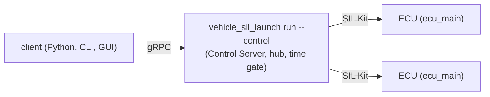

# Control API の使い方

実行中のシミュレーションを外から操作・監視する人（Python、CLI、試験）と、ECU に変数を宣言する人向けです。前に読む文書はありません。ECU の実行ファイル（`ecu_main`）なら、変数の名前と型は `--describe` の `variables` で調べられます（[ecu-executable.md](ecu-executable.md) の「JSON の形式」）。次に読むのは、契約の詳細が要るときだけ、下の段落にある architecture.md の節です。

実行中のシミュレーションを、外から操作・監視します。ECU が外から読み書きする変数を宣言し、クライアント（Python、CLI、GUI）が Control Server の gRPC の API（`proto/vehicle_sil/control/v1/control.proto`）で、その変数と仮想時間を操作します。契約の詳細（反映の時刻、順序、上限、スレッド）は [architecture.md](architecture.md) の「外部操作（Control API）と GUI」にあります。

ふつうは、シミュレーションを動かす `vehicle_sil_launch run` に `--control` を付けて、ランチャーの中の Control Server につなぎます（下の「ランチャーにつなぐ」）。`ecu_main` で作った ECU は、変数を宣言していれば、何も書かなくてもランチャーから読み書きできます。ECU の実行ファイルは gRPC を持ちません（ECU とランチャーの間は SIL Kit です）。



ランチャーを使わずに、単独の Control Server（`vehicle_sil_control_server`）に、gRPC の `AgentClient` を付けた ECU をつなぐこともできます（下の「単独の Control Server」）。

## ビルド

```sh
cmake --preset linux-gcc-release -DVEHICLE_SIL_BUILD_CONTROL_SERVER=ON
cmake --build --preset linux-gcc-release
```

gRPC が見つからなければ FetchContent で取り込みます（初回は取得とビルドに数分かかります）。Windows（MSYS2 UCRT64）は `pacman -S mingw-w64-ucrt-x86_64-grpc` で入れておきます。詳しくは [dependencies.md](dependencies.md)。このビルドの `vehicle_sil_launch` は `--control` を持ち、`vehicle_sil_launch version --json` の `features` に `control-server` があります。持たないビルドで `--control` を付けると、引数の誤り（終了コード 4）で、作り直し方を標準エラーに書きます。

## ランチャーにつなぐ

```sh
vehicle_sil_launch run --events --stdin-commands --start-paused --control 0 simulation.yaml
```

- `--control <address>` で、ランチャーが Control Server を立てます。`<address>` は、ポート番号だけ（127.0.0.1 で待ち受けます。0 なら空いているポート）、`<host>:<port>`、`unix:<path>` のどれかです。
- 実際のアドレス（ポート 0 なら選ばれたポート）は、事象 `control_server` の `address` と、人向けの出力の `[vehicle_sil_launch] control server at <address>` の行で知らせます。照合が通った後、registry より前に立てます（照合で失敗した実行では立てません）。立てられなければ（ポートが使われているなど）、何も起動せずに設定の誤り（`setup`、終了コード 3）です。
- サーバーが扱うのは、そのランチャーの実行だけです。ECU の変数（Peer の一覧、値、書き込み、操作の結果、購読）と、仮想時間（一時停止、再開、ステップ、指定時刻まで、速さ、停止）です。Peer の一覧には、構成ファイルの必須の participant も、Agent がなくても出ます。gRPC の Agent の接続（`AgentService`）は受け付けません。
- 実行が終わると（ふつうの終わり、止める要求、`--timeout-ms`、participant の失敗、どれでも）、ランチャーは participant を終わらせてから、結果を書く前にサーバーを閉じます。待っている呼び出し（`Watch`、`WaitOperation`、`WaitPaused`）は、そこで終わります（`Watch` はストリームの終わり、`WaitPaused` は `FAILED_PRECONDITION` か `CANCELLED`）。ランチャーはクライアントを待たないので、クライアントがあっても終わるのは遅れません。シミュレーションが終わってからサーバーを閉じるまでの間は、終わった時点の値を読めます。
- 例: [examples/launch_control](../examples/launch_control)（Python から起動してつなぎ、始まる前に書いて、読み返して確かめる）。

### 始まる前に書く（`--start-paused`）

`--control` と `--start-paused` を一緒に付けると、全員がそろった後、どの participant も時刻 0 のステップを始める前で止まり、`resume`、`step`、`run_until` のどれかを待ちます（標準入力からでも、クライアントからでもかまいません）。この間に書いた値は、各 ECU の時刻 0 のステップで反映されます（Parameter も書けます）。

```python
from vehicle_sil_control import Control, Launch, ms

with Launch("vehicle_sil_launch", "simulation.yaml", start_paused=True) as launch, Control(launch.address) as c:
    c.sim.wait_paused()                               # 0 で止まっている（time().running は偽: まだ始まっていない）
    seq = c.write({"Engine": {"engine.throttle": 50.0}})
    c.wait(seq, until="queued")                       # 全員が受け取ってから進める
    c.sim.step(ms(500)); c.sim.wait_paused()
    print(c.wait(seq).target("Engine").applied_at)    # 0
```

- 止まっている間、`GetTime` は `now` 0、`paused` 真、`running` 偽（まだ始まっていない）、`ended` 偽です。`WaitPaused` はすぐに 0 を返します。事象の `phase` は `waiting` のままで、ランチャーは `standing still before the first step until a resume, step or run_until command ...` の行を書きます。
- 書いたら、`wait(seq, until="queued")` で全員が受け取ったことを確かめてから進めます。受け取る前に進めると、時刻 0 に間に合わないことがあります。
- 止まっている時間に、それだけの上限はありません。`start_timeout_ms` は、止まるまで（全員がそろい、変数を出す ECU とつながるまで）と、進んだ後（全員が最初のステップに着くまで）にそれぞれ効き、止まっている間は数えません。止まるまでか進んだ後に participant が固まると、`simulation-start` の誤りになります（着いていない participant と状態を文言に挙げます）。
- `--timeout-ms` は、止まっている時間も数えます（一時停止している時間を数えるのと同じです）。クライアントが来ないまま `--timeout-ms` が過ぎると、時刻 0 のステップを走らせてから中断し、誤り `timeout` になります（文言に、最初のステップの前に止まっていたことを書きます）。`--timeout-ms` がなければ、止める要求が来るまで待ちます。
- 止める要求（Ctrl+C、`stop` の命令、標準入力の終わり、クライアントの `Stop`）でも止まるのをやめます。そのときは、時刻 0 のステップを 1 つ走らせてから止まります。待っている間に必須の participant が抜けると（プロセスが終わったなど）、すぐに待つのをやめて、始まらなかった実行として終わります（`ended-before-start`）。
- `pause` と `speed` では進みません（`speed` は、進んだ後の速さになります）。時刻を指定した `pause`（0 より後）は、`run_until` と同じく進みます。`run_until` 0 を送ると、時刻 0 のステップを走らせて 0 で止まります（`--control` なしの `--start-paused` と同じ止まり方）。
- 止まるより前（照合や、participant がそろうのを待つ間）に受け付けた命令も効きます。止まるのは、止まる時点で 0 で止まることになっているときだけです。`resume` を受け付けていれば止まらずに始まり、`step` や `run_until` を受け付けていれば、止まらずに 0 から進んでその時刻で止まります（止まってから受けたのと同じ結果）。その後に `pause` を受け付けていれば、また止まります。標準入力から来た命令も同じです。
- `--control` なしの `--start-paused`（`--stdin-commands` だけ）は、時刻 0 のステップを走らせてから 0 で止まります。この場合と、一時停止してから書く場合は、`at` を止まっている時刻より後にします（下の「Python」）。

### 2 つの口の命令

時間の命令は、標準入力（`--stdin-commands`）とクライアントの両方から受け付けます。どちらも同じ経路を通ります。

- 1 つずつ順に処理します。受け付けるかを決め、`command` の事象を書き、時間のゲートに渡すまでを、ほかの命令をはさまずに行います。事象の順が、効いた順です。どの口から来たかは `source` でわかります（`stdin`、`eof`、`control_server`）。
- 規則は同じです（`step` は一時停止している間だけ、など）。クライアントへの答えは、受け付けなければ gRPC の誤りで、文言は事象の `message` と同じです。引数の誤り（範囲の外の速さ、0 以下のステップ）は `INVALID_ARGUMENT`、今はできない命令は `FAILED_PRECONDITION` です。
- クライアントの命令の名前は、`Pause` が `pause`（時刻つきなら `at_ms`）、`Resume` が `resume`、`Step` が `step`（`ms`）、`RunUntil` が `run_until`（`at_ms`）、`SetSpeed` が `speed`、`Stop` が `stop` です。時刻はミリ秒に切り上げ、さらに controller の刻みに切り上げます（事象の値が、実際に止まる時刻です）。
- `Stop` は、標準入力の `{"command":"stop"}` と同じです（1 回目は順に止め、2 回目は待たずに participant を終わらせます）。結果の `interrupted_by` は `"control server stop"` です。`Stop` の理由の文は、監査の行にだけ残ります。シミュレーションが終わった後（始まらなかったときも）の `Stop` は、時間の命令と同じく断ります（`accepted: false`、`FAILED_PRECONDITION`）。結果は変わりません。`Stop` の事象も、時間の命令と同じ順に並びます。
- 標準入力とクライアントが同時に命令を送ると、どちらが先かは届いた順です。たとえば、クライアントの `step` と標準入力の `resume` が重なると、事象の順で、止まるか進み続けるかが決まります。

### 認証

- ループバック（ポート番号だけ、`localhost:<port>`、`[::1]:<port>`、数字の `127.x.y.z:<port>`、`unix:<path>`）では、`--control-credentials` を付けなければ認証はありません。同じコンピューターの誰でもつなげます。`unix:` のソケットは、ファイルの権限しだいで、同じコンピューターのほかの利用者もつなげます。
- ほかのコンピューターからつながるアドレス（`0.0.0.0:<port>` など）では、TLS と認証情報が要ります（`--control-tls-cert`、`--control-tls-key`、`--control-credentials`）。足りなければ引数の誤り（終了コード 4）です。
- 認証情報は、単独の Control Server と同じ形式のファイルです（下の「単独の Control Server を起動する」。`agent` の行は使いません）。1 件もないファイル（空、コメントだけ）は引数の誤りです（付けたのに誰でもつなげる、を避けるため）。誤りの文は行番号と何が違うかだけで、行の語は出しません（トークンかもしれないため）。トークンは引数に書けません（ランチャーの引数は、事象 `hello` の `arguments` や、プロセスの一覧に出るため）。
- `--control-audit-log <file>` で、誰が何を変えたかをファイルに追記します（書けなくなっても実行は続き、その行は失われます）。呼び出しに要る役割は、単独の Control Server と同じです（viewer は読むだけ、operator は時間の操作と書き込み、`Stop` は admin だけ）。

## ECU の変数

ECU のクラス（`Ecu&` を受け取るクラス）が、コンストラクターで変数を宣言します。宣言は ECU の Control Agent（`Ecu::agent()`。ECU に 1 つ）が持ちます。SIL Kit の `Peer` でも、ローカルの `Simulation()` と `LocalBench` でも、同じコードが同じように動きます。

```cpp
class Engine {
public:
    explicit Engine(vehicle_sil::Ecu& ecu) {
        ecu.input("engine.throttle", &throttle_, {.unit = "%", .min = 0.0, .max = 100.0});
        ecu.output("engine.speed", &rpm_, {.unit = "rpm"});
        ecu.every(10ms, [this](vehicle_sil::SimTime) { rpm_ = 800.0 + 50.0 * throttle_; });
    }
private:
    double throttle_ = 0.0;
    double rpm_ = 800.0;
};
```

- 宣言: `input(name, &value, options)`、`input(name, get, set, options)`（setter が値の保存以外もするとき）、`input_enum(name, &value, items, options)`、`output(name, &value, options)`、`output(name, get, options)`、`output_enum(name, get, items, options)`。型は bool、整数、実数、列挙で、単位、範囲、刻み、説明を付けられます（`VariableOptions`。`parameter` は最初のステップの前だけ書ける変数）。値は ECU のステップのスレッドで読み書きするので、モデルにロックは要りません。
- 宣言は実行の前（ECU の組み立ての中）だけです。開始後は `std::logic_error`、同じ ECU での同じ名前は `std::invalid_argument` です（どちらも文言に ECU の名前があります）。
- ポインターと関数は、ECU が持つもの（`Simulation::add()` が作るクラス、`emplace()` したオブジェクト）を指すようにします。ECU は Agent を、ネットワークの後、`emplace()` したオブジェクトの前に破棄します。
- `set_agent_options()` で、読み出しの周期（`sample_period`、既定 10 ms、0 で毎ステップ）とキューの大きさを選べます。最初の `input()`、`output()`、`agent()` より前だけです。不正な値はその場で `std::invalid_argument` です（文言に ECU の名前）。
- 変数を宣言しない ECU には Agent がなく、ステップの処理も増えません。
- 外からの書き込みは、指定した仮想時刻以後の最初のステップで、アプリの処理の前に反映されます（そのステップの J1939 の受信処理や部品のタイマーは反映より前に動くので、それらが新しい値を使うのは次のステップから）。値は、アプリと LIN の処理の後に読み出します。SIL Kit とローカルで同じ時点です。
- 同じプロセスからは、`ecu.agent().submit()` で書き込み、`latest()` で読めます。`Simulation::add<App>()` で足した ECU は、`sim.ecu(name).agent()` で引けます（例: `examples/vehicle`）。

## Python

```sh
uv sync                                         # .venv に grpcio、grpcio-tools、protobuf などを入れる
source .venv/bin/activate                       # または、各コマンドの前に uv run を付ける
python -m vehicle_sil_control.generate          # スタブを python/vehicle_sil_control/_generated に作る
export PYTHONPATH=$PWD/python
```

- Python は 3.11 以上です。版と依存はリポジトリ直下の `pyproject.toml`（`control` グループ）と `uv.lock` で決めています（README の「Python（uv）」）。
- uv を使わない場合は `pip install grpcio grpcio-tools protobuf`、MSYS2 UCRT64 では `pacman -S mingw-w64-ucrt-x86_64-python-grpcio mingw-w64-ucrt-x86_64-python-grpcio-tools` で入れます。

ランチャーは、`Launch` で子プロセスとして起動できます。`vehicle_sil_launch run --events --stdin-commands --control <address>` を起動し、事象を別のスレッドで読みます（標準ライブラリだけで、gRPC は要りません）。

```python
from vehicle_sil_control import Control, Launch, ms

with Launch("build/linux-gcc-release/tools/launch/vehicle_sil_launch", "simulation.yaml", start_paused=True) as launch:
    with Control(launch.address) as c:   # address は事象 control_server を待って返す
        ...
    launch.stop()                        # {"command":"stop"}（with を出るときも、動いていれば止める）
    print(launch.wait()["result"])       # run --json と同じ結果
```

- `Launch(launcher, config, address="0", start_paused=False, arguments=(), cwd=None, stderr=None)`: `arguments` は `run` のほかの引数（`--speed`、`--disable`、`--control-credentials` など）です。`events`（読んだ事象の dict の一覧）、`result`、`wait_for_event(event, timeout, **keys)`（キーの値が合う最初の事象を待つ）、`send(command)`（標準入力に命令を 1 行）、`stop()`、`wait(timeout)`、`returncode`。ランチャーが結果を書かずに終わったときや、待つ事象が来ないまま実行が終わったときは `LaunchError` です（文言に結果と誤りの所見）。
- 自分でランチャーを起動するときは、`control_address(lines)` が、事象の行（文字列か dict）から最初の `control_server` の `address` を返します。

単独の Control Server（TLS とトークンつき）にも、同じようにつなぎます。

```python
from vehicle_sil_control import Control, ms

with Control("ctrl-pc:8510", token=token, root_certificates=open("server.crt", "rb").read()) as c:
    print([p.participant for p in c.peers()])
    c.sim.wait_paused()
    seq = c.write({"Engine": {"engine.throttle": 50.0}, "Body": {"cabin.lamp": 2}}, at=ms(100))
    c.wait(seq, until="queued")         # 全員が受け取ってから進める（at が止まっている時刻より後なので、遅すぎる書き込みが起きない）
    c.sim.run_until(ms(500)); c.sim.wait_paused()
    print(c.wait(seq).target("Engine").applied_at)   # 100 ms（ns で）
    print(c.values("Engine").values["engine.speed"])
    for update in c.watch(peers=["Body"]):           # Peer、Values、EventInfo、Operation
        print(update)
        break
```

時刻は仮想時間のナノ秒です（`ms()`、`s()` で作る）。呼び出しの失敗は `ControlError`（`code` は gRPC の状態コード）で、Agent が断った書き込みは例外ではなく、操作の結果（`invalid` など）になります。

- 止めてから書くときは、`at` を止まっている時刻（`c.sim.time().now`）より後にします（たとえば 1 ns 後）。止まっている時刻のステップは、すでに走った Peer があるので、その時刻か `at` なしの書き込みは `late` になるか、反映のステップが実行ごとに変わることがあります。例外は、ランチャーの `--start-paused` で最初のステップの前に止まっているときです（上の「始まる前に書く」）。
- `write()` は自動では送り直しません。応答を受け取る前に接続が切れた書き込みは、受け付けられているかもしれません（同じ書き込みを送り直すと、別の操作になります）。
- 複数のクライアントが同じ変数に同じ時刻で書くと、残る値は Server に届いた順で決まります。
- 時間の状態の購読（`watch(time=True)`）は約 100 ms ごとの最新で、短い一時停止は現れないことがあります。止まるのを待つには `c.sim.wait_paused()` を使います。
- `peers()` と `watch()` は、同じ Peer を同じ内容で返します。`has_agent` は Agent がつながったことがあるか（既定は偽）、`simulation_state` は SIL Kit の状態です。`TimeState.running` が偽のとき、`ended` が真なら終わっていて、偽ならまだ始まっていません。
- シミュレーションの状態の購読（`watch(simulation=True)`）は `SimulationState` を返します。必須の participant ごとの SIL Kit の状態（`participants`）、失敗した participant と理由（`failed_participant`、`failure_reason`）、終わったか（`ended`）が入ります。Server が状態を読めなかったときは、前の値に理由（`error`）が付きます。クライアントが遅くて Server が途中の状態を持ちきれなかったときは、捨てた数が gRPC の `Update.dropped` に入ります（Python の `watch()` はこの数を返しません。失敗と終わりは後の状態に残るので失われません）。`peers()` も、読めなかったときは、呼ぶたびに `ControlWarning` で知らせます（同じ箇所からの 2 回目以降も出します。出すか、例外にするか、無視するかは利用者の警告フィルターのとおりで、ライブラリはフィルターを変えません）。

## CLI

`--server`（既定は `VEHICLE_SIL_CONTROL_SERVER`）に、ランチャーの事象 `control_server` の `address`（人向けの出力では `control server at` の行）か、単独の Control Server のアドレスを渡します。

```sh
export VEHICLE_SIL_CONTROL_SERVER=ctrl-pc:8510 VEHICLE_SIL_CONTROL_TOKEN=... VEHICLE_SIL_CONTROL_ROOT_CERT=server.crt
python -m vehicle_sil_control peers
python -m vehicle_sil_control show Engine
python -m vehicle_sil_control set Engine engine.throttle=50 --at-ms 100   # 既定は全員が積むまで待つ（--wait done で反映まで）
python -m vehicle_sil_control run-until 500
python -m vehicle_sil_control step 10
python -m vehicle_sil_control speed 1        # 実時間。max でできるだけ速く
python -m vehicle_sil_control watch --peer Body --count 10
python -m vehicle_sil_control stop
```

## 単独の Control Server（`vehicle_sil_control_server`）

ランチャーを使わないときの形です。`vehicle_sil_control_server` が Hub と（`--required` で）シミュレーションの調停と時間ゲートを持ち、ECU は自分で gRPC の `AgentClient` を付けて、Server へつなぎます。クライアントの API（上の「Python」と「CLI」）は、ランチャーの Control Server と同じです。

### ECU を gRPC でつなぐ（`AgentClient`）

```cpp
vehicle_sil::Peer peer(options);            // Coordinated、仮想時間
peer.emplace<Engine>(peer);                 // ECU が変数を宣言する
vehicle_sil::control_grpc::AgentClient link(peer.agent(), {   // ECU の後、start() の前に作る
    .server = "ctrl-pc:8510", .participant = options.participant,
    .status = [&] { return vehicle_sil::control::PeerStatus{peer.failed(), peer.error()}; },
    .token = agent_token, .root_certificates_pem = server_certificate,
    .on_replaced = [&](const std::string& why) {  // 同じ名前の別のプロセスに置き換えられた
        std::fprintf(stderr, "%s\n", why.c_str());
        peer.request_stop("replaced at the control server");
    }});
peer.start();
while (!peer.wait(std::chrono::minutes(1))) {} // 止めている間も含めて、終わるまで待つ
peer.stop();                                // ステップが終わり、残っている操作を Cancelled にする
link.stop();                                // その結果を送ってから閉じる
```

- `AgentClient` は、作るときに Agent の変数の一覧（スキーマ）を確定させます。ECU が変数を宣言した後、`start()` の前に作ると、シミュレーションが始まる前に Server につながります。確定した後の宣言は `std::logic_error` です。
- `AgentClient` は ECU（`Peer`、`Simulation`、`LocalBench`）より後に宣言し、先に破棄します。ECU が Agent を破棄するためです。ECU に `emplace()` しません（`emplace()` したオブジェクトは Agent より後に壊れます）。`AgentClient` が残ったまま ECU が Agent を破棄すると、ECU の名前と直し方を標準エラーに出してプロセスを止めます（`std::terminate()`）。
- Peer は、スキーマを確定するときに、ECU の変数の後に監視の出力を足します（`peer.steps`、`peer.speed`、J1939 のネットワークとノードの状態と統計。一覧は [architecture.md](architecture.md) の「Control Agent（`vehicle_sil::control`）」の「Peer の監視」の項）。対象は、そのときにある J1939 のネットワークとノードです。その後に `j1939()` でネットワークを足すと `std::logic_error` になるので、ネットワークは `AgentClient` を作る前（最初の `submit()` の前）に足します。要らなければ `PeerOptions::monitor = false` にします。
- 終わり: `peer.stop()` は、ステップが走らなくなった後に、残っている操作を `Cancelled` にします（破棄でも同じ）。その後で `link.stop()` を呼ぶと、その結果も Server に届きます。`wait()` が時間切れで戻っただけでは、ステップが続いています。
- `on_replaced` は、同じ participant 名の別のプロセスに接続を置き換えられて、`AgentClient` がつなぎ直しをやめたときに 1 回だけ、`AgentClient` のスレッドで呼ばれます。引数は `last_error()` と同じ理由です。指定しなければ、理由を標準エラーに 1 行出します。この中で `link.stop()` を呼んだり `link` を破棄したりしません。`examples/control/control_peer.cpp` は、理由を標準エラーに出し、`peer.request_stop()` で止めて、終了コード 1 で終わります。
- `ecu_main` で作った ECU は、`AgentClient` を書かなくても、変数を SIL Kit の publish/subscribe で `vehicle_sil_launch run` へ出します（[ecu-executable.md](ecu-executable.md) の「変数を出す」。gRPC は要りません）。この文書の Control Server（gRPC）につながるのは、上のとおり `AgentClient` を付けた ECU です。
- `Simulation` の ECU も同じです（`AgentClient link(sim.ecu("Engine").agent(), ...)`）。SIL Kit の `Simulation` は、実行の終わりに ECU を止めるので、残っている操作はそこで `Cancelled` になります。
- ローカル（`Simulation()`、`LocalBench`）の ECU も、`AgentClient` で既存の Control Server につないで値を読み書きできます。ただし、時間の操作（一時停止、ステップ実行）、`Simulation` から Control Server を起動する口、監視の出力はありません。待っている書き込みの結果は届きません（`AgentClient` は ECU より先に破棄するため）。
- 例: `examples/control/control_peer.cpp`（プロセスごとに 1 つの Peer）、`examples/control/control_demo.cpp`（1 つのプロセスにすべて）。どちらも ECU のクラスは `examples/control/control_apps.hpp` にあります。

### 単独の Control Server を起動する

```sh
vehicle_sil_control_server --listen 0.0.0.0:8510 \
    --registry-uri silkit://localhost:8500 --required Engine,Body --start-paused 1 \
    --credentials credentials.txt --tls-cert server.crt --tls-key server.key --audit-log audit.log
```

- `--required` を付けると、Server が SimulationController を兼ね、必要な participant がそろったところでシミュレーションを始めます。必要な participant が Error で抜ける（プロセスの異常終了、ステップの失敗、切断）とすぐに、ほかの状態で抜けて 5 秒たってもシミュレーションが終わらなければ、Server はシミュレーションを止めて終わります（終了コード 1。判定は `vehicle_sil_sim_controller` と同じ）。始まる前に `stop` を呼ぶと、始まった直後に止まります（Peer によっては、最初のステップの前に終わりを見て、開始の失敗として終わります）。`--gate-step-ms`（既定 10）は止められる時刻の刻みです。`--start-paused 1` で T = 0 で止めて始めます。
- 認証情報のファイルは 1 行に 1 つで、`<role> <name> <token> [participant,...]` です（role は viewer、operator、admin、agent。トークンは 16 文字以上の秘密の文字列）。agent の行には、接続してよい participant 名を必ず書きます（カンマで区切る）。その名前でしか接続できません。どの名前でもよいときは `*` を書きます。participant 名のない agent の行は、読み込みの誤りです。

```text
# role     name     token                     participants
operator   tester   0f3c9a...（長い乱数）
admin      lead     7b21e4...
agent      engine   c4d8f0...                 Engine
agent      body     91aa3b...                 Body
agent      bench    5e07d2...                 *      # どの名前でもよい（試験台など）
```

- ループバック以外で待ち受けるときは TLS と認証情報が必須です（試すだけなら `--allow-insecure 1`）。

### 複数の PC

- SIL Kit のレジストリと Control Server を 1 台に置き、各 PC の Peer は両方へ外向きにつなぎます（Peer 側で待ち受けるポートは要りません。SIL Kit は participant どうしが直接つながらないとき、レジストリを中継に使います）。
- 発見: Server（`--required` のとき）は、必須の participant を SIL Kit のレジストリを通して見ているので、どの PC の Peer も、Agent がつながる前から一覧に出ます（`peers` の `has_agent` が偽、`simulation_state` に SIL Kit の状態）。Agent がつながると、その変数と値が加わります。
- Peer のプロセスが落ちて起動し直すと、Server は別の incarnation として扱い、前の未完了の操作を Unknown（反映されたかわからない）にします。ただし `--required` の Peer が落ちると、シミュレーションと Server が終わります（Coordinated の participant は、始まった後のシミュレーションに戻れない）。起動し直せるのは、必須でない Peer か、`--required` なしの Server のときです。同じ participant 名の Agent が別のプロセスからつながると、新しい接続が勝ちます。前の Agent はつなぎ直しをやめ、`replaced()` が真になり、`last_error()` に理由（participant 名、新しい接続の incarnation と接続元、同じ名前のプロセスが 2 つ動いていないか確かめること）が入り、`on_replaced` が呼ばれます（指定しなければ標準エラーに 1 行）。Server は置き換えを監査に残し、購読には新しい接続の Peer の出来事（Warning。Python では `level` が `"warning"` の `EventInfo`）として置き換えのたびに流すので、まとめる人が画面で気づけます。回線が切れただけなら、Agent はつなぎ直し、Agent が受け取っていた操作はそのまま続きます（受け取ったと知らされる前に切れた操作は Unknown）。黙って切れた接続は keepalive で数十秒以内に見つけます。
- Server を起動し直すと、前の Server の操作の結果は問い合わせられません（`NOT_FOUND`）。Agent がまだ持っていた時刻つきの書き込みは、そのまま反映されます。
- 試験: `tests/control_server/multi_process.py` は、レジストリ、Server、2 つの Peer をプロセスに分けて動かし、Python から操作します。`--remote-body` で Body を別の PC で動かせます。

## 制限

- 時間の操作（一時停止、ステップ実行、速度）は、ランチャーの Control Server と、`--required` でシミュレーションを調停している単独の Control Server だけです。止まるのは仮想時間で同期している Peer だけで、実時間の Peer は走り続けます。速度を指定したとき、シミュレーションが実時間に遅れても、後から追いつこうとはしません（遅れた分だけ後ろにずれたまま、指定の速度で進みます。[architecture.md](architecture.md) の時間の操作の「遅れ」）。
- リセット、participant の起動と再起動、CAN/LIN のチャネルの選択はありません。ランチャーの Control Server は、そのランチャーの 1 回の実行だけを扱い、実行が終わると閉じます。
- 値の購読は最新値です（読む前に来た新しい値で置き換えます）。すべての値の記録は、SIL Kit のトレースか `TapPort` を使います。
- 1 回の `write()` の書き込みは 4096 個まで、同時に待つ呼び出しと購読は合わせて 256 本まで（Server の既定）です。
