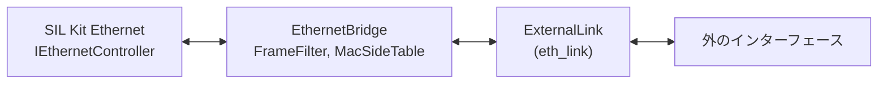

# イーサネットのブリッジ

SIL Kit の Ethernet ネットワークと、SIL Kit の外のイーサネットのインターフェースの間でフレームを運ぶ部品を使う人と、直す人向けです。前に読む文書はありません。直す人は、次に [code-map.md](code-map.md) の「Ethernet Bridge」を読みます。

ここに書いてあるのは、2 つのライブラリです。

| ターゲット | 中身 |
|---|---|
| `vehicle_sil::eth_link` | 外のインターフェースの口 `ExternalLink`、MAC アドレス、絞り込み `FrameFilter`、輪を防ぐ表 `MacSideTable`。SIL Kit を使わない |
| `vehicle_sil::ethernet_bridge_core` | SIL Kit の `IEthernetController` と `ExternalLink` の間でフレームを運ぶ `EthernetBridge`、統計と監視の行、引数の解釈（`parse_bridge_options()`）。プラットフォームに依存しない |



## 外のインターフェースの口（`ExternalLink`）

`vehicle_sil::eth_link::ExternalLink`（`vehicle_sil/eth_link/external_link.hpp`）は、外のイーサネットのインターフェース 1 つです。フレームはバイト列で、宛先 MAC アドレスから payload の終わりまでです。FCS は含みません。

| 関数 | 契約 |
|---|---|
| `start(handler)` | インターフェースを開き、受信スレッドから `handler` に `LinkEvent` を渡し始める。開けなければ `LinkError` を投げる |
| `stop()` | 渡すのをやめる。戻る前に、前の知らせの後で OS が捨てたフレームの数を、呼んだスレッドから `Overrun` で知らせてよい。戻った時点で、ハンドラーは動いていない。始めていなくても呼べる |
| `transmit(frame)` | フレームを 1 つ送る。結果は `Ok`、`QueueFull`（送信のキューがいっぱいで送らなかった）、`Failed`（ほかの誤り。理由は `last_error()`）。フレームは呼び出しの間だけ読む。ブロックしない |
| `echoes_own_transmissions()` | `transmit()` で送ったフレームが、受けたフレームとしてハンドラーに戻るか。口の寿命の間は変わらない。ブリッジは `start()` のときに読み、輪の防ぎ方を変える（下の「輪の防ぎ方」） |
| `describe()` | 起動のときに出す 1 行の部品。種類、名前、実か仮想か（例: `tap 'vsil0' (virtual)`） |

スレッド: ハンドラーは一度に 1 つのスレッドからだけ呼ばれます（受信スレッドと、`stop()` を呼んだスレッド）。`transmit()` はどのスレッドからでも、ハンドラーと並行にも呼べます。受信の時刻は渡しません。OS の時計はシミュレーションの時計と別のものだからです。

`transmit()` は、ブロックせず、例外を投げず、受信スレッドを待ちません。また、口がハンドラーを呼んでいる間、`transmit()` が取る錠を持ってはいけません。ブリッジは、SIL Kit がフレームのハンドラーの錠を持ったまま呼ぶ受信スレッドで `transmit()` を呼び、口のハンドラーの中で呼ぶ `SendFrame()` は同じ錠を取るからです（[dependencies.md](dependencies.md) の「実装が前提にしている上流の挙動」）。口の錠をハンドラーの間も持つと、2 つのスレッドが互いを待って止まります。ブリッジは、契約に反して `transmit()` が投げた例外を捕まえて `ext_tx_failures` に数え、続けます。

`LinkEvent` の種類です。

| 種類 | 意味 |
|---|---|
| `Frame` | 受けたフレーム（`frame`。ハンドラーの呼び出しの間だけ有効） |
| `Overrun` | OS が読み取りの前に捨てたフレームの数（`count`。前の知らせからの増分） |
| `LinkState` | リンクが上がった、下がった（`state`: `Up`、`Down`、`Unknown`） |
| `Fault` | リンクが動かなくなった（インターフェースがなくなった、読み取りが失敗し続ける）。理由は `detail`。この後フレームは届かず、`transmit()` は失敗する |
| `Warning` | 止めるほどではないが利用者に知らせること（`detail`） |

`LinkError` の種類（`kind()`）は `NoSuchInterface`、`PermissionDenied`、`LibraryMissing`、`NotEthernet`、`Other` です。`what()` は、何が起きたかと直し方を言います。

試験用の偽の口は `tests/eth_link/fake_link`（`FakeLink` と、偽の口どうしをつなぐ `FakeSegment`）です。受信スレッドを持ち、送信の詰まり、取りこぼし、`Fault`、リンクの上下、自分が送ったフレームが戻るインターフェースを模擬します。

## 転送（`EthernetBridge`）

`vehicle_sil::ethernet_bridge::EthernetBridge`（`vehicle_sil/ethernet_bridge/ethernet_bridge.hpp`）は、フレームを書き換えずに両方向に運びます。

- `start()` は、外の口を始め、SIL Kit のフレームのハンドラーを RX の向きだけで登録し、送信の確認のハンドラーを登録します。participant の lifecycle を始める前に呼びます。失敗したら、始めたものを戻してから例外を投げます。
- コントローラーの `Activate()` は `start_controller()` で、participant の CommunicationReady のハンドラーから呼びます（`runtime.add_communication_ready_handler([&bridge] { bridge.start_controller(); })`）。SIL Kit が勧めている時点です（SIL Kit のスレッドの上、Running の前）。それまでに外の口から届いたフレームは、SIL Kit に渡しません（数えません）。SIL Kit から外への向きは、`start()` から運びます。`Activate()` が失敗したら、例外ではなく `fault()` で知らせます。`start_controller()` の後の `start()`（止めて始め直す）は、`Activate()` もします。ブリッジは autonomous の participant なので、Ethernet を模擬するネットワークシミュレーターをその時点で見つけている保証はありません。
- `stop()` は、SIL Kit のフレームのハンドラーを外し、外の口を止め、送信の確認のハンドラーを外し、コントローラーを `Deactivate()` します。何度呼んでもかまいません。
- 自分のキューは持ちません。SIL Kit から外へは SIL Kit の受信スレッドで `transmit()` し、外から SIL Kit へは外の口の受信スレッドで `SendFrame()` します。押し戻しはなく、失ったフレームは数えます。
- `Fault` が届いても、ブリッジは動き続けます。`fault()` が理由を返すので、止めるかどうかは呼ぶ側が決めます。
- 警告は `take_warnings()` で、古い順に受け取ります。外の口の `Warning` と、ブリッジ自身の警告（下の「輪の防ぎ方」）です。

1 つのフレームは、次の順に調べます。

| 向き | 順序 |
|---|---|
| SIL Kit から外へ | 長さ（`malformed`、`oversize`）→ 絞り込み（`filtered_to_ext`）→ MAC の規則（`loop_suspected`）→ `transmit()` |
| 外から SIL Kit へ | 長さ（`malformed`、`oversize`）→ MAC の規則（`own_tx_dropped`、`loop_suspected`）→ 絞り込み（`filtered_from_ext`）→ `SendFrame()` |

外から来たフレームは、絞り込みより先に MAC の規則を見ます。自分が送ったフレームの戻りと、両側にあるアドレスのフレームは、絞り込みで落ちるものでもそれとして数えるためです。

## 絞り込み（`FrameFilter`）

同じ規則を両方向にかけます（`vehicle_sil/eth_link/frame_filter.hpp`）。

- 長さ: イーサネットのヘッダー（14 バイト）より短いフレームは `malformed`、最大長（既定 1522 バイト、FCS なし）より長いフレームは `oversize` として捨てます。
- EtherType（`FrameFilterOptions::ether_types`）: 挙げた EtherType のフレームだけを通します。送り元 MAC の後の 2 バイトが VLAN タグの印（TPID。既定は `0x8100` と `0x88A8`）なら、その 4 バイトのタグの後ろを見ます。見るタグは 2 つまでです。タグの途中で終わるフレームは通しません。
- SIL Kit の側の MAC（`FrameFilterOptions::silkit_macs`）: SIL Kit から外へは、送り元がそのどれかのフレームだけを通します。外から SIL Kit へは、宛先がそのどれかか、グループのアドレス（ブロードキャスト、マルチキャスト）のフレームだけを通します。グループのアドレスは挙げられません。
- 両方を挙げたときは、両方を満たすフレームだけを通します。どちらも挙げなければ、長さのほかは絞りません。

> [!NOTE]
> VLAN の TPID の既定（`0x8100`、`0x88A8`）、最大長の既定 1522 バイト、EtherType の位置は、一般の資料の値で、規格では確かめていません。どれも `FrameFilterOptions`（引数では `--vlan-tpid`、`--max-frame-bytes`）で変えられます。試験と例が使う EtherType `0x88B5` は、ローカルの実験用として知られた値で、これも規格では確かめていません。プロトコルの EtherType はライブラリに入れていないので、利用者が挙げます。

SIL Kit は、60 バイトより短いフレームを受け手の側で 0 で埋めます（[dependencies.md](dependencies.md) の「実装が前提にしている上流の挙動」）。そのため SIL Kit から来るフレームは 60 バイト以上で、外から来た短いフレームは、埋められて SIL Kit の相手に届きます。

## 輪の防ぎ方（`MacSideTable`）

同じ 2 つのネットワーク（SIL Kit の Ethernet ネットワークと外の線）の間には、ブリッジを 1 つだけ置きます。2 つ置くのは構成の誤りで、フレームが 2 つのブリッジを回り続けることがあります。ブリッジは、フレームの送り元 MAC から、見つけられる場合にこの誤りを見つけ、そのアドレスのフレームを止めて警告します。どの場合でも止めるとは約束しません（下の「止まらない場合」）。OS の設定には頼りません（`vehicle_sil/eth_link/mac_side_table.hpp`）。

規則:

- SIL Kit から来て、絞り込みを通ったフレームの送り元を「SIL Kit の側」として覚えます。`--src-mac`（`FrameFilterOptions::silkit_macs`）で挙げたアドレスは、ブリッジを作るときに SIL Kit の側として入れておきます。
- 外から来て、絞り込みを通ったフレームの送り元を「外の側」として覚えます。絞り込みで落ちたフレームでは覚えません。
- SIL Kit から来たフレームの送り元が外の側なら、そのアドレスは両側にあります（同じネットワークの間に 2 つのブリッジがある、または同じ MAC アドレスが両側にある）。
- 外から来たフレームの送り元が SIL Kit の側のとき:
  - 口が自分の送信を戻さない（`echoes_own_transmissions()` が `false`）なら、そのフレームは自分の送ったものではありえないので、そのアドレスは両側にあります。
  - 口が自分の送信を戻す（`true`）なら、自分が送ったフレームの戻りとして捨て、`own_tx_dropped` に数えます。警告は出しません。
- 両側にあるアドレスのフレームは、以後両方向で捨て、`loop_suspected` に数えます。警告は、アドレスごとに 1 回、最初の 8 つまでアドレスを挙げて出し、それより多いときは 1 回だけまとめて出します。両側の印は、ブリッジを起動し直すまで消えません。誤りを直したら（ブリッジを 1 つにしたら）、残ったブリッジも起動し直します。
- グループの送り元アドレス（ブロードキャスト、マルチキャスト）は覚えず、調べずに通します。

止まる場合（偽の口と偽のコントローラーの 2 つのブリッジで、試験が確かめています）:

- 自分の送信を戻さない口では、SIL Kit の機器が始めた輪も、外の機器が始めた輪も、写しが届く順序によらず止まります。輪が回るのは、遅れた側のブリッジが、もとのフレームを自分の側で受けるまでの間です。受けた時点で、そのアドレスが両側にあると分かります。
- 自分の送信を戻さない口では、片方のブリッジだけが `--no-mac-guard` でも、規則を使う側のブリッジが見つけて止め、警告します。
- 自分の送信を戻す口でも、SIL Kit の機器が始めた輪は止まります（アドレスを外で先に見たブリッジが、SIL Kit から来たフレームで両側と分かる）。

止まらない場合:

- 自分の送信を戻す口で、外の機器が始めた輪。ブリッジ 1 が外のフレームを SIL Kit に入れ、ブリッジ 2 がそれを自分の外の写しより先に SIL Kit から受けると、ブリッジ 2 はそのアドレスを SIL Kit の側と覚え、後から来る外の写しを自分の戻りとして捨てます。どちらのブリッジもアドレスを両側に見ず、輪は続き、警告も出ません（試験はこの事実も確かめています）。この口では、自分の戻りと、別のブリッジや同じアドレスの別の機器から来たフレームを、送り元だけからは見分けられません。
- 自分の送信を戻す口で、片方が `--no-mac-guard` の場合。規則を使う側は、相手の写しを自分の戻りとして捨てます。
- 両方のブリッジが `--no-mac-guard` の場合。
- MAC の表がいっぱいで覚えられなかったアドレス（`mac_unguarded` に数える）と、グループの送り元アドレスのフレーム。

どの口が自分の送信を戻すかは、口の実装が申告します。どの OS のどの仕組みが戻すかは、まだ確かめていません。

両側にあるアドレスのフレームを両方向で捨てるので、同じ MAC アドレスを持つ機器が両側に本当にあると、そのアドレスのフレームは届かなくなります。警告がアドレスを挙げるので、構成の誤りとして見つけられます。ただし、自分の送信を戻す口では、SIL Kit の側で先に覚えたアドレスを外で見ても、戻りと区別できないので、黙って捨てます。

MAC の表の大きさは既定 1024 アドレス（`--mac-table-size`、16〜65536）で、確保はブリッジを作るときだけです。いっぱいになると、SIL Kit の側のアドレス（と両側の印）は、外の側の最も古いアドレスを追い出して入ります。外の側の新しいアドレスは覚えません。覚えられなかったアドレスのフレームは、調べずに通して `mac_unguarded` に数え、最初の 1 回だけ警告します。

`EthernetBridgeOptions::mac_guard` を `false`（引数では `--no-mac-guard`）にすると、この規則を使いません。輪は使う人が防ぎます。

警告の文は次のとおりです（試験が文言まで確かめています）。アドレスを先に見た側と、いま見た側（`SIL Kit`、`the external link`）が入ります。

```
MAC 02:00:00:00:00:99 is on both sides: frames from it came from the external link and now come from SIL Kit, so frames from it are dropped both ways (loop_suspected). Run one bridge between these networks and give each device its own MAC address, then restart the bridge: it keeps dropping them until it restarts.
more MAC addresses are on both sides than the first 8 named: frames from them are dropped both ways too (loop_suspected).
the MAC table is full (1024 addresses): frames from addresses that do not fit are forwarded without the check against loops (mac_unguarded); addresses of the SIL Kit side take the places of the oldest addresses outside. Raise --mac-table-size if this many devices are expected.
```

## 統計

`format_statistics()` は、全部の数を 1 行にします。キーの名前と順序はこの文書の契約で、試験が読みます。

```
stats silkit_to_ext=0 ext_to_silkit=0 own_tx_dropped=0 loop_suspected=0 mac_unguarded=0 filtered_to_ext=0 filtered_from_ext=0 oversize=0 malformed=0 ext_overruns=0 ext_queue_full=0 ext_tx_failures=0 silkit_tx_failures=0
```

| キー | 数えるもの |
|---|---|
| `silkit_to_ext` | SIL Kit から外へ送ったフレーム |
| `ext_to_silkit` | 外から SIL Kit へ渡したフレーム（`SendFrame()` が戻ったもの） |
| `own_tx_dropped` | 外の口から戻ってきた、自分が送ったフレーム（自分の送信を戻す口だけ） |
| `loop_suspected` | 送り元が両側にあるアドレスのフレーム |
| `mac_unguarded` | MAC の表に入らず、輪を調べずに通したフレーム |
| `filtered_to_ext`、`filtered_from_ext` | 絞り込みで通さなかったフレーム（向きごと） |
| `oversize` | 最大長より長いフレーム（両方向） |
| `malformed` | イーサネットのヘッダーより短いフレーム（両方向） |
| `ext_overruns` | OS が読み取りの前に捨てたフレーム |
| `ext_queue_full` | 外の口の送信のキューがいっぱいで失ったフレーム |
| `ext_tx_failures` | 外の口でのほかの送信の失敗（`transmit()` が投げた例外を含む） |
| `silkit_tx_failures` | `SendFrame()` が例外を投げたもの、または SIL Kit が送れなかったと確認したもの（`ControllerInactive`、`LinkDown`、`Dropped`、`InvalidFrameFormat`）。後者のフレームは、渡した時点で `ext_to_silkit` にも数えてある |

問題の数は `loop_suspected`、`mac_unguarded`、`oversize`、`malformed`、`ext_overruns`、`ext_queue_full`、`ext_tx_failures`、`silkit_tx_failures` です（`problems_grew()`）。転送した数、絞り込みの数、`own_tx_dropped` は問題に数えません。

## 監視の行

`format_health_change(before, now, interface, problems_before)` は、呼ぶ側が取った 2 つの見本（`EthernetBridge::health()`）の間の変化を 1 行にします。何もなければ行を作りません。

- 問題の数が増えたか、リンクの状態が変わったとき（ただし、状態不明から `link up` への変化は、健全なリンクの最初の知らせなので出しません）:
  ```
  interface enp3s0: link down; since the last report: ext_tx_failures +12
  ```
- 何も増えていないが、前の見本では増えていたとき（`problems_before`）:
  ```
  interface enp3s0: link up; no new problems since the last report
  ```

リンクの状態は `link up`、`link down`、`link state unknown` のどれかです。

## 引数（`parse_bridge_options()`）

`vehicle_sil/ethernet_bridge/bridge_options.hpp` の `parse_bridge_options()` が解釈する引数です。誤りは `BridgeUsageError` で、何が誤りかと直し方を言います。使い方の全文は `bridge_usage()` です。

| 引数 | 意味 |
|---|---|
| `--registry-uri <uri>` | SIL Kit の registry。必須 |
| `--network <name>` | SIL Kit の Ethernet ネットワーク。必須で、既定の名前はない（別のネットワークに誤ってつながないため） |
| `--participant <name>` | participant の名前（既定 `EthernetBridge`） |
| `--backend <tap\|packet\|npcap\|pcap>` | 外のインターフェースの開き方。必須。`tap` は PC の中の仮想のインターフェース、ほかは実のアダプターに届きうるものとして扱う |
| `--interface <name>` | つなぐインターフェース。必須で、「最初に見つかったもの」は選ばない |
| `--ethertype <hex>,...` | 通す EtherType（`0x` で始まる 16 進。繰り返すと足される） |
| `--src-mac <mac>,...` | SIL Kit の側の MAC アドレス（`:` か `-` で区切った 6 バイト。繰り返すと足される） |
| `--all-frames` | 絞らない。`--ethertype`、`--src-mac` とは一緒に使えない |
| `--vlan-tpid <hex>,...` | VLAN タグの印（既定 `0x8100,0x88a8`） |
| `--max-frame-bytes <n>` | 最大長、FCS なし、60〜65535（既定 1522）。SIL Kit が 60 バイトより短いフレームを渡さないので、60 が下限 |
| `--promiscuous` | 自分宛てでないフレームも受ける。`tap` では使えない |
| `--tap-create` | TAP デバイスをブリッジが動く間だけ作る。`tap` だけ |
| `--no-mac-guard` | MAC の規則を使わない |
| `--mac-table-size <n>` | MAC の表の大きさ、16〜65536（既定 1024） |
| `--list-interfaces` | インターフェースの一覧を求める（`--backend` のほかは要らない） |
| `--help` | 使い方 |

実のアダプターに届きうる `--backend`（`packet`、`npcap`、`pcap`）では、何を通すか（`--ethertype`、`--src-mac`、`--all-frames` のどれか）が必須です。ないと次の誤りになります。

```
--backend npcap sends to a real adapter: say what may pass with --ethertype, --src-mac or --all-frames.
```

## 試験

`ctest -R '^(eth_link|ethernet_bridge)\.'` で回ります。どれも実時間に頼らず、偽の口と偽のコントローラーで起きたことを待ちます。

- `eth_link.*`: MAC アドレス、絞り込み（EtherType、VLAN タグの先、MAC、最大長）、MAC の表（戻り、両側、上限、並行）、偽の口。`eth_link.boundary` は、`libs/eth_link` が SIL Kit のヘッダーを直接にも間接にも含まないことを確かめます。
- `ethernet_bridge.*`: 偽のコントローラーと偽の口での転送、絞り込み、自分のフレームの戻り、2 つのブリッジを通る輪（止まる順序と、自分の送信を戻す口で止まらない順序、片方が `--no-mac-guard` の場合）、MAC の表があふれたとき、流れの最中の `stop()`、失ったフレーム、`Fault`、警告、始め方と止め方。統計と監視の行、引数の誤りの文言。`ethernet_bridge.silkit_*` は、プロセス内の registry（空いているポート）と 2 つの participant で、本物の SIL Kit の側を確かめます。
