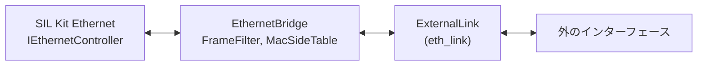

# イーサネットのブリッジ

SIL Kit の Ethernet ネットワークを、SIL Kit の外のイーサネットのインターフェース（PC の中の TAP デバイス、ネットワークのインターフェース）につなぐ人と、ブリッジを直す人向けです。前に読む文書はありません。直す人は、次に [code-map.md](code-map.md) の「Ethernet Bridge」を読みます。

`vehicle_sil_ethernet_bridge` は、SIL Kit の Ethernet ネットワークと外のインターフェースの間で、イーサネットのフレームを書き換えずに双方向に運びます。実時間で動き、時刻同期には参加しません。

> [!WARNING]
> 外のインターフェースを開けるのは、いまは Linux の `tap` と `packet` だけです。Windows では実行ファイルはビルドできますが、開けるバックエンドがまだありません（`--backend` に何を渡しても、その旨と直し方を言って終了コード 3 で終わります）。確かめた範囲は「[確かめたことと、確かめていないこと](#確かめたことと確かめていないこと)」にあります。

| ターゲット | 中身 |
|---|---|
| `vehicle_sil_ethernet_bridge`（実行ファイル） | ブリッジの CLI。止め方、監視、終了コードは `run_bridge()`（[bridges.md](bridges.md) と同じ）。どのプラットフォームでもビルドする |
| `vehicle_sil::eth_link` | 外のインターフェースの口 `ExternalLink`、MAC アドレス、絞り込み `FrameFilter`、輪を防ぐ表 `MacSideTable`、OS がライブラリなしで持つ口（`os_links.hpp`: Linux の TAP デバイスと packet ソケット）。SIL Kit を使わない |
| `vehicle_sil::ethernet_bridge_core` | SIL Kit の `IEthernetController` と `ExternalLink` の間でフレームを運ぶ `EthernetBridge`、統計と監視の行、引数の解釈（`parse_bridge_options()`）、実行ファイルが言うこと（起動の 1 行、OS ごとに使えるバックエンド、プロミスキャスの手がかり: `bridge_app.hpp`）。プラットフォームに依存しない |



## 使い方（`vehicle_sil_ethernet_bridge`）

```sh
# PC の中だけ: 先に作った自分の TAP デバイスにつなぐ（権限は要らない）
sudo ip tuntap add dev vsil0 mode tap user $USER
sudo ip link set vsil0 up
vehicle_sil_ethernet_bridge --registry-uri silkit://127.0.0.1:8500 --network ETH1 --backend tap --interface vsil0

# ネットワークのインターフェース: 何を通すかの指定が要る
sudo setcap cap_net_raw+ep ./vehicle_sil_ethernet_bridge
vehicle_sil_ethernet_bridge --registry-uri silkit://127.0.0.1:8500 --network ETH1 --backend packet --interface enp3s0 \
    --ethertype 0x88b5 --promiscuous

vehicle_sil_ethernet_bridge --list-interfaces
```

引数は「[引数](#引数parse_bridge_options)」にあります。ブリッジは次の順に動きます。

1. 引数を調べます。誤りは、何が誤りかと使い方を標準エラーに出して、終了コード 4 で終わります。
2. `--backend` がこの OS で使えるかを調べます。使えなければ、SIL Kit に接続する前に、理由と代わりを言って終了コード 3 で終わります。
3. SIL Kit の registry に接続し、Ethernet のコントローラーを作ります。registry に接続できなければ、どこに接続しようとしたかと次にすることを言って、終了コード 3 で終わります（括弧の中は SIL Kit の文です）。

   ```
   [eth-bridge] FAIL setup: cannot connect to the SIL Kit registry at silkit://127.0.0.1:8500 (SIL Kit: An unspecified error occurred (1): ERROR: Failed to connect to SIL Kit Registry). Start the registry first ('sil-kit-registry --listen-uri silkit://127.0.0.1:8500'), or give the address it listens at with --registry-uri.
   ```
4. 外のインターフェースを開き、転送を始めます（`EthernetBridge::start()`）。開けなければ、何が起きたかと直し方を言って終了コード 3 で終わります（下の「[バックエンド](#バックエンド)」の文）。
5. participant の lifecycle を始めます。転送を先に始めるのは、ほかの participant が、ブリッジが Running になったのを見た時点で送り始めるからです。
6. 起動の 1 行を出し、止める要求か失敗まで動きます。

起動の 1 行は、何をどこにつないだか、何を通すか、プロミスキャスと MAC の規則の状態を言います。

```
[eth-bridge] bridging SIL Kit network 'ETH1' (participant 'EthernetBridge', silkit://127.0.0.1:8500) <-> packet 'enp3s0' (network interface): EtherType 0x88b5 only, both ways; promiscuous off (only frames to the interface's own address and to group addresses arrive); MAC guard on; Ctrl+C to stop
```

- 何を通すかは `every frame, both ways`、`EtherType 0x88b5,0x0800 only, both ways`、`SIL Kit MAC 02:00:00:00:00:01 only, both ways`、またはその 2 つを `and` でつないだものです。
- プロミスキャスの部分は `promiscuous on` か上の `promiscuous off (...)` で、`tap` では出しません。
- 動いている間は、警告を `[eth-bridge] warning: <文>`、監視の行（「[監視の行](#監視の行)」）を `[eth-bridge] interface <名前>: ...` として、1 秒に 1 回まで出します。止める直前に出た警告は、`stopping` の後、統計の前に出します。
- 止める要求（Ctrl+C、Ctrl+Break、SIGTERM、Windows でコンソールを閉じたとき）で、`stopping`、統計の 1 行（「[統計](#統計)」）、最後の誤りがあれば `last error: <文>`、`stopped` の順に出して終わります。止める順は、SIL Kit のハンドラーを外す、外の受信を止める（インターフェースを閉じる）、統計を出す、lifecycle を止める、です。

終了コードです。participant の状態の扱いは Vector XL CAN Bridge と同じです（[bridges.md](bridges.md) の「接続先とチャネルの選択（CLI）」）。

| 終了コード | 意味 |
|---|---|
| 0 | 止める要求で止まった。`--list-interfaces`、`--help` が終わった |
| 1 | 動いている間の失敗。外のインターフェースが動かなくなった（なくなった、読み取りの失敗）: `FAIL: <理由>`。SIL Kit の participant が自分で止まった、終わった、Running にならなかった |
| 3 | 準備の失敗（この OS で使えないバックエンド、インターフェース、SIL Kit）: `FAIL setup: <理由>` |
| 4 | 引数の誤り |

プロミスキャスなしで（`packet`）、ブリッジが外へフレームを送ってから 5 秒たっても、SIL Kit の側の MAC アドレス（外へ送ったフレームの送り元）宛てのフレームが 1 つも来ないとき、手がかりを 1 回だけ警告します。プロミスキャスなしのインターフェースは、自分のアドレス宛てとグループのアドレス宛てのフレームしか渡さず、SIL Kit の機器のアドレスはインターフェースのアドレスと違うからです。返事を待たない使い方（外へ流すだけ）でも出るので、文は条件つきです。

```
no frame to a MAC address of the SIL Kit side has come from packet 'enp3s0' (network interface) in the 5 s since the bridge first sent a frame there, and --promiscuous is off: without it an interface passes on only frames to its own address and to group addresses, so frames to the SIL Kit devices (they have other addresses) do not arrive. If devices outside are meant to answer, add --promiscuous.
```

## バックエンド

| `--backend` | OS | 相手 | 仕組み | 要る権限 |
|---|---|---|---|---|
| `tap` | Linux | 同じ PC の OS のネットワークスタックと、その TAP デバイスを開くソフト（Wireshark など） | `/dev/net/tun` の TAP デバイス | 先に作った自分の持ち物のデバイスなら不要。`--tap-create` は `CAP_NET_ADMIN` |
| `packet` | Linux | ネットワークのインターフェース（NIC、veth）の先の機器と、同じ PC で同じインターフェースを packet ソケットや pcap で開くソフト。同じ PC の OS のネットワークスタックは相手にできません（「[同じ PC の OS のネットワークスタックが相手のとき](#同じ-pc-の-os-のネットワークスタックが相手のとき)」） | インターフェースに結び付けた packet ソケット（`AF_PACKET`） | `CAP_NET_RAW` |
| `npcap`、`pcap` | — | — | この版にはない（引数としては受け付け、使えないと言う） | — |

どちらも Linux のカーネルの口だけを使い、外のライブラリは要りません（[dependencies.md](dependencies.md)）。ブリッジは、インターフェースに IP アドレスを振ることも、上げることもしません。インターフェースが下がっていると、起動のときに 1 回警告し、上げ方を言います。

```
interface 'vsil0' is down: no frame passes until it is up. Bring it up with 'sudo ip link set vsil0 up'.
```

`--list-interfaces` は、この PC のインターフェースを、イーサネットかどうかと上がっているかを付けて並べます。

```
interfaces of this computer (--backend packet takes the Ethernet ones; --backend tap takes a TAP device):
  --interface lo      not Ethernet (link type 772), up
  --interface enp3s0  Ethernet, up
  --interface vsil0   Ethernet, down
```

### `tap`

TAP デバイスは PC の中の仮想のイーサネットのインターフェースで、ブリッジはその線の向こう側になります。ブリッジが送ったフレームは、OS がそのインターフェースで受けたフレームになります。OS やほかのソフトがそのインターフェースに送ったフレームを、ブリッジが受けます。

- 既定では、すでにあるデバイスにつなぎます。自分の持ち物として作ってあれば（`ip tuntap add ... user $USER`）、権限は要りません。
- `--tap-create` を付けると、ブリッジがデバイスを作ります（`CAP_NET_ADMIN` が要ります）。作ったデバイスは下がった状態で、ブリッジが止まるとなくなります。上げるのは使う人です（上がると監視の行が `link up` と言います）。
- 絞り込みの指定は要りません（既定で全部通します）。フレームは PC の中にとどまるからです。その TAP デバイスを OS のブリッジで NIC につないだ場合に外へ出るフレームは、つないだ人の責任です。
- 1 つの TAP デバイスにつなげるソフトは 1 つです。
- OS が TAP デバイスへ渡す前に捨てたフレームは、ブリッジからは見えません（`ext_overruns` は増えません）。OS の側のインターフェースの統計（`ip -s link show <名前>`）で見ます。

開けないときの文です（終了コード 3）。

```
no TAP device 'vsil0'. Make it first: 'sudo ip tuntap add dev vsil0 mode tap user $USER' and 'sudo ip link set vsil0 up'; or let the bridge make it while it runs with --tap-create (needs CAP_NET_ADMIN). Interfaces here: lo, enp3s0.
cannot attach to TAP 'vsil0': Operation not permitted. It belongs to another user. Make it yours first: 'sudo ip tuntap del dev vsil0 mode tap', then 'sudo ip tuntap add dev vsil0 mode tap user $USER' and 'sudo ip link set vsil0 up'.
cannot attach to TAP 'vsil0': Device or resource busy. Another program has it open, and a TAP device serves one program: stop that program, or use another TAP device.
interface 'lo' is not a TAP device. For a network interface use --backend packet; a TAP device is made with 'sudo ip tuntap add dev <name> mode tap user $USER'.
cannot create TAP 'vsil0': an interface with that name exists. Leave out --tap-create to attach to it, or choose another name.
cannot create TAP 'vsil1': Operation not permitted. Creating a TAP device needs CAP_NET_ADMIN: make it first with 'sudo ip tuntap add dev vsil1 mode tap user $USER' and 'sudo ip link set vsil1 up' and leave out --tap-create, or run as root.
cannot open /dev/net/tun: Permission denied. This user may not use TAP devices here: ask the administrator for read and write access to /dev/net/tun, or run as root.
cannot open /dev/net/tun: No such file or directory. The kernel's TUN/TAP driver is not there: load it with 'sudo modprobe tun'.
```

### `packet`

インターフェースに結び付けた packet ソケットで、フレームをそのまま送り受けします。

- `CAP_NET_RAW` が要ります。実行ファイルに 1 回付けるか（`sudo setcap cap_net_raw+ep <実行ファイル>`）、root で動かします。誤りの文は、この実行ファイルのパスを入れたコマンドを言います。
- 実のネットワークに出うるので、何を通すか（`--ethertype`、`--src-mac`、`--all-frames` のどれか）が必須です。
- 受けるのは、インターフェースに届いたフレームと、同じ PC の OS やほかのソフトがそのインターフェースに送ったフレームです。ブリッジ自身が送ったフレームは受けません。
- ブリッジが送ったフレームは、線の先へ出るだけです。届くのは、線の先の機器と、同じインターフェースを packet ソケットや pcap で開いているソフトです。同じ PC の OS のネットワークスタック（普通のソケットを使うソフト）には届きません。
- 受けたフレームの外側の VLAN タグは、カーネルがフレームのバイト列から外して、別の情報として渡します。ブリッジはそれを元の位置に戻すので、タグつきのフレームはタグを保ったまま両方向に通ります。
- `--promiscuous` は、ブリッジが動いている間だけ、自分宛てでないフレームも受けます（ソケットの設定で、止まると元に戻ります）。付けないと、実の NIC は自分の MAC アドレス宛てとグループのアドレス宛てのフレームしか渡しません。SIL Kit の機器宛てのユニキャストを外から受けるには、付けます。
- イーサネットでないインターフェース（`lo` など）は開きません。
- OS がソケットへ渡す前に捨てたフレームは `ext_overruns` に数えます。
- 受信のオフロード（GRO、LRO）が効いていると、最大長より長いフレームが見えることがあります。そのフレームは `oversize` として捨てます。困るときは、インターフェースのオフロードを切ります（`sudo ethtool -K <名前> gro off lro off`）。

#### 同じ PC の OS のネットワークスタックが相手のとき

同じ PC のソフトが、OS の普通のソケット（UDP、TCP）で SIL Kit の機器と話すなら、`tap` を使います。`packet` では、次の 3 つが起きます。

- **返事が届きません。** ソフトが送ったフレームはブリッジが受けて SIL Kit へ渡しますが、SIL Kit からの返事はブリッジが線の先へ送るだけで、同じ PC の OS のスタックには上がりません。片方向だけ通り、統計は両方向とも増えます。veth の対の片方をブリッジが開き、もう片方に IP アドレスを付けて使う形なら、両方向に届きます。
- **チェックサムが未完成のフレームが SIL Kit へ入ります。** OS は、送る UDP と TCP のチェックサムの計算を NIC に任せます（送信のチェックサムのオフロード）。packet ソケットは NIC が計算する前のフレームを見るので、チェックサムの欄は正しい値ではありません。veth の対の向こうの端から OS が送ったフレームも同じです（計算する NIC がありません）。ブリッジはこのフレームを捨てず、チェックサムを埋めることもせず、そのまま渡して `ext_checksum_incomplete` に数え、最初の 1 回だけ警告します。チェックサムを確かめる受け手（自分の TCP/IP スタックを持つ ECU）は、このフレームを黙って捨てます。直すには、フレームを送る側のインターフェース（veth なら向こうの端）で送信のオフロードを切ります（`sudo ethtool -K <名前> tx off`）。
- **TCP の長いフレームを `oversize` で捨てます。** OS は、TCP のデータを分けるのも NIC に任せ（送信の分割のオフロード、TSO、GSO）、packet ソケットには分ける前の、最大長より長いフレームが見えます。上と同じ `tx off` で、分けた後の長さになります。

警告の文です。1 つ目はブリッジのインターフェース自身から OS が送ったフレーム、2 つ目はインターフェースに届いたフレーム（veth の向こうの端から）のときです。

```
interface 'enp3s0': a frame this computer's OS sent on it has no TCP/UDP checksum yet: the OS leaves the checksum to the network adapter (checksum offload), and the bridge sees the frame before that. The bridge passes such frames on as they are, and a receiver in SIL Kit that checks checksums drops them. Turn the offload off with 'sudo ethtool -K enp3s0 tx off'; or, if the peer is this computer's OS, use --backend tap instead. This warning is given once.
interface 'va': a frame received on it has no TCP/UDP checksum: this computer's OS sent it through a virtual interface (the other end of a veth pair) and left the checksum to a network adapter that is not there (checksum offload). The bridge passes such frames on as they are, and a receiver in SIL Kit that checks checksums drops them. Turn the offload off on the interface the frames are sent from (for a veth pair the other end, not 'va'): 'sudo ethtool -K <that interface> tx off'; or, if the peer is this computer's OS, use --backend tap instead. This warning is given once.
```

`tap` には、チェックサムと長さの 2 つは起きません（TAP デバイスから読むフレームは、チェックサムが入っていて、分けた後の長さです）。

開けないときの文です（終了コード 3）。

```
no interface 'eth9' for --backend packet. Interfaces here: lo, enp3s0, vsil0 (run --list-interfaces).
interface 'lo' is not Ethernet (link type 772): --backend packet carries Ethernet frames only. Choose an Ethernet interface (run --list-interfaces).
cannot open a packet socket on 'enp3s0': Operation not permitted. A network interface needs CAP_NET_RAW: run 'sudo setcap cap_net_raw+ep /opt/vehicle-sil/bin/vehicle_sil_ethernet_bridge' once, or run as root.
```

### 動いている間にインターフェースが変わったとき

- リンクが下がった、上がった: 監視の行が `link down`、`link up` と言い、ブリッジは動き続けます。下がっている間に送って OS が断ったフレームは `ext_tx_failures` に数えます。
- インターフェースがなくなった（消した、名前を変えた）、読み取りが失敗した: `FAIL: interface 'vsil0' is gone (removed or renamed while the bridge ran)` などと言い、統計を出して終了コード 1 で終わります。

### この OS で使えないバックエンド

```
--backend npcap is for Windows. On Linux use --backend packet (a network interface) or --backend tap (a TAP device).
--backend pcap is not part of this version. Use --backend packet (a network interface) or --backend tap (a TAP device).
--backend tap cannot be used here: this version of vehicle_sil_ethernet_bridge has no backend for Windows (tap and packet are for Linux; npcap and pcap are not part of this version). Run the bridge on a Linux computer that reaches the same SIL Kit registry.
```

Windows では `--list-interfaces` も同じ理由（`there is no interface to list here: ...`）で、終了コード 3 で終わります。

## 外のインターフェースの口（`ExternalLink`）

`vehicle_sil::eth_link::ExternalLink`（`vehicle_sil/eth_link/external_link.hpp`）は、外のイーサネットのインターフェース 1 つです。フレームはバイト列で、宛先 MAC アドレスから payload の終わりまでです。FCS は含みません。

| 関数 | 契約 |
|---|---|
| `start(handler)` | インターフェースを開き、受信スレッドから `handler` に `LinkEvent` を渡し始める。開けなければ `LinkError` を投げる |
| `stop()` | 渡すのをやめる。戻る前に、前の知らせの後で OS が捨てたフレームの数を、呼んだスレッドから `Overrun` で知らせてよい。戻った時点で、ハンドラーは動いていない。始めていなくても呼べる |
| `transmit(frame)` | フレームを 1 つ送る。結果は `Ok`、`QueueFull`（送信のキューがいっぱいで送らなかった）、`Failed`（ほかの誤り。理由は `last_error()`）。フレームは呼び出しの間だけ読む。ブロックしない |
| `echoes_own_transmissions()` | `transmit()` で送ったフレームが、受けたフレームとしてハンドラーに戻るか。口の寿命の間は変わらない。ブリッジは `start()` のときに読み、輪の防ぎ方を変える（下の「輪の防ぎ方」） |
| `describe()` | 起動のときに出す 1 行の部品。種類、名前、実か仮想か（例: `tap 'vsil0' (TAP device in this computer)`、`packet 'enp3s0' (network interface)`） |

スレッド: ハンドラーは一度に 1 つのスレッドからだけ呼ばれます（受信スレッドと、`stop()` を呼んだスレッド）。`transmit()` はどのスレッドからでも、ハンドラーと並行にも呼べます。受信の時刻は渡しません。OS の時計はシミュレーションの時計と別のものだからです。

`transmit()` は、ブロックせず、例外を投げず、受信スレッドを待ちません。また、口がハンドラーを呼んでいる間、`transmit()` が取る錠を持ってはいけません。ブリッジは、SIL Kit がフレームのハンドラーの錠を持ったまま呼ぶ受信スレッドで `transmit()` を呼び、口のハンドラーの中で呼ぶ `SendFrame()` は同じ錠を取るからです（[dependencies.md](dependencies.md) の「実装が前提にしている上流の挙動」）。口の錠をハンドラーの間も持つと、2 つのスレッドが互いを待って止まります。ブリッジは、契約に反して `transmit()` が投げた例外を捕まえて `ext_tx_failures` に数え、続けます。

`LinkEvent` の種類です。

| 種類 | 意味 |
|---|---|
| `Frame` | 受けたフレーム（`frame`。ハンドラーの呼び出しの間だけ有効）。`checksum_incomplete` が真なら、UDP や TCP のチェックサムが未完成のフレーム（同じ PC の OS が送り、計算を NIC に任せたもの）。口はそのまま渡し、最初の 1 つの前に `Warning` を 1 回出す。ブリッジは渡して `ext_checksum_incomplete` に数える |
| `Overrun` | OS が読み取りの前に捨てたフレームの数（`count`。前の知らせからの増分） |
| `LinkState` | リンクが上がった、下がった（`state`: `Up`、`Down`、`Unknown`） |
| `Fault` | リンクが動かなくなった（インターフェースがなくなった、読み取りが失敗し続ける）。理由は `detail`。この後フレームは届かず、`transmit()` は失敗する |
| `Warning` | 止めるほどではないが利用者に知らせること（`detail`） |

`LinkError` の種類（`kind()`）は `NoSuchInterface`、`PermissionDenied`、`LibraryMissing`、`NotEthernet`、`Other` です。`what()` は、何が起きたかと直し方を言います。

OS の口は `vehicle_sil/eth_link/os_links.hpp` の `make_tap_link()` と `make_packet_link()` で作ります（Linux だけ。ほかの OS では `has_os_links()` が `false` で、作る関数は `LinkError` を投げます）。`list_interfaces()` はこの PC のインターフェースを返します。どちらの口も、受信スレッドが 250 ms ごとにインターフェースを見て、リンクの上下、なくなったこと、OS が捨てた数を知らせます。`LinkError` の文は、直し方が引数のときは `vehicle_sil_ethernet_bridge` の引数の名前で言います。

試験用の偽の口は `tests/eth_link/fake_link`（`FakeLink` と、偽の口どうしをつなぐ `FakeSegment`）です。受信スレッドを持ち、送信の詰まり、取りこぼし、`Fault`、リンクの上下、自分が送ったフレームが戻るインターフェースを模擬します。

## 転送（`EthernetBridge`）

`vehicle_sil::ethernet_bridge::EthernetBridge`（`vehicle_sil/ethernet_bridge/ethernet_bridge.hpp`）は、フレームを書き換えずに両方向に運びます。

- `start()` は、外の口を始め、SIL Kit のフレームのハンドラーを RX の向きだけで登録し、送信の確認のハンドラーを登録します。participant の lifecycle を始める前に呼びます。失敗したら、始めたものを戻してから例外を投げます。
- コントローラーの `Activate()` は `start_controller()` で、participant の CommunicationReady のハンドラーから呼びます（`runtime.add_communication_ready_handler([&bridge] { bridge.start_controller(); })`）。SIL Kit が勧めている時点です（SIL Kit のスレッドの上、Running の前）。それまでに外の口から届いたフレームは、SIL Kit に渡しません（数えません）。SIL Kit から外への向きは、`start()` から運びます。`Activate()` が失敗したら、例外ではなく `fault()` で知らせます。`start_controller()` の後の `start()`（止めて始め直す）は、`Activate()` もします。ブリッジは autonomous の participant なので、Ethernet を模擬するネットワークシミュレーターをその時点で見つけている保証はありません。
- `stop()` は、SIL Kit のフレームのハンドラーを外し、外の口を止め、送信の確認のハンドラーを外し、コントローラーを `Deactivate()` します。何度呼んでもかまいません。
- 自分のキューは持ちません。SIL Kit から外へは SIL Kit の受信スレッドで `transmit()` し、外から SIL Kit へは外の口の受信スレッドで `SendFrame()` します。押し戻しはなく、失ったフレームは数えます。
- `Fault` が届いても、ブリッジは動き続けます。`fault()` が理由を返すので、止めるかどうかは呼ぶ側が決めます。
- 警告は `take_warnings()` で、古い順に受け取ります。外の口の `Warning` と、ブリッジ自身の警告（下の「輪の防ぎ方」）です。

1 つのフレームは、次の順に調べます。

| 向き | 順序 |
|---|---|
| SIL Kit から外へ | 長さ（`malformed`、`oversize`）→ 絞り込み（`filtered_to_ext`）→ MAC の規則（`loop_suspected`）→ `transmit()` |
| 外から SIL Kit へ | 長さ（`malformed`、`oversize`）→ MAC の規則（`own_tx_dropped`、`loop_suspected`）→ 絞り込み（`filtered_from_ext`）→ `SendFrame()` |

外から来たフレームは、絞り込みより先に MAC の規則を見ます。自分が送ったフレームの戻りと、両側にあるアドレスのフレームは、絞り込みで落ちるものでもそれとして数えるためです。

## 絞り込み（`FrameFilter`）

同じ規則を両方向にかけます（`vehicle_sil/eth_link/frame_filter.hpp`）。

- 長さ: イーサネットのヘッダー（14 バイト）より短いフレームは `malformed`、最大長（既定 1522 バイト、FCS なし）より長いフレームは `oversize` として捨てます。
- EtherType（`FrameFilterOptions::ether_types`）: 挙げた EtherType のフレームだけを通します。送り元 MAC の後の 2 バイトが VLAN タグの印（TPID。既定は `0x8100` と `0x88A8`）なら、その 4 バイトのタグの後ろを見ます。見るタグは 2 つまでです。タグの途中で終わるフレームは通しません。
- SIL Kit の側の MAC（`FrameFilterOptions::silkit_macs`）: SIL Kit から外へは、送り元がそのどれかのフレームだけを通します。外から SIL Kit へは、宛先がそのどれかか、グループのアドレス（ブロードキャスト、マルチキャスト）のフレームだけを通します。グループのアドレスは挙げられません。
- 両方を挙げたときは、両方を満たすフレームだけを通します。どちらも挙げなければ、長さのほかは絞りません。

> [!NOTE]
> VLAN の TPID の既定（`0x8100`、`0x88A8`）、最大長の既定 1522 バイト、EtherType の位置は、一般の資料の値で、規格では確かめていません。どれも `FrameFilterOptions`（引数では `--vlan-tpid`、`--max-frame-bytes`）で変えられます。試験と例が使う EtherType `0x88B5` は、ローカルの実験用として知られた値で、これも規格では確かめていません。プロトコルの EtherType はライブラリに入れていないので、利用者が挙げます。

SIL Kit は、60 バイトより短いフレームを受け手の側で 0 で埋めます（[dependencies.md](dependencies.md) の「実装が前提にしている上流の挙動」）。そのため SIL Kit から来るフレームは 60 バイト以上で、外から来た短いフレームは、埋められて SIL Kit の相手に届きます。

## 輪の防ぎ方（`MacSideTable`）

同じ 2 つのネットワーク（SIL Kit の Ethernet ネットワークと外の線）の間には、ブリッジを 1 つだけ置きます。2 つ置くのは構成の誤りで、フレームが 2 つのブリッジを回り続けることがあります。ブリッジは、フレームの送り元 MAC から、見つけられる場合にこの誤りを見つけ、そのアドレスのフレームを止めて警告します。どの場合でも止めるとは約束しません（下の「止まらない場合」）。OS の設定には頼りません（`vehicle_sil/eth_link/mac_side_table.hpp`）。

規則:

- SIL Kit から来て、絞り込みを通ったフレームの送り元を「SIL Kit の側」として覚えます。`--src-mac`（`FrameFilterOptions::silkit_macs`）で挙げたアドレスは、ブリッジを作るときに SIL Kit の側として入れておきます。
- 外から来て、絞り込みを通ったフレームの送り元を「外の側」として覚えます。絞り込みで落ちたフレームでは覚えません。
- SIL Kit から来たフレームの送り元が外の側なら、そのアドレスは両側にあります（同じネットワークの間に 2 つのブリッジがある、または同じ MAC アドレスが両側にある）。
- 外から来たフレームの送り元が SIL Kit の側のとき:
  - 口が自分の送信を戻さない（`echoes_own_transmissions()` が `false`）なら、そのフレームは自分の送ったものではありえないので、そのアドレスは両側にあります。
  - 口が自分の送信を戻す（`true`）なら、自分が送ったフレームの戻りとして捨て、`own_tx_dropped` に数えます。警告は出しません。
- 両側にあるアドレスのフレームは、以後両方向で捨て、`loop_suspected` に数えます。警告は、アドレスごとに 1 回、最初の 8 つまでアドレスを挙げて出し、それより多いときは 1 回だけまとめて出します。両側の印は、ブリッジを起動し直すまで消えません。誤りを直したら（ブリッジを 1 つにしたら）、残ったブリッジも起動し直します。
- グループの送り元アドレス（ブロードキャスト、マルチキャスト）は覚えず、調べずに通します。

止まる場合（偽の口と偽のコントローラーの 2 つのブリッジで、試験が確かめています）:

- 自分の送信を戻さない口では、SIL Kit の機器が始めた輪も、外の機器が始めた輪も、写しが届く順序によらず止まります。輪が回るのは、遅れた側のブリッジが、もとのフレームを自分の側で受けるまでの間です。受けた時点で、そのアドレスが両側にあると分かります。
- 自分の送信を戻さない口では、片方のブリッジだけが `--no-mac-guard` でも、規則を使う側のブリッジが見つけて止め、警告します。
- 自分の送信を戻す口でも、SIL Kit の機器が始めた輪は止まります（アドレスを外で先に見たブリッジが、SIL Kit から来たフレームで両側と分かる）。

止まらない場合:

- 自分の送信を戻す口で、外の機器が始めた輪。ブリッジ 1 が外のフレームを SIL Kit に入れ、ブリッジ 2 がそれを自分の外の写しより先に SIL Kit から受けると、ブリッジ 2 はそのアドレスを SIL Kit の側と覚え、後から来る外の写しを自分の戻りとして捨てます。どちらのブリッジもアドレスを両側に見ず、輪は続き、警告も出ません（試験はこの事実も確かめています）。この口では、自分の戻りと、別のブリッジや同じアドレスの別の機器から来たフレームを、送り元だけからは見分けられません。
- 自分の送信を戻す口で、片方が `--no-mac-guard` の場合。規則を使う側は、相手の写しを自分の戻りとして捨てます。
- 両方のブリッジが `--no-mac-guard` の場合。
- MAC の表がいっぱいで覚えられなかったアドレス（`mac_unguarded` に数える）と、グループの送り元アドレスのフレーム。

どの口が自分の送信を戻すかは、口の実装が申告します。`tap` と `packet` は「戻さない」と申告します。Linux のカーネルで確かめた挙動です（試験 `ethernet_bridge.netns.*`）。

- `tap`: ブリッジが TAP デバイスに書いたフレームは OS へ行き、ブリッジの読み取りには戻りません。
- `packet`: ブリッジのソケットが送ったフレームは、そのソケットには戻りません。同じインターフェースのほかのソケットが送ったフレームは届きます。

そのため、この 2 つの口では「止まる場合」の全部が当てはまり、SIL Kit の側のアドレスを送り元に持つフレームが外から来たら、そのアドレスは両側にあるものとして止めて警告します。同じ PC で、SIL Kit の機器と同じ MAC アドレスを送り元にして同じインターフェースに送るソフトがあると、この警告になります。

両側にあるアドレスのフレームを両方向で捨てるので、同じ MAC アドレスを持つ機器が両側に本当にあると、そのアドレスのフレームは届かなくなります。警告がアドレスを挙げるので、構成の誤りとして見つけられます。ただし、自分の送信を戻す口では、SIL Kit の側で先に覚えたアドレスを外で見ても、戻りと区別できないので、黙って捨てます。

MAC の表の大きさは既定 1024 アドレス（`--mac-table-size`、16〜65536）で、確保はブリッジを作るときだけです。いっぱいになると、SIL Kit の側のアドレス（と両側の印）は、外の側の最も古いアドレスを追い出して入ります。外の側の新しいアドレスは覚えません。覚えられなかったアドレスのフレームは、調べずに通して `mac_unguarded` に数え、最初の 1 回だけ警告します。

`EthernetBridgeOptions::mac_guard` を `false`（引数では `--no-mac-guard`）にすると、この規則を使いません。輪は使う人が防ぎます。

警告の文は次のとおりです（試験が文言まで確かめています）。アドレスを先に見た側と、いま見た側（`SIL Kit`、`the external link`）が入ります。

```
MAC 02:00:00:00:00:99 is on both sides: frames from it came from the external link and now come from SIL Kit, so frames from it are dropped both ways (loop_suspected). Run one bridge between these networks and give each device its own MAC address, then restart the bridge: it keeps dropping them until it restarts.
more MAC addresses are on both sides than the first 8 named: frames from them are dropped both ways too (loop_suspected).
the MAC table is full (1024 addresses): frames from addresses that do not fit are forwarded without the check against loops (mac_unguarded); addresses of the SIL Kit side take the places of the oldest addresses outside. Raise --mac-table-size if this many devices are expected.
```

## 統計

`format_statistics()` は、全部の数を 1 行にします。キーの名前と順序はこの文書の契約で、試験が読みます。

```
stats silkit_to_ext=0 ext_to_silkit=0 own_tx_dropped=0 loop_suspected=0 mac_unguarded=0 filtered_to_ext=0 filtered_from_ext=0 oversize=0 malformed=0 ext_overruns=0 ext_queue_full=0 ext_tx_failures=0 silkit_tx_failures=0 ext_checksum_incomplete=0
```

| キー | 数えるもの |
|---|---|
| `silkit_to_ext` | SIL Kit から外へ送ったフレーム |
| `ext_to_silkit` | 外から SIL Kit へ渡したフレーム（`SendFrame()` が戻ったもの） |
| `own_tx_dropped` | 外の口から戻ってきた、自分が送ったフレーム（自分の送信を戻す口だけ） |
| `loop_suspected` | 送り元が両側にあるアドレスのフレーム |
| `mac_unguarded` | MAC の表に入らず、輪を調べずに通したフレーム |
| `filtered_to_ext`、`filtered_from_ext` | 絞り込みで通さなかったフレーム（向きごと） |
| `oversize` | 最大長より長いフレーム（両方向） |
| `malformed` | イーサネットのヘッダーより短いフレーム（両方向） |
| `ext_overruns` | OS が読み取りの前に捨てたフレーム |
| `ext_queue_full` | 外の口の送信のキューがいっぱいで失ったフレーム |
| `ext_tx_failures` | 外の口でのほかの送信の失敗（`transmit()` が投げた例外を含む） |
| `silkit_tx_failures` | `SendFrame()` が例外を投げたもの、または SIL Kit が送れなかったと確認したもの（`ControllerInactive`、`LinkDown`、`Dropped`、`InvalidFrameFormat`）。後者のフレームは、渡した時点で `ext_to_silkit` にも数えてある |
| `ext_checksum_incomplete` | 外から SIL Kit へ渡したフレームのうち、UDP や TCP のチェックサムが未完成のもの（`packet` で、同じ PC の OS が送ったフレーム。「[同じ PC の OS のネットワークスタックが相手のとき](#同じ-pc-の-os-のネットワークスタックが相手のとき)」）。`ext_to_silkit` にも数えてある |

問題の数は `loop_suspected`、`mac_unguarded`、`oversize`、`malformed`、`ext_overruns`、`ext_queue_full`、`ext_tx_failures`、`silkit_tx_failures`、`ext_checksum_incomplete` です（`problems_grew()`）。転送した数、絞り込みの数、`own_tx_dropped` は問題に数えません。

## 監視の行

`format_health_change(before, now, interface, problems_before)` は、呼ぶ側が取った 2 つの見本（`EthernetBridge::health()`）の間の変化を 1 行にします。何もなければ行を作りません。

- 問題の数が増えたか、リンクの状態が変わったとき（ただし、状態不明から `link up` への変化は、健全なリンクの最初の知らせなので出しません）:
  ```
  interface enp3s0: link down; since the last report: ext_tx_failures +12
  ```
- 何も増えていないが、前の見本では増えていたとき（`problems_before`）:
  ```
  interface enp3s0: link up; no new problems since the last report
  ```

リンクの状態は `link up`、`link down`、`link state unknown` のどれかです。

## 引数（`parse_bridge_options()`）

`vehicle_sil/ethernet_bridge/bridge_options.hpp` の `parse_bridge_options()` が解釈する引数です。誤りは `BridgeUsageError` で、何が誤りかと直し方を言います。使い方の全文は `bridge_usage()` です。

| 引数 | 意味 |
|---|---|
| `--registry-uri <uri>` | SIL Kit の registry。必須 |
| `--network <name>` | SIL Kit の Ethernet ネットワーク。必須で、既定の名前はない（別のネットワークに誤ってつながないため） |
| `--participant <name>` | participant の名前（既定 `EthernetBridge`） |
| `--backend <tap\|packet\|npcap\|pcap>` | 外のインターフェースの開き方。必須。`tap` は PC の中の仮想のインターフェース、ほかは実のアダプターに届きうるものとして扱う。いま開けるのは Linux の `tap` と `packet`（「[バックエンド](#バックエンド)」） |
| `--interface <name>` | つなぐインターフェース。必須で、「最初に見つかったもの」は選ばない |
| `--ethertype <hex>,...` | 通す EtherType（`0x` で始まる 16 進。繰り返すと足される） |
| `--src-mac <mac>,...` | SIL Kit の側の MAC アドレス（`:` か `-` で区切った 6 バイト。繰り返すと足される） |
| `--all-frames` | 絞らない。`--ethertype`、`--src-mac` とは一緒に使えない |
| `--vlan-tpid <hex>,...` | VLAN タグの印（既定 `0x8100,0x88a8`） |
| `--max-frame-bytes <n>` | 最大長、FCS なし、60〜65535（既定 1522）。SIL Kit が 60 バイトより短いフレームを渡さないので、60 が下限 |
| `--promiscuous` | 自分宛てでないフレームも受ける。`tap` では使えない |
| `--tap-create` | TAP デバイスをブリッジが動く間だけ作る。`tap` だけ |
| `--no-mac-guard` | MAC の規則を使わない |
| `--mac-table-size <n>` | MAC の表の大きさ、16〜65536（既定 1024） |
| `--list-interfaces` | この PC のインターフェースの一覧を出して終わる（ほかの引数は要らない） |
| `--help` | 使い方 |

実のアダプターに届きうる `--backend`（`packet`、`npcap`、`pcap`）では、何を通すか（`--ethertype`、`--src-mac`、`--all-frames` のどれか）が必須です。ないと次の誤りになります。

```
--backend npcap sends to a real adapter: say what may pass with --ethertype, --src-mac or --all-frames.
```

## 確かめたことと、確かめていないこと

確かめたこと（Linux。試験 `ethernet_bridge.netns.*` が、ユーザー名前空間の中のネットワーク名前空間で、本物の実行ファイルとカーネルに対して確かめます）:

- `tap`: TAP デバイスの側の packet ソケットから送ったフレームが SIL Kit の相手にそのまま届き、返事が戻る。ブリッジが書いたフレームがブリッジに戻らない。2 つ目のブリッジは断られる。`--tap-create` で作ったデバイスが、下がった状態で作られ、ブリッジが止まるとなくなる。
- `packet`（veth の対）: タグなし、VLAN タグ 1 つ、タグ 2 つのフレームが、タグを保ったまま両方向に通る。同じインターフェースの別のソケットが送ったフレームが SIL Kit の相手に届く。ブリッジが送ったフレームがブリッジに戻らない。`--promiscuous` がインターフェースの promiscuity を、動いている間だけ上げる。リンクの上下の監視の行。OS のスタックが送った UDP（veth の向こうの端からと、ブリッジのインターフェース自身から）が、SIL Kit の相手にそのまま届き、`ext_checksum_incomplete` に数えられ、警告が 1 回だけ出る。警告のとおりに `ethtool -K <名前> tx off` をすると、数も警告も出ない。
- 開けないときの文と終了コード 3（ない、TAP でない、イーサネットでない、すでにある、使用中、権限を落としたとき）。インターフェースを消したときの `FAIL` と終了コード 1。registry がないときの文と終了コード 3。

確かめていないこと:

- 実の NIC と、その先の実機や別の PC との往復。`--promiscuous` のありなしでの届き方（veth は、プロミスキャスでなくても全部のフレームをソケットに渡すので、名前空間では違いが出ません）。プロミスキャスの手がかりの警告は、時計を差し替えた試験でだけ確かめています。
- `setcap cap_net_raw+ep` した実行ファイルが、共有ライブラリの SIL Kit を見つけられるか（権限を付けた実行ファイルでは、ライブラリを探す環境変数が効かないことがあります）。
- ほかの人の持ち物の TAP デバイスにつなごうとしたときの文（文言は試験で確かめていますが、カーネルがその誤りを返す場面は作れていません）。
- 受信のオフロードで長いフレームが見える場面、無線のアダプター。
- 実の NIC での、チェックサムが未完成のフレームの警告と、`ethtool -K <名前> tx off` の効き方（試験は veth の対だけです）。送信の分割のオフロードで TCP の長いフレームが見えることと、それが `tx off` でなくなることは、veth の対で確かめましたが、試験にはありません。
- ランチャーの構成ファイル（`describe: false`、`required: false`）から起動する形。
- EtherType の位置、VLAN の TPID、最大長は、上の「絞り込み」の注のとおり、規格では確かめていません。

## 試験

`ctest -R '^(eth_link|ethernet_bridge)\.'` で回ります。名前空間の試験のほかは実時間に頼らず、偽の口と偽のコントローラーで起きたことを待ちます。

- `eth_link.*`: MAC アドレス、絞り込み（EtherType、VLAN タグの先、MAC、最大長）、MAC の表（戻り、両側、上限、並行）、偽の口。`eth_link.boundary` は、`libs/eth_link` が SIL Kit のヘッダーを直接にも間接にも含まないことを確かめます。
- `ethernet_bridge.*`: 偽のコントローラーと偽の口での転送、絞り込み、自分のフレームの戻り、2 つのブリッジを通る輪（止まる順序と、自分の送信を戻す口で止まらない順序、片方が `--no-mac-guard` の場合）、MAC の表があふれたとき、流れの最中の `stop()`、失ったフレーム、`Fault`、警告、始め方と止め方。統計と監視の行、引数の誤りの文言。`ethernet_bridge.silkit_*` は、プロセス内の registry（空いているポート）と 2 つの participant で、本物の SIL Kit の側を確かめます。
- `eth_link.os_link_*`: OS の口が開けないときの文と種類、`--list-interfaces` の並べ方（文だけなので全プラットフォーム）。
- `ethernet_bridge.app_*`: OS ごとに使えるバックエンドと使えないときの文、起動の 1 行、プロミスキャスの手がかり（時計を差し替えて、5 秒を待たずに確かめる）。
- `ethernet_bridge.integration.*`（全プラットフォーム）: 実行ファイルに偽の口をリンクしたもの（`vehicle_sil_ethernet_bridge_on_fake`。`tests/ethernet_bridge/fake_link_factory.cpp`）を、registry と SIL Kit の相手（`eth_bridge_it_peer`。SIL Kit の `IEthernetController` を直接使う）と一緒にプロセスとして動かします。往復と統計、起動の 1 行、引数の誤り（4）、開けないインターフェース（3）、`Fault`（1）、止める要求（統計、`stopped`、0）。`backend-not-here` は本物の実行ファイルで、その OS で使えないバックエンドの文を確かめます。
- `ethernet_bridge.netns.tap`、`ethernet_bridge.netns.packet`（Linux だけ。`tests/ethernet_bridge/bridge_netns.py`）: 上の「確かめたこと」。ユーザー名前空間を作れない所では飛ばします（終了コード 77。環境変数 `VEHICLE_SIL_REQUIRE_MULTI_HOST=1` があれば失敗）。名前空間は作れるが、その中で TAP デバイス、veth、packet ソケットを作れない所でも飛ばします（`VEHICLE_SIL_REQUIRE_ETHERNET_NETNS=1` があれば失敗）。どちらで飛ばしたかは、出力の `skipped:` の行が言います。`setpriv` や `ethtool` がない所では、それが要る部分だけを省いて `NOT CHECKED` と言います（`VEHICLE_SIL_REQUIRE_ETHERNET_NETNS=1` があれば、これも失敗）。CI は 2 つの変数を両方与えるので、飛ばしも省きも失敗になります。
