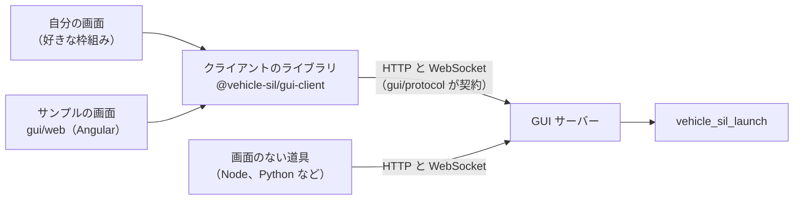
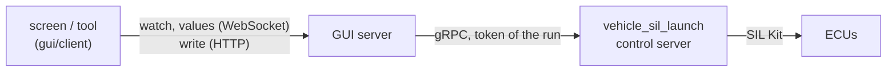

# ブラウザの GUI（`vehicle-sil-gui`）

ブラウザでシミュレーションを動かして見る人と、自分の画面を作る人向けです。先に読む文書はありません（ランチャーの言葉は [simulation-run.md](simulation-run.md) にあります）。次は、自分の画面を作るなら、下の「自分の画面を作る」の後に [gui/client/README.md](../gui/client/README.md)（クライアントのライブラリ）と [gui/protocol/README.md](../gui/protocol/README.md)（サーバーの口）です。

ブラウザからシミュレーションを動かし、見て、ECU の変数を読み書きするための道具です。GUI サーバー（Python）が自分の PC の上で `vehicle_sil_launch` を動かし、その経過と ECU の変数を、HTTP と WebSocket の口で画面に中継します。シミュレーションを動かすのはランチャーで、GUI はそれを映すだけです。試験や AI エージェントから使う正式な口は、今までどおり `vehicle_sil_launch` と Control API です。

GUI は、自分の画面を作るための道具一式（SDK）です。

| 部分 | 場所 | 役目 |
|---|---|---|
| GUI サーバー | `gui/server`（`vehicle-sil-gui`） | ランチャーを動かし、口を出し、画面（静的なファイル）を配る |
| サーバーの口 | [gui/protocol](../gui/protocol/README.md) | HTTP と WebSocket の形。版と互換の決まり、認証。どの言語からでも使える |
| クライアントのライブラリ | [gui/client](../gui/client/README.md)（`@vehicle-sil/gui-client`） | TypeScript。枠組みに依らない。接続、実行と時刻の操作、ECU の変数 |
| サンプルの画面 | `gui/web`（Angular） | 上の 3 つだけで作った参照のアプリ。指定がなければ GUI サーバーはこれを配る |

利用者は、好きな枠組みでまったく別の画面を作り、`--web` で GUI サーバーに配らせます（下の「自分の画面を作る」）。サンプルの画面は、そのまま使うことも、部品を写して使うこともできます（下の「サンプルの画面」）。

## 要るもの

- `vehicle_sil_launch`（`tools/launch` をビルドしたもの）。`version --json` の `features` に `events` と `stdin-commands` があるもの（`run --events`、`run --stdin-commands`。[simulation-events.md](simulation-events.md) の「機械から使う」）。時刻の操作には `speed`、`start-paused`、`time-commands` も要ります（ないランチャーでは、その操作を出しません）。
- ECU の変数を読み書きするには、Control Server を持つランチャー（`features` に `control-server`。`-DVEHICLE_SIL_BUILD_CONTROL_SERVER=ON` でビルドしたもの。[control-api.md](control-api.md)）と、GUI サーバーの Python に gRPC（`grpcio`、`protobuf`。`uv sync` が入れます）が要ります。どちらかがなくても、ほかの機能はそのまま使えます（変数だけが「使えない」になり、理由を出します）。
- 構成ファイルと、そこに書いた ECU の実行ファイル（ランチャーが照合と実行で起動します）。
- Python 3.11 以上と [uv](https://docs.astral.sh/uv/)（GUI サーバー）。
- 画面: サンプルの画面のビルド（`gui/web` の `npm run build` の出力）か、自分の画面のビルド（`--web`）。画面を使うだけなら Node.js は要りませんが、ビルドには要ります（[gui/web/README.md](../gui/web/README.md)）。
- ビルド済みの道具（README の「[取得とビルド](../README.md#取得とビルド)」）には、上のうち Python 以外の全部（Control Server を持つランチャー、GUI サーバー、ビルドした画面、gRPC のスタブ）が入っています。要るのは Python 3.11 以上だけで、uv があれば、Python とパッケージも uv が入れます。

## 起動

ビルド済みの道具では、その `bin` を `PATH` に入れて、構成ファイルのあるディレクトリで起動します。

```sh
vehicle-sil-gui simulation.yaml
```

- `bin/vehicle-sil-gui`（Windows のコマンドプロンプトでは `bin\vehicle-sil-gui.cmd`）は、道具の `vehicle_sil_launch` を `VEHICLE_SIL_LAUNCH` で、gRPC のスタブを `VEHICLE_SIL_CONTROL_STUBS` で GUI サーバーに渡し、`uv run` で `python/requirements.txt` のパッケージ（版とハッシュを固定）を入れて起動します（2 回目からは uv のキャッシュを使います）。Python は、固定したパッケージの wheel がある版（3.11 から、試験している `.python-version` の版まで）を uv が選び、なければ取ってきます。パッケージをソースからビルドはしません。引数は下の表のとおりです。
- uv がないときは、Python 3.11 以上の仮想環境に `python -m pip install --require-hashes -r <道具>/python/requirements.txt` で入れ、その Python を環境変数 `VEHICLE_SIL_PYTHON` で指定します。足りなければ、そう言って終了コード 2 で終わります。
- GUI サーバーの Python は、カレントディレクトリのモジュールを読み込みません（`python -P`）。

リポジトリの中で動かすときは、リポジトリの直下で `uv sync` をしてから、ビルドしたランチャーを `--launcher` で渡して起動します。例は、ビルドした ECU の例（`build/<preset>/examples/ecu_main/`。CMake が構成ファイルを実行ファイルの隣にコピーします）です。

```sh
uv run vehicle-sil-gui --launcher build/<preset>/tools/launch/vehicle_sil_launch \
  build/<preset>/examples/ecu_main/simulation.yaml
```

リポジトリの直下の `scripts/run-gui.py` は、この起動を 1 つのコマンドにしたものです。`build/` の下から Control Server を持つランチャーを探し、その隣の例の `simulation.live.yaml`（同じ 2 つの ECU を、`stop_at_ms` なし、`speed: 1` で動かす構成。止めるまで動くので、画面で値を見ながら触れます）で GUI サーバーを起動します。ビルドはしません。ランチャー、例、画面のビルド、uv のどれかがなければ、作るコマンドを表示して終了コード 1 で終わります（コマンドはリポジトリの直下で打つ形です。ほかのディレクトリから呼んだときは、打つ場所を最初の行で言います）。`--launcher` や構成ファイルに渡したファイルがないときは、引数の誤り（終了コード 2）です。`build/` の外のランチャー（展開した道具のものなど）を `--launcher` で渡すときは、隣に例がないので、構成ファイルも渡します。`--dry-run` は、探した結果と起動するコマンドだけを表示します。Windows では、Ctrl+C で全部が止まりますが、このスクリプトのプロセスだけを終わらせると（道具からの終了、タスクの終了）、GUI サーバーと実行中のシミュレーションが残ります。道具から止めるときは、プロセスの木ごと止めます（`taskkill /T /PID <pid>`）。

```sh
scripts/run-gui.py
```

画面で `simulation.yaml` を選ぶと、ランチャーが各 ECU の `--describe` で照合し、participant ごとの申告（ステップ幅、ネットワーク、変数の数）を出します。「開始」でシミュレーションを動かし、`stop_at_ms`（例では 1000 ms）で終わると結果を出します。構成ファイルの実行ファイルの相対パスは、構成ファイルのあるディレクトリから数えます（ランチャーの決まり）。

- 起動すると、`http://127.0.0.1:<port>/#token=<...>` を 1 行表示して、ブラウザで開きます。ブラウザには URL を直接渡さず、自分だけが読める一時ファイル（URL へ移るだけのページ。30 秒後かサーバーの終わりに消す）を開かせます。ブラウザがそのファイルを開けない（一時ディレクトリを読めないブラウザなど）ときや、ブラウザが開かないときは、表示した URL をブラウザに貼ります。Ctrl+C でサーバーを止めます。実行中のシミュレーションは、先に止めます。
- ランチャーは `--launcher <path>`、環境変数 `VEHICLE_SIL_LAUNCH`、`PATH` の順に探します。`PATH` で見つけたものがカレントディレクトリにあるときは使わず、終了コード 2 で終わります（Windows はカレントディレクトリを `PATH` より先に探すので、人から受け取ったフォルダで起動すると、そこにあるプログラムが動いてしまうため）。そのランチャーを使うときは `--launcher` で指定します。ランチャーが GUI に要る機能（`version --json` の `features` の `events` と `stdin-commands`）を持たないときは、何が足りないかを表示して終了コード 2 で終わります。
- `--web` を付けずに起動して、サンプルの画面のビルド（`gui/web` の `npm run build`）がないときは、ビルドの手順を書いたページを表示します。

| 引数 | 意味 |
|---|---|
| `<構成ファイル>` | 最初に選んでおくファイル（`--root` の下） |
| `--root <dir>` | 画面で選べるファイルの範囲。既定は、渡した構成ファイルのディレクトリ、なければカレントディレクトリ |
| `--port <n>` | 待ち受けるポート（127.0.0.1）。既定の 0 は空いているポート。80 は使えない（ブラウザが `Host` からポートを省くため） |
| `--no-browser` | ブラウザを開かない |
| `--launcher <path>` | `vehicle_sil_launch` のパス（`.py` で終わるパスは、この Python で動かす） |
| `--web <dir>` | 自分の画面を配る: そのビルドの出力のディレクトリ（`index.html` があること）。既定はサンプルの画面（下の「`--web` で配る」） |
| `--dev-origin <origin>` | 画面の開発サーバー（`ng serve`、Vite など。`http://127.0.0.1:<port>` の形だけ）からの要求も受け付ける（下の「開発中のやり方」） |
| `--json` | URL の代わりに `{"vehicle_sil_gui": 1, "url": ..., "port": ...}` を 1 行で表示する（道具から起動するとき） |
| `--stop-timeout <秒>` | 終わるとき、実行中のシミュレーションが止まるのを待つ時間（既定 10）。過ぎたらランチャーを止める |
| `--check-timeout <秒>` | 照合（各 ECU の `--describe` を含む）の時間の上限（既定 120）。過ぎたら照合を止める |
| `--silent-after <秒>` | 動いているランチャーがこの時間より長く何も書かなければ（心拍も来なければ）、画面に知らせる（既定 5。1 以上） |
| `--no-variables` | ランチャーの Control Server を立てない（ECU の変数を読み書きしない） |

終了コード: 0 は止めた（Ctrl+C、SIGTERM）、1 は動いている間の失敗、2 は引数の誤りか、ランチャーやポートを使えない。

## 自分の画面を作る

自分の画面は、クライアントのライブラリを使って好きな枠組みで作り、ビルドした静的なファイルを GUI サーバーに配らせます。画面は GUI サーバーと同じ origin から開くので、サーバーの守りの線（トークン、`Host`、`Origin`、CSP）がそのまま効きます。



1. 画面を作ってビルドし、静的なファイル（`index.html` と、スクリプト、スタイル）にします。
2. `vehicle-sil-gui --web <ビルドの出力のディレクトリ> <構成ファイル>` で起動します。サーバーがそのディレクトリを配り、表示した URL（`#token=` つき）でブラウザに自分の画面が開きます。
3. 画面は、URL のトークンをライブラリの `takeToken(window)` で受け取り、`createClient` でサーバーにつなぎます。

| 作り方 | 使うもの | 始め方 |
|---|---|---|
| ビルドなしの素の JavaScript | ライブラリを 1 つにまとめたファイル（`vehicle-sil-gui-client.mjs`） | ひな形 [examples/gui_starter](../examples/gui_starter/) を写す |
| TypeScript と好きな枠組み（React、Vue、Svelte など） | ライブラリのパッケージ（`.tgz`） | [examples/gui_starter/README.md](../examples/gui_starter/README.md) の「TypeScript と好きな枠組みで作る」 |
| Angular | 上のパッケージと、サンプルの部品と包み | 下の「サンプルの部品を写して使う」 |
| 画面のない道具（試験の駆動、記録） | ライブラリ、または口を直接 | 下の「画面のない道具」 |

### ライブラリを取り込む

- **パッケージ**: `gui/web` で `npm run pack:client` を実行すると、`build/gui-client/vehicle-sil-gui-client-<版>.tgz` ができます（版は GUI サーバーと同じ）。中身は 1 つにまとめた ESM（`dist/index.js`）、型（`types/`）、`exports` を書いた `package.json`、README、LICENSE で、依存はありません。自分のプロジェクトで `npm install <その .tgz>` をすると、`@vehicle-sil/gui-client` として import できます。npm のレジストリには公開していません。リリースのページと、ビルド済みの道具の圧縮ファイル（`client/`）にも、同じ `.tgz` があります（`npm install <その URL>` でも入ります）。型は、ブラウザの型（`lib` の `DOM`。`WebSocket` など）を使います。`npm run pack:client` は、作ったパッケージを入れた形で Node から import し、ひな形の README の TypeScript の例を、型の解決 `nodenext` と `bundler` で型の検査に通してから終わります。`--out <dir>` で置き場所を、`--version <版>` で版を変えられます（`node gui/client/pack.mjs --help`）。
- **1 つにまとめたファイル**: `gui/web` で `npm run build:client` を実行すると、`build/gui-client/vehicle-sil-gui-client.mjs` ができます。画面のディレクトリに置いて、相対のパスで import します（ブラウザでも Node 22 以上でも読めます）。
- 公開している口は [gui/client/README.md](../gui/client/README.md) の一覧です。

### 変数の部品を作る

スライダー、スイッチ、ランプのように、変数 1 つを描いて書く部品の「裏の動き」は、ライブラリの `client.variables.bind(ref, options)` が持っています。枠組みに依らないので、自分の画面の部品は、返る `state`（読める値）を描き、`write(value)` を呼ぶだけで作れます。

| `state` の欄 | 中身 |
|---|---|
| `info`、`reading` | 変数の定義と、最後の値（いつの値かつき） |
| `condition` | 値の状態: まだない、この実行にない、動いている途中の値、止まっている時刻の値、古い（理由つき）、終わった実行の最後の値、変数の機能が使えない |
| `block` | いま書けない理由（書けるなら `null`）: 読むだけ、接続が切れた、実行がない・終わった、ECU が切れた、最初のステップの後のパラメーター、シナリオの実行中、範囲や値がない |
| `writeStatus`、`pending` | 最後の書き込みの様子（送った、受け付けた、反映した、うまくいかなかった理由）と、送って結果を待っている値 |

- 書き込みは、変数ごと・実行ごとに 1 つにまとめます。同じ変数を何か所で `bind` しても重ねて送らず、どこからも同じ様子が見えます。サーバーが前の書き込みを受け取るまでの次の値は、最後の 1 つだけを覚えて後から送ります。答えが来なかった書き込みを、自動で送り直すことはしません。
- 部品が多い画面では、`{ visible: false }` で作って `setVisible()` を呼ぶと、見えている部品だけが値を受け取ります。
- 欄の値の一覧と細かい決まりは [gui/client/README.md](../gui/client/README.md) の「部品を作る（`bind`）」、動く見本はひな形のスライダーとランプ（`examples/gui_starter/main.js`）です。サンプルの画面の部品（Angular）も、この口を signal に写して使っています（下の「部品を足す」）。

### `--web` で配る

- 渡すのは、画面のビルドの出力のディレクトリ（`dist/` など）です。`index.html`（シンボリックリンクでないファイル）がないとき、`package.json` か `node_modules` があるとき（ビルドの出力でなく、プロジェクトそのもの）は、何を渡すかを表示して終了コード 2 で終わります。`--web` を付けなければ、サンプルの画面を配ります。
- 画面のファイルは、トークンなしで読めます（ブラウザはページとスクリプトの読み込みにトークンを付けられないため）。同じ PC のほかのプロセスも読めるので、秘密をビルドの出力に入れないでください。ほかの人が書ける場所（共有のディレクトリ、`/tmp` の下など）を `--web` にしないでください（そこに置かれたスクリプトは、画面としてトークンを持って動きます）。
- 配るのは、そのディレクトリの中のファイルだけで、種類は拡張子で決めます: `.html`、`.js`、`.mjs`、`.css`、`.json`、`.map`、`.webmanifest`、`.txt`、`.svg`、`.ico`、`.png`、`.jpg`、`.jpeg`、`.gif`、`.webp`、`.avif`、`.woff`、`.woff2`、`.ttf`、`.otf`。ほかの拡張子、`..` と絶対パス、`.` で始まる名前（隠しファイルと隠しディレクトリの中）、シンボリックリンク（ディレクトリの中を指すものも）とジャンクション、同じファイルの別の名前（Windows の短い名前など）は、配らずに 404 を返します。ファイルは開いてから、確かめたものと同じかを見直します（確かめた後にリンクへ差し替えられても読みません）。隣の圧縮したファイル（`.gz`、`.br`）も使いません。1 つのファイルは 64 MiB までで、超えると、そう書いた 404 を返し、標準エラーにも 1 行出します（ビルドで分けるか、ソースマップを外します）。
- 拡張子のないパス（`/settings/foo` など）は、ブラウザがページを読み込むとき（アドレスの入力、リンク、再読み込み。`Sec-Fetch-Mode: navigate`、それを送らないブラウザでは `Accept` に `text/html`）だけ、`index.html` を返します（画面の経路。1 つのページで動く画面のため）。拡張子のないファイルは、あっても配りません。ページの読み込みでない要求（`fetch` など）は 404 です（口の URL を経路の下に作ってしまったとき、JSON の代わりにページが返らないように）。拡張子のあるパスは、なければ 404 です。根の直下の `api/`、`ws`、`panels/` はサーバーの口なので、画面のパスに使えません。
- 画面のファイルには `Cache-Control: no-cache` を付けます（ブラウザは毎回確かめるので、ビルドし直したらページを読み直せば新しいものが出ます）。Service Worker は登録できません（`Service-Worker: script` の付いた要求は 404）。登録した Service Worker は、後で同じポートで起動したサーバーでも古い画面を出し、その画面が新しいトークンを受け取ってしまうためです。
- クライアントの `baseUrl` は、サーバーの根にします（`createClient({ baseUrl: new URL('/', location.href).href, ... })`）。`document.baseURI` は、`<base href="/">` のないページでは、そのときの画面の経路（`/settings/foo` など）になり、口が `/settings/api/app` に向いてしまいます（サンプルの画面は `<base href="/">` を持つので、`document.baseURI` を使っています）。

### 守りの線

自分の画面にも、サンプルの画面と同じ守りの線が効きます（下の「安全の考え方」）。API と WebSocket はトークンがないと答えず、`Host` と `Origin` を確かめ、ほかの origin からの要求（CORS）には答えません。画面のファイルには、次の CSP が付きます。

```text
default-src 'self'; script-src 'self'; style-src 'self' 'unsafe-inline'; img-src 'self' data:; font-src 'self'; connect-src 'self'; object-src 'none'; base-uri 'self'; form-action 'none'; frame-ancestors 'none'
```

自分の画面では、次のことになります。

- スクリプトはファイルから読みます。インラインの `<script>`、`onclick="..."` などの属性、`eval` と `new Function` は動きません。テンプレートを実行時に組み立てる作り方（Vue のテンプレートを実行時にコンパイルする版など）は使えないので、ビルドで済ませます。
- ほかの場所（CDN など）からは、スクリプト、スタイル、フォント、画像を読めず、接続もできません。npm で入れてビルドに含めます。
- スタイルは、ファイルのほかに `<style>` と `style` の属性も使えます。画像は同じ origin と `data:` の URL、フォントは同じ origin だけです（`data:` のフォントは読めないので、ビルドがフォントを CSS に埋め込むときは、ファイルに出す設定にします）。
- WebAssembly、`blob:` の URL の Worker と画像、フォームの送信は使えません。画面を frame に入れることはできません（ほかのページの中にも、自分の画面の `<iframe>` の中にも。どの応答にも `X-Frame-Options: DENY` と `frame-ancestors 'none'` が付きます）。Service Worker も使えません（上）。
- CSP を変える口はありません。この範囲で動かない画面は、何が要るかを issue に書いてください。

### トークンを受け取る

- サーバーは、起動のたびに作るトークンを、表示する URL（`http://127.0.0.1:<port>/#token=<トークン>`）の `#` の後ろに付けます（`#` の後ろはサーバーに送られず、アクセスのログにも残りません）。
- 画面は、最初に `takeToken(window)` を呼びます。URL の `#token=` を読み、すぐに URL から消し（`history.replaceState`。タブの戻る・進むの履歴からも消えます。ブラウザの閲覧履歴には、開いた URL が残ることがあります）、タブの sessionStorage（鍵は `TOKEN_STORAGE_KEY`）に置いて返します。再読み込みのときは、sessionStorage のものを返します。どちらにもなければ `null` なので、「サーバーが表示した URL から開く」と出します。画面の経路（router）が URL を書き換えると `#token=` が消えるので、経路を始める前に呼びます。
- トークンを `createClient({ token })` に渡せば、ライブラリが API には `Authorization: Bearer`、WebSocket には最初のメッセージで送ります。トークンを URL の query、ログ、画面の表示に出さないでください。
- サーバーがトークンを断ったら（サーバーを起動し直した、など）、`client.session.rejected` が真になり（WebSocket）、HTTP の要求は状態 401 の `HttpError` で断られます。サーバーが新しく表示した URL から開き直します。

### 開発中のやり方

画面を作っている間は、自分の開発サーバー（Vite など。保存すると画面が変わる）で画面を配り、口（`api/` と `ws`）だけを GUI サーバーへ転送します。GUI サーバーは `--dev-origin` で、開発サーバーからの要求（開発サーバーの `Host` と `Origin`）も受け付けます。開発サーバーは `127.0.0.1` で待たせます（`--dev-origin` は `http://127.0.0.1:<port>` の形だけです）。

```js
// vite.config.js
const gui = 'http://127.0.0.1:8765'; // GUI サーバーの --port
export default {
  server: {
    host: '127.0.0.1',
    port: 5173,
    strictPort: true,
    proxy: {
      '/api/': { target: gui },
      '^/ws$': { target: gui, ws: true },
    },
  },
};
```

```sh
uv run vehicle-sil-gui --port 8765 --dev-origin http://127.0.0.1:5173 simulation.yaml
```

GUI サーバーは、開発サーバーを通す URL（`http://127.0.0.1:5173/#token=...`）を標準エラーに出し（`--json` では `dev_url`）、ブラウザでそれを開きます。開発サーバーのポートは、開発サーバーより先に別のプログラム（同じ PC のほかの利用者のものも）が待っていると、そのページがトークンを受け取ります。開発サーバーが `strictPort` で待ち受けを始めてから GUI サーバーを起動し、開いたページが自分の開発サーバーのものかを確かめます。開発サーバーが配るページには GUI サーバーの CSP が付かないので、仕上げはビルドして `--web` で確かめます。サンプルの画面の開発（`ng serve`）も同じ形です（`gui/web/proxy.conf.mjs`）。

### ひな形

[examples/gui_starter](../examples/gui_starter/) は、ライブラリだけを使った、ビルドなしの最小の画面です（素の HTML、ES モジュール、ライブラリを 1 つにまとめたファイル）。つなぐ、構成ファイルを照合する、実行を始めて止める、変数を 1 つ選んで見て書く、`client.variables.bind` で作ったスライダーとランプ、までがあります。使い方は、その README にあります。`scripts/verify-gui.py` が、流し直すランチャーと偽の Control Server を相手に、`--web` で配ったこのひな形をブラウザで動かして確かめます。

### 画面のない道具

[examples/gui_client](../examples/gui_client/) に、画面を使わずに口を叩く、素の JavaScript の 1 ファイルの例があります（Node 22 以上）。`run.mjs` はライブラリを使わず、標準の `fetch` と `WebSocket` だけで書いたもの、`run-with-library.mjs` はライブラリを 1 つにまとめたファイルを使うものです。どちらも、照合して実行を始め、事象を読み、終わりを待って、結果で終了コードを返します。`variables.mjs` は、ライブラリで ECU の変数を読み書きします（止めて始め、最初のステップの前に 1 つ書き、進めて止め、止まっている時刻の値を確かめる。期待どおりなら終了コード 0）。`VEHICLE_SIL_GUI_URL='<サーバーが表示した URL>' node examples/gui_client/run.mjs simulation.yaml`（URL は環境変数で渡す。引数に書くと、トークンがほかの利用者のプロセスの一覧に見えるため）。ブラウザの外から使うので、`Origin` をサーバー自身の origin にして送ります。

### ライブラリの外にある決まり

次の決まりは、ライブラリが肩代わりしません。サンプルの画面はこれを守っているので、自分の画面でも同じにします。

- **照合と開始の要求**: ランチャーの `features`（`client.app.get()?.launcher.features`）にない機能の欄は送りません（`manual` は `manual-participants`、`speed` は `speed`、`start_paused` は `start-paused`、`scenario` は `scenario` があるときだけ）。`manual` に `disable` の名前を入れません（サーバーが 400 で断ります）。シナリオを選んだら `start_paused` は偽にします（シナリオは止めた状態では始められません）。照合は、前の照合の答えを待ってから送ります（サーバーは 1 つずつ行います）。
- **変数を書けるか**: 部品を `client.variables.bind` で作れば、`state` の `block` がこの決まりを確かめます。`write` を直接呼ぶ画面は、自分で確かめます。`writable` が偽の変数（`output`）は書けません。`parameter` は最初のステップの前（`client.time.state` の `beforeStart`）だけです。シナリオを回している実行（セッションの写しに `scenario` があり、ランチャーが動いている）と、Control Server とつながっていない participant（`client.variables.state` の `peers[].connected` が偽）にも書けません。サーバーも同じ理由で断ります（`WriteError` の `refused`）が、押せないことを先に見せるには、画面で確かめます。
- **値が古いか**: `bind` の `state` の `condition` が `stale` と理由で知らせます。`watch` を直接使う画面は、自分で確かめます。`client.variables.state` が `ready` で `reason` があるときは、値の読み取りが失敗し続けています（値は最後に読めたもの）。participant がつながっていない間の値も古いものです。
- **監視の変数**: ECU が宣言したのではない変数（`ecu.connected`、`peer.`、`j1939.<ネットワーク>.`）は、照合の結果の `participants[].variables[].builtin` で見分けます。`builtin` がない（実行中に足される監視の変数、古いランチャー）ときは、名前の前置き（`ecu.`、`peer.`、`j1939.`）で分けます。
- **握手で断られた理由**: WebSocket の握手が断られると、ブラウザには理由が見えません。`client.connection.failures` が増えたら、`client.loadApp()` を呼び直すと、HTTP の答え（誤りの文）で理由がわかります。
- **自分で起動した participant が残っている**: 実行の後も participant が残っていることは、いまはランチャーのログ（`vehicle_sil_launch` の行）の英語の文でだけ知らせます。機械が読む欄はありません。

## 安全の考え方

GUI サーバーはプロセスを起動できます（構成ファイルに書いたコマンドを、ランチャーが起動します）。そのため、自分の PC の上で自分だけが使う前提で、次のように守っています。

- 127.0.0.1 だけで待ちます。ほかの PC からは開けません（SSH のポート転送で見る手順は [howto/multi-pc.md](howto/multi-pc.md)。転送は同じポート番号で）。`Host` は `127.0.0.1:<port>` だけを受け付けます（`localhost` は、ブラウザが先に `::1` へつなぐことがあり、そこで別のプログラムが待てるので受け付けません）。
- 起動のたびに新しいトークンを作ります。トークンは表示した URL の `#token=` の後ろにだけあり、画面はそれを読んだら URL から消します。API と WebSocket はトークンがないと答えません。URL を人に渡さないでください。
- ほかのウェブページからの要求を断ります（`Host` と `Origin` の検査。CORS は許しません）。
- 画面から使えるのは `--root` の下の構成ファイルだけです。外へ出るパスや、root の外へのシンボリックリンクは、検査の時点で断ります（検査の後に root の中でリンクを差し替えることは防げませんが、root に書ける人は構成ファイルをそのまま置けます）。ランチャーに渡す引数はサーバーが決まった形で組み立て、任意のコマンドは受け取りません。
- ECU の変数は、ランチャーの Control Server（127.0.0.1 の空いているポート）から読み書きします。実行のたびに新しいトークンを作り、自分だけが読めるファイル（一時ディレクトリの `vehicle-sil-gui-control-*.txt`。POSIX では権限 0600）でランチャーに渡します。ファイルは、ランチャーが読んだ後（Control Server が待ち受けを始めたとき）に消し、実行の終わりにも消します。このトークンは、ランチャーの引数、事象、画面への通知、誤りの文のどこにも出しません。同じ PC のほかのプロセスは、このトークンなしでは Control Server を使えません。GUI サーバーがつなぐのは、ランチャーが知らせた `127.0.0.1:<port>` だけです。画面からの書き込みは、ほかの API と同じ検査（トークン、`Host`、`Origin`）を通り、変数の一覧にある書ける変数へ、型と範囲の合う値だけを渡します。
- シナリオ（構成ファイルの隣の `scenarios` の `.yaml` / `.yml`）は、その一覧にあるものだけをランチャーに渡します。`..`、絶対パス、NUL、長すぎる名前、`.` で始まる名前、シンボリックリンク（ファイルも、`scenarios` とその上のディレクトリも）は一覧に入らず、指定しても断ります。保存するシナリオの YAML は、サーバーが文字列として返すだけで、ファイルを書きません。
- ダッシュボードのファイル（構成ファイルの隣の `.dashboard.yaml`）と持ち込みのパネル（`panels/` の `.js` / `.mjs`）は、構成ファイルと同じく root の中のものだけを読み、配ります。ダッシュボードのファイルは YAML の安全な読み方で、大きさと入れ子と値の数に上限を設け、別名（`*name`）を使わせません。パネルは同じ origin から配るので、CSP（`script-src 'self'`）は緩めません。パネルのモジュールの URL には、トークンの代わりに起動ごとの別の乱数が入ります（下の「持ち込みのパネル」）。
- 画面は、起動した人が指定したディレクトリ（`--web`。なければサンプルの画面）の中のファイルだけを配ります（上の「`--web` で配る」）。その画面は、同じ origin で、トークンを持って動き、GUI でできることを全部できます。`--web` には、自分が信頼する画面だけを渡します（root と同じく、人からもらったものは先に読みます）。
- 実行は、サーバー 1 つにつき一度に 1 つです。同時に開始を頼まれても、始めるのは 1 つだけです。サーバーを 2 つ起動すれば、実行も 2 つ動きます。

守れないもの:

- **同じ PC のほかの利用者**。トークンは、表示した URL（端末、`--json` の出力、それを読んだ道具のログ）を見られる人には見えます。トークンを持つ人は、ブラウザを使わずに `Host` と `Origin` を自由に書けるので、API を全部使えます。ブラウザのコマンドラインにはトークンを載せません（ほかの利用者はプロセスの引数を読めることがあるため）が、端末の表示は守りません。トークンを持たない人でも、WebSocket の接続を開き続ければ、画面がつながるのを妨げられます（認証前の接続は 16 本までで、あふれると古いものから閉じるので、画面は何度か試せばつながりますが、妨げる側が開く速さには勝てません）。
- **root の中身**。root の中のものは、画面で開いただけで動きます。実行の画面は、選んだ構成ファイルをすぐに照合し、照合は各 ECU の実行ファイルを `--describe` で起動します。変数の画面は、ダッシュボードのファイルの `panels:` のモジュールを読み込み、パネルは画面の中でトークンを持って動きます（実行を始められるので、root の中の構成ファイルに書いたコマンドを動かせます）。root に書ける人は、GUI を使う人の権限でコマンドを動かせます。信頼できないリポジトリやディレクトリを root にしないでください（人からもらったものは、先に構成ファイル、`*.dashboard.yaml` の `panels:`、`panels/` の中身を読みます）。ほかの人が書ける場所（共有のディレクトリ、`/tmp` の下など）も root にしないでください。
- **ブラウザの拡張**。拡張は画面とその `sessionStorage`（トークンを持つ）を読めます。
- 同じ利用者の権限で動くプログラムは、もともと何でもできるので、相手にしていません。

## 止め方

- 画面の「停止」は、ランチャーの標準入力に `stop` を送って順に止めます。「待たずに止める」は、もう一度 `stop` を送り、ランチャーは participant の終わりを待たずに止めます。標準入力を読まないランチャーは、どちらでも止まりません。そのときはサーバーを止めます。
- サーバーが終わるとき（Ctrl+C、SIGTERM、端末を閉じた）は、照合をすぐ止め、ランチャーの標準入力を閉じて順に止めさせます。`--stop-timeout` の間に止まらなければ、ランチャーのプロセスグループに SIGTERM（Windows は Ctrl+Break）を送り、5 秒後にグループを強制終了します（Windows は `taskkill /T /F`）。2 回目の Ctrl+C は待ちを飛ばします。終わるまでの時間は、長くても `--stop-timeout` に 20 秒を足した程度です。
- サーバーが届くのは、ランチャーと、ランチャーと同じプロセスグループにいるものまでです。participant の後始末はランチャーの役目です（ランチャーは participant を別のプロセスグループで起動します）。ランチャーが終わっても、ランチャーが起動したプロセスが出力を開いたままのときは、2 秒待ってから実行を終わりにし、画面に知らせます。そのプロセスは残っているかもしれません。
- サーバーが強制終了されたときも、ランチャーは標準入力の終わりを受けて自分で止まります。

## 時刻の操作

時刻を進めるのはランチャーで、GUI は命令を渡して、その結果を映すだけです。命令の意味と遅れの数え方は、ランチャーの決まりのとおりです（[simulation-run.md](simulation-run.md) の「等速で動かす」と、[simulation-events.md](simulation-events.md) の「標準入力の命令」）。

- **始める前**: 構成ファイルのカードで、速度（構成のとおり、最速、等速、倍率）と「止めた状態で始める」を選びます。止めた状態で始めると、全員がそろったところで仮想時間 0 に止まり、再開かステップ送りを待ちます。速度は前の実行のものから始めますが、「止めた状態で始める」は前の実行から持ち越しません（気づかずに止まったまま始まらないように）。
- **実行中**: 状態の帯の「一時停止」と「再開」は別のボタンで、始めてから結果が出るまで、いつも開始と停止の後の同じ場所にあり（開始と停止の位置は動きません。止めるよう頼んだ後も、押せないまま残ります）、使えない方は押せません（押している最中に、同じ場所のボタンの意味が入れ替わりません）。とても狭い窓では、ボタンは印（‖ と ▶）だけになります（名前は読み上げに残ります）。「時刻」のカードで、仮想時刻、いまの速度、実際の速さ、一時停止しているかを見て、ステップ送り（ミリ秒を入れる）と速度の変更をします。ステップ送りは一時停止している間だけで（ステップ送りの途中も、ランチャーと同じく一時停止の扱いで、再開とステップ送りができます）、ランチャーが刻みの倍数に切り上げた、実際に進む量を出します。送った命令にランチャーが答える（`command` の事象が届く）までは、次の命令を送りません（ダブルクリックで 2 回進まないように）。5 秒たっても答えがなければ（入力を読まないランチャー）、待つのをやめて操作を押せるように戻し、答えが来ないことを出します（帯のボタンの説明も同じ理由を指します）。シミュレーションが終わりに入ったら（段階が「停止中」）、時刻の操作はできません。ランチャーが受け付けなかった命令は、その理由を出します。
- **遅れ**: 速度を数で決めて動かしている間（最速ではない間）、遅れた刻みの数、最大の遅れ、ずれの合計、いまの遅れを出します。許容（`late_tolerance_ms`）を超えて遅れた刻みがあるときだけ、色だけでなく文で知らせます（状態の帯と「時刻」のカード。途中で最速に変えても残ります）。いまの遅れ（`late_ms`）は、刻みの同期のたびに許容の内の小さな値が出たり消えたりするので、数として見せるだけで、文の条件にしません（許容を超えて止まっている刻みは、ランチャーが遅れた刻みにその場で数えます）。読み上げるのは状態の帯の 1 か所だけで、遅れが「ある」になったときに 1 回です（数が変わるたびには読み上げません）。
- **終わった後**: 結果のカードに、時間の進み方（速度、仮想時刻、かかった実時間、実際の速さ、一時停止していた時間、速さを合わせたときの遅れ）を出します。所見 `behind-real-time` と `coarse-time-step` は、ほかの所見と同じく結果の所見に出ます。
- 途中から開いた画面や、別のタブも、同じ時刻の状態を出します（サーバーの要約に、最後の `time` と `command` の事象があるため）。
- ランチャーの `features` に `speed`、`start-paused`、`time-commands` がなければ、それぞれの操作を出しません（`speed` だけのランチャーでは、「時刻」のカードは見るだけです）。時刻の命令を受け付けるかは、動いている実行のランチャー（始めたときの `version --json`）で決めます。

- 変数を読み書きできる実行（ランチャーが Control Server を持つ）では、「止めた状態で始める」は、最初のステップの前（時刻 0 のステップが走る前）で止まります（ランチャーの決まり。[control-api.md](control-api.md) の「始まる前に書く」）。この間に書いた変数は、時刻 0 のステップで反映されます。ランチャーは、この間は `time` の事象を書きませんが、再開とステップ送りを受け付けます（ライブラリの `client.time.state` の `beforeStart`）。`--no-variables` で起動したときと、Control Server を持たないランチャーでは、今までどおり時刻 0 のステップの後に止まります。

### サーバーの口

| 要求 | すること |
|---|---|
| `POST api/run` の `speed`、`start_paused` | ランチャーの `--speed`、`--start-paused` |
| `POST api/time` `{"command": "pause"}`、`{"command": "resume"}` | 一時停止、再開 |
| `POST api/time` `{"command": "step", "ms": <ms>}` | ステップ送り（一時停止している間だけ。ランチャーが刻みの倍数に切り上げる） |
| `POST api/time` `{"command": "speed", "value": <数か "max">}` | 速度の変更（一時停止はそのまま） |

`api/time` は、ほかの API と同じ検査（トークン、`Host`、`Origin`、JSON の本文）を通ります。サーバーは命令をランチャーの標準入力に 1 行で書いてすぐ返し、ランチャーの答えは待ちません（止まっているランチャーで要求が固まらないように。入力を読まないランチャーでも、長くて約 2 秒で返ります）。受け付けたかどうかは、ランチャーの `command` の事象で届きます。形と誤りの `code` は [gui/protocol/README.md](../gui/protocol/README.md) にあります。

### サンプルの画面の包み（Angular）

時刻の状態と命令は、アプリ全体で 1 つのサービスにあります（中身はクライアントのライブラリの `TimeControl`。上の「自分の画面を作る」）。部品はここの signal を読むだけにして、状態を自分で持ちません（どの部品も同じ状態を見ます）。

- `ServerInfo`（`gui/web/src/app/core/session/server-info.ts`）: `app`（`GET api/app`）、`features`（ランチャーができること）、`has(name)`（その機能があるか）、`limits`（速度の範囲、ステップ送りの上限）。
- `SimulationTime`（`gui/web/src/app/core/session/simulation-time.ts`）:

| signal | 中身 |
|---|---|
| `supported` | ランチャーが時刻の命令を持つか |
| `time` | 最後の `time` の事象（`simMs`、`speed`、`paused`、`actualSpeed`、`lateSteps`、`maxLateMs`、`slippedMs`、`lateMs`）。まだなければ `null` |
| `simMs`、`speed`、`paused`、`actualSpeed` | `time` の各欄（古いランチャーが書かない欄は `null`） |
| `paced` | 速度が数か（遅れを数えているか） |
| `lateness`、`behind` | 遅れの数と、実時間に遅れたか（許容を超えて遅れた刻みがある） |
| `lastCommand` | 最後の `command` の事象（`name`、`accepted`、`message`、`ms`） |
| `controllable` | 時刻の命令が意味を持つか（ランチャーが対応し、段階が running で、`time` の事象が来ていて、結果がまだで、止めるよう頼んでいない。サーバーと揃っている。`beforeStart` の間も真） |
| `beforeStart` | 最初のステップの前で、再開かステップ送りを待っているか（止めて始めた実行で、ランチャーが変数を読み書きする口を持つとき。`time` はまだ `null` で、`canResume` と `canStep` が真になる） |
| `canPause`、`canResume`、`canStep` | いま押してよいか（`controllable` で、さらに前の命令の答えを待っていない。一時停止しているか、ステップ送りの途中か、で分かれる） |
| `stepping` | ステップ送りの途中か（ランチャーは一時停止の扱い） |
| `sending` | 送って、ランチャーの答え（`command` の事象）をまだ見ていない命令。答えが届く、ランチャーが終わる、実行が変わる、サーバーが断る、つなぎ直した要約に答えがある、のどれかで解ける。5 秒（`ANSWER_TIMEOUT_MS`）たっても答えがなければ、待つのをやめる |
| `error`、`errorFromServer` | 最後の命令がうまくいかなかった理由（サーバーが断った文は英語のまま。答えが来なかったときは画面の文）と、それがサーバーの文か |

命令は `pause()`、`resume()`、`step(ms)`、`setSpeed(value)`（どれも `send(command)` を通る）です。前の命令の答えを待っている間と、実行がないときは送らず、`{sent: false, reason: 'waiting' | 'no-session'}` を返します（送ったら `{sent: true}`）。押せるかは、送る前に `canPause` などで確かめます。状態の帯に操作を足すときは、`<app-run-status>` の中に `runStatusActions` の属性を付けた要素を置きます（開始と停止の後、「待たずに止める」の前に並びます。開始と停止の位置は動きません）。

## シナリオ

シナリオ（[scenario.md](scenario.md)。ECU の変数に決まった手順で値を入れ、結果を確かめるファイル）を、画面から選んで回します。ランチャーの `features` に `scenario` があるときだけ、構成ファイルのカードに「シナリオ」の欄が出ます。

- **置き場所**: 構成ファイルの隣の `scenarios`（`simulation.yaml` なら同じディレクトリの `scenarios/`）の `.yaml` と `.yml` が一覧に出ます。ほかの場所のファイルは選べません（上の「安全の考え方」）。
- **照合**: シナリオを選ぶと、照合もシナリオつき（`check --scenario`）になり、シナリオの誤りは、所見としてシナリオのファイルと行を付けて出ます。
- **実行**: シナリオを選んで始めると、ランチャーがシナリオを時刻 0 から最後まで進め、終わったところでシミュレーションを止めます。「シナリオ」のカードに、全体の合否と、手順の表（行、手順、状態、決めた仮想時刻、失敗の理由）が出ます。表は、ランチャーの事象 `scenario_step` で進み、結果が出たら、動かなかった手順を含む全部の手順になります。途中から開いた画面も同じ表を出します。結果のカードの「終わり方」は「シナリオが終わった」です。
- **できないこと**: シナリオは止めた状態では始められません（「止めた状態で始める」は押せなくなります）。一時停止、ステップ送り、速度の変更、停止は、ふつうの実行と同じです（シナリオの結果は変わりません。GUI はランチャーの標準入力の命令で送るので、Control Server がシナリオの実行中に断る時刻の呼び出しとは別です）。
- **変数**: シナリオの実行中は、変数を書けません（シナリオの結果を変えないため。サーバーも `scenario-running` で断ります）。ランチャーの `features` に `scenario-control` があれば、「変数」の画面で値を見られます（書く部品は押せず、「シナリオの実行中は書けません」と出ます）。ないランチャーでは、シナリオの実行に変数はなく、「変数」の画面は「シナリオの実行中は、変数を見られません」と出します。
- サーバーの口は `GET api/scenarios?file=<構成ファイル>` と、`api/check`、`api/run` の `scenario`（[gui/protocol/README.md](../gui/protocol/README.md) の「シナリオ」）、ライブラリでは `client.scenarios(file)` と、`check` と `run.start` の `scenario`、セッションの写しの `scenario` です。

### 操作をシナリオとして保存する

ふつうの実行（シナリオなし、変数を読み書きできる実行）では、「操作をシナリオに」のカードに、この実行で反映された書き込みの数を出し、「この実行の操作をシナリオとして保存」でシナリオの YAML をブラウザで保存します（ファイル名は `<構成ファイルの名前>-run<実行の番号>.yaml`。置き場所はブラウザで決めます）。実行が終わった後も、次の実行を始めるまで保存できます。

```yaml
# Written by vehicle-sil-gui: the writes made through the GUI server in the run named below (from every
# screen and tool that used it) that were applied, each at the time of the step it was applied at.
# Not here: pauses and steps of the time, writes that were not applied (docs/gui.md).
# This scenario ends at its last step (350 ms): the launcher stops the simulation there.
# The recorded run went on to 1000 ms.
# To keep it running after the last step, add a step at the end, such as
#   - expect: { Engine.ecu.connected: true }
#     hold_for_ms: 650
# Add expect and wait_until steps to check what the ECUs do (docs/scenario.md).
vehicle_sil_scenario: 1
name: "recorded from simulation.yaml (run 3)"
steps:
  - at_ms: 0
    set:
      Engine.engine.throttle: 40.0
  - at_ms: 350
    set:
      Engine.engine.throttle: 12.5
```

- **だれの書き込みか**: 入るのは、この実行で GUI サーバーを通したすべての書き込みのうち、反映されたものです。同じ GUI サーバーを開いているほかの画面（ほかの人）の書き込みも、`api/write` を使う道具（`examples/gui_client/variables.mjs` など）の書き込みも入ります。画面や人ごとには分けません。GUI サーバーを通さずに Control Server に直接書いたものは入りません。
- **どこで終わるか**: 手順は、反映したステップの仮想時刻（`at_ms`）ごとの `set` だけです。ランチャーは、シナリオの最後の手順が終わったところでシミュレーションを止めるので、保存したファイルを回すと、最後の `set` の時刻で止まります（記録した実行がもっと長く走っていても）。その後も走らせたいときは、ファイルの先頭のコメントの例のように、最後に `expect` と `hold_for_ms` の手順を足します（コメントに、記録した実行が走った時刻も書きます）。
- 保存したファイルを `scenarios/` に置けば、そのまま照合を通り、「シナリオ」で回せます（ECU ごとにステップの時刻が違うので、同じ書き込みでも ECU ごとに手順が分かれることがあります）。
- 入らないもの: 一時停止とステップ送り、反映されなかった書き込み、確かめる手順（`expect`、`wait_until`）。`ramp` にまとめることもしません。確かめる手順は、エディターで足します。
- 1 回の実行で覚えるのは 2000 個の値までです。名前に `.` がある participant の変数は、シナリオで名指せない（最初の `.` までが participant の名前）ので入れません。入らなかった数はカードに、理由はファイルの先頭のコメントに出ます。
- サーバーの口は `GET api/recording`（[gui/protocol/README.md](../gui/protocol/README.md) の「操作の記録」）、ライブラリでは `client.recording()` です。

## ECU の変数

ECU が宣言した変数（[control-api.md](control-api.md) の「ECU の変数」）を、GUI サーバーを通して読み書きします。値を持っているのはランチャーの Control Server で、GUI サーバーは中継するだけです。



- **始め方**: ランチャーが Control Server を持てば、GUI サーバーは実行を `--control 0 --control-credentials <file>` 付きで始め、ランチャーの事象 `control_server` が知らせたアドレスへつなぎます。変数の機能の状態（`off`、`connecting`、`ready`、`failed`、`ended`）と理由は、要約の `variables` と `variables` の通知で届きます。つながらなくても、切れても、実行はそのまま続きます（変数だけが `connecting` か `failed` になり、切れたときは自分でつなぎ直します）。
- **一覧**: participant ごとの変数（名前、型、役割、単位、範囲、刻み、説明、列挙の項目、書けるか）。
- **値**: 画面が変数を選んで watch すると、選んだ間隔（20 ms 以上）で最後の値が届きます。GUI サーバーは、watch されている participant の値だけを、頼まれた頻度でランチャーから読みます（シミュレーションが速くても、読む量は増えません）。値は最後の 1 組だけを持ち、履歴は持ちません（履歴は画面の側。ライブラリが環状バッファーで持ちます）。受け取りの遅い画面には、読めるようになったときの最後の値を送ります（古い値をためません）。
- **止まっている時刻の値**: `values` の通知の `paused` が真のとき、その通知の値には、`sim_ms` より前に始まったステップの値が全部入っています。`sim_ms` より後のステップの値は入っていません。GUI サーバーは、時刻と値をランチャーの Control Server から 1 回の呼び出し（`GetSnapshot`。[control-api.md](control-api.md) の「時刻と値をまとめて読む」）で読み、その応答の印（`consistent`）が真のときだけ、真にします（止まった知らせだけでは真にしません）。ちょうど `sim_ms` に始まるステップの値は、止まっている間に後から届くことがあり、そのときは同じ時刻の通知がもう 1 回届きます。動いている間は偽です。前提と限りは、`gui/protocol/README.md` の「ECU の変数」に書いてあります。`GetSnapshot` を持たない古いランチャーでは、変数の機能は `failed`（理由つき）になります。
- **書き込み**: `POST api/write`。書き込みを向ける実行の id（`session`）を付け、サーバーは、それが動いている実行でなければ断ります（`session-changed`。実行が替わる間に送った書き込みを、次の実行に書かないため）。シナリオを回している実行には書けません（`scenario-running`）。サーバーが、変数の一覧と照らして型と範囲を確かめてから、ランチャーに渡します。結果（操作）は、受け付けた（`queued`）、反映された（`applied` と、そのステップの時刻）、間に合わなかった（`late`）、ECU が断った（`rejected`、`invalid`）などとして、全部の画面に届きます。結果は捨てません。実行が終わるまでに結果が来なかった操作は、`unknown` で確定します。
- **終わった後**: 状態は `ended` になり、最後に読めた値が残ります（次の実行を始めるまで）。

形と上限は [gui/protocol/README.md](../gui/protocol/README.md) の「ECU の変数」、ライブラリの口は [gui/client/README.md](../gui/client/README.md) の「ECU の変数」（部品を作る口 `bind` も）、動く例は `examples/gui_client/variables.mjs` です。Angular の包みは `EcuVariables`（`gui/web/src/app/core/session/ecu-variables.ts`: `session`、`status`、`reason`、`peers`、`operations`、`find(ref)`、`peerConnected(peer)`、部品が壊れると自分でやめる `watch()`、自分でやめる `open()`、`write()`）です。

## サンプルの画面

`gui/web` の Angular のアプリです。クライアントのライブラリと、その Angular の包み（`gui/web/src/app/core/session/`。ライブラリの読める値を signal にするだけの薄い層）だけで作っていて、`--web` を付けずに起動すると、GUI サーバーがこれを配ります。そのまま使うことも、部品を写して自分の Angular の画面で使うこともできます（下の「サンプルの部品を写して使う」）。画面の作り方の決まりは [gui/web/README.md](../gui/web/README.md) にあります。

下の「変数の画面と部品」「ダッシュボードのファイル」「持ち込みのパネル」は、サンプルの画面の機能です。自分の画面には自動では付きません。

### できること

- 構成ファイルを一覧から選ぶ（起動のときに渡したファイル、または `--root` の下の `.yaml` / `.yml`）。
- 照合の結果（所見、participant の表）を見る。participant を外して（`--disable`）照合し直す。
- participant を自分で起動する（`--manual`。ランチャーの `features` に `manual-participants` があるときだけ。デバッガーから ECU を動かすときなど）: 照合の表で「自分で起動する」にして始めると、ランチャーはその participant を起動せず、「participant の状態」に、起動するコマンドとそのディレクトリを出します（選んで写せ、コピーのボタンもあります）。registry がループバックのアドレスでない構成では、設定する環境変数（`VEHICLE_SIL_LISTEN_ON_NETWORK` と値 `1`）も、名前と値を分けてコマンドの上に出します。設定の書き方はシェルや IDE によって違うので、変数ごとのボタンで `名前=値` を写し、それぞれの書き方で設定します（コマンドのボタンは変数を写しません）。そのコマンドを実行すると「参加した（自分で起動）」になり、シミュレーションはそれまで待ちます。構成ファイルに `manual: true` と書いた participant は、最初からそうなっています（画面からは戻せません）。参加しないまま止めると、シミュレーションは始まらず「参加しなかった」と出します。ランチャーは自分で起動した participant を終わらせないので、終わった後も残っているとランチャーが知らせたら、そう出します。決まりは [simulation-config.md](simulation-config.md) の「participant を自分で起動する」です。
- 実行を始める、止める（順に止めるか、待たずに止める）。段階、participant ごとの状態と終了コード、ログ、所見、結果を見る。所見は、code ごとの決まりを持たず、重さ（誤り、警告、注記。知らない重さは誤り）の順に、code と文をそのまま出します（ランチャーに新しい所見が増えても、そのまま出ます）。ランチャーが participant を失敗と決めたら（`failed`）、プロセスが終わる前でもすぐに失敗として出します。利用者が止めた実行は「中断」として、失敗の色にせずに出します。
- 時刻を操作する（上の「時刻の操作」）: 速度を決めて始める、止めた状態で始める、一時停止、再開、ステップ送り、速度の変更。仮想時刻、いまの速度、実際の速さ、実時間への遅れを見る。
- participant ごとに、変数を読み書きする口のつながり方（ランチャーの `control-links`: つながった、hello が来なかった、形式の版が違う、変数はあるが口を出していない、なし）を見る。読み書きできないつながり方は、色だけでなく ⚠ と文で出します。
- ECU の変数を見る・書く（上の「ECU の変数」と下の「変数の画面と部品」）: 「変数」の画面に、いまの実行の変数が ECU ごとに、型に合った部品（値の表示、スイッチ、スライダー、グラフなど）で並びます。名前で絞り込めます。同じことは、サーバーの口とクライアントのライブラリでもできます。
- 変数の並べ方をファイルに書く（下の「ダッシュボードのファイル」）: 構成ファイルの隣の `<名前>.dashboard.yaml` に、どの変数をどの部品でどの順に出すかを書くと、「変数」の画面がそのとおりに並べます。自分で書いた部品（custom element。下の「持ち込みのパネル」）も置けます。
- シナリオを選んで回す（上の「シナリオ」）: 構成ファイルの隣の `scenarios` の `.yaml` から選ぶと、照合でシナリオも確かめ、実行では手順の表が進み、終わると合否を出します。
- 実行中の操作をシナリオとして保存する（上の「操作をシナリオとして保存する」）: GUI で書いて反映された値を、シナリオの YAML としてブラウザで保存します。
- ランチャーが 1 秒ごとの心拍も書かなくなったら（既定で 5 秒。`--silent-after`）、止まっているかもしれないことを状態の帯に出します。ランチャーが読む側の遅さで書けなかったログの行（`log_dropped`）は、その位置に落ちた行の数として出します。
- ランチャーが結果を出さずに終わったら、異常終了と終了コード、ランチャーが標準エラーに書いた行（最初の 20 行と最後の 30 行）を見る。終わりを知らせてこなかった participant の状態は「不明」になります（ランチャーが先に終わったので、その後どうなったかは画面にはわかりません）。
- 画面を開き直したり、別のタブで開いたりしても、同じ実行の状態を見られる。ログは、participant ごとに直近の 2000 行（1 MiB まで）を見られます。それより古い行は、落とした行の数だけを表示します。
- 画面の言葉は日本語と英語（ブラウザの言語で決まり、ツールバーの言語のメニューで変えられる。選んだ言語はブラウザに残る）。ランチャーと ECU が出す文（所見、ログ）は、どちらの言語でも英語のまま出します。

### 変数の画面と部品

ナビゲーションの「変数」は、いまの実行の変数を部品で並べる画面です。構成ファイル（いまの、または最後の実行のもの。実行がなければ起動のときに渡したもの）の隣にダッシュボードのファイルがあれば、そのとおりに並べます（下の「ダッシュボードのファイル」）。なければ、変数を ECU ごとにまとめ、変数ごとに既定の部品を並べます（自動のダッシュボード）。上の欄で名前を絞り込めます（空白で区切った語のすべてが、ECU の名前か変数の名前に入っているもの）。実行がないときと、変数を読み書きできないとき（Control Server のないランチャー、gRPC のない GUI サーバー、つながらない）は、理由を出します。止めて始めた実行が最初のステップの前で待っている間も、部品から書けます（パラメーターを含む。時刻 0 のステップで反映されます。再開は「実行」の画面で行います）。

ECU が宣言したのではない変数（vehicle-sil が付ける変数と、ECU の実行ファイルが自分で足す監視の変数: `peer.steps` などの `peer.` と、J1939 の統計の `j1939.<ネットワーク>.`。[internals/control.md](internals/control.md) の「Control Agent」の「Peer の監視」）は、ECU ごとに、アプリの変数の後の畳んだまとまり（「<ECU> の監視」）にします。畳んでいる間は部品を作らず、値も受け取りません。名前の絞り込みは畳んだまとまりの中も探し、当たった部品を開いて出します。見分け方は `dashboard-spec.ts` の `isMonitoring` の 1 か所です: 実行の照合の結果（`check --json` の `participants[].variables[].builtin`）にある変数はそれで決め、ない変数（実行中に足される監視の変数）と、`builtin` を書かない古いランチャーでは、名前の前置き（`ecu.`、`peer.`、`j1939.`）で分けます。

どの ECU にもある入力 `ecu.connected`（false の間、ECU はすべてのバスから外れ、ステップは動き続けます。[internals/execution.md](internals/execution.md) の「ECU の入口」の「バスからの切り離し」）は、ECU の見出しの「バスにつなぐ」のスイッチになります（読み上げの名前は「<ECU> をバスにつなぐ」）。外れている間は、そのまとまりの横に線を引き、スイッチの横に印（⚠）と文で知らせます。ダッシュボードのファイルでは、`auto:` で並べたまとまりの見出しに付きます（1 つのまとまりに 1 つ。2 つ目の ECU の分はスイッチの部品として並びます）。`variable: Engine.ecu.connected` と書けば、ほかの変数と同じくスイッチの部品として置けます。

#### 部品

| 部品 | 種類（`WidgetKind`） | 中身 |
|---|---|---|
| 値の表示 | `value` | 最後の値と単位。列挙は項目の名前、bool はオン・オフ |
| 数値の入力 | `number` | 書ける数。入れて Enter か「書く」で書く。整数と範囲は送る前に確かめ、合わなければ送らずに理由を出す |
| スライダー | `slider` | 範囲（`min` と `max`）が決まっている書ける数。動かしている間は書かず、放したとき（キーボードではキーを押すたび）に書く。範囲のない変数と、値がまだない間（最初のステップの前など）は動かせない |
| スイッチ | `switch` | 書ける bool。押すとすぐに書く |
| ランプ | `lamp` | 読むだけの bool。点いているかを、色のほかに塗りつぶしと文字（オン・オフ）で出す |
| 選択肢 | `select` | 書ける列挙。一覧を開いて項目を選んだときだけ書く（閉じたまま矢印キーや文字を押しても書かない） |
| グラフ | `graph` | 数の時間の変化（横は値を読んだステップの仮想時間）。最後の値と単位も出す。履歴はクライアントのライブラリが持ち、見えている間の最後の 600 点を描く |

#### 既定の部品

変数の型、範囲、列挙の項目、書けるか（`writable`。`role` が `input` か `parameter`）から、1 つの関数（`gui/web/src/app/widgets/dashboard-spec.ts` の `defaultWidget`）が決めます。

| 型 | 書ける | 読むだけ |
|---|---|---|
| `bool` | スイッチ | ランプ |
| `enum`（項目がある） | 選択肢 | 値の表示（項目の名前） |
| `integer`、`real`（`min` と `max` があり、`min` < `max`） | スライダー | グラフ |
| `integer`、`real`（範囲がない、片方だけ） | 数値の入力 | グラフ |
| 知らない型、項目のない `enum` | 値の表示 | 値の表示 |

`parameter` は書ける部品になりますが、書けるのは最初のステップの前だけで、その後は部品が理由を出して操作を止めます。

#### 部品の共通の振る舞い

- **値の状態**: 値の下に、いつの値かを文で出します（色だけに頼らず、印も添えます）。動いている間は値を読んだステップの時刻、止まっているときは「止まっている時刻 … s の値」（ライブラリの `paused` が真の値）、まだ届いていなければ「値はまだありません」、いまの実行にない変数は「この実行にない変数です」。画面とサーバーの接続が切れた、ランチャーにつなぎ直している、ECU が切れた、値の読み取りが失敗し続けている（Control Server が期限までに答えないなど。サーバーの変数の状態は `ready` のまま `reason` に理由がある）ときは、値を残して「古い値」と理由を出します。読み取りが失敗し続けているときは、「変数」の画面の上にもその理由（サーバーの英語の文）を出します。実行が終わった後は「終わった実行の最後の値」です。
- **書き込みの様子**: 送った（サーバーの答えを待つ）、受け付けた（ECU のステップで反映されるのを待つ。止まっている間はここで待ちます）、反映した（そのステップの時刻）を出します。うまくいかなかったときは、ライブラリの `WriteError` の `kind` ごとに、サーバーが断った、反映されなかった、答えが来なかった（反映されたかわからない）、接続を閉じた、を読み上げの `alert` で出し、表示を読んだ値に戻します。**答えが来なかった書き込みは、自動で送り直しません**（二重に書かないため。値を確かめてから書き直します）。
- **書けないとき**: 読むだけの変数、実行がない、変数の機能が使えない、実行が終わった、画面とサーバーの接続が切れた、ECU がつながっていない、最初のステップの後のパラメーターは、操作を押せなくして理由を出します。
- **書き込みをためない**: 前の書き込みをサーバーがまだ受け取っていない間に次の値が来たら（スライダーやキーの連打）、送らずに覚えておき、受け取ったら最後の値だけを送ります。送る前に、同じ実行で、まだ書けるかを確かめ直し、書けなくなっていれば送らずにそう出します。様子の欄は、最後の操作（最後に送った書き込み、または送る前に断った入力）のことを出します。送る前に断った入力（数でない文字、範囲の外）は、送っている書き込みと結果を待っている書き込みに触れません。「送った値」の表示は、最後に送った書き込みが確定したときに、様子の欄が何を出していても消えます。
- **書き込みは変数ごとに 1 つ、実行ごと**: 書き込みの様子は部品でなく変数ごとに持つので、同じ変数を 2 つの部品に置いても重ねて送らず、絞り込みで部品が作り直されても、送っている途中・失敗の知らせは残ります。実行が替わると、前の実行の様子と「送った値」は消えます。書き込みは、そのときの実行に向けて送り（`api/write` の `session`）、サーバーに着く前に実行が替わっていれば、次の実行には書かれません。
- **重くしない**: 部品は、画面に見えている間（と、その少し外）だけ値を watch します。数百の変数を並べても、値を受け取るのは見えている部品の分だけです。
- **操作**: キーボードで全部を操作できます。読み上げでは、部品が変数の名前のまとまりになり、操作の名前も変数の名前です（スライダーは単位つきの値を読みます）。速く変わる値に `aria-live` を付けません。部品は自分の幅で並び、360 px の窓から全画面まで崩れません。

#### ダッシュボードのデータ

画面は、「どの変数をどの部品でどこに置くか」を 1 つの素のオブジェクト（`DashboardSpec`）で受け取って描きます（`DashboardView`）。自動のダッシュボードは、変数の一覧からこれを作ります（`autoDashboard`）。ダッシュボードのファイルは、サーバーが確かめた形と変数の一覧から、これを作ります（`fileDashboard`）。まとまりには、部品のほかに持ち込みのパネル（`{ panel, label, options, variables }`）も置けます。`title` は画面の上に出す題、`modules` はパネルを定義するモジュールの URL です。

```ts
const spec: DashboardSpec = {
  sections: [
    {
      title: 'Engine',
      items: [
        { peer: 'Engine', name: 'engine.throttle', widget: 'slider', options: { step: 5 } },
        { peer: 'Engine', name: 'engine.speed', widget: 'graph', label: 'Engine speed' },
      ],
    },
    { title: 'Engine の監視', collapsed: true, items: [{ peer: 'Engine', name: 'peer.steps', widget: 'graph' }] },
  ],
};
```

置き場所は、まとまり（`sections`）の順と、まとまりの中の部品（`items`）の順で決まります。並べ方（列の数）は画面の幅に合わせて決まります。`label` を省くと変数の名前を出します。`collapsed: true` のまとまりは畳んで始まります。

部品ごとの設定は `options`（素のオブジェクト）に書きます。受け付ける欄は部品ごとに決まっています（`WIDGET_OPTIONS`）。

| 部品 | 設定 |
|---|---|
| スライダー | `step`: 刻み（正の数。省くと宣言の刻み、なければ整数は 1、実数は範囲の 1/100） |
| グラフ | `points`: 覚えて描く点の数（2 以上の整数。既定 600） |

描く前に、部品の種類が変数に合うかを確かめます（`checkItem`、まとめては `checkDashboard`）。合わなければ、その場所に理由と直し方を出し、ほかの部品は描きます。

| 部品 | 使える変数 |
|---|---|
| 値の表示 | どれでも |
| ランプ | `bool` |
| グラフ | `integer`、`real`、`bool` |
| スイッチ | 書ける `bool` |
| 選択肢 | 書ける `enum`（項目がある） |
| スライダー | 書ける `integer`、`real`（範囲がある） |
| 数値の入力 | 書ける `integer`、`real` |

知らない部品の種類、部品が知らない設定、値の合わない設定も、その場所に出します。いまの実行にない変数は、確かめずに部品が「この実行にない変数です」と出します。

#### 部品を足す

部品は `gui/web/src/app/widgets/` にあり、どれもライブラリの公開の口と Angular の包みだけを使います。値の状態、書けるかどうか、書き込みの管理（上の「部品の共通の振る舞い」のうち、見た目でないもの）は、ライブラリの `client.variables.bind` にあり、`bindVariable`（`variable-binding.ts`）は、それを signal に写し、部品が見えているか（IntersectionObserver）を伝え、値を画面の言葉にするだけです。自分の部品も同じ方法で作れます。

1. コンポーネントを作り（`ChangeDetectionStrategy.OnPush`）、input の `ref`（`VariableRef`）、`label`、`options`（設定）を持たせる。
2. field の初期化で `bindVariable(this.ref)` を呼ぶ（`variable-binding.ts`）。返る `VariableBinding` が、定義（`info`）、最後の値（`reading`）、値の状態（`condition`）、書けない理由（`block`）、書き込み（`write(value)`）とその様子（`writeStatus`、`pending`）を signal で持ちます（中身は、ライブラリの `BoundVariable` の欄）。値は、部品が見えている間だけ watch されます。履歴が要るときは `bindVariable(this.ref, { history: 600 })`。
3. テンプレートを `<app-variable-frame [variable]="variable" [label]="label()" [writable]="true">` で包む（`variable-frame.ts`。名前、役割、値の状態、書き込みの様子、書けない理由を出す）。操作には `[attr.aria-labelledby]="variable.id + '-name'"` を付ける。
4. `dashboard-spec.ts` の `WidgetKind` と `widgets.ts` の `WIDGETS` に足す（ダッシュボードのデータから使えるように）。既定にするなら `defaultWidget` と上の表も変える。

値の表示（`value-widget.ts`）がいちばん小さい見本、書く部品はスイッチ（`switch-widget.ts`）が見本です。`bindVariable` は 1 つの部品で何度呼んでもかまいません（2 つの変数を描く部品など）。範囲の要る部品は `bindVariable(this.ref, { needsRange: true })`、値から動かす部品は `needsValue: true` で、条件に合わない間は `block` が理由（`no-range`、`no-value`）になります。

### サンプルの部品を写して使う

Angular で自分の画面を作るときは、サンプルの部品（スイッチ、スライダー、グラフなど）と、それが頼る包みを、自分のプロジェクトへ写して使えます。部品と包みは、画面（`run/`、`variables/`）とアプリの殻（`app.ts`、経路、ナビゲーション）に頼りません（`gui/web/eslint.config.js` が import の向きを縛ります）。

| 写すもの | 中身 |
|---|---|
| `gui/web/src/app/widgets/` | 部品、部品の土台（`variable-binding.ts`: ライブラリの `client.variables.bind` を signal に写す。`variable-frame.ts`）、ダッシュボードのデータと描く部品（`dashboard-spec.ts`、`dashboard-view.ts`）、持ち込みのパネルの置き場所（`panel-host.ts`） |
| `gui/web/src/app/core/session/` | ライブラリの読める値を signal にする包み（`ServerConnection`、`ServerInfo`、`SimulationTime`、`RunCommands`、`EcuVariables`）と、クライアントを作るところ（`gui-client.ts`） |
| `gui/web/src/app/core/auth/` | トークン（`AuthToken`。中身は `takeToken`）と、API にトークンを付ける interceptor |
| `gui/web/src/app/core/format/measure-pipe.ts` | 数と単位の書き方 |

`*.spec.ts` は写しません（試験の部品 `@vehicle-sil/gui-client/testing` は、パッケージに入っていません）。

頼っているもの:

- `@vehicle-sil/gui-client`（上の「ライブラリを取り込む」のパッケージ）。
- Angular（`@angular/core`、`@angular/common`、`@angular/common/http`。サンプルと同じ版。signal と新しい制御構文を使い、zone.js なしで動きます）と RxJS（HTTP と接続の包みの中だけ）。
- Angular Material（`button`、`form-field`、`input`、`select`、`slider`、`slide-toggle`）と、そのテーマ（Material 3 の `mat.theme`。部品は CSS の変数 `--mat-sys-*` を読みます）。
- 間隔の CSS の変数 `--app-space-1` から `--app-space-4`（`gui/web/src/styles.css` の `:root`。写した先の全体のスタイルに置きます）。
- `@angular/localize`（部品の文は `$localize` とテンプレートの `i18n` の印つきの日本語です）。翻訳しないなら、`@angular/localize/init` を polyfills に入れるだけで、日本語のまま出ます。訳を入れるときは、サンプルの `src/locale/` と `core/i18n/` の読み込み方を見ます。

写した先で要る設定:

- `provideHttpClient(withInterceptors([authInterceptor]))`（API にトークンを付ける）と、経路が URL を書き換える前にトークンを読む `provideAppInitializer(() => void inject(AuthToken))`（サンプルの `app.config.ts` と同じ）。
- クライアントは `GUI_CLIENT`（`gui-client.ts`）が、ページの `document.baseURI` と `AuthToken` から 1 つ作ります（`index.html` に `<base href="/">` を置きます。サンプルと同じ）。ほかの所で作ったクライアントを使うときは、`GUI_CLIENT` を `useValue` で差し替えます。
- 部品は `<app-dashboard-view [spec]="spec" />` で並べます。`spec` は、変数の一覧から作る `autoDashboard(...)` か、自分で書く `DashboardSpec`（上の「ダッシュボードのデータ」）です。1 つずつ置くときは、部品のコンポーネント（`<app-slider-widget [ref]="..." />` など。`WIDGETS` の表）を使います。

空の Angular のプロジェクトへ実際に写してビルドすることは、試験では確かめていません。

### ダッシュボードのファイル

サンプルの画面の機能です（自分の画面には自動では付きません。ファイルの中身は `client.dashboard(file)` で読めるので、自分の画面で使うこともできます）。

構成ファイルの隣に `<構成ファイルの名前（拡張子なし）>.dashboard.yaml`（`simulation.yaml` なら `simulation.dashboard.yaml`）を置くと、「変数」の画面がそのとおりに並べます。手で書いても、AI に書かせてもかまいません。例は [examples/ecu_main/simulation.dashboard.yaml](../examples/ecu_main/simulation.dashboard.yaml) です。

```yaml
vehicle_sil_dashboard: 1
title: Engine and dashboard            # 任意: 画面の上に出す題
panels: [panels/rpm-bar.js]            # 任意: 持ち込みのパネルのモジュール
sections:
  - title: Engine
    items:
      - variable: Engine.engine.throttle # <participant>.<変数名>
        widget: slider                   # 任意: 省くと既定の部品
        label: Throttle                  # 任意: 省くと変数の名前
        options: { step: 5 }             # 任意: 部品ごとの設定
      - panel: rpm-bar                   # 持ち込みのパネル（custom element の名前）
        variables: [Engine.engine.speed]
        options: { max: 4000 }
      - auto: Engine                     # Engine の残りの変数
  - title: Dashboard
    collapsed: true                      # 任意: 畳んで始める
    items:
      - auto: Dashboard
```

| キー | 中身 |
|---|---|
| `vehicle_sil_dashboard` | 形式の版。いまは `1` |
| `title` | 画面の上に出す題（任意） |
| `panels` | 持ち込みのパネルを定義するモジュール。ファイルの隣の `panels/` の中の `.js` / `.mjs`（任意。16 個まで） |
| `sections` | まとまりの並び。まとまりは `title`、`items`、`collapsed`（任意） |
| `items` の `variable` | 変数を部品で出す。`<participant>.<変数名>`（最初の `.` までが participant の名前。シナリオと同じ書き方）、`widget`（上の「部品」の種類。省くと既定の部品）、`label`、`options`（上の「ダッシュボードのデータ」の設定） |
| `items` の `panel` | 持ち込みのパネル（下の「持ち込みのパネル」）。`label`、`variables`（`<participant>.<変数名>` の並び）、`options`（パネルが決める） |
| `items` の `auto` | いまの実行にない participant なら、その場所に理由を出す。その participant の変数のうち、ファイルのほかの所（`variable` とパネルの `variables`）に書いていないものを、その場所に既定の部品で並べる。監視の変数は、そのまとまりの後の畳んだまとまりにする。全部の変数を書かなくてよいように |

- 項目は `variable`、`panel`、`auto` のどれか 1 つを持ちます。知らないキー、型の違う値、同じキーの 2 回目は誤りです。
- **誤り**: GUI サーバーが読むときに、YAML の誤りと形の誤りを、ファイルの行と桁、データの中の場所、直し方とともに返し、画面は誤りの一覧を出して、変数を自動で並べます。変数があるか、部品が変数に合うかは、画面がいまの変数の一覧で確かめ、合わない部品の場所に理由を出します（ほかは描きます）。いまの実行にない変数は「この実行にない変数です」と出します。実行を始める前でも、ファイルのとおりに並んだ部品を見られます。
- **読み直す**: 画面は、実行が替わるたびにファイルを読み直します。直した後すぐに見るには、画面の「読み直す」を押します（パネルのモジュールを直したときは、ページを読み直します。ブラウザは一度定義した custom element を差し替えられないため）。
- **エディターの補完**: JSON Schema は [gui/protocol/dashboard.schema.json](../gui/protocol/dashboard.schema.json) です。YAML の言語サーバーを使うエディターでは、ファイルの先頭に `# yaml-language-server: $schema=<このファイルへのパス>` と書くと補完と検査が効きます。
- **上限**: 256 KiB、入れ子 16 段、値 50000 個、まとまり 200 個、項目は全部で 2000 個（多いときは `auto` を使います）、1 つの値は 1024 文字。YAML の別名（`&name` と `*name`）とタグ（`!!python/...` など）、2 つ目の文書（`---`）は使えません。
- サーバーの口は `GET api/dashboard?file=<構成ファイル>`（[gui/protocol/README.md](../gui/protocol/README.md) の「ダッシュボードのファイル」）、ライブラリでは `client.dashboard(file)` です。

画面で並べ替えて保存することはできません（ファイルを書き換えます）。

### 持ち込みのパネル

サンプルの画面の機能です（ダッシュボードのファイルから使います）。

自分で書いた画面の部品を、ダッシュボードに置けます。部品は custom element を定義する ES モジュールで、構成ファイルの隣の `panels/` に置き、ダッシュボードのファイルの `panels:` に挙げます（挙げたものだけを読み込みます）。例は [examples/ecu_main/panels/rpm-bar.js](../examples/ecu_main/panels/rpm-bar.js)（素の JavaScript。回転数を棒で出す）です。

- 画面は、`panels:` のモジュールを全部読み込み終えてから、`panel:` の名前の要素を作り、次のプロパティを渡してから、ページに入れます（`connectedCallback` で使えます）。
  - `client`: クライアントのライブラリの `GuiClient`（[gui/client/README.md](../gui/client/README.md)）。値は `client.variables.watch(...)`、書き込みは `client.variables.write(...)` で。パネルが自分で import しなくても使えます。
  - `options`: 項目の `options`（素のオブジェクト）。
  - `variables`: 項目の `variables`（`[{peer, name}]`）。
- 要素がページから外れたら（画面を移った、まとまりを畳んだ、絞り込みで隠れた）、`disconnectedCallback` で watch を `close()` します。
- モジュールを読み込めない、`panel:` の名前の要素が定義されていない、要素を作れないときは、その場所に理由を出します（ほかの部品は描きます）。別の構成ファイルの同じ名前のパネルを前に読み込んでいると、このファイルのモジュールは定義に失敗し、前の定義で描きます。そのときも、その場所に知らせを出します（ページを読み直すと、このファイルのモジュールで描きます）。パネルの中で起きた誤りは、ブラウザの開発者ツールのコンソールに出ます。
- モジュールは 1 MiB まで。ほかのモジュールを相対パスで import できます。GUI サーバーが配るのは、root の下の `panels` という名前のディレクトリ（どの場所のものでも。`panels` やその上のディレクトリがシンボリックリンクのものは除く）の中の `.js` / `.mjs` です。
- **信頼**: パネルは、自分の PC に置いたコードとして信頼します。パネルは画面と同じページの中で、トークンを持ったクライアントで動き、GUI でできることを全部できます: 実行を始める（root の中の構成ファイルに書いたコマンドを動かす）、止める、時刻を操作する、変数を書く。変数の画面を開いただけで読み込むので、信頼できないリポジトリを root にしないでください（上の「安全の考え方」）。読み込んだモジュールの名前は、変数の画面の「ダッシュボードのファイル … のとおりに並べています」の行に出ます。GUI サーバーは、`--root` の下の `panels` という名前のディレクトリの中の `.js` / `.mjs` しか配りません（`..`、`panels` の外を指すリンク、リンクの `panels`、`.` で始まる名前、ほかの拡張子は配りません）。パネルを同じ origin から配るので、CSP（`script-src 'self'`）はそのままで、インラインのスクリプトと `eval` は使えません。
- **配り方**: ブラウザはモジュールの import に `Authorization` のヘッダーを付けられないので、モジュールの URL（`panels/<key>/...`）に、起動ごとの乱数 `<key>` を入れます。`<key>` はトークンとは別の値で、トークンのある `api/dashboard` の応答にだけ入っています。知った人が読めるのは、パネルのモジュールだけです（API は使えません）。

## いまの制限

- 変数の画面で部品を並べ替えて保存することはできません。並べ方はダッシュボードのファイルに書きます。
- 変数の値は、GUI サーバーが読んだ時点の最後の値です。全部の値の記録ではありません（速いシミュレーションでは、間の値は届きません）。実行が終わった後に残る値は、最後に読めた値で、ランチャーが Control Server を閉じるのが早ければ、終わりの値より少し古いことがあります。
- 変数の読み書きは、ビルド済みの道具の `vehicle-sil-gui`（スタブを同梱）か、リポジトリの中で動かす GUI サーバー（`uv sync` の後の `uv run vehicle-sil-gui`）が前提です。gRPC のスタブを、リポジトリの `proto/` から `grpcio-tools` で作る（なければ `python -m vehicle_sil_control.generate` が作ったものを使う）ためです。リポジトリの外に入れた GUI サーバーは、任意の依存 `vehicle-sil-gui[variables]`（grpcio、protobuf）だけでは変数を使えません。スタブを自分で作って `VEHICLE_SIL_CONTROL_STUBS` で渡します（`PYTHONPATH` と同じく、そこに置いたコードを GUI サーバーが読み込みます。自分のディレクトリだけを指します）。スタブは、Python のパッケージ（`vehicle-sil-gui`）には入っていません（ビルド済みの道具には入っています）。
- 古いランチャー（`time` の事象に `paused` がない）は、仮想時刻を動き始め（0）と `stop_at_ms` に達したときにしか知らせないので、動いている間の 0 は出しません。
- Windows では、起動と照合だけを確かめています（`scripts/package.py verify`）。実行中のランチャーの止め方（Ctrl+Break、`taskkill`）と一時ファイルの権限は、動かしていません。Windows はコンソールを閉じると約 5 秒でプロセスを終わらせるので、`--stop-timeout` を待たずに終わります（ランチャーには標準入力の終わりが届きます）。

## 開発

- サーバーは `gui/server`（Python パッケージ `vehicle_sil_gui`、uv の workspace のメンバー）、サンプルの画面は `gui/web`、クライアントのライブラリは `gui/client`（画面はこれを通してサーバーを使う）、サーバーの口の正本は `gui/protocol`（README と実例）です。
- 試験: `scripts/verify-gui.py`（サーバーの試験、画面の `scripts/verify-web.py`、最小の例 `examples/gui_client/` を流し直すランチャーで動かす試験。ライブラリの試験は `verify-web.py` の `client` の段、1 つにまとめるのは `bundle` の段、パッケージは `package` の段、ひな形 `examples/gui_starter` を `--web` で配ってブラウザで動かすのは e2e の `starter.spec.ts`）。サーバーだけなら `--skip-web`。
- 試験は、ランチャーの代わりに、本物のランチャーの出力を録ったものを流し直すランチャー（`gui/server/tests/replay_launcher.py`）を使います。録ったもの（`gui/server/tests/recordings/`）は、`gui/server/tests/configs/` の構成ファイルを、本物のランチャーと ecu_main の例の ECU で動かした、事象の行、標準エラー、終了コード、`check --json`、`version --json` と、試験が書く命令（止める、時刻の命令）の場所です。同じ引数の録りが複数あるときは、来た命令で録りを選びます。録りのない引数や命令（録りより遅れて来た命令も）が来ると、何を録ればよいかを標準エラーに書いて終わり、その試験は落ちます（サーバーの試験の `gui_server` と e2e の起動側が、流し直しの書いた報告のファイルが空かを確かめる）。本物では起こせないこと（壊れた行、落ちる、遅れる、読まない、止まらないなど）は、構成ファイルの `# replay-fault:` の行（または `REPLAY_FAULT`）で、録ったものを変えて流します。流し直すランチャーは、既定では Control Server を持たないランチャーの代わりです（変数は「使えない」になる）。変数の試験は、`REPLAY_FEATURES` に `control-server` を足し、偽の Control Server（`gui/server/tests/fake_control.py`。gRPC）を立てさせて行います（変数の申告は、偽の Control Server の値の作り方に合わせて置き換えます。`REPLAY_VARIABLES=more` で、部品の種類が揃う変数を足します）。GUI サーバーの中の変数の元（`vehicle_sil_gui/source.py` の `Source`）は差し替えられ、順序の試験（`test_variable_units.py`）は筋書きどおりに答える元を使います。流し直すランチャーでも GUI を動かせます: `uv run vehicle-sil-gui --launcher gui/server/tests/replay_launcher.py gui/server/tests/configs/simulation.yaml`。
- サーバーの試験は、起きるはずのことを `conftest.py` の `wait_until` と `Socket.until` で待ちます。ほかに待ちの上限を書くときは `scaled(秒)` を通します。どれにも環境変数 `VEHICLE_SIL_TEST_TIMEOUT_SCALE` の倍率が掛かります（決まりは [code-map.md](code-map.md) の「試験の名前と回し方」）。
- 録ったものが本物と合うかは、`python3 gui/server/tests/record_launcher.py --launcher build/<preset>/tools/launch/vehicle_sil_launch --compare` で確かめます（Linux。隣にビルドした ecu_main の例の ECU を使う。CI の linux-gcc-release でも回す。Control Server なしでビルドしたランチャーでは、それが要る場面を飛ばし、`version --json` の features もその機能を除いて比べ、そう言う。走りが実時間に遅れた場面（混んだ機械）は 3 回まで録り直し、要約の行に出す）。比べるのは、事象の順（時刻、ログ、log_dropped の数と場所は除く。ほかの事象の間に並ぶ participant の事象は、participant どうしの並びを問わない。同じ participant の状態の順は比べる）、ランチャーが決める値（所見の code、命令の受否と `ms`、participant の状態と終了コード、結果の `result` / `simulation` / `interrupted_by` と所見の code、照合の結果と所見の code、シナリオの手順の状態、`version --json` の features）、すべての種類の事象と、その中のオブジェクトと配列のすべての要素のキーと型、書いた命令、終了コード、標準エラーの有無です。録るときには、本物の行が `event`、`seq`、`t_ms` で始まり、`seq` が 0 から 1 ずつ増え、`t_ms` が戻らないことも確かめます。
- ランチャーが変わったら、`--compare` が言う場面を録り直します: `python3 gui/server/tests/record_launcher.py --launcher <vehicle_sil_launch> <場面>...`（場面を書かなければ全部。手元のパス、利用者の名前、ホスト名、トークンは決まった印に置き換え、残っていれば書きません）。`git diff gui/server/tests/recordings` で変わった所を読みます。録るたびに変わってよいのは、時刻（`gap_ms`、`time` の `sim_ms`）、時刻とログの行の数、ログの文の中の時刻（Dashboard の `t=… ms`）だけです。事象の順、キー、型、所見の code、命令の受否、終了コードが変わっていれば、ランチャーの振る舞いが変わったので、GUI が使う所なら GUI を直します。構成ファイルを変えたときも録り直します（録ったものは構成ファイルの文面と組で、変わっていれば試験が落ちて言います）。試験が新しい引数や命令を使うときは、`record_launcher.py` の `CASES` に場面を足して録ります。
- 本物のランチャーでも確かめるには、`scripts/verify-gui.py --launcher build/<preset>/tools/launch/vehicle_sil_launch`（または環境変数 `VEHICLE_SIL_GUI_LAUNCHER`）。そのランチャーの隣にビルドした ecu_main の例の ECU を使い、録ったものがいまの本物の出力と合うかの比べ（`gui/server/tests/test_real_launcher.py`。上の `record_launcher.py --compare`）、変数の読み書き（`test_real_variables.py` と、保存したシナリオが本物の照合を通って回ること、例 `examples/gui_client/variables.mjs`。Control Server を持つランチャーのとき）、画面の e2e（`gui/web/e2e/real/`。変数の画面で Engine のスロットルを書いて回転数が変わること、例のダッシュボードのファイルのとおりに並び、持ち込みのパネルが回転数を出すこと、ランチャーの `features` に `scenario-control` があれば、シナリオの実行中に値が見え、書く部品が理由を出して書かず、一時停止、再開、停止が効くことも）を回します。ランチャーを渡さなければ、これらは「skipped」と出して飛ばします。
