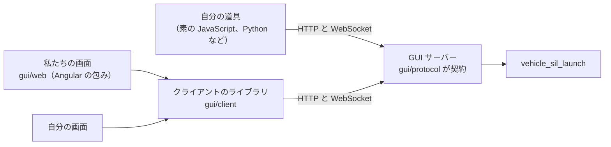

# ブラウザの GUI（`vehicle-sil-gui`）

構成ファイルを選んで照合し、シミュレーションを始めて止め、participant の状態とログをブラウザで見る道具です。GUI サーバー（Python）が自分の PC の上で `vehicle_sil_launch` を動かし、その経過を画面に中継します。シミュレーションを動かすのはランチャーで、GUI はそれを映すだけです。試験や AI エージェントから使う正式な口は、今までどおり `vehicle_sil_launch` と Control API です。

## できること

- 構成ファイルを一覧から選ぶ（起動のときに渡したファイル、または `--root` の下の `.yaml` / `.yml`）。
- 照合の結果（所見、participant の表）を見る。participant を外して（`--disable`）照合し直す。
- 実行を始める、止める（順に止めるか、待たずに止める）。段階、participant ごとの状態と終了コード、ログ、所見、結果を見る。ランチャーが participant を失敗と決めたら（`failed`）、プロセスが終わる前でもすぐに失敗として出します。利用者が止めた実行は「中断」として、失敗の色にせずに出します。
- 時刻を操作する（下の「時刻の操作」）: 速度を決めて始める、止めた状態で始める、一時停止、再開、ステップ送り、速度の変更。仮想時刻、いまの速度、実際の速さ、実時間への遅れを見る。
- participant ごとに、変数を読み書きする口のつながり方（ランチャーの `control-links`: つながった、hello が来なかった、形式の版が違う、変数はあるが口を出していない、なし）を見る。読み書きできないつながり方は、色だけでなく ⚠ と文で出します。変数の値はまだ見られません（下の「いまの制限」）。
- ランチャーが 1 秒ごとの心拍も書かなくなったら（既定で 5 秒。`--silent-after`）、止まっているかもしれないことを状態の帯に出します。ランチャーが読む側の遅さで書けなかったログの行（`log_dropped`）は、その位置に落ちた行の数として出します。
- ランチャーが結果を出さずに終わったら、異常終了と終了コード、ランチャーが標準エラーに書いた行（最初の 20 行と最後の 30 行）を見る。終わりを知らせてこなかった participant の状態は「不明」になります（ランチャーが先に終わったので、その後どうなったかは画面にはわかりません）。
- 画面を開き直したり、別のタブで開いたりしても、同じ実行の状態を見られる。ログは、participant ごとに直近の 2000 行（1 MiB まで）を見られます。それより古い行は、落とした行の数だけを表示します。
- 画面の言葉は日本語と英語（ブラウザの言語で決まり、ツールバーの言語のメニューで変えられる。選んだ言語はブラウザに残る）。ランチャーと ECU が出す文（所見、ログ）は、どちらの言語でも英語のまま出します。

## 要るもの

- `vehicle_sil_launch`（`tools/launch` をビルドしたもの）。`version --json` の `features` に `events` と `stdin-commands` があるもの（`run --events`、`run --stdin-commands`。[simulation-config.md](simulation-config.md) の「機械から使う」）。時刻の操作には `speed`、`start-paused`、`time-commands` も要ります（ないランチャーでは、その操作を出しません）。
- 構成ファイルと、そこに書いた ECU の実行ファイル（ランチャーが照合と実行で起動します）。
- Python 3.11 以上と [uv](https://docs.astral.sh/uv/)（GUI サーバー）。画面のビルド（`gui/web` の `npm run build` の出力）。画面を使うだけなら Node.js は要りませんが、ビルドには要ります（[gui/web/README.md](../gui/web/README.md)）。

## 起動

リポジトリの直下で `uv sync` をしてから、ビルドしたランチャーを `--launcher` で渡して起動します。例は、ビルドした ECU の例（`build/<preset>/examples/ecu_main/`。CMake が構成ファイルを実行ファイルの隣にコピーします）です。

```sh
uv run vehicle-sil-gui --launcher build/<preset>/tools/launch/vehicle_sil_launch \
  build/<preset>/examples/ecu_main/simulation.yaml
```

画面で `simulation.yaml` を選ぶと、ランチャーが各 ECU の `--describe` で照合し、participant ごとの申告（ステップ幅、ネットワーク、変数の数）を出します。「開始」でシミュレーションを動かし、`stop_at_ms`（例では 1000 ms）で終わると結果を出します。構成ファイルの実行ファイルの相対パスは、構成ファイルのあるディレクトリから数えます（ランチャーの決まり）。

- 起動すると、`http://127.0.0.1:<port>/#token=<...>` を 1 行表示して、ブラウザで開きます。ブラウザには URL を直接渡さず、自分だけが読める一時ファイル（URL へ移るだけのページ。30 秒後かサーバーの終わりに消す）を開かせます。ブラウザがそのファイルを開けない（一時ディレクトリを読めないブラウザなど）ときや、ブラウザが開かないときは、表示した URL をブラウザに貼ります。Ctrl+C でサーバーを止めます。実行中のシミュレーションは、先に止めます。
- ランチャーは `--launcher <path>`、環境変数 `VEHICLE_SIL_LAUNCH`、`PATH` の順に探します。`PATH` で見つけたものがカレントディレクトリにあるときは使わず、終了コード 2 で終わります（Windows はカレントディレクトリを `PATH` より先に探すので、人から受け取ったフォルダで起動すると、そこにあるプログラムが動いてしまうため）。そのランチャーを使うときは `--launcher` で指定します。ランチャーが GUI に要る機能（`version --json` の `features` の `events` と `stdin-commands`）を持たないときは、何が足りないかを表示して終了コード 2 で終わります。
- 画面のビルド（`gui/web` の `npm run build`）がないときは、ビルドの手順を書いたページを表示します。

| 引数 | 意味 |
|---|---|
| `<構成ファイル>` | 最初に選んでおくファイル（`--root` の下） |
| `--root <dir>` | 画面で選べるファイルの範囲。既定は、渡した構成ファイルのディレクトリ、なければカレントディレクトリ |
| `--port <n>` | 待ち受けるポート（127.0.0.1）。既定の 0 は空いているポート。80 は使えない（ブラウザが `Host` からポートを省くため） |
| `--no-browser` | ブラウザを開かない |
| `--launcher <path>` | `vehicle_sil_launch` のパス（`.py` で終わるパスは、この Python で動かす） |
| `--dev-origin <origin>` | 画面の開発サーバー（`http://127.0.0.1:<port>` の形だけ）からの要求も受け付ける |
| `--json` | URL の代わりに `{"vehicle_sil_gui": 1, "url": ..., "port": ...}` を 1 行で表示する（道具から起動するとき） |
| `--stop-timeout <秒>` | 終わるとき、実行中のシミュレーションが止まるのを待つ時間（既定 10）。過ぎたらランチャーを止める |
| `--check-timeout <秒>` | 照合（各 ECU の `--describe` を含む）の時間の上限（既定 120）。過ぎたら照合を止める |
| `--silent-after <秒>` | 動いているランチャーがこの時間より長く何も書かなければ（心拍も来なければ）、画面に知らせる（既定 5。1 以上） |

終了コード: 0 は止めた（Ctrl+C、SIGTERM）、1 は動いている間の失敗、2 は引数の誤りか、ランチャーやポートを使えない。

## 安全の考え方

GUI サーバーはプロセスを起動できます（構成ファイルに書いたコマンドを、ランチャーが起動します）。そのため、自分の PC の上で自分だけが使う前提で、次のように守っています。

- 127.0.0.1 だけで待ちます。ほかの PC からは開けません。`Host` は `127.0.0.1:<port>` だけを受け付けます（`localhost` は、ブラウザが先に `::1` へつなぐことがあり、そこで別のプログラムが待てるので受け付けません）。
- 起動のたびに新しいトークンを作ります。トークンは表示した URL の `#token=` の後ろにだけあり、画面はそれを読んだら URL から消します。API と WebSocket はトークンがないと答えません。URL を人に渡さないでください。
- ほかのウェブページからの要求を断ります（`Host` と `Origin` の検査。CORS は許しません）。
- 画面から使えるのは `--root` の下の構成ファイルだけです。外へ出るパスや、root の外へのシンボリックリンクは、検査の時点で断ります（検査の後に root の中でリンクを差し替えることは防げませんが、root に書ける人は構成ファイルをそのまま置けます）。ランチャーに渡す引数はサーバーが決まった形で組み立て、任意のコマンドは受け取りません。
- 実行は、サーバー 1 つにつき一度に 1 つです。同時に開始を頼まれても、始めるのは 1 つだけです。サーバーを 2 つ起動すれば、実行も 2 つ動きます。

守れないもの:

- **同じ PC のほかの利用者**。トークンは、表示した URL（端末、`--json` の出力、それを読んだ道具のログ）を見られる人には見えます。トークンを持つ人は、ブラウザを使わずに `Host` と `Origin` を自由に書けるので、API を全部使えます。ブラウザのコマンドラインにはトークンを載せません（ほかの利用者はプロセスの引数を読めることがあるため）が、端末の表示は守りません。トークンを持たない人でも、WebSocket の接続を開き続ければ、画面がつながるのを妨げられます（認証前の接続は 16 本までで、あふれると古いものから閉じるので、画面は何度か試せばつながりますが、妨げる側が開く速さには勝てません）。
- **root の中身**。root に書ける人は、構成ファイルを置いて、GUI を使う人の権限でコマンドを動かせます。ほかの人が書ける場所（共有のディレクトリ、`/tmp` の下など）を root にしないでください。
- **ブラウザの拡張**。拡張は画面とその `sessionStorage`（トークンを持つ）を読めます。
- 同じ利用者の権限で動くプログラムは、もともと何でもできるので、相手にしていません。

## 止め方

- 画面の「停止」は、ランチャーの標準入力に `stop` を送って順に止めます。「待たずに止める」は、もう一度 `stop` を送り、ランチャーは participant の終わりを待たずに止めます。標準入力を読まないランチャーは、どちらでも止まりません。そのときはサーバーを止めます。
- サーバーが終わるとき（Ctrl+C、SIGTERM、端末を閉じた）は、照合をすぐ止め、ランチャーの標準入力を閉じて順に止めさせます。`--stop-timeout` の間に止まらなければ、ランチャーのプロセスグループに SIGTERM（Windows は Ctrl+Break）を送り、5 秒後にグループを強制終了します（Windows は `taskkill /T /F`）。2 回目の Ctrl+C は待ちを飛ばします。終わるまでの時間は、長くても `--stop-timeout` に 20 秒を足した程度です。
- サーバーが届くのは、ランチャーと、ランチャーと同じプロセスグループにいるものまでです。participant の後始末はランチャーの役目です（ランチャーは participant を別のプロセスグループで起動します）。ランチャーが終わっても、ランチャーが起動したプロセスが出力を開いたままのときは、2 秒待ってから実行を終わりにし、画面に知らせます。そのプロセスは残っているかもしれません。
- サーバーが強制終了されたときも、ランチャーは標準入力の終わりを受けて自分で止まります。

## 時刻の操作

時刻を進めるのはランチャーで、GUI は命令を渡して、その結果を映すだけです。命令の意味と遅れの数え方は、ランチャーの決まりのとおりです（[simulation-config.md](simulation-config.md) の「等速で動かす」と「標準入力の命令」）。

- **始める前**: 構成ファイルのカードで、速度（構成のとおり、最速、等速、倍率）と「止めた状態で始める」を選びます。止めた状態で始めると、全員がそろったところで仮想時間 0 に止まり、再開かステップ送りを待ちます。速度は前の実行のものから始めますが、「止めた状態で始める」は前の実行から持ち越しません（気づかずに止まったまま始まらないように）。
- **実行中**: 状態の帯の「一時停止」と「再開」は別のボタンで、始めてから結果が出るまで、いつも開始と停止の後の同じ場所にあり（開始と停止の位置は動きません。止めるよう頼んだ後も、押せないまま残ります）、使えない方は押せません（押している最中に、同じ場所のボタンの意味が入れ替わりません）。とても狭い窓では、ボタンは印（‖ と ▶）だけになります（名前は読み上げに残ります）。「時刻」のカードで、仮想時刻、いまの速度、実際の速さ、一時停止しているかを見て、ステップ送り（ミリ秒を入れる）と速度の変更をします。ステップ送りは一時停止している間だけで（ステップ送りの途中も、ランチャーと同じく一時停止の扱いで、再開とステップ送りができます）、ランチャーが刻みの倍数に切り上げた、実際に進む量を出します。送った命令にランチャーが答える（`command` の事象が届く）までは、次の命令を送りません（ダブルクリックで 2 回進まないように）。5 秒たっても答えがなければ（入力を読まないランチャー）、待つのをやめて操作を押せるように戻し、答えが来ないことを出します（帯のボタンの説明も同じ理由を指します）。シミュレーションが終わりに入ったら（段階が「停止中」）、時刻の操作はできません。ランチャーが受け付けなかった命令は、その理由を出します。
- **遅れ**: 速度を数で決めて動かしている間（最速ではない間）、遅れた刻みの数、最大の遅れ、ずれの合計、いまの遅れを出します。許容（`late_tolerance_ms`）を超えて遅れた刻みがあるときだけ、色だけでなく文で知らせます（状態の帯と「時刻」のカード。途中で最速に変えても残ります）。いまの遅れ（`late_ms`）は、刻みの同期のたびに許容の内の小さな値が出たり消えたりするので、数として見せるだけで、文の条件にしません（許容を超えて止まっている刻みは、ランチャーが遅れた刻みにその場で数えます）。読み上げるのは状態の帯の 1 か所だけで、遅れが「ある」になったときに 1 回です（数が変わるたびには読み上げません）。
- **終わった後**: 結果のカードに、時間の進み方（速度、仮想時刻、かかった実時間、実際の速さ、一時停止していた時間、速さを合わせたときの遅れ）を出します。所見 `behind-real-time` と `coarse-time-step` は、ほかの所見と同じく結果の所見に出ます。
- 途中から開いた画面や、別のタブも、同じ時刻の状態を出します（サーバーの要約に、最後の `time` と `command` の事象があるため）。
- ランチャーの `features` に `speed`、`start-paused`、`time-commands` がなければ、それぞれの操作を出しません（`speed` だけのランチャーでは、「時刻」のカードは見るだけです）。時刻の命令を受け付けるかは、動いている実行のランチャー（始めたときの `version --json`）で決めます。

### サーバーの口

| 要求 | すること |
|---|---|
| `POST api/run` の `speed`、`start_paused` | ランチャーの `--speed`、`--start-paused` |
| `POST api/time` `{"command": "pause"}`、`{"command": "resume"}` | 一時停止、再開 |
| `POST api/time` `{"command": "step", "ms": <ms>}` | ステップ送り（一時停止している間だけ。ランチャーが刻みの倍数に切り上げる） |
| `POST api/time` `{"command": "speed", "value": <数か "max">}` | 速度の変更（一時停止はそのまま） |

`api/time` は、ほかの API と同じ検査（トークン、`Host`、`Origin`、JSON の本文）を通ります。サーバーは命令をランチャーの標準入力に 1 行で書いてすぐ返し、ランチャーの答えは待ちません（止まっているランチャーで要求が固まらないように。入力を読まないランチャーでも、長くて約 2 秒で返ります）。受け付けたかどうかは、ランチャーの `command` の事象で届きます。形と誤りの `code` は [gui/protocol/README.md](../gui/protocol/README.md) にあります。

### 画面の部品から使う

時刻の状態と命令は、アプリ全体で 1 つのサービスにあります（中身はクライアントのライブラリの `TimeControl`。下の「自分の画面や道具を作る」）。部品はここの signal を読むだけにして、状態を自分で持ちません（どの部品も同じ状態を見ます）。

- `ServerInfo`（`gui/web/src/app/core/session/server-info.ts`）: `app`（`GET api/app`）、`features`（ランチャーができること）、`has(name)`（その機能があるか）、`limits`（速度の範囲、ステップ送りの上限）。
- `SimulationTime`（`gui/web/src/app/core/session/simulation-time.ts`）:

| signal | 中身 |
|---|---|
| `supported` | ランチャーが時刻の命令を持つか |
| `time` | 最後の `time` の事象（`simMs`、`speed`、`paused`、`actualSpeed`、`lateSteps`、`maxLateMs`、`slippedMs`、`lateMs`）。まだなければ `null` |
| `simMs`、`speed`、`paused`、`actualSpeed` | `time` の各欄（古いランチャーが書かない欄は `null`） |
| `paced` | 速度が数か（遅れを数えているか） |
| `lateness`、`behind` | 遅れの数と、実時間に遅れたか（許容を超えて遅れた刻みがある） |
| `lastCommand` | 最後の `command` の事象（`name`、`accepted`、`message`、`ms`） |
| `controllable` | 時刻の命令が意味を持つか（ランチャーが対応し、段階が running で、`time` の事象が来ていて、結果がまだで、止めるよう頼んでいない。サーバーと揃っている） |
| `canPause`、`canResume`、`canStep` | いま押してよいか（`controllable` で、さらに前の命令の答えを待っていない。一時停止しているか、ステップ送りの途中か、で分かれる） |
| `stepping` | ステップ送りの途中か（ランチャーは一時停止の扱い） |
| `sending` | 送って、ランチャーの答え（`command` の事象）をまだ見ていない命令。答えが届く、ランチャーが終わる、実行が変わる、サーバーが断る、つなぎ直した要約に答えがある、のどれかで解ける。5 秒（`ANSWER_TIMEOUT_MS`）たっても答えがなければ、待つのをやめる |
| `error`、`errorFromServer` | 最後の命令がうまくいかなかった理由（サーバーが断った文は英語のまま。答えが来なかったときは画面の文）と、それがサーバーの文か |

命令は `pause()`、`resume()`、`step(ms)`、`setSpeed(value)`（どれも `send(command)` を通る）です。前の命令の答えを待っている間と、実行がないときは送らず、`{sent: false, reason: 'waiting' | 'no-session'}` を返します（送ったら `{sent: true}`）。押せるかは、送る前に `canPause` などで確かめます。状態の帯に操作を足すときは、`<app-run-status>` の中に `runStatusActions` の属性を付けた要素を置きます（開始と停止の後、「待たずに止める」の前に並びます。開始と停止の位置は動きません）。

## 自分の画面や道具を作る

私たちの画面は、誰でも使える部品だけで作っています。同じ部品で、自分の画面（別の枠組みでも）や、画面のない道具（試験の駆動、記録）を作れます。



- **サーバーの口**（[gui/protocol/README.md](../gui/protocol/README.md)）: HTTP と WebSocket の形、実例（`examples/`）、版と互換の決まり（足すのは互換、消す・意味を変えるのは `vehicle_sil_gui` の版を上げる。読む側は知らない欄と事象を無視する）、認証と `Origin` の決まり。どの言語からでも使えます。
- **最小の例**（[examples/gui_client](../examples/gui_client/)）: 画面を使わずに口を叩く、素の JavaScript の 1 ファイルの例が 2 つあります（Node 22 以上）。`run.mjs` はライブラリを使わず、標準の `fetch` と `WebSocket` だけで書いたもの、`run-with-library.mjs` は下のライブラリを 1 つにまとめたファイル（`gui/web` で `npm run build:client`）を使うものです。どちらも、照合して実行を始め、事象を読み、終わりを待って、結果で終了コードを返します。`VEHICLE_SIL_GUI_URL='<サーバーが表示した URL>' node examples/gui_client/run.mjs simulation.yaml`（URL は環境変数で渡す。引数に書くと、トークンがほかの利用者のプロセスの一覧に見えるため）。ブラウザの外から使うので、`Origin` をサーバー自身の origin にして送ります。
- **クライアントのライブラリ**（[gui/client/README.md](../gui/client/README.md)、`@vehicle-sil/gui-client`）: TypeScript。接続（トークン、再接続、握手の失敗の数）、セッションの写し（要約が正、再送、部分ごとの読み取り）、実行と時刻の操作、口の型と読み取り。状態は「読める値」（`get()` と、解除の関数を返す `subscribe(fn)`）で出すので、枠組みに依らず使えます。公開するものは入口（`gui/client/src/index.ts`）に挙げたものだけで、README に一覧があります。TypeScript のアプリは `paths` でソースを取り込み、素の JavaScript からは 1 つにまとめたファイルを読みます。
- **Angular の包み**（`gui/web/src/app/core/session/`）: ライブラリの読める値を signal にするだけの薄い層です（`ServerConnection`、`ServerInfo`、`SimulationTime`、`RunCommands`。つなぐところは `gui-client.ts`）。画面（`gui/web/src/app/run/`）は包みだけを読みます。型と純粋な関数は、ライブラリから直接 import します。別の枠組みで画面を作るときは、この層に当たるものを書きます。

## いまの制限

- 変数の値（Control）はまだ見られません。照合の結果にある変数の数だけを表示します。
- 古いランチャー（`time` の事象に `paused` がない）は、仮想時刻を動き始め（0）と `stop_at_ms` に達したときにしか知らせないので、動いている間の 0 は出しません。
- Windows では確かめていません（子プロセスの止め方、Ctrl+Break、`taskkill`、一時ファイルの権限は書いてありますが、動かしていません）。Windows はコンソールを閉じると約 5 秒でプロセスを終わらせるので、`--stop-timeout` を待たずに終わります（ランチャーには標準入力の終わりが届きます）。

## 開発

- サーバーは `gui/server`（Python パッケージ `vehicle_sil_gui`、uv の workspace のメンバー）、画面は `gui/web`、クライアントのライブラリは `gui/client`（画面はこれを通してサーバーを使う）、サーバーの口の正本は `gui/protocol`（README と実例）です。
- 試験: `scripts/verify-gui.py`（サーバーの試験、画面の `scripts/verify-web.py`、最小の例 `examples/gui_client/` の 2 つを偽のランチャーで動かす試験。ライブラリの試験は `verify-web.py` の `client` の段、1 つにまとめるのは `bundle` の段）。サーバーだけなら `--skip-web`。
- 試験は、ランチャーの代わりに偽のランチャー（`gui/server/tests/fake_launcher.py`。本物と同じ事象を、筋書きどおりに書く。時刻の命令、`time` の事象、結果の `timing` も本物の形で、筋書き `late`（`gui/server/tests/configs/late.yaml`）は実時間への遅れを作る）を使います。偽のランチャーでも GUI を動かせます: `uv run vehicle-sil-gui --launcher gui/server/tests/fake_launcher.py gui/server/tests/configs/simulation.yaml`。
- 本物のランチャーでも確かめるには、`scripts/verify-gui.py --launcher build/<preset>/tools/launch/vehicle_sil_launch`（または環境変数 `VEHICLE_SIL_GUI_LAUNCHER`）。そのランチャーの隣にビルドした ecu_main の例の ECU を使い、偽のランチャーとの事象の形の比べ（`gui/server/tests/test_real_launcher.py`）と、画面の e2e（`gui/web/e2e/real/`）を回します。ランチャーを渡さなければ、この 2 つは「skipped」と出して飛ばします。
