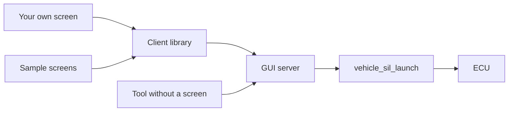
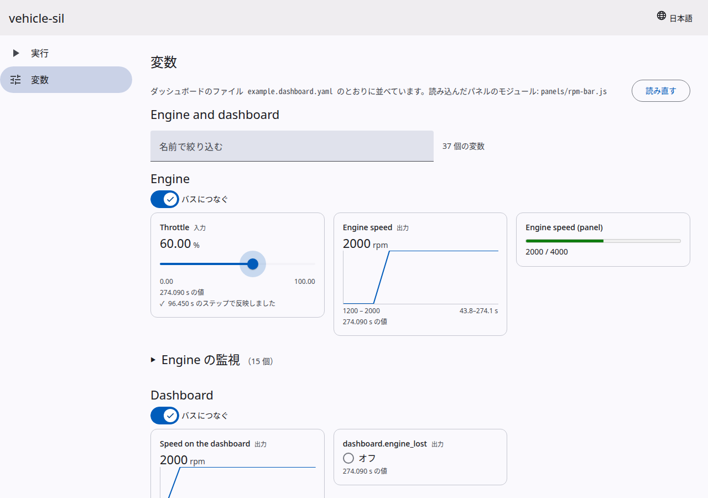

# Browser GUI (`vehicle-sil-gui`)

[日本語](ja/gui.md)

`vehicle-sil-gui` is a tool that starts a simulation from the browser and reads and writes ECU variables with sliders, charts and other widgets. This page has a guide to using the GUI, and a reference for its arguments, its security and the features of its screens.

| Goal | Section |
|---|---|
| Watch and change values in the browser | "[Use the GUI](#use-the-gui)" |
| Build your own screen and have the GUI server serve it | The guide [Build your own screen for the browser GUI](howto/gui-screen.md) |
| Look up the arguments, the exit codes and how the GUI stops | "[Arguments and exit codes](#arguments-and-exit-codes)", "[Stopping and exiting](#stopping-and-exiting)" |
| See what the GUI protects against, and what it does not | "[Security](#security)" |
| Describe the layout of the Variables screen in a file | "[Dashboard files](#dashboard-files)" |
| Look up the rules that apply to your own screen | "[Reference for your own screen](#reference-for-your-own-screen)" |
| Find all external API specs, OpenAPI/JSON Schemas, and examples | [External API and Schemas](external-api.md) |
| Develop the GUI itself | "[Development](#development)" |

## Structure

The GUI server (Python) starts `vehicle_sil_launch` on the same computer and relays its progress and the ECU variables to the screen over HTTP and WebSocket. The launcher runs the simulation; the GUI only shows it. For tests and AI agents, the official interfaces remain `vehicle_sil_launch` and the Control API.



Arrows point in the direction of the calls. The GUI is also an SDK for building your own screens. It has 4 parts:

| Part | Location | Role |
|---|---|---|
| GUI server | `gui/server` (the command is `vehicle-sil-gui`) | Starts the launcher, provides the API, and serves the screens' static files. |
| Server API | [gui/protocol](../gui/protocol/README.md) | Defines the HTTP and WebSocket shapes, the versioning and compatibility rules, and authentication, backed by offline OpenAPI 3.1 (`openapi.yaml`) and Draft 2020-12 WebSocket/CLI JSON Schemas (`schemas/*.schema.json`, also bundled in `protocol/` of the prebuilt tools archive). Usable from any language. |
| Client library | [gui/client](../gui/client/README.md) (`@vehicle-sil/gui-client`) | A TypeScript library for the connection, run and time control, and ECU variables. It does not depend on any framework. `connect()` returns its front door: what a screen shows (`status`, `clock`, `controls`), the operations as Promises, and one variable at a time. |
| Sample screens | `gui/web` (Angular) | A reference implementation built only on the 3 parts above. The GUI server serves it unless you give `--web`. |

The library talks to the GUI server over HTTP and WebSocket ([gui/protocol](../gui/protocol/README.md) is the specification). The GUI server talks to the launcher through the launcher's stdin and stdout and through the Control Server (gRPC).

## Use the GUI

This guide uses the sample screens to start a simulation, read and write variables, pause and step time, and run a scenario.

### Prerequisites

| Requirement | Details |
|---|---|
| Template project | Complete step 1 of [Create your first ECU](howto/first-ecu.md): build the ECUs and add the tools' `bin` to `PATH`. |
| Python | 3.11 or later. If you have [uv](https://docs.astral.sh/uv/), uv installs Python and the packages. |
| Browser | A browser on the same computer as the GUI server. |

Run the commands in the template project's directory (the one that contains `simulation.yaml`). If you work from a build of the repository instead, use the right column:

| | Template project | Repository (after "[Quick start](../README.md#quick-start)" in the README) |
|---|---|---|
| Directory to run in | The one that contains `simulation.yaml` | The root of the repository |
| Command to start | `vehicle-sil-gui simulation.live.yaml` | `scripts/run-gui.py` |
| Configuration file used | `simulation.live.yaml` | `build/<preset>/examples/ecu_main/simulation.live.yaml` |

`simulation.live.yaml` uses the same two ECUs as `simulation.yaml`. The stop time is chosen for each run.

### Overview

| Step | What you do | What you see |
|---|---|---|
| 1 | Start the GUI server | The Run screen in the browser, and the check result |
| 2 | Start the simulation | The state **Running** and the ECU log |
| 3 | Watch and write variables | Sliders and charts on the Variables screen |
| 4 | Pause time and advance one step at a time | Virtual time stopping, and how far a step advances it |
| 5 | Stop the run and exit | The result **Stopped** |
| 6 | Run a scenario | A table with the result of each scenario step |

"Step 1" to "Step 6" are the parts of this guide; anywhere else on this page, a "step" is a simulation step. The screen uses the same terms as this page, and text in bold is exactly what the screen shows.

### Step 1: Start the GUI server

```sh
vehicle-sil-gui simulation.live.yaml
```

#### Verify the GUI server

The terminal prints one URL line, and the browser opens.

```text
http://127.0.0.1:34457/#token=<token that changes on every start>
vehicle-sil-gui: open the URL above (it has the token); Ctrl+C stops the server
```

The browser shows the Run screen, with `simulation.live.yaml` selected under **Configuration file**. The GUI checks the selected configuration file at once, so the **Check** card shows **✓ Check: Passed (errors: 0, warnings: 0, notes: 0)** and the participants `Engine` and `Dashboard`.

#### Troubleshoot the GUI server

| Symptom | Cause | Fix |
|---|---|---|
| `vehicle-sil-gui` is not found | The tools' `bin` is not on `PATH`. | Run the `export PATH=...` line that `get_tools.py` printed. |
| The browser does not open | The environment cannot start a browser, or the browser cannot open a temporary file. | Paste the printed URL into the browser, including everything after `#token=`. |
| `vehicle-sil-gui` exits with exit code 2 | An argument is wrong, or the launcher, the Python packages or the port cannot be used. | Follow the printed message (see "[Arguments and exit codes](#arguments-and-exit-codes)"). |
| A browser on another computer cannot open it | The GUI server listens on 127.0.0.1 only. | Use SSH port forwarding (see [Run on several computers](howto/multi-pc.md)). |

### Step 2: Start the simulation

Click **Start** at the top of the Run screen.

#### Verify the start

| Where to look | What it shows |
|---|---|
| The status bar at the top | **● Running**, with the phases going through **Check**, **Start**, **Join** and **Run** in that order. |
| **Participant status** | `Engine` and `Dashboard` show **● Joined** and **Variables: connected (18)**. |
| **Log** | Lines from `Dashboard` (such as `t=500 ms engine speed 1200 rpm (5 messages)`) keep coming. |

#### Troubleshoot the start

| Symptom | Cause | Fix |
|---|---|---|
| **Start** cannot be clicked | The check has errors. | Read the text under **Findings**, fix the configuration file or the ECU, and click **Check again** (see [simulation-check.md](simulation-check.md)). |
| **Variables: connected** does not appear | The launcher or the ECU does not support reading and writing variables. | Check "Reading and writing ECU variables" in "[Requirements](#requirements)". |

### Step 3: Watch and write variables

Open **Variables** in the navigation. The template has a dashboard file (`simulation.live.dashboard.yaml`), so the screen shows the throttle of `Engine` (`Engine.engine.throttle`) as a slider and the engine speed (`Engine.engine.speed`) as a chart. Move the **Throttle** slider from 20 % to 40 %.

#### Verify the variables

Below the slider, the screen shows the virtual time at which the write was applied, such as **✓ Applied in the step at 6.600 s**, and **Engine speed** rises from 1200 rpm to 1600 rpm. **Value at 8.870 s** below a value is the virtual time of the step in which that value was read.



#### Troubleshoot the variables

| Symptom | Cause | Fix |
|---|---|---|
| A reason appears instead of the variables | There is no run, or the setup cannot read and write variables. | Start a run as in step 2. If the reason still appears, check "[Requirements](#requirements)". |
| A slider or switch cannot be used | The variable cannot be written: it is an output, the run has ended, the ECU is disconnected, or similar. | Read the reason shown in the widget (see "[Behavior common to all widgets](#behavior-common-to-all-widgets)"). |
| The variable you look for is missing | Variables that are not in the dashboard file, and monitoring variables, appear at the end or in collapsed sections. | Enter part of the variable's name in **Filter by name** at the top. |

### Step 4: Pause time and advance one step at a time

1. Go back to the Run screen and click **‖ Pause** in the status bar.
2. In the **Time** card, enter `100` in **Step by (ms)** and click **Step**.
3. Click **▶ Resume**.

#### Verify pausing and stepping

| After | What it shows |
|---|---|
| Pause | The state in the status bar and in the **Time** card becomes **Paused**, and **Virtual time** stops advancing. |
| Step | **Virtual time** advances by 100 ms (for example, from 10.175 s to 10.275 s), and the card shows "The last step advanced 100 ms (the launcher rounds a step up to whole time steps)." |
| Resume | The state returns to **Running**, and **Virtual time** advances. |

You can write on the Variables screen while paused. A write is applied in the next step, so until you step or resume, the widget shows **Accepted. Waiting for the ECU to apply it in a step**. To set a value before the first step, select **Start paused** before you start (see "[Time control](#time-control)").

### Step 5: Stop the run and exit

Click **Stop** to stop the simulation, then press Ctrl+C in the terminal to exit the GUI server.

#### Verify the stop

The **Result** card shows **■ Stopped** and **How it ended: Stopped**. A run that you stop is not a failure; its result is **Stopped**. After Ctrl+C, `vehicle-sil-gui` exits with exit code 0. If you press Ctrl+C during a run, the GUI server stops the simulation first, then exits (see "[Stopping and exiting](#stopping-and-exiting)").

### Step 6: Run a scenario

A scenario ([scenario.md](scenario.md)) is a file that sets variables in a fixed sequence of steps and checks the results. The screen lists the scenarios in `scenarios/` next to the configuration file.

1. Start the GUI with `vehicle-sil-gui simulation.yaml` (if it is still running, select `simulation.yaml` under **Configuration file**).
2. Select `throttle_step.yaml` under **Scenario**.
3. Click **Start**.

#### Verify the scenario run

| Where to look | What it shows |
|---|---|
| The **Check** card (before the start) | "The scenario scenarios/throttle_step.yaml was checked too (steps: 6)." |
| The **Result** card | **✓ Passed** and **How it ended: The scenario ended** |
| The **Scenario** card | **✓ The scenario passed**, and a table of the scenario steps with their line, state and virtual time (for example, `set Engine.engine.throttle = 50` with **✓ Passed** and **0 ms**) |
| The **Timeline** link in the **Scenario** card | Opens a new tab with a chart of the steps and the values the scenario wrote and saw, in the GUI's language (see "[Timeline of a scenario run](#timeline-of-a-scenario-run)") |

While a scenario runs, you cannot write variables. For the detailed rules, see "[Scenarios](#scenarios)".

### What to read next

- Decide the layout of the Variables screen → "[Dashboard files](#dashboard-files)"
- Save what you did in the GUI as a scenario file → "[Save your actions as a scenario](#save-your-actions-as-a-scenario)"
- Add a part to the sample screens, build your own screen, or drive the GUI from a tool → "[Build your own screen](#build-your-own-screen)" compares the 3 ways

## Build your own screen

There are 3 ways to add your own code to the GUI. They differ in what stays of the sample screens and in what your code gets.

| Way | When to use it | What you write | What your code gets | The sample screens | Where to start |
|---|---|---|---|---|---|
| Custom panel | You add a part for your ECU to the sample screens, for example when several teams each bring parts for their own ECUs. | An ES module that defines a custom element, in `panels/` next to the configuration file and listed in the dashboard file. | The properties `client` (a connected `GuiClient`), `options` and `variables` of its dashboard item. | They stay, and the panel appears on the Variables screen. | "[Custom panels](#custom-panels)" |
| Your own screen (`--web`) | You replace the whole screen with one of your own. | Static files: HTML with the parts of the client library, a script if you need one, in any framework. | The whole page, opened from the GUI server's origin with the token in its URL. | They are replaced: the Run screen, time control and the Variables screen are gone unless your screen has them. | The guide [Build your own screen for the browser GUI](howto/gui-screen.md) |
| A tool without a screen | You drive tests or record from a program. | A program that uses the client library or the server API. | The URL that the server printed, with the token (pass it in an environment variable). | They stay, and the tool uses the same GUI server alongside them. | "[Use from tools without a screen](#use-from-tools-without-a-screen)" |

- `--web` takes one directory, and the GUI server then serves it instead of the sample screens. A second GUI server starts a launcher of its own, so it cannot show the run of the first one.
- Panels are a feature of the sample screens: your own screen served with `--web` does not get them automatically.
- Your own screen opens from the same origin as the GUI server, so the server's security checks (token, `Host`, `Origin`, CSP) apply to it unchanged.

For your own screen, use as many of these 3 layers as you need. Each layer keeps what the one before wrote:

| Layer | You write | What you get | Where to start |
|---|---|---|---|
| Parts only | HTML and CSS: elements such as `<vsil-run-controls>`, `<vsil-slider variable="Engine.engine.throttle">` and `<vsil-value>` | Start and stop, time control, status, values, sliders, buttons that write, the scenario of the next run and its result, and the timeline of the run. No script and no build | The guide [Build your own screen for the browser GUI](howto/gui-screen.md) |
| A script of your own | A script that calls `connect()`, `watch`, `client.variable()` and the operations (Promises) | What the parts do not have: a display or a button of your own, a rule. It uses the connection of the parts: a refused start, stop or time operation shows in `<vsil-status>`, and a refused write of a variable next to the part that shows it | `main.js` of the screen template, and "The front door (`connect()`)" in [gui/client/README.md](../gui/client/README.md#the-front-door-connect) |
| A project with a framework | A project with a build, and the library package (`.tgz`) | The same parts and library in the templates of React, Vue, Svelte, Angular and others (the parts are custom elements) | "A project with a framework" in [examples/gui_starter/README.md](../examples/gui_starter/README.md#a-project-with-a-framework) (the package, a whole run through the front door, an Angular signal) |

The parts and the library come from the GUI server (`/vsil/`) in the first 2 layers, so there is nothing to copy; a project with a framework uses the package. The sample screens' own widgets (the Angular app in `gui/web`) are not offered for reuse: use the parts.

For the files that are served, CSP, the token, development servers and the rules that the library does not enforce for you, see "[Reference for your own screen](#reference-for-your-own-screen)".

## Requirements

| Feature | Requirement |
|---|---|
| Starting the GUI server | Python 3.11 or later and [uv](https://docs.astral.sh/uv/) |
| Checking and running a simulation | A `vehicle_sil_launch` whose `features` in `version --json` include `events`, `stdin-commands`, `request`, `time-commands`, `stdin-run-until`, `state`, `speed`, `start-paused`, `scenario` and `manual-participants` (every launcher of the same vehicle-sil version has them; see [simulation-events.md](simulation-events.md)) |
| Time control | `time-commands`, `speed` and `start-paused` in `features` (all required, see above) |
| Reading and writing ECU variables | A launcher with a Control Server (`control-server` in `features`; built with `-DVEHICLE_SIL_BUILD_CONTROL_SERVER=ON`; see [control-api.md](control-api.md)), and Python gRPC for the GUI server (`grpcio`, `protobuf`; `uv sync` installs them) |
| A simulation to run | A configuration file and the ECU executables it lists (the launcher starts them for check and run) |
| Screens | A build of the sample screens (the output of `npm run build` in `gui/web`) or a build of your own screen (`--web`) |
| Browser | A desktop browser: a current Chromium-based one (Chrome, Edge), which the tests use; Firefox should work too. The features that the screens and the timeline use need Chrome or Edge 123 or later (`light-dark()`), or Firefox 121 or later (`:has()`) |

- The prebuilt tools (see "[Quick start](../README.md#quick-start)" in the README) contain everything except Python: a launcher with a Control Server, the GUI server, the built screens and the gRPC stubs. You need only Python 3.11 or later; if you have uv, uv installs Python and the packages too.
- If either requirement for reading and writing variables is missing, everything else still works. Only the variables show **Not available**, with the reason.
- Using the screens needs no Node.js. Building them does (see [gui/web/README.md](../gui/web/README.md)).

## Arguments and exit codes

```sh
vehicle-sil-gui [options] [<configuration file>]
```

| Argument | Meaning |
|---|---|
| `<configuration file>` | The file selected when the screen opens (a file under `--root`) |
| `--root <dir>` | The directory whose files the screen can choose from. Default: the directory of the given configuration file, otherwise the current directory |
| `--port <n>` | The port to listen on (127.0.0.1). The default 0 picks a free port. 80 cannot be used (browsers drop the port from `Host`) |
| `--no-browser` | Do not open the browser |
| `--launcher <path>` | The path of `vehicle_sil_launch` (a path that ends in `.py` is run with this Python) |
| `--web <dir>` | Serve your own screen: its build output directory (must contain `index.html`). Default: the sample screens (see "[Files served with `--web`](#files-served-with---web)") |
| `--dev-origin <origin>` | Also accept requests from the screen's development server (`ng serve`, Vite and others; only of the form `http://127.0.0.1:<port>`) (see "[Use a development server](#use-a-development-server)") |
| `--json` | Print `{"vehicle_sil_gui": 4, "url": ..., "port": ...}` on one line instead of the URL (when a tool starts the GUI; with `--no-auth`, also `"auth": false` and no `#token=...` in `url`/`dev_url`) |
| `--stop-timeout <seconds>` | On exit, how long to wait for a running simulation to stop before signaling the launcher. By default the server waits for the launcher to finish |
| `--participant-start-timeout-ms <ms>` | Wall-clock wait for required participants during startup (default 30000 ms) |
| `--participant-stop-timeout-ms <ms>` | Launcher’s wall-clock wait per participant shutdown stage (default 10000 ms) |
| `--check-timeout <seconds>` | The time limit of a check (including `--describe` of each ECU) (default 120). After that, the check is stopped |
| `--silent-after <seconds>` | If the running launcher prints nothing (not even a heartbeat) for longer than this, notify the screen (default 5; 1 or more) |
| `--no-variables` | Do not start the launcher's Control Server (no reading or writing of ECU variables) |
| `--no-save` | The screen saves no configuration file. Use it when the GUI is only for looking, or others may see the token (see "[Security](#security)") |
| `--allow-command-changes` | The screen also saves an edit that changes the commands that run, and new files. Then anyone with the token can run any command as you (see "[Security](#security)"). Not together with `--no-save` |
| `--no-auth` | Disable token authentication for HTTP API and WebSocket connections (prints a warning on stderr and omits `#token=...` from the URL). Any local process on this computer can control simulations and edit configurations under `--root`; `127.0.0.1`, `Host`, `Origin`, CSP and `--root` checks still apply (see "[Security](#security)") |

| Exit code | Meaning |
|---|---|
| 0 | Stopped (Ctrl+C, SIGTERM) |
| 1 | Failure while running |
| 2 | Argument error, or the launcher or the port cannot be used |

### What happens at startup

- The GUI server prints `http://127.0.0.1:<port>/#token=<...>` on one line and opens it in the browser.
- It does not pass the URL to the browser directly. It has the browser open a temporary file that only you can read (a page that only redirects to the URL; deleted after 30 seconds or when the server exits).
- With `--no-auth`, the printed URL is `http://127.0.0.1:<port>/` (no `#token=...`), the browser opens it directly without a temporary file, and a warning is written to stderr (and `--json` includes `"auth": false`).
- If the browser cannot open that file (a browser that cannot read the temporary directory, for example), or no browser opens, paste the printed URL into a browser.
- Ctrl+C stops the server. A running simulation is stopped first.
- When you select a configuration file on the screen, the launcher checks it, running each ECU with `--describe`, and the screen shows the `--describe` output of each participant (step size, networks, number of variables).
- Relative executable paths in the configuration file are relative to the directory that contains the configuration file (the launcher's rule).
- If you start without `--web` and there is no build of the sample screens (`npm run build` in `gui/web`), the server shows a page with the build instructions.

### Hot Start and Cold Start

The GUI server can pre-warm a resident `vehicle_sil_launch serve` process through `POST api/prepare` (Hot Start) when a configuration is eligible, and falls back to per-run Cold Start (`serve --once`) automatically otherwise.

- Hot Start skips restarting the `vehicle_sil_launch` process only; `--describe`, the Control Server, the SIL Kit registry/controller, and ECU startup still run from virtual time 0 on every run, and you can inspect the per-phase startup breakdown via Events v4 `phase` events (`t_ms`; see "[Events (`serve [--once]`)](simulation-events.md#events-serve---once)").
- The server falls back to Cold Start (`serve --once`) when a configuration fixes `registry_uri` or sets `manual: true` on a participant, when manual participants are requested for the run (`manual` in the GUI/API, equivalent to `--manual`), when `VEHICLE_SIL_TRACE` is set, or if the resident launcher exits unexpectedly (see "[Running sequentially in one launcher (`vehicle_sil_launch serve`)](simulation-run.md#running-sequentially-in-one-launcher-vehicle_sil_launch-serve)").

### How the launcher is found

The GUI server looks for the launcher in `--launcher <path>`, the environment variable `VEHICLE_SIL_LAUNCH`, and `PATH`, in that order.

| Situation | What happens |
|---|---|
| The launcher found on `PATH` is in the current directory | The server does not use it and exits with exit code 2. |
| The launcher is of another vehicle-sil version than this GUI server (compared in full, pre-release included) | The server prints both versions (use the `vehicle_sil_launch` of the same version) and exits with exit code 2. A launcher replaced while the server runs is refused the same way (`launcher-unusable`). |
| The launcher lacks one of the features above in `features` | The server prints what is missing (use the `vehicle_sil_launch` of the same vehicle-sil version) and exits with exit code 2. A launcher replaced while the server runs is refused the same way (`launcher-unusable`). |

The server refuses a launcher in the current directory because Windows searches the current directory before `PATH`: starting the GUI in a folder you received from someone would run whatever program is in it. To use that launcher, name it with `--launcher`.

### Start script in the prebuilt tools

With the prebuilt tools, add their `bin` to `PATH` and start the GUI in the directory of the configuration file, as in `vehicle-sil-gui simulation.yaml`. `bin/vehicle-sil-gui` (`bin\vehicle-sil-gui.cmd` in the Windows command prompt) does the following:

| What it does | Details |
|---|---|
| Passes the launcher | Passes the tools' `vehicle_sil_launch` to the GUI server in the environment variable `VEHICLE_SIL_LAUNCH`. |
| Passes the gRPC stubs | Passes the tools' stubs in the environment variable `VEHICLE_SIL_CONTROL_STUBS`. |
| Installs the packages and starts | With `uv run`, installs the packages in `python/requirements.txt` (versions and hashes pinned) and starts the server (from the second start on, uv installs them from its cache). |
| Chooses Python | uv chooses a version for which the pinned packages have wheels (from 3.11 up to the tested version in `.python-version`), and downloads it if needed. |

- Packages are never built from source.
- Without uv, install the packages into a virtual environment of Python 3.11 or later with `python -m pip install --require-hashes -r <tools>/python/requirements.txt`, and name that Python in the environment variable `VEHICLE_SIL_PYTHON`. If something is missing, the script says so and exits with exit code 2.
- The GUI server's Python does not load modules from the current directory (`python -P`).
- Because `bin/vehicle-sil-gui` launches the server through `uv run`, automation stopping it should send `SIGTERM` or signal the process group (`killpg` on POSIX, `taskkill /T` on Windows) rather than sending `SIGKILL` to the `uv` PID alone (which would leave the child Python process running).

### Start from the repository

Run `uv sync` at the root of the repository, then start the GUI and name the launcher you built with `--launcher`. The command below uses the ECU example from the build (`build/<preset>/examples/ecu_main/`; CMake copies the configuration file next to the executables).

```sh
uv run vehicle-sil-gui --launcher build/<preset>/tools/launch/vehicle_sil_launch \
  build/<preset>/examples/ecu_main/simulation.yaml
```

`scripts/run-gui.py` does this in one command. It looks under `build/` for a launcher with a Control Server and starts the GUI server with the example's `simulation.live.yaml` next to it. It does not build anything.

```sh
scripts/run-gui.py
```

| Situation | What `scripts/run-gui.py` does |
|---|---|
| The launcher, the example, the screen build or uv is missing | Prints the command that makes it and exits with exit code 1. |
| A file given with `--launcher` or as the configuration file does not exist | Argument error (exit code 2). |
| `--launcher` names a launcher outside `build/` (one from extracted tools, for example) | There is no example next to it, so give the configuration file too. |
| With `--dry-run` | Prints only what it found and the command it would run. |

- The printed commands are meant to be run at the root of the repository. When you call the script from another directory, the first line says where to run them.
- A build keeps each bridge in a directory of its own (`build/<preset>/bridges/<name>/`), and the launcher looks for a bridge next to itself or on `PATH`. The script puts the directories of the bridges that the launcher's build has first on the GUI server's `PATH`, so that a run connected outside (`--connect`) and the list of connections find them. A launcher outside `build/` has its bridges next to it.
- On Windows, Ctrl+C stops everything. If only this script's process ends (a tool ends it, or you use End task), the GUI server and the running simulation keep running. To stop it from a tool, stop the whole process tree (`taskkill /T /PID <pid>`).

### Workbench

Build the alternate Workbench screen and start it from the repository root.

~~~sh
npm --prefix gui/web/workbench ci
npm --prefix gui/web/workbench run build
scripts/run-gui.py --workbench
~~~

The top **Network** menu selects a simulation configuration and calls `POST api/prepare` to use Hot Start when eligible (see "[Hot Start and Cold Start](#hot-start-and-cold-start)"). Each **Start** performs a single check before running, and Workbench views identify runs by configuration file and status rather than numeric run IDs. **Network Designer** edits its buses and ECU channel mappings. The top **Scenario** menu lists runnable YAML files in the server's `scenarios/` directory next to that configuration. **Free run** and **Record & start** have no automatic stop when **Stop at (ms)** is blank. A supplied limit applies to both Check and Start.

In **Settings → Scenario folder**, choose a local directory for opening and saving YAML from the **Scenario** tab. If the browser offers read-only folder access, **Save YAML** downloads the file. To run a local file on the server, put it in the selected network's server-side `scenarios/` directory and refresh the run list.

## Stopping and exiting

| Action | What happens |
|---|---|
| **Stop** on the screen | Sends `stop` to the launcher's stdin; the launcher stops in order. |
| **Stop without waiting** on the screen | Sends `stop` once more; the launcher stops without waiting for the participants to exit. |
| The server exits (Ctrl+C, SIGTERM, terminal closed) | Stops a check at once, and closes the launcher's stdin so that the launcher stops in order. |
| A second Ctrl+C | Skips the waits. |
| The server is killed | The launcher sees the end of stdin and stops by itself. |

- A launcher that does not read stdin stops neither with **Stop** nor with **Stop without waiting**. In that case, stop the server.
- When the server exits, it closes the launcher's input and waits for it to finish. If `--stop-timeout` is given and the launcher has not stopped within that time, the server sends SIGTERM (on Windows, Ctrl+Break) to its process group and kills the group 5 seconds later (on Windows, `taskkill /T /F`). A second signal skips both the initial wait and the 5-second wait. With no timeout, a launcher that cannot finish needs a second signal to force it to stop.
- The server can stop only the launcher and what is in the launcher's process group. Cleaning up the participants is the launcher's job (the launcher starts the participants in a process group of their own).
- If the launcher has exited but a process it started still holds its output open, the server waits 2 seconds, then ends the run and notifies the screen. That process may still be running.
- When running `bin/vehicle-sil-gui` via `uv run` from automation, stop it with `SIGTERM` or by signaling its process group (`killpg` on POSIX, `taskkill /T` on Windows) rather than `SIGKILL` to the `uv` PID alone.

## Security

The GUI server can start processes (the launcher starts the commands in the configuration file). It is therefore built on the assumption that only you use it, on your own computer, and protects itself as follows.

- **Listen address**: it listens on 127.0.0.1 only. Other computers cannot open it (to view it through SSH port forwarding, see [howto/multi-pc.md](howto/multi-pc.md); forward to the same port number). It accepts `Host` only as `127.0.0.1:<port>` (not `localhost`: a browser may connect to `::1` first, and another program can listen there).
- **Token**: by default, the server creates a new token on every start. The token is only in the printed URL, after `#token=`, and the screen removes it from the URL once it has read it. The API and WebSocket do not answer without the token. Do not give the URL to anyone. Only when `--no-auth` is passed explicitly does the server disable HTTP API and WebSocket token authentication; all other protections below (`127.0.0.1`, `Host`, `Origin`, no CORS, CSP, `--root`, `--no-save`, `--allow-command-changes`, external target checks, and the launcher's gRPC Control Server token) remain active.
- **Other web pages**: the server rejects requests from other web pages (`Host` and `Origin` checks; CORS is not allowed).
- **Configuration files**: the screen can use only configuration files under `--root`. Paths that lead outside it, and symbolic links that point out of the root, are rejected when checked (this cannot stop someone from swapping a link inside the root after the check, but anyone who can write to the root can put a configuration file there directly). The server builds the launcher's arguments in a fixed form and accepts no arbitrary command, except when it was started with `--allow-command-changes` (see "Saving a text" below).
- **Checking a text that is not saved**: a check of a configuration's text sent by a screen (`text` of `POST api/check`) starts nothing: the launcher takes each executable's `--describe` output from descriptions that the server saved from a check of the saved file. When the server has no such descriptions, or the saved file has changed since, it first checks the saved file, so its executables start with `--describe` (as when the Run screen opens a file). The server reads a configuration file's text for a screen (`GET api/config`); a screen can read only the text of configuration files under the root (not of a path with a part that starts with `.`, nor of a file without `vehicle_sil_simulation` near its top); the descriptions are in a temporary directory of the server, removed when it stops (see "The text of a configuration file" in [gui/protocol/README.md](../gui/protocol/README.md#the-text-of-a-configuration-file-apiconfig-text-of-apicheck-apidescribe)).
- **Saving a text**: a screen can save the text of a configuration file (`POST api/config`). By default, the server saves only an edit that keeps the commands that run: the launcher's check of the text compares it with the saved file (`check --compare-commands`), and the server saves only when the launcher says `"same"` (an edit of the networks, of their mapping or of `external`). The server compares no YAML itself, and saves nothing that cannot be compared. It writes only configuration files under the root: an existing one that `GET api/configs` lists as a simulation configuration, with the stamp that the screen read, through a new file in the same directory that replaces it. Every other file that it writes is in a temporary directory. `--no-save` saves nothing. With `--allow-command-changes`, the server also saves an edit that changes the commands that run, and makes new files (not dashboard files, nor in a `scenarios` directory). Anyone with the token can then run any command as you: they save it in a configuration file, and it starts with `--describe` at the next check. This includes the code of a screen served with `--web` and of its panels, which run on the same origin. Even by default, anyone with the token can rewrite what the launcher does not compare in the configuration files that the screen lists (the networks, `external`, `params`, comments, and a text whose check fails), and the server keeps no copy of the old content: when you use the GUI only to look, or others may see the token, start it with `--no-save`. With `--allow-command-changes`, the server says so on its standard error when it starts, and `allowed.save` of the API carries the same caution for the screen (see "Saving a text" in [gui/protocol/README.md](../gui/protocol/README.md#saving-a-text-post-apiconfig)).
- **ECU variables**: the server reads and writes them through the launcher's Control Server (a free port on 127.0.0.1).
  - For each launcher process, the server creates a new token and passes it to the launcher in a file that only you can read (`vehicle-sil-gui-control-*.txt` in the temporary directory; mode 0600 on POSIX).
  - A launcher started for one run (`vehicle_sil_launch serve --once`): the file is deleted after the launcher has read it (when the Control Server starts listening), and again when the run ends.
  - A persistent launcher (`vehicle_sil_launch serve`, prepared with `POST api/prepare`): the launcher reads the file again at the start of each of its runs, so the file stays while that launcher runs and is deleted when it exits (when the configuration changes, when it fails, or when the GUI server stops).
  - This token appears nowhere in the launcher's arguments, in events, in notifications to the screen or in error messages. Other processes on the same computer cannot use the Control Server without it.
  - The GUI server connects only to the `127.0.0.1:<port>` that the launcher reported.
  - Writes from the screen pass the same checks as the rest of the API (token, `Host`, `Origin`), and only values whose type and range fit reach writable variables in the variable list.
- **Scenarios**: the server passes to the launcher only scenarios in its list (`.yaml` / `.yml` in `scenarios` next to the configuration file). `..`, absolute paths, NUL, names that are too long, names that start with `.`, and symbolic links (files, and `scenarios` and the directories above it) are not listed and are rejected if requested. For a scenario to save, the server only returns the YAML as a string; it writes no file.
- **Connecting a network outside**: a target of `connect` (where a network of the file is connected to a real bus) reaches the launcher only if the last `POST api/connections` of that network of that file listed it as usable, written exactly so, and the file has not changed since; a run compares right before it starts the launcher (otherwise 400 `target-not-listed`; `none` needs no list). So a target that the screen sends can only be a device that the launcher found on this computer, and the list is made only for the network that the screen asks about. A bridge written in the configuration file (`role: bridge`, which `enable` or a variant may take in) is part of the file's contents, like any other command in it, and is not compared (see "Connecting a network outside" in [gui/protocol/README.md](../gui/protocol/README.md#connecting-a-network-outside-connect-time_policy-apiconnections)).
- **Dashboard files and custom panels**: the server reads and serves dashboard files (`.dashboard.yaml` next to the configuration file) and custom panels (`.js` / `.mjs` in `panels/`) only from inside the root, as for configuration files. Dashboard files are read with YAML's safe loader, with limits on size, nesting and number of values, and aliases (`*name`) are not allowed. Panels are served from the same origin, so the CSP (`script-src 'self'`) is not relaxed. Panel module URLs carry a random value created at each start instead of the token (see "[Custom panels](#custom-panels)").
- **Timeline files**: the files of scenario runs are in a temporary directory of the server (on POSIX, readable by you only), served only with the token (`api/timeline/<run_id>`), and removed when the server stops. The timeline page at `timeline/` is served without the token, as the screen's files are; it reads the token where the screens keep it (see "[Timeline of a scenario run](#timeline-of-a-scenario-run)"). The token is never part of its address.
- **Screen files**: the server serves only the files in the directory the person who started it named (`--web`; otherwise the sample screens) (see "[Files served with `--web`](#files-served-with---web)"). That screen runs on the same origin with the token and can do everything the GUI can (with `--allow-command-changes`, that includes running any command as you). Give `--web` only screens you trust (as with the root, read what you received from others first).
- **Concurrent runs**: one server runs one run at a time. If several starts are requested at the same time, only one starts. Two servers can run two runs.

What it cannot protect against:

- **Other users of the same computer.** Anyone who can see the printed URL (the terminal, the `--json` output, logs of tools that read it) can see the token. Anyone with the token can set `Host` and `Origin` freely outside a browser, and so can use the whole API. The server does not put the token on the browser's command line (other users can sometimes read process arguments), but it does not protect what the terminal shows. Even without the token, someone who keeps WebSocket connections open can keep the screen from connecting (up to 16 unauthenticated connections are allowed and the oldest is closed when they overflow, so the screen gets through after a few tries, but it cannot outpace the rate at which the other side opens connections).
- **The contents of the root.** What is in the root runs as soon as you open it on the screen. The Run screen checks the selected configuration file at once, and the check starts each ECU executable with `--describe`. The Network design screen does the same for the file it opens. The Variables screen loads the modules in `panels:` of the dashboard file, and panels run inside the screen with the token (they can start a run, and so run the commands in the configuration files in the root). Anyone who can write to the root can run commands with the rights of the person using the GUI. Do not make an untrusted repository or directory the root (for something you received from others, first read the configuration files, `panels:` of `*.dashboard.yaml`, and the contents of `panels/`). Do not make a place that others can write to (a shared directory, somewhere under `/tmp` and so on) the root either.
- **Browser extensions.** Extensions can read the screen and its `sessionStorage` (which holds the token).
- **The token with `--allow-command-changes`.** Started with it, the server lets anyone with the token write any command into a configuration file. Other users who see the token, browser extensions, and the code of a `--web` screen or of a panel can then run commands as you. Start with it only when you work alone and want to change participants and commands on the screen.
- **Starting with `--no-auth`.** Token authentication is disabled for HTTP API and WebSocket requests: any local process on the same computer (including other local users' processes that can connect to `127.0.0.1:<port>` and set `Host` and `Origin`) can start and stop simulations, read and write ECU variables, and save configuration files under `--root` (unless `--no-save` is also given). Combined with `--allow-command-changes`, **any local process on this computer can run arbitrary commands as your user** (the server prints an extra warning on stderr and sets `allowed.save.caution`). Use `--no-auth` only in a trusted local environment, add `--no-save` when saving is not needed, and avoid combining `--no-auth` with `--allow-command-changes`.
- Programs that run with the same user's rights can do anything anyway, so they are out of scope.

## Time control

The launcher advances time; the GUI only passes commands and shows the results. What the commands mean and how lateness is counted follow the launcher's rules (see "Running at a set speed (`speed`)" in [simulation-run.md](simulation-run.md#running-at-a-set-speed-speed) and "Stdin commands (`run --stdin-commands`)" in [simulation-events.md](simulation-events.md#stdin-commands-run---stdin-commands)).

| When | Where on the screen | What you can do |
|---|---|---|
| Before the start | The **Configuration file** card | Choose the speed (**As configured**, **Fastest**, **Real time**, **Factor**) and **Start paused**. |
| During the run | The status bar | Click **Pause** and **Resume**. |
| During the run | The **Time** card | See the virtual time, the current speed, the actual speed and whether the run is paused; step (enter milliseconds) and change the speed. |
| After the end | The **Result** card | See how time went (speed, virtual time, real time taken, actual speed, time paused, lateness when the speed was paced). |

- The launcher's `time-commands`, `stdin-run-until`, `state`, `speed` and `start-paused` are required when the server starts, so the server does not check them per command.
- In a run that is connected outside the simulation (a `role: bridge` participant in the file, or `connect` in the request of the run), the launcher refuses pause, step and a speed other than 1 with the reason `outside-real-time`, as it does on the command line (see "Time of a run that is connected outside (`--time-policy`)" in [simulation-run.md](simulation-run.md#time-of-a-run-that-is-connected-outside---time-policy)). The rule is the launcher's: the GUI server has none of its own and passes the answer on. `time_policy` (`"free"`) in the request lifts it, and the check's `time_lock` says whether the run keeps real time. The **Time** card shows the launcher's reason under pause and step, and the speeds other than **Real time** cannot be chosen (the card says that this run can go at real time only).
- Whether each time control can be used, why not, and the range of a step and of the speed come from the client library's `controls` (see [gui/client/README.md](../gui/client/README.md)); the screen has no rule of its own. A reason that the screen has words for appears in the screen's language; any other reason appears in the launcher's English sentence. A caution (the command is accepted, but something is worth knowing first, such as `outside-not-real-time`) appears in the same place.
- A screen opened during a run, and other tabs, show the same time state (the server's summary holds the last `time` and `command` events).
- The findings `behind-real-time` and `coarse-time-step` appear among the result's findings, like any other finding.

### Start paused

- A run started paused stops at virtual time 0 once all participants have joined, and waits for resume or step.
- The speed of the previous run stays selected, but **Start paused** is not carried over from the previous run (so a run never starts paused without you noticing).
- In a run that can read and write variables (the launcher has a Control Server), the run holds before the first step, that is, before the step at time 0 runs. This is a launcher rule; see "Write before the start (`--start-paused`)" in [control-api.md](control-api.md#write-before-the-start---start-paused). Variables written meanwhile are applied in the step at time 0.
- While held before the first step, the launcher writes no `time` events, but it accepts resume and step (`holding` in the launcher's `state` event; `isHolding(session)` in the library).
- When started with `--no-variables`, and with a launcher without a Control Server, the run holds after the step at time 0.

### Pause, resume and step

- **Pause** and **Resume** are separate buttons. From the start until the result, they are always in the same place, after **Start** and **Stop**. **Start** and **Stop** do not move, and after a stop is requested they stay in place, disabled.
- The button that cannot be used is disabled (a button in one position never changes its meaning while you press it). It stays focusable, and its description gives the reason. The **Time** card also shows the reason, unless the button would change nothing (already paused, not paused).
- In a very narrow window, the buttons show only their symbols (‖ and ▶) (screen readers still get the names).
- Stepping works only while paused. During a step, the run counts as paused, as in the launcher, so you can resume or step.
- For a step, the screen shows the amount the run actually advances, rounded up by the launcher to a multiple of the time step.
- Until the launcher answers a command (a `command` event arrives), the screen sends no next command (so a double click does not step twice).
- If no answer comes within 5 seconds (a launcher that does not read its input), the screen stops waiting, enables the controls again and says that no answer came (the bar's button descriptions give the same reason).
- Once the simulation has begun to end (phase **Stop**), time control is not available.
- When the launcher does not accept a command, the screen shows the reason.

### Lateness display

While the run is paced at a numeric speed (not as fast as possible), the screen shows the number of late steps, the maximum lateness, the total slip and the current lateness.

- Only when a step was later than the tolerance (`late_tolerance_ms`) does the screen say so in text, not only in color (in the status bar and the **Time** card; this stays even if you switch to **Fastest** later).
- The current lateness (`late_ms`) is shown only as a number and does not trigger the text. Small values within the tolerance come and go with every step synchronization (a step that stalls beyond the tolerance is counted as late by the launcher right away).
- Screen readers announce lateness in one place only, the status bar, and only once, when lateness appears (not every time the count changes).

### Time control API

| Request | What it does |
|---|---|
| `speed` and `start_paused` of `POST api/run` | The launcher's `--speed` and `--start-paused` (returns `{instance, run_id}` Ack on success, or synchronous `422 check-failed` on check failure without clearing the prior run screen) |
| `POST api/time` `{"run_id": "<run_id>", "instance": "<instance>", "command": "pause"}` or `"resume"` | Pause, resume (returns `{run_id, command}` Ack) |
| `POST api/time` `{"run_id": "<run_id>", "instance": "<instance>", "command": "step", "ms": <ms>}` | Step (only while paused; the launcher rounds up to a multiple of the time step; returns `{run_id, command}` Ack) |
| `POST api/time` `{"run_id": "<run_id>", "instance": "<instance>", "command": "run_until", "at_ms": <ms>}` | Run until `at_ms` and pause (whether currently paused or running; returns `{run_id, command}` Ack) |
| `POST api/time` `{"run_id": "<run_id>", "instance": "<instance>", "command": "speed", "value": <number or "max">}` | Change the speed (a pause stays a pause; returns `{run_id, command}` Ack) |
| `POST api/stop-session` `{"force": <bool>, "run_id": "<run_id>", "instance": "<instance>"}` | Stop the named run (returns `{instance, run_id}` Ack; non-targeted `POST api/stop` is removed) |
| `POST api/prepare` `{"file": ...}` | Prepare the resident launcher (returns `{instance}` Ack) |

`api/time` passes the same checks as the rest of the API (token, `Host`, `Origin`, JSON body). The server writes the command as one line to the launcher's stdin and returns `{run_id, command}` at once, without waiting for the launcher's answer (so a request never hangs on a stuck launcher; even with a launcher that does not read its input, it returns within about 2 seconds). State updates arrive on the single WebSocket stream numbered by `(instance, run_id, stream_seq)` (`run_id` is `"<instance>-<n>"`; reconnect delta log replay uses `auth` `{token, instance, run_id, after_stream_seq}` and `hello.replay.after_stream_seq`, while `GET api/session` remains a stationary read endpoint). Whether the command was accepted arrives in the launcher's `command` event. A command may carry an `id` (a whole number from 0 to 2^53); the launcher returns it in the `command` event that answers it, so a screen can tell that answer from the answers to other commands. For the shapes and the error `code`s, see [gui/protocol/README.md](../gui/protocol/README.md).

## Scenarios

Select and run a scenario ([scenario.md](scenario.md); a file that sets ECU variables in a fixed sequence of steps and checks the results) from the screen. The **Configuration file** card has the **Scenario** field.

| Item | Details |
|---|---|
| Location | The list shows the `.yaml` and `.yml` files in `scenarios` next to the configuration file (for `simulation.yaml`, `scenarios/` in the same directory). |
| Check | When you select a scenario, the check also covers it (`check --scenario`). Scenario errors appear as findings with the scenario file and line. |
| Run | When you start with a scenario selected, the launcher runs the scenario from time 0 to its end, then stops the simulation. |
| Result | The **Scenario** card shows the overall result and a table of the scenario steps (line, step, state, the virtual time at which the result was decided, the reason for a failure), and **How it ended** in the **Result** card is **The scenario ended**. |
| Variables | While a scenario runs, variables cannot be written (so that the scenario result does not change; the server also rejects writes with `scenario-running`). |
| Timeline | After the run, the **Timeline** link of the **Scenario** card opens the run's timeline as a chart (see "[Timeline of a scenario run](#timeline-of-a-scenario-run)"). |

- Scenario files elsewhere cannot be selected (see "[Security](#security)").
- The step table advances with the launcher's `scenario_step` events. When the result arrives, it shows every step, including those that did not run. A screen opened during the run shows the same table.
- A scenario cannot start paused (**Start paused** is disabled).
- Pause, step, speed changes and stop work as in a run without a scenario (the scenario result does not change). The GUI sends them as commands on the launcher's stdin; a Control Server client's time calls get the same answers.
- If the launcher has a Control Server (`control-server` in `features`), the Variables screen shows the values (writing widgets are disabled and show "Cannot write while a scenario runs (view only)"). With a launcher without a Control Server, no run has variables, a scenario run included, and the Variables screen shows the reason as for any run.
- The server API is `GET api/scenarios?file=<configuration file>` and `scenario` of `api/check` and `api/run` (see "Scenarios" in [gui/protocol/README.md](../gui/protocol/README.md#scenarios)); in the library, `front.scenarios({ file })` (`client.low.scenarios(file)` is the one-shot call under it), `scenario` of `check` and `run.start`, and `scenario` of the session copy.

### Timeline of a scenario run

When the launcher's `features` have `timeline`, the GUI server records the timeline of every scenario run (it gives the launcher `--timeline`; see "[Recording a scenario run on a timeline](simulation-run.md#recording-a-scenario-run-on-a-timeline---timeline)"). When the run has ended, passed or failed, the **Scenario** card shows the link **Timeline**. It opens the timeline page in a new tab: the steps and the values the scenario wrote and saw, over virtual time, and for a failed scenario the failed step, the condition that did not hold and the value it saw (see "[Viewing a timeline file](simulation-run.md#viewing-a-timeline-file)"). The page is in the GUI's language.

| Item | Details |
|---|---|
| Page | `timeline/` of the GUI server (`timeline.html`, `page.js` and `vehicle-sil-timeline.js` of `gui/timeline`; the tools archive has them inside the GUI). The link is `timeline/?src=/api/timeline/<run_id>&lang=<ja or en>`. The page is one element `<vehicle-sil-timeline>`, which you can also put on your own screen (see "[Putting a timeline on your own screen](#putting-a-timeline-on-your-own-screen)"). |
| File | `GET api/timeline/<run_id>` (with the token, as every API request). The server keeps the files of the last 4 scenario runs that wrote one, in a temporary directory of its own (`vehicle-sil-gui-timelines-*`), and removes them when it stops. If the file of a run is gone, the page says 404 `no-timeline`. |
| Launcher without `timeline` | The server does not give `--timeline`, and the card has no link. |
| Token | The link carries no token. The new tab starts with a copy of the GUI tab's `sessionStorage`, where the GUI keeps its token, and the page sends it with `Authorization: Bearer`. A page opened another way (a copied address, a bookmark, a link opened without an opener, such as with the middle button in some browsers) has no token and says so (HTTP 401). Open it with a left click on the link, or add `#token=<token>` from the address the server printed to the end of the page's address: the page reads it, removes it from the address and loads the file. |

- The files are not kept beyond the last 4 runs or after the server stops. To keep one, fetch `api/timeline/<run_id>` with the token before then, or run the scenario with `vehicle_sil_launch run --scenario <scenario> --timeline <file>` yourself.
- The server API is `scenario.timeline_url` of the summary and `GET api/timeline/<run_id>` (see "Timeline of a scenario run (`api/timeline`)" in [gui/protocol/README.md](../gui/protocol/README.md#timeline-of-a-scenario-run-apitimeline)); in the library, `timelineUrl` of the session copy's `scenario`.
- The **Scenario** card also has **Show the timeline here**, which shows the same timeline inside the card with the element (see "[Putting a timeline on your own screen](#putting-a-timeline-on-your-own-screen)").

### Save your actions as a scenario

In a run without a scenario that can read and write variables, the **Save as a scenario** card shows how many writes were applied in this run. Click **Save this run's writes as a scenario** to save the scenario YAML through the browser (file name `<configuration file name>-run<run number>.yaml`; the browser decides where). You can save after the run has ended too, until the next run starts.

```yaml
# Written by vehicle-sil-gui: the writes made through the GUI server in the run named below (from every
# screen and tool that used it) that were applied, each at the time of the step it was applied at.
# Not here: pauses and steps of the time, writes that were not applied (docs/gui.md).
# This scenario ends at its last step (350 ms): the launcher stops the simulation there.
# The recorded run went on to 1000 ms.
# To keep it running after the last step, add a step at the end, such as
#   - expect: { Engine.ecu.connected: true }
#     hold_for_ms: 650
# Add expect and wait_until steps to check what the ECUs do (docs/scenario.md).
vehicle_sil_scenario: 1
name: "recorded from simulation.yaml (run 3)"
steps:
  - at_ms: 0
    set:
      Engine.engine.throttle: 40.0
  - at_ms: 350
    set:
      Engine.engine.throttle: 12.5
```

| Item | Details |
|---|---|
| Included | Every write that went through the GUI server in this run and was applied. |
| Not included | Pauses and steps, writes that were not applied, checking steps (`expect`, `wait_until`), and writes made directly to the Control Server, not through the GUI server. |
| Form of the steps | Only a `set` per virtual time of the step it was applied in (`at_ms`); writes are not merged into a `ramp`. |
| Limit | Up to 2000 values are recorded per run. |

- Writes from other screens (other people) that have the same GUI server open, and writes from tools that use `api/write` (such as `examples/gui_client/variables.mjs` in the repository), are included too. They are not separated by screen or by person.
- The launcher stops the simulation when the scenario's last step is done. So a saved file, when run, stops at the time of the last `set` (even if the recorded run went on longer). To keep it running after that, add an `expect` step with `hold_for_ms` at the end, as in the example in the comments at the top of the file (the comments also give the time the recorded run reached).
- Put the saved file in `scenarios/`, and it passes the check as is and can be run from **Scenario** (ECUs have different step times, so the same writes may become separate steps per ECU).
- Add checking steps in an editor.
- Variables of a participant whose name contains `.` cannot be addressed in a scenario (everything up to the first `.` is the participant name), so they are left out. The card shows how many were left out, and the comments at the top of the file say why.
- The server API is `GET api/recording` (returns `run_id` along with the recorded scenario YAML; see "Recording actions (`api/recording`)" in [gui/protocol/README.md](../gui/protocol/README.md#recording-actions-apirecording)); in the library, `client.recording()`.

## ECU variables

The GUI reads and writes the variables that ECUs declare (see "ECU variables" in [control-api.md](control-api.md#ecu-variables)) through the GUI server. The launcher's Control Server holds the values; the GUI server only relays them. Between the screen and the GUI server, value subscriptions (watch) and value notifications go over WebSocket, and writes over HTTP. Between the GUI server and the launcher, gRPC with a per-run token is used.

| Item | Details |
|---|---|
| Start | If the launcher has a Control Server, the GUI server starts the launcher (`serve --once`, or `serve` for a persistent launcher) with `--control 0 --control-credentials <file>` and connects to the address that the launcher's `control_server` event reports. |
| State | The state of the variable feature (`off`, `connecting`, `ready`, `failed`, `ended`) and its reason arrive in `variables` of the summary and in the `variables` notification. |
| List | The variables of each participant (name, type, role, unit, range, value increment, description, enum items, whether writable). |
| Values | When the screen watches selected variables, their last values arrive at the chosen period (20 ms or more) as delayed `values` frames carrying `{id, watch_id, run_id, sim_ms, paused, peers}` outside `stream_seq`. |
| Writes | Sent to `POST api/write` with the target `run_id` (and optional `instance`), returning `{run_id, operation}`. |
| After the end | The state becomes `ended`, and the last values read remain (until the next run starts). |

- **If the connection fails**: whether the server cannot connect or the connection drops, the run continues. Only the variables become `connecting` or `failed`; after a disconnection, the server reconnects automatically.
- **How values are read**: the GUI server reads from the launcher only the values of watched participants, at the requested rate (a fast simulation does not increase the amount read). It keeps only the last set of values and no history (history is on the screen's side; the library keeps it in a ring buffer). A screen that receives slowly gets the last values at the moment it can receive (stale values are not queued).
- **Values at the paused time**: when `paused` of a `values` notification is true, the notification holds the values of every step that started before `sim_ms`, and none of a step after `sim_ms`.
  - The GUI server reads time and values from the launcher's Control Server in one call (`GetSnapshot`; see "Read time and values together (`snapshot()`)" in [control-api.md](control-api.md#read-time-and-values-together-snapshot)), and sets `paused` to true only when the flag in that response (`consistent`) is true (a notification that the run paused is not enough).
  - The values of a step that starts exactly at `sim_ms` may arrive later while paused; in that case, another notification for the same time arrives.
  - While the run runs, `paused` is false. For the assumptions and limits, see "ECU variables" in [gui/protocol/README.md](../gui/protocol/README.md#ecu-variables).
  - With an older launcher that has no `GetSnapshot`, the variable feature is `failed` (with a reason).
- **Checks on writes**: the server rejects a write whose `run_id` (or `instance`) does not belong to the running run (`session-changed`; so a write sent while one run ends and the next starts is not written to the next run). A run that is running a scenario cannot be written either (`scenario-running`). The server checks type and range against the variable list before passing the write to the launcher.
- **Results of writes**: results (operations) reach every screen as queued (`queued`), applied (`applied`, with the time of the step), too late (`late`), refused by the ECU (`rejected`, `invalid`) and so on. Results are never dropped. An operation with no result by the end of the run is completed as `unknown`. The results of a scenario's own writes do not come.

| To find | See |
|---|---|
| Shapes of notifications and requests, limits | "ECU variables" in [gui/protocol/README.md](../gui/protocol/README.md#ecu-variables) |
| The library API (including `bind` for building widgets) | "ECU variables" in [gui/client/README.md](../gui/client/README.md#ecu-variables) |
| A working example | `examples/gui_client/variables.mjs` in the repository |
| The Angular wrapper | `EcuVariables` (`gui/web/src/app/core/session/ecu-variables.ts`) |

`EcuVariables` provides `session`, `status`, `reason`, `peers`, `operations`, `find(ref)`, `peerConnected(peer)`, `watch()` that ends automatically when its component is destroyed, `open()` (callers must call `close()` explicitly; it does not auto-dispose), and `write()`.

## The sample screens

An Angular app in `gui/web`. It is built only on the client library and its Angular wrapper (`gui/web/src/app/core/session/`, a thin layer that turns the library's `Readable` into signals and has no rules of its own). When started without `--web`, the GUI server serves it. You can use it as it is. For the rules for developing the screens, see [gui/web/README.md](../gui/web/README.md).

"The Variables screen and widgets", "Dashboard files" and "Custom panels" are features of the sample screens. Your own screen does not get them automatically.

### Features

| Feature | Details |
|---|---|
| Select a configuration file | Select the file given at startup, or a `.yaml` / `.yml` under `--root`, from a list. |
| See the check result | See the findings and the participant table, and check again with participants disabled (`--disable`). |
| Start a participant yourself | The equivalent of `--manual`, for running an ECU from a debugger and similar (see "Starting a participant yourself" below). |
| Start and stop a run | Choose to stop in order or to stop without waiting. |
| Follow the run | See the phase, the state and exit code of each participant, the log, the findings and the result. |
| Control time | Start at a chosen speed, start paused, pause, resume, step and change the speed, and see the virtual time, the current speed, the actual speed and the lateness behind real time (see "[Time control](#time-control)"). |
| See the connection to the Control Server | See, for each participant, the state of the connection that reads and writes variables (the launcher's `control-links`). |
| See and write ECU variables | The Variables screen lists the variables of the current run by ECU, each with a widget that fits its type, and can filter them by name (see "[The Variables screen and widgets](#the-variables-screen-and-widgets)"). |
| Describe the layout of the variables in a file | Write `<name>.dashboard.yaml` next to the configuration file, and the Variables screen lays them out as written (see "[Dashboard files](#dashboard-files)"). |
| Design the networks | The Network design screen writes `networks` and the `network_names` of the participants into the text of a configuration file, with the check of that text beside it (see "[The Network design screen](#the-network-design-screen)"). |
| Place widgets you wrote yourself | Place custom elements on the dashboard (see "[Custom panels](#custom-panels)"). |
| Select and run a scenario | Select a `.yaml` from `scenarios` next to the configuration file: the check also covers the scenario, the run advances the step table, and the screen shows the result at the end (see "[Scenarios](#scenarios)"). |
| Save your actions as a scenario | Save the values you wrote in the GUI that were applied as scenario YAML through the browser (see "[Save your actions as a scenario](#save-your-actions-as-a-scenario)"). |
| Connect a network outside | Choose where the next run connects a `can` or `ethernet` network outside the simulation (`--connect`), and see the connected networks while it runs (see "[Connecting a network outside](#connecting-a-network-outside)"). |
| Reopen the screen, open it in another tab | See the state of the same run. |
| Switch the language | The screen is in English or Japanese. It follows the browser's language (English if the browser prefers neither), and the language menu in the toolbar changes it (the browser remembers the choice). |

The server API and the client library can read and write ECU variables in the same way. Text that the launcher and the ECUs print (findings, logs) appears as they print it, whatever the screen language.

### The Run screen

- **Findings**: the screen has no rules per code. It shows each finding's code and text as they are, ordered by severity (error, warning, note; an unknown severity counts as an error) (findings that the launcher adds later appear as they are too).
- **Participant failure**: when the launcher reports a participant as failed (`failed`), the screen shows the failure at once, even before the process ends.
- **Stopped**: a run that you stopped shows as **Stopped**, not in the failure color (**Stopped before the scenario's end** if a scenario was running: it has no verdict). A run that a signal ended, or whose launcher lost the GUI server, shows as **Interrupted**.
- **Connection to the Control Server**: the state is one of: connected, no hello received, different format version, variables declared but the API not exposed, none. States that cannot read or write show ⚠ and text, not only color.
- **When the launcher falls silent**: if the launcher stops writing even its heartbeat every second (for 5 seconds by default; `--silent-after`), the status bar says it may be stuck.
- **Dropped log lines**: log lines that the launcher could not write because its reader was slow (`log_dropped`) appear at their position as the number of lines dropped.
- **Abnormal launcher exit**: if the launcher exits without a result, the screen shows the abnormal exit, the exit code and the lines the launcher wrote to stderr (the first 20 and the last 30). Participants that did not report their end show **Unknown** (the launcher ended first, so the screen cannot know what happened to them).
- **Amount of log**: the log shows the last 2000 lines (up to 1 MiB) of each participant. For older lines, only the number of dropped lines is shown.

### Starting a participant yourself

For the rules, see "Starting a participant yourself (`manual`, `--manual`)" in [simulation-config.md](simulation-config.md#starting-a-participant-yourself-manual---manual).

| Step | What you do | What the screen shows |
|---|---|---|
| 1 | Select **Start it yourself** in the check table, then start | The launcher does not start that participant. **Participant status** shows the command to start it and its directory. |
| 2 | Run the command shown | **Joined (started by you)**. |

- You can select and copy the command; there is also a copy button. The simulation waits until the participant joins.
- If the registry is not on a loopback address, the environment variables to set (`VEHICLE_SIL_LISTEN_ON_NETWORK` with the value `1`) also appear above the command, with name and value shown separately. How to set them depends on the shell or IDE, so copy `name=value` with each variable's button and set it the way your tool does (the command's button does not copy the variables).
- A participant with `manual: true` in the configuration file starts out as **Start it yourself** (the screen cannot change that back).
- If you stop before it joins, the simulation does not start, and the screen shows **Did not join (start it yourself)**.
- The launcher does not end participants that you started yourself. If the launcher reports that one remains after the end, the screen shows that.

### Connecting a network outside

Shown when the check of the selected file has a `can` or `ethernet` network. For what the launcher does, see "Connecting a bus outside (`--connect`)" in [simulation-run.md](simulation-run.md#connecting-a-bus-outside---connect).

- **Choosing**: under **Configuration file**, each such network has a choice, which starts at `SIL Kit only (not connected)`. The screen asks for the list of targets only when you open a choice (with the mouse, or with a key other than Tab and Escape), so a computer that only runs SIL Kit starts no bridge. The list is that of the computer the GUI server runs on, not of the browser's computer. A target that cannot be used cannot be chosen, and says why. The bridge's line about each target (for example, that another vehicle-sil bridge uses the device) appears as the bridge wrote it. The words of the choice are English in both languages (they are the client library's part `<vsil-connect>`).
- **Before the start**: under the status bar, the screen shows which networks the start connects, and where. The check runs again with the choice, and its findings (`connect-*`, `outside-*`, such as the note that the run keeps real time) appear under the choice and in the **Check** card. Both show the same check: it has every choice of the screen (the participants, the scenario, the speed, **Start paused** and the networks), as the start sends them. A run that keeps real time refuses a speed other than 1 and **Start paused**: the check says so before you start (the error `outside-real-time`), and **Start** stays disabled.
- **While the run goes on**: the choices are hidden (they cannot be changed and no list is asked for), and the line under the status bar is not shown. The card **Networks connected outside** has a row for each connected network: the link or the bus, the condition and its reasons, and the frame counts (the part `<vsil-outside>`). A run connected outside keeps real time, so pause, step and a speed other than 1 cannot be used, and the **Time** card shows the launcher's reason. **Stop** can always be used. A bridge that fails (`connect-failed`, `connect-lost`) and the findings at the end appear in the result.
- **Kept while the page stays open**: after a run, the choices are as they were, the line under the status bar again says where the next start connects, and **Run again** connects there. Choosing another configuration file clears them. The screen does not save the choice: after reloading the screen and after switching the language, every network is back at `SIL Kit only (not connected)`.
- **Time policy**: the screen always keeps real time. For `time_policy: free`, run from the command line (`--time-policy free`) or from a screen of your own.

### The Network design screen

The screen opens a configuration file as text, and edits `networks` (add and remove a network) and the `network_names` of each participant (which simulation network each of its executable's networks goes to) with tables. After every edit, and 300 ms after you stop typing in the text, it checks that text (`check` with `text`; nothing is saved and no ECU starts, apart from `--describe` of the executables whose description is not saved yet). The tables, the findings and the check result all come from that check: the screen has no rules of its own, so a mistake appears as the launcher's finding, on the row of its participant or network and on its line of the text.

| Area | Details |
|---|---|
| Networks | Each network's name, kind and the participants on it (as the check reports them). **Add** takes a name and `can`, `lin` or `ethernet`; **Remove** also removes the lines of `network_names` in the common part of the file that name it; a `j1939_nodes` entry or a line of a variant that names it stays, and the check reports it (for example `j1939-node-undeclared`), so edit it in the text. A network cannot be renamed (remove it and add it again). |
| Channels of the participants | For each participant, the networks that its executable reports (by name; `can` and `j1939` of one name are one channel), the MAC it reports (or "not reported"), and the network to connect it to. Every network is offered, whatever its kind: a kind that does not fit is a finding. Connecting to the executable's own name writes no line. |
| Text | The YAML text. Edit it by hand and the tables are read again. Comments and the spelling of every value the tables do not touch are kept (`007` and `0x1F` stay text, as the launcher reads them), and so are the indentation width and the line ends (CRLF). The tables may tidy what the YAML library cannot keep: the alignment of a comment at the end of a line, a run of blank lines (it becomes one) and the folding of a `>-` text. Everything the tables do not write (`command`, `variables`, `variants`, `external` and so on) is edited here. |

- The check passing does not mean that every connection is verified: a participant whose description is not read (**Not described**) or that has `describe: false` has unknown channels. The screen says how many participants were not described, and offers **Describe the ECUs again** for those that are in the saved file. That reads the saved file's ECUs: a participant that you added in the text, or whose `command` you changed, cannot be checked until you save the file (press **Save**; if the server does not save, download it and put it in place).
- With `variants`, the tables edit only the common part, and the check runs with the variant you choose. A line that the chosen variant overrides is shown as such, and its selection is disabled (edit it in the text).
- A configuration file in JSON (the text starts with `{`) and a text that is not YAML are edited in the text only.
- **Save** writes the text to the file with the stamp that the screen read (`POST api/config`), then reads the file again and checks it. It is enabled only when the server saves now (not with `--no-save`); the reason appears otherwise, and with `--allow-command-changes` a caution. By default the server saves only an edit that keeps the commands that run (see "[Security](#security)"): an edit that changes a `command` is refused with the launcher's finding, and you make it in a text editor or start the GUI with `--allow-command-changes`. If the file changed outside after the screen read it, the screen asks whether to read it again (your edits are lost). A participant that you added in the text can be checked after you save. A participant whose `command` you changed cannot be checked by describing the ECUs again either (that reads the saved file), and by default the server does not save a changed `command`; the screen puts such a participant under "save first" once describing again did not fix it. The saved text becomes the text that the screen compares your edits with, and the file is not read again, so what you typed while it saved is kept. **Download** gives the same text to the browser as a file. Reading the file again, and choosing another file, ask first when the text has edits, because they would be lost. The tables do not connect one executable network to two simulation networks (the check reports `network-map-collision` for a text written that way), nor two ports of one participant to one network (`network_names` has one line per network name, so the screen refuses and says which port already has it), and they do not change the names in the `network_names` of the variants when a network is renamed.

### The Variables screen and widgets

The **Variables** screen (in the navigation) lays out the variables of the current run as widgets.

| Situation | Layout |
|---|---|
| A dashboard file exists next to the configuration file | As the file says (see "[Dashboard files](#dashboard-files)"). |
| No dashboard file | Variables grouped by ECU, each with its default widget (the automatic dashboard). |
| No run, or variables cannot be read and written | The screen shows the reason (a launcher without a Control Server, a GUI server without gRPC, cannot connect). |

- The configuration file is the one of the current run or the last run. Without a run, it is the one given at startup.
- The field at the top filters by name (it shows the variables for which every space-separated word is contained in the ECU name or the variable name).
- While a run started paused waits before the first step, you can still write from widgets (parameters included; applied in the step at time 0; resume on the Run screen).

#### Monitoring variables

Variables that the ECU did not declare are grouped, per ECU, in a collapsed section after the application's variables (**<ECU> monitoring**). These are the variables vehicle-sil adds, and the monitoring variables that the ECU executable adds itself (`peer.` ones such as `peer.steps`, and `j1939.<network>.` for J1939 statistics; see "Peer monitoring" under "Control Agent" in [internals/control.md](internals/control.md#peer-monitoring)).

- While collapsed, the section creates no widgets and receives no values.
- The name filter also searches collapsed sections, and opens them to show matching widgets.
- One place decides what counts as monitoring: `isMonitoring` in `dashboard-spec.ts`. For variables in the run's check result (`participants[].variables[].builtin` of `check --json`), that decides. For variables not there (monitoring variables added during the run), and with older launchers that do not write `builtin`, the name prefix decides (`ecu.`, `peer.`, `j1939.`).

#### Bus connection (`ecu.connected`)

The input `ecu.connected`, which every ECU has, becomes the **Connect to the bus** switch in the ECU's heading (the name screen readers read is **Connect <ECU> to the bus**). While it is false, the ECU is disconnected from all its buses and its steps keep running (see "Disconnecting from the bus (`ecu.connected`)" under "The `Ecu` class" in [internals/execution.md](internals/execution.md#disconnecting-from-the-bus-ecuconnected)).

- While disconnected, a line runs beside the section, and a symbol (⚠) and text appear beside the switch.
- In a dashboard file, the switch goes in the heading of a section laid out with `auto:` (one per section; the switch of a second ECU in it appears as a switch widget).
- With `variable: Engine.ecu.connected`, you can place it as a switch widget like any other variable.

#### Widget kinds

| Widget | Kind (`WidgetKind`) | Details |
|---|---|---|
| Value display | `value` | The last value and its unit. Enums show the item name; bools show **On** or **Off** |
| Number input | `number` | A writable number. Enter a value and press Enter or click **Write**. Integers and ranges are checked before sending; if the value does not fit, it is not sent and the reason appears |
| Slider | `slider` | A writable number with a set range (`min` and `max`). It does not write while you drag; it writes when you release it (with the keyboard, on each key press). It cannot be moved for a variable without a range, or while there is no value yet (before the first step, for example) |
| Switch | `switch` | A writable bool. Writes as soon as you click it |
| Lamp | `lamp` | A read-only bool. Shows whether it is lit by fill and text (**On**, **Off**) as well as color |
| Choice | `select` | A writable enum. Writes only when you open the list and select an item (arrow keys or typing on the closed list do not write) |
| Chart | `graph` | A number over time (the horizontal axis is the virtual time of the step in which the value was read). Also shows the last value and its unit. The client library keeps the history; the chart draws the last 600 points while visible |

#### Default widgets

One function (`defaultWidget` in `gui/web/src/app/widgets/dashboard-spec.ts`) picks the widget from the variable's type, range, enum items, and whether it is writable (`writable`: `role` is `input` or `parameter`).

| Type | Writable | Read-only |
|---|---|---|
| `bool` | Switch | Lamp |
| `enum` (with items) | Choice | Value display (item name) |
| `integer`, `real` (with `min` and `max`, and `min` < `max`) | Slider | Chart |
| `integer`, `real` (no range, or only one end) | Number input | Chart |
| Unknown type, `enum` without items | Value display | Value display |

A `parameter` gets a writing widget, but it can be written only before the first step; after that, the widget shows the reason and stops accepting input.

#### Behavior common to all widgets

**Value condition**: below the value, text says which time the value belongs to (with a symbol, not only color).

| Condition | What it shows |
|---|---|
| Running | The time of the step in which the value was read |
| Paused | **Value at … s (paused)** (a value whose `paused` is true in the library) |
| No value yet | **No value yet** |
| A variable the current run does not have | **Not a variable of this run** |
| The connection between the screen and the server dropped, the server is reconnecting to the launcher, the ECU is disconnected, or reading values keeps failing | The value stays, marked **Stale value** with the reason |
| The run ended | **Last value of the ended run** |

When reading values keeps failing (the Control Server does not answer before its deadline, for example), the server's variable state stays `ready` and `reason` holds the reason. The Variables screen then also shows that reason at the top, as the server words it (not localized).

**Write status**: shown in this order.

| Status | Meaning |
|---|---|
| Sent | Waiting for the server's response. |
| Accepted | Waiting for the ECU to apply it in a step (while paused, it waits here). |
| Applied | Shows the time of that step. |
| Failed | Depending on the `kind` of the library's `WriteError` (the server refused it, it was not applied, no answer came (unknown whether it was applied), the connection was closed), the widget announces it through an `alert` for screen readers and shows the read value again. |

**A write that got no answer is not resent automatically** (to avoid writing twice; check the value, then write again).

**When writing is not possible**: in these cases, the controls are disabled and the reason is shown: a read-only variable, no run, the variable feature unavailable, the run ended, the connection between the screen and the server dropped, the ECU not connected, a parameter after the first step.

**Writes do not pile up**:

- If the next value comes while the server has not yet received the previous write (a dragged slider or repeated keys), it is kept instead of sent; once the previous write is received, only the last value is sent.
- Before sending, the widget checks again that the run is the same and the variable is still writable; if not, it does not send and says so.
- The status shown is that of the last action (the last write sent, or an input refused before sending).
- An input refused before sending (not a number, out of range) does not affect the write being sent or the writes waiting for results.
- The display of the sent value disappears when the last write sent completes, whatever the status display shows.

**One write state per variable, per run**:

- The write state belongs to the variable, not the widget. Placing the same variable in 2 widgets does not send twice, and in-flight and failure notices survive when filtering recreates the widgets.
- When the run changes, the previous run's state and sent value disappear.
- A write is sent to the run current at that moment (`run_id` of `api/write`). If the run changes before the write reaches the server, it is not written to the next run.

**A variable the ECU does not use now**: when an ECU reports that it does not use a variable (for example because of its configuration), the widget's frame gets `data-availability="inactive"`, its value and controls are dimmed, and its heading says so (a small mark whose title is "Not used by this ECU now"; screen readers also hear it with the control's description). This is information only: the controls stay enabled and a write is sent as for any other variable, and values keep arriving. A variable whose availability is not known yet is shown as usual.

**Keeping the load down**: widgets watch values only while they are visible on the screen (and a little beyond). Even with hundreds of variables laid out, only the visible widgets receive values. The Variables screen also creates a widget only when it first comes within about one screen height of the visible area; until then, a frame with the variable's name stands in its place, so finding the name in the page still works.

**Operation**: everything can be operated with the keyboard. For screen readers, a widget is a group named after the variable, and its controls are also named after the variable (a slider reads its value with the unit). Values that change quickly do not get `aria-live`. Widgets are laid out at their own width and work at any window width from 360 px up to full screen.

#### Dashboard data

The screen receives "which variable, with which widget, where" as one plain object (`DashboardSpec`) and draws it (`DashboardView`).

| Function that builds it | From |
|---|---|
| `autoDashboard` | The variable list (the automatic dashboard) |
| `fileDashboard` | The dashboard file shape checked by the server, and the variable list |

Besides widgets, a section can hold custom panels (`{ panel, label, options, variables }`). `title` is the title shown at the top of the screen; `modules` are the URLs of the modules that define the panels.

```ts
const spec: DashboardSpec = {
  sections: [
    {
      title: 'Engine',
      items: [
        { peer: 'Engine', name: 'engine.throttle', widget: 'slider', options: { step: 5 } },
        { peer: 'Engine', name: 'engine.speed', widget: 'graph', label: 'Engine speed' },
      ],
    },
    { title: 'Engine monitoring', collapsed: true, items: [{ peer: 'Engine', name: 'peer.steps', widget: 'graph' }] },
  ],
};
```

Placement follows the order of the sections (`sections`) and of the widgets in each section (`items`). The arrangement (number of columns) follows the screen width. Without `label`, the widget shows the variable name. A section with `collapsed: true` starts collapsed.

Settings per widget go in `options` (a plain object). Each widget accepts its own fields (`WIDGET_OPTIONS`).

| Widget | Settings |
|---|---|
| Slider | `step`: the increment (a positive number; if omitted, the declared increment, otherwise 1 for integers and 1/100 of the range for reals) |
| Chart | `points`: the number of points recorded and drawn (an integer of 2 or more; default 600) |

Before drawing, the screen checks that the widget kind fits the variable (`checkItem`; all at once, `checkDashboard`). If it does not fit, the screen shows the reason and the fix in that place and draws the other widgets.

| Widget | Variables it can show |
|---|---|
| Value display | Any |
| Lamp | `bool` |
| Chart | `integer`, `real`, `bool` |
| Switch | Writable `bool` |
| Choice | Writable `enum` (with items) |
| Slider | Writable `integer`, `real` (with a range) |
| Number input | Writable `integer`, `real` |

Unknown widget kinds, settings a widget does not know, and settings with values that do not fit also show in their place. For a variable the current run does not have, the widget shows **Not a variable of this run** without checking.

#### Add a widget

The widgets are in `gui/web/src/app/widgets/`, and all of them use only the library's public API and the Angular wrapper. The value condition, whether the variable can be written, and write handling (the non-visual parts of "Behavior common to all widgets" above) are in the library's `client.variables.bind`. `bindVariable` (`variable-binding.ts`) only turns that into signals, tells it whether the widget is visible (IntersectionObserver), and turns values into screen text. You can build your own widgets the same way.

1. Create the component (`ChangeDetectionStrategy.OnPush`) with the inputs `ref` (`VariableRef`), `label` and `options` (settings).
2. Call `bindVariable(this.ref)` in a field initializer (`variable-binding.ts`).
3. Wrap the template in `<app-variable-frame [variable]="variable" [label]="label()" [writable]="true">` (`variable-frame.ts`; shows the name, role, value condition, write status, and why it cannot be written). Give the controls `[attr.aria-labelledby]="variable.id + '-name'"`.
4. Add it to `WidgetKind` in `dashboard-spec.ts` and to `WIDGETS` in `widgets.ts` (so dashboard data can use it). To make it a default, also change `defaultWidget` and the table above.

The `VariableBinding` that `bindVariable` returns holds the following as signals (their contents are the fields of the library's `BoundVariable`).

| Signal | Contents |
|---|---|
| `info` | The variable definition |
| `reading` | The last value |
| `condition` | The value condition |
| `block`, `launcherReason` | Why it cannot be written (`launcherReason`: the launcher's code and sentence when `block` is `launcher`) |
| `write(value)`, `writeStatus`, `pending` | Writing, and its status |

- Values are watched only while the widget is visible.
- For a history, use `bindVariable(this.ref, { history: 600 })`.
- One component may call `bindVariable` any number of times (a widget that draws 2 variables, for example).
- A widget that needs a range uses `bindVariable(this.ref, { needsRange: true })`; one that moves from the current value uses `needsValue: true`. While the condition is not met, `block` holds the reason (`no-range`, `no-value`).
- The value display (`value-widget.ts`) is the smallest model; for a writing widget, the switch (`switch-widget.ts`) is the model.

### Time control wrapper

The time state and commands live in one service for the whole app (built on the client library's `TimeControl`). Components only read its signals and keep no time state of their own (every component sees the same state).

`ServerInfo` (`gui/web/src/app/core/session/server-info.ts`):

| Member | Contents |
|---|---|
| `app` | The response of `GET api/app` |
| `limits` | The speed range and the step limit |

`SimulationTime` (`gui/web/src/app/core/session/simulation-time.ts`):

| Signal | Contents |
|---|---|
| `time` | The last `time` event (`null` if none yet) |
| `simMs`, `actualSpeed` | Virtual time and the actual speed: `sim_ms` and `actual_speed` of `clock` of the library's `connect()` (while paused: the time the launcher's `state` says it is paused at, and `null`) |
| `speed`, `paused` | The speed set and whether the run is paused: `speed` and `paused` of the launcher's last `state` event (`null` before the first one, and when the launcher is not running) |
| `paced` | Whether the speed is numeric (whether lateness is counted) |
| `lateness`, `behind` | The lateness figures, and whether the run fell behind real time (a step was later than the tolerance) |
| `lastCommand` | The last `command` event (`name`, `accepted`, `message`, `ms`, `atMs`) |
| `beforeStart` | Whether the run is held before the first step, waiting for resume or step (`holding` of the launcher's `state`) |
| `controls` | For each operation, whether it may be used now, why not, and its range (`controls` of the library's `connect()`) |
| `waiting` | Whether a command was sent and its answer has not been seen yet |
| `failure` | When the last operation of the app was a time command: that command and `problem` of the library's `status` (`null` when there is no problem, and when the last operation was a start or a stop) |

- The fields of `time` are `simMs`, `actualSpeed`, `lateSteps`, `maxLateMs`, `slippedMs` and `lateMs`.
- The screen does not work out whether a control may be used: `controls` puts together what the launcher says it accepts (`allowed` of its `state` event), what the GUI server says, and the connection.
- `beforeStart` is true in a run started paused when the launcher has the API for reading and writing variables. Then `time` is still `null`, and `controls.resume` and `controls.step` are `ok`.
- `waiting` clears when the answer arrives, the launcher exits, the run changes, or the server rejects the command. If no answer comes within 5 seconds (`ANSWER_TIMEOUT_MS`), the command fails with the code `no-answer`.
- The library decides when the failure goes (at the next operation, or when `status.run` changes). `failureLine` (`gui/web/src/app/run/labels.ts`) turns it into the sentence of the screen: the screen's own sentence when no answer came, the server's or the launcher's English sentence otherwise. It leaves out what the status bar or the result card says (the connection, a crash, a failed run), and `interrupted` and `not-running` of a time command (another sender's command came first, or the run ended first: not the user's mistake).

The commands are `pause()`, `resume()`, `step(ms)` and `setSpeed(value)`. Each returns a Promise that settles when the command is done (a step: when the run is paused again at its time); a failure appears in `status.problem` (and `failure`) and does not reject the Promise. Check `controls` before sending.

To add a control to the status bar, place an element with the attribute `runStatusActions` inside `<app-run-status>` (it appears after **Start** and **Stop** and before **Stop without waiting**; **Start** and **Stop** do not move).

### Dashboard files

A feature of the sample screens (your own screen does not get it automatically; it can read the file's contents with `client.dashboard(file)` and use them).

Put `<configuration file name without extension>.dashboard.yaml` (for `simulation.yaml`, `simulation.dashboard.yaml`) next to the configuration file, and the Variables screen lays out the variables as it says. Write it by hand or have an AI write it. For an example, see [examples/ecu_main/simulation.dashboard.yaml](../examples/ecu_main/simulation.dashboard.yaml).

```yaml
vehicle_sil_dashboard: 1
title: Engine and dashboard            # optional: the title at the top of the screen
panels: [panels/rpm-bar.js]            # optional: custom panel modules
sections:
  - title: Engine
    items:
      - variable: Engine.engine.throttle # <participant>.<variable name>
        widget: slider                   # optional: the default widget if omitted
        label: Throttle                  # optional: the variable name if omitted
        options: { step: 5 }             # optional: settings of the widget
      - panel: rpm-bar                   # custom panel (the custom element's name)
        variables: [Engine.engine.speed]
        options: { max: 4000 }
      - auto: Engine                     # the remaining variables of Engine
  - title: Dashboard
    collapsed: true                      # optional: start collapsed
    items:
      - auto: Dashboard
```

| Key | Details |
|---|---|
| `vehicle_sil_dashboard` | The format version. Currently `1` |
| `title` | The title shown at the top of the screen (optional) |
| `panels` | Modules that define custom panels: `.js` / `.mjs` in `panels/` next to the file (optional; up to 16) |
| `sections` | The list of sections. A section has `title`, `items` and `collapsed` (optional) |
| `variable` of `items` | Shows a variable in a widget. The value is `<participant>.<variable name>` |
| `panel` of `items` | Places a custom panel (see "[Custom panels](#custom-panels)") |
| `auto` of `items` | Lays out, in that place and with default widgets, the variables of that participant that are not written elsewhere in the file |

Each item has exactly one of `variable`, `panel` and `auto`. Unknown keys, values of the wrong type, and a second occurrence of the same key are errors.

| Item | Keys allowed with it |
|---|---|
| `variable` | `widget` (a kind from "[Widget kinds](#widget-kinds)"; the default widget if omitted), `label`, `options` (the settings in "[Dashboard data](#dashboard-data)") |
| `panel` | `label`, `variables` (a list of `<participant>.<variable name>`), `options` (defined by the panel) |
| `auto` | None |

- In `<participant>.<variable name>`, everything up to the first `.` is the participant name (the same notation as in scenarios).
- "Elsewhere in the file" for `auto` means `variable` items and the `variables` of panels. The key saves you from listing every variable. Monitoring variables go in a collapsed section after that section. For a participant the current run does not have, the reason appears in that place.
- **Errors**: when the GUI server reads the file, it returns YAML errors and shape errors with the file's line and column, the location in the data, and how to fix them. The screen shows the list of errors and lays out the variables automatically.
- **Checking against the variables**: the screen checks whether each variable exists and whether its widget fits, against the current variable list, and shows the reason in the place of a widget that does not fit (the rest is drawn). A variable the current run does not have shows **Not a variable of this run**. Even before a run starts, you can see the widgets laid out as the file says.
- **Reloading**: the screen reads the file again whenever the run changes. To see a change at once, click **Reload** on the screen. After changing a panel module, reload the page (a browser cannot replace a custom element once it is defined).
- **Editor completion**: the JSON Schema is [gui/protocol/dashboard.schema.json](../gui/protocol/dashboard.schema.json). In an editor that uses the YAML language server, write `# yaml-language-server: $schema=<path to that file>` at the top of the file to get completion and validation.
- **Limits**: 256 KiB, 16 levels of nesting, 50000 values, 200 sections, 2000 items in total (use `auto` when you have more), 1024 characters per value. YAML aliases (`&name` and `*name`), tags (`!!python/...` and others) and a second document (`---`) are not allowed.
- **Saving**: you cannot rearrange widgets on the screen and save the layout (edit the file instead).
- The server API is `GET api/dashboard?file=<configuration file>` (see "Dashboard files" in [gui/protocol/README.md](../gui/protocol/README.md#dashboard-files)); in the library, `client.dashboard(file)`.

### Custom panels

A feature of the sample screens (used from dashboard files).

You can place widgets that you wrote yourself on the dashboard. A panel is an ES module that defines a custom element. Put it in `panels/` next to the configuration file and list it under `panels:` in the dashboard file (only listed modules are loaded). For an example, see [examples/ecu_main/panels/rpm-bar.js](../examples/ecu_main/panels/rpm-bar.js) (plain JavaScript; shows the engine speed as a bar).

The screen loads all the modules in `panels:`, then creates an element with the name in `panel:`, sets the following properties, and inserts it into the page (they are usable in `connectedCallback`).

| Property | Contents |
|---|---|
| `client` | The client library's `GuiClient` ([gui/client/README.md](../gui/client/README.md)) |
| `options` | The item's `options` (a plain object) |
| `variables` | The item's `variables` (`[{peer, name}]`) |

- The panel can use `client` without importing anything itself. Read values with `client.variables.watch(...)` and write with `client.variables.write(...)`.
- When the element leaves the page (the screen changed, the section was collapsed, the filter hid it), `close()` the watch in `disconnectedCallback`.
- If a module cannot be loaded, no element named in `panel:` is defined, or the element cannot be created, the reason appears in that place (the other widgets are drawn).
- If a panel of the same name from another configuration file was loaded earlier, this file's module fails to define it, and the earlier definition is used. A notice appears in that place in that case too (reload the page to draw it with this file's modules).
- Errors inside a panel appear in the console of the browser's developer tools.
- A module can be up to 1 MiB. It can import other modules with relative paths.
- The GUI server serves only `.js` / `.mjs` in directories named `panels` under the root (in any location, except where `panels` or a directory above it is a symbolic link).

**Trust**: a panel gets the same trust as any code that you put on your own computer.

- A panel runs in the same page as the screen, with a client that holds the token, and can do everything the GUI can: start a run (run the commands in configuration files in the root), stop it, control time, write variables.
- Opening the Variables screen is enough to load panels, so do not make an untrusted repository the root (see "[Security](#security)").
- The names of the loaded modules appear in the line "Laid out from the dashboard file …" on the Variables screen.
- The GUI server serves only `.js` / `.mjs` in directories named `panels` under `--root` (it does not serve `..`, links that point out of `panels`, a `panels` that is a link, names that start with `.`, or other extensions).
- Panels are served from the same origin, so the CSP (`script-src 'self'`) stays as it is, and inline scripts and `eval` cannot be used.

**How panels are served**: a browser cannot add an `Authorization` header to a module import, so the module URL (`panels/<key>/...`) carries `<key>`, a random value created at each start. `<key>` is a different value from the token and appears only in the response of `api/dashboard`, which needs the token. Someone who learns it can read panel modules only (not use the API).

## Reference for your own screen

The rules that apply to your own screen served with `--web`. For the steps to build one, see the guide [Build your own screen for the browser GUI](howto/gui-screen.md).

| To find | See |
|---|---|
| Getting the library file or package | "[Get the library](#get-the-library)" |
| Which files are served and which are not | "[Files served with `--web`](#files-served-with---web)" |
| Loading the library and the parts from the server | "[Files served under `vsil/`](#files-served-under-vsil)" |
| What a screen cannot use (inline scripts, CDNs and others) | "[CSP restrictions](#csp-restrictions)" |
| Handling the token | "[Receiving the token](#receiving-the-token)" |
| Working with a development server such as Vite | "[Use a development server](#use-a-development-server)" |
| The parts (the elements to put in HTML), and what they promise | "Parts (custom elements)" in [gui/client/README.md](../gui/client/README.md#parts-custom-elements) |
| Building a widget the parts do not have | "[Build a variable widget](#build-a-variable-widget)" |
| Reading a key of the launcher's results that the library's types do not name | "[Read the launcher's results](#read-the-launchers-results)" |
| Rules that the library does not enforce for you | "[Rules for building a screen](#rules-for-building-a-screen)" |
| Using the API without a screen | "[Use from tools without a screen](#use-from-tools-without-a-screen)" |

### Get the library

| Form | Location in the prebuilt tools | Command to build it in the repository (run in `gui/web`) |
|---|---|---|
| Bundled file (`vehicle-sil-gui-client.mjs`) | `client/` | `npm run build:client` (creates `build/gui-client/vehicle-sil-gui-client.mjs`) |
| The parts (`vehicle-sil-gui-elements.mjs`, which imports the file above) | `client/` | `npm run build:client` (creates `build/gui-client/vehicle-sil-gui-elements.mjs`) |
| npm package (`vehicle-sil-gui-client-<version>.tgz`) | `client/` (the releases page and the npm registry have the same file) | `npm run pack:client` (creates `build/gui-client/vehicle-sil-gui-client-<version>.tgz`) |

- **From the GUI server**: the server serves the bundled file and the parts as `/vsil/vehicle-sil-gui-client.mjs` and `/vsil/vehicle-sil-gui-elements.mjs`, so a screen without a build needs no copy of them (`<script type="module" src="/vsil/vehicle-sil-gui-elements.mjs">`, `import { connect } from '/vsil/vehicle-sil-gui-client.mjs'`). Load both from `/vsil/` or both from copies, never one of each: the parts import the client library by its file name, and a second copy of it makes a second connection. See "[Files served under `vsil/`](#files-served-under-vsil)".
- **Bundled file**: for a tool that runs outside a page (Node 22 or later), or a screen that is not served by the GUI server. Put it (and the parts, which import it by the name `./vehicle-sil-gui-client.mjs`) in one directory and import it with a relative path.
- **Package**: run `npm install @vehicle-sil/gui-client@<version>` in your project, with the version of your GUI server, then import it as `@vehicle-sil/gui-client`. `npm install <that .tgz>` and `npm install <its URL>` also work. On the npm registry, the dist-tag `latest` is the newest release and `next` the newest pre-release (after a release, `next` is older than `latest`: install a version by its number); both are the file that the release carries.
  - It contains the bundled ESM (`dist/index.js`), the types (`types/`), a `package.json` with `exports`, the README and the LICENSE, and has no dependencies. Its version is the same as the GUI server's.
  - Its types use the browser types (`DOM` in `lib`: `WebSocket` and others).
  - Before it finishes, `npm run pack:client` installs the package it built, imports it from Node, and type-checks the TypeScript example in the screen template's README with both `nodenext` and `bundler` module resolution.
  - `--out <dir>` changes the output location and `--version <version>` the version (`node gui/client/pack.mjs --help`).
- The public API is the list in "Public API" in [gui/client/README.md](../gui/client/README.md#public-api).

### Files served with `--web`

`--web` takes the build output directory of your screen (for an Angular build, the folder `dist/<project>/browser`; other tools name it differently). Without `--web`, the server serves the sample screens.

| Directory given | What happens |
|---|---|
| Has no `index.html` (a file that is not a symbolic link) | The server says what to pass and exits with exit code 2. |
| Has `package.json` or `node_modules` (the project itself, not its build output) | The same: exit code 2. |

**Trust**: screen files can be read without the token (a browser cannot add the token when it loads pages and scripts). Other processes on the same computer can read them too, so do not put secrets in the build output. Do not give `--web` a place that others can write to (a shared directory, somewhere under `/tmp` and so on): a script placed there runs as your screen, with the token. With `--allow-command-changes`, your screen's code (and anything that gets into it) can run any command as you, because it can save a configuration file whose commands change (see "[Security](#security)").

**Files served**: only files inside that directory are served, and their type is decided by the extension.

| What | What happens |
|---|---|
| Files with the extension `.html`, `.js`, `.mjs`, `.css`, `.json`, `.map`, `.webmanifest`, `.txt`, `.svg`, `.ico`, `.png`, `.jpg`, `.jpeg`, `.gif`, `.webp`, `.avif`, `.woff`, `.woff2`, `.ttf` or `.otf` | Served. |
| Other extensions, `..` and absolute paths, names that start with `.` (hidden files, and anything in hidden directories) | Not served: 404. |
| Symbolic links (also those pointing inside the directory) and junctions, other names of the same file (Windows short names and others) | Not served: 404. |
| Files larger than 64 MiB | A 404 that says so, plus one line on stderr (split the file in the build, or leave out source maps). |
| Compressed files next to them (`.gz`, `.br`) | Not used. |

After opening a file, the server checks again that it is the same file it checked (a file swapped for a link after the check is not read).

**Paths without an extension**: paths such as `/settings/foo` are for the screen's routing (a single-page screen).

| Request | Response |
|---|---|
| The browser loads a page (address entered, link, reload) | `index.html`. |
| A request that is not a page load (`fetch` and others) | 404 (so that an API URL built under a screen path by mistake does not return a page instead of JSON). |
| A path with an extension, and no such file | 404. |

- Whether a request is a page load is decided by `Sec-Fetch-Mode: navigate`, or, for browsers that do not send it, by `text/html` in `Accept`.
- Files without an extension are not served, even if they exist.
- `api/`, `ws`, `panels/`, `timeline/` and `vsil/` directly under the root are the server's own, so screen paths cannot use them.

**Cache and Service Workers**: screen files get `Cache-Control: no-cache` (the browser revalidates every time, so after a rebuild, reloading the page shows the new files). Service Workers cannot be registered (requests with `Service-Worker: script` get 404). A registered Service Worker would keep showing an old screen even from a server started later on the same port, and that screen would receive the new token.

**`baseUrl`**: set the client's `baseUrl` to the server root (`createClient({ baseUrl: new URL('/', location.href).href, ... })`). On a page without `<base href="/">`, `document.baseURI` is the current screen path (such as `/settings/foo`), and the API URL would become `/settings/api/app` (the sample screens have `<base href="/">`, so they use `document.baseURI`).

### Files served under `vsil/`

The server serves the client library and the parts to a screen of your own, with the sample screens' headers and without the token (they are public library code, as the timeline page). `vsil/` is the server's, also when your `--web` directory has a `vsil/` of its own: that one is not served.

| Request | Response |
|---|---|
| `GET /vsil/vehicle-sil-gui-client.mjs` | The bundled client library (`text/javascript`). |
| `GET /vsil/vehicle-sil-gui-elements.mjs` | The parts. It imports `./vehicle-sil-gui-client.mjs`, which is the URL above. |
| Any other name under `vsil/` (other files of the directory, another letter case, `..` and encoded paths) | 404. Only these two names are served, and no path is built from the request. |
| The files are not built (in the repository, `build/gui-client/`) | 404 that names the two files and says what to run (`npm ci && npm run build:client` in `gui/web` of the repository; unpack the tools archive again). The server looks again at each request, so a build made after it started is found. At the first such request it also writes the same on stderr, with the two places it looked. The tools archive has the files inside the GUI. |

### CSP restrictions

Your own screen gets the same security checks as the sample screens (see "[Security](#security)"). The API and WebSocket do not answer without the token, `Host` and `Origin` are checked, and requests from other origins (CORS) get no answer. Screen files carry this CSP:

```text
default-src 'self'; script-src 'self'; style-src 'self' 'unsafe-inline'; img-src 'self' data:; font-src 'self'; connect-src 'self'; object-src 'none'; base-uri 'self'; form-action 'none'; frame-ancestors 'none'
```

| What | Allowed | Not allowed |
|---|---|---|
| Scripts | Loaded from files | Inline `<script>`, attributes such as `onclick="..."`, `eval` and `new Function` |
| Other locations (CDNs and others) | None | Loading scripts, styles, fonts and images, and connecting |
| Styles | Files, `<style>`, the `style` attribute | None |
| Images | Same origin and `data:` URLs | `blob:` URLs |
| Fonts | Same origin | `data:` fonts |
| Other | None | WebAssembly, Workers from `blob:` URLs, form submission, frames, Service Workers |

- Approaches that build templates at runtime (Vue builds that compile templates at runtime, for example) do not work; compile at build time.
- A `<form>` works if its `submit` handler calls `preventDefault()` (nothing is sent to a URL). It is the simple way to send a field on Enter: the browser does not submit on the Enter that confirms an input-method (IME) conversion, which a `keydown` handler for Enter would take as a send unless it checks `isComposing`.
- Install with npm what you used to load from a CDN, and include it in the build.
- If your build embeds fonts into CSS, configure it to write them to files.
- The screen cannot be put in a frame (neither inside another page nor in an `<iframe>` of your own screen; every response carries `X-Frame-Options: DENY` and `frame-ancestors 'none'`).
- There is no way to change the CSP. If your screen cannot work within these limits, open an issue that says what you need.

### Receiving the token

| Stage | What happens |
|---|---|
| Server start | The token, created on every start, is appended after `#` in the printed URL (`http://127.0.0.1:<port>/#token=<token>`). |
| The screen's first code | `takeToken(window)` reads `#token=` from the URL, removes it from the URL at once, stores it in the tab's sessionStorage (key `TOKEN_STORAGE_KEY`), and returns it. |
| Reload | `takeToken(window)` returns the token from sessionStorage. |
| Creating the client | Pass the token to `createClient({ token })`; the library sends it as `Authorization: Bearer` for the API and in the first message for the WebSocket. |
| Token rejected (the server was restarted, for example) | `client.session.rejected` becomes true (WebSocket), and HTTP requests are rejected with an `HttpError` of status 401. |

- The part of a URL after `#` is not sent to the server and does not appear in access logs.
- `history.replaceState` removes it from the URL, and it also disappears from the tab's back and forward history. The browser's browsing history may still keep the URL you opened.
- If neither the URL nor sessionStorage has a token, `takeToken` returns `null`, so the screen tells the user to open the URL the server printed.
- When the screen's router rewrites the URL, `#token=` is lost, so call `takeToken` before routing starts.
- Do not put the token in a URL query, in logs or on the screen.
- If the token is rejected, open the screen again from the new URL the server printed.

### Use a development server

While you build a screen, serve it from your own development server (Vite or similar, which updates the screen when you save) and forward only the API (`api/` and `ws`) to the GUI server. With `--dev-origin`, the GUI server also accepts requests from the development server (the development server's `Host` and `Origin`). Make the development server listen on `127.0.0.1` (`--dev-origin` accepts only the form `http://127.0.0.1:<port>`).

```js
// vite.config.js
const gui = 'http://127.0.0.1:8765'; // --port of the GUI server
export default {
  server: {
    host: '127.0.0.1',
    port: 5173,
    strictPort: true,
    proxy: {
      '/api/': { target: gui },
      '/vsil/': { target: gui }, // only for a screen that loads the library and the parts from the server
      '^/ws$': { target: gui, ws: true },
    },
  },
};
```

```sh
uv run vehicle-sil-gui --port 8765 --dev-origin http://127.0.0.1:5173 simulation.yaml
```

The command above is the form for the repository. With the prebuilt tools, leave out `uv run`: `vehicle-sil-gui --port 8765 ...`.

- The GUI server prints the URL through the development server (`http://127.0.0.1:5173/#token=...`) to stderr (`dev_url` with `--json`) and opens it in the browser.
- During local development where you restart the GUI server often, you can add `--no-auth` so the browser does not have to re-open a new `#token=...` URL on every restart (`127.0.0.1`, `Host`, `Origin`, no-CORS and `--root` checks still apply, but any local process on the machine can call the API; see "[Security](#security)").
- If another program (including one of another user on the same computer) listens on the development server's port before the development server does, that page receives the token. Start the GUI server only after the development server has started listening with `strictPort`, and check that the page that opened is your own development server's.
- Pages served by the development server do not get the GUI server's CSP. To catch CSP violations early without breaking Vite HMR, add a report-only header in `server.headers` of `vite.config.js`, and still do a final check built with `--web`:

```js
headers: {
  'Content-Security-Policy-Report-Only':
    "default-src 'self'; script-src 'self'; style-src 'self' 'unsafe-inline'; img-src 'self' data:; font-src 'self'; connect-src 'self'; object-src 'none'; base-uri 'self'; form-action 'none'; frame-ancestors 'none'",
},
```

- Developing the sample screens (`ng serve`) works the same way (`gui/web/proxy.conf.mjs`).

### Build a variable widget

The logic of a widget that shows and writes one variable, such as a slider, a switch or a lamp, is in the library's `client.variables.bind(ref, options)`. It does not depend on any framework, so a widget on your own screen only draws the returned `state` (a `Readable`) and calls `write(value)`.

| Field of `state` | Contents | Values to compare in code |
|---|---|---|
| `info`, `reading` | The variable definition, and the last value (with the time it belongs to) | None |
| `condition` | The value condition | `condition.kind`: `unavailable`, `missing`, `waiting`, `live`, `paused`, `stale`, `ended` |
| `block` | Why it cannot be written now (`null` if it can) | `read-only`, `disconnected`, `ended`, `not-ready`, `missing`, `peer-disconnected`, `launcher` (the launcher does not take a write, or has not said yet that it does; its reason is in `launcherReason`), `parameter`, `no-range`, `no-value` |
| `writeStatus`, `pending` | The status of the last write, and the value sent and waiting for its result | `writeStatus.kind`: `idle`, `sending`, `queued`, `applied` and others |

The meanings of `condition.kind` are below. For the meanings of the values of `block` and `writeStatus` and the detailed rules, see "Build widgets (`bind`)" in [gui/client/README.md](../gui/client/README.md#build-widgets-bind).

| `condition.kind` | Meaning |
|---|---|
| `unavailable` | The variable feature is not available (not running, for example) |
| `missing` | A variable this run does not have |
| `waiting` | No value yet |
| `live` | A value while the simulation runs |
| `paused` | A value at the paused time |
| `stale` | A stale value (with a reason) |
| `ended` | The last value of a run that ended |

- Writes are combined into one per variable and per run. However many places `bind` the same variable, nothing is sent twice, and every place sees the same state.
- Of the values that come before the server has received the previous write, only the last is kept and sent afterward.
- A write that got no answer is never resent automatically.
- For a chart of a variable over time, create it with `{ history: 600 }`: `history()` returns the points (`sampleMs`, `value`), oldest first, and you draw them with the chart code of your choice. The library keeps the points; the limits are in "History" in [gui/client/README.md](../gui/client/README.md#history). No part draws a chart of live values; `<vsil-timeline>` shows the values of a run's scenario after the run.
- On a screen with many widgets, create them with `{ visible: false }` and call `setVisible()`, so that only the visible widgets receive values.
- The parts `<vsil-slider>`, `<vsil-value>` and `<vsil-write>` cover the common widgets, and are built on this API (`gui/client/src/elements/variable-parts.ts` is the working model). Use `bind` for one the parts do not have (a switch, a number field, a choice). The widgets of the sample screens (Angular) also use it, turned into signals (see "[Add a widget](#add-a-widget)").

### Putting a timeline on your own screen

The element `<vehicle-sil-timeline>` draws a timeline file on a screen of your own: the chart of the steps and values, the failure and the tables, as the timeline page shows them. It is a standard custom element, so it works in plain HTML and in frameworks (Angular below is the tested model; for React, see "[In React](#in-react)"). Load one script and place one tag:

```html
<script src="/timeline/vehicle-sil-timeline.js"></script>
<vehicle-sil-timeline src="/api/timeline/3"></vehicle-sil-timeline>
```

| Where you get the element | File |
|---|---|
| A screen that the GUI server serves (`--web`, custom panels) | `timeline/vehicle-sil-timeline.js` of the server (served without the token, as the screen's files) |
| Prebuilt tools | `client/vehicle-sil-timeline.js`, with its types `client/vehicle-sil-timeline.d.ts` |
| The npm package of the client library | `import '@vehicle-sil/gui-client/timeline'` (an ES module with its types; it defines the element and exports nothing) |
| Repository | `gui/timeline/vehicle-sil-timeline.js` and `.d.ts`. The smallest page is `gui/timeline/example.html` |

- The run of a GUI server: `src` is `/` and `scenario.timeline_url` of the session summary (`timelineUrl` in the library). Without a script, put the element inside `<vsil-timeline>` (a part of the client library, as in `examples/gui_starter/index.html`): it sets `src` and `hidden` of the element from the run's scenario and leaves the other attributes to you.
- Token: the element sends its `token` property, else the token that the GUI's screens keep in the tab (`takeToken` of the library keeps it there), with `Authorization: Bearer`. Without a token the server answers 401, and the element says so.
- `src` must be on the page's own server (the same origin). The element does not follow a redirect, so that the token and the headers do not go to another address: it says that the address redirected. For a file from elsewhere, fetch it yourself and give it to `data`.
- The element works even under a CSP that allows no inline style (`style-src 'self'`; the GUI server's is less strict): its CSS is a constructable style sheet, not a `<style>` element.
- While it loads `src`, the element has `aria-busy="true"` and dims the file shown before.

Hover over the chart to see each signal's value at the same virtual time. When both are recorded, `sent` is the write and `seen` is the sampled value. A dash means no value is available at that time.

The step details above the chart show the expected values, the rule for when they must match, and the actual decision time. Hover over a step or click it to inspect it. The cursor line runs across the chart so you can compare signals at the same time.

Every option below can be changed after the element is on the page. The element redraws once for the changes made together. A simple option is both an attribute (kebab-case) and a property (camelCase); objects are properties only. A value it cannot use is ignored with a warning in the browser's console (a number that is not one, a word of `hide` or a `theme` it does not know, `from` not before `to`), and the names of `variables` that match no variable are said above the chart.

| Attribute | Property | Type | Default | What it does |
|---|---|---|---|---|
| `src` | `src` | string | none | Address of a timeline file on the page's own server. A change loads it |
| `file-name` | `fileName` | string | The name the server gives, else the last part of `src` | The name shown for the file |
| | `data` | object or string | `null` | The file itself (its parsed JSON or its text). While it is not `null`, it is shown instead of `src` |
| | `token` | string | The GUI's token of the tab | The token sent with `src`. A property only, so that it stays out of the page's markup |
| | `headers` | object | `null` | More request headers sent with `src` (string values), for a file behind your own server |
| `lang` | `lang` | `en`, `ja` or a language of `messages` | The browser's language, else `en` | The language of the texts |
| | `messages` | object | `null` | Texts to add or change: `{ <language>: { <key>: <text or function> } }`, with the keys of `VehicleSilTimeline.MESSAGES.en` (on `globalThis` once the script is loaded; the source is `gui/timeline/messages.js`). A language here can be named in `lang`. A key it lacks comes in English |
| `cursor` | `cursor` | number (ms) | none | The cursor time |
| `step` | `step` | number | none | The chosen step (its `index`): marked on the chart and in the table, and shown |
| `from`, `to` | `from`, `to` | number (ms) | Around the failure, else the whole run | The part of the run shown |
| `variables` | `variables` | Names separated by commas or spaces; an array of strings | All | The lanes to draw, in this order: a variable name, or a prefix ending in `*`. Without it, the inputs of the scenario come first, then the others |
| | `labels` | object | `null` | A label for a variable, by its name, shown in its lane above the name |
| `hide` | `hide` | Words separated by spaces (or commas) | none | The parts to leave out: `header`, `summary`, `toolbar`, `help`, `steps` (the lane of the steps), `readout`, `legend`, `tables` |
| `compact` | `compact` | boolean (the attribute is present) | off | Narrower lane heads, lower number lanes and smaller text, for a small box |
| `theme` | `theme` | `light`, `dark`, `auto` | `auto` | The colours. `auto` takes the `color-scheme` of the page around the element: with `light dark` (as the sample screens and the timeline page declare), the browser's light or dark setting; where the page declares none, light |

The getters of `cursor`, `step`, `from` and `to` return what the element shows now, also after the user has changed it. The method `reload()` loads `src` again.

| Event | When | `detail` |
|---|---|---|
| `load` | A file is shown | `{ file, scenario, status, start, end }` (`status` as the file writes it; `start` and `end`: the whole run, in ms) |
| `error` | A file cannot be shown. The element shows the reason too | `{ message, status }` (`status`: the HTTP status, or `null`) |
| `cursorchange` | The user moves the cursor (the pointer, the arrow keys) | `{ cursor }` |
| `stepselect` | The user chooses a step (on the chart, or its number in the table) | `{ step }` |
| `viewchange` | The user zooms or moves the view | `{ from, to }` |

- The events are `CustomEvent`. `load` and `error` do not bubble; the others do.
- A change made through a property or an attribute raises no event. So a screen can keep two timelines, or a timeline and its own chart, in step without a loop: `a.addEventListener('viewchange', (e) => Object.assign(b, e.detail));`.
- Size: the element is a block as wide as its container and as high as its contents. Give it a height (`max-height`, for example) and it scrolls inside.
- The slot `actions` puts your own buttons at the right of its header (the timeline page puts **Open a file** there).
- Its title is an `h2` (its parts use `h3` and `h4`), so that it sits under the `h1` of your page.

Its look is inside its shadow root: the CSS of your page does not reach in, and its CSS does not reach out. To change a colour, set its custom property (`--vst-` and the name below) on the element or on any element around it, such as `:root`. Give the light and the dark colour with `light-dark()`, and the element picks the one of its `theme`: `:root { --vst-bad: light-dark(#b00020, #ff8080); }`. A plain colour is used in both.

| Custom properties | Used for |
|---|---|
| `--vst-bg`, `--vst-panel`, `--vst-fg`, `--vst-muted`, `--vst-border`, `--vst-grid` | The background, the panels, the text, the lines |
| `--vst-sent`, `--vst-seen`, `--vst-base`, `--vst-true` | The values the scenario sent, the values seen, the base of a line, a true bool |
| `--vst-ok`, `--vst-ok-fill`, `--vst-ok-bg`, `--vst-bad`, `--vst-bad-fill`, `--vst-bad-bg`, `--vst-warn`, `--vst-warn-fill`, `--vst-warn-bg`, `--vst-neutral`, `--vst-neutral-fill` | Passed, failed, warnings, and steps without a result |
| `--vst-unrecorded`, `--vst-e0`, `--vst-e1`, `--vst-e2`, `--vst-cursor`, `--vst-selection` | The time after the record, the states of an enum, the cursor, a selection |

In Angular, allow the element with `CUSTOM_ELEMENTS_SCHEMA`, import the script once, and bind properties to signals and events to methods. The working model is `gui/web/src/app/run/timeline-view.ts` (the **Show the timeline here** of the sample screens, which imports the script when it is first shown):

```ts
import { CUSTOM_ELEMENTS_SCHEMA, Component, input, signal } from '@angular/core';
import '@vehicle-sil/gui-client/timeline';
import type { VehicleSilTimelineEventMap } from '@vehicle-sil/gui-client/timeline';

@Component({
  selector: 'app-run-timeline',
  schemas: [CUSTOM_ELEMENTS_SCHEMA],
  template: `<vehicle-sil-timeline
    [src]="src()" [cursor]="cursor()" [variables]="['Engine.*']" [compact]="true"
    (cursorchange)="onCursor($event)" />`,
})
export class RunTimeline {
  readonly src = input.required<string>();
  readonly cursor = signal<number | null>(null);
  onCursor(event: Event): void {
    this.cursor.set((event as VehicleSilTimelineEventMap['cursorchange']).detail.cursor);
  }
}
```

- The npm package gives the element as an ES module. If you import the plain script instead (`client/vehicle-sil-timeline.js`), the Angular build warns that it is not an ES module: add the module you import to `allowedCommonJsDependencies`, as `gui/web/angular.json` does with `@vehicle-sil/gui-client/timeline`.

#### In React

What holds for every React version: get the element with a `ref`, and in an effect set the object properties (`data`, `labels`, `messages`, `headers`, `token`), the boolean `compact`, and add the event listeners. String attributes (`src`, `lang`, `hide`, `variables`, `theme`, `cursor`, `from`, `to`, `step`) can be written in JSX. The repository's tests do not run React: the lines below are the pattern, not a tested example.

```tsx
import { useEffect, useRef } from 'react';
import '@vehicle-sil/gui-client/timeline';
import type { VehicleSilTimelineElement } from '@vehicle-sil/gui-client/timeline';

export function RunTimeline(props: { src: string; onCursor: (ms: number | null) => void }) {
  const ref = useRef<VehicleSilTimelineElement>(null);
  const { onCursor } = props;
  useEffect(() => {
    const timeline = ref.current;
    if (!timeline) return;
    timeline.labels = { 'Engine.engine.speed': 'Speed' };
    timeline.compact = true;
    const listener = (e: Event) =>
      onCursor((e as CustomEvent<{ cursor: number | null }>).detail.cursor);
    timeline.addEventListener('cursorchange', listener);
    return () => timeline.removeEventListener('cursorchange', listener);
  }, [onCursor]);
  return <vehicle-sil-timeline ref={ref} src={props.src} hide="help" />;
}
```

With TypeScript, JSX knows the tag after a declaration such as this one in a `.d.ts` of your project (also not run by the repository's tests):

```ts
import type { DetailedHTMLProps, HTMLAttributes } from 'react';
import type { VehicleSilTimelineElement } from '@vehicle-sil/gui-client/timeline';

declare module 'react' {
  namespace JSX {
    interface IntrinsicElements {
      'vehicle-sil-timeline': DetailedHTMLProps<
        HTMLAttributes<VehicleSilTimelineElement>,
        VehicleSilTimelineElement
      > & { src?: string; hide?: string; variables?: string; theme?: string };
    }
  }
}
```

### Screen template (`gui_starter`)

[examples/gui_starter](../examples/gui_starter/) is a screen of parts that you copy and change: HTML with the parts (status, run and time controls, a slider, values, a lamp, buttons that write, the scenario of the next run and its result, and the timeline element), a short script of your own and a stylesheet. It has no build step and no copy of the library (it loads the parts and the library from `vsil/`). In the prebuilt tools, it is in `gui_starter/`.

- It is written for the example ECUs of `examples/ecu_main`. To use your own, change the `variable` attributes (the guide shows how).
- `main.js` is the layer "a script of your own" of "[Build your own screen](#build-your-own-screen)": a display of your own made with `watch`, and a button of your own that handles the failure of its operation.
- Its README explains how to use it.
- `scripts/verify-web.py` serves this template with `--web` and runs it in a browser, against the stub launcher (`gui/server/tests/stub_launcher.py`) and a fake Control Server (the end-to-end test `starter.spec.ts`).

### Use from tools without a screen

[examples/gui_client](../examples/gui_client/) in the repository has single-file examples in plain JavaScript that call the API without a screen (Node 22 or later). They are not included in the prebuilt tools archive.

| File | Contents |
|---|---|
| `run.mjs` | Written with only the standard `fetch` and `WebSocket`, without the library. |
| `run-with-library.mjs` | Uses the bundled library file. |
| `front.mjs` | Uses the front door of the library (`connect()`, `status`) to start a run and wait for its result. |
| `variables.mjs` | Reads and writes ECU variables with the library. |

- `run.mjs` and `run-with-library.mjs` check, start a run, read the events, wait for the end, and return an exit code from the result.
- `front.mjs` starts a run through `client.run.start()`, prints each change of `client.status`, and returns an exit code from `result.ok` (a refused start prints the `ActionError` code and its findings). "The front door (`connect()`)" in [gui/client/README.md](../gui/client/README.md#the-front-door-connect) describes what it shows and how each operation ends.
- `variables.mjs` starts paused, writes one value before the first step, advances and pauses, and checks the value at the paused time (exit code 0 if it is as expected).
- The URL is passed in an environment variable (as an argument, the token would be visible to other users in the process list).

  ```sh
  VEHICLE_SIL_GUI_URL='<URL the server printed>' node examples/gui_client/run.mjs simulation.yaml --stop-at-ms 1000
  ```

- For a finite run, pass `--stop-at-ms` with the virtual stop time in milliseconds (an integer from 1 to 1000000000000). Without it, the run continues until stopped.

- They run outside a browser, so they send the server's own origin as `Origin`.

### Read the launcher's results

The check result, the run result, findings and launcher events come from the launcher. The GUI server relays them unchanged, and the client library passes on every key of them. Its typed fields (for example `traffic` of the run result) follow the launcher's format versions (`vehicle_sil_check`, `vehicle_sil_run`, `vehicle_sil_events`). Every object read from the launcher also has `raw`, the launcher's object as it arrived, so a screen or a panel can read a key that the types do not name without a new library. Values in `raw` are unchecked: check their type, and show them as text. An event that the library does not know reaches only `client.connection.onBatch`. See "The launcher's keys (`raw`)" in [gui/client/README.md](../gui/client/README.md#the-launchers-keys-raw).

```ts
const result = client.session.session.get()?.result; // RunResult | null
for (const network of result?.traffic?.networks ?? []) console.log(network.name, network.delivered);
const strict = result?.raw?.['strict']; // a key without a typed field: unknown
```

### Rules for building a screen

The library does not enforce these rules for you. The sample screens follow them; do the same on your own screen.

| Rule | If you do not |
|---|---|
| Leave out a choice that is not made (send no `null`) in check and start requests | The server rejects the request with 400 `invalid-field`. |
| Before writing, check whether the variable can be written | The server rejects the write (`refused` of `WriteError`), but you cannot show in advance that it is disabled. |
| Check whether a value is stale, and show it | A stale value looks like the current value. |
| Tell monitoring variables apart from the variables the ECU declared | Monitoring variables get mixed in with the application's variables. |
| Find out over HTTP why a handshake was rejected | The browser cannot see the reason. |

**Check and start requests**:

- A choice that is not made is a field that is left out: the server refuses `null`. The fields are the keys of the launcher's request file, with its names and value forms (`variant`, `params`, `scenario`, `disable`, `enable`, `manual`, `strict`, `speed`, `start_paused`, `stop_at_ms`, `late_tolerance_ms`). Check resolves the run’s time step and checks the requested stop time, speed and paused start.
- Do not put a name from `disable` into `manual` (the launcher refuses it).
- If a scenario is selected, set `start_paused` to false (a scenario cannot start paused).
- Send a check only after the response to the previous check (the server runs checks one at a time). The front door's `check()` does this for you, and shares a check of the same intent and file that waits or is on its way; do it yourself with the low-level `client.check()`.

**Whether a variable can be written**: if you build your widgets with `client.variables.bind`, `block` of `state` checks these rules. A screen that calls `write` directly checks them itself.

- A variable whose `writable` is false (`output`) cannot be written.
- A `parameter` can be written only before the first step (`holding` of the launcher's `state`; `isHolding(session)` in the library). This is the library's prediction of the ECU's rule: the launcher does not say it for each variable.
- A write that the launcher does not take now cannot be written: `allowed.write` of the launcher's `state` (`launcherState` of the session copy) is not `ok`, for example with `scenario-running` while a scenario plays, and until a `state` with `allowed.write` has arrived the launcher has not said that it takes one (`unsupported`). Read it with `launcherAnswer(launcherState, 'write')` (`block` is `launcher`, with the code and the sentence in `launcherReason`); do not decide it from `scenario` of the session copy, so that the screen follows the launcher when its rule changes. This comes before the `parameter` prediction.
- A participant not connected to the Control Server (`peers[].connected` of `client.variables.state` is false) cannot be written either.

**Whether a value is stale**: `condition` of `bind`'s `state` reports `stale` with the reason. A screen that uses `watch` directly checks this itself.

- When `client.variables.state` is `ready` and has a `reason`, reading values keeps failing (the values are the last ones read).
- Values of a participant that is not connected are stale too.

**Monitoring variables**: decide which variables the ECU did not declare (`ecu.connected`, `peer.`, `j1939.<network>.`) by `participants[].variables[].builtin` in the check result. Where there is no `builtin` (monitoring variables added during the run, older launchers), decide by the name prefix (`ecu.`, `peer.`, `j1939.`).

**Why a handshake was rejected**: when the WebSocket handshake is rejected, the browser cannot see the reason. When `client.connection.failures` grows, call `client.loadApp()` again: the HTTP response (its error text) gives the reason.

**A participant you started yourself is still running**: currently, the only sign that a participant remains after the run is a line of text in the launcher's log (the `vehicle_sil_launch` lines). There is no machine-readable field for it.

#### Held inputs, reconnect recovery, and bus observation

- **Held or momentary inputs**: the GUI server does not automatically reset variable values when a browser tab closes or a WebSocket disconnects (`POST api/write` is stateless HTTP, separate from `/ws`, so automatic server-side resets would overwrite other tabs or scripts and could fire late after a silent drop). Handle release according to your use case:
  1. **Held GUI controls (press-and-hold buttons, pedals)**: release on `blur` and `visibilitychange` with `front.variable(ref).write(0)` (or `front.low.variables.write(...)`). In `pagehide`, pass `{ keepalive: true }` (supported on both `front.variable(ref).write(value, { keepalive: true })` and `front.low.variables.write(writes, { keepalive: true })`) so `fetch()` keeps `Authorization` and `Origin` while the page unloads (`navigator.sendBeacon` fails with 401 when token authentication is enabled, and cross-origin `fetch` bypassing a dev proxy fails with 403). Limits: sudden network loss or a browser crash still leaves the last written value. Guarding against crashes requires an ECU-side watchdog (heartbeat variable), which means modifying the ECU, only works reliably near `x1` speed (browser wall-clock heartbeats false-trigger at `x4`/`max` and lag at `x0.1`), consumes operation history (256 server / 64 client) and recording capacity (`MAX_WRITES = 2000`), and requires multi-tab screens to send heartbeats only from the active tab.
  2. **Deterministic virtual-time pulses (while paused)**: use low-level `front.low.variables.write(writes, { atMs, late, timeoutMs: Infinity })` (not `front.variable(ref).write()`, which does not accept `atMs` or `late`). While paused, queue both edges (`atMs: T` and `atMs: T + holdMs`) with `timeoutMs: Infinity` before advancing time so the pulse completes deterministically even if the browser disconnects. Do not use scheduled `atMs` pulses for live running buttons (`x1`/`x4`/`max`): `front.clock.sim_ms` lags by WebSocket batching (100 ms) plus RTT, so `late: 'reject'` drops writes and `late: 'apply'` collapses both writes onto the same step (zero width).
- **Reconnect recovery**: the GUI server sends WebSocket heartbeats every 30 seconds (clients do not need to send their own ping, and a silent network drop can take up to about 30 seconds to detect). While reconnecting—including after the socket opens and before `hello` and `synced` arrive—`session.ready` stays `false`, `status.link` is not `online`, and `bind` keeps `block: 'disconnected'`. When `hello` and `synced` arrive, the client updates its variable state before marking `session.ready` `true` (and `status.link` `'online'`), so code reacting to reconnect immediately sees the current run's variables. On reconnect to the same running simulation, session sync (`session.ready` / `can_write`) unblocks writes immediately, while cached variable readings stay `stale` (`why: 'connection'`) until each variable receives its first post-reconnect `values` sample (runs that already ended report `ended`).
- **Bus observation (`ecu.connected` vs `Spy`)**: setting an ECU's `ecu.connected` to `false` disconnects that participant from its buses while its steps keep running; it does not report what other ECUs actually transmit on the bus. To observe real bus traffic in the GUI, add a `Spy` participant (`Spy::watch<M>()`; see [j1939-guide.md](j1939-guide.md)): its variables (`count`, `last_ms`, `period_ms`, `size`, `invalid`, `spy.missed`, `stale`, `.state`) appear automatically on the dashboard. Remember that the GUI polls latest values every 20–100 ms rather than streaming every raw frame.

## Known limitations

| What | Limitation |
|---|---|
| Rearranging widgets | You cannot rearrange widgets on the Variables screen and save the result. Write the layout in a dashboard file. |
| Variable values | The last value at the time the GUI server read it, not a record of every value (in a fast simulation, the values in between do not arrive). |
| Values that remain after the end | The last values read. If the launcher closes the Control Server early, they may be slightly older than the values at the end. |
| A GUI server installed outside the repository | The optional dependency `vehicle-sil-gui[variables]` (grpcio, protobuf) alone is not enough for variables. |
| Connecting a network outside | The sample screens choose only where to connect, and always keep real time: they do not send `time_policy`. A screen of your own can send it (see "Connecting a network outside" in gui/protocol/README.md). |
| Windows | Only starting and checking are verified (`scripts/package.py verify`). |

- **gRPC stubs**: reading and writing variables assumes the `vehicle-sil-gui` of the prebuilt tools (which bundles the stubs), or a GUI server run inside the repository (`uv run vehicle-sil-gui` after `uv sync`). The reason: the gRPC stubs are generated from the repository's `proto/` with `grpcio-tools` (or, failing that, the ones that `python -m vehicle_sil_control.generate` made are used).
  - With a GUI server installed outside the repository, generate the stubs yourself and pass them in `VEHICLE_SIL_CONTROL_STUBS` (as with `PYTHONPATH`, the GUI server loads the code placed there; name only a directory of your own).
  - The stubs are not in the Python package (`vehicle-sil-gui`); they are in the prebuilt tools.
- **Windows**: how a running launcher is stopped (Ctrl+Break, `taskkill`) and the permissions of the temporary files have not been verified in practice. When you close the console, Windows ends the processes in about 5 seconds, so the server exits without waiting for `--stop-timeout` (the launcher sees the end of stdin).

## Development

Directories and tests for developing the GUI itself.

| Part | Location |
|---|---|
| GUI server | `gui/server` (Python package `vehicle_sil_gui`, a member of the uv workspace) |
| Sample screens | `gui/web` |
| Client library | `gui/client` (the screens use the server through it) |
| Server API reference | `gui/protocol` (README and examples) |

### Running the tests

`scripts/verify-gui.py` runs everything. For the server only, add `--skip-web`.

| Test | What runs it |
|---|---|
| Server tests | `scripts/verify-gui.py` |
| Screen tests | `scripts/verify-web.py` (`verify-gui.py` calls it) |
| A test that runs the minimal example `examples/gui_client/` with the stub launcher | `scripts/verify-gui.py` |
| Library tests | The `client` stage of `verify-web.py` |
| Bundling the library into one file | The `bundle` stage of `verify-web.py` |
| Package | The `package` stage of `verify-web.py` |
| Unit tests of the timeline page and element `gui/timeline`, and whether `vehicle-sil-timeline.js` is what its sources make | The `timeline` stage of `verify-web.py` (the browser tests of the page: `--e2e-grep 'timeline page'`; of the element: `--e2e-grep 'timeline element'`; with the GUI: `--e2e-grep 'timeline'`). After changing `messages.js`, `timeline.css` or `viewer.js`, run `npm run bundle:timeline` in `gui/web` |
| Serving the screen template `examples/gui_starter` with `--web` and running it in a browser | The end-to-end test `starter.spec.ts` |

The server tests wait for what should happen with `wait_until` and `Socket.until` in `conftest.py`. Any other wait limit you write goes through `scaled(seconds)`. All of them are multiplied by the environment variable `VEHICLE_SIL_TEST_TIMEOUT_SCALE` (for the rules, see "Timeouts and the scale factor" under "Test names and how to run tests" in [code-map-testing.md](code-map-testing.md#timeouts-and-the-scale-factor)).

### The stub launcher and in-process runtime harness

Instead of starting the C++ launcher in every test, the GUI test suite uses an in-process Events v4 runtime harness (`gui/server/tests/fake_runtime.py`) and a deterministic Events v4 scenario launcher stub (`gui/server/tests/stub_launcher.py`).

| Item | Details |
|---|---|
| In-process runtime harness (`gui/server/tests/fake_runtime.py`) | Implements the `LauncherRuntime` and `RunHandle` boundary in-process so server unit and integration tests can drive Events v4 (`vehicle_sil_events: 4`) lifecycles, `LauncherState` transitions, `prepare` / `status` / `result` events, and time/stop commands deterministically without child processes. |
| Deterministic scenario launcher stub (`gui/server/tests/stub_launcher.py`) | A lightweight stand-in for `vehicle_sil_launch` (`version --json`, `check --json`, `connections --json`, `serve` and `serve --once`) over the configuration files in `gui/server/tests/configs/`, used by subprocess and Playwright end-to-end tests. |
| Fault injection | A `# replay-fault:` line in the configuration file (or `REPLAY_FAULT`) injects protocol, process, or timing faults (broken lines, abnormal exit, lateness, not reading stdin, not stopping and so on). |

- By default, the stub launcher stands in for a launcher without a Control Server (variables show **Not available**).
- Variable tests add `control-server` to `REPLAY_FEATURES` and have it start a fake Control Server (`gui/server/tests/fake_control.py`; gRPC). The `--describe` output of the variables matches how the fake Control Server produces values. `REPLAY_VARIABLES=more` adds variables that cover every widget kind.
- The GUI server's source of variables (`Source` in `vehicle_sil_gui/source.py`) can be replaced; the ordering tests (`test_variable_units.py`) use a source that answers as scripted.
- You can also run the GUI with the stub launcher.

  ```sh
  uv run vehicle-sil-gui --launcher gui/server/tests/stub_launcher.py gui/server/tests/configs/simulation.yaml
  ```

### Verify with the real launcher

`scripts/verify-gui.py --launcher build/<preset>/tools/launch/vehicle_sil_launch` (or the environment variable `VEHICLE_SIL_GUI_LAUNCHER`) runs the following tests with the ECUs of the ecu_main example built next to that launcher. Without a launcher, these show as "skipped" and are left out.

| Test | What it checks |
|---|---|
| `gui/server/tests/test_real_launcher.py` | That the real launcher's Events v4 (`serve` and `serve --once`) and `check --json` contract work end-to-end with the GUI server |
| `test_real_text_check.py` | Unsaved configuration text check and command comparison (`--text-from-stdin`, `--write-descriptions`, `--compare-commands`) with the real launcher |
| `test_real_variables.py` (with a launcher that has a Control Server) | Reading and writing variables, that a saved scenario passes the real check and runs, and the example `examples/gui_client/variables.mjs` |
| Screen end-to-end tests (`gui/web/e2e/real/`) | That writing the Engine throttle on the Variables screen changes the engine speed, that the example dashboard file's layout is followed, and that the custom panel shows the engine speed |

If the launcher has a Control Server, the screen end-to-end tests also check that values are visible while a scenario runs, that writing widgets show the reason and do not write, and that pause, resume and stop work.

## See also

| Document | Contents |
|---|---|
| [external-api.md](external-api.md) | Tag-pinned index of external API specs, OpenAPI/JSON Schemas, manuals, and runnable examples |
| [Build your own screen for the browser GUI](howto/gui-screen.md) | How to build a screen that shows one variable, starting from the screen template |
| [gui/client/README.md](../gui/client/README.md) | The client library API |
| [gui/protocol/README.md](../gui/protocol/README.md) | The server's HTTP and WebSocket API |
| [gui/web/README.md](../gui/web/README.md) | Developing the sample screens |
| [examples/gui_starter/README.md](../examples/gui_starter/README.md) | How to use the screen template |
| [simulation-run.md](simulation-run.md) | The launcher's `run` and its terms |
| [control-api.md](control-api.md) | ECU variables and the Control API |
| [scenario.md](scenario.md) | How to write scenario files |
