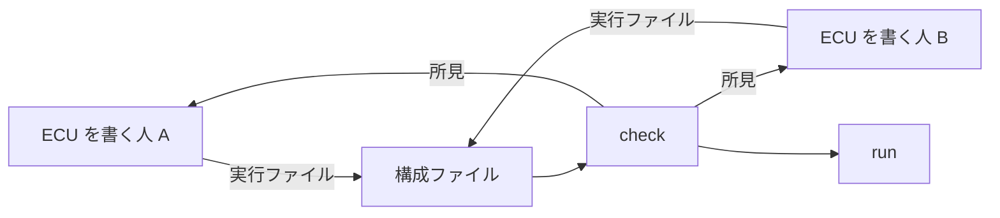

# ECU をまとめて動かす

まとめる人向けの手引きです。前に読む文書はありません（ECU の実行ファイルが持つ引数と `--describe` は、[ecu-executable.md](../ecu-executable.md) の冒頭と「引数」にあります）。次は [simulation-config.md](../simulation-config.md)（構成ファイルのキー）、[simulation-check.md](../simulation-check.md)（照合）、[simulation-run.md](../simulation-run.md)（実行）の規則の正本で、外から操作するなら [control-api.md](../control-api.md)、ブラウザで見るなら [gui.md](../gui.md) です。

何人かが別々に作った ECU の実行ファイルを、構成ファイル 1 つにまとめ、照合して食い違いを見つけ、動かして止めるまでの順番です。手引きに書くのは手順と読み方だけです。キー、`code`、出力の形の正本は simulation-config.md、simulation-check.md、simulation-run.md です。

例には [examples/ecu_main](../../examples/ecu_main) の 2 つの ECU（`vehicle_sil_engine_ecu`、`vehicle_sil_dashboard_ecu`）と、それをまとめる [examples/ecu_main/simulation.yaml](../../examples/ecu_main/simulation.yaml) を使います。ECU の書き方は [最初の ECU を作る](first-ecu.md) にあります。



## 分担の決まり

### 名前の決め方

まとめる人が先に決めて、ECU を書く人に配ります。

| 名前 | 決まり | 合わないとき |
|---|---|---|
| participant 名 | 構成ファイルの `participants[].name`。シミュレーションの中で重ならないこと。`SimulationController` は使えません。ランチャーが `--name` で ECU に渡すので、ECU の既定の名前（`EcuMainOptions::name`）と違ってもかまいません | `duplicate-name`、`reserved-name` |
| ネットワークの名前と種類 | ECU が `j1939()`、`can()`、`lin_master()`、`lin_slave()` に渡す名前を、構成ファイルの `networks` に同じ名前と種類（`can`、`lin`）で書きます。チームで一覧を決めます | `unknown-network`、`kind-mismatch`、`unused-network` |
| J1939 のアドレスと NAME | ネットワークごとに、どの ECU のノードがどのアドレスを求めるかを表にして配ります。NAME も ECU ごとに変えます（例では identity number と Manufacturer Code。Manufacturer Code の 0x7F0 は例の仮の値です）。254 は任意アドレスの範囲から取るノードで、重なりとみなしません | `address-conflict`、`address-shared`、`name-conflict` |
| 変数の名前 | ECU の中で重ならないこと。`peer.` と `ecu.` で始められません（`ecu.connected` はどの ECU にもあります）。`j1939.<ネットワークの名前>.` で始まる名前は、監視の出力とぶつかることがあるので避けます。例では ECU の役割を前に付けています（`engine.throttle`、`dashboard.engine_speed`） | ECU の組み立ての例外（`--describe` が終了コード 3）。監視の出力とぶつかると、SIL Kit で始めるときに ECU が終了コード 3 |

- 同じ ECU を 2 つ載せるとき、`--name` で変わるのは participant 名だけです。J1939 の NAME、アドレス、変数の名前は同じなので、照合が `name-conflict` を出します（[simulation-check.md](../simulation-check.md) の「人向け」の `two-engines.yaml` の例）。NAME は ECU のビルドに入っているので、ECU を書く人が直します（下の「同じ ECU を 2 つ載せる」）。
- 決まりの詳細は、participant 名とネットワークが [simulation-config.md](../simulation-config.md) の「構成ファイル」、アドレスと NAME の判定が同じ文書の「照合」の表、変数の名前が [ecu-executable.md](../ecu-executable.md) の「`Ecu::describe()`」にあります。

### 同じ ECU を 2 つ載せる

同じ実行ファイルを 2 つの participant で動かすときは、2 つ目の J1939 の NAME とアドレスを変えます。`ecu_main` は知らない引数を受け付けない（終了コード 4）ので、ECU を書く人とまとめる人で、次のように分けます。

- ECU を書く人は、`main()` で自分の引数（たとえばアドレスと identity number）を `argv` から取り出し、残りを `ecu_main()` に渡します。取り出した値は、`ecu_main<App>(argc, argv, options, args...)` の `args` で ECU のクラスのコンストラクターに渡せます（[ecu-executable.md](../ecu-executable.md) の「`ecu_main`」）。
- まとめる人は、構成ファイルの `command` の、実行ファイルの後ろにその引数を書きます（たとえば `command: [engine/vehicle_sil_engine_ecu, --address, "0x01", --identity-number, "2"]`）。ランチャーは、照合（`--describe`）でも実行でも、`command` の引数の後ろに自分の引数を足して起動します。照合は、その引数で作ったノードを見て、重なりを判定します。
- 自分の引数の名前は、`ecu_main` の引数（[ecu-executable.md](../ecu-executable.md) の「引数」の表）と重ねません。ランチャーが足す引数は、`command` に書くと照合の誤りです。`ecu_main` の使い方（`--help`）には、自分の引数は出ないので、ECU の説明に書いておきます。
- 例のエンジン（`vehicle_sil_engine_ecu`）は、この引数を持ちません。

### ECU を書く人が守ること

- `main()` を `ecu_main()` で作ります。どの ECU も同じ引数と自己申告（`--describe`）を持つので、まとめる人は中身を知らずに照合して動かせます。`ecu_main` を使わない実行ファイルは `describe: false` で入れ、照合されません。
- 配られた名前（ネットワーク、アドレス、NAME）を使い、ステップ幅をまとめる人に伝えます。変えたら `--describe` で確かめてから渡します。
- まとめる人と同じ版の vehicle-sil でビルドします。違うと注記 `version-mismatch` が出ます。変数の口の版が違うと警告 `control-link-version` で、その ECU の変数を読み書きできません。
- ECU が起動したプロセスは、ECU が終わるときに終わらせます。残ると警告 `left-processes` です。
- 標準出力と標準エラーは UTF-8 で書きます。ランチャーは、UTF-8 でないバイトを `?` にします。

### まとめる人がすること

1. 名前を決めて配る（上の表）。
2. 実行ファイルを集め、構成ファイルを書く。
3. `check` で照合し、所見を、直す人に返す。
4. `run` で動かし、結果を見る。

## 構成ファイルを書く

例の [examples/ecu_main/simulation.yaml](../../examples/ecu_main/simulation.yaml) が、2 つの ECU をまとめる最小の形です（全文は [simulation-config.md](../simulation-config.md) の「構成ファイル」にあります）。

- `participants[].command` の相対パスは、構成ファイルのあるディレクトリから数えます。構成ファイルと実行ファイルを同じディレクトリの下にまとめておけば、置き場所を変えても同じファイルが使えます。Windows では `.exe` を書かなくても見つけます。
- `participants[].step_ms` を書くと、ECU が申告するステップ幅と照合します。ECU を書く人から聞いた値を書いておくと、ECU が変わったときに気づけます。
- `ecu_main` でない道具は `describe: false` で入れます。引数に `{registry_uri}` と `{name}` を書けます。シミュレーションが待たない道具は `required: false` にします。SIL Kit の autonomous の lifecycle で仮想時間に参加する道具（既定のままの `Peer` など）は、ECU より先に仮想時間を進めると、後から ECU が始まった時点で、SIL Kit がシミュレーション全体を abort します（その道具も終わります）。`run` は構成の participant を続けて起動するので、そういう道具は、coordinated にして `required: true` にするか、`manual: true`（`required: false` のまま。`run` はコマンドを書くだけで、待ちません）にして、シミュレーションが始まった後に手で起動します。
- キーの一覧と既定の値は [simulation-config.md](../simulation-config.md) の「構成ファイル」にあります。

## 照合で食い違いを見つける（`check`）

```sh
vehicle_sil_launch check simulation.yaml
```

`check` は、`describe: true` の各実行ファイルを `--describe --name <participant 名>` で 1 つずつ起動し、構成ファイルと自己申告を突き合わせて、見つけたものを 1 回で全部出します。シミュレーションは始めません。ただし、ECU のコンストラクターは動くので、信頼できない構成ファイルや実行ファイルを渡しません。

### 所見の読み方

表示の ECU を外して照合した出力です。

<!-- vehicle_sil_launch check simulation.yaml --disable Dashboard -->
```text
simulation.yaml: 2 participants (1 disabled), 1 network

participant  step   networks
Engine       10 ms  J1939_CAN (j1939 0x00)
Dashboard    -      disabled

network    kind  participants
J1939_CAN  can   Engine

warning: simulation.yaml:8: network 'J1939_CAN': only Engine is on it, so what it sends there reaches no one: add the other participants of this network, or remove it [single-participant]
note: simulation.yaml:14: participant 'Dashboard': disabled (enabled: false, or --disable): it is neither checked nor started, and the other findings are about the simulation without it [participant-disabled]

passed: 0 errors, 1 warning, 1 note
```

- participant の表は、各 ECU が申告したもの（ステップ幅、ネットワーク、J1939 のノードが求めるアドレス）です。構成ファイルの `step_ms` ではありません。ネットワークの表は、構成ファイルのネットワークと、それを使う participant です。
- 所見は 1 行に 1 つで、`<重さ>: <ファイル>:<行>: <何が、どの値で、どう直すか> [<code>]` の形です。行は構成ファイルの行です。終わりの `[...]` は所見の名前で、下の「所見ごとの直す人」の表と [simulation-check.md](../simulation-check.md) の「照合」の表を、この名前で引けます。
- 重さは 3 つです。`error` は照合を失敗にします（`run` は何も起動しません）。`warning` は `--strict` のときだけ失敗にします。`note` は失敗にしません。照合が確かめられなかったこと、外したことを知らせます。
- 最後の行が結果と数です。終了コードは、通れば 0、誤りがあれば 1 です。
- 誤りのある例（同じ ECU を 2 つ、ステップ幅の食い違い、キーの打ち間違い）は、[simulation-check.md](../simulation-check.md) の「人向け」の `two-engines.yaml` にあります。

### 所見ごとの直す人

所見の `code` は、人向けの行の終わりの `[...]` と、`--json` の出力にあります（一覧と意味は [simulation-check.md](../simulation-check.md) の「照合」の表）。よく出るものと、直す人の目安です。

| `code` | 直す人 | すること |
|---|---|---|
| `unknown-key`、`missing-key`、`value`、`launcher-argument`、`executable` | まとめる人 | 文言のとおりに構成ファイルを直す。`command` から `ecu_main` の引数を消す。実行ファイルのパスを直す |
| `unknown-network`、`kind-mismatch`、`unused-network` | 取り決めに合わないほう | ネットワークの名前と種類の一覧と、ECU の申告を比べる |
| `step-mismatch` | 取り決めに合わないほう | `step_ms` と ECU のステップ幅のどちらが正しいかを決める |
| `address-conflict`、`address-shared`、`name-conflict` | ECU を書く人 | アドレスの表に合わせて、ECU のノードのアドレスか NAME を変えてビルドし直す |
| `describe-failed`、`describe-output`、`describe-timeout` | ECU を書く人 | 添えられた標準エラーの末尾を渡す。`describe-failed` で終了コード 4 なら、`ecu_main` で作った実行ファイルでない見込みが高い（`describe: false` にするか、`ecu_main` にしてもらう） |
| `describe-unknown-value` | まとめる人 | ECU の vehicle-sil と同じか新しい版の `vehicle_sil_launch` を使う（文言に両方の版がある） |
| `describe-version` | 版が古いほう | 文言のとおり、`vehicle_sil_launch` を新しくするか、ECU をビルドし直す |
| `version-mismatch`、`control-link-version` | どちらか | 同じ版の vehicle-sil でビルドし直す |
| `single-participant` | まとめる人 | 外した ECU か、まだない ECU のせいなら、そのままでよい。`--strict` では失敗になる |

ネットワークの名前の食い違いは、構成ファイルでは直せません。構成ファイルには、ECU が使う名前を別の名前に付け替える書き方がないからです。2 つの ECU が 1 つのバスを別の名前で呼んでいるとき（`unknown-network` や `single-participant` の文が、同じ種類のほかのネットワークを挙げているとき）は、`networks` に名前を足しても 2 つのバスに分かれるだけです。取り決めた名前に合わないほうの ECU を書いた人が、名前を直して実行ファイルを作り直します。

## 動かす（`run`）

```sh
vehicle_sil_launch run simulation.yaml
vehicle_sil_launch run simulation.yaml --log-dir logs --timeout-ms 60000
```

- `run` は、まず `check` と同じ照合をします。誤りがあれば何も起動しません。
- 通れば、registry と controller を自分のプロセスの中に立て、ECU を起動し、`stop_at_ms` まで動かして、結果を書きます。出力の例は [最初の ECU を作る](first-ecu.md) の「動かす」にあります。participant の表の `ended` の列で、各 ECU がどう終わったかを見ます。
- `--log-dir logs` で、ECU ごとの出力が `logs/<participant 名>.log` にも残ります。何も付けなければ、標準エラーに `[<participant 名>] ` を付けて流れます。
- ステップの中で止まった ECU がいると、仮想時間が進まず、`stop_at_ms` があっても終わりません。CI では `--timeout-ms` で実時間の上限を付けます。
- 実行で出る所見（`participant-failed`、`not-joined`、`did-not-end` など）と、見張りの規則は [simulation-run.md](../simulation-run.md) の「見張ること」と「出力」の表にあります。どれも、どの participant かを文言に書きます。

## ECU を外す（`enabled`、`--disable`）

まだ届いていない ECU や、問題を切り分けたい ECU を外して動かします。

```sh
vehicle_sil_launch check simulation.yaml --disable Dashboard
vehicle_sil_launch run simulation.yaml --disable Dashboard
```

- 外した ECU は、照合も起動もしません。実行ファイルがまだなくてもかまいません。
- ファイルに `enabled: false` と書いても同じです。`--enable <participant 名>` で戻します。コマンドラインがファイルより優先します。
- 外した ECU ごとに注記 `participant-disabled` が出ます（上の出力）。「一部を外して通った」を「全部で通った」と読み違えないためのものです。外したことで出る警告（`single-participant` など）は、`--strict` で失敗になります。
- `ecu_main` の ECU には `required: false` を書けません。外すときは `enabled: false` か `--disable` です。
- 規則の詳細は [simulation-config.md](../simulation-config.md) の「participant を外す」にあります。

## 止める

- `stop_at_ms` を書けば、その仮想時刻で止まります。書かなければ、Ctrl+C まで動きます。
- Ctrl+C で、シミュレーションを順に止め、ECU を終わらせて、結果を書きます（終了コード 130）。2 回目の Ctrl+C は待たずに強制終了します。
- プログラムから止めるときは、`--stdin-commands` を付けて、標準入力に `{"command":"stop"}` を書くか、標準入力を閉じます。
- どの止め方でも、ランチャーは起動した ECU と、ECU が起動したプロセスを終わらせてから終わります。シミュレーションが終わっても自分で終わらない必須の ECU は、止まるよう求めてから強制終了し、`did-not-end` の誤りにします。
- 順番と待つ時間は [simulation-run.md](../simulation-run.md) の「止め方」「中断（Ctrl+C）」「participant を残さないこと」にあります。

## 機械から使う（`--json`、`--events`）

CI のスクリプト、GUI、AI エージェントから使うときです。

```sh
vehicle_sil_launch version --json
vehicle_sil_launch check --json simulation.yaml
vehicle_sil_launch run --events --stdin-commands simulation.yaml
```

- 結果は終了コードで判定できます（0 が成功、1 が誤り、130 が中断。表は [simulation-config.md](../simulation-config.md) の「引数と終了コード」）。
- `--json` は、結果を 1 つの JSON で書きます。所見の `code`、`participant`、`line` を、そのまま読めます。`check` の JSON の `participants[].variables` で、どの ECU にどの変数があるかを実行の前に見られます。
- `run --events` は、経過を 1 行に 1 つの JSON（NDJSON）で書きます。最初が `hello`、最後が `result` で、`result` は `run --json` と同じです。`--json` と一緒には付けられません。
- 見届けるプログラムは `--stdin-commands` も付けます。プログラムが止まると標準入力が閉じ、ランチャーも順に止まります。
- 版の違うランチャーを相手にするときは、`version --json` の `features` に名前があるかで、できることを確かめます。
- 事象の種類、順序の約束、読む側が守ることは [simulation-events.md](../simulation-events.md) の「機械から使う」にあります。Python からは `Launch`（[control-api.md](../control-api.md) の「Python」）が、この形でランチャーを起動します。

## 等速で動かす（`--speed`）と遅れの見方

実時間で動く機器と一緒に動かすとき、人が画面を見ながら操作するときは、速さを指定します。

```sh
vehicle_sil_launch run simulation.yaml --speed 1
```

速さを指定すると、結果に `time:` の行が増えます。次は `--speed 4` の行です（`<` と `>` の所は実行ごとに違う値です）。

<!-- vehicle_sil_launch run simulation.yaml --speed 4: the line of the time -->
```text
time: speed 4, ran at <actual_speed> times real time; <late_steps> of 200 paced steps more than 10 ms late (the latest by <max_late_ms> ms), <slipped_ms> ms behind in all
```

- `ran at ... times real time` は全体の実際の速さです（一時停止を除く）。
- `<late_steps> of 200 paced steps more than 10 ms late` は、速さを合わせた刻みのうち、許容（`late_tolerance_ms`、既定 10 ms）を超えて遅れた数です。1 つでもあると警告 `behind-real-time` が出ます。
- `ms behind in all` は、遅れて後ろにずれた合計です。シミュレーションは遅れを取り戻そうとしません。
- 遅れたときは、速さを下げるか、遅い ECU を探します。ランチャーはどの ECU が遅いかを知らないので、ECU を 1 つずつ外して（`--disable`）比べます。
- `time_step_ms` を書いたときと、最速で始めて途中で速さを変えたときに、ECU のステップが controller の刻みの境目で始まらないと、警告 `coarse-time-step` が出ます。ファイルに `speed` と `time_step_ms` の両方があれば、`check` の時点で出ます。文言にある値を `time_step_ms` に書きます。
- 遅れの定義、許容の決め方、刻みと ECU のステップの関係は [simulation-run.md](../simulation-run.md) の「等速で動かす」にあります。

## 次に読むもの

- 構成ファイルのキー: [simulation-config.md](../simulation-config.md)
- 照合の規則と所見、その出力の形: [simulation-check.md](../simulation-check.md)
- 実行の規則と結果の形: [simulation-run.md](../simulation-run.md)
- ECU の実行ファイルの引数と自己申告: [ecu-executable.md](../ecu-executable.md)
- 実行中に変数を読み書きする、時間を止めて進める: [信号を外から操作する](operate-signals.md)、[control-api.md](../control-api.md)
- 決まった手順で値を入れて確かめる、CI で回す: [シナリオで試験を書く](scenario-tests.md)
- ブラウザで照合と実行を見る: [gui.md](../gui.md)
- ECU を書く人に渡す手引き: [最初の ECU を作る](first-ecu.md)
