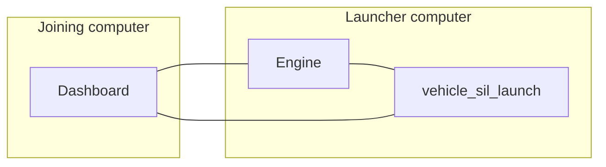

# Run on several computers

[日本語](../ja/howto/multi-pc.md)

This guide splits one simulation across 2 computers. One computer runs `vehicle_sil_launch` (the launcher), and an ECU started on the other computer joins that simulation. The later sections show how to use the Control API and the GUI from another computer.

> [!WARNING]
> **SIL Kit has no authentication.** Anyone who can connect to the registry (the SIL Kit server that introduces the joining processes to each other) can join the simulation and write ECU variables. Use it on a closed network.

## Prerequisites

| Requirement | Details |
|---|---|
| Computers | 2, on the same closed network |
| Build | Both computers have a build made as described in "[Build from the repository](../../README.md#build-from-the-repository)" in the README. |
| Address of the launcher computer | This guide uses `192.0.2.10`. Use the address of your own computer instead. |

On both computers, run these 2 lines in the repository root. Run all later commands in the directory they change to (the one that contains `simulation.yaml`).

```sh
export PATH="$PWD/build/linux-gcc-control/tools/launch:$PATH"
cd build/linux-gcc-control/examples/ecu_main
```

The commands are for Linux. The table in "[Differences on Windows](#differences-on-windows)" lists what differs on Windows. To try this with the template project, use these replacements:

| What | This guide (repository build) | Template project |
|---|---|---|
| Working directory | `build/linux-gcc-control/examples/ecu_main` | The project directory |
| Location of `vehicle_sil_launch` | `build/linux-gcc-control/tools/launch` | `tools/vehicle-sil-tools-<version>-linux-x86_64/bin` |
| ECU executables | `engine/vehicle_sil_engine_ecu`, `dashboard/vehicle_sil_dashboard_ecu` | `bin/engine_ecu`, `bin/dashboard_ecu` |
| Configuration file | `simulation.two-pcs.yaml` | A copy of `simulation.yaml` with the 2 keys from the table in step 1 added |
| Starting the GUI server | `scripts/run-gui.py` in the repository root | `vehicle-sil-gui simulation.yaml` |

## Where things run

In this guide's example, the engine ECU (`Engine`) runs on the same computer as the launcher, and the dashboard ECU (`Dashboard`) runs on the other computer. Each line in the diagram is a TCP connection.



| Box | How it starts | Connects to |
|---|---|---|
| `vehicle_sil_launch` | `run` in step 2 | It runs the registry itself and listens for connections from the other 2. |
| `Engine` | The launcher starts it. | The registry on the same computer |
| `Dashboard` | The command in step 3, on the joining computer | The registry given with `--registry-uri`, then `Engine` as well |

## Overview

| Step | Computer | What you do | What you get |
|---|---|---|---|
| 1 | Launcher computer | Check the configuration file | `check` output that reports that the simulation listens on the network |
| 2 | Launcher computer | Start `run` | The URI for joining from other computers |
| 3 | Joining computer | Join from the other computer | A simulation that runs across 2 computers |
| 4 | Launcher computer | Read the result | A table that shows how the 2 ECUs ended |

Do steps 1–4 in order. "Step 1" to "Step 4" are the parts of this guide; anywhere else, a "step" is a simulation step. Read the remaining sections when you need them.

| Goal | Section |
|---|---|
| Choose the port that the joining ECU listens on | [Listen on a fixed port](#listen-on-a-fixed-port) |
| Run on Windows | [Differences on Windows](#differences-on-windows) |
| Read and write values from Python on another computer | [Use the Control API from another computer](#use-the-control-api-from-another-computer) |
| Open the screens in a browser on another computer | [Open the GUI in a browser on another computer](#open-the-gui-in-a-browser-on-another-computer) |

## Step 1: Check the configuration file

Work on the launcher computer. The configuration file is `simulation.two-pcs.yaml`, in the build directory. Without the comments at the top, it reads:

<!-- examples/ecu_main/simulation.two-pcs.yaml -->
```yaml
vehicle_sil_simulation: 1
stop_at_ms: 1000
registry_uri: silkit://0.0.0.0:8500
networks:
  - name: J1939_CAN
    kind: can
participants:
  - name: Engine
    command: [engine/vehicle_sil_engine_ecu]
    step_ms: 10
  - name: Dashboard
    command: [dashboard/vehicle_sil_dashboard_ecu]
    step_ms: 5
    manual: true
```

It differs from `simulation.yaml`, which runs on one computer, in 2 keys:

| Key | Meaning |
|---|---|
| `registry_uri: silkit://0.0.0.0:8500` | The registry listens on port 8500 on every address of this computer. |
| `manual: true` | `run` does not start that ECU and waits until it joins. |

You can also write a single address of this computer in `registry_uri`, as in `silkit://192.0.2.10:8500`. Instead of writing `manual: true` in the configuration file, you can pass `run --manual Dashboard`.

Put the `Dashboard` executable on the launcher computer too: `check` and `run` run it with `--describe` to check the configuration file against it.

Check the configuration file:

```sh
vehicle_sil_launch check simulation.two-pcs.yaml
```

### Verify the check

The last line is `passed:` and there are 2 `note:` lines. The exit code is 0.

<!-- multi-pc guide: check simulation.two-pcs.yaml -->
```text
simulation.two-pcs.yaml: 2 participants, 1 network

participant  step   networks
Engine       10 ms  J1939_CAN (j1939 0x00)
Dashboard    5 ms   J1939_CAN (j1939 0x28)

network    kind  participants
J1939_CAN  can   Engine, Dashboard

note: simulation.two-pcs.yaml:10: registry_uri silkit://0.0.0.0:8500 is not a loopback address: the registry and the participants listen on the network, where anyone who reaches this computer can join the simulation (SIL Kit does not authenticate); run gives the participants it starts VEHICLE_SIL_LISTEN_ON_NETWORK=1 and shows it with the command of a participant you start yourself: set it for every participant on this computer that connects to the registry at a loopback address; to keep the simulation on this computer, use 127.0.0.1 or leave registry_uri out [registry-on-network]
note: simulation.two-pcs.yaml:18: participant 'Dashboard': you start it yourself (manual: true, or --manual): run does not start it, but prints the command to start it with, and waits for it to join without a time limit (with --timeout-ms, at most that long); start it with VEHICLE_SIL_LISTEN_ON_NETWORK=1 in its environment, so that the other computers reach it (registry_uri is not a loopback address) [participant-manual]

passed: 0 errors, 0 warnings, 2 notes
```

The `[...]` at the end of each `note:` line is the finding code:

| Code | What it tells you |
|---|---|
| `registry-on-network` | The registry and the ECUs listen on the network, and SIL Kit has no authentication. |
| `participant-manual` | `run` does not start `Dashboard`, and waits for it to join without a time limit. |

Both notes mention the environment variable `VEHICLE_SIL_LISTEN_ON_NETWORK=1`. You set it only when you start `Dashboard` on the same computer as the launcher. In this guide, `Dashboard` starts on the other computer, so do not set it.

## Step 2: Start `run`

On the launcher computer, run:

```sh
vehicle_sil_launch run simulation.two-pcs.yaml
```

On Windows, the firewall must allow the launcher (see "[Differences on Windows](#differences-on-windows)").

### Verify that `run` waits

`run` prints these lines to stderr and waits after the line `waiting for Dashboard to join`. Where this example shows `/home/you/vehicle-sil/.../ecu_main`, you see the absolute path of the directory you ran in.

```text
[vehicle_sil_launch] registry at silkit://127.0.0.1:8500
[vehicle_sil_launch] from other computers, join at silkit://192.0.2.10:8500 (this computer's address): give it as --registry-uri to a participant started by hand on another computer (instead of the loopback address in its command; it needs no VEHICLE_SIL_LISTEN_ON_NETWORK)
[vehicle_sil_launch] starting Engine: /home/you/vehicle-sil/.../ecu_main/engine/vehicle_sil_engine_ecu --name Engine --registry-uri silkit://127.0.0.1:8500 --start-timeout-ms 1000000000000
[vehicle_sil_launch] not starting Dashboard: start it yourself (manual: true, or --manual); the simulation waits for it to join. In the directory /home/you/vehicle-sil/.../ecu_main, with VEHICLE_SIL_LISTEN_ON_NETWORK=1 in its environment, run:
[vehicle_sil_launch]   /home/you/vehicle-sil/.../ecu_main/dashboard/vehicle_sil_dashboard_ecu --name Dashboard --registry-uri silkit://127.0.0.1:8500 --start-timeout-ms 1000000000000
[vehicle_sil_launch] waiting for Dashboard to join (manual): start it with the command above; Ctrl+C stops the run
```

| Line | What it tells you |
|---|---|
| `from other computers, join at silkit://192.0.2.10:8500` | The URI for joining from another computer. In step 3, you pass it to `--registry-uri`. |
| `not starting Dashboard: ...` and the next line | The command that starts `Dashboard` on this computer. To start it on another computer, change `--registry-uri` to the URI above. |
| `waiting for Dashboard to join (manual)` | The launcher is waiting for `Dashboard` to join. |

When `registry_uri` is `0.0.0.0`, the launcher lists the IPv4 addresses of this computer's active networks after `join at`. If it lists 2 or more, choose as follows:

| Address | How to choose |
|---|---|
| The first address | It is the address on the network with the default route, usually on the same LAN as the other computer. If there are other addresses, the launcher adds a note that the first one is this address. |
| An address such as `172.x.x.x` | Addresses on the virtual networks of WSL, Docker and virtual machines are often unreachable from other computers. Choose the address on the same LAN as the other computer. |

### Troubleshoot starting `run`

| Symptom | Cause | Fix |
|---|---|---|
| `the registry cannot listen at silkit://...: ...`, and the exit code is 3 | Another program or another `run` uses that port. | Change the port in `registry_uri`, or end the other `run`. |

## Step 3: Join from the other computer

Work on the joining computer. After the launcher prints `waiting for Dashboard to join`, start `Dashboard` with this command:

```sh
dashboard/vehicle_sil_dashboard_ecu --name Dashboard --registry-uri silkit://192.0.2.10:8500 --start-timeout-ms 1000000000000
```

| Argument | Meaning |
|---|---|
| `--name Dashboard` | Must match `name` in the configuration file exactly, including case. |
| `--registry-uri silkit://192.0.2.10:8500` | The URI that the launcher printed after `join at` in step 2. |
| `--start-timeout-ms 1000000000000` | The time limit for waiting for the simulation to start. It is the value from the command that the launcher prints, and in effect means no limit. |

Do not set the environment variable `VEHICLE_SIL_LISTEN_ON_NETWORK`. An ECU that connects to a registry at a non-loopback address listens on all addresses without it.

In the tested setups, the joining computer needed no firewall rule, even when it was a Windows virtual machine, because the ECU connects out to the launcher computer.

### Verify the join

When all required ECUs have joined, the simulation starts. `Dashboard` prints these 3 lines to stdout. When the simulation ends, `Dashboard` exits on its own with exit code 0.

```text
t=0 ms engine speed 0 rpm (0 messages)
t=500 ms engine speed 1200 rpm (5 messages)
t=1000 ms engine speed 1200 rpm (10 messages)
```

`engine speed 1200 rpm` shows that `Dashboard` receives the engine speed that `Engine` on the other computer sends over CAN.

### Troubleshoot joining

In each row, either `Dashboard` on the joining computer exits with exit code 3, or the launcher prints the symptom to stderr.

| Symptom | Cause | Fix |
|---|---|---|
| The ECU exits immediately and prints `cannot join the simulation at ...: ... Failed to connect to SIL Kit Registry` | The launcher is not running yet, or the address or port is wrong. | Start the launcher first, and pass the URI printed after `join at`. |
| The ECU exits after about 5 s and prints `Timeout during connection handshake ...` | The firewall of the launcher computer blocks the connection. | Run the `netsh` line from "[Differences on Windows](#differences-on-windows)". |
| The ECU exits after about 5 s and prints `... already exists ... (the registry refused the name "<name>" for 5000 ms: ...)` | A participant with the same name has already joined. | Check `--name`. |
| The launcher prints `participant 'x' joined the simulation, but this run has no participant of that name (...)` | `--name` differs from the name in the configuration file. | Stop that ECU with Ctrl+C and start it again with the name from the configuration file. |

`Timeout during connection handshake` in the second row is a SIL Kit message, and the sentence after it suggests a participant with the same name as the cause. It appeared in a setup with port forwarding, when the firewall blocked the connection. The message in the third row also appears when you only restart an ECU immediately under the same name. While the registry refuses the name, the ECU retries joining for up to 5 s (or for `--start-timeout-ms`, if that is shorter). If the registry sees the end of the earlier participant within that time, the ECU joins. An ECU with a wrong name, as in the fourth row, keeps waiting, and the simulation does not start.

## Step 4: Read the result

The simulation ends at virtual time 1000 ms. The launcher prints this result at the end of stdout and exits with exit code 0.

```text
run: the simulation ran to stop_at_ms (1000 ms) and ended

participant  required  ended
Engine       yes       exit code 0
Dashboard    yes       started by you (manual)

passed: 0 errors, 0 warnings, 2 notes
```

`started by you (manual)` for `Dashboard` means that the ECU you started yourself joined the simulation. The launcher cannot know how that ECU ended, so check its exit code on the joining computer.

To stop the run early, do as you would on one computer: stop the launcher with Ctrl+C, or send the `stop` command. The joined ECU also exits on its own when the simulation ends.

### Troubleshoot the result

| Symptom | Cause | Fix |
|---|---|---|
| The joined ECU keeps running after the launcher has ended | The launcher was killed (crash, power loss, SIGKILL), so the ECU keeps waiting. | Stop the ECU with Ctrl+C. |
| The launcher prints `virtual time has not advanced for 10 s ...` | The network is down, a debugger has stopped a process, or an ECU hangs inside a step. | When the network comes back, the run continues from where it stopped (`virtual time advances again`). |
| Each join takes about 5 s | The other computer cannot connect directly to the ECUs on the launcher computer (the firewall allows only the launcher, or there is NAT). | Leave it as it is, or also allow the ECU executables on the launcher computer through the firewall. |

SIL Kit takes a long time to notice a broken connection; on Linux, more than 10 minutes. If you do not want to wait with virtual time stopped, stop the launcher with Ctrl+C. For unattended runs, add `--timeout-ms` to `run`.

## Listen on a fixed port

To choose the port that the joining ECU listens on, for example for a firewall or port forwarding, pass a SIL Kit participant configuration file with `--silkit-config`. The same file can also raise the number of connection attempts.

Save this as `dashboard.silkit.yaml`:

```yaml
Middleware:
  AcceptorUris: ["tcp://0.0.0.0:8601"]
  ConnectAttempts: 5
```

Start the ECU with the command from step 3 plus `--silkit-config`:

```sh
dashboard/vehicle_sil_dashboard_ecu --name Dashboard --registry-uri silkit://192.0.2.10:8500 --start-timeout-ms 1000000000000 --silkit-config dashboard.silkit.yaml
```

Verify the result as in step 3. Settings that are not in the file keep their defaults. For the rules, see "Passing a SIL Kit configuration file (`--silkit-config`)" in [ecu-executable.md](../ecu-executable.md#passing-a-sil-kit-configuration-file---silkit-config).

## Differences on Windows

The steps are the same. These things differ:

| What | Linux | Windows |
|---|---|---|
| Build and shell | "[Build from the repository](../../README.md#build-from-the-repository)" in the README | "Windows (MSYS2 UCRT64)" in [build.md](../build.md#windows-msys2-ucrt64) |
| Executable names | `vehicle_sil_launch`, `vehicle_sil_dashboard_ecu` | The names end in `.exe`. |
| Firewall on the launcher computer | Not tested with firewalld or similar firewalls | Allow `vehicle_sil_launch.exe` once. |
| `openssl` | Available | Included in MSYS2 and Git for Windows |
| Starting Python | `python3` | `python` |
| SSH server on the GUI server computer | Required | Use the OpenSSH Server feature. |

### Firewall rules

To run the launcher on Windows, allow `vehicle_sil_launch.exe` in the firewall once. If Windows asks, allow it. If it does not ask, or you did not allow it, run this line in a Command Prompt as administrator. Replace the path with your own.

```bat
netsh advfirewall firewall add rule name="vehicle-sil launch" dir=in action=allow program="C:\vehicle-sil\bin\vehicle_sil_launch.exe" enable=yes
```

| Situation | What happens |
|---|---|
| `vehicle_sil_launch.exe` is not allowed | The joining ECU fails after about 5 s (the second row of the table in step 3). |
| The ECUs that the launcher starts (such as `Engine`) are not allowed | The simulation runs, but each join takes about 5 s longer. |

Allowing the ECUs that the launcher starts is optional. Without it, a direct connection from the joining ECU gives up after about 5 s, and the launcher computer connects to the other computer instead. The same happens when the launcher computer is behind NAT and the other computer can reach only the forwarded port.

## Use the Control API from another computer

Make the launcher's Control Server listen on an address that other computers can reach. On such an address, the Control Server requires TLS and credentials. For the rules, see "Authentication" in [control-api.md](../control-api.md#authentication).

Do items 1 and 2 below on the launcher computer, and item 3 on the client computer.

1. Create a certificate. In `subjectAltName`, write the address that clients connect to.

   ```sh
   openssl req -x509 -newkey ec -pkeyopt ec_paramgen_curve:prime256v1 -nodes -days 30 -subj "/CN=vehicle-sil" \
     -addext "subjectAltName=IP:192.0.2.10" -keyout server.key -out server.crt
   ```

   This creates `server.key` (the key) and `server.crt` (the certificate).

2. Create the credentials file `credentials.txt` and pass it to `run`. The file has one entry per line, in the form `<role> <name> <token>`. `role` is `viewer`, `operator` or `admin`, and the token is a secret string of at least 16 characters. This line creates an `admin` entry with a random token:

   ```sh
   python3 -c "import secrets; print('admin', 'lead', secrets.token_hex(16))" > credentials.txt
   ```

   ```sh
   vehicle_sil_launch run simulation.live.yaml --control 0.0.0.0:8510 --control-tls-cert server.crt --control-tls-key server.key --control-credentials credentials.txt
   ```

   `simulation.live.yaml` is a configuration file that runs the same 2 ECUs until you stop them. The launcher prints `[vehicle_sil_launch] control server at 0.0.0.0:8510` to stderr. Read `0.0.0.0` as the address of this computer.

3. Copy `server.crt` and the token to the client computer. Do not copy the key (`server.key`). The token is the third word in `credentials.txt`; on the client computer, save it in `token.txt`. Write this into `list_peers.py`:

   ```python
   from vehicle_sil_control import Control

   token = open("token.txt").read().strip()
   with Control("192.0.2.10:8510", token=token, root_certificates=open("server.crt", "rb").read()) as c:
       print(sorted(p.participant for p in c.peers()))
   ```

   Run it in a shell in which you have set up the client as described in "Python" in [control-api.md](../control-api.md#python):

   ```sh
   python list_peers.py
   ```

### Verify the remote Control API

If the script prints the participant names from the configuration file, the connection works.

```text
['Dashboard', 'Engine']
```

### Troubleshoot the remote Control API

| Client error | Cause |
|---|---|
| `Hostname Verification Check failed` | The `subjectAltName` of the certificate does not contain the address you connected to. |
| `CERTIFICATE_VERIFY_FAILED` | The certificate you gave the client is not the server's certificate. |
| `Connection refused` | The port is wrong, or the launcher is not running. |
| `UNAUTHENTICATED: a valid token is required` | The token differs from the one in `credentials.txt`. |

## Open the GUI in a browser on another computer

The GUI server listens only on 127.0.0.1. For now, open it through SSH port forwarding. The computer that runs the GUI server needs an SSH server.

1. On the GUI server computer, start the server on a port you choose. In the repository root, run:

   ```sh
   scripts/run-gui.py --port 8765 --no-browser
   ```

   In the template project, the command is `vehicle-sil-gui --port 8765 --no-browser simulation.yaml`. Copy the printed URL to the computer that runs the browser.

   ```text
   http://127.0.0.1:8765/#token=...
   vehicle-sil-gui: open the URL above (it has the token); Ctrl+C stops the server
   ```

2. On the computer that runs the browser, forward **the same port number**:

   ```sh
   ssh -L 8765:127.0.0.1:8765 <user>@<GUI server computer>
   ```

3. In the browser on that computer, open the URL from item 1.

### Troubleshoot the remote GUI

| Symptom | Cause | Fix |
|---|---|---|
| The browser shows 403 | The GUI server accepts only requests whose `Host` is `127.0.0.1:<its port>`. | Forward the same port number that the GUI server uses. |

For the addresses that the GUI server listens on and the rules for the requests it accepts, see [gui.md](../gui.md).

## Speed

Every step costs a round trip between the computers.

| Run | Effect |
|---|---|
| As fast as possible (no `speed`) | Slower than on one computer |
| At a set speed (`speed: 1` and others) | No effect, as long as the round trip takes much less than the real time available for one step |

The `time:` line of the result shows any lateness.

## Tested setups

| Setup | Status |
|---|---|
| 2 Linux computers | 2 hosts made with network namespaces. The automated test `multi_host.two_hosts` covers this setup. |
| Linux and Windows | Windows runs in a virtual machine behind NAT, so connections work in one direction only. Tested with the launcher on either side. |
| GUI forwarding over SSH | The forwarding setup is tested; ssh itself is not. |
| A LAN with 2 physical computers, Windows to Windows, VPN, networks across sites, 3 or more computers | Not tested |
| Linux firewalls (firewalld and others) | Not tested |

## What to read next

- Rules for how `manual` ECUs wait and stop: "Starting a participant yourself (`manual`, `--manual`)" in [simulation-config.md](../simulation-config.md#starting-a-participant-yourself-manual---manual)
- Rules for which addresses are listened on, and `VEHICLE_SIL_LISTEN_ON_NETWORK`: "Listen addresses" in [simulation-run.md](../simulation-run.md#listen-addresses)
- Back to the configuration file, `check` and `run`: [Integrate and run several ECUs](integrate-ecus.md)
