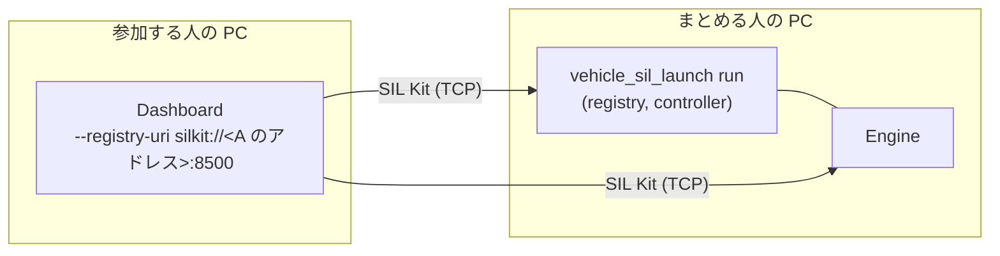

# 複数の PC で動かす

まとめる人の PC で `vehicle_sil_launch run` を動かし、ほかの人の PC から ECU を参加させる手順です。前に読む文書は [ECU をまとめて動かす](integrate-ecus.md)（構成ファイル、`check`、`run`）です。キーと出力の正本は [simulation-config.md](../simulation-config.md) の「participant を自分で起動する」と [simulation-run.md](../simulation-run.md) の「待ち受けるアドレス」です。例のアドレス `192.0.2.10` は文書用のアドレスです。自分の PC のアドレスに読み替えます。



- 参加する ECU は、構成ファイルで `manual: true` にします（または `run --manual <名前>`）。`run` はそれを起動せず、参加するのを待ちます。
- **SIL Kit には認証がありません。** registry に届く人は誰でもシミュレーションに参加でき、ECU の変数にも書けます。閉じたネットワークで使います。
- 確かめた構成: Linux 2 台（ネットワーク名前空間で作った 2 台。自動の試験 `multi_host.two_hosts`）と、Linux と Windows（仮想マシン。NAT の内側にあり、片方向にしか届かない）。どちらの側でランチャーを動かす場合も確かめています。確かめていない構成: 本物の 2 台の PC の LAN、Windows 同士、VPN、拠点をまたぐネットワーク、3 台以上、Linux のファイアウォール（firewalld など）、ssh そのものでの GUI の転送（転送の形は確かめた）。

## まとめる人

1. 構成ファイルの `registry_uri` に、ほかの PC から届くアドレスを書きます。`silkit://0.0.0.0:8500` は全部のアドレスで待ち受けます。この PC のアドレスを 1 つ書いてもかまいません（`silkit://192.0.2.10:8500`）。参加する ECU には `manual: true` を付けます。

   ```yaml
   vehicle_sil_simulation: 1
   stop_at_ms: 1000
   registry_uri: silkit://0.0.0.0:8500
   networks:
     - name: J1939_CAN
       kind: can
   participants:
     - name: Engine
       command: [engine/vehicle_sil_engine_ecu]
     - name: Dashboard
       command: [dashboard/vehicle_sil_dashboard_ecu]
       manual: true
   ```

   `check` は注記 `registry-on-network`（ネットワークで待ち受けること、認証がないこと）と、`participant-manual` を出します。参加する ECU の実行ファイルも、この PC で `check` できるように置いておきます（`--describe` を動かすためです）。

2. Windows では、ファイアウォールに `vehicle_sil_launch.exe` を 1 回許可します。確認の画面が出たら許可します。出ないとき、または許可しなかったときは、管理者のコマンドプロンプトで次の 1 行を実行します（パスは自分のものに変えます）。

   ```bat
   netsh advfirewall firewall add rule name="vehicle-sil launch" dir=in action=allow program="C:\vehicle-sil\bin\vehicle_sil_launch.exe" enable=yes
   ```

   許可がないと、参加する側の ECU は約 5 秒で失敗します（下の表）。この PC で `run` が起動する ECU（Engine など）の許可は必須ではありません。許可がなければ、参加する側からの直接の接続は約 5 秒で諦められ、この PC の側から相手につなぎ直します。そのため、参加に毎回 5 秒ほど余計にかかります。この PC が NAT の内側にあり、相手から届くのが転送したポートだけのときも同じです。

3. `run` を起動します。`registry at` の次の行が、ほかの PC から参加する URI です。この PC の、動いているネットワークの IPv4 アドレスを並べます。既定の経路のあるネットワーク（ふつうは相手と同じ LAN）のアドレスが先で、ほかにもあれば、先頭がそれだと書き添えます。`172.x.x.x` などは、WSL、Docker、仮想マシンの仮想のネットワークで、ほかの PC から届かないことが多いアドレスです。相手と同じ LAN のアドレスを選びます。

   ```text
   [vehicle_sil_launch] registry at silkit://127.0.0.1:8500
   [vehicle_sil_launch] from other computers, join at silkit://192.0.2.10:8500 (this computer's address): give it as --registry-uri to a participant started by hand on another computer (instead of the loopback address in its command; it needs no VEHICLE_SIL_LISTEN_ON_NETWORK)
   ...
   [vehicle_sil_launch] waiting for Dashboard to join (manual): start it with the command above; Ctrl+C stops the run
   ```

   `run` が書く Dashboard のコマンドは、この PC で起動するためのもの（`--registry-uri silkit://127.0.0.1:8500`）です。参加する人には、`--registry-uri` を上の URI に変えたコマンドを伝えます。

4. 全員が参加すると始まります。止め方はいつもどおりです（Ctrl+C、`stop` の命令）。参加した ECU も、シミュレーションが終われば自分で終わります。

## 参加する人

1. ランチャーが `waiting for <名前> to join` を書いた後に、ECU を起動します。先に起動すると、すぐに終了コード 3 で終わります（`Failed to connect to SIL Kit Registry`）。

   ```sh
   dashboard/vehicle_sil_dashboard_ecu --name Dashboard --registry-uri silkit://192.0.2.10:8500 --start-timeout-ms 1000000000000
   ```

   `--name` は構成ファイルの名前と同じにします（大文字と小文字も）。`VEHICLE_SIL_LISTEN_ON_NETWORK` は要りません（ループバックでない URI につなぐ ECU は、全部のアドレスで待ち受けます）。

   決まったポートで待ち受けたいとき（ファイアウォールやポートの転送で、開けるポートを決めるとき）や、接続を試す回数を増やしたいときは、SIL Kit の構成ファイルを `--silkit-config` で渡します。書いていない設定は、いつもの既定のままです（[ecu-executable.md](../ecu-executable.md) の「SIL Kit の構成を渡す」）。

   ```yaml
   # dashboard.silkit.yaml
   Middleware:
     AcceptorUris: ["tcp://0.0.0.0:8601"]
     ConnectAttempts: 5
   ```

   ```sh
   dashboard/vehicle_sil_dashboard_ecu --name Dashboard --registry-uri silkit://192.0.2.10:8500 --start-timeout-ms 1000000000000 --silkit-config dashboard.silkit.yaml
   ```

2. 参加する側の PC のファイアウォールの許可は、確かめた構成では要りませんでした（Windows の仮想マシンでも）。ECU は自分からまとめる人の PC につなぎます。

3. シミュレーションが終われば、ECU は自分で終わります。まとめる人の `vehicle_sil_launch` が強制終了された（クラッシュ、電源断、SIGKILL）ときは、ECU は待ち続けます。Ctrl+C で止めます。

## 別の PC から Control API を使う

ランチャーの Control Server を、ほかの PC からつながるアドレスで開きます。TLS と認証情報が要ります（[control-api.md](../control-api.md) の「認証」）。

1. 証明書を作ります。`subjectAltName` に、クライアントがつなぐアドレスを書きます（`openssl` は Linux、MSYS2、Git for Windows にあります）。

   ```sh
   openssl req -x509 -newkey ec -pkeyopt ec_paramgen_curve:prime256v1 -nodes -days 30 -subj "/CN=vehicle-sil" \
     -addext "subjectAltName=IP:192.0.2.10" -keyout server.key -out server.crt
   ```

2. 認証情報のファイル（`<role> <name> <token>`、トークンは 16 文字以上）を作り、`run` に渡します。

   ```sh
   vehicle_sil_launch run simulation.yaml --control 0.0.0.0:8510 --control-tls-cert server.crt --control-tls-key server.key --control-credentials credentials.txt
   ```

   `[vehicle_sil_launch] control server at 0.0.0.0:8510` の `0.0.0.0` は、この PC のアドレスに読み替えます。

3. クライアントの PC に `server.crt`（鍵は渡しません）とトークンを渡し、証明書に書いたアドレスでつなぎます。

   ```python
   from vehicle_sil_control import Control
   with Control("192.0.2.10:8510", token=token, root_certificates=open("server.crt", "rb").read()) as c:
       print([p.participant for p in c.peers()])
   ```

| クライアントの誤り | 原因 |
|---|---|
| `Hostname Verification Check failed` | 証明書の `subjectAltName` に、つないだアドレスがない |
| `CERTIFICATE_VERIFY_FAILED` | クライアントに渡した証明書が、サーバーのものと違う |
| `Connection refused` | ポートの違い、ランチャーが動いていない |

## 別の PC のブラウザーから GUI を見る

GUI サーバーは 127.0.0.1 だけで待ちます（[gui.md](../gui.md)）。当面は SSH のポート転送で見ます。まとめる人の PC に SSH のサーバーが要ります（Windows では OpenSSH Server の機能）。

1. まとめる人の PC で、ポートを決めて GUI サーバーを起動します: `vehicle-sil-gui --port 8765 --no-browser simulation.yaml`。表示した URL（`http://127.0.0.1:8765/#token=...`）を、見る人に伝えます。
2. 見る人の PC で、**同じポート番号**で転送します: `ssh -L 8765:127.0.0.1:8765 <ユーザー>@<まとめる人の PC>`。GUI サーバーは `Host` が `127.0.0.1:<自分のポート>` の要求だけを受け付けるので、別の番号で転送すると 403 になります。
3. 見る人の PC のブラウザーで、その URL を開きます。

## うまくいかないとき

| 見えること | 原因 | 直し方 |
|---|---|---|
| 参加する ECU がすぐに終了コード 3: `cannot join the simulation at ...: ... Failed to connect to SIL Kit Registry` | ランチャーがまだ動いていない、アドレスかポートの違い | ランチャーを先に起動し、`from other computers, join at` の URI を使う |
| 参加する ECU が約 5 秒後に終了コード 3: `Timeout during connection handshake ...`（SIL Kit の文は同じ名前を疑うが） | まとめる人の PC のファイアウォールが止めている（ポートを転送した構成で見た文） | 上の `netsh` の 1 行 |
| 参加する ECU が約 5 秒後に終了コード 3: `... already exists ... (the registry refused the name "<名前>" for 5000 ms: ...)` | 同じ名前の participant がすでに参加している | 名前を確かめる。同じ名前ですぐに起動し直しただけなら、その 5 秒の間に通る |
| ランチャーが `participant 'x' joined the simulation, but this run has no participant of that name (...): it waits for the simulation's start, ...` | `--name` の打ち間違い | 構成ファイルの名前で起動し直す（打ち間違えた ECU は始まらないので、止める） |
| 参加のたびに 5 秒ほどかかる | まとめる人の PC の ECU に、相手から直接つなげない（ファイアウォールの許可がランチャーだけ、NAT） | 気にしないか、まとめる人の PC の ECU の実行ファイルも許可する |
| ランチャーが `virtual time has not advanced for 10 s ...` | ネットワークが切れた、デバッガーで止めている、ECU がステップの中で固まった | ネットワークが戻れば、止まった所から続きます（`virtual time advances again`）。SIL Kit は切れた接続に長い間（Linux では十数分）気づかないので、待たないなら Ctrl+C で止めます。人のいない実行には `--timeout-ms` を付けます |
| ランチャーが `the registry cannot listen at silkit://...: ...`（終了コード 3） | そのポートを別のプログラムか別の `run` が使っている | `registry_uri` のポートを変えるか、別の `run` を終える |
| まとめる人のランチャーが落ちた後も、参加した ECU が残る | ECU は、controller がいなくなっても自分では終わらない | ECU を Ctrl+C で止める |

## 速さ

ステップごとに、PC の間の往復の時間がかかります。最速で動かすと 1 台より遅くなります。速さを指定した実行（`speed: 1` など）では、往復の時間が刻みの枠より十分小さければ影響しません。遅れは結果の `time:` の行に出ます。
