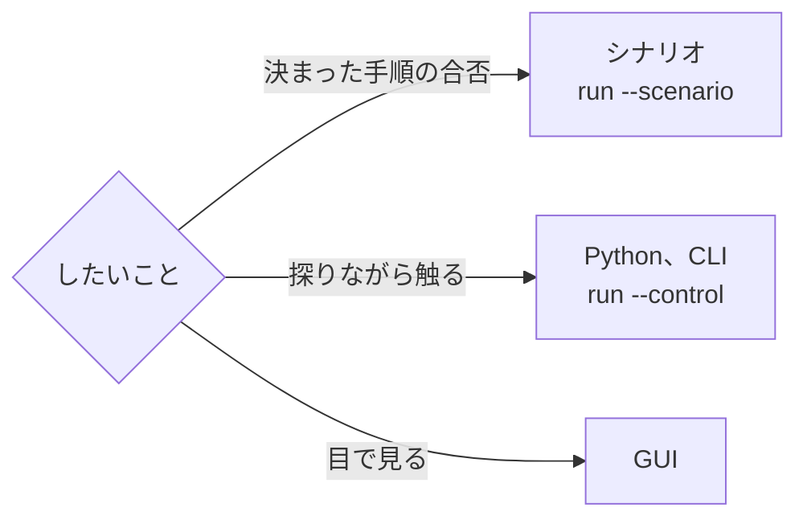

# 信号を外から操作する

Python や自分の道具から、動いているシミュレーションの ECU の変数を操作する人向けの手引きです。前に [最初の ECU を作る](first-ecu.md) の「Python から変数を読み書きする」（準備と、例を動かすまで）を読んでおきます。次は [control-api.md](../control-api.md)（クライアントの API と約束の正本）です。

ランチャーの Control Server（`vehicle_sil_launch run --control`）につなぎ、ECU の変数を読む、書く、待つまでと、時間を止めて進めるまでの順番です。手引きに書くのは、どの口を使うか、手順、つまずく所だけです。呼び出しの引数、反映の時刻、順序の約束の正本は control-api.md です。

例には [examples/launch_control](../../examples/launch_control) の 2 つを使います。どちらも [examples/ecu_main](../../examples/ecu_main) の 2 つの ECU（Engine と Dashboard）を動かし、Python から操作する例で、CTest が動かして確かめています。

- [write_before_start.py](../../examples/launch_control/write_before_start.py): 最初のステップの前に書き、進めて、読み返します。
- [pause_and_step.py](../../examples/launch_control/pause_and_step.py): 動いている途中で止め、時刻を指定して書き、少し進めて、時刻と値をまとめて読み、速さを変えて最後まで動かします。

## どの口を使うか



| 口 | 向いているとき | 手引きと正本 |
|---|---|---|
| シナリオ（`run --scenario`） | 決まった手順で値を入れて確かめ、終了コードで合否を出す。CI で回す。同じ構成と同じシナリオなら、結果はいつも同じ | [シナリオで試験を書く](scenario-tests.md)、[scenario.md](../scenario.md) |
| Python（`vehicle_sil_control`） | 値を見ながら次に書くものを決める。手順をプログラムで組み立てる。止めて、書いて、少し進めて、読む | この手引き、[control-api.md](../control-api.md) の「Python」 |
| CLI（`python -m vehicle_sil_control`） | Python を書かずに、1 つずつ読む、書く、進める | [control-api.md](../control-api.md) の「CLI」 |
| GUI（`vehicle-sil-gui`） | ブラウザで値を見ながら、スライダーやスイッチで書く | [gui.md](../gui.md) の「ECU の変数」と「変数の画面と部品」 |

- シナリオの実行（`--scenario`）にも Control Server（`--control`）でつなげますが、その間は、読む・待つ・止めるだけです（[scenario.md](../scenario.md) の「実行中に変数を見る」）。外から値を書くと、シナリオが同じ結果にならなくなるためです。
- GUI も、中ではランチャーの Control Server を使います。Python と同じ規則（反映の時刻、書き込みの結果）で動きます。

## 準備

- ランチャーを `-DVEHICLE_SIL_BUILD_CONTROL_SERVER=ON` でビルドします。`vehicle_sil_launch version --json` の `features` に `control-server` があれば使えます（[control-api.md](../control-api.md) の「ビルド」）。ないビルドで `--control` を付けると、引数の誤り（終了コード 4）です。
- Python 3.11 以上で、gRPC のパッケージを入れ、スタブを作り、`python/` を `PYTHONPATH` に入れます（[control-api.md](../control-api.md) の「Python」）。
- 変数の名前と型は、`vehicle_sil_launch check --json` の `participants[].variables` か、ECU の `--describe` の `variables` で調べます。書くときは participant 名（`"Engine"`）と変数の名前（`"engine.throttle"`）を分けて渡します。
- ECU の側で足す作業はありません。`ecu_main` で作った ECU は、変数を宣言していれば、ランチャーとつながります。

例を動かすコマンドです（例の 5〜7 行。`pause_and_step.py` も同じ引数です）。

```sh
python examples/launch_control/write_before_start.py \
    --launch build/<preset>/tools/launch/vehicle_sil_launch \
    build/<preset>/examples/ecu_main/simulation.yaml
```

## 起動してつなぐ

`write_before_start.py` の 40〜44 行です。

```python
    with Launch(args.launch, args.config, start_paused=True) as launch:
        print(f"control server at {launch.address}")
        with Control(launch.address) as c:
            stands = c.sim.wait_paused()
            expect(stands.now == 0 and not stands.running, "it stands still at 0 before the first step")
```

- `Launch` は、ランチャーを子プロセスとして `run --events --stdin-commands --control 0` で起動し、`start_paused=True` なら `--start-paused` も付けます。`launch.address` は、ランチャーが知らせた Control Server のアドレスです。
- `Control(address)` が gRPC の接続です。`with` を出ると閉じます。
- ランチャーを自分で起動するときは、`run --control 0` の出力の `control server at <address>` の行か、事象 `control_server` の `address` からアドレスを読みます（[control-api.md](../control-api.md) の「ランチャーにつなぐ」）。
- ほかの引数（`--speed`、`--disable` など）は `Launch` の `arguments` で渡します。

## 始まる前に書く（`--start-paused`）

`--control` と `--start-paused` を一緒に付けると、全員がそろった後、どの ECU も時刻 0 のステップの前で止まります。この間に書いた値は、時刻 0 のステップで入ります。初期値を決めて始めたいときの形です（Parameter もここでだけ書けます）。

`write_before_start.py` の 46〜50 行です。

```python
            # Before the first step: the write takes effect in the engine's step at 0. Wait until the
            # engine has queued it before letting the simulation go on.
            seq = c.write({"Engine": {"engine.throttle": THROTTLE}})
            queued = c.wait(seq, until="queued")
            expect(queued.target("Engine").status == "queued", f"Engine queued the throttle ({queued.target('Engine').status})")
```

- `c.write()` は、participant ごとの変数と値を受け取り、操作の番号（`seq`）を返します。1 回の `write()` に複数の participant を書けます。
- `c.wait(seq, until="queued")` で、ECU が受け取ったことを確かめてから時間を進めます。受け取る前に進めると、時刻 0 に間に合わないことがあります。
- 止まっている時間に上限はありません（`--timeout-ms` は数えます）。規則は [control-api.md](../control-api.md) の「始まる前に書く」です。

## 時間を操作する

`write_before_start.py` の 52〜54 行で 500 ms 進めて止め、66 行で再開します。

```python
            c.sim.step(ms(500))
            stands = c.sim.wait_paused()
            expect(stands.now == ms(500), f"it stands still at 500 ms ({stands.now / 1e6:g} ms)")
```

```python
            c.sim.resume()
```

- 時刻は仮想時間のナノ秒です。`ms()` と `s()` で作ります。
- `c.sim` には、ほかに一時停止（`pause()`）、指定した時刻まで進める（`run_until()`）、速さを変える（`set_speed()`）、止める（`stop()`）があります。CLI では `step`、`run-until`、`speed`、`stop` です。一時停止と速さは、下の「動いている途中で止めて書く」で使います。
- 進める命令の後は `c.sim.wait_paused()` で止まるのを待ちます。時間の状態の購読（`watch(time=True)`）は間引かれるので、短い一時停止は見えないことがあります。
- ステップ送りは一時停止している間だけです。時刻は controller の刻みに切り上がります。今はできない命令は `ControlError`（`FAILED_PRECONDITION`）、引数の誤りは `INVALID_ARGUMENT` です。
- 同じ命令は、ランチャーの標準入力（`--stdin-commands`）からも送れます。2 つの口の順序の規則は [control-api.md](../control-api.md) の「2 つの口の命令」です。
- 止まるのは仮想時間で動く ECU だけです。速さと遅れの見方は [ECU をまとめて動かす](integrate-ecus.md) の「等速で動かす（`--speed`）と遅れの見方」です。

## 書き込みの結果を読む

`write_before_start.py` の 56〜59 行です。

```python
            done = c.wait(seq)
            expect(done.target("Engine").status == "applied" and done.target("Engine").applied_at == 0,
                   f"the throttle took effect in the step at 0 ({done.target('Engine').status} at "
                   f"{done.target('Engine').applied_at})")
```

- `c.wait(seq)` は、どの宛先も結果が決まるまで待ちます。`target(<participant>)` で宛先ごとの結果を読みます。
- `status` の主なもの: `queued`（ECU が受け取った）、`applied`（入った。`applied_at` は入ったステップの時刻）、`late`（指定の時刻のステップに間に合わなかった）、`invalid`（名前、型、範囲、書けるかの検査で断った。つながっていない宛先も）、`rejected`（ECU の setter が断った）、`unknown`（入ったかわからない）。意味の正本は [internals/control.md](../internals/control.md) の「Control Agent」と「Control Server の中核」です。
- 断られた書き込みは例外になりません。`status` を確かめます。例外（`ControlError`）になるのは、呼び出しそのものの失敗です。
- `write()` は自動では送り直しません。応答の前に接続が切れた書き込みは、受け付けられているかもしれません。

## 値を読む

`write_before_start.py` の 60〜63 行です。

```python
            values = c.values("Engine").values
            expect(values["engine.throttle"] == THROTTLE, f"engine.throttle reads {values['engine.throttle']}")
            expect(values["engine.speed"] == EXPECTED_RPM, f"engine.speed reads {values['engine.speed']} rpm "
                                                           f"(expected {EXPECTED_RPM})")
```

- `c.values(<participant>)` は、その ECU の最後の値です。ECU は `sample_period`（既定 10 ms）ごとに値を送るので、それより細かい変化は見えません。
- 時刻と複数の ECU の値を、同じ瞬間のものとして読むときは、`c.snapshot()` を使います（下の「動いている途中で止めて書く」）。
- 値が変わるたびに受け取るときは `c.watch()` です（同じ節）。届くのは最新の値で、すべての値の記録ではありません。

## 動いている途中で止めて書く

[pause_and_step.py](../../examples/launch_control/pause_and_step.py) は、実時間の 4 分の 1 の速さ（`--speed 0.25`）で動かし、エンジンの回転数が 1000 rpm を超えたら止めます。

例の 45〜56 行です。

```python
            # Watch the engine's values while the simulation runs; pause once it passes 1000 rpm.
            for update in c.watch(peers=["Engine"], events=False, operations=False):
                if isinstance(update, Values) and update.values.get("engine.speed", 0) >= 1000:
                    print(f"engine.speed {update.values['engine.speed']} rpm at {update.time / 1e6:g} ms")
                    break
            else:
                print("FAIL the simulation ended before the engine passed 1000 rpm")
                return 1
            c.sim.pause()
            stands = c.sim.wait_paused()
            paused_at = stands.now
            expect(stands.paused and update.time <= paused_at <= ms(800), f"it stands still at {paused_at / 1e6:g} ms")
```

- `c.watch(peers=[...])` は、Peer（変数の名前と型）と値（`Values`）などを、届いた順に返します。`Values.time` はそのサンプルの時刻です。返すものの一覧は [control-api.md](../control-api.md) の「Python」です。
- `pause()` は、controller の次の刻みの境目で止めます。止まった時刻は `wait_paused()` の `now` で読みます。見た値の時刻より後のことがあります。
- 最速（既定）で動かすと、止める前に終わることがあります。途中で止めるつもりなら、`--speed` で遅くするか、`--start-paused` で始め、`run_until()` で止めたい時刻まで進めます。

例の 58〜65 行で時刻を指定して書き、67〜71 行で入ったステップを確かめます。

```python
            # Write for a time after the one it stands still at (here 1 ms after); it takes effect in
            # the engine's first step from then on. Wait until the engine has queued it before stepping on.
            at = paused_at + ms(1)
            seq = c.write({"Engine": {"engine.throttle": THROTTLE}}, at=at)
            c.wait(seq, until="queued")
            c.sim.step(ms(100))
            stands = c.sim.wait_paused()
            expect(stands.now == paused_at + ms(100), f"it stands still at {stands.now / 1e6:g} ms after the step")
```

```python
            done = c.wait(seq).target("Engine")
            first_step = -(-at // ENGINE_STEP) * ENGINE_STEP
            expect(done.status == "applied" and done.applied_at == first_step,
                   f"the throttle took effect in the engine's step at {first_step / 1e6:g} ms "
                   f"({done.status} at {done.applied_at})")
```

- `at` は、止まっている時刻より後にします。値は、その ECU の、`at` 以後に始まる最初のステップで入ります。エンジンのステップは 10 ms ごとなので、`applied_at` は `at` を 10 ms の倍数に切り上げた時刻です。
- ECU が受け取った（`queued`）のを待ってから進めます。

例の 73〜81 行で、時刻と値をまとめて読みます。

```python
            # The time and the values, read in one go: consistent says the values are those of
            # the time it stands still at.
            snap = c.snapshot(["Engine"])
            engine = snap.values["Engine"]
            expect(snap.consistent and snap.time.now == stands.now,
                   f"the snapshot is of {snap.time.now / 1e6:g} ms (consistent: {snap.consistent})")
            expect(engine.values["engine.throttle"] == THROTTLE and engine.time <= snap.time.now,
                   f"engine.throttle reads {engine.values['engine.throttle']} in the sample of "
                   f"{engine.time / 1e6:g} ms; engine.speed {engine.values['engine.speed']} rpm")
```

- `c.sim.time()` と `c.values()` を別々に呼ぶと、その間にシミュレーションが進むことがあります。`snapshot()` は Server が 1 回で読みます。
- 止まるのを待ってから呼び、`consistent` が真なら、値は止まっている時刻のものです。ちょうどその時刻に始まるステップの値が入っているかは、`Values.time` でわかります。約束と限りは [control-api.md](../control-api.md) の「時刻と値をまとめて読む（`snapshot()`）」です。

例の 83〜86 行で、速さを最速に変えて、最後まで動かします。

```python
            # The rest as fast as possible; runs on to stop_at_ms of simulation.yaml.
            speed = c.sim.set_speed(None)
            expect(speed.speed is None and speed.paused, "the speed is max, and it still stands still")
            c.sim.resume()
```

- `set_speed(None)` が最速、数は実時間の何倍か（`--speed` と同じ）です。止まっている間に変えても、止まったままです。

## 終わりを待つ

`write_before_start.py` の 67 行と 71〜72 行です。

```python
        result = launch.wait()
```

```python
    expect(result["result"] == "passed" and result["simulation"] == "reached_stop_at",
           f"the run passed ({result['result']}, {result['simulation']})")
```

- `launch.wait()` は、ランチャーが終わるのを待ち、`run --json` と同じ結果を返します。読み方は [simulation-config.md](../simulation-config.md) の「JSON（`run --json`）」です。
- 途中で止めるときは `launch.stop()` です。`with` を出るときも、動いていれば止めます。
- 実行が終わると、ランチャーは Control Server を閉じます。待っている呼び出しは、そこで終わります。

## つまずく所

- 動いている途中で書くときは、先に一時停止し、止まるのを待ってから、`at` を止まっている時刻（`c.sim.time().now`）より後にして書きます（上の「動いている途中で止めて書く」）。止まっている時刻か `at` なしの書き込みは、`late` になるか、入るステップが実行ごとに変わることがあります。最初のステップの前で止まっているとき（上の「始まる前に書く」）だけは例外です。規則は [control-api.md](../control-api.md) の「Python」です。
- 範囲の外の値（`engine.throttle` は 0〜100）は、例外ではなく `invalid` です。
- 出力の変数には書けません。Parameter は最初のステップの前だけです。
- 同じ変数に複数のクライアントが同じ時刻で書くと、残る値は Server に届いた順で決まります。
- ECU をバスから外すのも変数への書き込みです（どの ECU にもある `ecu.connected` に false）。J1939 でどう見えるかは [j1939-guide.md](../j1939-guide.md) の「ECU をバスから外す（`ecu.connected`）」です。
- 操作した結果を決まった手順の試験として残すときは、同じ手順をシナリオに書きます。Python の操作は、届いた順や時刻の指定しだいで結果が変わることがあります。

## J1939 の信号を変数に出す

Control API が扱うのは、ECU が宣言した変数と時間だけです。J1939 のフレームは扱いません。受けた信号を外から読むには、ECU が受けた値を出力の変数にします。外から決めたい値は入力の変数にして、ECU がそれを送る値に使います。

例では、表示の ECU が受けた回転数を出力 `dashboard.engine_speed` にしています（[examples/ecu_main/dashboard/main.cpp](../../examples/ecu_main/dashboard/main.cpp) の 24〜29 行）。

```cpp
        node.on_message(ecu_main_example::kEngineSpeed, [this](const j1939::Message& m) {
            rpm_ = ecu_main_example::decode_speed(m.data);
            ++received_;
            last_ = m.time;
        });
        ecu.output("dashboard.engine_speed", &rpm_, {.unit = "rpm", .description = "the speed shown"});
```

変数の宣言の仕方は [j1939-guide.md](../j1939-guide.md) の「外から信号を操作する・読む（UI、試験）」と [control-api.md](../control-api.md) の「ECU の変数」です。変数を足すのは ECU を書く人の作業なので、要る信号を ECU を書く人に伝えます。

## 次に読むもの

- クライアントの API、反映の時刻、`snapshot()` の約束、CLI: [control-api.md](../control-api.md)
- 事象と標準入力の命令、`run --json` の結果: [simulation-config.md](../simulation-config.md) の「機械から使う」
- 決まった手順で確かめて、終了コードで合否を出す: [シナリオで試験を書く](scenario-tests.md)
- ブラウザで値を見る・書く: [gui.md](../gui.md)
- J1939 の信号を変数に出す: [j1939-guide.md](../j1939-guide.md)
