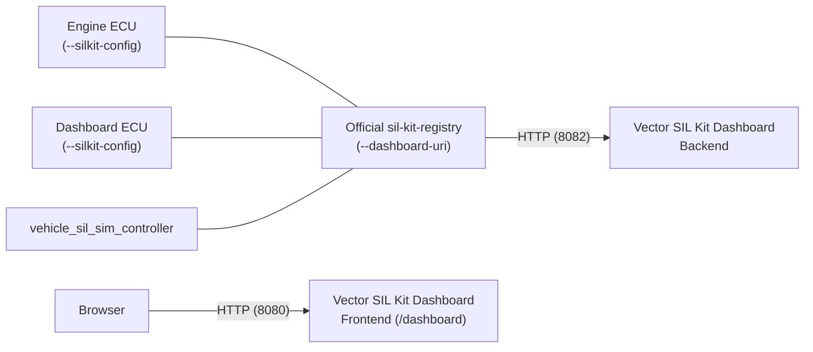

# Observe a simulation in Vector SIL Kit Dashboard

[日本語](../ja/howto/vector-dashboard.md)

This guide shows how to observe a vehicle-sil simulation in [Vector SIL Kit Dashboard](https://vector.com/sil-kit-dashboard) using existing ECU executables, `vehicle_sil_sim_controller`, and Vector's official `sil-kit-registry`. You can inspect participant states, CAN network topology, and SIL Kit Remote Metrics in the Dashboard web UI without modifying vehicle-sil.

> [!NOTE]
> vehicle-sil does not bundle Vector SIL Kit Dashboard or Vector's official SIL Kit SDK binaries, and does not require Dashboard in CI. Download both from Vector separately under their respective licenses.

## Why a separate official `sil-kit-registry` is needed

The `sil-kit-registry` built inside vehicle-sil is compiled with `SILKIT_BUILD_DASHBOARD=OFF` (`cmake/VehicleSilDependencies.cmake`) and ignores `--dashboard-uri`. Likewise, `vehicle_sil_launch run` hosts an in-process registry without Dashboard support.

To send simulation data to Vector SIL Kit Dashboard, run Vector's official `sil-kit-registry` (with `--dashboard-uri` or a registry configuration file) and connect the ECUs and `vehicle_sil_sim_controller` to it with `--registry-uri`.



Because this setup replaces vehicle-sil's patched registry with the official upstream binary, vehicle-sil's 2 registry-side SIL Kit patches (`0003` and `0005` in "[When the consumer already defines `SilKit::SilKit`](../dependencies.md#when-the-consumer-already-defines-silkitsilkit)" of `dependencies.md`) do not apply to the registry process.

## Prerequisites and downloads

| Component | Version (verified) | Where to obtain | Notes |
|---|---|---|---|
| vehicle-sil build | Current repository | Build as described in "[Build from the repository](../../README.md#build-from-the-repository)" in the README | Provides `vehicle_sil_sim_controller`, `vehicle_sil_engine_ecu`, and `vehicle_sil_dashboard_ecu`. |
| Vector SIL Kit SDK (`sil-kit-registry`) | `v5.0.8` | [SIL Kit GitHub Releases](https://github.com/vectorgrp/sil-kit/releases/tag/v5.0.8) (for Linux x86_64: `SilKit-5.0.8-ubuntu-24.04-x86_64-gcc.zip`) | Extract the archive; the binary is `SilKit/bin/sil-kit-registry`. |
| Vector SIL Kit Dashboard | `1.3.1` | [Vector SIL Kit product page](https://www.vector.com/en/product/sil-kit/) or [`vector.com/sil-kit-dashboard`](https://vector.com/sil-kit-dashboard) | Closed-source freeware under the Vector Free Software License. Vector's download center requires submitting a download form. |
| ASP.NET Core Runtime (Linux portable) | `10.0` (verified with `10.0.15`) | [Microsoft .NET 10 Downloads](https://dotnet.microsoft.com/en-us/download/dotnet/10.0) (`aspnetcore-runtime-10.0.x-linux-x64.tar.gz`) | Required by Dashboard 1.3.1 portable edition on Linux (no root privileges required when extracted to a local directory). |

Compatibility notes from Vector's package documentation:

- Vector SIL Kit Dashboard 1.3.1 supports SIL Kit >= 4.0.51.
- The Attributes and Metrics feature requires SIL Kit >= 5.0.2.

Set shell variables for the paths you use in the steps below (adjust the preset name and directories to match your machine):

```sh
REPO=/path/to/vehicle-sil
BUILD="$REPO/build/linux-gcc-release"          # or build/linux-gcc-control
SILKIT_REG=/path/to/SilKit-5.0.8-ubuntu-24.04-x86_64-gcc/SilKit/bin/sil-kit-registry
DASHBOARD_DIR=/path/to/vector-sil-kit-dashboard-1.3.1  # directory containing SILKitDashboard.Backend.dll
DOTNET_ROOT="$HOME/tools/dotnet-10"            # directory where aspnetcore-runtime-10.0.x was extracted
```

> [!NOTE]
> `vehicle_sil_sim_controller` is not included in the prebuilt tools archive. In a repository build it is under `build/<preset>/tools/sim_controller/`. In a FetchContent project such as `template/`, build it explicitly (`--target vehicle_sil_sim_controller`).

## Overview

| Step | What you do | What you get |
|---|---|---|
| 1 | Start Vector SIL Kit Dashboard (portable edition) | Frontend at `http://localhost:8080/dashboard` and backend at `http://localhost:8082` |
| 2 | Start official `sil-kit-registry` with `--dashboard-uri` | Registry listening on `silkit://127.0.0.1:8500` and pushing telemetry to Dashboard |
| 3 | Write `--silkit-config` files for Remote Metrics and pacing | `engine_metrics.yaml` and `dashboard_metrics.yaml` |
| 4 | Run the ECUs and `vehicle_sil_sim_controller` | A 10-second real-time-paced run with J1939 CAN traffic and Remote Metrics |
| 5 | Inspect the run in the Dashboard web UI | Participant states, `J1939_CAN` topology, and live/recorded Metrics charts |

Do steps 1–5 in order. "Step 1" to "Step 5" are the parts of this guide; anywhere else, a "step" is a simulation step.

## Step 1: Start Vector SIL Kit Dashboard (portable edition)

The downloaded `vector-sil-kit-dashboard-1.3.1.zip` contains 3 distributions:

- `portable/vector-sil-kit-dashboard-1.3.1.zip` (cross-platform framework-dependent binary; no root privileges required)
- `linux-x64/*.deb` (Ubuntu packages)
- `win-x64/*.msi` (Windows installer)

On Fedora 44 (where `.deb` packages do not apply and .NET 10 is not installed by default), extract `portable/vector-sil-kit-dashboard-1.3.1.zip` (which creates a top-level `vector-sil-kit-dashboard-1.3.1/` directory containing `SILKitDashboard.Backend.dll`; point `$DASHBOARD_DIR` to that directory) and extract `aspnetcore-runtime-10.0.x-linux-x64.tar.gz` into `$DOTNET_ROOT`, then start Dashboard in terminal 1:

```sh
export DOTNET_ROOT="$HOME/tools/dotnet-10"
cd "$DASHBOARD_DIR"
"$DOTNET_ROOT/dotnet" SILKitDashboard.Backend.dll
```

If ASP.NET Core Runtime 10.0 is already installed system-wide, run `dotnet SILKitDashboard.Backend.dll` directly.

### Verify Dashboard startup

Dashboard prints a startup banner showing the enabled features, URLs, SQLite database path, and log file path:

```text
================================================================================
== SIL Kit Dashboard v1.3.1
== Copyright © 2025 Vector Informatik GmbH.
== All rights reserved.
================================================================================

 Features:  AttributesAndMetrics
 Dashboard: http://localhost:8080
 Frontend:  http://localhost:8080
 Backend:   http://localhost:8082/system-service
 Database:  /home/you/.local/share/sil-kit-dashboard/database/Simulation.db
 Log file:  /home/you/.local/share/sil-kit-dashboard/logs/sil-kit-dashboard_....log

================================================================================
Press Ctrl+C to shut down.
```

You can also verify readiness over HTTP:

```sh
curl -s http://localhost:8080/actuator/health
```

A healthy server returns HTTP 200 with `"status":"UP"`.

### Browser URL vs Registry telemetry destination

Dashboard exposes two separate HTTP endpoints by default. Keep them distinct:

| Endpoint | Default URL | Used by | Notes |
|---|---|---|---|
| Web UI (Frontend) | `http://localhost:8080/dashboard` | Your web browser | The startup banner prints `Frontend: http://localhost:8080`; both `/` and `/dashboard` open the UI. |
| Telemetry ingest (Backend) | `http://localhost:8082` | `sil-kit-registry` (`--dashboard-uri` or `DashboardUri`) | Pass `http://localhost:8082` **without** the `/system-service` suffix (the Registry appends `/system-service/v1.0/...` and `/v1.1/...`). SIL Kit v5.0.8 accepts plaintext `http://` only, not `https://`. |

> [!IMPORTANT]
> Dashboard's default `appsettings.json` sets `"AllowedHosts": "localhost"`. Use `http://localhost:8082` (not `http://127.0.0.1:8082`) with `--dashboard-uri` and `http://localhost:8080/dashboard` in the browser. Requests sent with `Host: 127.0.0.1:...` are rejected with HTTP 400 unless you add `"AllowedHosts": "localhost;127.0.0.1"` to `appsettings.Production.json` (or pass `AllowedHosts='localhost;127.0.0.1'` in the environment).

To change the default ports (for example, when 8080 or 8082 is already in use) or isolate the SQLite database/logs without editing `appsettings.json`, pass ASP.NET Core environment variables when starting Dashboard:

```sh
XDG_DATA_HOME=/tmp/silkit-dash-data \
Kestrel__Endpoints__Frontend__Url=http://localhost:18080 \
Kestrel__Endpoints__Backend__Url=http://localhost:18082 \
Frontend__BaseUri=http://localhost:18080 \
"$DOTNET_ROOT/dotnet" SILKitDashboard.Backend.dll
```

## Step 2: Start official `sil-kit-registry`

In terminal 2, start Vector's official `sil-kit-registry` v5.0.8 pointing to Dashboard's Backend URL (`http://localhost:8082`):

```sh
"$SILKIT_REG" --listen-uri silkit://127.0.0.1:8500 --dashboard-uri http://localhost:8082
```

Alternatively, configure the same settings in a registry configuration file (`registry.yaml`) and pass `--registry-configuration`:

```yaml
ListenUri: silkit://127.0.0.1:8500
DashboardUri: http://localhost:8082
```

```sh
"$SILKIT_REG" --registry-configuration registry.yaml
```

Notes on `sil-kit-registry`:

- Passing `--dashboard-uri` (or `DashboardUri:`) is sufficient in SIL Kit v5.0.8. Although Vector's Dashboard README mentions `--enable-dashboard`, `sil-kit-registry --help` in v5.0.8 does not define that flag.
- `sil-kit-registry` enables remote metrics collection (`Experimental.Metrics.CollectFromRemote: true`) by default.
- If you see `SIL Kit Dashboard support is not compiled into this build`, you started vehicle-sil's bundled `sil-kit-registry` instead of Vector's official binary.
- **Do not attach `sil-kit-registry` stdout/stderr to an unread pipe.** `sil-kit-registry` logs at `info` level by default and writes frequent lines when Remote Metrics are active. If you launch it from a script or background shell, redirect stdout and stderr to a log file (for example `> registry.log 2>&1`) or pass `--log warn` so the process never blocks when the OS pipe buffer fills.

## Step 3: Write participant `--silkit-config` files for Remote Metrics

Create a working directory (for example `/tmp/dashboard-demo`) and save two SIL Kit participant configuration files.

`engine_metrics.yaml`:

```yaml
Experimental:
  TimeSynchronization:
    AnimationFactor: 1.0
  Metrics:
    UpdateInterval: 1
    Sinks:
      - Type: Remote
        Name: EngineRemoteMetrics
```

`dashboard_metrics.yaml`:

```yaml
Experimental:
  Metrics:
    UpdateInterval: 1
    Sinks:
      - Type: Remote
        Name: DashboardRemoteMetrics
```

Key settings and why they matter:

| Key | Setting | Why |
|---|---|---|
| `Experimental.Metrics.UpdateInterval` | `1` (integer seconds, minimum `1`; note uppercase `U`) | Controls how often SIL Kit's metrics timer thread sends updates to the Registry. |
| `Experimental.Metrics.Sinks[].Type` | `Remote` | Sends participant attributes and metrics over the SIL Kit link to `sil-kit-registry`, which forwards them to Dashboard. |
| `Experimental.TimeSynchronization.AnimationFactor` | `1.0` (on `Engine`) | Paces virtual time to 1x wall-clock time. Because all coordinated participants share one synchronized virtual clock, pacing one ECU paces the whole simulation. |

### Why the simulation must run for several wall-clock seconds

SIL Kit's metrics timer waits `UpdateInterval` wall-clock seconds (at least 1 s) before emitting its first metrics update, and destroying a participant does not flush pending metrics.

Without `AnimationFactor: 1.0` (or a long enough run), `vehicle_sil_sim_controller --stop-at-ms 1000` finishes in a few milliseconds of wall-clock time—long before the first 1-second timer tick—so **no Metrics appear in Dashboard** (Network Setup and Status History still appear). Running at `AnimationFactor: 1.0` for 5–10 seconds (or omitting `--stop-at-ms` and stopping with Ctrl+C when finished observing) gives multiple metrics samples in Dashboard.

For general rules on `--silkit-config` (validation, defaults added by vehicle-sil, and disallowed keys), see "[Passing a SIL Kit configuration file (`--silkit-config`)](../ecu-executable.md#passing-a-sil-kit-configuration-file---silkit-config)" in `ecu-executable.md`.

## Step 4: Run the ECUs and `vehicle_sil_sim_controller`

In terminal 3 (in the directory containing `engine_metrics.yaml` and `dashboard_metrics.yaml`), start both ECUs and `vehicle_sil_sim_controller`:

```sh
"$BUILD/examples/ecu_main/engine/vehicle_sil_engine_ecu" \
  --registry-uri silkit://127.0.0.1:8500 \
  --silkit-config engine_metrics.yaml &
PID_ENGINE=$!

"$BUILD/examples/ecu_main/dashboard/vehicle_sil_dashboard_ecu" \
  --registry-uri silkit://127.0.0.1:8500 \
  --silkit-config dashboard_metrics.yaml &
PID_DASH=$!

"$BUILD/tools/sim_controller/vehicle_sil_sim_controller" \
  --registry-uri silkit://127.0.0.1:8500 \
  --required Engine,Dashboard \
  --stop-at-ms 10000 \
  --timeout-ms 30000

wait "$PID_ENGINE" "$PID_DASH"
```

To keep the simulation running interactively until you press Ctrl+C instead of stopping at 10 seconds, omit `--stop-at-ms 10000`.

### Verify the run

`vehicle_sil_sim_controller` runs for about 10 wall-clock seconds (`speed=1.000`) and exits with code 0. Both ECUs exit with code 0 on their own.

`vehicle_sil_sim_controller` prints:

```text
[sim-controller] waiting for Engine,Dashboard
[sim-controller] simulation running
[sim-controller] result sim_ms=10000 wall_us=10000500 speed=1.000
[sim-controller] simulation shut down
```

`vehicle_sil_dashboard_ecu` prints the engine speed received over J1939 every 500 ms of virtual time (excerpt):

```text
t=0 ms engine speed 0 rpm (0 messages)
t=500 ms engine speed 1200 rpm (5 messages)
t=1000 ms engine speed 1200 rpm (10 messages)
...
t=10000 ms engine speed 1200 rpm (100 messages)
```

Wait 1–2 seconds after the simulation finishes before stopping `sil-kit-registry` (Ctrl+C in terminal 2) so the Registry finishes posting the final `stopped` status to Dashboard.

## Step 5: Inspect the run in Vector SIL Kit Dashboard

Open `http://localhost:8080/dashboard` in your browser. Select the simulation entry (showing `silkit://127.0.0.1:8500/`) on the **Simulations** page and check the 3 views in the top navigation bar:

| View | What you see | Notes |
|---|---|---|
| **Network Setup** | Participants `SimulationController`, `Engine`, and `Dashboard`, and CAN network `J1939_CAN` connected to `Engine` and `Dashboard` | `ecu_main` ECUs also expose `vehicle_sil.control.*` pub/sub topics by default. Pass `--no-control` to the ECUs if you want only `J1939_CAN` in the graph. Selecting `Engine` or `Dashboard` also shows static **Attributes** when Remote Metrics are enabled. |
| **Status History** | Lifecycle state transitions for all 3 participants (`ServicesCreated` -> `CommunicationInitializing` -> `CommunicationInitialized` -> `ReadyToRun` -> `Running` -> `Stopping` -> `Stopped` -> `ShuttingDown` -> `Shutdown`) | Shows whether the simulation reached `Shutdown` cleanly or entered `Error`. |
| **Metrics** | Time-series charts of counters (`rx_packets`, `tx_packets`, `rx_bytes`, `tx_bytes`) and statistics (`rx_bandwidth`, `tx_bandwidth`, `tx_queue_size`, `execution_duration`, `waiting_duration`, `completion_duration`) | Populated from `Engine` and `Dashboard` (which passed `--silkit-config`). `vehicle_sil_sim_controller` has no `--silkit-config` CLI flag, so it does not emit Remote Metrics of its own. |

> [!NOTE]
> Vector SIL Kit Dashboard persists simulation records, network topology, and status history in its SQLite database (`Simulation.db`), but keeps **Attributes and Metrics in memory only**. Stopping and restarting Dashboard clears previously collected Metrics charts.

When finished, stop `sil-kit-registry` (Ctrl+C in terminal 2) and Dashboard (Ctrl+C in terminal 1).

## Troubleshooting

| Symptom | Cause | Fix |
|---|---|---|
| `sil-kit-registry` prints `SIL Kit Dashboard support is not compiled into this build` | You ran vehicle-sil's bundled `sil-kit-registry` (`SILKIT_BUILD_DASHBOARD=OFF`). | Run Vector's official `sil-kit-registry` v5.0.8 binary instead. |
| No simulation appears in Dashboard and `sil-kit-registry` logs HTTP 400 | `--dashboard-uri` used `http://127.0.0.1:8082` while Dashboard's `AllowedHosts` is `"localhost"`. | Use `http://localhost:8082`, or add `"AllowedHosts": "localhost;127.0.0.1"` to `appsettings.Production.json`. |
| **Network Setup** and **Status History** appear, but **Metrics** is empty | The run finished in less than `UpdateInterval` (1 wall-clock second), `--silkit-config` was omitted, or Dashboard was restarted after the run. | Set `AnimationFactor: 1.0` and run for at least 5–10 wall-clock seconds, confirm `UpdateInterval` (uppercase `U`) and `Type: Remote`, and inspect Metrics before restarting Dashboard. |
| Simulation hangs or stops advancing after running for a while under a script | `sil-kit-registry` stdout/stderr was attached to a pipe that nothing reads. | Redirect `sil-kit-registry` stdout/stderr to a log file (or `/dev/null`) or use `--log warn`. |
| `dotnet` fails to start `SILKitDashboard.Backend.dll` with missing framework `Microsoft.AspNetCore.App` 10.0 | ASP.NET Core Runtime 10.0 is missing or `DOTNET_ROOT` is not set. | Install or extract `aspnetcore-runtime-10.0.x-linux-x64.tar.gz` and export `DOTNET_ROOT` pointing to that directory. |
| Simulation stays at `Running` in Dashboard after finishing | `sil-kit-registry` was terminated immediately after `vehicle_sil_sim_controller` exited. | Wait 1–2 seconds before sending SIGTERM / Ctrl+C to `sil-kit-registry`. |

## Verified and unverified environments

| Environment / feature | Status | Notes |
|---|---|---|
| Fedora Linux 44 x86_64, official SIL Kit `v5.0.8` (`SilKit-5.0.8-ubuntu-24.04-x86_64-gcc.zip`), SIL Kit Dashboard `1.3.1` portable + ASP.NET Core Runtime `10.0.15` | Verified | End-to-end verified with `vehicle_sil_engine_ecu`, `vehicle_sil_dashboard_ecu`, and `vehicle_sil_sim_controller`: Dashboard health/UI, `SimulationController`/`Engine`/`Dashboard` participants, `J1939_CAN` topology, full lifecycle status history, and Remote Metrics (`counters` and `statistics`). Verified both `--dashboard-uri` and `--registry-configuration`, and verified that an unpaced 1 s run emits 0 metrics. |
| Ubuntu / Debian `.deb` packages (`linux-x64`) | Not verified | Follow Vector's package `README.md`; the `sil-kit-registry` and ECU steps are the same. |
| Windows (`win-x64` `.msi` or portable) and macOS | Not verified | Windows `.msi` bundles ASP.NET Core Runtime and installs a service; use `.exe` names for vehicle-sil executables. |
| Other SIL Kit versions (4.x / other 5.x) or other Dashboard versions | Not verified | Attributes and Metrics require SIL Kit >= 5.0.2 per Vector's compatibility notes. |
| HTTPS/TLS (`appsettings.ProductionSSL.json`), remote-host Dashboard access (`AllowedHosts: "*"`), or LDAP/IAM (`IdentityAndAccessManagement: true`) | Not verified | SIL Kit v5.0.8's Dashboard client uses plaintext `http://` only. |
| Running with `vehicle_sil_launch` or `vehicle-sil-gui` | Not applicable to this guide | `vehicle_sil_launch run` currently uses an in-process registry without Dashboard support. |

## What to read next

- Rules for `--silkit-config` and running ECUs without the launcher: [ecu-executable.md](../ecu-executable.md)
- Running peers and `vehicle_sil_sim_controller` manually: [peers.md](../peers.md)
- SIL Kit build settings and registry patches: [dependencies.md](../dependencies.md)
- Observing and changing ECU variables in vehicle-sil's own browser GUI: [gui.md](../gui.md)
