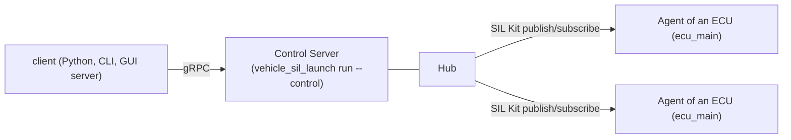
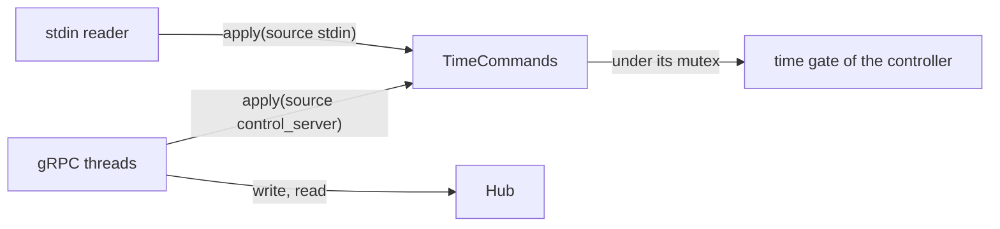
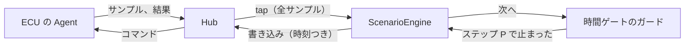

# 外部操作（Control API）

vehicle-sil 自体を直す人と、Control API の契約（反映の時刻、順序、上限、スレッド）を確かめたい人向けです。使い方は [control-api.md](../control-api.md) にあります。 先に [architecture.md](../architecture.md)（全体の形）と [code-map.md](../code-map.md)（どこに何があるか）を読みます。ほかの中の仕組みの文書は、architecture.md の「[中の仕組み](../architecture.md#中の仕組み)」にあります。

Control API は、外からシミュレーションを操作・監視する口です。担当は次のように分けています。

- **SIL Kit**: CAN/LIN の通信と仮想時間の同期（データプレーン）
- **Control API**: 操作と監視

クライアント（Python、CLI、GUI サーバー）が使う Control API は gRPC（Protocol Buffers、`proto/vehicle_sil/control/v1/control.proto` の v1）で、SIL Kit とは別の接続です。Server は、シミュレーションを動かす `vehicle_sil_launch run --control` の中にあります（下の「ランチャーの Control Server」）。利用者向けの使い方は [control-api.md](../control-api.md) にあります。

ECU の Agent と Hub の間の運び手は、SIL Kit の publish/subscribe（`vehicle_sil::control_silkit`）だけです。`ecu_main()` で作った ECU が Agent の側を付け、`vehicle_sil_launch run` が Hub の側を自分の participant に持ちます。ECU の実行ファイルは gRPC にも Protocol Buffers にも依存しません。値と結果は仮想時刻に合わせて届きます（下の「SIL Kit の上の運び手」）。



構成要素は次の 3 つです。

| 構成要素 | 役割 | 実装 |
|---|---|---|
| Control Agent | 各 ECU が持つ。ECU の変数（と Peer の状態）を公開し、操作を受け付ける | `vehicle_sil::control::Agent`、`Ecu::input()`、`output()`、`agent()`。Hub への接続は `vehicle_sil::control_silkit::AgentTransport`（`ecu_main()` が付ける） |
| Control Server | Peer の Agent を受け付け、操作を中継し、状態を集約する。時間ゲートで時間を操作する | `vehicle_sil::control::Hub`。Agent の側は `vehicle_sil::control_silkit::HubTransport`（`vehicle_sil_launch run` が controller の participant に持つ）。クライアントの側は `vehicle_sil::control_grpc::ControlServer` の `ControlService`（`vehicle_sil_launch run --control`） |
| クライアント | Python、CLI、GUI サーバー。いずれも共通の Control API を使う | Python のパッケージと CLI（`python/vehicle_sil_control`）。GUI サーバー（`gui/server`）は自分のクライアント（`vehicle_sil_gui/control.py`）でつなぎ、画面には HTTP と WebSocket で中継する（[gui.md](../gui.md)） |

## 扱う機能

- Peer の一覧と状態（`ListPeers`）
- 時間: 取得、一時停止、再開、ステップ実行、指定時刻まで実行、速度、止まるのを待つ、停止（`GetTime`、`Pause`、`Resume`、`Step`、`RunUntil`、`SetSpeed`、`WaitPaused`、`Stop`）。開始はランチャーが決めます（必須の participant がそろったとき。`--start-paused` では `Resume`、`Step`、`RunUntil` で始まります）。リセットはありません。やり直すにはプロセスを起動し直します。
- 変数の読み書き（スイッチ、レバー、センサー値など。仮想時刻を指定した書き込みを含む。`GetValues`、`Write`、`GetOperation`、`WaitOperation`）と、時刻と値をまとめて読むこと（`GetSnapshot`）
- 通信状態（J1939 のアドレスと統計、バスの状態）、エラー、出来事、性能情報の監視（下の「Control Agent」の「Peer の監視」）
- 状態の変化の通知（購読、`Watch`）と、切れた Peer を忘れること（`ForgetPeer`）
- CAN/LIN のチャネルと Vector のデバイスは選べません（[bridges.md](../bridges.md) の「接続先とチャネルの選択（CLI）」）。

## 守っていること

- **ステップを待たせない**: Agent のステップのスレッドは、通信の側を待ちません。操作は上限つきのキューで受け渡します（「Control Agent」の「スレッドと上限」）。
- **仮想時刻に合わせる**: 書き込みは、指定した仮想時刻以後の最初のステップで反映します。
- **上限を設ける**: キューとメモリの使用量には上限があります（各節の上限）。
- **クライアントの口だけを認証する**: クライアント向けの gRPC（Control Server）は、TLS、トークン、役割による認可を持ちます（「Control Server と通信の層」の「認証とアクセス制御」）。Agent と Hub の間（SIL Kit の上の運び手）と、SIL Kit の registry とデータプレーンには認証がありません。閉じたネットワークで使います。
- **変数を自己記述する**: 各 ECU は、変数の名前、型、範囲、単位を公開します（`Agent::schema()`、`--describe` の `variables`）。GUI のサンプルの画面は、ダッシュボードのファイルがなければ、これを使って変数ごとに部品を並べます（[gui.md](../gui.md) の「変数の画面と部品」）。
- **GUI を分ける**: GUI はシミュレーションと別のプロセスです。GUI サーバー（`gui/server`、Python）がランチャーを動かし、Control API のクライアントになって、画面に中継します（[gui.md](../gui.md)）。公開ライブラリ（`vehicle_sil::*`）は GUI に依存しません。

## Control Agent（`vehicle_sil::control`）

ECU の中で、外から操作できる変数を公開し、外からの書き込みをステップの中の決まった時刻に反映します。通信（Control Server との接続）は含みません。SIL Kit にも依存しません。ECU（`Ecu`）が 1 つ持ち、ECU のクラスが変数を宣言します（[execution.md](execution.md) の「ECU の入口」）。

```cpp
class Body {
public:
    explicit Body(vehicle_sil::Ecu& ecu) {
        ecu.input("cabin.parking_brake", &parking_brake_, {.description = "Parking brake switch"});
        ecu.input("engine.coolant", &coolant_, {.unit = "degC", .min = -40.0, .max = 210.0});
        ecu.input_enum("trans.gear", &gear_, {{"P", 0}, {"R", 1}, {"N", 2}, {"D", 3}});
        ecu.output("vehicle.speed", [this] { return speed_; }, {.unit = "km/h"});
    }
    // ...
};
```

- 変数: 型は bool、整数（C++ の型の範囲で検査。64 ビットの符号なしは入力にできず、出力では int64 の最大で止めて読む）、実数（`float` は `float` の範囲で検査）、列挙（値の一覧。型に収まり、名前と値が重複しないこと）。役割（FMI の causality に合わせる）は Input（走行中も書ける）、Output（読むだけ）、Parameter（最初のステップより前だけ書ける）。メタデータは名前（`.` で階層）、単位、最小、最大（含む。NaN は不可）、刻み（編集の目安、強制しない）、説明、列挙の項目で、`schema()` が登録順に返します。変数は、スキーマが確定する前に登録します（後は `std::logic_error`。誤用の検出で、同期ではないので、登録と `submit()` を別のスレッドで同時に行わない）。スキーマは、`complete_schema()`（通信の側が `schema()` を初めて読む前に呼ぶ。`control_silkit::AgentTransport` はコンストラクターで呼ぶ。ドライバーは最初のステップの前に呼ぶ）、最初の `submit()`、最初のステップのうち、最初のもので確定します。`complete_schema()` は、`bind_driver()` に渡された関数（ドライバーが足す変数。Peer の監視の出力）を 1 回呼んでから登録を閉じます。その関数が例外を投げれば、例外が伝わり、スキーマは確定しません。ポインタや関数の参照先は Agent より長く生きること（ECU の Agent では、ECU が持つもの）。
- 書き込み（`Command`）: 1 つ以上の書き込みを、同じステップでまとめて反映します。`submit()` が名前、型、範囲、列挙、書き込めるかを確かめ、だめなら `Invalid` で何も積みません。整数の変数は整数か整数値の実数を、実数の変数は整数か有限の実数を受け付けます。整数の変数の最小と最大が型の範囲の外にあれば、登録のときに `std::invalid_argument` です。範囲外の値は丸めません（整数の範囲は整数のまま比べます）。`finish()` の後の `submit()` も `Invalid` です。
- 反映の時刻: `Command::at` 以上の開始時刻を持つ最初のステップで、アプリの処理の前に反映します（アプリはそのステップで新しい値を見ます）。Peer では、J1939 の受信処理、ハンドラ、部品のタイマー（`PeriodicSender` の Encoder など）はアプリの処理より前に動くので、それらが新しい値を使うのは次のステップからです。`at` がなければ次のステップです。同じステップで反映するものは (at, seq) の順です（`at` のないものは、そのステップの時刻として並べます）。participant が `at` 以降に始まるステップを受け取る前に実行していれば、その操作は遅すぎます。既定では反映せずに `Late` を返し、`LatePolicy::ApplyNext` なら次のステップで反映して `late` を立てます。Parameter の書き込みは、最初のステップが始まった後の `submit()` なら `Invalid`、始まる前に積んで時刻が最初のステップより後なら `Rejected` です。関数で登録した入力の setter が投げたら、その操作は `Rejected` で、同じ操作の中で先に書いた値はそのまま残ります（ステップは失敗しません）。
- 結果: キューに積んだ操作には、必ず 1 つの `CommandResult`（`Applied` と反映したステップの時刻、`Late`、`Rejected`、`Cancelled`）が返ります。シミュレーションが終わると `finish()` が、残っている操作を `Cancelled` にします（ECU の Agent では ECU が呼びます。[execution.md](execution.md) の「ECU の入口」の変数の時点）。`VirtualTimeOptions::end` 以降の時刻を指定した操作と、ステップが失敗した Peer への操作も、`finish()` まで確定しません。実時間の Peer では、`at` はその Peer のドライバーの時計の時刻です。
- 値: ステップの終わり（Peer では LIN の処理の後）に、0、`sample_period`、2 `sample_period` … の時刻以後の最初のステップ（`Ecu::every()` と同じ数え方。既定 10 ms、0 なら毎ステップ）で全変数を読み、`latest()` で最新の 1 組を返します。受け渡しは 3 つのバッファで、ロックはありません。
- ステップの中から送る通信の側（`set_step_sink()`）: 関数を 1 つ登録すると、毎ステップの終わり（読み出しの直後）に、ステップのスレッドで、ステップの時刻と、そのステップが読んだ 1 組（読まなかったステップでは空）を渡して呼びます。その中から `drain_results()` と `drain_events()` を呼べます。そのステップが作ったもの（反映の結果、出来事、値）を、そのステップの中で送るための口です（`control_silkit::AgentTransport` が使います）。登録は最初のステップの前に 1 回だけで（後からと 2 つ目は `std::logic_error`）、外せません。登録がなければ、ステップの負担は分岐 1 つです。関数が投げた例外は、そのステップの失敗です。
- スレッドと上限: ステップのスレッド（`on_step_begin`、`on_step_end`、`log`、`finish`。1 本）と通信の側（`submit`、`drain_results`、`drain_events`、`latest`、`stats`。互いにスレッド安全で、複数のスレッドから呼べる）で使います。ステップのスレッドは通信の側を待ちません。通信の側は、`finish()` の間と、実時間のドライバーを起こす `Host::post()` の短いロックを待つことがあります。`bind_driver()` に渡す起こしの関数の中から `submit()` と `clear_wakeup()` は呼びません。受け渡しは固定容量の SPSC リングです。処理中の操作（積んでから結果を `drain_results()` で受け取るまで）は `max_pending`（既定 256）までで、超えた `submit()` はすぐ `Busy` を返します。そのため結果は捨てません。出来事は `max_events`（既定 1024）までで、あふれたものは捨てて数えます。変数のアクセサはステップのスレッドだけで呼ぶので、モデルにロックは要りません。ステップのスレッドは通信のスレッドが持つロックを取りません（使い終えた操作の解放と、結果の理由の文字列の確保はステップのスレッドで行います。量は 1 ステップに `max_pending` まで）。
- 決定論性: Agent は、反映の時刻を決めるだけで、ステップの並びとデータを変えません。Agent がない実行、Agent があって値を読み続けている実行で、通信の結果は同じです。時刻を指定した書き込みは、participant がその時刻以降に始まるステップを実行する前に届けば、何度実行しても同じステップで反映されます。保証はこの範囲だけです。
  - 時間ゲートで止めてから書くとき: 止まっている位置 P（`TimeState::now`）に始まるステップを、すでに実行した、または実行中の participant があります。そのため `at` は P より後（たとえば P + 1 ns）にします。`at` が P 以下なら `Late` になりえて、`at` がなければ P と次のステップのどちらで反映されるかは届いた時刻で決まります。
  - 同じステップで反映する操作の順（seq）は、Hub が受け付けた順です。複数のクライアントが同じ変数に同じ時刻で書くと、残る値は届いた順で決まり、実行ごとに変わりえます。
- ECU が動かす: ECU は Agent を作ったときに自分をドライバーとして結び付け（`bind_driver()`）、アプリの処理の直前に `on_step_begin()`、LIN の処理の直後に `on_step_end()` を呼び、止まるときに `finish()` を呼びます（[execution.md](execution.md) の「ECU の入口」）。実時間の Peer では、操作を積むとドライバーを起こします（`Host::post()`。未処理の起こしは 1 つまで）。Peer は止まり始めると起こさせるのをやめ、ステップがもう走らなくなってから `finish()` を呼ぶので、その後の `submit()` は `Invalid` で、Peer には触れません。Peer は `start()` で、Agent があればスキーマを確定させます。
- Peer の監視（`PeerOptions::monitor`、既定で有効）: Agent のスキーマが確定するときに、Peer が ECU の変数の後に次の出力を足します。値は Agent の読み出しの時にステップのスレッドで読みます。どの Peer も `start()` までに Agent を作るので（`ecu.connected`）、変数を宣言しない Peer にも付き、ステップごとの記録も走ります。要らなければ `PeerOptions::monitor = false` にします。
  - `peer.steps`（ステップの数）、`peer.speed`（前の読み出しからの仮想時間の秒 / 壁時計の秒。最初の読み出しでは 0、止まっていた後は小さくなる）、`peer.app_time_max_us`（前の読み出しから、アプリと LIN の処理にかかった最長の時間。J1939 の処理と書き込みの反映は含まない）
  - J1939 のネットワーク N ごとに `j1939.N.bus_state`（列挙: unknown、error_active、error_passive、bus_off）と、統計の `frames_received`、`frames_sent`、`send_failures`、`send_queue_full`、`receive_overflows`、`held_dropped`、`address_violations`、`transport_aborts_sent`、`transport_aborts_received`
  - N のノード i ごとに `j1939.N.node<i>.address` と `j1939.N.node<i>.address_state`（列挙: fixed、not_started、claiming、claimed、cannot_claim）
  - 出来事: ノードのアドレスの状態かアドレスが変わったとき（本文は「j1939.N.node<i>: <状態> at address <a>」で、状態の名前は列挙の項目と同じ。cannot_claim は Warning）
  - 対象は、スキーマが確定する時点（通信の側の `control_silkit::AgentTransport` を作る、最初の `submit()`、`start()` のうち最初のもの）にあるネットワークとノードです。その後の `Peer::j1939()`（両方の形）は、監視されないネットワークになるので `std::logic_error` です（文言に Peer とネットワークの名前、直し方: 通信の側を作る前、最初の `submit()` の前に足すか、`PeerOptions::monitor = false`）。その後に足したノードは監視されません。生の CAN と LIN は監視の対象ではありません。`peer.` で始まる名前は予約で、`Ecu` の変数の宣言（`input()`、`output()` など）は、`monitor` の設定と実装（`Peer`、`LocalBench`）によらず、宣言のときに `std::invalid_argument` です（文言に ECU と変数の名前、決まり）。ネットワークの出力（`j1939.N.` で始まる名前）が ECU の変数と重なれば、確定させる呼び出しが `std::invalid_argument`（何も変えず、スキーマは確定しない。文言に Peer の名前と `PeerOptions::monitor = false`）。その後に宣言した変数も、`describe()` の ECU の変数です。ステップの失敗はここでは知らせません（失敗の後はステップが走らないため）。`Peer::failed()` と `error()`（スレッド安全）を通信の側で読みます。

## Control Server の中核（`vehicle_sil::control::Hub`）

Control Server の、通信の方式によらない部分です。接続した Agent の一覧、書き込みの振り分け、Peer ごとの結果、最新の値、上限つきの購読を受け持ちます。全関数がスレッド安全です。

- 通信の層は、接続ごとに `agent_connected(hello, link)` を呼んで `ConnectionId` を受け取り、以後 Agent から届いたもの（`agent_submitted`、`agent_result`、`agent_values`、`agent_events`、`agent_status`）と切断（`agent_disconnected`）を、その ID で渡します。`hello` は Agent を Peer に `attach()` した後で作ります（監視の出力がスキーマに入るため）。`agent_status` には `Peer::failed()` と `error()` を渡します（ステップの失敗は監視の出力では届かないため）。SIL Kit の運び手は `agent_status` を呼びません（Hub の口としては残っています）。そのため、クライアントに見える Peer の `status` はいつも空で、participant の失敗はシミュレーションの監視（`SimulationMonitor`）が知らせます。
- `AgentLink::send()`: Hub は自分のロックを持たずに呼びます。1 つの Peer には 1 本のスレッドから、通し番号の順に 1 つずつ呼ぶので、短く待っても、中から Hub を呼び返してもかまいません。`false` を返せば、その操作は Invalid、例外なら Unknown になります。`write()` を呼んだスレッドが、同じ Peer への前の操作の送信も引き受けることがあるので、`write()` は `send()` の分だけ待つことがあります。Hub はリンクの最後の参照を、ロックの外で手放します。`agent_connected()` には、空でない名前、リンク、0 より大きい `max_pending` が要ります。
- Agent は participant 名（空は不可）と起動ごとの ID（incarnation）で名乗ります。
  - 同じ名前と同じ ID: 同じプロセスのつなぎ直しです（SIL Kit の運び手は、運び手ごとに新しいセッションで名乗るので、この形を使いません。つなぎ直す通信の層のための口です）。新しい接続が古い接続に代わり、未完了の操作は続きます。古い接続の切断の知らせが後から届いても、Peer は切断になりません（その接続に渡して積まれたと知らされていない操作だけが Unknown になります）。hello の `open_seqs` に、Agent がまだ持っている操作（積んだが、結果を通信の層がまだ届けていないもの）を入れると、それらは新しい接続で Queued になり（古い接続の終わりの影響を受けません）、それ以外の未確定の操作は Unknown で確定します。通信の層は、届けられなかった結果を次の接続で送り直します。`open_seqs` を入れなければ何も確定させないので、結果を失った操作は未確定のまま残り、その Peer の `max_pending` の枠を使い続けます。
  - 同じ名前で別の ID: プロセスの再起動です。前の ID の未完了の操作は Unknown になり、前の ID の値は消えます。
  - どちらの場合も、置き換えた古い接続は `AgentLink::close()` で閉じます。同じ名前の 2 つのプロセスが同時に動いている（設定の誤り）ときも、古いほうは黙って無視されるのではなく、接続が切れたことを知ります。新しい接続が勝ちます。
  - 終わり（`agent_ended(connection, reason)`）: 同じ ID ではもうつながらないと通信の層がわかっているとき（participant がシミュレーションを去った、Agent が最後の知らせを送った）に呼びます。切断と同じ処理をしたうえで、その ID の未確定の操作をすべて Unknown（理由つき）で確定させるので、待っている呼び出しは残りません。
  - 切断: Agent が積んだ操作は Disconnected（未確定）になり、同じ ID でつなぎ直した後に結果が届けば、それで確定します。リンクに渡したが積まれたと知らされていない操作は Unknown、まだリンクに渡していない操作は Invalid です。`forget_peer()` で切断した Peer を消すと、その未確定の操作は Unknown になり、購読者には `removed` の印つきの PeerUpdate が届きます。
  - 結果は、操作を送った ID のどの接続から届いても受け付けます。別の ID からの結果は使いません。値、出来事、状態は、いまの接続からのものだけを使います。スキーマと数が合わない値と、前より古い値は捨てます。
- `write(request)` は、Peer ごとのまとめをロックの外で行い、操作に Hub 全体で増える通し番号（既定の初めの値は壁時計のマイクロ秒で、Server を起動し直しても前より大きい）を振り、Peer ごとにまとめた `Command`（その番号を `seq` に持つ）を送ります。Hub が確かめるのは、Peer がつながっていること、変数があって書けること、その Peer の未完了の操作が `max_pending`（hello で受け取る）より少ないこと（多ければ Busy）だけです。型、範囲、反映するステップは Agent が決めます。Peer ごとの状態は Sent → Queued（Agent が積んだ）→ Applied、Late、Rejected、Cancelled のどれか、または Disconnected、Invalid、Busy、Unknown です。Sent、Queued、Disconnected 以外は確定で、二度と変わりません。
- `wait_queued(seq)` は、Sent の目標がなくなるまで待ち、そのときの操作を返します（時間切れと、知らない番号は空）。止まっている位置より後の時刻を指定して書き込み（Control Agent の「決定論性」）、すべての目標が Queued になったことを確かめてから再開すれば、遅すぎる書き込みは起きません。`wait_done(seq)` は確定まで待って操作を返すので、直後に操作が忘れられても結果はわかります（待っている間に忘れられたときも空を返すので、`max_operations` は待つ操作の数より大きくします）。
- 購読（`subscribe()`）: 始めると、その時点の Peer の一覧と最新の値がまず届きます。Peer、値、操作は、それぞれ Peer ごと・操作ごとに最新の状態だけを持ちます（読む前に変われば置き換える）。上限（`capacity`）があるのは出来事と操作で、あふれたら、出来事は古いものから、操作はいちばん前に変わったものから捨てて数えます。値には、そのスキーマの incarnation が付きます。`poll()` の順は、Peer、操作（番号の順）、出来事（届いた順）、値です。`close()` で待っている `poll()` を起こして終えます。
- まとめて読む（`latest_of(peers)`）: 複数の Peer（空なら全部）の最新の値を、Hub のロックを 1 回取って、同じ瞬間のものとして返します（値は共有で、写しません）。時刻と値を 1 組で読みたい側は、時間の状態を先に読んでからこれを呼びます。値は新しくなる一方なので、時間の状態を読んだ時点で Hub にあったものは必ず入っています。`none_after(values, now)` は、`now` より後のステップの値が混ざっていないかを答えます。
- 変数の対応表（`set_variable_map(participant, map)`、`control/variable_map.hpp` の `MappedSchema`）: その participant の変数を、読む側と書く側の全員に、対応の後の名前と値で見せます。ランチャーが構成ファイルの `participants[].variables` から渡します（`RunControl::hub()` の最初の呼び出し。Agent がつながる前）。変換は Hub の中の 4 か所だけです。見せる一覧はロックの外で作ってロックの中で入れ替え、ほかの 3 つはロックの中で行います。通信の層と読む口（tap、最新の値、購読、Control Server）は変換を知りません。
  - 一覧: `agent_connected()` で、hello の一覧から見せる一覧を 1 回作ります（接続ごと）。並びと数は変えません（値は並びで対応するため）。合わない対応は当てず、`PeerInfo::map_problems` に理由を入れます。対応が掛かった変数の実行ファイルでの名前は `PeerInfo::sources` です。つながっている接続には、後から渡した対応表は効きません。
  - 値: `agent_values()` で、Hub が持つ前に変換します。tap、`latest()`、`latest_of()`、購読は同じ 1 つの変換済みの値を共有するので、口によって値が違うことはありません。時刻と通し番号は Agent のままで、順序の約束は変わりません。
  - 書き込み: `write()` が名前と向きを確かめる所で、実行ファイルの名前と値に直してから `Command` に入れます（一次式の逆、整数への丸め（半分は 0 から遠いほうへ。浮動小数点の丸めモードによらない）、範囲と `map` の値の確かめ。直せない値は Invalid）。範囲は実行ファイルの値で比べます（見せる範囲の端は積なので、10 進で書いた値から 1 ulp ずれうる。一覧に出す端は 15 桁に丸めた値）。シナリオの照合も同じ判定を使います（`MappedSchema::in_range()` が `to_actual()` を呼ぶ）。当たらなかった対応の `name` と `from` への書き込みは、一覧を探す前に断ります（`MappedSchema::not_writable()`。読むのはそのまま）。ランチャーは、開始時につながっていた participant について、当たらなかった対応を実行の行で 1 回知らせます（`RunControl::note_links()`）。確かめた一覧と直す一覧が同じ時点のものになります。直した `Command` は、その incarnation にだけ送ります（再起動なら捨てます）。操作の記録（`request`）は、クライアントが書いた名前と値のままです。
  - 理由: Agent が返す理由の先頭の変数名を、見せる名前に直します。
  - 規則（型、範囲、衝突）は `MappedSchema::make()` の 1 か所で、照合（`launch::seen_variables()`）も同じ関数を `--describe` の一覧に掛けます。対応の形を足すときは、`VariableMapping` のメンバー、`MappedSchema::make()` と変換、構成の読み手（`libs/launch/src/config.cpp` の `kVariableMapKeys` と `read_variable()`）、`check --json` の `variable_map`（`check_format.cpp`）を直します。
- 覚えておく操作: 確定した操作は `max_operations` までで、超えたら古いものから忘れます。未確定の操作は忘れません（数は Peer ごとの `max_pending` で決まります）。

## SIL Kit の上の運び手（`vehicle_sil::control_silkit`）

Agent と Hub の間のメッセージを、SIL Kit の publish/subscribe で運びます。新しい participant は作りません。ECU の側（`AgentTransport`）は ECU の participant に、Hub の側（`HubTransport`）は Hub を持つ側の participant（`vehicle_sil_launch run` では controller）に、発行者と購読者を作ります。

```mermaid
sequenceDiagram
    participant E as ECU (AgentTransport)
    participant H as controller (HubTransport)
    E->>H: hello (before the start; kept for a late subscriber)
    Note over E,H: start window: everyone waits before the first step
    H->>E: command
    E->>H: submitted (from the receive handler)
    Note over E,H: steps
    E->>H: step message (results, events, sample; sent within the step)
    E->>H: last word (when the transport is destroyed)
    H->>E: last word received (the ECU's transport waits for it, for a bounded time)
```

- メッセージの形式（`control/wire.hpp`、`vehicle_sil::control`）: hello、コマンド、受け付け（`submit()` の返事）、ステップのメッセージ（結果、出来事、値）、問い合わせ（probe）とその返事（ready）、最後の知らせへの返事（last word received）の 7 種類です。依存のないバイト列で、数はリトルエンディアンです。どのメッセージも先頭に形式の版（`kVersion`）を持ち、復号は自分の版だけを受け付けます。版は、メッセージの並びを変えたときに上げます。相手が知らなくても困らない種類を足すだけなら上げません（知らない種類は、読めないメッセージとして数えて捨てます。最後の知らせへの返事は、こうして足しました）。hello は、どの版でも participant 名までが同じ並びなので、版の違う hello からも名前を読めます。復号は例外を投げず、渡されたバイト列の外を読みません。切れた入力、種類の違い、版の違い、大きすぎる入力、範囲の外の値を、それぞれ別の誤りで返します。大きさの上限は版より先に見ます（版の違うメッセージも、上限を超えて読みません）。数の欄は、残りのバイト数に収まるかを確かめ、申告された数の分の領域を先に取りません。同じメッセージのオブジェクトに続けて復号すると、領域を使い回します。宛先（セッション）だけを先に読む関数（`addressed()`）があり、ECU は自分宛てでないコマンドを復号しません。
- 大きさ: コマンド、受け付け、ステップのメッセージは 64 KiB（`kMaxMessageBytes`）までです。1 ステップの分（結果、出来事、値）がそれを超えるときは、複数のステップのメッセージに分けて同じステップの中で送り、Hub の側が 1 組の値に組み立てます。コマンドは分けません（1 つのコマンドの書き込みは同じステップで反映するため）。収まらないコマンドは送らず、その操作は Invalid です。hello は 1 つのメッセージで（後から購読した相手には、最後に送った 1 つしか届かないため）、4 MiB（`kMaxHelloBytes`）、変数 65536 個（`kMaxVariables`）までです。participant 名と変数名は 1〜256 バイト（`kMaxNameBytes`）です。これを超える Agent には、`AgentTransport` を作れません（`std::invalid_argument`）。復号も同じ上限で断ります。理由と出来事の文は 1024 バイトで切ります。
- トピック: 向きと種類ごとに 1 つで、全 participant で共通です（`vehicle_sil.control.hello`、`.step`、`.submitted`、`.command`）。participant 名はトピックに入れません。メッセージが、送り手か宛先の Agent を、`AgentTransport` ごとに新しく作る 64 ビットの番号（セッション。Hub から見た incarnation）で示します。コマンドは全 ECU に届き、宛先でない ECU は捨てます。この名前で始まる SIL Kit のサービスは、利用者が作らないでください。
- ECU の側（`AgentTransport`）のスレッド:
  - コンストラクター: Agent のスキーマを確定させ（`complete_schema()`）、hello を履歴 1 の発行者で送ります。ECU を作った後、ECU を始める前に、組み立てのスレッドで作ります（始めた後は `std::logic_error`）。Agent に 1 つだけです。
  - ステップのスレッド: ステップが作ったもの（反映の結果、出来事、読んだ値）を、値を読んだ直後に、そのステップの中で送ります（`Agent::set_step_sink()`）。ほかのスレッドからは送りません。何も作らなかったステップは何も送りません。
  - SIL Kit の受信のハンドラー: コマンドを `submit()` し、その返事をその場で送ります（ステップの外）。
  - デストラクター: まだ送っていない結果（`Peer::stop()` の後なら、取り消された書き込み）を「最後の知らせ」として送り、Hub の返事を待ってから戻ります（下の「接続の終わり」。待つのは長くても `AgentTransportOptions::last_word_wait`、既定 500 ms）。ECU を止めてから壊し、ECU より先に壊します（`control::TransportLease` を持ちます）。SIL Kit のハンドラーの中からは壊しません（返事を受けるスレッドなので、上限まで待つことになります）。
- Hub の側（`HubTransport`）のスレッド: 受信のハンドラーは、メッセージを復号して Hub に渡すだけです。participant の SIL Kit のスレッドで動き、そのスレッドは participant のステップも動かすので、ハンドラーが遅いとシミュレーション全体が待ちます。待ち行列は持たず、何も捨てません（遅さは値の欠けではなく、実行の遅れになります。`HubTransportStats::handler_time`）。Hub の購読者への配布は、購読者のスレッドが `Subscription::poll()` で行います。コマンドの送信は、`Hub::write()` を呼んだスレッドがそのまま発行します。作るのは participant を始める前です。
- Hub の側が受け取るものの検査と上限:
  - 値の組は、hello のスキーマと、個数、順（分けた部分が先頭から続いていること）、変数ごとの型が合うものだけを Hub に渡します。合わないものは捨てて数えます（`HubTransportStats::unknown`）。
  - 覚える participant は `HubTransportOptions::max_links`（既定 256）までです（つながっているもの、終わったもの、版の違うものの合計）。超えた hello と、ほかの participant がつながっているセッション番号を名乗る hello は、捨てて数えます（`refused_hellos`）。1 つの hello が Hub に残すのは、上の hello の上限までです。
- コマンドを送れるようになるまで: hello が届いただけでは、ECU の側のコマンドの購読が確立しているとは限りません（向きごとに別々につながるため）。`HubTransport` は問い合わせ（probe）を送り、ECU の返事（ready）が届いてから、その Agent へコマンドを送ります（`LinkInfo::ready`）。問い合わせは、hello のとき、返事が来るまでのステップのメッセージ（8 通に 1 回）のとき、`wait_for_hellos()` の中で送ります。返事の前の書き込みと、ライフサイクルが止まり始めた（Stopping 以降、Error）participant への書き込みは、`AgentLink::send()` が断り、Hub がその場で Invalid にします（誰にも届かないコマンドを送って、操作が確定しないまま残ることがないように）。始まる前の窓の中では、必須の participant への問い合わせは必ず届きます。
- 届く順序の約束（Hub の側の participant が時刻同期に参加し、ECU が仮想時間で動くとき。`vehicle_sil_launch run` はいつもそうです）:
  - Hub の側の participant のステップ P が始まった時点で、したがって時間ゲートが P で止まった時点で、Hub には、各 ECU の「P より前に始まったステップ」の結果と値がすべて入っています。
  - ちょうど P に始まる ECU のステップの分は、その時点で入っているかどうか決まりません。止まっている間に届きます。「P まで」ではなく「P より前まで」として扱います（`StepInbox` と同じ規則）。
  - P より後に始まるステップの分は、シミュレーションを進めるまで届きません。
  - 受け付けの返事（Queued など）とコマンドはステップの外で送るので、順序は保たれますが、時刻の約束はありません。止めてから `at` > P で書き、全員の Queued を待ってから進める手順（Control Agent の「決定論性」）は、そのまま使えます。
  - `HubTransport` は、この約束に反して届いたステップのメッセージ（Hub の側がすでに後のステップを始めていた）を数えます（`HubTransportStats::late_messages`、`LinkInfo::late_messages`）。ECU がステップの中から送っている限り 0 です。
- 始まる前の窓（`SimulationController::set_start_window()`）: controller は、必須の participant が全員、最初のステップの前で待っている間（SIL Kit の CommunicationReady の非同期のハンドラー。`ParticipantRuntime::set_communication_ready_handler_async()`）に、登録した関数を自分のスレッド（SIL Kit のスレッドでも、`start()` を呼んだスレッドでもない）で呼び、関数が戻ってからシミュレーションを始めます。この間に `HubTransport::wait_for_hellos()` で Agent の hello を待ち、`Hub::write()` で Parameter を書いて `wait_queued()` で受け付けを待てば、その値は各 ECU の時刻 0 のステップで反映され、アプリはそのステップで見ます。ECU と controller がどの順に起動しても同じです。
  - 窓は開始の一部です。`start()` の時間切れは窓を含み（`StartWindow::deadline()`）、全 participant の `start()` が窓の終わりを待ちます。関数を外から止める手段はないので、関数は待つたびに `StartWindow::cancelled()`（止める要求、ライフサイクルの終わり、`start()` の時間切れ）を見て、すぐ戻ります。`start()` は、戻るときも投げるときも、関数の終わりを待ちます。関数が投げても窓は閉じて全員が始まり、`start()` がその文言で `std::runtime_error` を投げます。
  - 窓は必ず完了させます。`start()` があきらめた後で窓が開いたとき（必須の participant の準備が遅かった）は、関数を呼ばずに完了だけします。全員が最初のステップまで進むので、その後の controller の停止で、窓のないときと同じに順に終わります（controller のデストラクターは、停止を待つ間も、開いた窓を完了させます）。
  - `vehicle_sil_launch` の `start()` は、開始を待つ間、必須の participant がシミュレーションを去っていないか（`has_finished()`。プロセスが終われば Error）を見て、去っていればすぐにあきらめます（`SimulationController::start()` の `give_up`）。窓の中で participant がいなくなると、残りの participant は時間切れまで待つためです。
  - `wait_for_hellos()` は、挙げた participant のそれぞれが、つながってコマンドを受け取れると返事をする、版の違う hello を送る、シミュレーションを去る、のどれかになるまで待ちます（期限と取り消しつき）。窓の中で participant がいなくなっても、待ちは終わります（その後の開始は、ほかの開始の失敗と同じに時間切れになります）。
  - 窓より前（workflow の前や、hello が届いた直後）に書いたコマンドは、届く保証がありません。
- 接続の終わり: Agent の「最後の知らせ」が届いたとき、その participant のライフサイクルが Error になったとき（ステップの失敗、接続が切れた＝プロセスが終わった）、`HubTransport` を壊したときに、`Hub::agent_ended()` で終えます。その Agent を待っていた操作は、最後の知らせに入っていた結果（Cancelled など）か Unknown で確定します。
  - 最後の知らせが届くことの約束: `HubTransport` は、最後の知らせを受けて接続を終えた後に、その Agent へ返事を送ります（すでに終わった接続の最後の知らせにも返事をします）。`AgentTransport` のデストラクターは、その返事を待ってから戻ります。ECU のプロセスは運び手の直後に participant を壊し、SIL Kit は participant を壊すときに、まだソケットに書いていない送信を捨てるためです。Hub の側の運び手がいて、待つ時間の中に返事ができる限り、デストラクターが戻った時点で、最後の知らせは届いていて、その Agent を待っていた操作は確定しています。
  - 待つ時間: 長くても `AgentTransportOptions::last_word_wait`（既定 500 ms。0 で待たない。`ecu_main()` では `EcuMainOptions::last_word_wait`）。返事はふつうすぐ来るので、この時間いっぱい待つのは、Hub の側がいなくなったか、返事をしない版のときだけです。壁時計で、ステップが止まった後に 1 回だけ待つので、仮想時間と実行の速さには関係しません。Hub から問い合わせもコマンドも受けたことのない Agent（Hub のいないシミュレーション）は待ちません。
  - 約束しないこと: Hub の側の運び手がいない・先に壊れた、返事をしない版である、待つ時間の中に返事が来なかった、Hub の問い合わせ（probe）がまだその Agent に届いていない（hello の直後に終わる ECU。待ちません）、のどれかのときは、最後の知らせは届かないことがあります。順に終わった（Shutdown になった）のに最後の知らせが届かなかった participant の接続は、`HubTransport` を壊すまで残り、そのときに Unknown で確定します。その間も、その participant への新しい書き込みは上のとおり断るので、確定しない操作は増えません。
  - 版を混ぜたとき: 返事を知らない Agent は、返事を捨てて今までどおりに終わります。返事をしない Hub が相手の Agent は、待つ時間いっぱい待って終わります。どちらも、形式の版（`kVersion`）は同じなので、つながります。
- hello が来ない相手: 運び手を付けていない ECU（`--no-control`、Agent のない古い vehicle-sil の実行ファイル、Agent を持たない participant）は hello を送らないので、Hub の Peer になりません。版の違う hello を送った相手は、Peer にならず、`HubTransport::links()` に participant 名と版つきで残ります。どちらも、待つ側には「来ない」ではなく別の答えとして見えます（`HelloReport` の `connected`、`mismatched`、`ended`、`missing`）。
- 実時間の Peer（仮想時間なし）にも `AgentTransport` を付けられます。同じメッセージが流れますが、届く時刻と Hub の側の仮想時刻の間に約束はありません（値は届いた時点のものとして扱います。`late_messages` にも数えません）。同じ名前で起動し直した participant は、新しいセッションの hello で古い接続に代わります（落ちた後の起動し直しでも同じです。hello を受けるときに、その名前のライフサイクルの状態は見ません。前のプロセスの状態かもしれないためです）。
- 認証: この区間に認証はありません。registry に参加できる者は、コマンドのトピックへ書けます（シミュレーションのバスにフレームを送れるのと同じです）。閉じたネットワークで使います。クライアント向けの gRPC の認証は、この区間に及びません。
- 量: 値は間引きません。送る量は「ECU の数 × `sample_period` ごとの 1 組」で、シミュレーションの速さに比例して増えます。量を減らすには `AgentOptions::sample_period` を大きくします（`Ecu::set_agent_options()`）。

## Control Server と通信の層（`vehicle_sil::control_grpc`）

`VEHICLE_SIL_BUILD_CONTROL_SERVER`（既定 OFF）のときだけ作ります。gRPC は `find_package(gRPC CONFIG)` で探し、なければ FetchContent で版を固定して取り込みます（[dependencies.md](../dependencies.md)）。ほかのライブラリは gRPC に依存しません。

- サービス: クライアント向けの `ControlService`（Peer の一覧、値、時刻と値をまとめて読む、書き込み、操作の結果と待ち、購読、Peer を忘れる、時間の操作）だけです。Agent は gRPC でつながりません（Hub の側の運び手は `HubTransport` で、Server を使う側が付けます）。列挙はどれも 0 が UNSPECIFIED で、クライアントから来た知らない値は安全側に読みます（書き込みの遅れの扱いは Reject として）。
- `ControlServer`: Hub にサービスを載せます。Hub は自分で持つか、呼ぶ側のもの（`ServerOptions::external_hub`。Server より長く生きること）を使います。
  - 時間: `TimeControl`（`time_control_of(controller)` で SimulationController の時間ゲートを使う）があれば時間の操作を受けます。なければ時間の操作は `FAILED_PRECONDITION` で、`GetTime` は `available = false` を返します。`Stop` は停止を要求するだけで待ちません（複数のクライアントから同時に呼べます）。理由は全 participant と SIL Kit のログに渡るので、制御文字を `?` にして 200 バイトまで（UTF-8 の文字の途中では切らない）にし、監査にも残します。シミュレーションが始まる前の `Stop` は、始まった直後に止めます（`ParticipantRuntime::request_stop()` は、lifecycle が Running になる前の要求を保ち、最初のステップで渡します。SIL Kit は Running の前の Stop を無視するため）。
  - シミュレーションの監視（`SimulationMonitor`、`ControlServer::simulation()`）: `TimeControl` があれば、Server は 1 本のスレッドで `ServerOptions::monitor_period`（既定 50 ms）ごとに `TimeControl` を読み、時間の状態、participant ごとの SIL Kit の状態、失敗した participant と理由（`FailureCheck`。猶予は `leave_grace`。一度失敗を見たら消さない）、終わったか、を 1 つのスナップショットに持ちます。変わったときだけ購読者（監視のスレッドか、`poll()` を呼んだスレッド、つまり時間の呼び出しを処理する gRPC のスレッドで、1 つずつ呼ばれる。短く、中から購読の登録や解除をしない）に知らせます。`ListPeers` と `Watch` は、どちらもこのスナップショットを使うので、購読の数によらず `TimeControl` を読むのは監視の 1 か所だけです。状態を読めなかったとき（`TimeControl` が投げた）は、前に読めた値を残し、理由を添えます（`ListPeers` の `simulation_error`、`SimulationState::error`。participant と時間の両方を読めなければ両方の理由）。participant を読めなかった回は失敗を判定しないので、いなくなった participant の猶予は数え直さずに続きます。`SimulationMonitor` は `TimeControl` だけに依存します。`TimeControl::left_participant()` は純粋仮想です（実装し忘れると、失敗を判定しないまま動くため）。SIL Kit の実装は、participant の状態を最初の 1 回だけ SIL Kit から読み直し（ハンドラーの登録中に届いた状態を SIL Kit が渡さないことがあるため）、以後はハンドラーが受けた状態を読みます。
  - Peer の一覧（`ListPeers`）: つながった Agent に、controller の必須の participant（`SimulationControllerOptions::required_participants`。Agent がなくても）を合わせたものです。必須でない participant は、Agent があるときだけ（`simulation_state` は空で）出ます。各 Peer に、Agent の有無（`has_agent`）と SIL Kit のライフサイクルの状態（`simulation_state`。まだ見えていなければ空）が付きます。`Watch` の Peer も同じ変換で作るので、同じ Peer は `ListPeers` と同じ内容で届きます。
  - 時刻と値をまとめて読む（`GetSnapshot`）: 時間の状態（`TimeControl::state()`）を先に読み、その後で `Hub::latest_of()` を呼びます。2 つの読み取りにまたがるロックは持ちません（`TimeControl` の側のロックを放してから、Hub のロックを取る）。それでも次のことが言えます。Hub の側の participant が時刻同期に参加していれば、ゲートが時刻 P を示した時点で、P より前に始まった各 Peer のステップの値は Hub に入っていて（「SIL Kit の上の運び手」の届く順序の約束）、Hub の値は新しくなる一方なので、後から読んだ値は時刻より古くなりません。応答の `consistent` は、読んだ時間の状態が止まっていて（終わっておらず）、どの値も P より後のステップのものでない（`none_after()`）ときだけ真です。2 つの読み取りの間に再開されても、その後のステップの値が入っていれば偽になり、入っていなければ値は P のもののままなので、印は正しいままです。ちょうど P に始まるステップの値は、入っているかどうか決まりません。実時間の Peer の値の時刻は、その Peer の時計のものなので、P より後なら偽になります。`TimeControl` がなければ、値だけを返し、`available` と `consistent` は偽です。時間の状態を読めなければ（`state()` が投げた）、呼び出しは失敗します。名前は `max_peers_per_request`（既定 1024）までで、応答が `max_snapshot_bytes`（既定 4 MiB。gRPC のクライアントが受け取れる既定の大きさ）を超えるときは、Peer を分けるように言って `RESOURCE_EXHAUSTED` を返します。
  - 誤り: gRPC の状態コードで返します（引数の誤りは `INVALID_ARGUMENT`、ない操作や Peer は `NOT_FOUND`、待ちの時間切れは `DEADLINE_EXCEEDED`）。
  - 待つ呼び出し（`WaitOperation`、`WaitPaused`）: `max_wait`（既定 60 秒）で打ち切り、クライアントの取り消しと Server の終了でもすぐに終わります。シミュレーションが終わった後の `WaitPaused` は、待たずに `FAILED_PRECONDITION` を返します。
  - 待つ呼び出しと `Watch` は、それぞれ Server のスレッドを 1 本使います。同時に `max_waiting_calls`（既定 256）までで、超えたら `RESOURCE_EXHAUSTED` です。
  - 購読（`Watch`）: 始めにその時点の Peer と最新値（`time` を求めれば時間の状態、`simulation` を求めればシミュレーションの状態も）を送ってから `initial_done` を送り、以後は変化を送ります。時間とシミュレーションの状態は、監視が知らせたスナップショットを購読ごとの待ち行列（64 件）に入れておき、Hub の変化を待つ間（最長 100 ms）ごとに、順に、変わったものを送ります。待ち行列があふれると古いものから捨て、捨てた数を `dropped` に足します（遅いクライアントには途中の状態が届かないことがあります。止まるのを待つには `WaitPaused` を使います）。失敗と終わりは一度立つと後のスナップショットすべてに残るので、捨てられても失われません。シミュレーションの状態（`SimulationState`）は、必須の participant とその SIL Kit の状態、失敗した participant とその状態と理由、終わったか、読めなかった理由です。シミュレーションを調停しない Server は、`simulation` を求めた購読に `available = false` を 1 回だけ送ります。Peer は `ListPeers` と同じ一覧（Agent のない必須の participant を含む）で、SIL Kit の状態が変わった Peer は送り直します。Agent の Peer が忘れられても必須の participant なら、Agent のない Peer として送ります（`removed_peer` は一覧から消えたときだけ）。時間の状態の `running` が偽のとき、`ended` で「まだ始まっていない」と「終わった」を区別します。時間を変える呼び出し（一時停止、再開、ステップ、指定時刻まで、速度、停止）と `WaitPaused` は、その場で監視に読ませるので、その結果の状態は、待ち行列があふれない限り購読に届きます。`capacity` は `max_watch_capacity`（既定 65536）までです。
  - 接続: keepalive（10 秒ごと、5 秒で応答がなければ切断）を使うので、黙って切れた接続も数十秒以内に見つかります。
- 認証とアクセス制御:
  - TLS: `SecurityOptions` にサーバーの証明書と秘密鍵（PEM）を渡すと TLS で待ち受けます。クライアントは、ルート証明書（PEM）を渡して TLS でつなぎます。
  - トークン: 認証情報（`Credential`: 名前、トークン、役割）を渡すと、すべての呼び出しに `authorization: Bearer <token>`（`Bearer` の大文字と小文字は問わない）が要ります。資格情報のファイル（`load_credentials()`）では、同じトークンの重複と、3 語でない行を誤りにします。役割 `agent` の行（Agent がトークンで gRPC につないでいたときのもの）も誤りで、もう使わないので消すように文言で言います。`SecurityOptions` に認証情報を直接渡しても同じ検査をし（`std::invalid_argument`）、証明書と秘密鍵の片方だけでも `std::invalid_argument` です。ないか合わなければ `UNAUTHENTICATED`、役割が足りなければ `PERMISSION_DENIED` です。トークンは長さによらない時間で比べます。認証情報を渡さなければ、誰でも何でもできます。
  - 役割: viewer（読む: 一覧、値、操作、購読、時刻、時刻と値をまとめて読む）< operator（変える: 書き込み、一時停止、再開、ステップ、速度、Peer を忘れる）< admin（停止）。viewer は、値、スキーマ、出来事、操作（書いた人の認証情報の名前と接続元を含む）を読めます。 RPC ごとに要る役割と監査の有無は、Server の 1 つの表（`rpc_rules()`）にあり、各 RPC はその表で認可してから処理します。表にない RPC は、誰が呼んでも `PERMISSION_DENIED` です（RPC を足して表を忘れると、試験が落ちます）。
  - ループバック以外のアドレスで待ち受けるには、TLS と認証情報の両方が要ります（`allow_insecure` を明示しない限り、`std::invalid_argument` で起動しません）。ループバックとみなすのは `localhost`、`[::1]`、数字の `127.x.y.z`、`unix:` のアドレスだけです（`is_loopback_address()`）。
  - 監査: `audit` に、変更する呼び出し（書き込み、時間の操作、Peer を忘れる）と、断った呼び出しを、誰が（認証情報の名前と接続元）、何を、結果、の 1 行で渡します。制御文字は `?` に置き換え（名前に改行を入れて偽の行を書けない）、1 行は約 1000 バイトで切ります。書き込みの行は最初の 16 個の名前と残りの数です。断った呼び出しはポートに届く誰でも起こせるので、1 秒に 20 行までにし、記録しなかった数は、次に記録する断った呼び出しの行の前に知らせます。監査の関数が投げた例外は無視します。
  - SIL Kit のレジストリとデータプレーンには認証がありません。閉じたネットワークで使います。SIL Kit の上の運び手（`vehicle_sil::control_silkit`）で運ぶ Agent と Hub の間も同じです。
- 上限: Server の未完了の操作は Peer ごとの `max_pending`（hello の値。65536 まで）、確定した操作は `max_operations`、購読は `capacity`（既定 1024、`max_watch_capacity` まで）、1 回の `Write` の書き込みは `max_writes_per_request`（既定 4096。超えたら `INVALID_ARGUMENT`）、1 回の `GetSnapshot` の名前は `max_peers_per_request`（既定 1024。超えたら `INVALID_ARGUMENT`）、待つ呼び出しと `Watch` は `max_waiting_calls` までです。1 つのメッセージは gRPC の既定の 4 MB までです。Agent の hello の上限は「SIL Kit の上の運び手」にあります。
- Server の再起動: Hub の状態（操作、値）は引き継ぎません。前の Server の操作の番号を問い合わせると `NOT_FOUND` です。Agent がまだ持っている前の Server の操作（時刻つきを含む）はそのまま反映されます。

## ランチャーの Control Server（`vehicle_sil_launch run --control`）

`VEHICLE_SIL_BUILD_CONTROL_SERVER` のビルドの `vehicle_sil_launch` だけが持ちます（`tools/launch/control_server.cpp`）。`libs/launch` は gRPC に依存しません。ランチャーは、`run` の Hub（ECU の Agent が SIL Kit でつながる。上の「SIL Kit の上の運び手」）を `ServerOptions::external_hub` で `ControlServer` に渡します。



- 見るだけのサーバー（`ServerOptions::observe_only`）: シナリオの実行（`run --scenario`）では、ランチャーがこれを付けます。呼び出しの表（`libs/control_grpc/src/auth.cpp` の `rpc_rules()`）の各行に、シミュレーションに何をするか（読む、変える、止める）があり、`observe_only` のサーバーは「変える」呼び出しを、権限の確認の直後、本体に入る前の 1 か所で断ります（`FAILED_PRECONDITION`、trailing metadata `vehicle-sil-reason`）。断った呼び出しは Hub にも `TimeControl` にも届きません。読む呼び出しが触るのは、Hub（スレッド安全。購読は上限つきで、運び手のスレッドを待たせない）と `TimeCommands::inspect()` だけで、シナリオの tap、書き込み、ガードとは何も共有しません。
- 立てる時期: 照合が通った後、registry より前に、`run_file()` が `RunOptions::serve_control` を呼びます（main のスレッド）。立てられなければ、何も起動しません（`setup`）。閉じるのは、`run_file()` が戻った後、結果を書く前です（main のスレッド。`ControlServer::shutdown()`）。
- 時間の操作: `TimeControl` の実装は `launch::TimeCommands` に渡すだけです。標準入力の命令と同じ `apply()` を、`source` を `control_server` にして呼びます。`apply()` は 1 つのミューテックスの中で、受け付けるかを決め、`command` の事象を書き、ゲートに渡すので、2 つの口の命令は 1 列に並び、事象の順が効いた順です。規則も同じです（`step` は一時停止中だけ、など）。受け付けなかった命令は、`std::invalid_argument`（引数の誤り）か `std::logic_error` にして、`ControlServer` が `INVALID_ARGUMENT` か `FAILED_PRECONDITION` で答えます。`Stop` も `apply()` で受け付けるかを決めて事象を書き（実行が終わった後は断る）、受け付けたら標準入力の `stop` と同じ止める要求にします（待たない）。
- 読むもの（時間の状態、必須の participant と SIL Kit の状態、去った participant）: `TimeCommands::inspect()` が、controller が付いている間だけ、ミューテックスの中で関数を呼びます。外れた後（`detach()`。controller を壊す前に、どの終わり方でも呼ぶ）は、最後に読んだ値を返します（`ended` は真）。そのため、gRPC のスレッドが、壊れた controller に触れることはありません。`WaitPaused` は `TimeCommands::wait_paused()` で、ミューテックスを持たずに待ち、外れたらすぐに戻ります。
- 時刻と値をまとめて読む（`GetSnapshot`）: 時間の状態は上の `inspect()` で読み（`TimeCommands` のミューテックス → ゲートのロック。戻るときに両方を放す）、その後で Hub を読みます。`TimeCommands` のミューテックスを持ったまま Hub のロックを取ることはないので、ロックの順序は増えません。始まる前の窓で止まっている間は、0 で止まっていて値はまだなく、`consistent` は真です。実行が終わった後は、最後の時刻と最後の値を返し、`consistent` は偽です。
- 始まる前の窓で止める（`--start-paused`）: 窓の関数が、hello を待った後に `TimeCommands::hold_before_start()` で待ちます。`resume`、`step`、`run_until` のどれかを受け付けると戻り、窓が閉じてシミュレーションが始まります。止める要求、窓の取り消し、必須の participant が去ったこと、`--timeout-ms` でも戻ります（そのときは、時刻 0 のステップの後に 0 で止まる、ふつうの `--start-paused` になります）。窓より前に受け付けた命令で、止まる時点に 0 で止まることになっていなければ、止まりません（`TimeCommands` が、最後の `pause` の後に `resume`、`step`、`run_until`、後の時刻への `pause` があったかを持つ）。この間、`GetTime` は 0 で止まって始まっていない状態を返し、`wait_paused()` はすぐに 0 を返します。
- 開始の期限: `vehicle_sil_launch` は `SimulationController::start()` を期限なし（`kNoStartLimit`）で呼び、期限を `give_up` で自分で持ちます。止まるまでは `start_timeout_ms` の残り（少なくとも hello の待ち + 1 秒）、止まっている間はなし、止まるのをやめてからは改めて `start_timeout_ms` です。利用者が起動する（manual の）必須の participant がいる実行では、manual の participant がすべて ReadyToRun 以上に着くまで期限なしで、着いた時点から `start_timeout_ms` です（その participant はデバッガーで止まっていることがあります。止まるまでの区間も同じです）。この実行では、どの段でも、`give_up` は止める要求（割り込み）と `--timeout-ms`（participant を待ち始めた時点から）を見ます（期限のない待ちから抜けるため。manual のいない実行では、止める要求は開始が終わってから効きます）。期限は main と窓のスレッドが 1 つのミューテックスで読み書きし、`give_up` は main のスレッドで 5 ms ごとに見ます。過ぎたら、最初のステップに着いていない participant（ReadyToRun でないもの）と状態を文言に挙げて `start()` を終わらせます。`--timeout-ms` は、止まった時点から数えます。
- 終わった後の値: `TimeCommands::detach()` が、controller を外す前に `set_on_detach()` の関数を呼び、`LaunchTimeControl` がそこで最後の時刻（結果の `sim_ms` と同じ数え方）、participant、去った participant を読みます。外れた後の `GetTime` は、その値を返します。
- 終わり: ランチャーはクライアントを待ちません。`run_file()` の中のどのスレッドも gRPC を待たず、gRPC のスレッドが取るのは `TimeCommands`、Hub、ゲートの短いロックだけです。`shutdown()` は、待つ呼び出しと購読に終わりを知らせ（それぞれ 200 ms と 100 ms ごとに見る）、gRPC の Server を最長 2 秒の期限で止めます。`WaitOperation` は、Agent の接続の終わり（`Hub::agent_ended()`）で操作が確定して戻ります。
- 認証: `ControlServer` の規則のとおりです（ループバック以外は TLS と認証情報）。ランチャーは、ループバックでないアドレスに TLS と認証情報がなければ、引数の誤りにします（`allow_insecure` は出しません）。トークンはファイルでだけ受け取ります（引数は事象の `hello` に出るため）。

## シナリオ（`vehicle_sil_launch run --scenario`）

シナリオ（[scenario.md](../scenario.md)）は、ランチャーの中で、Hub と時間ゲートを直接使って進めます。gRPC は使いません。約束の正本は `libs/launch/include/vehicle_sil/launch/scenario_run.hpp` の `ScenarioEngine` のコメントです。



- **ガード**（`SimulationController::guard_from(t)`、`wait_guarded()`）: 一時停止とペース調整とは別の保留です。t 以降に始まる controller のステップを、持ち主がガードを先へ動かすまで保留します。保留している間の位置の意味は、一時停止と同じです（[virtual-time.md](virtual-time.md) の「一時停止、ステップ実行、速度（時間ゲート）」の「P で止まっている」）。`TimeState::paused` は変えず、ペース調整の期限も変えません（持ち主が期限を過ぎて持っていた分は、次のステップの遅れとして、そのステップが始まったときに数えます。ガードが保留している間は、期限を過ぎたステップとして数えません）。stop_at のステップは保留しません。
- **全サンプル**（`control::Hub::set_values_tap()`）: Hub が受け取ったサンプルを、受け取った順に 1 つずつ渡します（購読は Peer ごとに最新の 1 つしか持たないので、条件の判定には使いません）。運び手のスレッド（ランチャーでは controller の SIL Kit のスレッド）で、Hub のロックの中から呼ばれるので、積むだけにします。
- **進め方**: ランチャーは controller のステップ 0 からガードをかけます。シナリオのスレッドは、ステップ P が保留されるたびに、届いたサンプルを機械に渡して `tick(P)` を呼び、戻ったらガードを P の先へ動かします。機械は、(1) 結果が届いているはずの書き込みを確かめ、(2) P より前に始まったステップのサンプルだけを、時刻の順（同じ時刻はシナリオに出てくる participant の順）に見て条件を判定し、(3) (P, P + 刻み] の時刻の書き込みを Hub に渡して、Agent が積むまで待ちます（`wait_queued()`）。時刻 0 の書き込みは、開始前の窓（「SIL Kit の上の運び手」）で渡します。
- **時間をかける書き込み**（`ramp`、`wave`）: 値は、手順の始まりからの仮想時間だけの関数です（`Waveform`。`ramp` の直線も、波形の 1 つです）。機械は、相手の ECU のステップごとに、その時刻の値を、送る直前に計算して書きます。関数は状態を持たず、乱数も種と時刻から作るので、controller の刻みや届く順を変えても、同じ時刻には同じ値が入ります。
- **書き込みが遅れない根拠**: P を保留している間、ECU は P より後のステップを始めません。P より後の時刻の書き込みを、その間に Agent が積めば、その時刻以降の最初のステップの先頭で入ります（Control Agent の「決定論性」）。
- **結果が機械の速さによらない根拠**: 判定に使うのは、サンプルの時刻と controller のステップの時刻だけです。ステップ P が始まった時点で、P より前に始まった各 ECU のステップのサンプルと結果は、Hub にすべて届いています（「SIL Kit の上の運び手」の約束）。ちょうど P に始まるステップの分は、届いていることも、いないこともあるので、P では見ずに、次のステップで見ます。書き込みの結果も、届いているはずの決まったステップ（適用する ECU のステップより後の最初の controller のステップ）で見ます。controller の刻みは、シナリオのある実行では速さによりません。実時間の待ちと時間切れは、結果を決めません（書き込みを Agent が積むのを待つ所に期限はなく、相手がいなくなれば Hub が確定させ、実行が終われば待つのをやめます）。
- **終わり**: シナリオが終わる（全部通った、1 つ失敗した）と、シナリオのスレッドはガードを動かさずに印を立て、主スレッドがシミュレーションを順に止めます。止まる位置は、その controller のステップです。stop_at で先に終わったときは、主スレッドが、最後のステップより前のサンプルで決められる所まで決めます。止める要求、participant の失敗、`--timeout-ms` で終わったときは、シナリオは途中で終わった扱いです。
- **前提が破れたとき**: ECU がステップの外から送るなどで、サンプルが遅れて届くと、判定が実行ごとに変わりえます。ランチャーは、遅れて届いたメッセージを数えて、警告 `control-link-late-values` を出します（`ecu_main` で作った ECU では起きません）。
- 制限: シナリオが使えるのは、仮想時間で動く ECU の変数だけです。待つ手順（`wait_until`、`within_ms`）の後の書き込みは、成り立ったサンプルから controller の刻みで 2 つ先のステップより前には入りません（サンプルを確かに持つのが次のステップ、書き込みが間に合うのがその次）。controller の刻みごとに、シナリオのスレッドとの受け渡しが 1 往復入ります。
