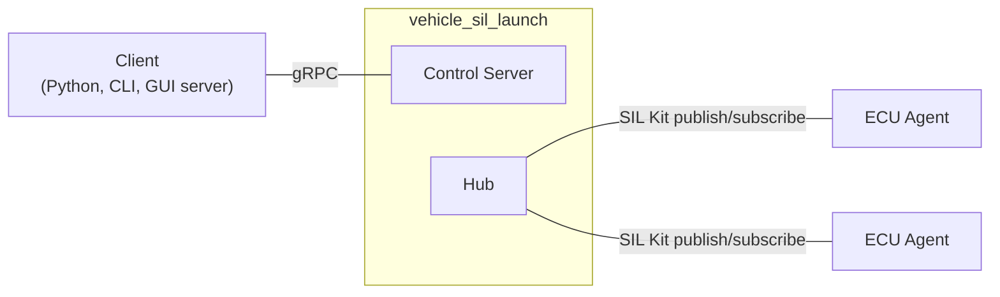
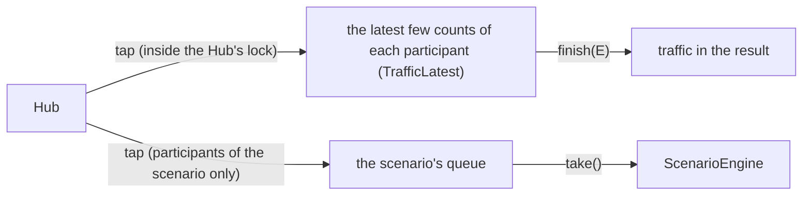
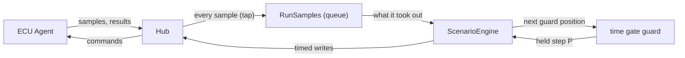

# External control (Control API)

[日本語](../ja/internals/control.md)

This page states the guarantees and limits of the Control API: when writes are applied, ordering, limits and threads. It covers the Control Agent, the Hub, the transport over SIL Kit, the Control Server, the launcher's Control Server and scenarios. For how to use the API, see [control-api.md](../control-api.md).

| Section | Contents |
|---|---|
| [Overview](#overview) | The parts and how each one connects |
| [Supported operations](#supported-operations) | What the Control API can and cannot do |
| [Design principles](#design-principles) | Never making the step wait, virtual time, limits, the scope of authentication, self-description, a separate GUI |
| [Control Agent](#control-agent-vehicle_silcontrol) | Variables, when writes are applied and their results, reading values, threads and limits, determinism, peer monitoring |
| [Control Server core](#control-server-core-vehicle_silcontrolhub) | Managing Agent connections, writes and operation state, subscriptions, reading values together, the variable map |
| [Transport over SIL Kit](#transport-over-sil-kit-vehicle_silcontrol_silkit) | Messages, threads, receive order guarantees, the start window before the first step, the end of a connection |
| [Control Server and communication layer](#control-server-and-communication-layer-vehicle_silcontrol_grpc) | The gRPC service, simulation monitoring, `GetSnapshot`, `Watch`, authentication, limits |
| [The launcher's Control Server](#the-launchers-control-server-vehicle_sil_launch-run---control) | The time control path, `--start-paused`, the start deadline, how it ends |
| [Samples the launcher receives](#samples-the-launcher-receives-runsamples) | The one tap of a run, the counts for `traffic`, the scenario's queue, locks |
| [Scenarios](#scenarios-vehicle_sil_launch-run---scenario) | The guard, every sample, how the scenario advances, why the result is fixed, limitations |

## Overview

The work is split as follows:

| Part | Responsible for |
|---|---|
| SIL Kit | CAN/LIN communication and virtual-time synchronization (the data plane) |
| Control API | Operation and monitoring |

Clients (Python, the CLI, the GUI server) use the Control API: gRPC (Protocol Buffers, v1 of `proto/vehicle_sil/control/v1/control.proto`) on a connection separate from SIL Kit. The server runs inside `vehicle_sil_launch run --control`, which runs the simulation (see "The launcher's Control Server" below).

The only transport between an ECU's Agent and the Hub is SIL Kit publish/subscribe (`vehicle_sil::control_silkit`). An ECU created with `ecu_main()` attaches the Agent side, and `vehicle_sil_launch run` holds the Hub side in its own participant. ECU executables depend on neither gRPC nor Protocol Buffers. The Hub receives values and results in step with virtual time (see "Transport over SIL Kit" below).

The processes and their connections. Each line is labeled with how it communicates:



| Part | What it does | Implementation | Connection |
|---|---|---|---|
| Control Agent | Each ECU has one. It exposes the ECU's variables (and the state of the `Peer`) and accepts operations. | `vehicle_sil::control::Agent`, `Ecu::input()`, `output()`, `agent()` | To the Hub through `vehicle_sil::control_silkit::AgentTransport` (attached by `ecu_main()`) |
| Control Server | Accepts the peers' Agents, relays operations, aggregates state and controls time through the time gate. | `vehicle_sil::control::Hub` | Agent side: `vehicle_sil::control_silkit::HubTransport` (held by `vehicle_sil_launch run` in the controller's participant). Client side: `ControlService` of `vehicle_sil::control_grpc::ControlServer` (`vehicle_sil_launch run --control`). |
| Client | Python, the CLI and the GUI server all use the same Control API. | The Python package and CLI (`python/vehicle_sil_control`); the GUI server's own client (`vehicle_sil_gui/control.py` in `gui/server`) | Connects to the Control Server over gRPC (the GUI server relays to the screen over HTTP and WebSocket; see [gui.md](../gui.md)) |

## Supported operations

| Feature | RPC |
|---|---|
| Peer list and state | `ListPeers` |
| Time: get, pause, resume, step, run until a given time, speed, wait until paused, stop | `GetTime`, `Pause`, `Resume`, `Step`, `RunUntil`, `SetSpeed`, `WaitPaused`, `Stop` |
| Reading and writing variables (switches, levers, sensor values and so on; includes writes at a given virtual time) | `GetValues`, `Write`, `GetOperation`, `WaitOperation` |
| Reading time and values together | `GetSnapshot` |
| Monitoring communication state (J1939 addresses and statistics, bus state), errors, events and performance | Read as variables (see "Peer monitoring" under "Control Agent" below) |
| Notifications of state changes (subscription) | `Watch` |
| Forgetting a disconnected peer | `ForgetPeer` |

- The launcher decides when the simulation starts: when the required participants have all joined. With `--start-paused`, it starts with `Resume`, `Step` or `RunUntil`.
- There is no reset. To start over, restart the processes.
- The Control API cannot select CAN/LIN channels or Vector devices (see "Arguments" in [bridges.md](../bridges.md#arguments)).

## Design principles

| Principle | Details | Section |
|---|---|---|
| Never make the step wait | The Agent's step thread does not wait for the transport. Operations pass through bounded queues. | "Threads and limits" under "Control Agent" |
| Follow virtual time | A write is applied in the first step at or after the given virtual time. | "When writes are applied" under "Control Agent" |
| Set limits | Queues and memory use are bounded. | The limits in each section |
| Authenticate only the client API | The gRPC API for clients (Control Server) has TLS, tokens and role-based authorization. | "Authentication and access control" under "Control Server and communication layer" |
| Self-describing variables | Each ECU exposes the name, type, range and unit of each variable (`Agent::schema()`, `variables` in `--describe`). | "Variables" under "Control Agent" |
| Separate GUI | The GUI is a process separate from the simulation. The GUI server (`gui/server`, Python) runs the launcher, acts as a Control API client and relays to the screen. | [gui.md](../gui.md) |

- There is no authentication between the Agent and the Hub (the transport over SIL Kit), nor on the SIL Kit registry and data plane. Use them on a closed network.
- Without a dashboard file, the GUI's sample screens use the information of the exposed variables to lay out one widget per variable (see "The Variables screen and widgets" in [gui.md](../gui.md#the-variables-screen-and-widgets)).
- The public libraries (`vehicle_sil::*`) do not depend on the GUI.

## Control Agent (`vehicle_sil::control`)

The Control Agent lives inside the ECU. It exposes the variables that can be operated from outside the simulation, and applies external writes at a fixed point in the step. It contains no communication (no connection to the Control Server) and does not depend on SIL Kit. Each ECU (`Ecu`) has one, and the ECU's class declares the variables (see "Declaring variables" under "The `Ecu` class (`vehicle_sil::Ecu`)" in [execution.md](execution.md#declaring-variables)).

```cpp
class Body {
public:
    explicit Body(vehicle_sil::Ecu& ecu) {
        ecu.input("cabin.parking_brake", &parking_brake_, {.description = "Parking brake switch"});
        ecu.input("engine.coolant", &coolant_, {.unit = "degC", .min = -40.0, .max = 210.0});
        ecu.input_enum("trans.gear", &gear_, {{"P", 0}, {"R", 1}, {"N", 2}, {"D", 3}});
        ecu.output("vehicle.speed", [this] { return speed_; }, {.unit = "km/h"});
    }
    // ...
};
```

### Variables

| Type | Checks and limits |
|---|---|
| bool | None |
| Integer | Checked against the range of the C++ type (a 64-bit unsigned integer cannot be an input; as an output, it is read clamped to the int64 maximum) |
| Floating point | A `float` is checked against the range of `float` |
| Enum | Has a list of values. The values fit the type, and no name or value appears twice. |

| Causality (as in FMI) | Writes |
|---|---|
| Input | Writable, also while running |
| Output | Read-only |
| Parameter | Writable only before the first step |

The metadata consists of the name (`.` separates levels), the unit, the minimum and the maximum (both inclusive; NaN is not allowed), the value increment (`step`; a hint for editing, not enforced), the description and the enum items. `schema()` returns the variables in the order they were registered.

#### When the schema is fixed

Register variables before the schema is fixed. Registering after that throws `std::logic_error`. This detects misuse; it is not synchronization. Do not register variables and call `submit()` at the same time on different threads.

The first of these fixes the schema:

| Trigger | Notes |
|---|---|
| `complete_schema()` | The transport calls it before it first reads `schema()` (`control_silkit::AgentTransport` calls it in its constructor; the driver calls it before the first step) |
| The first `submit()` | |
| The first step | |

`complete_schema()` calls the function passed to `bind_driver()` once (that function adds the driver's variables: the outputs of peer monitoring), then closes registration. If that function throws, the exception propagates and the schema is not fixed.

Whatever the pointers and functions refer to must outlive the Agent (for an ECU's Agent, these are things the ECU owns).

### Writes (`Command`)

- One or more writes are applied together in the same step.
- `submit()` checks the name, the type, the range, the enum and whether the variable is writable. If a check fails, it returns `Invalid` and queues nothing.
- If the minimum or maximum of an integer variable lies outside the range of its type, registration throws `std::invalid_argument`.
- Out-of-range values are not clamped (integer ranges are compared as integers).
- `submit()` after `finish()` also returns `Invalid`.

| Variable type | Accepted values |
|---|---|
| Integer | An integer, or a floating-point number with an integral value |
| Floating point | An integer, or a finite floating-point number |

### When writes are applied

A write is applied in the first step whose start time is at or after `Command::at`, before the application's processing. The application sees the new value in that step. Without `at`, the write is applied in the next step.

In a `Peer`, J1939 receive processing, handlers and timers (such as the Encoder of a `PeriodicSender`) run before the application. They use the new value from the next step on.

Writes applied in the same step are applied in (at, seq) order (a write without `at` sorts as if its time were the time of that step).

| Condition | Result |
|---|---|
| Before the operation was received, the participant had already run a step that starts at or after `at` (a late operation). Default. | Not applied; `Late` |
| A late operation, with `LatePolicy::ApplyNext` | Applied in the next step, with `late` set |
| A write to a Parameter, passed to `submit()` after the first step started | `Invalid` |
| A write to a Parameter, queued before the start, with a time after the first step | `Rejected` |
| The setter of an input registered with functions throws | The operation is `Rejected`. Values written earlier in the same operation stay (the step does not fail). |

### Results

- Every queued operation gets exactly one `CommandResult`: `Applied` with the time of the step that applied it, `Late`, `Rejected` or `Cancelled`.
- When the simulation ends, `finish()` sets the remaining operations to `Cancelled` (for an ECU's Agent, the ECU calls it; see "When variable writes are applied" in [execution.md](execution.md#when-variable-writes-are-applied)).
- Operations with a time at or after `VirtualTimeOptions::end`, and operations on a `Peer` whose step failed, also remain unsettled until `finish()`.
- In a real-time `Peer`, `at` is a time on the clock of that `Peer`'s driver.

### Reading values

At the end of the step (in a `Peer`, after LIN processing), the Agent reads all variables. `latest()` returns the latest set. It reads them in the first step at or after each of the times 0, `sample_period`, 2 `sample_period`, … (counted as `Ecu::every()` counts; default 10 ms; 0 means every step). The values are handed over through three buffers, without locks.

### Sending from inside a step (`set_step_sink()`)

If you register a function, the Agent calls it at the end of every step (right after reading values), on the step thread. It passes the time of the step and the set that the step read (empty in a step that did not read). The function can call `drain_results()` and `drain_events()`. This API lets a transport send what a step produced (results of applied writes, events, values) within that same step. `control_silkit::AgentTransport` uses it.

- Register once, before the first step. Registering later, or a second time, throws `std::logic_error`.
- The registration cannot be removed.
- Without a registration, the cost to the step is one branch.
- An exception thrown by the function fails that step.

### Threads and limits

| Thread | Functions it calls |
|---|---|
| The step thread (one) | `on_step_begin`, `on_step_end`, `log`, `finish` |
| The transport side | `submit`, `drain_results`, `drain_events`, `latest`, `stats` (thread-safe with each other; can be called from several threads) |

- The step thread never waits for the transport side.
- The transport side may wait during `finish()`, and on the short lock of `Host::post()`, which wakes the real-time driver.
- Do not call `submit()` or `clear_wakeup()` from inside the wake-up function passed to `bind_driver()`.
- Hand-over uses fixed-capacity SPSC rings.
- Variable accessors are called only on the step thread, so the model needs no locks.
- The step thread does not take locks that transport threads hold.
- Freeing finished operations and allocating the reason strings of results happen on the step thread (at most `max_pending` per step).

| Limit | Default | When exceeded |
|---|---|---|
| Operations in flight (from queuing until the result is taken with `drain_results()`): `max_pending` | 256 | `submit()` returns `Busy` at once (so no result is ever dropped) |
| Events: `max_events` | 1024 | Events that overflow are dropped and counted |

### Determinism

The Agent only decides when writes are applied. It does not change the order of steps or the data. A run without an Agent and a run with an Agent that keeps reading values produce the same communication. A write with a time is applied in the same step on every run, provided that it is received before the participant runs a step that starts at or after that time. That is the whole guarantee.

If you stop at the time gate and then write, some participants have already run, or are running, the step that starts at the stop position P (`TimeState::now`). Set `at` after P (for example P + 1 ns). If `at` is P or earlier, the write can be `Late`. Without `at`, the time of reception decides whether the write is applied at P or in the next step.

Operations applied in the same step are ordered (seq) as the Hub accepted them. If several clients write the same variable at the same time, the value that remains depends on the order of reception and can differ from run to run.

### Driving from the ECU

- When the ECU creates the Agent, it binds itself to the Agent as the driver (`bind_driver()`).
- The ECU calls `on_step_begin()` right before the application's processing, `on_step_end()` right after LIN processing and `finish()` when it stops (see "Order within one step" in [execution.md](execution.md#order-within-one-step)).
- In a real-time `Peer`, queuing an operation wakes the driver (`Host::post()`; at most one pending wake-up).
- When a `Peer` starts to stop, it no longer lets the Agent wake it, and it calls `finish()` once steps no longer run. A `submit()` after that returns `Invalid` and does not touch the `Peer`.
- In `start()`, a `Peer` that has an Agent fixes the schema.

### Peer monitoring

With `PeerOptions::monitor` (enabled by default), the `Peer` adds the following outputs after the ECU's variables when the Agent's schema is fixed. Their values are read on the step thread when the Agent reads values. Every `Peer` creates its Agent by `start()` (for `ecu.connected`), so a `Peer` that declares no variables gets these outputs too, and the per-step recording runs. If you do not need them, set `PeerOptions::monitor = false`.

| Output | Meaning |
|---|---|
| `peer.steps` | The number of steps |
| `peer.speed` | Seconds of virtual time / seconds of wall-clock time since the previous read (0 at the first read; smaller after a pause) |
| `peer.app_time_max_us` | The longest time spent in application and LIN processing since the previous read (excludes J1939 processing and applying writes) |
| `j1939.N.bus_state` (for each J1939 network N) | Enum: unknown, error_active, error_passive, bus_off |
| Statistics for each network N | `frames_received`, `frames_sent`, `send_failures`, `send_queue_full`, `receive_overflows`, `held_dropped`, `address_violations`, `transport_aborts_sent`, `transport_aborts_received`, `transport_timeouts`, `transport_rejected`, `transport_bam_dropped`, `transport_bam_replaced` (the fields of `j1939::NetworkStatistics` of the same names) |
| `j1939.N.node<i>.address` (for each node i of N) | The node's address |
| `j1939.N.node<i>.address_state` (for each node i of N) | Enum: fixed, not_started, claiming, claimed, cannot_claim |

When a node's address state or address changes, the `Peer` emits an event. Its text is `j1939.N.node<i>: <state> at address <a>`, with the state named as in the enum. cannot_claim is a Warning.

N is the name of the network in the simulation. For a network renamed with `PeerOptions::network_names` (`--map-network` of an ECU executable; see "Renaming networks" in [ecu-executable.md](../ecu-executable.md#renaming-networks---map-network)), both the variables and the text of the events use the new name, so the networks of every executable appear under the same names in the GUI and the Control API. A network without a mapping, and every network in a `--local` run, uses the code's name.

Monitoring covers the networks and nodes that exist when the schema is fixed (by the first of: creating the transport `control_silkit::AgentTransport`, the first `submit()`, `start()`).

| Condition | What happens |
|---|---|
| `Peer::j1939()` (either form) is called after the schema is fixed | It would be an unmonitored network, so it throws `std::logic_error`. The message names the `Peer` and the network, and the fix: add the network before creating the transport and before the first `submit()`, or set `PeerOptions::monitor = false`. |
| A node is added after the schema is fixed | The node is not monitored |
| Raw CAN and LIN | Not monitored |
| An ECU variable is declared with a name that starts with `peer.` or `j1939.` (`input()`, `output()` and so on) | These prefixes are reserved, as are `can.`, `lin.` and `eth.` for the other buses (`monitor_names::kReservedPrefixes` in `ecu/monitor_names.hpp`). The declaration throws `std::invalid_argument`, whatever the `monitor` setting and the implementation (`Peer`, `LocalBench`). The message names the ECU, the variable and the rule. |
| A variable registered directly on `agent()` clashes with a monitoring output | The call that fixes the schema throws `std::invalid_argument`. Nothing changes and the schema is not fixed. The message names the `Peer` and mentions `PeerOptions::monitor = false`. |

In the last case the schema stays open, so variables declared after the call that threw are also ECU variables in `describe()`.

Step failures are not reported here (no step runs after a failure). Read `Peer::failed()` and `error()` (thread-safe) on the transport side.

## Control Server core (`vehicle_sil::control::Hub`)

The Hub is the part of the Control Server that does not depend on how it communicates. It keeps the list of connected Agents, routes writes, and holds the results per peer, the latest values and bounded subscriptions. Every function is thread-safe.

### Calls from the transport

- For each connection, the transport calls `agent_connected(hello, link)` and receives a `ConnectionId`.
- From then on, it passes what it receives from the Agent (`agent_submitted`, `agent_result`, `agent_values`, `agent_events`, `agent_status`) and the disconnection (`agent_disconnected`) with that ID.
- The `hello` is built after the Agent is attached to the `Peer` with `attach()` (so that the monitoring outputs are in the schema).
- `agent_status` receives `Peer::failed()` and `error()` (step failures do not arrive through the monitoring outputs).
- The SIL Kit transport does not call `agent_status` (it remains in the Hub's API). The `status` of a peer that clients see is therefore always empty, and the simulation monitoring (`SimulationMonitor`) reports participant failures.
- `agent_connected()` needs a non-empty name, a link and a `max_pending` greater than 0.

### `AgentLink::send()`

- The Hub calls it without holding its own lock.
- For one peer, it is called from one thread, one operation at a time, in sequence-number order, so it may wait briefly and may call back into the Hub.
- If it returns `false`, the operation becomes Invalid. If it throws, the operation becomes Unknown.
- The thread that called `write()` may also take over sending earlier operations to the same peer, so `write()` may wait for those `send()` calls.
- The Hub releases its last reference to a link outside its lock.

### Agent identity and reconnection

An Agent identifies itself with its participant name (must not be empty) and an ID that changes with every start (the incarnation).

#### Same name, same ID (reconnection)

This is the same process reconnecting. The SIL Kit transport identifies itself with a new session for each transport, so it never uses this form. The API exists for transports that reconnect.

The new connection replaces the old one, and unfinished operations continue. If the disconnection notice of the old connection arrives later, the peer does not become disconnected (only the operations passed to that connection and not yet reported as queued become Unknown). The transport resends, over the next connection, the results it could not deliver.

| `open_seqs` in the hello | Handling |
|---|---|
| Contains the operations that the Agent still holds (queued, but the transport has not yet delivered their results) | Those operations become Queued on the new connection (the end of the old connection does not affect them). Other unsettled operations settle as Unknown. |
| Does not contain them | Nothing is settled. Operations whose results were lost stay unsettled and keep counting toward the peer's `max_pending`. |

#### Same name, different ID (restart)

This is a restarted process. Unfinished operations of the previous ID become Unknown, and the values of the previous ID are discarded.

#### Replaced connections

In both cases, the Hub closes the replaced old connection with `AgentLink::close()`. Even when two processes with the same name run at once (a configuration error), the older one learns that its connection was closed instead of being silently ignored. The new connection takes precedence.

#### End (`agent_ended(connection, reason)`)

The transport calls this when it knows that the same ID will not connect again (the participant left the simulation, or the Agent sent its last word). The Hub does what it does for a disconnection, then settles every unsettled operation of that ID as Unknown (with a reason). No waiting call is left behind.

#### Disconnection

| Operation | On disconnection |
|---|---|
| Queued by the Agent | Becomes Disconnected (unsettled). If a result is received after the same ID reconnects, that result settles it. |
| Passed to the link, but not reported as queued | Unknown |
| Not yet passed to the link | Invalid |

If `forget_peer()` removes a disconnected peer, its unsettled operations become Unknown and subscribers receive a PeerUpdate with the `removed` flag.

#### Which connection's data is used

- A result is accepted from any connection of the ID that the operation was sent to. Results from another ID are not used.
- Values, events and status are used only from the current connection.
- Values whose count does not match the schema, and values older than the previous ones, are discarded.

### Writes and operation state (`write()`)

- `write(request)` groups the writes per peer outside the lock.
- Each operation gets a sequence number that increases across the whole Hub (by default it starts from the wall-clock time in microseconds, so it is larger than before even after the Server restarts).
- The Hub sends one `Command` per peer, with that number as `seq`.
- The Hub checks only that the peer is connected, that the variable exists and is writable, and that the peer has fewer unfinished operations than `max_pending` (received in the hello; if not, Busy).
- The Agent decides the type, the range and the step that applies the write.

For each peer, the state goes from Sent to Queued (the Agent queued it), then to one of Applied, Late, Rejected and Cancelled. It can also be Disconnected, Invalid, Busy or Unknown. Every state except Sent, Queued and Disconnected is final and never changes.

With the state, each peer's result says which of its writes took effect and which one was refused, as positions (`TargetResult::applied_writes`, `TargetResult::failed_write`). The writes of an operation for one peer are that peer's command, in the order of the request (a variable written twice is two writes); the positions count in it, from 0, and `n` is the number of its writes.

| State | `applied_writes` | `failed_write` |
|---|---|---|
| Applied | `n` | empty |
| Late, Cancelled, Busy | 0 | empty |
| Invalid | 0 | The write at which the Hub's check stopped, or the one the Agent names. Empty when the command as a whole was refused (the peer is not connected, the link refused it). |
| Rejected | The position of the write whose setter threw (the writes before it took effect) | The same position |
| Sent, Queued, Disconnected, Unknown | empty | empty |

- A command that the Agent received before its first step and that writes a Parameter at a later step is Rejected with nothing applied and no setter called, and the Agent says 0 for it, as it does when the first setter throws. So for a command that writes a Parameter and has two or more writes, a 0 from the Agent gives `applied_writes` 0 and an empty `failed_write`: the Hub cannot tell the two apart. (A command that writes a Parameter and arrives after the first step is Invalid at once.)
- A number from the Agent that is `n` or larger is not believed (a Rejected command has a write that did not take effect): both are empty.
- An Agent that does not say the numbers (a transport of its own that leaves them out): both are 0 for a command of one write, and empty otherwise. The Hub never reads a `reason` to find a write.
- Callers tell which writes took effect from these numbers, not from `reason` (the launcher's scenario does: `ScenarioEngine::failed_write()`).

### Waiting for queued and done (`wait_queued()`, `wait_done()`)

- `wait_queued(seq)` waits until no target is Sent, then returns the operation as it is at that point (empty on timeout and for an unknown number).
- If you write with a time after the stop position (see "Determinism" under "Control Agent") and resume only after you confirm that every target is Queued, no write is late.
- `wait_done(seq)` waits until the operation is settled and returns it, so you know the result even if the operation is forgotten right after.
- It also returns empty if the operation is forgotten while it waits, so make `max_operations` larger than the number of operations you wait for.

### Subscriptions (`subscribe()`)

- A new subscription first receives the current peer list and the latest values.
- For peers, values and operations, it keeps only the latest state per peer and per operation (a change before it is read replaces the previous one).
- Events and operations are bounded (`capacity`). On overflow, the oldest events and the operations that changed longest ago are dropped and counted.
- Values carry the incarnation of their schema.
- `poll()` returns peers, then operations (in number order), then events (in order of reception), then values.
- `close()` wakes a waiting `poll()` and ends it.

### Reading the latest values together (`latest_of()`)

- `latest_of(peers)` returns the latest values of several peers (all of them if empty) as of one instant, taking the Hub's lock once (values are shared, not copied).
- To read time and values as one set, read the time state first, then call this.
- Values only ever get newer, so everything the Hub had when you read the time state is included.
- `none_after(values, now)` returns whether none of the values comes from a step after `now`.

### Variable map (`set_variable_map()`)

`set_variable_map(participant, map)` (`MappedSchema` in `control/variable_map.hpp`) shows that participant's variables to every reader and writer with the mapped names and values. The launcher passes it from `participants[].variables` in the configuration file (on the first call of `RunControl::hub()`, before any Agent connects).

The conversion happens in only 4 places in the Hub. The list that is shown is built outside the lock and swapped in inside it; the other 3 conversions run inside the lock. The transport and the reading APIs (tap, latest values, subscriptions, the Control Server) do not know about the conversion.

| Where | What it does |
|---|---|
| The list (`agent_connected()`) | Builds the list to show from the hello's list, once per connection |
| Values (`agent_values()`) | Converts values before the Hub stores them |
| Writes (`write()`) | Converts to the executable's names and values where the name and direction are checked, before putting them into the `Command` |
| Reasons | Changes the variable name at the start of a reason returned by the Agent to the name that is shown |

The list:

- The order and count do not change (values correspond to variables by position).
- A mapping that does not fit is not applied, and the reason goes into `PeerInfo::map_problems`.
- `PeerInfo::sources` holds the executable's names of the mapped variables.
- A map passed later does not apply to connections that already exist.

Values:

- The tap, `latest()`, `latest_of()` and subscriptions share one converted value, so no API sees a different value.
- Times and sequence numbers stay as the Agent sent them. The ordering guarantees do not change.

Writes:

- The conversion happens where the write is checked, so the list used for the check and the list used for the conversion are from the same moment.
- The conversion inverts the linear expression, rounds to an integer (halves away from zero, independent of the floating-point rounding mode), and checks the range and the values of `map`. A value that cannot be converted is Invalid.
- Ranges are compared in the executable's values (the ends of the shown range are products, so they can be 1 ulp off from values written in decimal; the ends shown in the list are rounded to 15 digits).
- The scenario check uses the same test (`MappedSchema::in_range()` calls `to_actual()`).
- Writes to the `name` and `from` of a mapping that was not applied are refused before the list is searched (`MappedSchema::not_writable()`). Reading them works as before.
- The launcher reports each mapping that was not applied once, in a run line and in the result: at the start for the participants connected by then (`RunControl::note_links()`, which looks at the links again after the start for a participant that the start window did not wait for), and at the end of the run for those that connected later (`RunControl::note_late_maps()`).
- The converted `Command` is sent only to that incarnation (after a restart, it is dropped).
- The operation record (`request`) keeps the names and values that the client wrote.

The rules (types, ranges, conflicts) live in one place, `MappedSchema::make()`, and the check (`launch::seen_variables()`) applies the same function to the `--describe` list. To add a kind of mapping, change:

- The members of `VariableMapping`
- `MappedSchema::make()` and the conversion
- The configuration file reader (`kVariableMapKeys` and `read_variable()` in `libs/launch/src/config.cpp`)
- `variable_map` in `check --json` (`check_format.cpp`)

### Retained operations

The Hub keeps up to `max_operations` settled operations and forgets the oldest beyond that. It never forgets unsettled operations (their number is bounded by each peer's `max_pending`).

## Transport over SIL Kit (`vehicle_sil::control_silkit`)

This transport carries the messages between the Agent and the Hub over SIL Kit publish/subscribe. It creates no new participant. The ECU side (`AgentTransport`) creates its publishers and subscribers in the ECU's participant. The Hub side (`HubTransport`) creates them in the participant that holds the Hub (in `vehicle_sil_launch run`, the controller).

### Message types

Messages flow in this order: the hello; the start window before the first step (everyone waits before the first step); commands and their submitted messages; a step message in each step; the last word (when the transport is destroyed) and its answer.

| Message | Direction | Sent when |
|---|---|---|
| hello | ECU → Hub | Before the start (the last one is kept for subscribers that join later) |
| command | Hub → ECU | `Hub::write()` is called |
| submitted (the answer to `submit()`) | ECU → Hub | A command is received (from the receive handler) |
| step message (results, events, values) | ECU → Hub | Inside the step |
| probe | Hub → ECU | See "Until commands can be sent" below |
| ready (the answer to a probe) | ECU → Hub | As the answer to a probe |
| last word received (the answer to the last word) | Hub → ECU | After the Hub receives the last word and ends the connection (see "End of a connection" below) |

### Message format (`control/wire.hpp`)

The format is defined in `control/wire.hpp` of `vehicle_sil::control`. It is a byte string with no dependencies. Numbers are little-endian.

Every message starts with the format version, `kVersion` (2). Both sides write `kVersion` and read only `kVersion`; nothing is negotiated. In every version, a hello has the same layout up to the participant name, so the name can be read even from a hello of another version: the Hub reports it (`LinkState::VersionMismatch`) and makes no peer of it. An Agent drops every message of another version.

- Version 1 (vehicle-sil 0.1.0) is not read any more. An ECU built with vehicle-sil 0.1.0 under a newer Hub, or a newer ECU under the Hub of 0.1.0, takes part in the simulation, but its variables cannot be read or written.
- The format can get new fields without a new version:
  - Each variable, write, result and event starts with its size in bytes.
  - The last byte of the header is the revision of the writer (`kRevision`).
  - A new field goes at the end of its element, or at the end of the message if it belongs to the message, and `kRevision` goes up by one.
  - The decoder skips what it does not know (the rest of an element, the rest of a message, flag bits) only when the writer's revision is newer than its own. From a writer of the same or an older revision, every size must be exactly what the decoder reads, and extra bytes are an error.
  - A value that must not be skipped (an unknown enumerator) is an error from any revision. A writer must not send one to an older side. The other side's revision arrives in the header, but nothing reads it yet: whoever raises `kRevision` and adds such a value makes the transport keep that revision and check it before sending.
- A result says how many writes of a command were applied (`CommandResult::applied_writes`), and a refusal says which write it is about (`SubmitResult::failed_write`); either can be empty (not said).
- Adding a kind that the other side can safely ignore changes neither the version nor the revision: an unknown kind is counted as an unreadable message and dropped (the answer to the last word was added this way).

- The decoder never throws and never reads outside the bytes it is given.
- It returns a distinct error for each of: truncated input, wrong kind, wrong version, oversized input, out-of-range value.
- It checks the size limit before the version (it does not read past the limit, even for a message of another version).
- For a count field, it checks that the count fits in the remaining bytes, and does not reserve space for the declared count up front.
- Decoding again into the same message object reuses its storage.
- A separate function (`addressed()`) reads only the destination (session) first, so an ECU does not decode commands addressed to another ECU.

### Size limits

| Item | Limit | When exceeded |
|---|---|---|
| Command, submitted message, step message | 64 KiB (`kMaxMessageBytes`) | See the table below |
| hello | 4 MiB (`kMaxHelloBytes`), 65536 variables (`kMaxVariables`) | `AgentTransport` cannot be created (`std::invalid_argument`) |
| Participant names and variable names | 1–256 bytes (`kMaxNameBytes`) | `AgentTransport` cannot be created (`std::invalid_argument`) |
| Texts of reasons and events | 1024 bytes | Truncated |

The decoder also rejects input with the same limits.

| Over 64 KiB | Handling |
|---|---|
| The output of one step (results, events, values) | Split into several step messages, sent within the same step. The Hub side reassembles one set of values. |
| A command | Not split (all writes of one command are applied in the same step). It is not sent, and the operation is Invalid. |

A hello is always a single message, because a subscriber that joins later receives only the last one sent.

### Topics

- There is one topic for each direction and kind, shared by all participants (`vehicle_sil.control.hello`, `.step`, `.submitted`, `.command`).
- Topics do not contain participant names.
- A message identifies its sending or destination Agent by a 64-bit number that each `AgentTransport` creates anew (the session; to the Hub, the incarnation).
- Commands reach every ECU, and ECUs that are not the destination drop them.
- Do not create SIL Kit services whose names start with these names.

### ECU-side threads (`AgentTransport`)

| Where | What it does |
|---|---|
| Constructor | Fixes the Agent's schema (`complete_schema()`) and sends the hello with a publisher of history 1 |
| Step thread | Sends what the step produced (results of applied writes, events, values read) within the step, right after the values are read (`Agent::set_step_sink()`) |
| SIL Kit receive handler | Passes a command to `submit()` and sends its answer at once (outside the step) |
| Destructor | Sends the results not sent yet (after `Peer::stop()`, the cancelled writes) as the "last word", and waits for the Hub's answer before it returns (see "End of a connection" below) |

- Call the constructor on the setup thread, after creating the ECU and before starting it (after the start, it throws `std::logic_error`).
- An Agent has only one `AgentTransport`.
- Nothing is sent from other threads.
- A step that produced nothing sends nothing.
- The destructor waits at most `AgentTransportOptions::last_word_wait` (default 500 ms).
- Destroy it after stopping the ECU and before destroying the ECU (it holds a `control::TransportLease`).
- Do not destroy it from inside a SIL Kit handler (that is the thread that receives the answer, so the destructor would wait the full limit).

### Hub-side threads (`HubTransport`)

- The receive handler only decodes messages and passes them to the Hub.
- The receive handler runs on the participant's SIL Kit thread. That thread also runs the participant's steps, so a slow handler makes the whole simulation wait.
- There is no queue, and nothing is dropped (slowness makes the run late instead of losing values; see `HubTransportStats::handler_time`).
- Delivery to the Hub's subscribers happens on the subscriber's thread, in `Subscription::poll()`.
- The thread that called `Hub::write()` publishes the commands itself.
- Create `HubTransport` before starting the participant.

### Hub-side checks and limits

- A set of values is passed to the Hub only if it matches the hello's schema in count, order (the split parts continue from the start) and the type of each variable. Other sets are dropped and counted (`HubTransportStats::unknown`).
- It remembers up to `HubTransportOptions::max_links` participants (default 256), counting connected ones, ended ones and ones of another version.
- Hellos beyond that limit, and hellos that claim the session number of another connected participant, are dropped and counted (`refused_hellos`).
- What one hello leaves in the Hub is bounded by the hello limits above.

### Until commands can be sent

Receiving a hello does not mean that the ECU's subscription to commands is established (each direction connects separately). `HubTransport` sends a probe, and sends commands to an Agent only after it receives the ECU's answer (ready) (`LinkInfo::ready`). It sends a probe when a hello arrives, once every 8 step messages until ready arrives, and in `wait_for_hellos()`.

`AgentLink::send()` refuses the following writes, and the Hub makes them Invalid at once. This keeps a command that reaches no one from leaving its operation unsettled.

- Writes before ready
- Writes to a participant whose lifecycle has started to stop (Stopping or later, or Error)

Within the start window, a probe to a required participant always arrives.

### Receive order guarantees

When the Hub-side participant takes part in time synchronization and the ECUs run in virtual time (`vehicle_sil_launch run` always does), the following holds once step P of the Hub-side participant has started (and therefore once the time gate has stopped at P):

| Start time of the ECU's step | Its results and values |
|---|---|
| Before P | All of them are in the Hub |
| Exactly P | Undetermined (they may arrive while stopped) |
| After P | Not received until the simulation advances |

The guarantee is "everything before P", not "everything up to P" (the same rule as `StepInbox`).

- Submitted messages (Queued and so on) and commands are sent outside steps. Their order is kept, but their timing is not guaranteed.
- The procedure of stopping, writing with `at` > P, waiting until every target is Queued and then advancing (see "Determinism" under "Control Agent") works as is.
- `HubTransport` counts step messages received in violation of this guarantee (the Hub side had already started a later step) (`HubTransportStats::late_messages`, `LinkInfo::late_messages`).
- As long as the ECUs send from inside their steps, `late_messages` is 0.

### Start window before the first step (`set_start_window()`)

If you register a function with `SimulationController::set_start_window()`, the controller calls it while all required participants wait before their first step (in SIL Kit's asynchronous CommunicationReady handler; `ParticipantRuntime::set_communication_ready_handler_async()`). It calls the function on a thread of its own (neither a SIL Kit thread nor the thread that called `start()`). The simulation starts after the function returns.

In this window, wait for the Agents' hellos with `HubTransport::wait_for_hellos()`, write Parameters with `Hub::write()` and wait with `wait_queued()` until they are queued. The values are then applied in each ECU's step at time 0, and the application sees them in that step. This holds whatever order the ECUs and the controller start in.

#### Relation to the start

- The window is part of the start.
- The timeout of `start()` includes the window (`StartWindow::deadline()`), and the `start()` of every participant waits for the window to end.
- Nothing can stop the function from outside. Each time the function waits, it checks `StartWindow::cancelled()` (a stop request, the end of the lifecycle, the `start()` timeout) and returns at once if it is set.
- `start()` waits for the function to end, whether `start()` returns or throws.
- If the function throws, the window still closes and everyone starts. `start()` then throws `std::runtime_error` with the function's message.
- Commands written before the window (before the controller publishes the SIL Kit workflow configuration with `SetWorkflowConfiguration`, or right after the hello arrives) are not guaranteed to arrive.

#### Always completing the window

The window is always completed. If the window starts after `start()` has given up (a required participant was slow to get ready), it is completed without calling the function. Every participant then reaches its first step, so a later stop of the controller ends them in order, as without a window. The controller's destructor completes a window that has started, even while it waits for the stop.

#### When a participant goes away

- While `start()` in `vehicle_sil_launch` waits for the start, it checks whether a required participant has left the simulation (`has_finished()`; when the process ends, the participant is in Error) and gives up at once if one has (`give_up` of `SimulationController::start()`). Without this, if a participant went away in the window, the remaining participants would wait until the timeout.
- `wait_for_hellos()` waits until each listed participant has done one of these: connected and answered that it can receive commands, sent a hello of another version, or left the simulation (with a deadline and cancellation).
- If a participant goes away in the window, the wait in `wait_for_hellos()` still ends (the start that follows times out like any other failed start).

### End of a connection

`HubTransport` ends a connection with `Hub::agent_ended()` when:

- It receives the Agent's "last word"
- The participant's lifecycle becomes Error (a step failure, or the connection was lost, that is, the process ended)
- `HubTransport` is destroyed

Operations that were waiting for that Agent settle with the result in the last word (Cancelled and so on) or as Unknown.

#### Delivery guarantee for the last word

`HubTransport` answers the Agent after it receives the last word and ends the connection (it also answers the last word of a connection that has already ended). The destructor of `AgentTransport` waits for that answer before it returns. The reason: the ECU process destroys the participant right after the transport, and SIL Kit drops sends that it has not yet written to the socket when it destroys a participant.

As long as the Hub-side transport is present and answers within the wait time, the last word has arrived when the destructor returns, and the operations that were waiting for that Agent are settled.

#### Wait times

- At most `AgentTransportOptions::last_word_wait` (default 500 ms; 0 means no wait; in `ecu_main()`, `EcuMainOptions::last_word_wait`).
- The answer normally comes at once. The full time passes only when the Hub side is gone or runs a version that does not answer.
- The wait is in wall-clock time, happens once after the steps have stopped, and is unrelated to virtual time and to the speed of the run.
- An Agent that has never received a probe or a command from a Hub (a simulation without a Hub) does not wait.

#### What is not guaranteed

The last word may not arrive if:

- There is no Hub-side transport, or it was destroyed first.
- The other side runs a version that does not answer.
- No answer arrived within the wait time.
- The Hub's probe has not reached that Agent yet (an ECU that ends right after its hello; it does not wait).

If a participant ended in order (reached Shutdown) but its last word did not arrive, its connection remains until `HubTransport` is destroyed, and is settled as Unknown then. Meanwhile, new writes to that participant are refused as described in "Until commands can be sent" above, so the number of unsettled operations does not grow.

#### Mixed versions

| Combination | Behavior |
|---|---|
| An Agent that does not know the answer | Drops the answer and ends as before |
| An Agent whose Hub does not answer | Waits the full wait time, then ends |

Neither case depends on the format version: the answer is a kind of its own, added without a new version.

### Peers that send no hello

- An ECU without a transport (`--no-control`, an executable of an old vehicle-sil without an Agent, a participant that has no Agent) sends no hello, so it does not become a peer of the Hub.
- A participant that sent a hello of another version does not become a peer. It remains in `HubTransport::links()` with its participant name and version.
- To a caller that waits, both cases appear as distinct results, not as "did not come" (`connected`, `mismatched`, `ended`, `missing` in `HelloReport`).

### Real-time peers and restarted participants

You can also attach an `AgentTransport` to a real-time `Peer` (without virtual time). The same messages flow, but there is no guarantee between the time of reception and the virtual time of the Hub side (values are treated as of the time they are received, and are not counted in `late_messages`).

A participant restarted with the same name replaces the old connection with the hello of its new session. This also holds for a restart after a crash. When a hello arrives, the lifecycle state of that name is not checked (it might be the state of the previous process).

### No authentication

This segment has no authentication. Anyone who can join the registry can write to the command topic (just as they can send frames on the simulation's buses). Use it on a closed network. The authentication of the client gRPC API does not extend to this segment.

### Traffic volume

Values are not thinned out. The traffic is "number of ECUs × one set per `sample_period`", and it grows in proportion to the simulation speed. To reduce it, increase `AgentOptions::sample_period` (`Ecu::set_agent_options()`).

## Control Server and communication layer (`vehicle_sil::control_grpc`)

This layer is built only with `VEHICLE_SIL_BUILD_CONTROL_SERVER` (default OFF). gRPC is found with `find_package(gRPC CONFIG)`; if it is not found, FetchContent fetches it at a pinned version (see [dependencies.md](../dependencies.md)). No other library depends on gRPC.

### Service

- The only service is `ControlService`, for clients (peer list, values, reading time and values together, writes, operation results and waiting, subscriptions, forgetting peers, time control).
- Agents do not connect over gRPC (the Hub-side transport is `HubTransport`, which the code that uses the Server attaches).
- In every enum, 0 is UNSPECIFIED. An unknown value from a client is treated as the safe choice (for the handling of late writes, as Reject).

### `ControlServer`

`ControlServer` puts the service on a Hub. The Hub is either its own or the caller's (`ServerOptions::external_hub`; it must outlive the Server).

### Time control

- If a `TimeControl` is given (`time_control_of(controller)` uses the time gate of a SimulationController), the Server accepts time control.
- Without a `TimeControl`, time control returns `FAILED_PRECONDITION`, and `GetTime` returns `available = false`.
- `Stop` only requests a stop and does not wait (several clients may call it at the same time).
- The reason given with `Stop` reaches every participant and the SIL Kit log, so control characters in it are replaced with `?` and it is cut to 200 bytes (never inside a UTF-8 character). It is also recorded in the audit.
- A `Stop` before the simulation starts stops it right after it starts. `ParticipantRuntime::request_stop()` keeps a request made before the lifecycle reaches Running, and delivers it at the first step, because SIL Kit ignores a Stop before Running.

### Simulation monitoring (`SimulationMonitor`)

If a `TimeControl` is given, the Server reads it on one thread every `ServerOptions::monitor_period` (default 50 ms) and keeps the following in one snapshot (`ControlServer::simulation()`):

- The time state
- The SIL Kit state of each participant
- Failed participants and the reasons (`FailureCheck`; the grace period is `leave_grace`; once a failure is seen, it is never cleared)
- Whether the simulation has ended

| Rule | Details |
|---|---|
| Notifying subscribers | Only on change |
| Thread that calls subscribers | The monitoring thread, or the thread that called `poll()` (that is, the gRPC thread that handles a time call), one subscriber at a time |
| Constraints on subscribers | Keep them short. Do not subscribe or unsubscribe from inside one. |
| Where `TimeControl` is read | `ListPeers` and `Watch` both use this snapshot, so only the monitor reads it, whatever the number of subscriptions |
| When the state cannot be read (`TimeControl` threw) | The values read last are kept, with the reason attached (`simulation_error` in `ListPeers`, `SimulationState::error`; if neither the participants nor the time can be read, both reasons) |
| A round in which the participants cannot be read | No failure is judged, so the grace period of a participant that went away continues without starting over |

- `SimulationMonitor` depends only on `TimeControl`.
- `TimeControl::left_participant()` is pure virtual (if an implementation forgot it, the monitor would run without ever judging a failure).
- The SIL Kit implementation queries SIL Kit for the participant states directly only once, at the start, because SIL Kit may not pass on states that arrived while the handlers were being registered. After that, it reads the states that its handlers received.

### Peer list (`ListPeers`)

- The list is the connected Agents plus the controller's required participants (`SimulationControllerOptions::required_participants`; even without an Agent).
- A participant that is not required appears only if it has an Agent (with an empty `simulation_state`).
- Each peer carries whether it has an Agent (`has_agent`) and its SIL Kit lifecycle state (`simulation_state`; empty if not seen yet).
- `Watch` builds its peers with the same conversion, so a peer arrives with the same content as in `ListPeers`.

### Reading time and values together (`GetSnapshot`)

The Server reads the time state (`TimeControl::state()`) first, then calls `Hub::latest_of()`. It holds no lock across the two reads (it releases the lock on the `TimeControl` side before it takes the Hub's lock).

The following still holds. If the Hub-side participant takes part in time synchronization, then when the gate shows time P, the values of every peer's steps that started before P are in the Hub (see "Receive order guarantees" under "Transport over SIL Kit"). The Hub's values only ever get newer, so values read afterwards are never older than the time.

`consistent` in the response is true only if the time state read was paused (and not ended) and no value comes from a step after P (`none_after()`).

| Case | `consistent` |
|---|---|
| Resumed between the two reads, and values of later steps are included | False |
| Resumed between the two reads, but no values of later steps are included | True (the values are still those at P, so the flag is correct) |
| The time of a real-time peer's value (on that peer's clock) is after P | False |
| No `TimeControl` | False (only the values are returned, and `available` is also false) |

- Whether the values of a step that starts exactly at P are included is undetermined.
- If the time state cannot be read (`state()` threw), the call fails.
- A call takes up to `max_peers_per_request` names (default 1024).
- If the response would exceed `max_snapshot_bytes` (default 4 MiB, the default size that a gRPC client accepts), the call returns `RESOURCE_EXHAUSTED` and says to split the peers.

### Errors

Errors are returned as gRPC status codes.

| Case | Code |
|---|---|
| Argument error | `INVALID_ARGUMENT` |
| Unknown operation or peer | `NOT_FOUND` |
| Timeout of a wait | `DEADLINE_EXCEEDED` |

### Waiting calls (`WaitOperation`, `WaitPaused`)

- They end after `max_wait` (default 60 s), and end at once when the client cancels or the Server shuts down.
- `WaitPaused` after the simulation has ended returns `FAILED_PRECONDITION` without waiting.
- Each waiting call and each `Watch` uses one Server thread. At most `max_waiting_calls` (default 256) can run at once; beyond that, the call returns `RESOURCE_EXHAUSTED`.

### Subscriptions (`Watch`)

A `Watch` first sends the current peers and the latest values (plus the time state if `time` is requested, and the simulation state if `simulation` is requested), then `initial_done`. After that, it sends changes.

For the time and simulation state, the snapshots that the monitor reports go into a queue for each subscription (64 entries). Each time the call has waited for Hub changes (at most 100 ms), it sends the changed ones in order.

- When the queue overflows, the oldest entries are dropped and their number is added to `dropped` (a slow client may miss intermediate states; to wait until the simulation is paused, use `WaitPaused`).
- A failure and the end, once set, stay in every later snapshot, so they are not lost even if snapshots are dropped.
- Calls that change time (pause, resume, step, run until, speed, stop) and `WaitPaused` make the monitor read at once, so the resulting state reaches the subscription unless the queue overflows.
- The simulation state (`SimulationState`) holds the required participants and their SIL Kit states, the failed participants with their states and reasons, whether the simulation has ended, and the reason if it could not be read.
- A Server that does not coordinate a simulation sends `available = false` once to a subscription that requested `simulation`.
- When `running` in the time state is false, `ended` tells "not started yet" from "ended".
- The peers are the same list as in `ListPeers` (including required participants without an Agent). A peer whose SIL Kit state changed is sent again.
- If the peer of an Agent is forgotten but it is a required participant, it is sent as a peer without an Agent (`removed_peer` is sent only when it leaves the list).
- `capacity` is at most `max_watch_capacity` (default 65536).

### Connections

The Server uses keepalive (every 10 s; the connection is closed if there is no answer within 5 s), so a connection that dropped silently is detected within a few tens of seconds.

### Authentication and access control

#### TLS

Pass a server certificate and private key (PEM) in `SecurityOptions` to listen with TLS. A client passes a root certificate (PEM) and connects with TLS.

#### Tokens

If credentials (`Credential`: name, token, role) are given, every call needs `authorization: Bearer <token>` (`Bearer` is case-insensitive). Without credentials, anyone can do anything. Token comparison takes the same time wherever the tokens differ.

| Case | Result |
|---|---|
| The credentials file (`load_credentials()`) has the same token twice | Error |
| The credentials file has a line that is not 3 words | Error |
| The credentials file has a line with the role `agent` (from when Agents connected to gRPC with a token) | Error (the message says to delete the line, because it is no longer used) |
| Credentials are passed directly in `SecurityOptions` | The same checks (`std::invalid_argument`) |
| Only one of the certificate and the private key is passed in `SecurityOptions` | `std::invalid_argument` |
| No token, or a wrong one | `UNAUTHENTICATED` |
| Insufficient role | `PERMISSION_DENIED` |

#### Roles

The roles are ordered viewer < operator < admin. Each role can do everything the roles before it can.

| Role | Can |
|---|---|
| viewer | Read: the list, values, operations, subscriptions, time, time and values together |
| operator | Change: writes, pause, resume, step, speed, forgetting peers |
| admin | Stop |

- A viewer can read values, schemas, events and operations (including the credential name and origin of whoever wrote).
- The role each RPC needs, and whether it is audited, are in one table in the Server (`rpc_rules()`). Each RPC is authorized through that table before it runs.
- An RPC missing from the table returns `PERMISSION_DENIED` to anyone (if you add an RPC and forget the table, a test fails).

#### Non-loopback addresses

To listen on a non-loopback address, both TLS and credentials are required (unless `allow_insecure` is set explicitly, the Server does not start and throws `std::invalid_argument`). Only `localhost`, `[::1]`, numeric `127.x.y.z` and `unix:` addresses count as loopback (`is_loopback_address()`).

#### Auditing

- `audit` receives one line for each changing call (writes, time control, forgetting peers) and each refused call: who (credential name and origin), what, and the result.
- Control characters are replaced with `?` (a newline in a name cannot forge a line).
- A line is cut at about 1000 bytes.
- A write line holds the first 16 names and the number of the rest.
- Anyone who can connect to the port can cause refused calls, so they are limited to 20 lines per second.
- The number of lines not recorded is reported before the next recorded line for a refused call.
- Exceptions thrown by the audit function are ignored.

#### Unauthenticated segments

The SIL Kit registry and data plane have no authentication. Use them on a closed network. The same applies between the Agent and the Hub, which the transport over SIL Kit (`vehicle_sil::control_silkit`) carries.

### Limits

| Item | Limit | When exceeded |
|---|---|---|
| Unfinished operations in the Server | Each peer's `max_pending` (the value in the hello; up to 65536) | Busy (see "Writes and operation state" under "Control Server core") |
| Settled operations | `max_operations` | The oldest are forgotten |
| Unread events and operation updates, per subscription | `capacity` (default 1024; a larger value than `max_watch_capacity` is reduced to it) | The oldest are dropped and counted in `dropped` |
| Writes in one `Write` | `max_writes_per_request` (default 4096) | `INVALID_ARGUMENT` |
| Names in one `GetSnapshot` | `max_peers_per_request` (default 1024) | `INVALID_ARGUMENT` |
| Waiting calls and `Watch` | `max_waiting_calls` | `RESOURCE_EXHAUSTED` |
| One message | gRPC's default of 4 MiB | gRPC refuses the message with `RESOURCE_EXHAUSTED`. The Server checks a `GetSnapshot` reply itself first (`max_snapshot_bytes`; see [Reading time and values together](#reading-time-and-values-together-getsnapshot)). |

For the limits on an Agent's hello, see "Size limits" under "Transport over SIL Kit".

### Server restarts

- The Hub's state (operations, values) is not carried over.
- Asking for the number of an operation of the previous Server returns `NOT_FOUND`.
- Operations of the previous Server that an Agent still holds (including those with a time) are applied as usual.

## The launcher's Control Server (`vehicle_sil_launch run --control`)

Only a `vehicle_sil_launch` built with `VEHICLE_SIL_BUILD_CONTROL_SERVER` has it (`tools/launch/control_server.cpp`). `libs/launch` does not depend on gRPC. The launcher passes the Hub of `run` (to which the ECUs' Agents connect over SIL Kit; see "Transport over SIL Kit" above) to `ControlServer` with `ServerOptions::external_hub`.

### Threads and what they call

| Thread | Calls | Locks it goes through |
|---|---|---|
| The thread that reads stdin | `TimeCommands::apply()` (`source` is `stdin`) | Passes the command to the controller's time gate inside the `TimeCommands` mutex |
| gRPC threads (time control) | `TimeCommands::apply()` (`source` is `control_server`) | Passes the command to the controller's time gate inside the `TimeCommands` mutex |
| gRPC threads (reading and writing values) | The Hub | The Hub's lock |

### Observe-only server (`observe_only`)

- When it runs a scenario (`run --scenario`), the launcher sets `ServerOptions::observe_only`.
- Each row of the call table (`rpc_rules()` in `libs/control_grpc/src/auth.cpp`) states what the call does to the simulation (read, change, stop).
- An `observe_only` server refuses "change" calls in one place, right after the permission check and before the body of the call (`FAILED_PRECONDITION`, trailing metadata `vehicle-sil-reason`).
- A refused call reaches neither the Hub nor `TimeControl`.
- Read calls access only the Hub (thread-safe; subscriptions are bounded and never make the transport thread wait) and `TimeCommands::inspect()`. They share nothing with the scenario's tap, writes or guard.

### When it starts and stops

- After the check passes and before the registry starts, `run_file()` calls `RunOptions::serve_control` (on the main thread).
- If the Server cannot start, nothing is started (`setup`).
- The Server is closed after `run_file()` returns and before the result is written (on the main thread; `ControlServer::shutdown()`).

### Time control path

- The `TimeControl` implementation only forwards to `launch::TimeCommands`.
- It calls the same `apply()` as stdin commands, with `source` set to `control_server`.
- `apply()` decides whether to accept a command, writes the `command` event and passes the command to the gate, all inside one mutex. Commands from stdin and gRPC therefore form one sequence, and the order of the events is the order in which the commands took effect.
- The rules are the same too (`step` only while paused, and so on).
- A command that is not accepted becomes `std::invalid_argument` (an argument error) or `std::logic_error`, which `ControlServer` returns as `INVALID_ARGUMENT` or `FAILED_PRECONDITION`.
- `Stop` also goes through `apply()`, which decides whether to accept it and writes the event (it is refused after the run has ended).
- An accepted `Stop` becomes the same stop request as `stop` on stdin (it does not wait).

### Reading state (`TimeCommands::inspect()`)

- It reads the time state, the required participants and their SIL Kit states, and the participants that left.
- `TimeCommands::inspect()` calls the function that the caller passes (the Server's read of the controller) inside the mutex, only while the controller is attached.
- After detachment (`detach()`, called before the controller is destroyed, however the run ends), it returns the values read last (`ended` is true).
- A gRPC thread therefore never accesses a destroyed controller.
- `WaitPaused` is `TimeCommands::wait_paused()`. It waits without holding the mutex, and returns at once on detachment.

### The launcher's `GetSnapshot`

- The time state is read with `inspect()` above (the `TimeCommands` mutex, then the gate's lock; both are released on return), then the Hub is read.
- The Hub's lock is never taken while the `TimeCommands` mutex is held, so no new lock order is added.

| When | Returns | `consistent` |
|---|---|---|
| While stopped in the start window before the first step | Stopped at 0, no values yet | True |
| After the run has ended | The last time and the last values | False |

### Pausing before the start (`--start-paused`)

- The function of the start window waits for the hellos, then waits in `TimeCommands::hold_before_start()`.
- It returns when a `resume`, `step` or `run_until` is accepted. The window then closes and the simulation starts.
- It also returns on a stop request, cancellation of the window, a required participant leaving, or `--timeout-ms`. The run then becomes an ordinary `--start-paused` run that stops at 0 after the step at time 0.
- If commands accepted before the window mean that the run would not be stopped at 0 at that point, it does not stop (`TimeCommands` records whether a `resume`, `step`, `run_until` or a `pause` at a later time came after the last `pause`).
- Meanwhile, `GetTime` returns a state that is stopped at 0 and not started, and `wait_paused()` returns 0 at once.

### Start deadline

`vehicle_sil_launch` calls `SimulationController::start()` with no deadline (`kNoStartLimit`) and keeps the deadline itself, in `give_up`.

| Phase | Deadline |
|---|---|
| Until the hold | The rest of `start_timeout_ms` (at least the hello wait + 1 s) |
| During the hold | None |
| After the hold ends | `start_timeout_ms` again |

In a run with a required participant that you start yourself (a manual participant), there is no deadline until every manual participant has reached ReadyToRun or later. `start_timeout_ms` counts from that moment. The reason is that such a participant may be stopped in a debugger. The same applies to the phase until the hold.

In such a run, in every phase, `give_up` watches for a stop request (an interrupt) and for `--timeout-ms` (counted from when the launcher starts waiting for participants), to get out of the waits that have no deadline. In a run without manual participants, a stop request takes effect after the start has finished.

- The main thread and the thread of the window read and write the deadline under one mutex.
- The main thread checks `give_up` every 5 ms.
- When the deadline passes, `start()` ends, and the message lists the participants that have not reached the first step (those not in ReadyToRun) and their states.
- In a run without a required manual participant, `--timeout-ms` counts from the moment of the hold (it is not checked before the hold). In a run with one, it counts from when the launcher starts waiting for participants, as above.

### Values after the end

`TimeCommands::detach()` calls the function set with `set_on_detach()` before it detaches the controller. In that function, `LaunchTimeControl` reads the last time (counted the same way as the result's `sim_ms`), the participants and the participants that left. `GetTime` after detachment returns those values.

### How it ends

- The launcher does not wait for clients.
- No thread in `run_file()` waits for gRPC. The gRPC threads take only short locks: those of `TimeCommands`, the Hub and the gate.
- `shutdown()` tells waiting calls and subscriptions to end (they check every 200 ms and every 100 ms respectively), and stops the gRPC Server with a deadline of at most 2 s.
- `WaitOperation` returns when the end of the Agent's connection (`Hub::agent_ended()`) settles the operation.

### Launcher authentication

- The rules of `ControlServer` apply (TLS and credentials for a non-loopback address).
- If a non-loopback address has no TLS and credentials, the launcher reports an argument error (it does not offer `allow_insecure`).
- The launcher accepts tokens only in a file (arguments appear in the `hello` event).

## Samples the launcher receives (`RunSamples`)

`vehicle_sil_launch run` sets one tap on the Hub in every run (`RunSamples` in `libs/launch/src/run_samples.hpp`). The scenario (next section) and `traffic` in the result (see "Network traffic (`traffic:`)" in [simulation-run.md](../simulation-run.md#network-traffic-traffic)) use it.



- **No queue for `traffic`.** The counts are running totals, so each participant needs only one set: that of its last step that started before E, the virtual time at which the run ends. The tap puts each sample into the participant's latest few counts (`TrafficLatest` in `libs/launch/src/run_traffic.hpp`). Nobody takes them out during the run; at the end, the main thread reads them once (`finish(E)`). Nothing overflows, so nothing is lost even when a real-time `Peer` keeps sending samples during a pause or while the launcher waits for the start.
- **Which sets are kept**: E is the start of a controller step, and so is N, the controller's time when the tap is called (`ParticipantRuntime::now()`, read atomically; N ≤ E). When the step at N starts, every sample of the steps before N has arrived (see "[Receive order guarantees](#receive-order-guarantees)" above), so of those the tap keeps the last set. Of the samples at or after N, it keeps, for each controller time step, the last set that started within that time step (whichever time step E falls into, the set that the count uses is among them). A participant that runs in virtual time is at most about one time step ahead of the controller, so 2 or 3 sets remain. Which sets remain depends neither on when the samples at or after N arrived nor on how long nobody looked.
- **One new limit**: a participant whose samples run more than 64 controller time steps (`TrafficLatest::kMaxAhead`) ahead of the controller is taken as not following the run's time. From then on, nothing of it is kept, and it is not counted (`real_time`). A real-time `Peer`, which keeps going while the simulation is stopped, ends up here. A participant that runs in virtual time never gets that far.
- **The scenario's queue**: from the start to the end of the scenario, only the samples of the Agents that were connected when the scenario started go into the queue. It has no limit, as before the counts were added: the scenario thread takes them out while it holds the controller's step, so there is usually one time step's worth, and during a pause ECUs in virtual time send no samples. Samples of participants that the scenario does not use do not go into this queue.
- **Participants that are not counted**: a participant that does not run in virtual time; one that was started again (the tap saw samples of 2 or more processes, or the Hub's hello at the end is not from the process the tap saw); one without counters for the network; and one whose counters the configuration's `variables` maps (the Hub rewrites the values before it passes them to the tap). The reason is in `not_counted` of the result.
- **Schema**: which variables are counters follows from the schema in the Agent's hello. The tap cannot call the Hub, so the launcher looks it up with `Hub::peers()` at the end.
- Locks: `RunSamples` has one mutex. The only order is the Hub's lock, then this mutex (the tap). Under this mutex, nothing else is taken and the Hub is not called.

## Scenarios (`vehicle_sil_launch run --scenario`)

A scenario ([scenario.md](../scenario.md)) runs inside the launcher and uses the Hub and the time gate directly. It does not use gRPC. The reference for the guarantees is the comment of `ScenarioEngine` in `libs/launch/include/vehicle_sil/launch/scenario_run.hpp`.

The data flow. Each arrow is labeled with what it passes:



### Guard (`guard_from()`, `wait_guarded()`)

- `SimulationController::guard_from(t)` and `wait_guarded()` are a hold separate from pausing and pacing.
- They hold the controller's steps that start at or after t until the owner moves the guard forward.
- While a step is held, the position means the same as when paused (see "stopped at P" under "Pause, step and speed (time gate)" in [virtual-time.md](virtual-time.md#pause-step-and-speed-time-gate)).
- The guard changes neither `TimeState::paused` nor the pacing deadline.
- Time that the owner holds past the deadline counts as lateness of the next step, when that step starts.
- While the guard holds a step, the step does not count as past its deadline.
- The stop_at step is not held.

### Every sample (`set_values_tap()`)

- `control::Hub::set_values_tap()` passes each sample that the Hub receives, one at a time, in order of reception.
- A subscription keeps only the latest sample per peer, so subscriptions are not used to evaluate conditions.
- The tap is called on the transport thread (in the launcher, the controller's SIL Kit thread) inside the Hub's lock, so it only queues the samples.
- The Hub has one tap, and in the launcher it belongs to the run, not to the scenario (see "[Samples the launcher receives](#samples-the-launcher-receives-runsamples)" above). The scenario gets only the samples that the tap received after the scenario started, from the Agents that were connected when it started.

### How the scenario advances

The launcher sets the guard from the controller's step 0. Each time step P is held, the scenario thread passes the received samples to `ScenarioEngine` and calls `tick(P)`. When `tick(P)` returns, the thread moves the guard past P. `tick(P)` does the following in order:

| Order | What it does |
|---|---|
| 1 | Checks the writes whose results should have arrived |
| 2 | Evaluates conditions, looking only at samples of steps that started before P, in time order (for equal times, in the order in which the participants appear in the scenario) |
| 3 | Passes the writes with times in (P, P + the controller's step size] to the Hub, and waits until the Agents have queued them (`wait_queued()`) |

Writes at time 0 are passed in the start window before the first step (see "Transport over SIL Kit").

### Writes over time (`ramp`, `wave`)

- The value is a function only of the virtual time since the scenario step began (`Waveform`; the line of a `ramp` is one waveform too). Here a scenario step is an entry in the scenario's `steps`; everywhere else on this page, a step is a simulation step.
- For each step of the target ECU, `ScenarioEngine` computes the value at that step's time right before it sends the write.
- The function has no state, and random values are derived from the seed, the variable name and the time. The same value is therefore applied at the same time even if the controller's step size or the order of reception changes.

### Why writes are never late

While P is held, no ECU starts a step after P. If an Agent queues a write with a time after P during that hold, the write is applied at the start of the first step at or after that time (see "Determinism" under "Control Agent").

### Why results do not depend on the speed of the computer

Evaluation uses only the times of samples and the times of the controller's steps. When step P starts, the samples and results of every ECU step that started before P have all arrived in the Hub (see "Receive order guarantees" under "Transport over SIL Kit"). Those of a step that starts exactly at P may or may not have arrived, so they are not looked at in P but in the next step. The results of writes are also looked at in a fixed step in which they must have arrived (the first controller step after the step of the ECU that applies the write).

In a run with a scenario, the controller's step size does not depend on the speed. Real-time waits and timeouts do not decide the result. The wait for an Agent to queue a write has no deadline: if the target goes away, the Hub settles the write, and if the run ends, the wait stops.

### End of a scenario

- When the scenario ends (all passed, or one failed), the scenario thread sets a flag without moving the guard, and the main thread stops the simulation in order.
- The simulation stops at that controller step.
- If the run ends at stop_at first, the main thread decides as much as the samples before the last step allow.
- If the run ends by a stop request, a participant failure or `--timeout-ms`, the scenario counts as ended partway.

### When the assumptions break

If samples arrive late, for example because an ECU sends from outside its steps, the evaluation can change from run to run. The launcher counts the messages that arrived late and reports the warning `control-link-late-values` (this does not happen with ECUs built with `ecu_main`).

### Limitations

- A scenario can use only the variables of ECUs that run in virtual time.
- A write after a wait step (`wait_until`, `within_ms`) is not applied before the step that is 2 controller step sizes after the sample that met the condition (the sample is certainly in hand in the next step, and the write is in time for the step after that).
- Each controller step adds one round trip with the scenario thread.

## See also

- How to use the API: [control-api.md](../control-api.md)
- How to write scenarios: [scenario.md](../scenario.md)
- GUI: [gui.md](../gui.md)
- Overview: [architecture.md](../architecture.md)
- Where things are: [code-map.md](../code-map.md)
- Other internals pages: "[Internals](../architecture.md#internals)" in architecture.md
