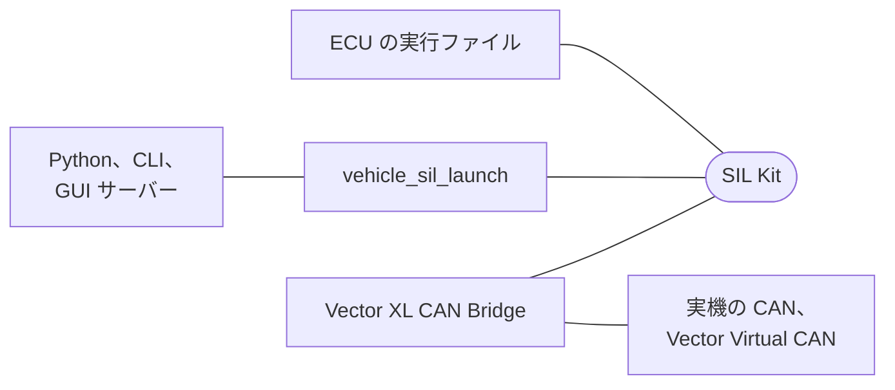
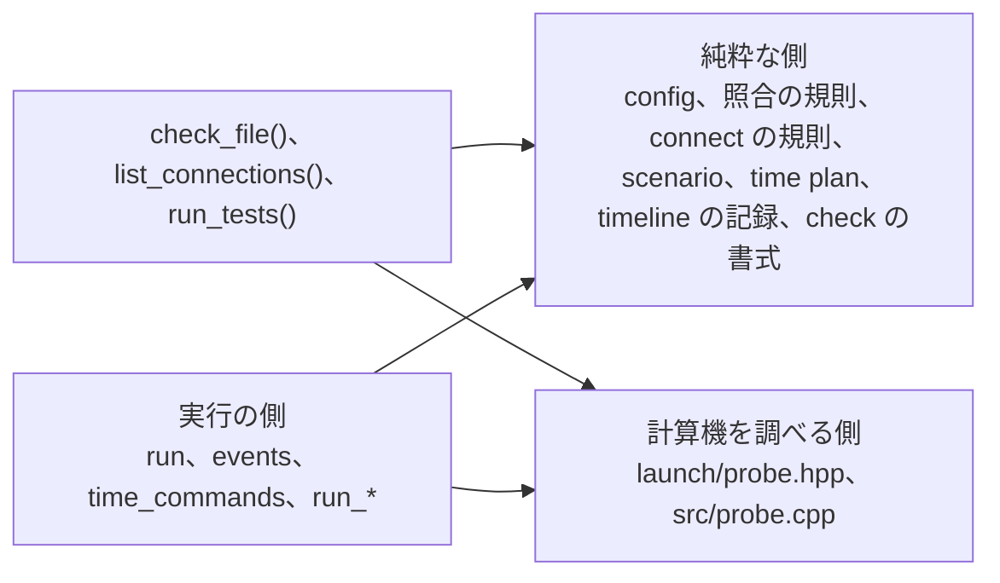
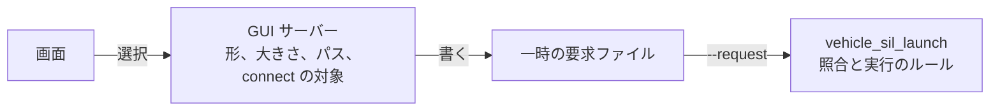

# アーキテクチャ

[English](../architecture.md)

vehicle-sil の全体像（プロセスとそのつながり）、ディレクトリとターゲットの一覧、主なクラス、設計のルールをまとめたドキュメントです。スレッド、順序、不変条件などの詳細は、「[内部の仕組み](#内部の仕組み)」の表に挙げたドキュメントにあります。

| 知りたいこと | 読む節 |
|---|---|
| どのプロセスが、何でつながるか | [全体像](#全体像) |
| どのディレクトリとターゲットに、何があるか | [ディレクトリとターゲット](#ディレクトリとターゲット) |
| 主なクラスの責務 | [主なクラス](#主なクラス) |
| コードを置く場所、時間と実行モードの扱い | [設計のルール](#設計のルール) |
| 仕様、スレッド、順序の詳細 | [内部の仕組み](#内部の仕組み) |

## 全体像

vehicle-sil は、Vector SIL Kit の上で車載通信のシミュレーションピアを作るためのライブラリ群とツールです。対象は CAN（J1939 と生の CAN）、LIN、イーサネット（生のフレーム）です。ピアは Windows（MinGW）または Linux の上で、独立したプロセスとして動きます。同じ ECU のコードを、SIL Kit を使わないプロセス内の仮想バスでも動かせます。

ECU ごとに実行ファイルを作り（`ecu_main()`）、設定ファイルで 1 つのシミュレーションにします（`vehicle_sil_launch run`）。ランチャーは SIL Kit の registry と controller を自分のプロセスに持ち、ECU の実行ファイルを子プロセスで起動します（`manual` の participant は利用者が起動します）。



図の線は、接続を表します。それぞれの接続でやり取りするものは、次のとおりです。

| 接続 | やり取りするもの | 詳しいドキュメント |
|---|---|---|
| ECU と SIL Kit | バス（CAN、LIN、イーサネット）と仮想時間の同期を、SIL Kit が運びます。 | — |
| ECU の変数とランチャー | ECU の変数（Control Agent）を、SIL Kit の publish/subscribe でランチャーの Hub に送信します。 | [internals/control.md](internals/control.md) |
| Python、CLI とランチャー | 外からの操作を、ランチャーの Control Server（`run --control`）が Control API（gRPC）で受信します。 | [control-api.md](control-api.md) |
| GUI サーバーとランチャー | 別のプロセスの GUI サーバー（`gui/server`）が、ランチャーを起動し、Control API のクライアントとしてブラウザの画面に中継します。 | [gui.md](gui.md) |
| Vector XL CAN Bridge と実機の CAN | ブリッジが、実時間で接続します。 | [bridges.md](bridges.md) |
| イーサネットのブリッジと外のイーサネット | `vehicle_sil_ethernet_bridge` が、SIL Kit の Ethernet と外のイーサネットの間でフレームを転送します（外部のインターフェースは、Linux の TAP デバイス、packet ソケット、libpcap と、Windows の Npcap です）。 | [ethernet-bridge.md](ethernet-bridge.md) |

## ディレクトリとターゲット

### ディレクトリ

```
vehicle-sil/
├── libs/core/        vehicle_sil::core   SIL Kit participant、lifecycle、他参加者の監視、時間ゲート、ホストを participant のステップにつなぐ bind_host()
├── libs/step/        vehicle_sil::step   参加者のプロトコル処理をステップで実行する仕組み（ホスト、仮想時間と実時間のドライバー、時計。バスの種類と SIL Kit に依存しない）
├── libs/lin/         vehicle_sil::lin    LIN の Master と Slave（スケジュールテーブル、フレームの送受信、診断フレーム、Sleep/Wakeup）、LIN のポートの抽象、プロセス内の仮想 LIN バス（SIL Kit と J1939 に依存しない）
├── libs/lin_silkit/  vehicle_sil::lin_silkit  vehicle_sil::lin のポートの SIL Kit 実装（仮想時間）
├── libs/can/         vehicle_sil::can    バックエンドに依存しない CAN の基盤（フレーム、ポート、vehicle_sil::step の上のホスト、仮想バス。SIL Kit に依存しない）
├── libs/can_silkit/  vehicle_sil::can_silkit  vehicle_sil::can のポートの SIL Kit 実装（仮想時間と実時間）
├── libs/can_netsim/  vehicle_sil::can_netsim  簡易 CAN Network Simulator（SIL Kit の Network Simulator API）
├── libs/eth/         vehicle_sil::eth    生のイーサネットのフレームの基盤（フレーム、ポート、vehicle_sil::step の上のチャネル、仮想ネットワーク。SIL Kit に依存しない）
├── libs/eth_silkit/  vehicle_sil::eth_silkit  vehicle_sil::eth のポートの SIL Kit 実装（仮想時間）
├── libs/eth_link/    vehicle_sil::eth_link  イーサネットのブリッジの外の側: 外部のインターフェースの抽象、フィルター、ループを防ぐ MAC の表、Linux の TAP デバイスと packet ソケット、実行時に読み込む pcap のライブラリ（Npcap、libpcap）（SIL Kit に依存しない）
├── libs/j1939/       vehicle_sil::j1939  J1939 スタック（vehicle_sil::can の上。SIL Kit に依存しない）と、そのプロトコルのコンポーネント（parts/）、型付きメッセージ（codec/）
├── libs/ecu/         vehicle_sil::ecu    ECU のアプリケーションを組み立てるクラス Ecu（変数の宣言と、ECU の構成を表す describe() とその JSON を含む。SIL Kit に依存しない）
├── libs/local/       vehicle_sil::local  プロセス内の仮想 CAN バス、仮想 LIN バス、イーサネットの仮想ネットワークの上で ECU を仮想時間で実行する LocalBench（SIL Kit に依存しない）
├── libs/testkit/     vehicle_sil::testkit  LocalBench の上の J1939 のテストの記録と故障注入（SIL Kit に依存しない）
├── libs/peer/        vehicle_sil::peer   1 つの participant と、その J1939、生の CAN、LIN のノード、Control Agent（監視の出力を含む）の組み立てと実行。Ecu の実装
├── libs/simulation/  vehicle_sil::simulation  ECU を仮想バスか SIL Kit で動かす Simulation と、ECU の実行ファイルの main()（ecu_main）
├── libs/spy/         vehicle_sil::spy  受信だけをする participant が、J1939 で聞いたことを ECU の変数に書く Spy（SIL Kit に依存しない）
├── libs/process/     vehicle_sil::process  子プロセス（ログファイルへの出力、標準出力と標準エラーの取り込みと時間切れ、行ごとの受け渡しと止める要求とプロセスの木ごとの終了。POSIX と Win32。内部用）
├── libs/launch/      vehicle_sil::launch  シミュレーションの設定ファイル、ECU の実行ファイルの --describe の出力との照合、シミュレーション全体の実行（内部用）
├── libs/control/     vehicle_sil::control  Control Agent と Control Server の中核（Hub）、両者の間のメッセージのバイト列の形式。通信と SIL Kit に依存しない
├── libs/control_silkit/ vehicle_sil::control_silkit  Agent と Hub の間を SIL Kit の publish/subscribe で運ぶ層（AgentTransport、HubTransport）
├── libs/control_grpc/ vehicle_sil::control_grpc  Control API の gRPC の層（クライアント向けの ControlServer。VEHICLE_SIL_BUILD_CONTROL_SERVER のときだけ）
├── proto/            Control API の定義（vehicle_sil/control/v1/control.proto）
├── python/vehicle_sil_control/ Control API の Python クライアントと CLI、`vehicle_sil_launch run --control` を子プロセスで動かす助け
├── bridges/common/  ブリッジの実行ファイルが共有する run_bridge()（止め方、監視のループ、止める順、終了コード。内部用）
├── bridges/can/     CAN ブリッジが共有する CanBridge と、別ターゲットの ExternalPortAdapter（移植可能、内部用）
├── bridges/vector-xl/ Vector XL CAN Bridge（チャネルの選択と引数はどこでも、XL バックエンドと実行ファイルは Windows 専用）
├── bridges/ethernet/ イーサネットのブリッジ（SIL Kit の Ethernet と外部のインターフェースの間の転送、統計、引数の解釈、実行ファイル。どのプラットフォームでもビルドする）
├── tools/common/     実行ファイル共通のコマンドライン解析、終了コード、ログ出力（内部用、ヘッダーのみ）
├── tools/sim_controller/ 仮想時間のシミュレーションを開始・停止する system controller（vehicle_sil_sim_controller）
├── tools/can_bus_simulator/ 簡易 CAN Network Simulator の実行ファイル（vehicle_sil_can_bus_simulator）
├── tools/launch/     設定ファイルの照合とシミュレーション全体の実行をする vehicle_sil_launch
├── tools/j1939_codegen/ YAML の定義から J1939 の型付きメッセージ（C++ のヘッダー）を作る生成器（Python。ビルドのときに vehicle_sil_add_j1939_codec() が呼ぶ）
├── examples/getting_started/ 最初の例: Ecu& を受け取る 2 つの ECU を Simulation で動かす
├── examples/         やりたいこと別のサンプル（typed_messages、pid_stream、fault_injection、vehicle、low_level など。索引は examples/README.md）
├── examples/j1939/   コンポーネントで作った 2 つの ECU（ecu_pair。Simulation で動かし、テストも同じコードを使う）、独自プロトコルのパラメーターサービス（param_service）と、最小ピア（実時間の Peer で送信する sender と、SIL Kit の CAN で直接受信して照合する receiver）
├── examples/virtual_time/ 仮想時間のピア（Peer の上の物理モデル、tick() 型の既存 ECU を載せた J1939 ECU、LIN Master と Slave）
├── examples/lin/     LIN クラスタのピア（Master と、役割の違う Slave。フレームの送受信と Sleep/Wakeup）
├── examples/ethernet/ 生のイーサネットのフレームを送受信する 2 つの ECU（1 つのプロセスで動かす例と、ecu_main の実行ファイル、設定ファイル、シナリオ）
├── examples/ecu_main/ ECU ごとの実行ファイル（ecu_main）と、それらを 1 つのシミュレーションにする設定ファイル、シナリオ、ダッシュボード
├── examples/launch_control/ ランチャーの Control Server に Python から接続する例（write_before_start.py、pause_and_step.py）
├── examples/gui_client/ GUI サーバーの API を JavaScript から使う例
├── examples/gui_starter/ GUI サーバーに配信させる自分の画面のテンプレート
├── examples/fetchcontent_consumer/   外部プロジェクトからの利用例
├── tests/            ユニットテスト、統合テスト、FetchContent テスト、XL ドライバのフェイク（tests/vector_xl/fake_xl）
├── external/         SIL Kit（サブモジュール）
├── patches/          SIL Kit へのパッチ（ビルドツリーのコピーに適用する。上流への提出用の形式）
├── gui/server/       ブラウザの GUI のサーバー（Python、vehicle-sil-gui。ランチャーを動かし、HTTP と WebSocket の API を提供する）
├── gui/protocol/     GUI サーバーの HTTP と WebSocket の API の仕様と例
├── gui/client/       GUI サーバーのクライアントのライブラリ（TypeScript）
├── gui/web/          サンプルの画面（Angular）
├── template/         ECU のプロジェクトのテンプレート（ビルド済みのツールをダウンロードする get_tools.py を含む）
├── scripts/          開発と CI のスクリプト（verify.py、package.py など。AGENTS.md の "Verification and scripts"）
├── cmake/            依存の取り込み、テストの登録、境界の検査
└── docs/
```

空のディレクトリや空のターゲットは作りません。

### ターゲット

区分は、どこから使い始めるかの目安です。

| 区分 | 意味 |
|---|---|
| 利用者向け | ECU を書くときと、ECU を 1 つのシミュレーションにするときに直接使うライブラリです（使い始めるクラスは `vehicle_sil::Ecu` と `vehicle_sil::Simulation`）。 |
| 基盤 | 利用者向けのライブラリを通して使うもので、直接も使えますが、API は上の層の必要に合わせて変わります。 |
| テスト用 | テストとサンプルのためのツールです。 |
| — | 実行ファイル、生成コード、CAN ブリッジは、区分に入れていません。 |

各ターゲットがリンクするもの（依存の向き）は、[code-map.md](code-map.md#観点から探す) から、領域ごとの依存の向きの図へたどれます。

| ターゲット | 区分 | 内容 | 主な型と機能 | 詳しいドキュメント |
|---|---|---|---|---|
| `vehicle_sil::sim_base`（ヘッダーのみ） | 基盤 | 仮想時間の基本の型と関数と、registry の URI がループバックのアドレスかの判定で、SIL Kit なしで使います。 | `SimTime`、`SimDuration`、`StepInbox`、`periodic()`、`once_at()`、`is_loopback_registry_uri()` | — |
| `vehicle_sil::core` | 基盤 | SIL Kit の participant、lifecycle、他参加者の状態、仮想時間のステップを RAII で管理し、プロトコルに依存しません。 | `vehicle_sil::ParticipantRuntime`、`SimulationController`（仮想時間のシミュレーションの開始と停止、一時停止、ステップ実行、速度）、`TickScheduler`、`RealTimePacer`、`vehicle_sil::bind_host()`（`step::Host` を participant のステップにつなぐ）、`sim_base` の型（`SimTime`、`StepInbox`） | [internals/core.md](internals/core.md) |
| `vehicle_sil::step` | 基盤 | 1 つの参加者のプロトコル処理をステップで実行する仕組みで、バスの種類にも SIL Kit にも依存しません。 | `Member`（ステップの参加者）、`Host`（`Member` を段の順に実行する）、`StepDriver`（仮想時間）、`RealTimeDriver`（実時間）、時計（`SteadyRealTimeClock`、テスト用の `ManualRealTimeClock`）、`TimeDomain`（時間の領域） | [internals/can.md](internals/can.md) のホストと駆動の節 |
| `vehicle_sil::lin` | 基盤 | LIN の Master と Slave、バスへのインターフェース、プロセス内の仮想 LIN バスで、仮想時間で使い、SIL Kit にも J1939 にも依存しません（ふつうは `Ecu::lin_master()` と `Ecu::lin_slave()` から使います）。 | `vehicle_sil::lin::LinMaster`（スケジュールテーブル、Master が送るフレーム、マスターリクエスト、go-to-sleep と wakeup）、`vehicle_sil::lin::LinSlave`（ステップで設定した値で応答、スレーブレスポンス、Master のフレームの受信、休止と起床）、`LinPort`、`VirtualLinBus`、`LinScheduleTable`、`validate_schedule()` | [internals/lin.md](internals/lin.md) |
| `vehicle_sil::lin_silkit` | 基盤 | `vehicle_sil::lin` のポートの SIL Kit 実装で、`Peer` が使います。 | `vehicle_sil::lin::SilKitLinPort` | — |
| `vehicle_sil::can` | 基盤 | バックエンドに依存しない CAN の基盤（J1939 スタックの下の層）で、SIL Kit に依存しません。 | `vehicle_sil::can::Frame`、`Port`（ポートの仕様）、`Steppable`、`Host`（複数のプロトコル処理をステップで実行する。`step::Host` の上で、`StepDriver`、`RealTimeDriver`、時計は `vehicle_sil::step` のものを同じ名前で使える）、テスト用の仮想バス（調停と送信時間の模擬、故障注入、ECU 単位の通信断を選べる）、`VirtualCanBus`、`CanBusModel`、`TapPort`（生フレームを読み取り専用で観測する） | [internals/can.md](internals/can.md) |
| `vehicle_sil::can_silkit` | 基盤 | `vehicle_sil::can` のポートの SIL Kit 実装（仮想時間と、時刻同期なしの実時間）です。 | `vehicle_sil::can::SilKitCanPort`、`vehicle_sil::can::bind_host`（`core` の `bind_host()` の別名） | — |
| `vehicle_sil::can_netsim` | 基盤 | 簡易 CAN Network Simulator で、SIL Kit の Network Simulator API を使い、CAN の調停、送信時間、バスの占有を仮想時間で模擬します。 | `CanBusSimulator`、Vector SIL Kit Network Simulator と共用の設定ファイルの読み込み | [internals/can.md](internals/can.md) |
| `vehicle_sil::eth` | 基盤 | 生のイーサネットのフレーム（宛先から payload の終わりまで。FCS なし）の基盤で、EtherType と payload は解釈せず、SIL Kit に依存しません。 | フレームと MAC アドレスの型、ポートの仕様、`Channel`（アプリケーションがステップの中で送受信する `step::Member`。同じ時刻のフレームを送信元のアドレスで並べる）、`VirtualEthernetBus`（ハブとして振る舞うプロセス内の仮想ネットワーク） | [internals/ethernet.md](internals/ethernet.md) |
| `vehicle_sil::eth_silkit` | 基盤 | `vehicle_sil::eth` のポートの SIL Kit 実装（仮想時間）です。 | `vehicle_sil::eth::SilKitEthPort` | — |
| `vehicle_sil::j1939` | 利用者向け | J1939 スタック（名前空間 `vehicle_sil::j1939`、ヘッダー `vehicle_sil/j1939/`）で、SIL Kit に依存しません。 | 単一フレームの送受信、Request、Acknowledgement、NAME と Address Claim（要求、競合、Cannot Claim、任意アドレスの選択、アドレス表、アドレス違反、Commanded Address の処理、状態の通知）、トランスポートプロトコル（BAM、RTS/CTS）、コンポーネントを作るツールキット（`Subscription`、`Timer`、`Node::attach`）、読み取り専用の観測（`Observer`）、`vehicle_sil::j1939::Network`、`Node`、`Pgn`、`Identifier` | [internals/j1939.md](internals/j1939.md) |
| `vehicle_sil::j1939_broadcast_suppression`、`vehicle_sil::j1939_diagnostics` | 利用者向け | `vehicle_sil::j1939` の公開 API とツールキットだけで作ったプロトコルのコンポーネントです。 | DM13 によるブロードキャストの抑制、DTC と DM1/DM2/DM3/DM11/DM22、識別情報（ソフトウェア ID、ECU ID、製品 ID、診断プロトコル ID）、`BroadcastSuppression`、`Diagnostics`、`Identification` | [internals/j1939.md](internals/j1939.md) |
| `vehicle_sil::j1939_periodic_sender`、`vehicle_sil::j1939_requester`、`vehicle_sil::j1939_monitor`、`vehicle_sil::j1939_address_commander`、`vehicle_sil::j1939_exchange` | 利用者向け | ECU アプリ向けのコンポーネントで、同じく公開 API とツールキットだけで作ります。 | `PeriodicSender`（PG の周期送信）、`Requester`（Request の送信と、応答・ACK・時間切れの報告）、`Monitor`（受信の最新値と途絶）、`AddressCommander`（Commanded Address の送信）、`Exchange`（独自プロトコルのコマンドと応答。例は [examples/j1939/param_service](../../examples/j1939/param_service)） | 使い方は [j1939-guide.md](j1939-guide.md)、内部は [internals/j1939.md](internals/j1939.md) |
| `vehicle_sil::j1939_codec`（ヘッダーのみ） | 利用者向け | J1939 の型付きメッセージで、YAML で定義した PG と信号から `vehicle_sil_add_j1939_codec()` がビルドのときに C++ の型を生成し、ビット操作を書かずに信号を値として送受信できます。 | 定義できるもの（位置、符号、スケーリング、範囲、列挙、Proprietary A/B、名前を付けた特別な値とそのプロファイル、埋め値）、`codec.hpp`、`PeriodicSender`、`codec_node.hpp` | 使い方は [j1939-codec.md](j1939-codec.md)、内部は [internals/j1939.md](internals/j1939.md) |
| `vehicle_sil::ecu` | 利用者向け | ECU のアプリケーションを組み立てるクラス `vehicle_sil::Ecu` で、`Peer` と `LocalBench` の ECU が実装するので、`Ecu&` を受け取るクラスは仮想バスでも SIL Kit でも同じコードで動きます（SIL Kit に依存しません）。 | J1939 の `Network`、生の CAN チャネル（J1939 でないプロトコル用の `can::RawChannel`）、LIN の Master と Slave（`lin_master()`、`lin_slave()`）、生のイーサネットのフレームのチャネル（`ethernet()`。`eth::Channel`）、外から読み書きする変数（`input`、`output`、ECU の Control Agent `agent()`）、ステップごとの処理（`on_step`、`every`、ある時刻に 1 回の `at`）、ECU が持つオブジェクト（`emplace`）、ECU の構成を表す JSON（`describe()`。`--describe` の出力）、`EcuDescription`、`to_json()`、`detail::OwnedObjects`、`detail::EcuAgent` | [internals/execution.md](internals/execution.md)、[ecu-executable.md](ecu-executable.md) |
| `vehicle_sil::local` | 基盤 | SIL Kit なしでプロセス内の仮想バス（CAN、LIN、イーサネット）に ECU を載せ、呼んだスレッドで仮想時間で進める `vehicle_sil::LocalBench` で、`Simulation` のローカルの実行もこれを使います。 | `LocalBench`（仮想バスの上の ECU（`Ecu`）とその `Network` を名前で組み立てる） | [internals/execution.md](internals/execution.md) |
| `vehicle_sil::testkit` | テスト用 | `LocalBench` の上の J1939 のテストのツールです。 | イベントと生フレームの記録（`J1939Events`、`FrameLog`）、故障注入の関数（`faults`）、`testkit::LocalCan`（`LocalBench` の別名） | [internals/execution.md](internals/execution.md) |
| `vehicle_sil::peer` | 基盤 | 1 つの SIL Kit participant とそのノードをまとめて作り、仮想時間か実時間で動かす `vehicle_sil::Peer` で、`Ecu` を実装します。 | J1939 の `Network`（SIL Kit の CAN か外部のポート）、生の CAN、LIN の Master/Slave、イーサネットのチャネル（SIL Kit の Ethernet。仮想時間だけ）、Control Agent（J1939 の通信状態の監視の出力を含む）、`start_together()` | [internals/execution.md](internals/execution.md) |
| `vehicle_sil::simulation` | 利用者向け | ECU をプロセス内の仮想バスか SIL Kit の participant として仮想時間で動かして失敗を例外で報告する `vehicle_sil::Simulation` と、ECU のクラスを 1 つの実行ファイルにする `ecu_main()` です。 | 動かす場所はコンストラクターで選ぶ（SIL Kit では、registry をプロセス内に立てられる）、`ecu_main()` の引数はどの ECU も同じ（`--describe`、`--registry-uri`、`--local`）、`SilKitOptions`、`SimulationError`、`EcuMainOptions` | 入門は [examples/getting_started](../../examples/getting_started)、[ecu-executable.md](ecu-executable.md)、[internals/execution.md](internals/execution.md) |
| `vehicle_sil::spy` | 利用者向け | 受信だけをする participant が、J1939 で聞いたことを ECU の変数に書く `vehicle_sil::spy::Spy` です。`vehicle_sil::j1939` と `vehicle_sil::ecu` の公開 API だけで作り、SIL Kit に依存しません。 | `Network` に `j1939::Listener` を作り（借りることもできる）、利用者が書く見張りのクラスに `spy::Scope`（変数の前置き、ハンドラーの登録と解除、ステップの時刻）を渡す。聞きこぼしの数も変数に書く | [j1939-guide.md](j1939-guide.md) の「受信だけをする participant」 |
| `vehicle_sil_sim_controller`（実行ファイル） | — | system controller の CLI です。 | — | — |
| `vehicle_sil::process`（内部用） | — | 子プロセスを起動して管理します（下の段落）。 | `ChildProcess`（出力をログファイルへ）、`run_captured()`（標準出力と標準エラーを別々に取り込み、時間切れで止める）、`Process`（標準出力と標準エラーを行ごとに渡す。作業ディレクトリ、止める要求、起動したプロセスとそのグループ（Windows ではジョブ）の全部のプロセスの終了） | — |
| `vehicle_sil::launch`（内部用。SIL Kit をサブモジュールからビルドしたとき） | — | 設定ファイルの読み込み、照合、シミュレーション全体の実行をするランチャーの本体です。 | `--describe` の JSON の読み込み、照合のルール（プロセスを起動しない関数）、実行（registry と `SimulationController` をプロセスの中に持ち、participant を子プロセスで動かす。実行の判定はプロセスを起動しない関数）、人向けと JSON の出力 | [simulation-config.md](simulation-config.md) |
| `vehicle_sil_launch`（実行ファイル） | — | `vehicle_sil_launch check` と `vehicle_sil_launch run` で、`-DVEHICLE_SIL_BUILD_CONTROL_SERVER=ON` のビルドでは `run --control` の Control Server も持ちます。 | — | [simulation-config.md](simulation-config.md)、[simulation-check.md](simulation-check.md)、[simulation-run.md](simulation-run.md) |
| `vehicle_sil::control` | 利用者向け | ECU の Control Agent と、Control Server の中核の `Hub` です。 | `vehicle_sil::control::Agent`（型・範囲・単位つきの変数の公開、外からの書き込みを仮想時刻を指定してステップの中で反映、固定容量のキュー。ECU が持って動かし、`Ecu::input()`、`output()` で変数を宣言する）、`Hub`、`wire` | [internals/control.md](internals/control.md) |
| `vehicle_sil::control_silkit` | 利用者向け | Control Agent と `Hub` の間を SIL Kit の publish/subscribe で運ぶ層で、`ecu_main()` で作った ECU と `vehicle_sil_launch run` が使い、gRPC は不要です。 | `vehicle_sil::control_silkit::AgentTransport`、`HubTransport` | [internals/control.md](internals/control.md) |
| `vehicle_sil::control_proto`（`VEHICLE_SIL_BUILD_CONTROL_SERVER` のとき） | — | `control.proto` から生成したコード（`control_grpc` の内部）です。 | — | — |
| `vehicle_sil::control_grpc`（同上） | 利用者向け | Control API（gRPC）の Server（クライアント向け。ECU の Agent は SIL Kit の `vehicle_sil::control_silkit` で接続します）で、`vehicle_sil_launch run --control` が使います。 | `vehicle_sil::control_grpc::ControlServer`、`time_control_of()`、認証（TLS、トークン、役割） | [control-api.md](control-api.md) |
| `vehicle_sil::bridge_runtime`（内部用） | — | ブリッジの実行ファイルが準備の後に呼ぶ `vehicle_sil::bridge_runtime::run_bridge()` で、プラットフォームに依存しません。 | 止める要求の受け方（シグナル、Windows のコンソールを閉じたとき）、監視のループ（participant の状態の判定、外の側の失敗、警告、監視の行）、止める順（統計を SIL Kit の participant の停止より先に出す）、終了コード、`BridgeHooks`（ブリッジごとの部分を渡す） | [bridges.md](bridges.md) |
| `vehicle_sil::can_bridge_core` | — | CAN ブリッジのうち、外部の側に依存しない部分で、プラットフォームに依存しません。 | `vehicle_sil::can_bridge::CanBridge` など、`ExternalCanPort` | — |
| `vehicle_sil::can_external` | `vehicle_sil::can_bridge_core`、`vehicle_sil::can`、`vehicle_sil::can_silkit` | 外部 CAN ポートの上にプロトコルスタックを直接載せるための `ExternalPortAdapter`。CAN ブリッジはリンクしません。プラットフォームに依存しません。 | `vehicle_sil::can_bridge::ExternalPortAdapter`（外部 CAN ポートを `vehicle_sil::can` の実時間のポートにする） | — |
| `vehicle_sil::vector_xl`（Windows のみ） | — | Vector XL Driver のバックエンドで、Windows 専用で、XL Driver Library が必要です。 | `vehicle_sil::vector_xl::XlDriver`、`XlCanPort` | — |
| `vehicle_sil_vector_xl_bridge`（Windows のみ、実行ファイル） | — | ブリッジの CLI です。 | — | — |
| `vehicle_sil::eth_link` | — | イーサネットのブリッジの外の側で、SIL Kit に依存しません。 | `vehicle_sil::eth_link::ExternalLink`（外部のインターフェースの抽象）、`FrameFilter`（フィルター）、`MacSideTable`（ループを防ぐ）、`make_tap_link()` と `make_packet_link()`（OS のインターフェース。Linux だけ）、`make_pcap_link()`（pcap のライブラリ。Windows の Npcap、Linux の libpcap を実行時に読み込む） | [ethernet-bridge.md](ethernet-bridge.md) |
| `vehicle_sil::ethernet_bridge_core` | — | SIL Kit の `IEthernetController` と `ExternalLink` の間でフレームを運ぶ `vehicle_sil::ethernet_bridge::EthernetBridge` で、プラットフォームに依存しません。 | 統計と監視の行、引数の解釈、起動の 1 行 | — |
| `vehicle_sil_ethernet_bridge`（実行ファイル） | — | イーサネットのブリッジの CLI で、どのプラットフォームでもビルドします（外部のインターフェースは、Linux の `tap`、`packet`、`pcap` と、Windows の `npcap`）。 | — | — |

`vehicle_sil::process` の `run_captured()` と `Process` の子は、自分のプロセスグループ（Windows ではプロセスグループとジョブオブジェクト）で動き、標準の 3 つのほかにハンドルを受け継がず、Linux では呼んだスレッドが終わると SIGKILL を受けます。プロセスの起動は、POSIX では `fork` と `exec`（`ChildProcess` は `posix_spawn`）、Windows では `CreateProcessW`（パスと引数は UTF-8 から変換する）です。

利用側は必要なターゲットだけをリンクします。依存ライブラリは `EXCLUDE_FROM_ALL` で追加しているので、リンクしないものはビルドされません（外部プロジェクトから取り込んだときは vehicle-sil のライブラリも同じです）。

## 主なクラス

| クラス | 責務 |
|---|---|
| `vehicle_sil::ParticipantRuntime` | SIL Kit の participant、lifecycle（autonomous または coordinated）、SystemMonitor、時刻同期（任意）を RAII で所有し、他参加者の状態（Running か、終了したか）を待てます。 |
| `vehicle_sil::SimulationController` | coordinated で起動するシミュレーションの system controller で、必要な参加者がそろったら一斉に開始させ、指定した仮想時刻で停止させます。 |
| `vehicle_sil::StepInbox` | SIL Kit のスレッドで受信したメッセージをステップの境界までため、決まった順序で渡します。 |
| `vehicle_sil::TickScheduler` | 1 つの participant の中で、固定周期のタスク（既存 ECU の `tick()` など）をステップから呼びます。 |
| `vehicle_sil::RealTimePacer` | 仮想時間を壁時計に一定の比率で結合するための待ち時間を計算します。 |
| `vehicle_sil::Ecu` | ECU のアプリケーションを組み立てるクラス（J1939 の `Network`、生の CAN、LIN の Master と Slave、ステップごとの処理、ECU が持つオブジェクト）で、`Peer` と `LocalBench` の ECU が実装します（[internals/execution.md](internals/execution.md)）。 |
| `vehicle_sil::Simulation` | `Ecu` を仮想バスか SIL Kit の仮想時間で動かし、失敗を `SimulationError` で報告します（[internals/execution.md](internals/execution.md)）。 |
| `vehicle_sil::Peer` | 1 つの participant と、その J1939 の `Network`、LIN の Master と Slave、ステップごとのアプリの処理を組み立てて動かし、正しい順序で片付けるもので、`Ecu` を実装します（[internals/execution.md](internals/execution.md)）。 |
| `vehicle_sil::lin::LinMaster` | LIN のスケジュールテーブルを仮想時間で実行してヘッダーごとの結果（応答の衝突は Error）を返し、Master が送るフレーム、診断のマスターリクエスト、go-to-sleep コマンド、wakeup パルスを送信します。 |
| `vehicle_sil::lin::LinSlave` | ステップで設定された値で Master のヘッダーに応答し（診断のスレーブレスポンスは 1 回だけ）、Master が送るフレームを受信し、休止と起床の状態を管理します。 |
| `vehicle_sil::lin::LinPort` | LIN のノードがバスにアクセスする唯一のインターフェースで、実装は `VirtualLinBus` のエンドポイントと `SilKitLinPort` です。 |
| `vehicle_sil::lin::VirtualLinBus` | プロセス内の LIN バスで、送信した側の呼び出しの中で同期に配信し、`LocalBench` が LIN のネットワーク名ごとに 1 つ作ります。 |

`ParticipantRuntime` の保証、所有と終了の順序、スレッドとキューは [internals/core.md](internals/core.md) にあります。

## 設計のルール

### 共通化のルール

どの処理をどのライブラリに置くかは、次のとおりです。

| 処理 | 置く場所 |
|---|---|
| どのプロトコルでも同じになる処理（SIL Kit への接続、lifecycle、他参加者の監視、仮想時間（ステップ、受信のバッファ、周期タスク、実時間との結合、時間ゲート）、失敗の判定 `FailureCheck`） | `core` |
| 外部操作（Control Agent と Hub） | `control`（Control API の時間の操作は `core` の時間ゲートを使います） |
| ステップを実行する仕組み（ホスト、ドライバー、時計、時間の領域） | バスの種類によらない `step` |
| バスごとのプロトコル処理とポートの組 | バスごとのライブラリ（`can`、`eth`）で、`step::Member` にしてホストに載せます（`eth::Channel` はそれ自体が `step::Member`）。 |
| バスのコントローラ（`ICanController` など） | 利用側が `ParticipantRuntime::participant()` から SIL Kit の API で作ります。 |
| J1939 と LIN のプロトコル処理 | 共通化しません。 |

`core` は CAN、LIN、J1939 に依存しません。

LIN はホストに載せません。いまの 1 ステップの順序は「アプリケーション → LIN の `step(now)` → 変数の読み出し → CAN の送信」で、LIN をホストの送信の段に移すと、LIN のハンドラが書いた値を読み出す時点が 1 ステップずれるためです。LIN のポートは受信のバッファを持たず、仮想時間だけで動きます。

将来のためだけの抽象クラスや空の実装は作りません。

### 時間の扱い

- 実時間（壁時計）とシミュレーション時間（SIL Kit の仮想時刻）を、型と名前で区別します（`SimTime`）。
- 時間管理は `core` に置き、J1939 や LIN の内部には埋め込みません。
- 一時停止とステップ実行は `SimulationController` の時間ゲートで行い、Control API はこれを操作します（[internals/virtual-time.md](internals/virtual-time.md) の「一時停止、ステップ実行、速度（時間ゲート）」）。

受信ハンドラから反応的に送信したメッセージは、SIL Kit の到着保証の対象外です。新しいプロトコルを仮想時間に載せるときは、送信をステップの中で行うか、LIN と同じように到着の上限を示してから使います。

### 実行モードと通信バックエンド

- 実行モード（仮想時間か実時間か。`PeerOptions::virtual_time`）と、バスとの接続（SIL Kit のポートか、利用者が渡すポート。Vector XL の `ExternalPortAdapter` など）は、別々に選びます。
- 実時間でも、SIL Kit の中だけで動かせます（J1939 の最小ピア `examples/j1939/sender`）。
- 仮想時間を壁時計に合わせるのは、ピアの `VirtualTimeOptions::real_time_factor` か、時間ゲートの速度です（[internals/virtual-time.md](internals/virtual-time.md) の「実時間との結合」）。
- 物理 CAN と Vector Virtual CAN は実時間で動かし、仮想時間のシミュレーションには参加させません（[bridges.md](bridges.md) の「物理 CAN と仮想時間」）。

### `libs/launch` の層



- 純粋な側は、値から指摘を作り、計算機を調べません。SIL Kit、`process`、`participant_runtime`、`participant_configuration`、`launch/run.hpp`、`launch/probe.hpp`、`events`、`stop_requests`、`time_commands`、`run_*.hpp` を、直接にも、include するヘッダーを通しても含みません。
- ランチャーが計算機について調べること（ファイルシステム、環境、起動したプロセスの出力）は `probe` に置きます。`check_file()`、`list_connections()`、`run_tests()` が `probe` を呼び、調べた結果を値か関数として純粋な側に渡します。実行の側（シミュレーションの実行）は両方に依存します。
- この向きは試験 `launch.pure_files_include_no_runtime`（`cmake/VehicleSilCheckIncludes.cmake`）で守ります。純粋な側に新しいファイルを足したら、`tests/launch/CMakeLists.txt` の `_launch_pure_files` に足します。
- 構成の照合（`launch/check.hpp` の `CheckReport`）はシナリオを知りません。シナリオが構成に依存し、逆はありません。`check --scenario` が読んだものは `ScenarioCheck`（`launch/scenario_check.hpp`）で、`check_file()` は `CheckReport` にシナリオを足した `Checked`（`launch/checked.hpp`）で返します。CheckReport に写すとシナリオが落ちるので、受けるときは `Checked` で受けます。試験 `launch.config_files_do_not_reach_the_scenario` が守ります。構成の側に新しいファイルを足したら、`tests/launch/CMakeLists.txt` の `_launch_config_files` に足します。
- 例外が 1 つ残っています。`connect.cpp` の `bridge_working_directory()` が、相対のディレクトリを絶対にします。
- 純粋な側に、計算機を調べる処理を足さないでください。`probe` に置き、結果を渡します。各部分のファイルは [code-map-launcher.md](code-map-launcher.md) にあります。

### 実行を計画し、観察し、閉じる形

各部分の詳細は [code-map-launcher.md](code-map-launcher.md) にあります。この節は形と守る約束だけを書きます。

- 実行は 2 段です。`Runner::prepare()` は中断を確かめ、ログとタイムラインを開き、実行の Hub を返します（続けられないときは何も返しません）。2 段の間に `run_file()` が、その Hub の上で Control Server を始めます（`ControlEndpoint::start()`。実行が持つときだけ）。registry より先に待ち受けるためです。`Runner::run()` は registry から終わりまでを行います。
- Hub と SIL Kit の部品（registry、controller、transport）は実行が作り、1 つの接続として、作った順の逆（transport、controller、registry）に閉じます。Control Server は Hub を借りるだけです（`std::shared_ptr` を持ち、SIL Kit の部品は持ちません）。そのため、期限で放置された閉じるスレッドが触るのは接続だけで、`Runner` はほかの実行と同じように破棄できます。
- `run_file()` が実行に渡すものは 3 種類です。
  - `RunPlan`: 値です。通った照合、要求（`RunRequest`）、`RunLimits` から、純粋な `plan_run()` が作ります。実行はこれに書きません。
  - `RunObservers`: 実行が呼び返す、呼び出し側の関数です（行、中断の名前、`before_start`）。
  - `RunControls`: 実行が借りるもの（停止の要求、時刻の命令）と、実行が自分で作るものです。

  イベントの流れ（`RunLent::events`）は `run_file()` のものです。照合は `run_file()` が自分で書きます。段階と状態は、自前の操作盤のときは `run_file()` が書き、貸した操作盤では呼び手の観察者が書きます。実行には、実行の知っているインターフェース（`RunEvents`）だけを渡します。
- 照合・実行・テストが何を頼まれるかは、1 つの値 `RunRequest`（`launch/request.hpp`）です。2 つの部分から成ります。利用者の選択（`RunIntent`）と、呼び出し側の指定（`RunHost`。ツールとログの場所、上限、Control Server や標準入力のコマンドを求めるか）です。`check_file()`、`run_file()`、`test_file()` がこれを受け取ります。コマンドラインと要求ファイルは、これを埋める 2 つの方法です。`validate_request()`（純粋）が、一緒には成り立たない欄のルールを置く唯一の場所です。`tools/launch` は引数を欄に写すだけなので、そこでの `cli::UsageError` は引数の形の誤りを意味し、意味のルールには使いません。
- `--request <file>` は、意図を JSON のファイルから読みます（`schema/run-request.schema.json`）。形式の読み手は 1 つ（`read_request_file()`）で、引数は欄ごとにファイルに勝ちます。値がファイルから来たときは、メッセージがファイルの名前を挙げます。
- `--connect` が足すブリッジの印は計画にあります（`RunMember::outside`。参加者ごとに `RunMember` が 1 つ）。`ParticipantConfig` はファイルが書いたことだけを持ちます。刻みの計画は、ブリッジを足す前の、ファイルの構成で作ります。
- 実行が見たものは、部分に分かれた `RunOutcome` です（`setup`、`start`、`end`、`control`、`scenario`、`close`、続いて `timing`、`participants` ほか）。JSON の出力の形とは別です。JSON は `format_run_json()` が書き、結果の判定は `assess_run()` が行います。実行が終わった理由は、結果の `end_reason()` です（`EndReason`。stopped と interrupted のどちらかは、最初に止めるよう頼んだものが決めます）。終了コードと、結果が成功かどうかは、1 つの表（`libs/launch/src/exit_codes.hpp`。`RunReport::exit_code()`、`RunReport::ok()`、`check_exit_code()`、`ConnectionsReport::exit_code()` が使う）から決まります。人に見せる 1 文は `RunReport::message()` で、`libs/launch/src/run_report.cpp` の `RunReport::result()` の隣にあります。
- 終了コード: 合格とオペレーターの停止は 0、失敗は 1、読めないファイルと失敗した準備は 3、使い方の誤り（読めない要求ファイルも）は 4。途中で切れたシナリオと中断には、それぞれ専用の値があります。
- Control Server の受け口は `libs/launch`（`src/control_server.cpp`。`VEHICLE_SIL_BUILD_CONTROL_SERVER=ON` のときだけビルド。ライブラリの公開ヘッダーは gRPC のヘッダーを include しません）にあります。`run_file()` が、要求が `--control` のために指すもの（`RunHost::control`）から作り、起動し、終えます。破棄は、呼ぶ側が結果の後に行います。`tools/launch` は引数を要求に写すだけです。

### GUI サーバーが実行をランチャーに渡す形



- GUI サーバーは、画面の選択を要求ファイルに書き（利用者だけが読める。ランチャーが終わったら削除）、`--request` を付けて `check` か `run` を起動します。そのために、ほかのランチャーのオプションは組み立てません。
- サーバーが確かめるのは、欄の形と大きさ、パスがルートの下にあること、`connect` の対象が `POST api/connections` で使えると挙げられたものであること（`target-not-listed`）だけです。意味のルール（機種がある、participant がある、欄が一緒に成り立つ）はすべてランチャーの照合のもので、サーバーはその指摘を見せます。
- `POST api/connections` は、ファイルの 1 つのネットワークについて `connections --json` を走らせ、使える対象を覚えます。この一覧が、あとの照合や実行が名指しできるものなので、画面は、ランチャーがこの計算機で見つけていない機器を渡せません。

## 内部の仕組み

vehicle-sil を変更するときや、仕様と制限を確認するときに、該当するドキュメントだけを読みます。

| ドキュメント | 内容 |
|---|---|
| [internals/core.md](internals/core.md) | `ParticipantRuntime` の保証、所有と終了の順序、スレッドとキュー、実時間モードの時刻 |
| [internals/can.md](internals/can.md) | CAN の共通基盤: ポート、イベント、`Steppable`、ホスト、ドライバー、仮想バス、`TapPort`、SIL Kit のポート、バスのタイミング、簡易 CAN Network Simulator |
| [internals/j1939.md](internals/j1939.md) | J1939 スタック: エンジン、Address Claim、トランスポートプロトコル、ツールキット、プロトコルのコンポーネント、型付きメッセージ、`Observer`、資源の上限、既知の制限 |
| [internals/lin.md](internals/lin.md) | LIN の Master と Slave、スケジュール、診断フレーム、休止と起床、ポートと仮想 LIN バス |
| [internals/ethernet.md](internals/ethernet.md) | イーサネットの基盤: フレーム、ポート、チャネル（受信の順、時間、上限、フィルター）、仮想ネットワーク、SIL Kit のポート（時刻同期していない送信元）、未確認の値 |
| [internals/execution.md](internals/execution.md) | `Ecu`、`Simulation`、`Peer`、`LocalBench` とテストキット（1 ステップの順序、所有と破棄、バスからの切断） |
| [internals/virtual-time.md](internals/virtual-time.md) | 共通仮想時間: 進み方、実時間との結合、時間ゲート（一時停止、ステップ実行、速度、遅れ）、受信の順序、固定周期 `tick()` の統合 |
| [internals/control.md](internals/control.md) | Control API の内部: Control Agent、Hub、SIL Kit の上のトランスポート、Control Server、ランチャーの Control Server、シナリオ |
| [bridge-contract.md](bridge-contract.md) | ランチャーとすべてのブリッジの取り決め: 引数、`--describe`、デバイスの一覧、終了コード、ブリッジが出す行、デバイスの印、自作のブリッジ |
| [bridges.md](bridges.md) | Vector XL CAN Bridge: 最初の接続、転送の仕様、バスの監視、スレッド、検証の範囲 |
| [ethernet-bridge.md](ethernet-bridge.md) | イーサネットのブリッジ: 最初の接続、バックエンド（`tap`、`packet`、`pcap`、`npcap`）と権限、外部のインターフェース、転送、フィルター、ループの防止、統計と監視の行、引数、確認した範囲 |

## 関連するドキュメント

- どこに何があるか → [code-map.md](code-map.md)
- SIL Kit の固定、パッチ、上流の挙動、gRPC → [dependencies.md](dependencies.md)
- ビルドと、自分の CMake プロジェクトからの取り込み → [build.md](build.md)
