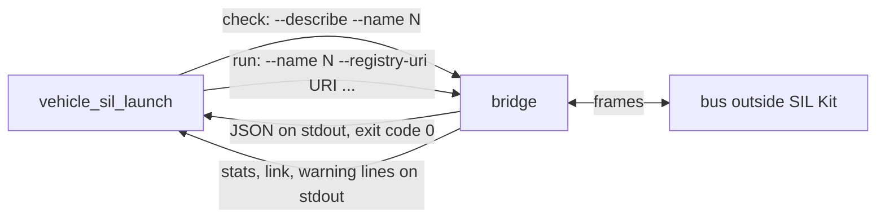

# ブリッジのプロセスの約束

[English](../bridge-contract.md)

ブリッジは、SIL Kit の 1 つのネットワークと、SIL Kit の外のバスをつなぐプロセスです。`vehicle_sil_launch` は、`--connect` を渡すとこのリポジトリのブリッジを起こし、設定ファイルに `role: bridge` で書いてあれば自作のブリッジを起こします。このページは、ランチャーとブリッジが取り決めていることをまとめたものです。引数、`--describe`、デバイスの一覧、終了コード、ブリッジが出す行、デバイスが使用中だと他のブリッジに知らせる印を扱います。各ブリッジのページには、そのブリッジだけのことを書きます。

| やりたいこと | 読む所 |
|---|---|
| 自作のブリッジを書く | このページ全体。最初に「[自作のブリッジを起こす](#自作のブリッジを起こすrole-bridge)」 |
| ブリッジの出力を読むスクリプトを書く | 「[ブリッジが出す行](#ブリッジが出す行)」と「[デバイスの一覧](#デバイスの一覧)」 |
| 3 つのブリッジのどれかを直す | このページと、そのブリッジのページ。共通のコードは `bridges/common` にあります（[code-map-bridges.md](code-map-bridges.md)） |

| 実行ファイル | ネットワークの種類 | ページ | 行のタグ | リンクの行のキー |
|---|---|---|---|---|
| `vehicle_sil_ethernet_bridge` | `ethernet` | [ethernet-bridge.md](ethernet-bridge.md) | `[eth-bridge]` | `link` |
| `vehicle_sil_vector_xl_bridge` | `can` | [bridges.md](bridges.md) | `[bridge]` | `bus` |
| `vehicle_sil_socketcan_bridge` | `can` | [socketcan-bridge.md](socketcan-bridge.md) | `[bridge]` | `bus`、`link` |



ランチャーが読んだものをどう使うか（数、所見、時刻）は、[simulation-run.md](simulation-run.md#バスを外につなぐ--connect) にあります。このページには写しません。

## 引数

ランチャーが渡す引数です。ブリッジは、ほかに何を受け取るかにかかわらず、これを受け取ります。

| 引数 | いつ | 意味 |
|---|---|---|
| `--network <name>` | `--connect` | ブリッジがつなぐ SIL Kit のネットワークです。`role: bridge` の participant には、ランチャーは足しません。`command` に書きます。 |
| `--name <name>` | `--describe` と実行 | participant の名前です。`--connect` では `bridge.<network>`、`role: bridge` の participant ではファイルに書いた名前です。`--participant <name>` も同じです（どちらか一方を指定します）。 |
| `--registry-uri <uri>` | 実行 | SIL Kit の registry です。`--describe` と一覧には要りません。 |
| `--start-timeout-ms <ms>` | 実行 | `start()` が participant の Running を待つ時間です（1 から 10^12、既定 15000）。過ぎると、ブリッジは終了コード 3 で、`FAIL setup: SIL Kit lifecycle of '<name>' did not reach Running within <ms> ms, state: <状態>` の行を出して終わります。「[実行中の participant の状態](#実行中の-participant-の状態)」の 15000 ms とは別で、そちらは固定です。 |
| `--stats-every-ms <ms>` | `--connect` の実行（1000） | 動いている間も統計の行を出します（100 から 3600000）。「[統計の行](#統計の行)」。 |
| `--describe` | `check` | ブリッジが何かを書いて終わります。「[`--describe`](#--describe)」。 |
| `--list-interfaces --backend <backend> --json` | `connections`、Ethernet | デバイスの一覧です。手で動かすときの `--backend` は省略できます。省略すると OS の既定（Linux は `packet`、Windows は `npcap`）になります。ランチャーは必ず付けます。 |
| `--list-channels --json` | `connections`、CAN | デバイスの一覧です。 |
| デバイスを決める引数 | `--connect` | どのデバイスを開くかです。ブリッジごとに下の表のとおりです。各ブリッジのページと「[ランチャーがブリッジに渡す引数](simulation-config.md#--connect)」にもあります。 |

`--connect` が、`--network <name>` に続けて各ブリッジに渡すデバイスの引数です。

| 実行ファイル | デバイスの引数 |
|---|---|
| `vehicle_sil_ethernet_bridge` | `--backend <backend> --interface <name>`、続けて絞り込みを 1 つ。`--all-frames`、なければ `--ethertype <list>`、それもなければ `--src-mac <list>`（ネットワークのノードの MAC アドレス。なければ付けません） |
| `vehicle_sil_vector_xl_bridge` | `--xl-target <target> --xl-channel <number>`。ネットワークにビットレートがあれば `--bitrate <bit/s>` |
| `vehicle_sil_socketcan_bridge` | `--interface <name>`。ネットワークにビットレートがあれば `--bitrate <bit/s>` |

引数のエラーは、終了コード 4 で、標準エラーに 2 行を出して終わります。1 行目は `error: <何が違うか、どう直すか>`、2 行目は `Run '<実行ファイル> --help' for the options.` です。`--help` は使い方の全部を出します。ランチャーは、`error:` か `FAIL` で始まる行を、所見 `connect-tool-failed` の理由として見せます。

## `--describe`

`--describe` は、ブリッジが何かを、ecu_main の実行ファイルが `--describe` で書くのと同じ JSON で書き（ecu-executable.md の「[JSON の形式](ecu-executable.md#json-の形式)」）、終了コード 0 で終わります。引数は実行のときと同じに確かめます（誤りは終了コード 4）。ただしデバイスを開かず、デバイスのライブラリも読まず、SIL Kit にもつなぎません。そのため、デバイスのない PC でも `check` は動きます。

```json
{
  "vehicle_sil_ecu": 1,
  "vehicle_sil": "<version>",
  "name": "bridge.ETH_EXT",
  "step_ns": null,
  "networks": [
    {
      "name": "ETH_EXT",
      "kind": "ethernet",
      "use": "ethernet",
      "nodes": [],
      "mac": null
    }
  ],
  "variables": [],
  "control": null,
  "features": []
}
```

| キー | ブリッジの値 |
|---|---|
| `vehicle_sil` | ブリッジをビルドした vehicle-sil の版です。 |
| `name` | 渡された `--name` です。 |
| `step_ns` | `null` です。ブリッジは実時間で動き、時刻の同期には加わりません。 |
| `networks` | 1 つで、`--network` のネットワークです。`kind` は `can` か `ethernet`、`use` は `can` なら `raw`、`ethernet` なら `ethernet` で、`nodes` は空、`mac` は `null` です。 |
| `variables`、`features` | 空の配列です。 |
| `control` | `null` です。 |

ランチャーが必須にするのは、`vehicle_sil_ecu`（1 でなければなりません）、`name`、`step_ns`、`networks` と、各ネットワークの `name`、`kind`、`use`、`nodes` だけです。`vehicle_sil` は、`--connect` のブリッジでは要ります（下）。ほかのキーは省いてかまいません。自作のブリッジは、これだけを出せば足ります。

`--connect` が起こすブリッジは、版を言わなければなりません。ランチャーは `vehicle_sil` を自分の版と比べ、別の vehicle-sil でビルドされたブリッジと、版を言わないブリッジを、エラー `connect-tool-failed`（`<tool> was built from vehicle-sil <X>; this launcher is <Y>`。版がなければ `unknown`）にします。違う版のランチャーとブリッジが、実行の前にたがいを断る仕組みです。`role: bridge` の participant は比べません。自作のものなので、別の版からビルドしていてかまいません。終了コードがエラーのブリッジは、`check` が `describe-failed` と報告します。Windows で、要る DLL がなくて起動できないブリッジも同じです。

## デバイスの一覧

`--list-interfaces`（Ethernet）と `--list-channels`（CAN）は、ブリッジが開けるデバイスを出して終わります。`--json` がなければ、文は人が読むためのもので、形が変わることがあります。`--json` を付けると、プログラムのために、1 つの JSON のオブジェクトを UTF-8 で標準出力に書き、最後に改行を付けます。`vehicle_sil_launch connections` がこの一覧を読みます（simulation-run.md の「[つなげる先の一覧](simulation-run.md#つなげる先の一覧vehicle_sil_launch-connections)」）。`--request <file>` を付けると、要求ファイルの先がこの一覧にあり、使えるかも答えます。

```json
{
  "vehicle_sil_targets": 1,
  "tool": "vehicle_sil_socketcan_bridge",
  "backend": null,
  "source": null,
  "targets": [
    {
      "value": "vcan0",
      "label": "vcan0",
      "detail": "virtual CAN, up",
      "usable": true,
      "reason": null,
      "in_use": false,
      "in_use_by": [],
      "in_use_count": 0,
      "can": {
        "kind": "vcan",
        "up": true,
        "bitrate": null,
        "state": null,
        "restart_ms": null
      }
    }
  ],
  "notes": [],
  "error": null
}
```

| キー | 内容 |
|---|---|
| `vehicle_sil_targets` | この形の版です（1）。 |
| `tool` | 実行ファイルの名前です。 |
| `backend` | 一覧が対象にするバックエンドです（Ethernet は `--backend`、なければ OS の既定）。デバイスの開き方が 1 つのブリッジでは `null` です。 |
| `source` | 一覧の出どころで、報告する版があるときだけ入ります（`npcap`、`pcap` は、ライブラリが言う版）。ほかは `null` です。 |
| `targets` | デバイスごとに 1 つのオブジェクトで、文の順に並びます。 |
| `targets[].value` | このデバイスを開くためにブリッジへ渡す値で、そのままです（Ethernet と SocketCAN は `--interface`。XL は `<target>:<number>` で、`:` の前を `--xl-target` に、番号を `--xl-channel` に渡します）。 |
| `targets[].label` | 見せる名前です。 |
| `targets[].detail` | 文の行で名前の後にある内容で、部分は `; ` で区切ります。 |
| `targets[].usable` | ブリッジがデバイスを使えないときは `false` で、`reason` が理由を言います。 |
| `targets[].reason` | デバイスを使えない理由で、使えるときは `null` です。 |
| `targets[].in_use`、`in_use_by`、`in_use_count` | いま vehicle-sil のブリッジがデバイスを使っているかで、そのブリッジが置いた印から分かります。`in_use_by` はプロセス ID を昇順に並べたもの（Windows では空）、`in_use_count` はブリッジの数です（Windows でも入ります）。そのとき `detail` の最後に `in use by a vehicle-sil bridge (process 4321)` が付きます。`usable` は変わりません。一覧は印を置きません。「[別のブリッジが使っているデバイス](#別のブリッジが使っているデバイス)」。 |
| `targets[].ethernet`、`targets[].can` | バックエンドが報告するデバイスの内容です。キーは各ブリッジのページにあります。 |
| `notes` | 文の最後の行の説明で、1 つにつき 1 文です。ほとんどは空です。 |
| `error` | `null`、または一覧を作れなかったときのエラーです。 |

一覧を作れないときも、ブリッジは JSON を書きます。`targets` は空で、`code` と `message` を持つ `error` が入り、終了コードは 3 です。`--json` がなければ標準出力に出る `FAIL setup: ...` の行は、`--json` のときは標準エラーに出るので、標準出力には JSON だけが出ます。`error.message` はその行の文です。コード（`library-missing`、`driver-missing`、`permission-denied`、`backend-unavailable`、`failed`）は、各ブリッジのページにあります。一覧を読むプログラムは、知らないキーを読み飛ばします。

## 終了コード

| 終了コード | 意味 |
|---|---|
| 0 | 止める要求（Ctrl+C、Ctrl+Break、SIGTERM、Windows ではコンソールのウィンドウを閉じたとき）による終了です。`--list-*`、`--describe`、`--help` が終わったときも 0 です。 |
| 1 | 実行中の失敗です。 |
| 3 | 準備の失敗です。 |
| 4 | 引数のエラーです。 |

終了コード 1 になるのは、次のときです。

- SIL Kit の participant が、止まる途中か終わった状態になった（registry の停止や接続断）。
- participant が、監視を始めてから 15000 ms たっても起動の途中のままである（固定の制限で、`--start-timeout-ms` ではありません。下の表）。
- デバイスが使えなくなった（外した、インターフェースがなくなった）。

終了コード 3 は、転送を始める前の失敗です。デバイスやライブラリがない、デバイスが拒んだ、registry が答えない、participant が `--start-timeout-ms` 以内に Running にならない、一覧を作れない、などです。原因は各ブリッジのページにあります。その行は `FAIL setup:` で始まります。

ブリッジは、止める要求を受けると順に終わります。実行が終わると、ランチャーは自分が起こしたブリッジに止める要求を送ります。Linux では SIGTERM、Windows では Ctrl+Break です。制限時間までに終わらないブリッジは、強制的に終わらせます（simulation-run.md の「[止め方](simulation-run.md#止め方)」）。

### 実行中の participant の状態

| 状態 | 扱い | 出力 |
|---|---|---|
| 止まる途中か終わった状態（Stopping、Stopped、Error、ShuttingDown、Shutdown、Aborting） | 失敗にします（終了コード 1）。 | `FAIL: SIL Kit participant left Running (state <状態>)` |
| 同じ状態に、Running になる前になった | 失敗にします（終了コード 1）。 | `FAIL: SIL Kit participant stopped before it reached Running (state <状態>)` |
| 起動の途中の状態（ReadyToRun など）で、監視を始めてから 1 秒たった | 失敗にしません。 | `waiting for the SIL Kit participant to reach Running (state <状態>; at most 15000 ms)` を 1 回 |
| 起動の途中の状態のまま、監視を始めてから 15000 ms たった | 失敗にします（終了コード 1）。 | `FAIL: SIL Kit participant did not reach Running within 15000 ms (state <状態>); its SIL Kit log may say why` |
| Paused | 失敗にしません。 | なし |

ブリッジは、自分では一時停止しません。15000 ms は `run_bridge()` の固定の値で、`--start-timeout-ms` には従いません。`--start-timeout-ms` は、この監視の前にある `start()` の待ち時間で、過ぎると終了コード 3 で終わります（上）。監視を始める時点で `start()` はもう Running を待ち終えているので、15000 ms に当たることはまれです。

### コンソールのウィンドウを閉じたとき（Windows）

Windows でコンソールのウィンドウを閉じたとき（ログオフ、シャットダウンも）は、`SetConsoleCtrlHandler` のハンドラーが停止を求め、ブリッジが止まり終わるまで（統計の出力を含む）最長 4 秒待ってから、ブリッジの終了コードでプロセスを終えます。Windows はハンドラーが戻るとプロセスを終わらせ、待つのも 5 秒ほどまでだからです。Windows の約 5 秒は変えられないので、統計は SIL Kit の participant を止める前に出力し、participant の停止を待つのは最長 2 秒にしています。それでも 4 秒を超えると、Windows がプロセスを終わらせ、終了コードは 0 になりません（統計は出力した後です）。

### ブリッジの実行ファイルが共有する処理

3 つの実行ファイルは、次の処理を `bridges/common` の `run_bridge()`（`vehicle_sil::bridge_runtime`）で共有します。

- 止める要求の受け方
- 監視のループと、上の participant の状態の判定
- 止める順。`stopping`、止める直前に出た警告、統計、エラーがあれば `last error: <文>` を、SIL Kit の participant の停止より先に出力し、最後に `stopped`
- 終了コード
- コンソールを閉じたときの 4 秒
- 動いている間の統計の行（`--stats-every-ms`。`BridgeHooks::statistics_line()`）
- 1 秒ごとのリンクの行と監視の行
- 機器から何も来ないと言う時点（`NothingCameHint`）。最初に外部へ送信してから 10 秒で 1 回。機器からフレームが来ていれば（`ext_from_devices` が 0 でなければ）言わない。文はブリッジごとに違い、機器からフレームが来ていないと言う `warning:` の行です。ほかの機器が返事をしないバスでも出るので、故障の証拠ではなく、ケーブル、機器、チャネルを確かめるきっかけとして読みます。

## ブリッジが出す行

行はどれも UTF-8 の 1 行で、`[<tag>] <文>` の形です。このリポジトリの 3 つのブリッジのタグは、`bridge`（Vector XL、SocketCAN）か `eth-bridge`（Ethernet）です。自作のブリッジは、この形のタグなら何でも、タグなしでもかまいません。ランチャーはその行を読まないからです。自分のスクリプトで全部のブリッジの行を同じに読みたければ、`bridge` にします。行を読むプログラムは、タグ（`[`、空白のない語、`] `。ある行だけ）と行末の `\r` を取ってから、文の先頭を見ます。

| 文の先頭 | 意味 | ランチャーが読むか |
|---|---|---|
| `stats ` | 数です。「[統計の行](#統計の行)」 | 読む |
| `link ` | デバイスへの接続の状態です。「[リンクの行](#リンクの行)」 | 読む |
| `warning: ` | 人が見るべきことです。原因ごとに 1 回出ます。 | デバイスを別のブリッジが使っているという警告だけ読む（「[別のブリッジが使っているデバイス](#別のブリッジが使っているデバイス)」） |
| `FAIL: ` | ブリッジが終了コード 1 で終わります。 | 文を理由として使う |
| `FAIL setup: ` | 準備の失敗です。終了コード 3 です。 | 文を理由として使う |
| `error: ` | 引数のエラーです。終了コード 4 です（標準エラーで、タグはありません）。 | 文を理由として使う |
| `stopping`、`stopped` | 止める手順の始まりと終わりです。 | 読まない |
| ほか（起動の行、監視の行、`waiting for ...`） | 人のためです。文は変わることがあります。 | 読まない |

ランチャーは、`--connect` で起こした実行ファイルの名前から、このリポジトリの 3 つのブリッジの `stats`、`link`、`warning:` の行を読みます。`role: bridge` の participant の出力は読みません。自作のブリッジが同じ行を出すと、自分のスクリプトで使えます。

これらの行を読むプログラムは、知らない行、キー、値を読み飛ばします。ブリッジには、キーと値が増えることがあるためです。

### 統計の行

`stats` の後に、下の表のキーごとに ` <キー>=<数>` を、表の順に 1 行に並べます。ブリッジは、止まるときに行を出し、`--stats-every-ms <ms>` があれば動いている間にも出します（最初の間隔で 1 回、その後は直前に出した行と違う間隔ごと）。数は起動からの合計で、1 つずつ読むので、1 行の数が同じ瞬間のものとは限りません。キーとその順序は、行を読むプログラムのためにこのページが定め、テストが守ります。

```
stats silkit_to_ext=0 ext_to_silkit=0 ext_from_devices=0 own_tx_dropped=0 error_frames=0 overruns=0 silkit_rejected=0 ext_rejected=0 ext_queue_full=0 ext_tx_failures=0 silkit_tx_failures=0 ext_tx_dropped=0 ext_tx_unsent=0
```

```
stats silkit_to_ext=0 ext_to_silkit=0 ext_from_devices=0 own_tx_dropped=0 loop_suspected=0 mac_unguarded=0 filtered_to_ext=0 filtered_from_ext=0 oversize=0 malformed=0 ext_overruns=0 ext_queue_full=0 ext_tx_failures=0 silkit_tx_failures=0 ext_checksum_incomplete=0
```

上の行が Vector XL と SocketCAN のブリッジ、下の行が Ethernet のブリッジです。

| キー | 数えるもの | 出すブリッジ | 監視の行 |
|---|---|---|---|
| `silkit_to_ext` | SIL Kit から外へ送ったフレーム（CAN は、デバイスの送信キューに渡したもの） | すべて | 出さない |
| `ext_to_silkit` | 外から SIL Kit へ渡したフレーム | すべて | 出さない |
| `ext_from_devices` | バス上の機器が送ってきたフレーム（ブリッジ自身のものと、この PC 自身のものは数えない）。ランチャーが「機器から来たフレーム」として読むキー | すべて | 出さない |
| `own_tx_dropped` | 戻ってきたブリッジ自身のフレーム。CAN は自分の送信のレシート、Ethernet は外部リンクが自分の送信を返したもの（vehicle-sil のリンクに返すものはない） | すべて | 出さない |
| `error_frames` | CAN コントローラーのエラーフレーム | CAN | 出す |
| `overruns` | 受信キューのあふれ | CAN | 出す |
| `silkit_rejected` | SIL Kit から来て転送しないフレーム（CAN FD、CAN XL、ID や DLC が正しくないもの） | CAN | 出す |
| `ext_rejected` | デバイスから来て転送しないフレーム（DLC が 15 を超えるもの） | CAN | 出す |
| `ext_tx_dropped` | バスが詰まっているあいだ `--tx-timeout-ms` で捨てたフレーム | CAN | 出す |
| `ext_tx_unsent` | デバイスに渡したが、バスに出ずに失われたフレーム | CAN | 出さない |
| `loop_suspected` | 送信元アドレスが両側にあるフレーム | Ethernet | 出す |
| `mac_unguarded` | MAC テーブルに入らず、ループの確認なしで通したフレーム | Ethernet | 出す |
| `filtered_to_ext`、`filtered_from_ext` | フィルターが通さなかったフレーム（方向ごと） | Ethernet | 出さない |
| `oversize` | 最大の長さを超えるフレーム | Ethernet | 出す |
| `malformed` | Ethernet ヘッダーより短いフレーム | Ethernet | 出す |
| `ext_overruns` | 読む前に OS が捨てたフレーム | Ethernet | 出す |
| `ext_checksum_incomplete` | UDP や TCP のチェックサムが未完成のまま SIL Kit へ渡したフレーム | Ethernet | 出す |
| `ext_queue_full` | デバイスの送信キューが満杯で失われたフレーム | すべて | 出す |
| `ext_tx_failures` | デバイスへの、そのほかの送信の失敗 | すべて | 出す |
| `silkit_tx_failures` | `SendFrame()` が例外を投げたフレーム、または SIL Kit が送れなかったと確認したフレーム | すべて | 出す |

「出すブリッジ」の CAN は Vector XL と SocketCAN のブリッジです。キーの順は、上の 2 行の順です。両方の行にあるキー（`silkit_to_ext`、`ext_to_silkit`、`ext_from_devices`、`own_tx_dropped`、`ext_queue_full`、`ext_tx_failures`、`silkit_tx_failures`）は、同じ名前で、同じものを数えます。1 つのブリッジでキーが数えるものの細かい点は、そのブリッジのページにあります。

自作のブリッジがスクリプトのために `stats` の行を出すなら、同じものには同じ名前を使い、自分のキーは最後に足します。ランチャーが読むのは、`stats` と ` <キー>=<数>` だけの 1 行で、同じキーがなく、数が 2^63 - 1 以下の 10 進数のものです。それ以外は、ほかの行と同じように見せます。

### リンクの行

`link` の後に、キーごとに ` <キー>=<値>` を並べ、続けてデバイスの印のキー（`device`、`marked`、`shared`、Linux では `peers`。「[別のブリッジが使っているデバイス](#別のブリッジが使っているデバイス)」）を付けます。キーにも値にも空白は入りません。

```
[eth-bridge] link link=up device=af3d43e7e4b8883a marked=1 shared=0
[bridge] link bus=active device=552dd508e2f03efe marked=1 shared=1 peers=4321
[bridge] link bus=active link=up device=552dd508e2f03efe marked=1 shared=0
```

| キー | 値 | 意味 |
|---|---|---|
| `link` | `up`、`down`、`unknown` | インターフェースのリンクです。キャリアがあって up、down、まだ分からない、または分からない（`npcap` バックエンドはいつも分かりません）。Ethernet と SocketCAN のブリッジ |
| `bus` | `active`、`passive`、`bus-off`、`unknown` | CAN コントローラーのエラー状態です。`unknown` は、最初の答えが来るまで、または答えが来ないとき（vcan のインターフェース、`--no-bus-monitor`）です。CAN のブリッジ |

- 最初の行は、デバイスを開いてから、SIL Kit のライフサイクルを始める前（participant が Running になりうる前）に出します。そのとき分からない値は `unknown` です。
- 行はどれも、すべてのキーを持ちます。`link` か `bus`（表のとおり、両方のこともあります）、`device`、`marked`、`shared` です。なくなりうるのは `peers` だけで、ほかのブリッジがそのデバイスを使っていないときは書かず、Windows では常に書きません。`peers` のない行は、いないという意味です。
- その後は 1 秒ごとに見て、値かデバイスの印のキーが変わったときだけ行を出します。同じ行を続けて 2 回は出しません。
- ブリッジが終わるとき（`FAIL:`、停止）には、行は出ません。participant の状態がそれを言います。
- ランチャーは、同じキーが繰り返されたら最初のものを読み、`<キー>=<値>` の形でない部分、知らないキー、知らない値を読み飛ばします。
- それぞれの値がブリッジでどういう意味か（アダプターで `down` とは何か、`bus` がいつ変わるか）は、そのブリッジのページにあります。

### 監視の行と警告

監視の行（`[<tag>] <文>`。人のためで、ランチャーは読みません）は、デバイスの状態が変わったか、上の表で「監視の行」が「出す」のキーの数が増えたときに、1 秒に 1 回までで出ます。何が増えたかを書きます（`since the last report: ext_tx_failures +12`）。次に見たとき増えていなければ、`no new problems since the last report` という 1 行を出します。問題が収まったことは、この行で分かります。形はブリッジごとに、各ページにあります。

`warning: <文>` の行は、一度確かめることを言います。プロミスキャスモードが切れている、デバイスを別のブリッジが使っている、機器から何も来ない、などです。`FAIL: <理由>` の行は、ブリッジが終わる理由を言います。止める手順の前に出て、終了コードは 1 です。これらの行は人のためです。ランチャーは、理由を自分の所見に書きます。

### registry に接続できないときのメッセージ

ブリッジが registry に接続できないときは、試したアドレスと次にすることを 1 行で出し、終了コード 3 で終わります。メッセージは `bridges/common` の `registry_failure_message()` が作ります。

```
[bridge] FAIL setup: cannot connect to the SIL Kit registry at <uri> (<SIL Kit text>). Start the registry first ('sil-kit-registry --listen-uri <uri>'), or give the address it listens at with --registry-uri.
```

`(<SIL Kit text>).` の後ろは、アドレスで変わります。ホストは大文字と小文字を区別せずに比べます。

| `--registry-uri` のホスト | メッセージが言うこと |
|---|---|
| この PC のループバックアドレス（`localhost`、`127.x.y.z`、`::1`）、または読めないアドレス | 上の行のとおりです。先に registry を起こすか、registry が待ち受けるアドレスを渡します。 |
| そのほかのホスト | registry のある PC で、registry が動いていて、ここから届くアドレスで待ち受けていること、そのファイアウォールを確かめます。 |
| `0.0.0.0` と `::`（`[::]`） | 待ち受けるためのアドレスで、接続はできません。registry が動いている PC のアドレスを渡します。 |

「そのほかのホスト」の文は、次のとおりです。ブリッジは、そのアドレスが別の PC のものか、この PC の LAN のアドレスかを判断しないので、どちらとも言いません。

```
... <host> is not the loopback address of this computer: check that the registry runs on the computer with that address (which may be this one), that it listens on an address reached from here ('sil-kit-registry --listen-uri silkit://0.0.0.0:<port>' there listens on all of its addresses, not only on its loopback), and that its firewall lets port <port> through.
```

`0.0.0.0` と `::`（`[::]`）の文は、次のとおりです。

```
... 0.0.0.0 stands for every address of a computer: a registry listens on it, a participant cannot connect to it. Give --registry-uri the address of the computer the registry runs on (silkit://127.0.0.1:<port> if it runs on this one).
```

アドレスにポートがなければ、これらの文の `<port>` は 8500（ポートなしで起こした registry のポート）です。Ethernet のブリッジも、タグを `[eth-bridge]` にして同じメッセージを書きます。

### 出力の文字コード

ブリッジと `vehicle_sil_can_bus_simulator` は、標準出力と標準エラーの文を UTF-8 で書きます。Windows では、出力の行き先で書き方が変わります（`tools/common` の `cli::write_text()`。`vehicle_sil_launch` も同じ書き方です）。

| 出力の行き先 | 書き方 |
|---|---|
| コンソール（コマンドプロンプト、PowerShell） | UTF-16 で書きます（`WriteConsoleW`）。 |
| ファイルかパイプ | UTF-8 のバイトで書きます。 |

- コンソールでは、ASCII 以外の文字（`--name` の名前、ネットワーク接続の名前）が、コードページ（日本語の Windows は 932）にかかわらず読めます。ブリッジはコードページを変えないので、`chcp` は要りません。
- MSYS2 のターミナル（mintty）はパイプとして扱われるので、UTF-8 のバイトを受け取ります。UTF-8 として読ませてください。
- Windows PowerShell 5.1 は、`>` や `|` で受け取ったバイトを `[Console]::OutputEncoding`（既定ではコンソールのコードページ）で読み直すので、ASCII 以外の文字が文字化けします。先に `[Console]::OutputEncoding = [Text.Encoding]::UTF8` を実行するか、コマンドプロンプトの `>` を使います。
- SIL Kit 自身のログは、この書き方ではありません。

## 別のブリッジが使っているデバイス

同じデバイスを開いた 2 つのブリッジは、たがいのフレームを受け取ります。そこで 2 つのネットワークや 2 つの実行が混ざります。ブリッジは、開いたデバイスに印を付け、そのデバイスにある、ほかの vehicle-sil のブリッジの印を、起動時に 1 回、動いている間は 1 秒ごとに数えます。そのため、あとから起動したブリッジを、先にいたブリッジも見つけます。印は誰も締め出しません。ほかのブリッジを見つけたブリッジは、警告して動き続けます。自作のブリッジも同じ印を置き、同じように数えると、このリポジトリの 3 つのブリッジとたがいに見つけ合えます。

```
[bridge] link bus=active device=552dd508e2f03efe marked=1 shared=1 peers=4321
[bridge] warning: XL 'Virtual Channel 1' (Vector Virtual CAN, whose channels are all one bus) is also used by another vehicle-sil bridge (process 4321): the frames of both mix there: if that is not meant, connect them to different devices, or stop a bridge left over from an earlier run
```

| リンクの行のキー | 意味 |
|---|---|
| `device` | デバイスで、ハッシュの小文字 16 桁の 16 進数です（下の `<device>`）。バックエンドにかかわらず、デバイスが同じならどのブリッジでも同じです |
| `marked` | `1` は、ブリッジが印を置いたことです。`0` は、置けなかったことで、理由を警告で言います。ほかのブリッジはこのブリッジを見つけられませんが、このブリッジはほかを見つけます |
| `shared` | いま、そのデバイスに印を付けているほかのブリッジの数です |
| `peers` | そのプロセス ID を `,` で区切ったものです（Linux だけ。ないときは書きません） |

- 最初の数え方は、最初のリンクの行にあります（SIL Kit のライフサイクルを始める前）。警告は新しいブリッジが来るたびに出ます（`shared` が増えたとき、または前になかったプロセス ID が現れたとき。別のブリッジが終わって数が変わらなかったときも）。来たブリッジのプロセス ID を添えます。文には ` is also used by another vehicle-sil bridge` という語が入ります（ランチャーはこの語で警告を見つけます）。リンクの行は、キーが変わるたびに出ます。ほかのブリッジが終わったときも出ます。
- 一覧は、印のあるデバイスに `in_use: true`、`in_use_by`、`in_use_count` を入れます（「[デバイスの一覧](#デバイスの一覧)」）。
- デバイスはバスへの口です。Ethernet のインターフェース、CAN のインターフェース、Vector のハードウェアの CAN チャネル、Vector Virtual CAN（全部のチャネルが 1 つのデバイス）です。Vector の 1 つの機器の 2 つのチャネルは、2 つのデバイスです。

| 印で見つかるもの | 印で見つからないもの |
|---|---|
| この PC の vehicle-sil のブリッジです。別の実行のもの、別のユーザーのもの、手で起こしたもの、同じ印を置く自作のブリッジが入ります | vehicle-sil の外でデバイスを開くプログラム（Wireshark、candump、CANoe）です。ブリッジがつなぐ「外」にあたります |
| | Linux で、別のネットワーク名前空間にあるブリッジです（見えるインターフェースが違います） |
| | Windows で、別のセッションにあるブリッジです（印はセッションの名前空間（下の `Local\`）にあります） |

Linux で `peers` にあるプロセス ID は、印を置いたブリッジの PID 名前空間のものです。独自の PID 名前空間（ネットワーク名前空間は同じ）のコンテナの中のブリッジは、コンテナの中の番号で見えます。

`vehicle_sil_launch run --connect` は、これらのキーを読みます。`shared` から自分の実行のブリッジを除き（`peers` のプロセス ID で。Windows では数で）、ブリッジの警告をプロセス ID 付きの自分の 1 行にして、残ったものを所見 `outside-device-shared` にします。`--strict` では、共有のデバイスで実行を始めず、共有が 3 秒続くと止めます（simulation-run.md の「[別の実行も使っているデバイス](simulation-run.md#別の実行も使っているデバイス)」）。

### 印の付け方

| OS | 印 |
|---|---|
| Linux | 抽象名 `vehicle-sil/device/<kind>/<identity>/<pid>/<random>` に bind した Unix ソケット（close-on-exec）で、ブリッジが動いている間は開いたままにします。数えるときは、`/proc/net/unix` から、名前が `vehicle-sil/device/<kind>/<identity>/` で始まるものを読みます（`/proc/net/unix` が抽象名の前に付ける `@` は除きます。下） |
| Windows | 名前付き mutex `Global\vehicle-sil-device-<device>-<n>` で、所有せず、継承もしません。`<n>` は 0 から 15 の最初の空き番号で、ブリッジが動いている間は開いたままにします。セキュリティ記述子は、全員が `SYNCHRONIZE` で開けるようにします。このユーザーがグローバルな名前を作れない場所では、印は `Local\`（このセッション）に付きます。数えるときは、ほかの番号を両方で開き、すぐ閉じます |

- `sockaddr_un` では、`sun_path` の最初の 1 バイトが NUL で、名前はその後に続きます。`bind` に渡す長さは、`sun_path` のオフセットに 1 と名前の長さを足したものです。`/proc/net/unix` は、この NUL を `@` で見せます。その `@` は名前の一部ではなく、この節の前置きは `@` の後から始まります。
- `<kind>` は `ethernet` か `can` です。
- `<pid>` はプロセス ID の 10 進数です。`<random>` は、小文字の 16 進数（`0-9`、`a-f`）のちょうど 16 桁で、名前がふさがっていれば別の値で試します。同じ前置きの下の名前でも、`<pid>/<random>` がこの形でなければ印ではなく、数えません。大文字の 16 進数や別の長さを使う自作のブリッジは、見つけてもらえません。
- `<identity>` はデバイスの名前です。

  | デバイス | `<identity>` |
  |---|---|
  | Ethernet のインターフェース | インターフェースの名前（Linux）、pcap の名前（Npcap）。同じインターフェースの `packet` と `pcap` は同じデバイスです |
  | SocketCAN のインターフェース | インターフェースの名前 |
  | Vector のハードウェアのチャネル | `xl-<hwType>-<hwIndex>-<serial>-<hwChannel>`（XL ドライバが報告する値） |
  | Vector Virtual CAN | `xl-virtual` |

  `<identity>` に、ASCII の英数字と `._:@+-` 以外の文字があるとき、または名前全体が 107 バイトを超えるときは、代わりに `device` のハッシュを使います。107 バイトは、先頭の NUL を除いた名前の長さです（`sun_path` は 108 バイト）。名前 `vehicle-sil/device/<kind>/<identity>/<pid>/<random>` の全体を数え、`<pid>` はプロセス ID にかかわらず 10 桁として数えます。名前の形がプロセス ID で変わらないようにするためです。`<identity>` をそのまま使うのは、`len("vehicle-sil/device/<kind>/") + len(<identity>) + 1 + 27 <= 107` のときだけです。
- `<device>` は `device` のキーで、文字列 `<kind>/<identity>` のバイト列（UTF-8。identity は実際には ASCII）の 64 ビット FNV-1a ハッシュです。オフセット基底は標準の `0xcbf29ce484222325`、素数は `0x100000001b3` で、バイトごとに XOR してから掛けます（2^64 を法とします）。書き方は、64 ビットの値そのものを、先頭に 0 を補った小文字 16 桁の 16 進数（`%016llx`）にし、上の桁から並べます。
- C++ のブリッジは `bridge_runtime::DeviceMark` と `DeviceShareWatch`（`bridges/common`）を使います。ほかの言語のブリッジは、上の表のとおりに印を置きます。
- テスト用にビルドしたブリッジは、偽のデバイスの印をプロセスごとに付けます。同時に動くテストがたがいを見つけないようにするためです。2 つのブリッジに 1 つのデバイスを共有させたいテストは、両方に同じ `VEHICLE_SIL_FAKE_DEVICE_SCOPE` を渡します。

## 自作のブリッジを起こす（`role: bridge`）

`vehicle_sil_launch` は、シミュレーションのほかの participant といっしょにブリッジを起こせます。設定ファイルには ECU と同じように（`describe: true`、既定）書き、`role: bridge` と `required: false` を付けます。

```yaml
participants:
  - name: MyBridge
    role: bridge
    required: false
    command: [my_bridge, --network, VehicleCAN]
```

ネットワーク（`VehicleCAN`）は、`networks` に、ブリッジの `--describe` が言う `kind` で書きます。

| コマンド | `vehicle_sil_launch` が足す引数 |
|---|---|
| `check` | `--describe --name MyBridge` |
| `run` | `--name MyBridge --registry-uri <URI> --start-timeout-ms <ms>` |

- `command` に `--network <name>` を書きます。ランチャーは足しません。`--name`、`--participant`、`--registry-uri` は書きません。ランチャーが足します（この `command` の `{registry_uri}` と `{name}` はエラーです）。URI は本当のものです。ファイルの `registry_uri` のポートが 0 でも、実行が選んだポートに置き換わっています。
- `--start-timeout-ms` は `start_timeout_ms` + `stop_timeout_ms` + 10000 です（最大 10^12）。ランチャーより先にブリッジが諦めないようにするためです。`--stats-every-ms` は足しません。
- `check` は `--describe` を実行します。引数のエラー（終了コード 4）は、ブリッジの文を添えて `describe-failed` と報告します。`check` は出力から、ブリッジがどのネットワークを運ぶかを知ります（simulation-config.md の「[テスト用の participant とブリッジ（`role`）](simulation-config.md#テスト用の-participant-とブリッジrole)」）。ブリッジには自分の MAC アドレスがないので、注意 `ethernet-mac-unknown` の原因にはなりません。
- `required: false`: シミュレーションはブリッジを待たず、実行が終わるとランチャーがブリッジに止める要求を送ります（上）。ブリッジが加わる前に送ったフレームについては、bridges.md の「[起動の順序](bridges.md#起動の順序)」を見てください。
- `role: bridge` の participant が実行中に自分で終わったとき（終了コード 1、3、そのほか何でも）、実行は止まりません（止まるのは `--connect` のブリッジだけです）。`required: false` なので、ランチャーは所見 `exit-code` を警告として報告し、シミュレーションはブリッジなしで続きます。そのために `run` の終了コードが 0 でなくなるのは、`--strict` のときだけです。
- ランチャーがブリッジに求めるのは、上の引数を受け取ること、運ぶネットワークを `--describe` で言うこと、止める要求（SIGTERM、Ctrl+Break）を受けたら終了コード 0 で終わることだけです。上の行はスクリプトのため、デバイスの印はほかのブリッジのためです。

このリポジトリのブリッジは、ファイルに書かなくても、`check` と `run` に `--connect <network>=<target>` を渡せばランチャーが起こします（simulation-config.md の「[`--connect`](simulation-config.md#--connect)」）。
