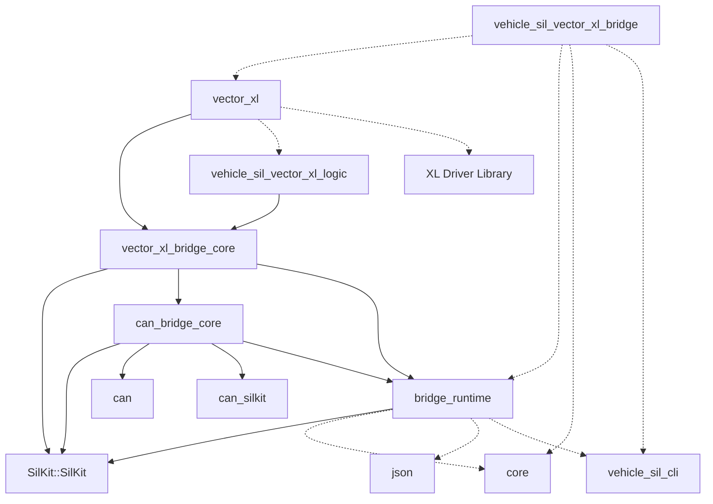
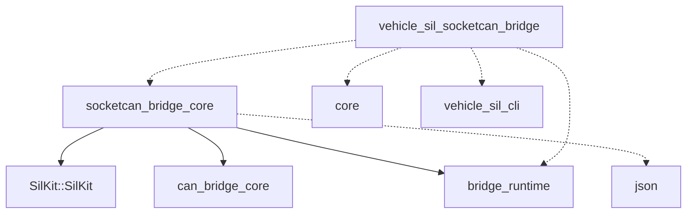
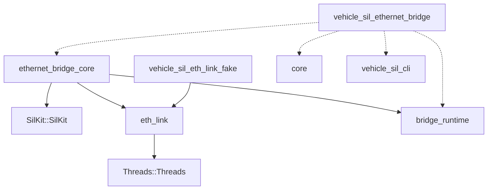

# Vector XL、SocketCAN、イーサネットのブリッジ

[English](../code-map-bridges.md)

この分野を変更するときの地図です。全体の入口は [code-map.md](code-map.md)、テストの共通ルールは [code-map-testing.md](code-map-testing.md) にあります。

関連する仕様と変更範囲: [bridge-contract.md](bridge-contract.md) / [bridges.md](bridges.md) / [socketcan-bridge.md](socketcan-bridge.md) / [ethernet-bridge.md](ethernet-bridge.md) / [CAN・イーサネット・LIN のバス](code-map-buses.md) / [ランチャー・プロセス・設定・実行](code-map-launcher.md)

## テストのラベル

### `can_bridge`

CAN ブリッジのうち、外部の側に依存しない部分（`CanBridge`、`ExternalPortAdapter`）のテストです。SIL Kit のコントローラのフェイクと外部ポートのフェイクに対して動かします。全プラットフォームで動きます。

### `socketcan_bridge`

SocketCAN ブリッジ（Linux のみ）のテストです。単体テストは、偽の `CanDevice`（ソケットの層）に対して本番のコードを動かします。引数、netlink の応答とインターフェースの確認、一覧、エラーのフレーム、フレーム・受領・エラーのフレーム・bus-off・`ENOBUFS`・`ENETDOWN`・`ENODEV`・送信のタイムアウトでの `SocketCanPort` です。`socketcan_bridge.netns.*`（`integration` ラベル）は、ネットワーク名前空間の `vcan0` で本物の実行ファイルを `tests/vector_xl` のピアと動かします。名前空間や `vcan0` を作れない所ではスキップ（77）し、`VEHICLE_SIL_REQUIRE_SOCKETCAN=1` ならそれを失敗にします。

### `vector_xl`

Vector XL の CAN ブリッジのテストです。全プラットフォームで、テスト専用の XL ドライバのフェイクに対して本番のコードを動かします。

| テストの種類 | 内容 |
|---|---|
| 単体テスト | 引数とチャネルの一覧 |
| XL バックエンドのテスト | XL バックエンド |
| プロセス内のテスト | 実際の SIL Kit を使う |
| E2E テスト | ブリッジの実行ファイルを使う |

E2E で確認すること:

- エコーノードとの往復（Virtual CAN と、ビットレートを設定する物理 CAN）
- 送信レシートが返ってくる場合のループ防止
- `--list-channels`、存在しないチャネル、引数のエラー
- registry に接続できない場合、ドライバがない場合
- 停止の要求で止めたときの統計の 1 行と終了コード 0（Windows では、共有するコンソールがなければスキップ）
- 何も答えないチャンネルでの、動いている間の統計の行（`--stats-every-ms`。`no-answers`）

### `eth_link` / `ethernet_bridge`

イーサネットのブリッジのテストです（全プラットフォーム）。`unit` ラベルも付きます。

| テスト | 内容 |
|---|---|
| `eth_link.*` | SIL Kit なしで、MAC アドレス、絞り込み（EtherType、VLAN タグの先、MAC、最大長）、MAC の表、偽の外部リンクを確認する |
| `eth_link.pcap_*` | pcap の外部リンクの文、インターフェースの選び方、実行時に読み込んだ偽の pcap のライブラリでの送受信と失敗を確認する |
| `eth_link.fake_pcap_imports.*` | Windows で、偽のライブラリの使う DLL が、ブリッジが探す場所にあるものだけかを確認する |
| `eth_link.boundary` | `libs/eth_link` に SIL Kit の include がないことを確認する |
| `ethernet_bridge.*` | 偽の SIL Kit のコントローラーと偽の外部リンクで、ブリッジの動作と出力を確認する |
| `ethernet_bridge.silkit_*` | プロセス内のレジストリ（空いているポート）で、本物の SIL Kit の側を確認する |
| `ethernet_bridge.integration.*`（`integration` ラベル） | 偽の外部リンクをリンクした実行ファイルをプロセスとして動かし、往復、終了コード、止め方を確認する |
| `ethernet_bridge.integration.pcap-*` | OS の外部リンクの実行ファイルに偽の pcap のライブラリを読み込ませて、同じことを確認する。`pcap-describe` は `--describe` を、`pcap-launcher` は `vehicle_sil_launch` の設定ファイルから ECU といっしょにブリッジを起こす形を確認する |
| `ethernet_bridge.netns.*`（Linux だけ、`integration` ラベル） | 名前空間の中の TAP デバイスと veth で、本物の実行ファイルの `tap`、`packet`、`pcap`（本物の libpcap）と、`launch`、`launch_tap`（`vehicle_sil_launch run --connect` が `packet` で、`tap:` でそれを起こす）を確認する |

`ethernet_bridge.*` が確認するのは、転送、絞り込み、自分のフレームの戻り、2 つのブリッジを通るループ（止まる順序と止まらない順序）、失ったフレーム、`Fault`、警告、統計と監視の行、引数のエラーの文言です。`ethernet_bridge.netns.*` は、名前空間を作れない所と libpcap がない所ではスキップします。

### `bridge_runtime`

ブリッジの実行ファイルが共有する `run_bridge()` のテストです（全プラットフォーム）。`unit` ラベルも付きます。

偽の `hooks` と、状態を決めた偽の participant で、次を確認します。

- 終了コード
- 止める順（統計を、SIL Kit の participant の停止より先に出力する）
- `fault()` と participant の失敗
- 警告と監視の行
- 動いている間の統計の行（`RunBridgeOptions::statistics_interval`）。最初の 1 回と、その後は変わったときだけ
- 起動の途中の状態を失敗にしないこと、起動の上限

機器から何も来ないときのヒントの決まり（`NothingCameHint`）は、テストが時刻を与えて確認します。

デバイスの使用中の印（`bridge_runtime.device_mark_*`）は、名前、ハッシュ、`/proc/net/unix` の読み取り、文を値を与えて確かめ、Linux と Windows では試験のプロセスの本物の印を確かめます（試験ごとに別のデバイスで）。

1 つのテストは、プロセス内のレジストリ（空いているポート）で本物の participant を使います。registry に接続できないときの文（`registry_failure_message()`）は、SIL Kit が実際に投げる文でも確認します。

`describe_json()`（ブリッジが `--describe` で書くもの）は、`libs/ecu` の `to_json()` とバイトごとに比べ、`vehicle_sil_launch` の読み手（`read_description()`）で読みます。ブリッジは `libs/ecu` をリンクせずに、ecu_main の実行ファイルの形を保ちます。

## ディレクトリごとのコードとテスト

### `bridges/can`

| 名前 | 場所 |
|---|---|
| `CanBridge`、`ExternalCanPort`、`ExternalCanEvent`、統計と健全性の行 | `can_bridge/can_bridge.hpp` |
| `ExternalPortAdapter` | `can_bridge/external_port_adapter.hpp` |

- テスト: `tests/can_bridge`（そこの `fake_external_port.hpp` と `frame_matrix.hpp` は `tests/vector_xl` も使う）
- `ctest -R`: `^can_bridge\.`

### `bridges/vector-xl`

| 名前 | 場所 |
|---|---|
| `XlDriver`、`XlCanPort` | `vector_xl/xl_driver.hpp` |
| チャネルの選択、チャネルの一覧、引数 | `vector_xl/channel_selection.hpp`、`vector_xl/bridge_options.hpp` |

- テスト: `tests/vector_xl`（XL ドライバのフェイクは `tests/vector_xl/fake_xl`）
- `ctest -R`: `^vector_xl\.`

### `bridges/socketcan`

| 名前 | 場所 |
|---|---|
| `SocketCanPort`（`ExternalCanPort`。リンクの状態、送信のタイムアウト） | `socketcan/socketcan_port.hpp` |
| `CanDevice`（ソケットの層。`LinuxCanDevice` がカーネルを呼び、試験は偽物を与える）、`RawFrame` | `socketcan/can_device.hpp`（`LinuxCanDevice` は `src/linux_can_device.cpp`） |
| netlink で読む CAN インターフェース、`check_interface()`、一覧のテキストと JSON | `socketcan/can_interfaces.hpp`（netlink の入出力は `src/netlink.cpp`） |
| `interpret_error_frame()` | `socketcan/error_frame.hpp` |
| 引数 | `socketcan/bridge_options.hpp` |

- スレッド: `SocketCanPort` はソケットを読み、インターフェースを見るスレッドを 1 つ持ちます。`transmit()` は任意のスレッドから来て、デバイスのロックを共有で取ります。`stop()` はソケットを閉じる前に排他で取ります。送信がインターフェースの消失や down を見つけたときは、スレッドに見るよう頼むだけです（`watch_requested_`、`requested_fault_`）。イベントはスレッドだけが出します。ただし、スレッドが動く前に `start()` が行う最初の look のイベントは除きます。
- テスト: `tests/socketcan_bridge`（`fake_can_device.hpp` が偽のソケットの層。netns の試験は `tests/vector_xl` のピアを使う）
- `ctest -R`: `^socketcan_bridge\.`

### `bridges/common`

| 名前 | 場所 |
|---|---|
| `run_bridge()`、`BridgeHooks`、`judge_participant_state()`、`request_stop()`、`finish_console_close()` | `bridge_runtime/run_bridge.hpp` |
| `registry_failure_message()` | `bridge_runtime/registry_failure.hpp` |
| `describe_json()`、`BridgeDescription`（ブリッジの `--describe`） | `bridge_runtime/describe.hpp` |
| `NothingCameHint`、`kNothingCameAfter`（機器から何も来ないとブリッジが言う時点） | `bridge_runtime/nothing_came_hint.hpp` |
| `DeviceMark`、`look_for_marks()`、`DeviceShareWatch`（ブリッジのデバイスの使用中の印と、ブリッジが数えるほかのブリッジ。[bridge-contract.md](bridge-contract.md#別のブリッジが使っているデバイス)） | `bridge_runtime/device_mark.hpp`（OS ごとの部分は `src/device_mark_os.cpp`） |

- スレッド: ブリッジの数は atomic で、受信のスレッド（外部リンクのもの、SIL Kit のもの）が足します。読むのは `run_bridge()` のスレッドだけで、統計の行（`BridgeHooks::statistics_line()`）とヒント（`take_warnings()`）のためです。そのため `NothingCameHint` は鍵を持ちません。`DeviceShareWatch` も持ちません。実行ファイルがメインのスレッドで印を置いて 1 回数え、その後は `run_bridge()`（同じスレッド）が `link_line()` の中で数えます。
- テスト: `tests/bridge_runtime`、ブリッジの実行ファイルの E2E（`tests/vector_xl` の `integration.*`）
- `ctest -R`: `^bridge_runtime\.`、`^vector_xl\.integration\.`

### `libs/eth_link`、`bridges/ethernet`

この項目の「外部リンク」は、SIL Kit の外のインターフェースへの接続（`ExternalLink`）のことです。

| 名前 | 場所 |
|---|---|
| `ExternalLink`、`LinkEvent`、`LinkError`、`Promiscuous` | `eth_link/external_link.hpp` |
| `FrameFilter` | `eth_link/frame_filter.hpp` |
| `MacSideTable` | `eth_link/mac_side_table.hpp` |
| `MacAddress` | `eth_link/mac_address.hpp` |
| `make_tap_link()`、`make_packet_link()`、`list_interfaces()` | `eth_link/os_links.hpp`（中身は `libs/eth_link/src/linux`） |
| `make_pcap_link()`、`pcap_interfaces()`、`format_pcap_interface_list()`、`pcap_interface_argument()` | `eth_link/pcap_link.hpp`（中身は `libs/eth_link/src/pcap`） |
| `EthernetBridge` | `ethernet_bridge/ethernet_bridge.hpp` |
| `parse_bridge_options()` | `ethernet_bridge/bridge_options.hpp` |
| `format_start_line()`、`backend_unavailable()`、`PromiscuousHint`、`nothing_came_warning()` | `ethernet_bridge/bridge_app.hpp` |
| `--list-interfaces` の文と JSON（`pcap_interfaces_json()` など） | `ethernet_bridge/interface_list.hpp` |
| 実行ファイル | `bridges/ethernet/app/main.cpp` |
| 外部リンクを作る所 | `app/link_factory.hpp`、`app/os_link_factory.cpp` |
| pcap のライブラリの場所、`--backend` の既定、デバイスの使用中の印の正体 | `app/pcap_library.hpp` |

`libs/eth_link/src/pcap` の中身:

| ファイル | 内容 |
|---|---|
| `pcap_api.hpp` | 関数の表 |
| `pcap_link.cpp` | 外部リンク |
| `pcap_errors.cpp` | エラーの文 |
| `pcap_loader_win.cpp`、`pcap_loader_posix.cpp` | ライブラリの読み込み |

- テスト: `tests/eth_link`、`tests/ethernet_bridge`
- `ctest -R`: `^eth_link\.`、`^ethernet_bridge\.`

| テストが使うもの | 場所 |
|---|---|
| 偽の外部リンク | `tests/eth_link/fake_link` |
| 偽の pcap のライブラリ | `tests/eth_link/fake_pcap` |
| 偽の外部リンクの実行ファイル | `tests/ethernet_bridge` の `fake_link_factory.cpp` |
| 偽の pcap のライブラリを読む実行ファイル | `tests/ethernet_bridge` の `fake_pcap_library.cpp` |
| 名前空間のテスト | `tests/ethernet_bridge` の `bridge_netns.py` |
| 偽のデバイスのプロセスごとの使用中の印（`VEHICLE_SIL_FAKE_DEVICE_SCOPE`） | `tests/ethernet_bridge` の `fake_device_scope.hpp`（偽の Ethernet のリンクと偽の XL ドライバーが使う） |
| 設定ファイルからブリッジを起こす試験（`pcap-launcher`）の ECU | `tests/ethernet_bridge` の `eth_bridge_it_ecu.cpp` |

## 依存の向き

[図の凡例と全体の層](code-map-core.md#依存の向き)、[境界を検査するテスト](code-map-testing.md#境界を検査するテスト) を参照。

### Vector XL CAN Bridge

| ターゲット | 作る条件 |
|---|---|
| `can_bridge_core`（`bridges/can`） | どのプラットフォームでも |
| `vector_xl`、`vehicle_sil_vector_xl_bridge` | Windows で、XL Driver Library があるときだけ |
| `bridge_runtime`（`bridges/common`） | どのプラットフォームでも |

`bridge_runtime` は、ブリッジの実行ファイルの止め方、監視のループ、動いている間の統計の行、機器から何も来ないときのヒント、終了コード、`--describe` の出力を 1 か所に置いたものです。

### SocketCAN Bridge

Linux だけでビルドします。`LinuxCanDevice` は実行ファイルにだけ入ります。試験は `socketcan_bridge_core` を偽の `CanDevice` とリンクします。

### Ethernet Bridge

「外部リンク」は、SIL Kit の外のインターフェースへの接続（`ExternalLink`）のことで、`tap`、`packet`、pcap の 3 種類があります。

| ターゲット | 内容 |
|---|---|
| `eth_link` | SIL Kit を使わず、vehicle-sil のほかのライブラリもリンクしません（`eth_link.boundary`）。 |
| `ethernet_bridge_core`、実行ファイル `vehicle_sil_ethernet_bridge` | どのプラットフォームでも作ります。 |
| `vehicle_sil_eth_link_fake`（`tests/eth_link`） | テストがリンクする偽の外部リンクです。 |
| `vehicle_sil_ethernet_bridge_on_fake` | プロセスのテストの実行ファイルで、同じ `main.cpp` に、OS の外部リンクの代わりに偽の外部リンクを作る `fake_link_factory.cpp` を組み合わせたものです。 |
| `vehicle_sil_ethernet_bridge_on_fake_pcap` | `main.cpp` と `os_link_factory.cpp` はそのままで、pcap のライブラリの場所だけを `fake_pcap_library.cpp`（環境変数 `VEHICLE_SIL_TEST_PCAP_LIBRARY`）に差し替えたものです。 |
| `vehicle_sil_fake_pcap`、`vehicle_sil_fake_pcap_old` | 偽の pcap のライブラリ（`_old` は関数が 1 つ足りない）で、MODULE なので、どこにもリンクしません。 |

プラットフォームによる違い:

- OS の外部リンク `tap` と `packet` の中身は、Linux だけにあります。
- pcap の外部リンクは Windows と Linux にあり、ライブラリは実行時に読み込むので、リンクしません。
- Windows では、接続の名前のために `iphlpapi` をリンクします。
- ほかのプラットフォームでは、`dlopen` のために `${CMAKE_DL_LIBS}` をリンクします。

## 変更するときに一緒に直すもの

### ブリッジの止め方と終了コード

変える場所:

- ブリッジの止め方、participant の状態の判定（`judge_participant_state()`）、止める順、終了コード、監視の行の出力（`bridges/common/src/run_bridge.cpp`）

合わせて直すドキュメント:

- [bridge-contract.md](bridge-contract.md) の「終了コード」と「実行中の participant の状態」

テスト:

- 出力する文言は、`bridge_runtime.*` が照合します。
- 止める順と終了コードは、`vector_xl.integration.stop-request` と `device-lost` も確認します。
- コンソールのウィンドウを閉じたときの扱い（4 秒）を確認する自動のテストはありません。変えたら、Windows で手で確認します。

### イーサネットのブリッジの出力

変える場所:

- 統計のキー、監視の行、起動の 1 行、警告、引数とエラーの文、外部リンクを開けないときの文（`bridges/ethernet/src`、`libs/eth_link/src`）

合わせて直すドキュメント:

- [bridge-contract.md](bridge-contract.md): 統計のキーとその順序、リンクの行、監視の行、registry のメッセージ（照合しないので、手で合わせる）
- [ethernet-bridge.md](ethernet-bridge.md): 文言のコピー（照合しないので、手で合わせる）

合わせて直すコード:

- 外部リンクを開けないときの文は、`tests/ethernet_bridge/bridge_netns.py` にもコピーがあります。

テスト:

- 文言は、`ethernet_bridge.*`、`eth_link.os_link_*`、`eth_link.pcap_*` が照合します。
