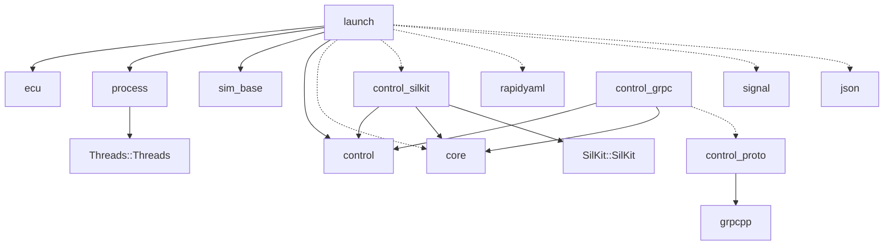

# Control API・gRPC・ランチャーの Control Server

[English](../code-map-control.md)

この分野を変更するときの地図です。全体の入口は [code-map.md](code-map.md)、テストの共通ルールは [code-map-testing.md](code-map-testing.md) にあります。

関連する仕様と変更範囲: [internals/control.md](internals/control.md) / [control-api.md](control-api.md) / [ランチャー・プロセス・設定・実行](code-map-launcher.md) / [シナリオ・時間の軸・一括実行](code-map-scenario.md) / [ブラウザー GUI・プロトコル・クライアント・画面の例](code-map-gui.md) / [ECU・Peer・ローカル実行・Simulation](code-map-execution.md)

**このページ:** [テストのラベル](#テストのラベル) / [ディレクトリごとのコードとテスト](#ディレクトリごとのコードとテスト) / [依存の向き](#依存の向き) / [変更するときに一緒に直すもの](#変更するときに一緒に直すもの)

**変更の種類:** [変数の対応表](#変数の対応表) / [`control.proto`](#controlproto) / [ランチャーの Control Server](#ランチャーの-control-server) / [シナリオの実行中の Control Server](#シナリオの実行中の-control-server) / [時刻と値をまとめて読む](#時刻と値をまとめて読む) / [Agent と Hub の間のメッセージ](#agent-と-hub-の間のメッセージ) / [SIL Kit の上のトランスポートと開始前の窓](#sil-kit-の上のトランスポートと開始前の窓)

## テストのラベル

### `control`

Control Agent のテスト（`control.*`）です。`unit` ラベルも付きます。`control_server` のテストにも、このラベルが付きます。

- 転送なしで Agent を直接動かすテスト
- `Ecu` で宣言した変数への時刻つきの書き込みが、仮想バスと SIL Kit で同じステップに反映され、同じ時刻に読み出されること
- `Peer` の Agent（SIL Kit の participant で、反映の位置、実時間、監視の出力）
- プロセス内で接続した `Hub`
- ECU より長く残った転送が、プロセスを止めること

### `control_server`

`VEHICLE_SIL_BUILD_CONTROL_SERVER=ON` のときだけ登録されます（プリセット `linux-gcc-control`）。CI もこのプリセットで実行し、GUI サーバーのテストもこのランチャーで実行します。

Control Server のテスト（`control_server.*`。`unit` と `control` のラベルも付きます）が確認すること:

- gRPC の生成コードと呼び出し
- 1 つのプロセスで端から端まで（2 つの J1939 の Peer の Agent が SIL Kit で接続する Hub、時間ゲート、gRPC のクライアント）
- 認証と役割と TLS と監査ログ
- どの役割がどの RPC を呼べるか（proto の RPC とルールの表の対応も）
- メッセージの変換、上限と入力の検査
- `SimulationMonitor`

grpcio と grpcio-tools のある Python があれば、次のテストも登録されます。どれも `control` と `python` のラベルが付きます。

| テスト | 内容 | ほかのラベル |
|---|---|---|
| `control_server.python_client` | Python のクライアントと CLI を、`vehicle_sil_launch run --control` に対して動かす | |
| `control_server.launcher` | `vehicle_sil_launch run --control` と `examples/ecu_main` の ECU を動かす | `integration` |
| `control_server.example_write_before_start`、`control_server.example_pause_and_step` | `examples/launch_control` を動かす | `examples` |
| `control_server.guide_operate_signals` | ガイド [信号を外から操作する](howto/operate-signals.md) の印つきのブロックを、同じ例、CLI、標準入力のコマンドの出力と照合する | `examples` |

`control_server.launcher` は、始まる前の書き込み、標準入力と Control Server の両方からのコマンド、終わり方、認証と TLS と監査、トークンつきの CLI を確認します。

## ディレクトリごとのコードとテスト

### `libs/control`

| 名前 | 場所 |
|---|---|
| `Agent` | `control/agent.hpp` |
| `Hub` | `control/hub.hpp` |
| 変数の対応表 `MappedSchema` | `control/variable_map.hpp` |
| Agent と Hub の間のメッセージの符号化と復号 | `control/wire.hpp` |

- テスト: `tests/control`
- `ctest -R`: `^control\.`（`wire.hpp` は `^control\.wire_`、対応表は `test_variable_map.cpp`）

### `libs/control_silkit`

| 名前 | 場所 |
|---|---|
| `AgentTransport` | `control_silkit/agent_transport.hpp` |
| `HubTransport` | `control_silkit/hub_transport.hpp` |
| トピックの名前 | `src/topics.hpp` |

- テスト: `tests/control_silkit`、`tests/launch`（プロセスをまたぐ開始前の窓）
- `ctest -R`: `^control_silkit\.`、`^launch_control\.`

### `libs/control_grpc`、`proto/`、`python/`

| 名前 | 場所 |
|---|---|
| `ControlServer` | `control_grpc/server.hpp` |
| Python のクライアント | `python/vehicle_sil_control/client.py` |
| ランチャーを起動する補助 | `python/vehicle_sil_control/launcher.py` |

- テスト: `tests/control_server`（`VEHICLE_SIL_BUILD_CONTROL_SERVER=ON` のときだけ）
- `ctest -R`: `^control_server\.`

| テストのファイル、テスト | 対象 |
|---|---|
| `test_launcher.py` | ランチャーの Control Server（認証、TLS、役割、監査も） |
| `test_python_client.py` | Python のクライアントと CLI |
| `control_server.example_write_before_start`、`control_server.example_pause_and_step` | `examples/launch_control` |
| `test_guide_operate_signals.py` | ガイド `docs/howto/operate-signals.md` と、例、CLI、標準入力のコマンドの照合（印は「[ドキュメントの例とテスト](code-map-testing.md#ドキュメントの例とテスト)」） |

### `examples/launch_control`（ガイド「信号を外から操作する」の例）

- テスト: `control_server.example_write_before_start`、`control_server.example_pause_and_step` が例を動かします。
- テスト: `control_server.guide_operate_signals`（`tests/control_server` の `test_guide_operate_signals.py`）が、ガイド [howto/operate-signals.md](howto/operate-signals.md) の印つきのブロックを、例、CLI、標準入力のコマンドの出力と照合します。
- `ctest -R`: `^control_server\.example_write_before_start`、`^control_server\.example_pause_and_step`、`^control_server\.guide_operate_signals`

どれも、Control Server のあるビルドで、grpcio と grpcio-tools のある Python があるときだけ登録されます。

## 依存の向き

[図の凡例と全体の層](code-map-core.md#依存の向き)、[境界を検査するテスト](code-map-testing.md#境界を検査するテスト) を参照。

### launch と Control API

| ターゲット | 作る条件 |
|---|---|
| `control_proto`、`control_grpc` | `VEHICLE_SIL_BUILD_CONTROL_SERVER=ON` のときだけ |
| `launch` | SIL Kit をサブモジュールからビルドしたとき（`rapidyaml` があるとき）だけ |

`grpcpp` は gRPC の C++ ライブラリです（`cmake/VehicleSilGrpc.cmake`）。

- `launch`、`ecu`、`json`: ランチャーは、`--describe` の出力と同じ書き手 `vehicle_sil/json/json_writer.hpp`（`json`）で JSON を書き、`--describe` の変数を `vehicle_sil/ecu/describe_json.hpp` で同じ形に書きます。`launch` は `ecu` の内部のヘッダーを読みません。

## 変更するときに一緒に直すもの

### 変数の対応表

設定ファイルの `participants[].variables` です。

変える場所:

| 内容 | 場所 |
|---|---|
| 読むコード | `libs/launch/src/config.cpp` の `read_variables()` |
| ルールと変換 | `libs/control/src/variable_map.cpp` の `MappedSchema` |
| 変換を適用する所 | `control::Hub`（`set_variable_map()`） |
| Hub に渡す所 | `libs/launch/src/run_control.cpp` の `RunControl::shared_hub()` |
| 照合 | `seen_ecu.cpp` の `seen_variables()`（`SeenEcu::variables()`）、`check_rules.cpp` の `variable_map_code()` |

合わせて直すドキュメント:

- [simulation-config.md](simulation-config.md) の「変数の名前と値を合わせる」（形の表、見え方）
- [simulation-check.md](simulation-check.md): `variable-map-*` と、JSON の `variables`、`variable_map`
- [simulation-run.md](simulation-run.md): `variable-map-not-applied`
- [control-api.md](control-api.md): `source`（`control.proto` の `VariableInfo.source`、Python の `Variable.source`）
- [internals/control.md](internals/control.md): Hub の「変数の対応表」（変換が適用される 4 か所と順序）

守ること:

- 変換は Hub の中だけで行います（読み取りの API や通信の層に追加しません）。
- 書ける値かどうかの判定は、`MappedSchema::to_actual()` の 1 か所です。シナリオの照合は、`in_range()` で同じ判定を使います（`libs/launch/src/scenario_values.cpp`）。
- 一致しなかった対応の名前には、書かせません（`not_writable()`）。
- 値は、Hub が保持する前に変換します（読み書きの経路による不整合を作りません）。
- 書き込みは、`write()` の検査と同じ所で変換します。
- 照合と実行は、同じ `MappedSchema::make()` を使います。

テスト:

- `^control\.`（`test_variable_map.cpp`）
- `^launch\.`（読み方、ルール、JSON）
- `launch_run.variable_map`: 対応表を通したシナリオが、対応表なしと同じ時刻に進む
- `control_server.control_server_peer_info_names_the_source_of_a_mapped_variable`

### `control.proto`

変える場所:

- `proto/vehicle_sil/control/v1/control.proto`

合わせて直すコードとドキュメント:

- `libs/control_grpc/src`（`convert.hpp`、`control_service.cpp`）
- サービスを追加したら、`auth.cpp` の `rpc_rules()` と `test_authorization*.cpp` も直します。
- `python/vehicle_sil_control/client.py`
- [control-api.md](control-api.md)

Python のスタブは、テストのビルドで生成します（`python -m vehicle_sil_control.generate`）。

### ランチャーの Control Server

変える場所:

- `libs/launch/src/control_server.cpp`: 要求が `--control` のために指すもの（`launch/request.hpp` の `RunHost::control`）の読み取りと検査（usage の誤り）と、検査済みの `ServerOptions` から作るサーバー。`tools/launch/main.cpp` は引数を要求に写すだけです。Control Server のないビルドでは `--control` を断り、ライブラリには代わりに `src/control_server_none.cpp` が入ります
- `launch::ControlEndpoint`（`launch/run.hpp`）。`libs/launch/src/run.cpp` の `run_file()` が、照合の前に Server を作り（`src/run_control_server.hpp` の `make_control_server_of_run()`）、`Runner::prepare()` と `Runner::run()` の間で起動し、戻るときに終えます。破棄は、呼ぶ側が結果の後に行います（`RunReport::ended_control_server`）。`RunLent::control_endpoint` は、呼ぶ側の自分のサーバーを代わりに貸すためのものです（試験が使います）
- `TimeCommands` の `hold_before_start()`、`inspect()`、`wait_paused()`
- `ServerOptions::external_hub`
- `python/vehicle_sil_control/launcher.py`

合わせて直すドキュメント:

- [control-api.md](control-api.md) の「ランチャーに接続する」（始まる前に書く、標準入力とクライアントのコマンド、認証）
- [simulation-config.md](simulation-config.md): 引数の表
- [simulation-events.md](simulation-events.md): イベント `control_server`、`command` の `source` と `at_ms`、`features` の `control-server`（`kControlServerFeature`）
- [internals/control.md](internals/control.md) の「ランチャーの Control Server」（スレッド、標準入力とクライアントのコマンドの順序、開始前に止めること、終わり方）

`features` の `control-server` は、Control Server を持つビルドだけが出力します。そのため `version --json` の例には入れず、`launch_cli.docs` がこの名前を除いて照合します。

守ること:

- gRPC のスレッドから controller を操作するのは、`TimeCommands` の中だけにします。`detach()` の後に controller が破棄されるためです。
- `run_file()` の中で、gRPC を待つものを追加しません。

テスト:

- `control_server.launcher`、`control_server.example_write_before_start`、`control_server.example_pause_and_step`
- `^launch\.`（`TimeCommands`）
- `launch_run.time_usage`（引数のエラー）

### シナリオの実行中の Control Server

シナリオの実行中の Control Server は、読み取り専用です。

変える場所:

- `ServerOptions::observe_only`
- `libs/control_grpc/src/auth.hpp` の `Effect` と、`auth.cpp` の `rpc_rules()`
- 拒否するコード: `control_service.cpp` の `guarded()`
- 設定するコード: `libs/launch/src/control_server.cpp`

合わせて直すドキュメント:

- [scenario.md](scenario.md) の「実行中に変数を見る」（拒否する呼び出しの表、理由 `scenario-running`）
- [control-api.md](control-api.md) の「ランチャーに接続する」と `ControlError.reason`
- [simulation-config.md](simulation-config.md): 引数の表
- [simulation-events.md](simulation-events.md): `features` の `scenario-control`（`kScenarioControlFeature`）
- [internals/control.md](internals/control.md) の「ランチャーの Control Server」

`scenario-control` は、`control-server` と同じく、持つビルドだけが出力します。RPC を追加したら、`rpc_rules()` の表の行に種類を書きます（状態を変える RPC は `Effect::Change`）。

守ること:

- 拒否するのは、RPC の本体に入る前の 1 か所です。
- クライアントの呼び出しから、実行の tap（`RunSamples`）、書き込み、ガードを操作する経路を追加しません。
- Hub の購読と tap に、待つものを追加しません。

テスト:

- `control_server.control_server_observe_only_*`、`control_server.control_server_that_only_observes_*`（呼び出しごとの表は、テストの側にも書いてあります）
- `control_server.launcher`: クライアントが読んでいても、いなくても、シナリオの結果が同じ。読み出さないクライアントがいても終わる
- `control.control_hub_readers_that_never_read_*`

### 時刻と値をまとめて読む

応答の形を変える場合は [control.proto](#controlproto)、ランチャーとの接続は [ランチャーの Control Server](#ランチャーの-control-server)、GUI の利用側は [GUI の実装とテスト](code-map-gui.md#guiserverguiprotocolguiclientguiweb) を参照。

`GetSnapshot` です。

変える場所:

- `libs/control_grpc/src/control_service.cpp`
- `Hub::latest_of()` と `none_after()`
- `Control.snapshot()`

合わせて直すドキュメント:

- `control.proto` の `GetSnapshotReply` のコメント: 保証
- [control-api.md](control-api.md) の「時刻と値をまとめて読む」（保証）
- [internals/control.md](internals/control.md) の「Control Server と通信の層」（読む順とロック）

守ること:

- 時間の状態を先に、値を後に読む順を変えません。逆にすると、値が時刻より古くなることがあります。

テスト:

- `^control_server\.control_server_snapshot`
- `control_silkit.the_time_and_then_all_values_`（gRPC なしで同じ読み方）
- `control_server.launcher`（止める、書く、ステップ実行、まとめて読む）

### Agent と Hub の間のメッセージ

変える場所:

- `libs/control/src/wire.cpp`

守ること:

- どちらの側も `kVersion` で書き、`kVersion` だけを読みます。別のバージョンの hello は報告し（participant 名は読みます）、Peer にしません。ほかのメッセージは、別のバージョンなら捨てます。`vehicle_sil_launch` は、`--describe` が出力したバージョンを `kVersion` と比べ（`libs/launch/src/check_rules.cpp`、`run_control.cpp`）、どちらをビルドし直すかを `libs/launch/src/check_words.hpp` の `control_version_fix()` で言います。
- コマンドのどの書き込みが反映されたかと、断った理由がどの書き込みについてかは、数で運びます（`CommandResult::applied_writes`、`SubmitResult::failed_write` と、同じ 2 つの名前を持つ Hub の `TargetResult`）。そのために `reason` を読まないでください（[internals/control.md](internals/control.md) の「Control Server の中核」）。
- 項目を追加するときは、その要素（変数、書き込み、結果、イベント）の末尾に追加します。メッセージ全体の項目なら、メッセージの末尾に追加します。`control/wire.hpp` の `kRevision` を 1 上げ、その項目は、その改訂番号以降の相手からだけ読みます。古いビルドの復号は、その項目を読み飛ばします。
- 読み飛ばしてはいけない変更（項目の移動や削除、相手が知らない列挙の値を送ること）には、新しいバージョンが必要です。`kVersion` を上げます。バージョンの違う ECU とランチャーは、変数を一緒に読み書きできなくなります（照合が `control-link-version` を出します）。
- `result_bytes()` と `event_bytes()` は、`write_result()` と `write_event()` が書くバイト数とちょうど同じ値を返すようにします。`encode_step()` はこの値で分割するので、小さすぎるとメッセージが上限を超えます。
- `kLeast` は、要素の最小の大きさです。復号は、何かを読む前に、個数をこの値と照らします。要素に項目を追加したら、ここも直します。
- `--describe` は `kRevision` を `control.wire_revision` として出し、check は古い改訂の ECU を注記します（`libs/launch/src/check_rules.cpp` の `control-link-revision`）。`kRevision` を上げたら、古い改訂に何が欠けるかを、その注記に書きます。
- 利用状態（改訂 1）は、ステップのメッセージの最後の部分で、値の後ろにあります。フラグ（`kStepAvailability`）で読み、残りのバイト数からは読みません。`AgentTransport` は、ステップのシンクの中で `Agent::availability()` を読みます。状態をトランスポートのスレッドへ渡す道はほかになく、要りません。
- 相手が知らなくても困らない種類を追加するだけなら、バージョンも改訂番号も上げません。知らない種類は捨てられます（最後の通知への返事 `Kind::LastWordReceived` がその例です）。
- ヘッダーの 8 バイト、hello のヘッダーの直後の participant 名、ほかのメッセージのヘッダーの直後の session は、どのバージョンでも変えません。バージョンの違う相手の名前を読むためと、ECU がメッセージの宛先を見るためです。

合わせて直すドキュメント:

- [internals/control.md](internals/control.md) の「SIL Kit の上のトランスポート」（大きさの上限 `kMaxMessageBytes`、`kMaxHelloBytes`、`kMaxTextBytes` と、分け方）

テスト:

- `^control\.wire_`: 1 バイトずつ切る、欄を壊す、乱数の入力。境界の外を読むと、sanitizer のプリセットで失敗します。
- `^control\.wire_v2_`: バージョン 2（メッセージは `tests/control/test_wire_v2.cpp` にも手で書いてあります）。古いバージョンと新しいバージョンを読まないこと、新しい改訂番号から読み飛ばすものと同じ改訂番号から断るもの、要素の大きさ、ステップのメッセージが上限ちょうどまで詰まること。
- `^control\.wire_building_`: ステップのメッセージを組み立てるとき、バッファが育った後はメモリを確保しないこと（専用の実行ファイル、`tests/control/test_wire_allocation.cpp`）。
- `^control\.wire_v2_revision_0_`: バージョン 2、改訂 0 のバイト列（`tests/control/wire_v2_golden.hpp` に手で書いたもの）。項目を追加するときは、新しい改訂のバイト列を横に追加し、これは変えません。
- `^control\.wire_v2_revision_1_`: 改訂 1 で足したバイト列（利用状態）。同じファイルにあります。
- `control_silkit.a_hello_of_another_version_is_reported_and_makes_no_peer`、`control_silkit.an_agent_does_not_answer_what_is_written_to_it_in_another_version`: 古いバージョンと新しいバージョンを、それぞれの側で。

### SIL Kit の上のトランスポートと開始前の窓

変える場所:

- SIL Kit の上のトランスポート（`libs/control_silkit/src`）
- 開始前の窓: `libs/core/src/simulation_controller.cpp` の `run_window()` と `cancel_window()`
- 開始前の窓: `libs/core/src/participant_runtime.cpp` の `set_communication_ready_handler_async()`
- `ecu_main()` がトランスポートを付ける所（`libs/simulation/src/ecu_main.cpp`）
- ランチャーの Hub: `libs/launch/src/run_start.cpp` の `RunStartWindow::run()`、`run_control.cpp` の `RunControl::note_links()`

合わせて直すドキュメント:

- [internals/control.md](internals/control.md) の「SIL Kit の上のトランスポート」（スレッド、受信の順序の保証、最初のステップの前で待つ区間、接続の終わりと最後の通知への返事、認証がないこと）
- [internals/control.md](internals/control.md): 同じ節の上限（`kMaxVariables`、`kMaxNameBytes`、`HubTransportOptions::max_links` を変えたとき）
- [dependencies.md](dependencies.md) の「実装が前提にしている上流の挙動」（依存している SIL Kit の挙動）
- [simulation-run.md](simulation-run.md) の「ECU の変数との接続」と表（下のランチャーの出力）
- [ecu-executable.md](ecu-executable.md) の「JSON の形式」（`--describe` の `control`）

仕様は、`agent_transport.hpp` と `hub_transport.hpp` のクラスのコメントに書いてあり、internals/control.md をそれに合わせます。

simulation-run.md に書いてあるランチャーの出力:

- イベント `control_link`
- 結果の `participants[].control_link`
- 照合の JSON の `participants[].control`
- 指摘 `control-link-no-hello`、`control-link-version`、`control-link-revision`、`control-link-late-values`、`control-link-dropped`、`control-link-not-offered`、`before-start`

`--describe` の `control` を扱うコード:

- 出力するコード: `libs/ecu/src/describe.cpp`
- 追加するコード: `ecu_main`
- 読むコード: `libs/launch/src/describe_read.cpp`

守ること:

- `AgentTransport` のデストラクターは、Hub の返事を待ちます（`AgentTransportOptions::last_word_wait`）。
- 待ちを長くする変更や、なくす変更は、ECU の終わりの遅れと、実行の終わりの結果（Cancelled か Unknown か）を変えます。
- 値と結果は、ステップのスレッドから、値を読んだ直後に送信します。別のスレッドに渡すと、順序の保証がなくなります（`HubTransportStats::late_messages` が数えます）。
- 利用状態は、遅れてつながった Hub のために、ステップの時刻で 1 秒ごとに送り直します（`agent_transport.cpp` の `kAvailabilityResend`。`control_silkit.the_availability_is_said_again_each_second_of_step_time`、`control_silkit.a_hub_that_comes_late_gets_the_availability_the_ecu_has_now`）。
- Hub の側の受信のハンドラーには、待つものと重い処理を追加しません。シミュレーション全体が待つことになります。

テスト:

- `^control_silkit\.`、`^core\.`、`^launch_control\.`
- `launch_run.control`
- `simulation.ecu_main_offers_its_variables_to_the_simulation_unless_no_control`
