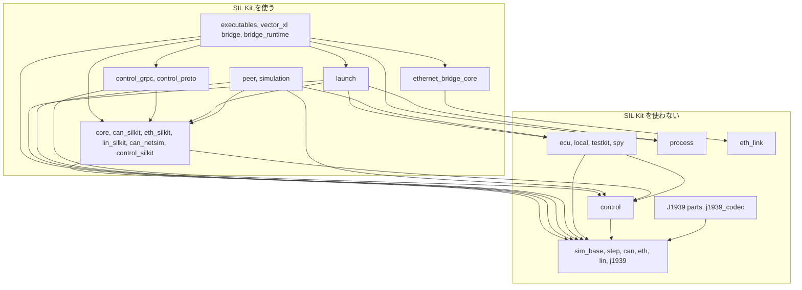
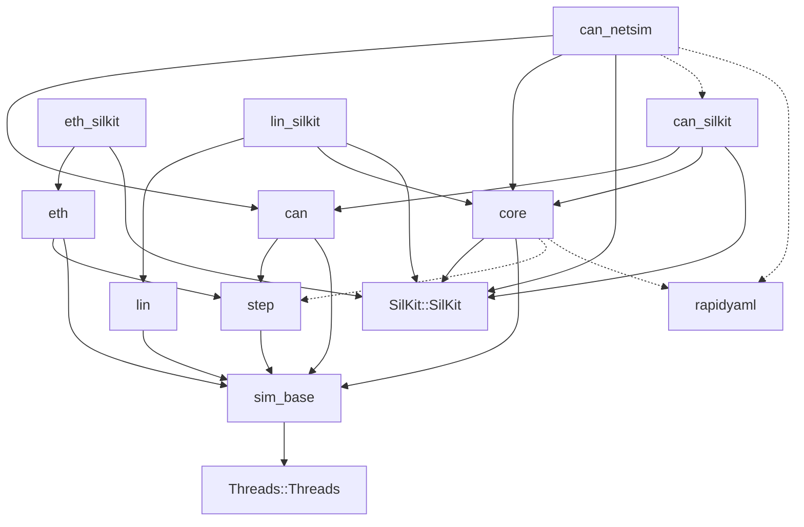

# 基盤・ステップ・信号・SIL Kit の既定

[English](../code-map-core.md)

この分野を変更するときの地図です。全体の入口は [code-map.md](code-map.md)、テストの共通ルールは [code-map-testing.md](code-map-testing.md) にあります。

関連する仕様と変更範囲: [internals/core.md](internals/core.md) / [internals/virtual-time.md](internals/virtual-time.md)

## テストのラベル

### `step`

`vehicle_sil::step` の単体テストです（CAN と SIL Kit なしでビルドします）。`unit` ラベルも付きます。

CAN でないテスト用の participant（`Member`）で、次を確認します。

- 段階の順序
- `start()` が 1 回だけ、最初のステップの前に呼ばれること
- 時間の領域の混在の拒否（ホストとドライバー）
- 失敗の扱い
- `post()` と起こし方、`next_deadline()`
- 仮想時間の `StepDriver`
- 差し替えた時計の上の `RealTimeDriver`（締め切りと到着で起きる）

`step.boundary` は、`libs/step` が SIL Kit のヘッダーを直接にも間接にも含まないことを検査します。

### `signal`

`vehicle_sil::signal` の波形の関数の単体テストです（標準ライブラリだけでビルドします）。`unit` ラベルも付きます。

- 時刻の表と比べた値（周期の端、位相、デューティー 0 と 100）
- 乱数の列が、どのプラットフォームでも同じ値であること
- 乱数とチャタリングが、時刻だけで決まること
- チャープの位相が飛ばないこと
- 点の並びの補間

`signal.boundary` は、`libs/signal` が SIL Kit のヘッダーを含まないことを検査します。

### `core`

仮想時間の単体テストです。`unit` ラベルも付きます。

プロセス内のレジストリで、次を確認します。

- ステップ幅の違う participant の同期、最も遅い participant を待つこと、実時間への結合
- `TickScheduler`、`StepInbox`

LIN のテストは [バスのページの LIN 単体テスト](code-map-buses.md#lin-単体テスト) と [LIN の結合テスト](code-map-buses.md#linlin_cluster) を参照してください。

## ディレクトリごとのコードとテスト

### `libs/core`

| 名前 | 場所 |
|---|---|
| `ParticipantRuntime` | `vehicle_sil/core/participant_runtime.hpp` |
| `default_participant_configuration()`, `merged_participant_configuration()` | `core/participant_configuration.hpp` |
| `SimulationController`、`StartWindow` | `core/simulation_controller.hpp` |
| `TickScheduler` | `core/tick_scheduler.hpp` |
| `bind_host()` | `core/bind_host.hpp` |
| `SimTime`（`sim_base`） | `core/sim_time.hpp` |
| `StepInbox`（`sim_base`） | `core/step_inbox.hpp` |
| `periodic()`（`sim_base`） | `core/periodic.hpp` |
| `is_loopback_registry_uri()`（`sim_base`） | `core/registry_uri.hpp` |

- テスト: `tests/core`
- `ctest -R`: `^core\.`

### `libs/step`

| 名前 | 場所 |
|---|---|
| `Member`、`Host` | `step/host.hpp` |
| `StepDriver` | `step/step_driver.hpp` |
| `RealTimeDriver` | `step/real_time_driver.hpp` |
| `RealTimeClock`、`ManualRealTimeClock` | `step/real_time_clock.hpp` |
| `TimeDomain`、`Wakeup` | `step/time_domain.hpp` |
| `SinkRef` | `step/sink_ref.hpp` |
| `OverflowCollector`（バスごとに別名: `can::OverflowCollector`、`eth::OverflowCollector`） | `step/overflow_collector.hpp` |

- テスト: `tests/step`
- `ctest -R`: `^step\.`

### `libs/signal`

| 名前 | 場所 |
|---|---|
| 時刻の関数としての波形 `sine()`、`triangle()`、`sawtooth()`、`square()`、`noise_uniform()`、`noise_gaussian()`、`chirp()`、`lag()`、`chatter()`、`points_linear()`、`points_hold()` | `signal/waveform.hpp` |
| 乱数の列 `unit_random()` | `signal/waveform.hpp` |

ヘッダーだけで、何もリンクしません。シナリオの `wave` と、利用者の C++ のコードの両方から使います。

- テスト: `tests/signal`
- `ctest -R`: `^signal\.`

### `libs/json`

`--describe` の出力と `vehicle_sil_launch` の JSON が共有する JSON の書き手です（ターゲット `vehicle_sil::json`、ヘッダーだけ）。

| 名前 | 場所 |
|---|---|
| `JsonWriter`、`hex64()` | `vehicle_sil/json/json_writer.hpp` |

- テスト: `--describe` の JSON（`tests/ecu`）とランチャーの JSON（`tests/launch`）を通して
- `ctest -R`: `^ecu\.`、`^launch`

## 依存の向き

どの図でも、矢印は「リンクする」（`target_link_libraries`）です。逆向きの依存は作りません。

| 図の書き方 | 意味 |
|---|---|
| 実線の矢印 | `PUBLIC` か `INTERFACE` のリンク |
| 点線の矢印 | 非公開（`PRIVATE`）のリンク |
| ノードの名前 | ターゲットの名前（`vehicle_sil::` を省く） |

[境界を検査するテスト](code-map-testing.md#境界を検査するテスト) も参照。

### 全体の層

箱はターゲットのまとまりです。箱の間の矢印は、後の図の 1 本以上のリンクをまとめたもので、公開か非公開かは区別していません。

SIL Kit を使わないのは `sim_base`、`step`、`can`、`eth`、`lin`、`control`、`j1939` とそのコンポーネント、`j1939_codec`、`ecu`、`local`、`testkit`、`spy`、`process`、`eth_link`、`signal`、`json` です。`signal` と `json` はヘッダーだけで、vehicle-sil のほかのライブラリも使いません（図にはありません）。

### 基盤と SIL Kit の実装

## 変更するときに一緒に直すもの

### SIL Kit の設定の既定

設定の既定を変える場合は、[ランチャーの設定キー](code-map-launcher.md#設定ファイルかシナリオのキー) と [ネットワーク名の対応](code-map-execution.md#ネットワークの名前の対応) にも注意する。

変える場所:

- `libs/core/src/participant_configuration.cpp` の `default_participant_configuration()` など（待ち受けるアドレス、Windows の TCP、registry はどの OS でも TCP）
- 渡された設定に重ねる `merged_participant_configuration()` と、ecu_main の `--silkit-config`
- 既定を使う所: `libs/launch/src/run.cpp` の controller と、ほかの PC に向けた行
- 既定を使う所: `run_participants.cpp` の環境変数、manual のコマンドの `environment`
- 既定を使う所: `config.cpp` の注記 `registry-on-network` と、`inherited_listen_variable()`（注記 `listen-variable-ignored`）

合わせて直すドキュメント:

- [internals/core.md](internals/core.md) の「SIL Kit の設定の既定」
- [simulation-run.md](simulation-run.md) の「待ち受けるアドレス」
- [simulation-check.md](simulation-check.md): 指摘の表
- [dependencies.md](dependencies.md): SIL Kit（Windows）の節
- [ecu-executable.md](ecu-executable.md) の「SIL Kit の設定ファイルを渡す」
- [howto/multi-pc.md](howto/multi-pc.md): `examples/ecu_main/simulation.two-pcs.yaml` と、その `check` の出力のブロック（`multi_host.docs` が照合）

テスト:

- `core.a_participant_*`、`core.a_configuration_*`、`core.a_registry_uri_*`
- `simulation.ecu_main_*silkit_configuration*`
- `launch_run.network`、`launch_run.busy_port`
- `multi_host.two_hosts`、`multi_host.docs`
- `core.silkit_configuration_defaults`
