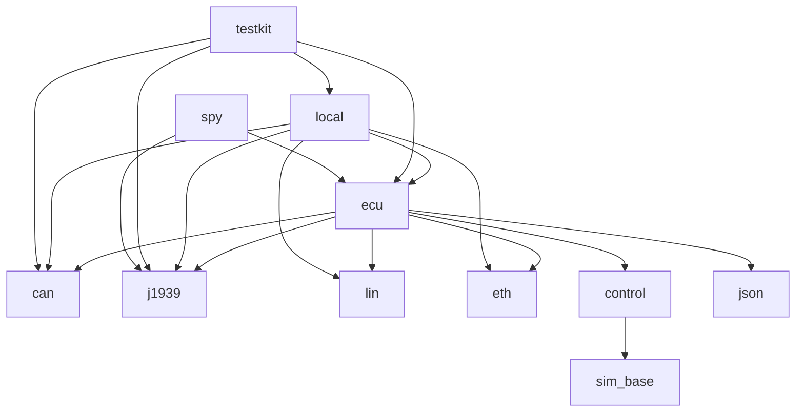
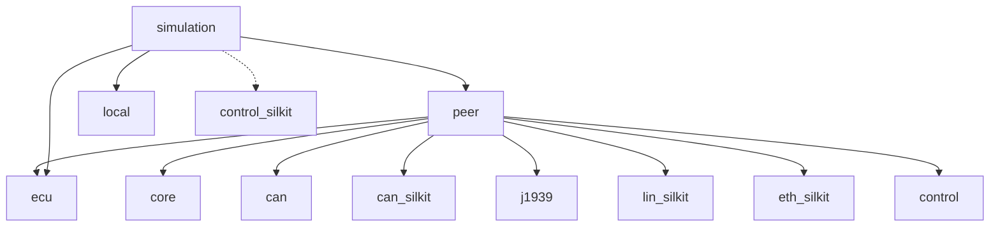

# ECU・Peer・ローカル実行・Simulation

[English](../code-map-execution.md)

この分野を変更するときの地図です。全体の入口は [code-map.md](code-map.md)、テストの共通ルールは [code-map-testing.md](code-map-testing.md) にあります。

関連する仕様と変更範囲: [internals/execution.md](internals/execution.md) / [internals/virtual-time.md](internals/virtual-time.md) / [ecu-executable.md](ecu-executable.md)

**このページ:** [テストのラベル](#テストのラベル) / [ディレクトリごとのコードとテスト](#ディレクトリごとのコードとテスト) / [依存の向き](#依存の向き) / [変更するときに一緒に直すもの](#変更するときに一緒に直すもの)

**変更の種類:** [`--describe` の JSON](#--describe-の-json) / [ネットワークの名前の対応](#ネットワークの名前の対応) / [`ecu_main` の引数と終了コード](#ecu_main-の引数と終了コード) / [ECU のバスからの切断](#ecu-のバスからの切断) / [ネットワークの種類か使い方を追加する](#ネットワークの種類か使い方を追加する) / [テンプレートと ECU の API](#テンプレートと-ecu-の-api)

## テストのラベル

### `peer` / `testkit`

| テスト | 内容 | ラベル |
|---|---|---|
| `peer.*` | `Peer` をプロセス内のレジストリで動かす | `peer`、`unit`、`j1939` |
| `testkit.*` | テストキットのテスト | `testkit`、`unit`、`j1939` |
| `ecu_api.*` | 利用者が書く形の ECU を、仮想バスで動かす | `testkit`、`unit`、`j1939` |
| `param_service.*` | `examples/j1939/param_service` の独自プロトコルを、仮想バスで動かす | `testkit`、`unit`、`j1939` |

それぞれが確認すること:

- `peer.*`: J1939 と LIN の 3 つの participant、仮想バスと同じ結果、実時間と外部ポート、組み立てのエラー、失敗の報告
- `peer.*j1939_nodes*`: `PeerOptions::j1939_nodes` が、名前を替えたネットワークと外から渡したポートのネットワークに当たること、`start()` の後に追加したノードに当たらないこと、どのノードにも当たらなかった行の理由と `start()` のメッセージ（`host()` で回した最初のステップの後に追加したノードの場合も）、`start_together` がどの `Peer` も始めずに同じメッセージで拒否すること、コードが渡した `node_overrides` を拒否すること
- `testkit.*`: アドレスの喪失、Address Claimed の欠落、TP のパケットの欠落、通信断、生フレームの注入、受信側のステップ幅と記録の有無によらない結果
- `ecu_api.*`: `examples/j1939/ecu_pair`、ツールキットと `Requester` で作る独自のプロトコル、`Monitor` と `Observer` と tap で通信を確認するテスト
- `param_service.*`: 正常な流れ、セッションの期限切れ、2 つ目のツール、応答しない ECU、アドレスの変化と喪失、拒否、動作中のコンポーネントの破棄
- `param_service.boundary`: 例が公開 API だけを使うこと
- `param_service.demo`: 例の実行

エンジンの内部を使っていないことの検査（`peer.boundary`、`testkit.boundary`、`local.boundary`）は、`j1939` の項目にあります。

### `ecu`

ECU の `--describe` の出力の JSON（`to_json(EcuDescription)`）の単体テストです（SIL Kit なし）。`unit` ラベルも付きます。

- 空と全部入りの全文、キーの順、数値、64 ビットの列挙の値、NAME の文字列、文字列のエスケープ、バージョン
- `ecu.no_silkit_boundary`、`ecu.simulation_headers_boundary`: `libs/ecu` と `libs/simulation/include` が、SIL Kit のヘッダーを直接にも間接にも含まないこと
- `ecu.boundary_check_*`: その検査自体のテスト
- `ecu.j1939_node_argument*`: 引数 `--j1939-node` の値を書く関数と読む関数の往復、誤った値ごとのメッセージ、1 つの ECU の行どうしの検査

### `simulation` / `examples`

| テスト | 内容 | ラベル |
|---|---|---|
| `simulation.*` | `Simulation` のテスト | `unit` と `simulation` |
| サンプルの実行 | サンプルは自分で結果を検査し、違えば 0 以外で終わる | `examples` と `simulation`（`low_level.demo` は `examples` だけ） |
| `ecu_main.*` | `examples/ecu_main` の ECU の実行ファイルを、プロセスとして動かす | `integration` と `simulation` |

`simulation.*` が確認すること:

- 同じ ECU が、仮想バスと SIL Kit で同じ記録を残すこと
- ECU が持つオブジェクトの破棄
- ステップの失敗が `SimulationError` になって戻ること
- 使い方のエラー（同じ入力を両方の実装で拒否すること、`App` のコンストラクターの例外）
- `request_stop` で終わる実行、ほかの participant の失敗、開始の時間切れ
- `local()` から追加した ECU、別プロセスの controller や participant との併用
- 2 つのネットワークを持つゲートウェイ、生の CAN、LIN の Master と Slave、イーサネットのチャネルが、両方で同じ結果になること
- `Ecu::describe()`
- 関数として呼んだ `ecu_main()` の引数と終了コード
- `simulation.*j1939_nodes*`: `SilKitOptions::j1939_nodes` が名前の ECU にだけ効くこと（同じ ECU のコードを 2 つ追加する場面）、ない ECU の名前や当たらなかった行を始める前に拒否すること
- `simulation.ecu_main_j1939_node*`: `ecu_main()` の `--j1939-node` が、行の値をノードに与えること（名前を替えたネットワークでも）、どのノードにも当たらない行のメッセージ（終了コード 3）、ステップの中で追加したノードがコードの値のままであること。値の使い方の誤りは `simulation.ecu_main_refuses_bad_command_lines`

イーサネットのチャネル（`test_ethernet.cpp`）では、次のステップで受信すること、同じ時刻の順、絞り込み、1 ステップに `receive_capacity` までのフレームを落とさないこと、拒否するときの文言、`LocalBench` の参照を確認します。

実行するサンプル:

- `vehicle_sil_getting_started`（仮想バスと `--silkit`）
- `typed_messages`、`pid_stream`、`fault_injection`、`low_level`
- `vehicle`（SIL Kit と `--local`）
- `vehicle_sil_ethernet_example`（仮想ネットワークと `--silkit`、別の EtherType、引数のエラー）

`ecu_main.*` が確認すること:

- `--describe` の JSON を [ecu-executable.md](ecu-executable.md) の例と、vehicle-sil のバージョンを除いてバイト単位で照合
- `--local`
- `vehicle_sil_sim_controller` の下の SIL Kit での 2 つの ECU
- エンジンの 2 つのコピー、2 つ目に `--j1939-node`（`ecu_main.j1939_node`。監視の出力のアドレス）
- 使い方、停止の要求

### `virtual_time`

registry、controller、4 つのピア（1 / 2 / 5 / 10 ms。どれも `Peer` の上）を別プロセスで動かします。`integration` ラベルも付きます。

- トレースを照合して、データがピアの間を予測どおりの仮想時刻で渡ることを確認します。
- J1939 の ECU が、Address Claim の 250 ms 後から送信することを確認します。
- 全速、遅い `tick()`、4 倍速、0.5 倍速の各条件でトレースが一致し、壁時計の所要時間が実時間より速い・遅いことを確認します。
- `peer-failure`: 途中で失敗したピアを controller が検出して中断し、全プロセスが終了コード 1 で終わることを確認します。

## ディレクトリごとのコードとテスト

### `libs/ecu`

| 名前 | 場所 |
|---|---|
| `Ecu` | `ecu/ecu.hpp` |
| `EcuDescription`、`to_json()` | `ecu/describe.hpp` |
| `to_json()` の名前と `variables` の配列。読む道具や同じ形で書く道具が使う（`value_type_name()`、`causality_name()`、`write_variables()`） | `ecu/describe_json.hpp` |
| ネットワークの種類と使い方の一覧 `kNetworkKinds`、`kNetworkUses` | `ecu/describe.hpp` |
| ECU の実行ファイルとランチャーの間の仕様（引数、終了コード、`kMaxMillis`） | `ecu/executable.hpp` |
| 引数 `--j1939-node` の値を書く関数と読む関数、`J1939NodeOverride` | `ecu/j1939_node_argument.hpp` |
| `Peer` の監視の出力の名前（`peer.*`、`j1939.<network>.*`）。`Peer` が登録し、ランチャーが読む | `ecu/monitor_names.hpp` |
| バスからの切断（`ecu.connected`）の `BusConnection`、`GatedCanPort`、`GatedLinPort`、`GatedEthPort` | `ecu/detail/bus_connection.hpp` |

- テスト: `tests/ecu`、`tests/simulation`（`test_disconnect.cpp`）
- `ctest -R`: `^ecu\.`、`^simulation\.disconnect`

### `libs/local`

| 名前 | 場所 |
|---|---|
| `LocalBench` | `local/local_bench.hpp` |

- テスト: `tests/testkit`、`tests/lin`
- `ctest -R`: `^testkit\.`、`^lin_local\.`、`^local\.`

### `libs/testkit`

| 名前 | 場所 |
|---|---|
| `J1939Events`、`FrameLog` | `testkit/recorders.hpp` |
| `faults` | `testkit/faults.hpp` |
| `LocalCan` | `testkit/local_can.hpp` |

- テスト: `tests/testkit`
- `ctest -R`: `^testkit\.`、`^ecu_api\.`、`^param_service\.`

### `libs/peer`

| 名前 | 場所 |
|---|---|
| `Peer`、`PeerOptions`、`start_together()` | `peer/peer.hpp` |
| 監視の出力 | `src/peer_monitor.cpp` |

- テスト: `tests/peer`
- `ctest -R`: `^peer\.`

### `libs/simulation`

| 名前 | 場所 |
|---|---|
| `Simulation`、`SilKitOptions`、`SimulationError` | `simulation/simulation.hpp` |
| `ecu_main()`、`EcuMainOptions` | `simulation/ecu_main.hpp` |
| `ecu_main()` の流れ: 準備、`--describe`、実行、終了コード | `src/ecu_main.cpp` |
| `ecu_main()` のコマンドライン: 引数の読み取り、使い方の文 | `src/ecu_main_command_line.*` |
| 標準出力への `--describe` の JSON と使い方の文 | `src/ecu_main_describe_stdout.*` |
| シグナルやコンソールのイベントで止める（`--registry-uri`） | `src/ecu_main_stop_on_signal.*` |
| `ecu_main()` の部品がメッセージで共有する文字列の処理 | `src/ecu_main_text.*` |

- テスト: `tests/simulation`
- `ctest -R`: `^simulation\.`、`^ecu_main\.`（`examples/ecu_main` のプロセス）
- サンプルの実行のテストは、`getting_started.`、`typed_messages.`、`pid_stream.`、`fault_injection.`、`vehicle.`、`low_level.`、`ethernet_example.` で始まります。

### `tools/sim_controller`

| 名前 | 場所 |
|---|---|
| `vehicle_sil_sim_controller` | `main.cpp` |

- テスト: 専用のテストはなく、プロセスのテストが使います。
- `ctest -R`: `^virtual_time\.`、`^ecu_main\.`、`^lin_cluster\.`

### `examples/virtual_time`

- テスト: `tests/virtual_time`
- `ctest -R`: `^virtual_time\.`

### `examples/first_ecu`（ガイド「最初の ECU を作る」の例）

ガイド [howto/first-ecu.md](howto/first-ecu.md) が、テンプレートに追加する ECU です。ファイルはガイドのコードのブロックと同じ内容で、利用者はガイドのとおりに自分で書きます。

| ファイル | 内容 |
|---|---|
| `cooler/main.cpp` | ECU の `Cooler` |
| `CMakeLists.txt` | テンプレートの `CMakeLists.txt` に追加する 4 行 |
| `simulation.yaml` | テンプレートの 2 つの ECU と `Cooler` |
| `read_cooler.py` | Python から読み書きするスクリプト |

- ビルド: `tests/template` が、テンプレートのプロジェクト（`build/<preset>/tests/template/project/bin/`）に `cooler_ecu` を追加します。`VEHICLE_SIL_BUILD_EXAMPLES` だけのビルドには入りません。
- `ctest -R`: `^template\.first_ecu`、`^control_server\.example_first_ecu`

| テスト | 照合するもの |
|---|---|
| `template.first_ecu`（`tests/template/first_ecu.cmake`） | 4 つのファイルとガイドのブロック |
| 同上 | `--describe` の抜粋のキー、`--local` |
| 同上 | 3 つの ECU での `check` と `run` の出力 |
| 同上 | `step_ms` を間違えたときの出力と、`--disable Dashboard` の出力 |
| `control_server.example_first_ecu` | `read_cooler.py` の出力 |

`control_server.example_first_ecu` は、Control Server のあるビルドで、gRPC のある Python があるときだけ登録されます。

## 依存の向き

[図の凡例と全体の層](code-map-core.md#依存の向き)、[境界を検査するテスト](code-map-testing.md#境界を検査するテスト) を参照。

### ECU とローカルの実行（SIL Kit なし）

### Peer と Simulation

## 変更するときに一緒に直すもの

### `--describe` の JSON

読み取る側の変更は [ランチャーの実装](code-map-launcher.md#libslaunchtoolslaunch) と [照合のルール](code-map-launcher.md#照合のルールと-code) を参照。

変える場所:

- `libs/ecu/src/describe.cpp`
- `examples/ecu_main/engine` の ECU

合わせて直すドキュメント:

- [ecu-executable.md](ecu-executable.md): `<!-- vehicle_sil_engine_ecu --describe -->` の後のコードブロック（`ecu_main.describe` が照合）
- [ecu-executable.md](ecu-executable.md) の「JSON の形式」

合わせて直すコード:

- JSON を読む側の `read_description()`（`libs/launch/src/describe_read.cpp`）
- 形式のバージョン `kEcuDescriptionFormat`（`ecu/describe.hpp`）

### ネットワークの名前の対応

変える場所:

- SIL Kit のコントローラーを作る所（`libs/peer/src/peer.cpp`。ネットワークの使い方を追加するときも）
- ネットワークの名前の対応（`PeerOptions::network_names`、`SilKitOptions::network_names`、`--map-network`）

守ること:

- コントローラーは、`Peer::simulation_name(<コードの名前>)`（対応を引くただ 1 つの関数）の名前のネットワークに作ります。`peer.controllers_are_made_on_the_simulation_name`（`cmake/VehicleSilCheckControllerNetworks.cmake`）が、`libs/` の `Create(Can|Lin|Ethernet|Flexray)Controller(` の行を読んで確認します。
- 監視の出力の名前（`libs/peer/src/peer_monitor.cpp`）も同じ関数を通します。
- 対応が使われないことをエラーにするのは `ecu_main` だけです。`Peer` と `Simulation` は、同じ対応を複数の ECU に渡せるので、エラーにしません。

合わせて直すドキュメント:

- [ecu-executable.md](ecu-executable.md) の「ネットワークの名前を替える」
- [internals/control.md](internals/control.md) の「Peer の監視」

テスト:

- `tests/simulation/test_network_kinds.cpp` の `speak_on()` と `hear_on()`: 使い方ごとに、名前を替えたネットワークがシミュレーションの名前の側にだけ届くことを、SIL Kit の上で確認します。新しい使い方は、ここに追加します。
- `peer.controllers_are_made_on_the_simulation_name`

### `ecu_main` の引数と終了コード

変える場所:

- `libs/simulation/src/ecu_main_command_line.cpp`（引数、使い方の文）
- `libs/simulation/src/ecu_main.cpp`（それぞれの引数ですること）

合わせて直すコード（`libs/ecu/include/vehicle_sil/ecu/executable.hpp`。ランチャーと `ecu_main` が同じものを使います）:

- `ecu_executable::kLauncherArguments`（設定ファイルの `command` に書けない引数。`--map-network` は `network_names` から、`--j1939-node` は `j1939_nodes` から追加する。メッセージは `config.cpp` の `check_arguments()`）
- 終了コード、`kMaxMillis`

合わせて直すドキュメント:

- [ecu-executable.md](ecu-executable.md) の「引数」

テスト:

- `simulation.ecu_main_takes_every_argument_the_launcher_gives`: `ecu_main` が `kLauncherArguments` の全部を知っているかを確認します。

### ECU のバスからの切断

`ecu.connected` です。

変える場所:

- `libs/ecu/src/bus_connection.cpp`
- ポートをゲートの後ろに置くコード: `libs/peer/src/peer.cpp` と `libs/local/src/local_bench.cpp`
- 変数を作るコード: `detail::EcuAgent::get()`
- J1939 で再接続したときの選択: `j1939::NetworkOptions::on_reconnect`

合わせて直すドキュメント:

- [internals/execution.md](internals/execution.md) の「`Ecu` クラス」の「バスからの切断」（反映される時点、CAN、J1939 で再接続したとき、LIN）
- [j1939-guide.md](j1939-guide.md) の「ECU をバスから切断する」
- [scenario.md](scenario.md) の「ECU をバスから切断する」と、例 `examples/ecu_main/scenarios/engine_disconnect.yaml`

守ること:

- 受信の判定はイベントの時刻で行い、ECU 自身のステップと、イベントを受信する順に依存させません。

テスト:

- `simulation.disconnect_*`: 仮想バスの 2 つの ECU の順と SIL Kit で同じ記録、LIN の Master をスロットの途中で切断する、再接続したときのアドレスの競合
- `launch_run.scenario_disconnect`

### ネットワークの種類か使い方を追加する

`NetworkKind` と `NetworkUse` です。手順はこの項目に書いてあり、`ecu/describe.hpp` のコメントがここを指しています。

1. `ecu/describe.hpp` の `kNetworkKinds`・`kNetworkUses` と、名前・`kind_of()`・文言（`detail::network_kind_label()`、`network_kind_calls()`）の `switch` に追加します。
2. `switch` が求める所に追加します。
3. ビルドでは失敗せず、`test_network_kinds.cpp` で失敗する所に追加します。
4. テストが確認しない所を、手で合わせます。

手順 1 の追加し忘れは、ビルドで失敗します。`default` のない `switch` は、vehicle-sil のターゲットでは常に `-Werror=switch` で、一覧は `static_assert` で確認しているためです。

手順 2 で `switch` が求める所:

- `libs/launch/src/check_rules.cpp` の種類ごとのルール（`check_network()`）
- `tests/simulation/test_network_kinds.cpp` の `put_on()`（Ecu の呼び出し）

手順 3 で追加する所:

- 新しい種類のコンテナ
- 名前の種類を返す、`libs/peer/src/peer.cpp` の `detail::network_kind()`
- 名前を確認する `Peer::require_can_name()`・`require_lin_name()`・`require_ethernet_name()`（新しい種類にも、同じ形のものを追加する）
- `libs/local/src/local_bench.cpp` の `bus_kind()`（名前の種類を返す。`require_name()` が使う）
- `Peer` と `LocalBench` の `describe()`

ほかの種類の名前かどうかは、`detail::network_kind()` が返します。拒否するときの文言は表から作るので、直すのは名前を探す所だけです（冠詞つきの種類の名前は `detail::network_kind_with_article()`）。

手順 4 で手で合わせる所:

- [simulation-config.md](simulation-config.md): 設定の表の `networks[].kind`
- [ecu-executable.md](ecu-executable.md) の「JSON の形式」の `networks` の説明と、`networks[].use` の表
- [simulation-check.md](simulation-check.md): `code` の表（種類ごとのルールを追加したとき）
- `libs/launch/include/vehicle_sil/launch/check.hpp`: `check_participants()` の説明（どのルールがどの種類に適用されるか）

設定ファイルと `--describe` を読むコードと、エラーの文言の一覧は表から作るので、直す必要はありません。

### テンプレートと ECU の API

変える場所:

- `template/`
- ECU の API

合わせて直すドキュメント:

- [howto/first-ecu.md](howto/first-ecu.md) の「J1939 で通信させる」（テンプレートのコードを、行の番号で引いている。照合しないので、手で合わせる）
- [howto/first-ecu.md](howto/first-ecu.md): テンプレートだけの出力のブロック（`template.check_and_run` が、テンプレートの出力と照合）
- `template/README.md`

ガイドがテンプレートに追加する ECU（`examples/first_ecu`）:

- この例は、テンプレートの `simulation.yaml` と `CMakeLists.txt` の続きです。`template.first_ecu` が失敗したら、例とガイドを合わせます。
- テンプレートの `simulation.yaml` のコメントの行数を変えたら、例の同じファイルも同じ行数にします。出力の行番号が変わるためです。
- テンプレートの 2 つの ECU は、`examples/ecu_main` と同じ名前、ネットワーク、アドレス、ステップ幅にしてあり、ガイドの出力は両方で同じです。
