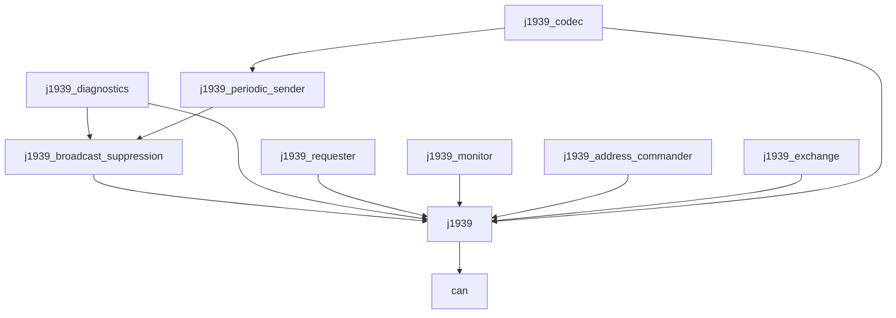

# J1939 エンジン・コンポーネント・コーデック・spy

[English](../code-map-j1939.md)

この分野を変更するときの地図です。全体の入口は [code-map.md](code-map.md)、テストの共通ルールは [code-map-testing.md](code-map-testing.md) にあります。

関連する仕様と変更範囲: [internals/j1939.md](internals/j1939.md) / [j1939-codec.md](j1939-codec.md) / [j1939-guide.md](j1939-guide.md)

## テストのラベル

### `j1939`

| テスト | 対象 | ラベル |
|---|---|---|
| `j1939.*` | `vehicle_sil::j1939` の単体テスト（SIL Kit なしでビルドする） | `unit` も |
| `j1939_silkit.*` | SIL Kit 上のテスト | `unit` も |
| `j1939_parts.*` | プロトコルのコンポーネント | |
| `j1939_codec.*` | 型付きメッセージ | |
| `j1939_spy.*` | `Spy`（`tests/spy`） | `unit` も |
| `local.boundary`、`testkit.boundary`、`peer.boundary`、`simulation.boundary`、`ecu.boundary` | それぞれのディレクトリのソースが、エンジンの内部を使っていないこと | `unit` と `j1939` |

エンジンで確認すること:

- PGN と識別子、単一フレームの送受信、宛先の振り分け、ローカル折り返し
- 同じ時刻のフレームの順序とタイマーの発火が、ステップ幅と到着順によらないこと
- Request への応答と ACK/NACK
- NAME と Address Claim（複数ノードと複数 Network の競合、任意アドレスの選択、アドレス表、アドレス違反、Commanded Address を含む）
- 1 つのホストの複数の Network（ゲートウェイ、片方の失敗）
- 再入と失敗、ステップ幅の検査、資源の上限
- 定常状態のステップでメモリを確保しないこと
- タイミングありの仮想バスで、プロトコルの結果が変わらないこと。混雑で転送が遅れ、バスが飽和すると時間切れになること
- 1 つの ECU がバスから切断されたとき（受信だけ、送受信とも）の TP の時間切れと回復
- 隠れていたアドレスの衝突の解決
- 時刻同期なしの SIL Kit での実時間の動作
- ツールキット（解除と破棄の再入、Network の後の破棄、タイマーの起点と予約）
- `j1939.seat_*`: エンジンの内部の口である聞き役の席（聞こえるもの、`Observer`、ハンドラー、タイマーとの順、読み取り専用であること、席の有無で記録が変わらないこと）
- `j1939.sniffer_*`: `TransferSniffer` の、手で書いたフレームでの決まりと、同じフレームを受けたエンジンの受信側のノードとの一致（エンジンどうしの転送、種を固定した故障注入）。`j1939.sniffer_boundary` は `Network` に依らないことを検査する
- `j1939.listener_*`: `Listener` の、エンジンどうしのやり取りを横から聞いた結果が受け手と一致すること、同じ `Network` のノードの送信が渡らないこと、ノードのアドレスの扱い、ハンドラーの順、読み取り専用であること、生成と破棄。`j1939.sniffer_boundary` は `listener.cpp` がエンジンの内部を席のほかに使わないことも検査する
- ノードのアドレスと NAME の上書き（`NetworkOptions::node_overrides`。当てる関数と文字列の往復、上書きの後の値で claim すること、拒否するものとそのメッセージ、開始で閉じた後のノードがコードの値のままであること、同じノードのコードを 1 本のバスに 2 つ載せる場面、負けた後・Request・Commanded Address でも上書きの後の値が使われること）（`j1939.*override*`）

仮想バスと SIL Kit の一致:

- プロセス内のレジストリで、同じシナリオのトレースが仮想バスと SIL Kit で一致すること（簡易 CAN Network Simulator ありでも）
- `j1939_silkit.listen_only_participants_*`: 受信だけをする participant（生の CAN、ノードのない `Network`、それに `Listener` を付けたもの。ステップ幅はいろいろ）を追加しても、各 ECU の受信、ポートに渡したフレーム、送信確認と統計が 1 行も変わらないこと
- 同じテストで、受信だけをする participant が何も送信しないこと（仮想バスと SIL Kit の両方で）

プロトコルのコンポーネント（`j1939_parts.*`）:

- DM13、診断、識別情報、送信の競合、後で返す ACK、ステップ幅によらない結果
- `j1939_parts.boundary`: コンポーネントがエンジンの内部を使っていないこと

型付きメッセージ（`j1939_codec.*`）:

- ビット配置を、ビットごとの実装と照合
- raw 値と物理値の変換、丸めと範囲の端
- 特別な値（J1939 のプロファイル、利用者のプロファイル、継承と上書き、すべてのビットパターンを値として使う Proprietary B、raw 値の保持）
- 列挙、セレクター、埋め値、長さ
- 小さい信号のすべての raw 値の往復
- ノードでの送受信
- `j1939_codec.generator`: 生成器が、誤った定義を止めること

`Spy`（`j1939_spy.*`）。`LocalBench` の ECU で:

- 見張りの変数の名前と値、見張りの呼ばれる順
- ハンドラーの後に getter と `Scope::now()` の時刻が来ること
- 壊す順（ハンドラーを外してから見張り、最後に `Listener`）、見張りから追加した見張り、`Scope::on_step`
- 変数を書いた `Spy` が ECU より先に壊れたときに、次のステップが止まること（仮想バスと SIL Kit）
- 聞きこぼしの変数の内訳と和、誤りの文
- 生成した型と手で書いた型での `watch<M>()`: 信号ごとの値（整数か実数）、その状態、`count`、`last_ms`、`period_ms`、`size`、`invalid`、`stale`、`from` と `to` の絞り、最後より古いメッセージ、同じ時刻の 2 つ、`std::int64_t` に入らない 64 ビットのカウンター（実数）、ECU が既に持つ名前（変数を 1 つも出さない）、誤りの文
- `j1939_spy.watch_of_a_signal_named_count_does_not_build`: 見張りの項目と同じ名前の信号がビルドの誤りになること（ビルドに入らないターゲット `vehicle_sil_spy_watch_clash` を、ビルド木でビルドの道具を呼んで作る。同じ木で同時にビルドしない）。vehicle-sil がサブプロジェクトのときと、構成が複数ある生成器では登録しない（構成のときにそう出す）
- `Spy` があってもほかの ECU の記録が変わらず、`Spy` が何も送信しないこと
- 定常状態のステップでメモリを確保しないこと
- 手引きの見本（`tests/spy/guide_example.hpp`、`guide_analysis.hpp`、`cal_messages.yaml`）。`j1939_spy.guide_example_is_the_guides`: 手引きが、このファイルをそのまま載せていること。`j1939_spy.analysis_example_judges_each_write_by_its_answer`: 解析の見本を、合う応答、応答なし、値の違う応答、接続で来た応答、応答の前の 2 つ目の Write で動かすこと
- `j1939_spy.boundary`: `libs/spy` がエンジンの内部を使っていないこと。`j1939.sniffer_boundary` は、エンジンが `vehicle_sil::spy` を知らないことも検査する

## ディレクトリごとのコードとテスト

### `libs/j1939`（エンジン）

NodeOverride やアドレス・NAME のテキスト書式を変える場合は、[ランチャーの j1939_nodes](code-map-launcher.md#設定ファイルの-j1939_nodes) の変更箇所とテスト（ECU 実行ファイルとの共通の規則を含む）を参照。

| 名前 | 場所 |
|---|---|
| `Network`、`Node` | `j1939/network.hpp` |
| `Pgn`、`Identifier` | `j1939/types.hpp` |
| `Name` | `j1939/name.hpp` |
| ノードのアドレスと NAME の上書き `NodeOverride`、`apply_node_overrides()`、文字列との往復（`Network` と、前もって照合するツールの両方が使う） | `j1939/node_override.hpp` |
| `Subscription`、`Timer` | `j1939/toolbox.hpp` |
| `Observer` | `j1939/observer.hpp` |
| `TransferSniffer`（ほかの ECU どうしの転送をフレームから追う。`Network` に依らない） | `j1939/transfer_sniffer.hpp` |
| `Listener`、`ListenerSubscription`（ほかの participant のメッセージを、宛先が誰でも聞く。ハンドラーの登録を持って、壊れると外す） | `j1939/listener.hpp` |
| Address Claim と Request | `src/node.cpp` |
| トランスポートプロトコル | `src/transport.cpp` |
| 盗み聞き | `src/transfer_sniffer.cpp` |
| トランスポートプロトコルと盗み聞きの両方が読むフレームの形（制御バイト、告知の形の検査。時間切れは `types.hpp` の `ProtocolTiming`） | `src/transport_wire.hpp` |
| 聞き役の席（内部の口） | `src/frame_seat.hpp` |
| 席に座る `Listener` | `src/listener.cpp` |

- テスト: `tests/j1939`
- `ctest -R`: `^j1939\.`、`^j1939_silkit\.`

### `libs/j1939/parts/<part>`

コンポーネントごとに、1 つのディレクトリと 1 つのターゲットがあります。

主なクラスと関数:

- `PeriodicSender`（`j1939/periodic_sender.hpp`）
- `Requester`、`Monitor`、`AddressCommander`、`Exchange`、`BroadcastSuppression`、`Diagnostics`、`Identification`
- `parse_dtc_list`（受信した DM1、DM2 を読む）

- テスト: `tests/j1939`
- `ctest -R`: `^j1939_parts\.`

### `libs/j1939/codec`、`tools/j1939_codegen`

| 名前 | 場所 |
|---|---|
| 信号の型 | `j1939/codec.hpp` |
| `attach_sender()`、`on_message()` | `j1939/codec_node.hpp` |
| 生成器 | `j1939_codegen.py` |
| `vehicle_sil_add_j1939_codec()` | `cmake/VehicleSilJ1939Codec.cmake` |

- テスト: `tests/j1939`
- `ctest -R`: `^j1939_codec\.`

### `libs/spy`

| 名前 | 場所 |
|---|---|
| `Spy`、`Scope`、`SpyOptions`（受信だけをする participant が、聞いたことを ECU の変数に書く。見張りは `Scope&` を取るクラス）、`WatchOptions` | `spy/spy.hpp` |
| `Spy::watch<M>()`、`Watch<M>`（型のあるメッセージを変数に。`vehicle_sil::j1939_codec` が要る） | `spy/watch.hpp` |

- テスト: `tests/spy`
- `ctest -R`: `^j1939_spy\.`

### `examples/j1939`（sender と receiver）

- テスト: `tests/integration`
- `ctest -R`: `^integration\.`

## 依存の向き

[図の凡例と全体の層](code-map-core.md#依存の向き)、[境界を検査するテスト](code-map-testing.md#境界を検査するテスト) を参照。

### J1939 のエンジンとコンポーネント

## 変更するときに一緒に直すもの

### J1939 のコンポーネントを追加する

追加する場所:

- `libs/j1939/parts/<part>/`
- `libs/j1939/CMakeLists.txt` の `add_subdirectory`
- テスト: `tests/j1939/CMakeLists.txt` の `vehicle_sil_j1939_parts_tests` の `SOURCES` と `LINK`

合わせて直すドキュメント:

- [architecture.md](architecture.md) の「ディレクトリとターゲット」
- [internals/j1939.md](internals/j1939.md) の「プロトコルのコンポーネント」
