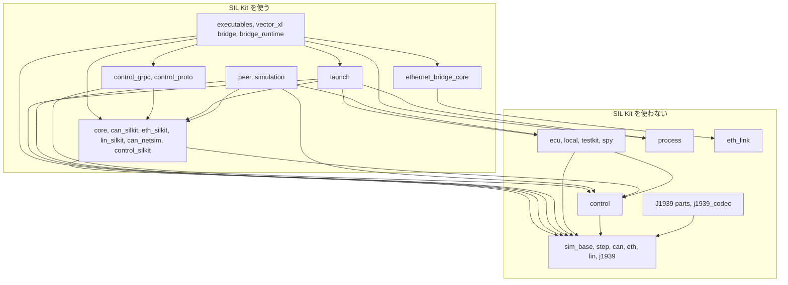
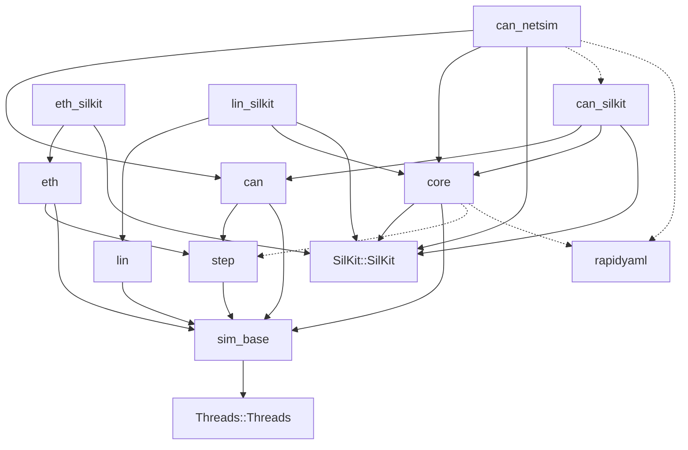
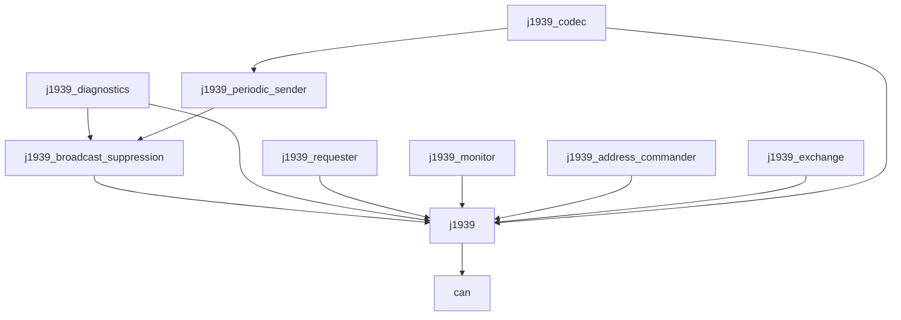
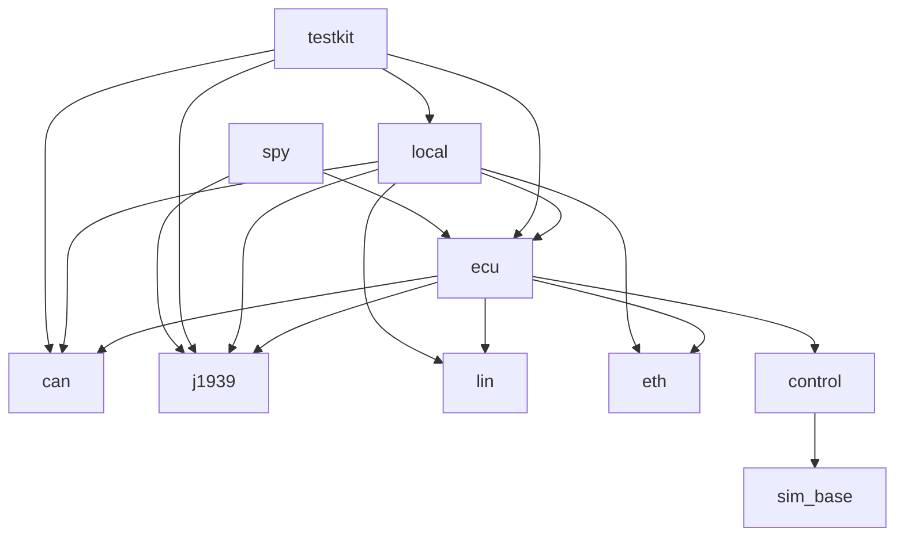
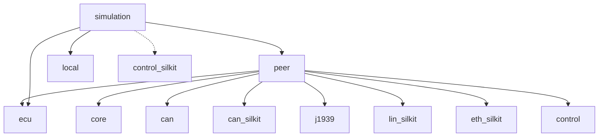
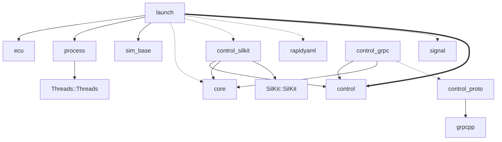
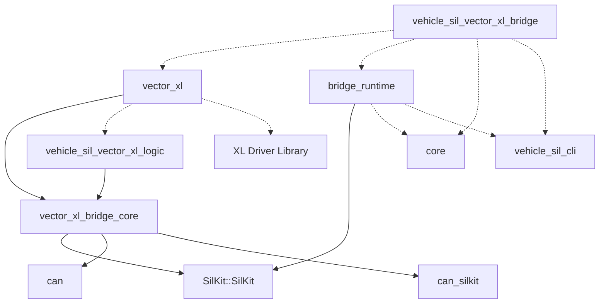
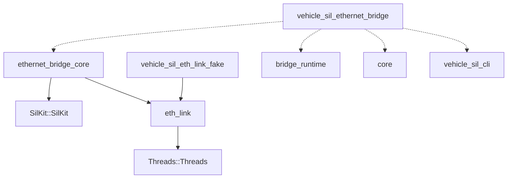

# コードの地図

[English](../code-map.md)

<!-- 書き方: 項目は、同じ形の短いブロックにします（小見出し、1 行に 1 つの事実の箇条書き、セルが 1 文の表）。1 つのセルや 1 つの箇条書きに複数の事実を詰めません。1 行が長くなり、別々の変更が同じ行に当たるためです。 -->

vehicle-sil 自体を開発するときに、変える場所、そのテスト、テストだけを実行する方法、一緒に直すものを探すための地図です。各ディレクトリと各ターゲットの内容は [architecture.md](architecture.md) の「ディレクトリとターゲット」にあり、ここには書きません。

| 探すもの | 節 |
|---|---|
| テストの名前の付け方、一部だけ実行する方法、ポートと待ち時間のルール | [テストの名前と実行方法](#テストの名前と実行方法) |
| ラベルごとのテストの内容 | [テストのラベル](#テストのラベル) |
| ディレクトリごとのクラス、ヘッダー、テスト、`ctest -R` の正規表現 | [ディレクトリごとのコードとテスト](#ディレクトリごとのコードとテスト) |
| ドキュメントの例を照合しているテストと、その印 | [ドキュメントの例とテスト](#ドキュメントの例とテスト) |
| ターゲットがリンクするもの | [依存の向き](#依存の向き) |
| 層の境界を検査しているテスト | [境界を検査するテスト](#境界を検査するテスト) |
| 変更に合わせて直すドキュメント、コード、テスト | [変更するときに一緒に直すもの](#変更するときに一緒に直すもの) |

## テストの名前と実行方法

```sh
ctest --preset linux-gcc-debug -R '^launch\.'
scripts/verify.py linux-gcc-debug --tests '^launch_run\.'
```

### 名前と登録

テストの名前は `<接頭辞>.<名前>` です。接頭辞は `tests/<領域>/CMakeLists.txt` の `PREFIX` です。

| テストの種類 | 名前 | 登録の方法 |
|---|---|---|
| テストの実行ファイルのテスト（ハーネス） | `<接頭辞>.<TEST_CASE の名前>` | ソースの `TEST_CASE(名前)` から、configure のときに登録されます（`vehicle_sil_add_harness_tests()`、`cmake/VehicleSilTestHelpers.cmake`）。 |
| プロセスを起動するテスト（シナリオ） | `<接頭辞>.<シナリオ>` | `vehicle_sil_add_scenario_tests()` で登録します。 |

ハーネスのテストを追加するとき:

- 既存のソースに `TEST_CASE` を追加するときは、CMake を書き換えません。
- 新しいソースのファイルは、その `CMakeLists.txt` の `SOURCES` に追加します。
- マクロ（`TEST_CASE`、`CHECK`、`CHECK_EQ`）は `tests/unit/test_harness.hpp` にあります。

シナリオのテストの場所:

- シナリオの一覧は `CMakeLists.txt` の `SCENARIOS` です。
- 中身は同じディレクトリの `*launcher.cpp`（`tests/integration/launcher.cpp`、`tests/launch/launch_run_launcher.cpp` など）です。
- 共通のコードは `tests/integration/launcher_support.hpp` にあります。

領域（`tests/` の直下のディレクトリ）のルール:

- `CMakeLists.txt` のあるディレクトリは、名前の順に自動で加わります（`tests/CMakeLists.txt` に行を追加しません）。
- 条件のある領域（`control_server`、`fetchcontent`、`integration`、`virtual_time` など）は、自分の `CMakeLists.txt` の先頭で条件を見て `return()` します。
- 領域は、ほかの領域のターゲットを `if(TARGET ...)` で確認しません。領域が加わる順に依存してしまうためです。
- CMake の一覧（`add_subdirectory`、ソース、シナリオ）は、1 行に 1 つ、名前の順に書きます。順に意味がある所は、コメントに書いてあります。

### 一部のテストだけを実行する

- 1 つのテストは、テストの実行ファイルに名前を渡すと動きます（`<実行ファイル> <名前>`。ctest もそうしています）。
- 接頭辞だけを指定するときは、`\.` まで書きます。`^j1939` は `j1939_parts.`、`j1939_codec.`、`j1939_silkit.`、`j1939_spy.` にも一致します。
- ラベルで選ぶときは `-L` を使います（[テストのラベル](#テストのラベル)）。

### ポートとロック

テストは決まったポートで待ち受けません。同じ PC で、別の作業ツリーのビルドのテストと同時に実行できます。

| 待ち受けるもの | ポートの決め方 |
|---|---|
| registry | ポート 0（`RegistryProcess`、`registry_uri` を書かない設定ファイル） |
| Control Server | `--control 0` |
| GUI サーバー | `--port 0` か、e2e が起動のたびに選ぶ空いているポート |
| `multi_host.two_hosts` の 18500 | テストが作る network namespace の中 |

ドキュメントが示す決まったポート（`manual` の 8500 など）が必要なシナリオは、`vehicle_sil_add_scenario_tests()` の `MACHINE_LOCK` で PC 全体のロックを取り、順に実行されます。

- ロックは `/tmp` のファイルへの `flock` です（`cmake/vehicle_sil_machine_lock.sh`。Windows ではロックしません）。
- 待つ間は 1 行表示し、待った時間はそのテストの CTest の `TIMEOUT` に数えます。
- ロックのファイルを開けないとき（別の利用者のファイルなど）は、1 行表示してロックなしで実行します。

### 待ち時間と倍率

起きるはずのことは、`eventually(条件, 上限)`（`test_harness.hpp`）か、起きたことを通知する手段で待ちます。決まった時間だけ眠って「進んだはず」としません。

待ちの上限には倍率が掛かります。

| 項目 | 内容 |
|---|---|
| 倍率の決まり方 | テストを動かすときの環境変数 `VEHICLE_SIL_TEST_TIMEOUT_SCALE`、なければビルドの既定です。 |
| ビルドの既定 | CMake のキャッシュ変数 `VEHICLE_SIL_TEST_TIMEOUT_SCALE_DEFAULT` で、既定は 1、TSan のプリセットは 4 です。 |
| 値の書き方 | 数字と小数点 1 つだけで書き、0 より大きくします（`3`、`2.5`）。 |
| ほかの書き方（空白、指数、16 進） | C++ のテスト、GUI サーバーのテスト、e2e が、変数の名前と直し方を表示して止まります。 |
| CI | 3 を与えます。TSan のジョブは与えずに、プリセットの既定を使います（`.github/workflows/ci.yml`）。 |

倍率を掛けるかどうかは、値の種類で決まります。

| 値の種類 | 倍率 | 理由と注意 |
|---|---|---|
| 起きるはずのことを待つ上限。上限として製品に渡す時間（ランチャーが製品の `--timeout-ms` に渡す値など）も同じ | 掛ける | 通るテストは待つものが起きた時点で進むので、倍率を上げても遅くなりません。 |
| 時間切れになることを確認する値のうち、時間切れの前に子プロセスや別のスレッドが何かを終えていなければならないもの（子が 1 行書いてから打ち切られる、など） | 掛ける | 期待の文に出る数も同じ値から作ります。このテストは、倍率の分だけ必ず長くなります。 |
| 「起きないこと」を確認する待ち、周期、時間切れの値そのものを確認するテストの値（`receiver-timeout` の 1500 ms など） | 掛けない | 掛けると、テストが確認することが変わります。 |

上限を書くときのルール:

- 関数に上限を渡すときは `scaled_timeout(20s)`（`tests/unit/test_timeout_scale.hpp`）を通します。GUI サーバーのテストは `conftest.py` の `scaled()`、e2e は `scaled()` です。
- 上限を受け取って中で倍率を掛ける関数（`eventually`、`tests/process/spawn_sleeper.hpp` の待ち、シナリオのランチャーの `--timeout-ms` など）は、そのドキュメントコメントに「scaled」と書きます。
- そうした関数に渡す値には、呼ぶ側で倍率を掛けません。

CTest の `TIMEOUT`:

- ハーネスのテストとシナリオのテストの `TIMEOUT` は、configure のときの倍率（環境変数、なければビルドの既定。切り上げた整数）で伸びます（`cmake/VehicleSilTestHelpers.cmake`）。
- configure の後で倍率を大きくしたら、configure し直します。そのままだと、止まったテストは自分で失敗を報告する前に CTest に止められます。
- ハーネスとランチャーは、そのときに `warning: ... configure the build again ...` の 1 行を表示します。

## テストのラベル

```sh
ctest --preset linux-gcc-release -L integration
# FetchContent テスト（依存ライブラリを一から再ビルドするので時間がかかる）
cmake --preset linux-gcc-release -DVEHICLE_SIL_TEST_FETCHCONTENT=ON
ctest --preset linux-gcc-release -L fetchcontent
```

どのラベルにも共通すること:

- 各プロセスのログは `build/<preset>/tests/` の下の `integration/<シナリオ>/`、`virtual_time/<シナリオ>/`、`lin_cluster/<シナリオ>/`、`vector_xl/integration/<シナリオ>/` に残ります。失敗したときは、ランチャーがすべてのログを出力します。
- テストケースの登録漏れは、テストの実行ファイルごとの `<ラベル>.registration` テストが検出します（実行ファイルの `--list` と登録した名前を比べます）。
- クロスビルドでは、`CMAKE_CROSSCOMPILING_EMULATOR`（たとえば `wine`）を指定すると、`ctest` がテストの実行ファイルをそれで動かします（`registration` テストも含みます）。Windows の DLL（MinGW の実行時ライブラリ）は、実行ファイルの隣に置くなどして見つかるようにしてください。
- テストプリセットは 8 並列で実行します。`scripts/verify.py` は、CPU がそれより少ない PC では CPU の数だけ並べます。
- 壁時計の所要時間を測るテスト（`virtual_time.*`、`core.virtual_time_*`、LIN の速度のテスト）は単独で実行されます。

### `unit`

コマンドライン解析と、標準出力・標準エラーへの書き出しのテスト（`unit.*`）に付きます。

| ほかに付くもの | 内容 |
|---|---|
| `core`、`lin`、`step`、`can`、`eth`、`j1939`、`peer`、`testkit`、`ecu`、`simulation`、`control`、`control_server`、`launch`、`process`、`vector_xl` | 単体テストと境界の検査 |
| `template.get_tools` | テンプレートの `get_tools.py` と、`scripts/package.py` の `template`、`version` を、手元で作ったアーカイブで確認する |
| `param_service.demo` | サンプルの実行のうち、これにだけ付く |

付かないのは、プロセスを起動するシナリオのテスト（`integration`）、サンプルの実行（`examples`）、Python のクライアントのテスト（`python`）、`fetchcontent` です。

### `integration`

`integration.*` は、`sil-kit-registry`、receiver、sender（実時間の `Peer` と J1939 スタック）を別プロセスで起動し、終了コードで判定します。

| シナリオ | 確認すること |
|---|---|
| `address-claim-and-pgn` | Address Claim と PGN の CAN ID とペイロードの一致 |
| `receiver-timeout` | タイムアウト処理 |
| `receiver-detects-wrong-name`、`receiver-detects-wrong-payload` | receiver が、誤った NAME と壊れたペイロードを失敗として報告すること |

このラベルは、プロセスを起動するほかのシナリオのテストにも付きます。

- `virtual_time.*`、`lin_cluster.*`、`launch_cli.*`、`launch_run.*`、`ecu_main.*`、`vector_xl.integration.*`、`control_server.launcher`（内容は、それぞれのラベルの項目）
- `template.check_and_run`: テンプレートの ECU を本体のビルドで作り、ランチャーで照合、実行、シナリオが通ることを確認します。照合と実行の出力を、ガイド「最初の ECU を作る」と照合します。

### `vector_xl`

CAN ブリッジのテストです。全プラットフォームで、テスト専用の XL ドライバのフェイクに対して本番のコードを動かします。

| テストの種類 | 内容 |
|---|---|
| 単体テスト | CanBridge |
| XL バックエンドのテスト | XL バックエンド |
| プロセス内のテスト | 実際の SIL Kit を使う |
| E2E テスト | ブリッジの実行ファイルを使う |

E2E で確認すること:

- エコーノードとの往復（Virtual CAN と、ビットレートを設定する物理 CAN）
- 送信レシートが返ってくる場合のループ防止
- `--list-channels`、存在しないチャネル、引数のエラー
- registry に接続できない場合、ドライバがない場合
- 停止の要求で止めたときの統計の 1 行と終了コード 0（Windows では、共有するコンソールがなければスキップ）

### `step`

`vehicle_sil::step` の単体テストです（CAN と SIL Kit なしでビルドします）。`unit` ラベルも付きます。

CAN でないテスト用の participant（`Member`）で、次を確認します。

- 段階の順序
- `start()` が 1 回だけ、最初のステップの前に呼ばれること
- 時間の領域の混在の拒否（ホストとドライバー）
- 失敗の扱い
- `post()` と起こし方、`next_deadline()`
- 仮想時間の `StepDriver`
- 差し替えた時計の上の `RealTimeDriver`（締め切りと到着で起きる）

`step.boundary` は、`libs/step` が SIL Kit のヘッダーを直接にも間接にも含まないことを検査します。

### `signal`

`vehicle_sil::signal` の波形の関数の単体テストです（標準ライブラリだけでビルドします）。`unit` ラベルも付きます。

- 時刻の表と比べた値（周期の端、位相、デューティー 0 と 100）
- 乱数の列が、どのプラットフォームでも同じ値であること
- 乱数とチャタリングが、時刻だけで決まること
- チャープの位相が飛ばないこと
- 点の並びの補間

`signal.boundary` は、`libs/signal` が SIL Kit のヘッダーを含まないことを検査します。

### `can`

`unit` ラベルも付きます。

| テスト | 対象 |
|---|---|
| `can.*` | `vehicle_sil::can` の単体テスト（SIL Kit なしでビルドする） |
| `can_silkit.*` | SIL Kit のポート |
| `can_netsim.*` | 簡易 CAN Network Simulator |

確認すること:

- フレームの検証
- 仮想バスの受信順序とあふれ
- ホストの段階の順序と失敗、ステップドライバーの順序
- 送信時間と調停（11 ビット / 29 ビット）、混雑、送信キュー
- 受信側のステップ幅によらないこと
- ポートのイベント（送信の結果、受信キューのあふれ、バス状態、エラーフレーム）
- 故障注入と、ECU 単位の通信断
- `post()`、時間の領域の混在の拒否
- 実時間のドライバー（差し替えた時計での決定的なテストと、壁時計での到着と順序）

簡易 CAN Network Simulator では、プロセス内の participant と実行ファイルの両方で、次を確認します。

- 仮想バスと同じ受信の時刻になること
- 繰り返しても同じ結果になること
- 送信時刻のない送信者
- コントローラーのモード（始めていないコントローラーの送信を捨てること、`Reset()` での送信の取り消し、止めたコントローラーへの配送）
- 設定ファイルの読み込み

プロセス内のレジストリでは、次を確認します。

- 同じシナリオのトレースが、仮想バスと SIL Kit で一致すること（ステップ幅の組み合わせを変えて）
- 送信の続く中で、participant を決まった順序で止めて破棄できること

### `eth`

`unit` ラベルも付きます。

| テスト | 対象 |
|---|---|
| `eth.*` | `vehicle_sil::eth` の単体テスト（SIL Kit なしでビルドする） |
| `eth_silkit.*` | SIL Kit のポート |
| `eth.steps_do_not_allocate` | ステップの中でメモリを確保しないこと（専用の実行ファイル） |
| `eth.boundary` | `libs/eth` が SIL Kit のヘッダーを直接にも間接にも含まないこと |

確認すること:

- フレームと MAC アドレスの型
- 仮想ネットワーク: ハブとしてのフレームの配信、次のステップで受信されること、短いフレームの埋め、自分のフレームを受信しないこと、時刻の順、あふれ
- チャネル: `step::Host` と `StepDriver` の上で動くこと、ゲートウェイ、同じ時刻のフレームを送信元のアドレスで並べること
- チャネル: `on_frame()` と `receive()`、送信の段階、上限、絞り込み、ポートのイベント、選択肢のエラー
- 偽のコントローラーに対するポート（時刻同期していない送信側のフレームの時刻、あふれた送信の確認を含む）
- プロセス内のレジストリで、同じシナリオの記録が仮想ネットワークと SIL Kit で一致すること（ステップ幅の組み合わせを変えて）

最後の項目は、3 つの送信側が同じ時刻に送信する場合を含みます。アドレスを登録の順とずらし、仮想ネットワークの側でもアドレスの順を確認します。

### `j1939`

| テスト | 対象 | ラベル |
|---|---|---|
| `j1939.*` | `vehicle_sil::j1939` の単体テスト（SIL Kit なしでビルドする） | `unit` も |
| `j1939_silkit.*` | SIL Kit 上のテスト | `unit` も |
| `j1939_parts.*` | プロトコルのコンポーネント | |
| `j1939_codec.*` | 型付きメッセージ | |
| `j1939_spy.*` | `Spy`（`tests/spy`） | `unit` も |
| `local.boundary`、`testkit.boundary`、`peer.boundary`、`simulation.boundary`、`ecu.boundary` | それぞれのディレクトリのソースが、エンジンの内部を使っていないこと | `unit` と `j1939` |

エンジンで確認すること:

- PGN と識別子、単一フレームの送受信、宛先の振り分け、ローカル折り返し
- 同じ時刻のフレームの順序とタイマーの発火が、ステップ幅と到着順によらないこと
- Request への応答と ACK/NACK
- NAME と Address Claim（複数ノードと複数 Network の競合、任意アドレスの選択、アドレス表、アドレス違反、Commanded Address を含む）
- 1 つのホストの複数の Network（ゲートウェイ、片方の失敗）
- 再入と失敗、ステップ幅の検査、資源の上限
- 定常状態のステップでメモリを確保しないこと
- タイミングありの仮想バスで、プロトコルの結果が変わらないこと。混雑で転送が遅れ、バスが飽和すると時間切れになること
- 1 つの ECU がバスから切断されたとき（受信だけ、送受信とも）の TP の時間切れと回復
- 隠れていたアドレスの衝突の解決
- 時刻同期なしの SIL Kit での実時間の動作
- ツールキット（解除と破棄の再入、Network の後の破棄、タイマーの起点と予約）
- `j1939.seat_*`: エンジンの内部の口である聞き役の席（聞こえるもの、`Observer`、ハンドラー、タイマーとの順、読み取り専用であること、席の有無で記録が変わらないこと）
- `j1939.sniffer_*`: `TransferSniffer` の、手で書いたフレームでの決まりと、同じフレームを受けたエンジンの受信側のノードとの一致（エンジンどうしの転送、種を固定した故障注入）。`j1939.sniffer_boundary` は `Network` に依らないことを検査する
- `j1939.listener_*`: `Listener` の、エンジンどうしのやり取りを横から聞いた結果が受け手と一致すること、同じ `Network` のノードの送信が渡らないこと、ノードのアドレスの扱い、ハンドラーの順、読み取り専用であること、生成と破棄。`j1939.sniffer_boundary` は `listener.cpp` がエンジンの内部を席のほかに使わないことも検査する
- ノードのアドレスと NAME の上書き（`NetworkOptions::node_overrides`。当てる関数と文字列の往復、上書きの後の値で claim すること、拒否するものとそのメッセージ、開始で閉じた後のノードがコードの値のままであること、同じノードのコードを 1 本のバスに 2 つ載せる場面、負けた後・Request・Commanded Address でも上書きの後の値が使われること）（`j1939.*override*`）

仮想バスと SIL Kit の一致:

- プロセス内のレジストリで、同じシナリオのトレースが仮想バスと SIL Kit で一致すること（簡易 CAN Network Simulator ありでも）
- `j1939_silkit.listen_only_participants_*`: 受信だけをする participant（生の CAN、ノードのない `Network`、それに `Listener` を付けたもの。ステップ幅はいろいろ）を追加しても、各 ECU の受信、ポートに渡したフレーム、送信確認と統計が 1 行も変わらないこと
- 同じテストで、受信だけをする participant が何も送信しないこと（仮想バスと SIL Kit の両方で）

プロトコルのコンポーネント（`j1939_parts.*`）:

- DM13、診断、識別情報、送信の競合、後で返す ACK、ステップ幅によらない結果
- `j1939_parts.boundary`: コンポーネントがエンジンの内部を使っていないこと

型付きメッセージ（`j1939_codec.*`）:

- ビット配置を、ビットごとの実装と照合
- raw 値と物理値の変換、丸めと範囲の端
- 特別な値（J1939 のプロファイル、利用者のプロファイル、継承と上書き、すべてのビットパターンを値として使う Proprietary B、raw 値の保持）
- 列挙、セレクター、埋め値、長さ
- 小さい信号のすべての raw 値の往復
- ノードでの送受信
- `j1939_codec.generator`: 生成器が、誤った定義を止めること

`Spy`（`j1939_spy.*`）。`LocalBench` の ECU で:

- 見張りの変数の名前と値、見張りの呼ばれる順
- ハンドラーの後に getter と `Scope::now()` の時刻が来ること
- 壊す順（ハンドラーを外してから見張り、最後に `Listener`）、見張りから追加した見張り、`Scope::on_step`
- 変数を書いた `Spy` が ECU より先に壊れたときに、次のステップが止まること（仮想バスと SIL Kit）
- 聞きこぼしの変数の内訳と和、誤りの文
- `Spy` があってもほかの ECU の記録が変わらず、`Spy` が何も送信しないこと
- 定常状態のステップでメモリを確保しないこと
- 手引きの見本
- `j1939_spy.boundary`: `libs/spy` がエンジンの内部を使っていないこと。`j1939.sniffer_boundary` は、エンジンが `vehicle_sil::spy` を知らないことも検査する

### `peer` / `testkit`

| テスト | 内容 | ラベル |
|---|---|---|
| `peer.*` | `Peer` をプロセス内のレジストリで動かす | `peer`、`unit`、`j1939` |
| `testkit.*` | テストキットのテスト | `testkit`、`unit`、`j1939` |
| `ecu_api.*` | 利用者が書く形の ECU を、仮想バスで動かす | `testkit`、`unit`、`j1939` |
| `param_service.*` | `examples/j1939/param_service` の独自プロトコルを、仮想バスで動かす | `testkit`、`unit`、`j1939` |

それぞれが確認すること:

- `peer.*`: J1939 と LIN の 3 つの participant、仮想バスと同じ結果、実時間と外部ポート、組み立てのエラー、失敗の報告
- `peer.*j1939_nodes*`: `PeerOptions::j1939_nodes` が、名前を替えたネットワークと外から渡したポートのネットワークに当たること、`start()` の後に追加したノードに当たらないこと、どのノードにも当たらなかった行の理由と `start()` のメッセージ（`host()` で回した最初のステップの後に追加したノードの場合も）、`start_together` がどの `Peer` も始めずに同じメッセージで拒否すること、コードが渡した `node_overrides` を拒否すること
- `testkit.*`: アドレスの喪失、Address Claimed の欠落、TP のパケットの欠落、通信断、生フレームの注入、受信側のステップ幅と記録の有無によらない結果
- `ecu_api.*`: `examples/j1939/ecu_pair`、ツールキットと `Requester` で作る独自のプロトコル、`Monitor` と `Observer` と tap で通信を確認するテスト
- `param_service.*`: 正常な流れ、セッションの期限切れ、2 つ目のツール、応答しない ECU、アドレスの変化と喪失、拒否、動作中のコンポーネントの破棄
- `param_service.boundary`: 例が公開 API だけを使うこと
- `param_service.demo`: 例の実行

エンジンの内部を使っていないことの検査（`peer.boundary`、`testkit.boundary`、`local.boundary`）は、`j1939` の項目にあります。

### `ecu`

ECU の `--describe` の出力の JSON（`to_json(EcuDescription)`）の単体テストです（SIL Kit なし）。`unit` ラベルも付きます。

- 空と全部入りの全文、キーの順、数値、64 ビットの列挙の値、NAME の文字列、文字列のエスケープ、バージョン
- `ecu.no_silkit_boundary`、`ecu.simulation_headers_boundary`: `libs/ecu` と `libs/simulation/include` が、SIL Kit のヘッダーを直接にも間接にも含まないこと
- `ecu.boundary_check_*`: その検査自体のテスト
- `ecu.j1939_node_argument*`: 引数 `--j1939-node` の値を書く関数と読む関数の往復、誤った値ごとのメッセージ、1 つの ECU の行どうしの検査

### `simulation` / `examples`

| テスト | 内容 | ラベル |
|---|---|---|
| `simulation.*` | `Simulation` のテスト | `unit` と `simulation` |
| サンプルの実行 | サンプルは自分で結果を検査し、違えば 0 以外で終わる | `examples` と `simulation`（`low_level.demo` は `examples` だけ） |
| `ecu_main.*` | `examples/ecu_main` の ECU の実行ファイルを、プロセスとして動かす | `integration` と `simulation` |

`simulation.*` が確認すること:

- 同じ ECU が、仮想バスと SIL Kit で同じ記録を残すこと
- ECU が持つオブジェクトの破棄
- ステップの失敗が `SimulationError` になって戻ること
- 使い方のエラー（同じ入力を両方の実装で拒否すること、`App` のコンストラクターの例外）
- `request_stop` で終わる実行、ほかの participant の失敗、開始の時間切れ
- `local()` から追加した ECU、別プロセスの controller や participant との併用
- 2 つのネットワークを持つゲートウェイ、生の CAN、LIN の Master と Slave、イーサネットのチャネルが、両方で同じ結果になること
- `Ecu::describe()`
- 関数として呼んだ `ecu_main()` の引数と終了コード
- `simulation.*j1939_nodes*`: `SilKitOptions::j1939_nodes` が名前の ECU にだけ効くこと（同じ ECU のコードを 2 つ追加する場面）、ない ECU の名前や当たらなかった行を始める前に拒否すること

イーサネットのチャネル（`test_ethernet.cpp`）では、次のステップで受信すること、同じ時刻の順、絞り込み、1 ステップに `receive_capacity` までのフレームを落とさないこと、拒否するときの文言、`LocalBench` の参照を確認します。

実行するサンプル:

- `vehicle_sil_getting_started`（仮想バスと `--silkit`）
- `typed_messages`、`pid_stream`、`fault_injection`、`low_level`
- `vehicle`（SIL Kit と `--local`）
- `vehicle_sil_ethernet_example`（仮想ネットワークと `--silkit`、別の EtherType、引数のエラー）

`ecu_main.*` が確認すること:

- `--describe` の JSON を [ecu-executable.md](ecu-executable.md) の例と、vehicle-sil のバージョンを除いてバイト単位で照合
- `--local`
- `vehicle_sil_sim_controller` の下の SIL Kit での 2 つの ECU
- 使い方、停止の要求

### `core` / `lin`

仮想時間の単体テストです。`unit` ラベルも付きます。

プロセス内のレジストリで、次を確認します。

- ステップ幅の違う participant の同期、最も遅い participant を待つこと、実時間への結合
- `TickScheduler`、`StepInbox`
- LIN のスケジュール、応答、Master のフレームの受信、休止と起床、スケジュールの切り替え

| LIN のテスト | 内容 |
|---|---|
| `lin_local.*` | 主なシナリオを、仮想 LIN バスの上でも確認する |
| `lin_bus.*` | 仮想 LIN バスだけのテスト |
| `lin.boundary` | `vehicle_sil::lin` が SIL Kit を含まないことの検査 |

### `virtual_time`

registry、controller、4 つのピア（1 / 2 / 5 / 10 ms。どれも `Peer` の上）を別プロセスで動かします。`integration` ラベルも付きます。

- トレースを照合して、データがピアの間を予測どおりの仮想時刻で渡ることを確認します。
- J1939 の ECU が、Address Claim の 250 ms 後から送信することを確認します。
- 全速、遅い `tick()`、4 倍速、0.5 倍速の各条件でトレースが一致し、壁時計の所要時間が実時間より速い・遅いことを確認します。
- `peer-failure`: 途中で失敗したピアを controller が検出して中断し、全プロセスが終了コード 1 で終わることを確認します。

### `lin`（`lin_cluster.*`）

registry、controller、LIN の Master と 2 つの Slave（5 / 2 / 4 ms）を別プロセスで動かします。`integration` ラベルも付きます。

- トレースを照合して、スケジュール、両方向のフレーム、Master・Slave・bus idle による休止と起床を確認します。
- Slave の 1 つを実時間に結合しても、トレースが一致することを確認します。

### `launch` / `process`

| テスト | 内容 |
|---|---|
| `launch.*` | 設定ファイルの読み込みと照合のルール、人向けと JSON の出力（プロセスを起動しない） |
| `launch_cli.*` | `vehicle_sil_launch check` を実行ファイルとして動かす |
| `launch_run.*` | `vehicle_sil_launch run` を実行ファイルとして動かす |
| `process.*` | 子プロセスのテスト |

`launch.*` は、各ルールの通る例と失敗する例を、文言と行番号まで照合します。

`launch_cli.*` が確認すること:

- [docs/simulation-config.md](simulation-config.md) の例とバイト単位で照合
- `--describe` に失敗する実行ファイル、`--strict`、読めないファイル、引数のエラー

`launch_run.*` が確認すること:

- docs の例との照合
- 失敗する ECU、そろわない participant、終わらない participant、残されたプロセス、中断、ランチャーが異常終了したとき
- 速度と一時停止とステップ実行、実時間への遅れ
- `launch_run.ethernet`: `examples/ethernet` の 2 つの ECU の照合とシナリオ
- `launch_run.test_command`、`launch_run.test_interrupt`: `vehicle_sil_launch test`
- `launch_run.live`: 止めるまで動く例の設定ファイル `simulation.live.yaml` の照合と、1000 ms を超えて動かしてから止める実行

`process.*` が確認すること:

- 標準出力と標準エラーの取り込み、行ごとの受け渡し、時間切れ
- 空の標準入力、作業ディレクトリ、受け継がないハンドル
- 停止の要求、起動したプロセスごとの終了
- 空白と ASCII 以外の文字を含むパスと引数

### `control`

Control Agent のテスト（`control.*`）です。`unit` ラベルも付きます。`control_server` のテストにも、このラベルが付きます。

- 転送なしで Agent を直接動かすテスト
- `Ecu` で宣言した変数への時刻つきの書き込みが、仮想バスと SIL Kit で同じステップに反映され、同じ時刻に読み出されること
- `Peer` の Agent（SIL Kit の participant で、反映の位置、実時間、監視の出力）
- プロセス内で接続した `Hub`
- ECU より長く残った転送が、プロセスを止めること

### `control_server`

`VEHICLE_SIL_BUILD_CONTROL_SERVER=ON` のときだけ登録されます（プリセット `linux-gcc-control`）。CI もこのプリセットで実行し、GUI サーバーのテストもこのランチャーで実行します。

Control Server のテスト（`control_server.*`。`unit` と `control` のラベルも付きます）が確認すること:

- gRPC の生成コードと呼び出し
- 1 つのプロセスで端から端まで（2 つの J1939 の Peer の Agent が SIL Kit で接続する Hub、時間ゲート、gRPC のクライアント）
- 認証と役割と TLS と監査ログ
- どの役割がどの RPC を呼べるか（proto の RPC とルールの表の対応も）
- メッセージの変換、上限と入力の検査
- `SimulationMonitor`

grpcio と grpcio-tools のある Python があれば、次のテストも登録されます。どれも `control` と `python` のラベルが付きます。

| テスト | 内容 | ほかのラベル |
|---|---|---|
| `control_server.python_client` | Python のクライアントと CLI を、`vehicle_sil_launch run --control` に対して動かす | |
| `control_server.launcher` | `vehicle_sil_launch run --control` と `examples/ecu_main` の ECU を動かす | `integration` |
| `control_server.example_write_before_start`、`control_server.example_pause_and_step` | `examples/launch_control` を動かす | `examples` |
| `control_server.guide_operate_signals` | ガイド [信号を外から操作する](howto/operate-signals.md) の印つきのブロックを、同じ例、CLI、標準入力のコマンドの出力と照合する | `examples` |

`control_server.launcher` は、始まる前の書き込み、標準入力と Control Server の両方からのコマンド、終わり方、認証と TLS と監査、トークンつきの CLI を確認します。

### `eth_link` / `ethernet_bridge`

イーサネットのブリッジのテストです（全プラットフォーム）。`unit` ラベルも付きます。

| テスト | 内容 |
|---|---|
| `eth_link.*` | SIL Kit なしで、MAC アドレス、絞り込み（EtherType、VLAN タグの先、MAC、最大長）、MAC の表、偽の外部リンクを確認する |
| `eth_link.pcap_*` | pcap の外部リンクの文、インターフェースの選び方、実行時に読み込んだ偽の pcap のライブラリでの送受信と失敗を確認する |
| `eth_link.fake_pcap_imports.*` | Windows で、偽のライブラリの使う DLL が、ブリッジが探す場所にあるものだけかを確認する |
| `eth_link.boundary` | `libs/eth_link` に SIL Kit の include がないことを確認する |
| `ethernet_bridge.*` | 偽の SIL Kit のコントローラーと偽の外部リンクで、ブリッジの動作と出力を確認する |
| `ethernet_bridge.silkit_*` | プロセス内のレジストリ（空いているポート）で、本物の SIL Kit の側を確認する |
| `ethernet_bridge.integration.*`（`integration` ラベル） | 偽の外部リンクをリンクした実行ファイルをプロセスとして動かし、往復、終了コード、止め方を確認する |
| `ethernet_bridge.integration.pcap-*` | OS の外部リンクの実行ファイルに偽の pcap のライブラリを読み込ませて、同じことを確認する |
| `ethernet_bridge.netns.*`（Linux だけ、`integration` ラベル） | 名前空間の中の TAP デバイスと veth で、本物の実行ファイルの `tap`、`packet`、`pcap`（本物の libpcap）を確認する |

`ethernet_bridge.*` が確認するのは、転送、絞り込み、自分のフレームの戻り、2 つのブリッジを通るループ（止まる順序と止まらない順序）、失ったフレーム、`Fault`、警告、統計と監視の行、引数のエラーの文言です。`ethernet_bridge.netns.*` は、名前空間を作れない所と libpcap がない所ではスキップします。

### `bridge_runtime`

ブリッジの実行ファイルが共有する `run_bridge()` のテストです（全プラットフォーム）。`unit` ラベルも付きます。

偽の `hooks` と、状態を決めた偽の participant で、次を確認します。

- 終了コード
- 止める順（統計を、SIL Kit の participant の停止より先に出力する）
- `fault()` と participant の失敗
- 警告と監視の行
- 起動の途中の状態を失敗にしないこと、起動の上限

1 つのテストは、プロセス内のレジストリ（空いているポート）で本物の participant を使います。registry に接続できないときの文（`registry_failure_message()`）は、SIL Kit が実際に投げる文でも確認します。

### `fetchcontent`

既定では無効です。

- このリポジトリのコミットを FetchContent で取り込み、利用例をビルドして実行します。
- `fetchcontent.template`: テンプレートを別のディレクトリにコピーし、いまの作業ツリーを FetchContent で取り込んでビルドし、照合と実行とシナリオが通ることを確認します。

## ディレクトリごとのコードとテスト

どの項目も、主なクラスと関数の表（ヘッダーは `include/` の下のパス）、テストのディレクトリ、`ctest -R` に渡す正規表現の順に書いてあります。

### `libs/core`

| 名前 | 場所 |
|---|---|
| `ParticipantRuntime` | `vehicle_sil/core/participant_runtime.hpp` |
| `default_participant_configuration()`, `merged_participant_configuration()` | `core/participant_configuration.hpp` |
| `SimulationController`、`StartWindow` | `core/simulation_controller.hpp` |
| `TickScheduler` | `core/tick_scheduler.hpp` |
| `bind_host()` | `core/bind_host.hpp` |
| `SimTime`（`sim_base`） | `core/sim_time.hpp` |
| `StepInbox`（`sim_base`） | `core/step_inbox.hpp` |
| `periodic()`（`sim_base`） | `core/periodic.hpp` |

- テスト: `tests/core`
- `ctest -R`: `^core\.`

### `libs/step`

| 名前 | 場所 |
|---|---|
| `Member`、`Host` | `step/host.hpp` |
| `StepDriver` | `step/step_driver.hpp` |
| `RealTimeDriver` | `step/real_time_driver.hpp` |
| `RealTimeClock`、`ManualRealTimeClock` | `step/real_time_clock.hpp` |
| `TimeDomain`、`Wakeup` | `step/time_domain.hpp` |
| `SinkRef` | `step/sink_ref.hpp` |
| `OverflowCollector`（バスごとに別名: `can::OverflowCollector`、`eth::OverflowCollector`） | `step/overflow_collector.hpp` |

- テスト: `tests/step`
- `ctest -R`: `^step\.`

### `libs/signal`

| 名前 | 場所 |
|---|---|
| 時刻の関数としての波形 `sine()`、`triangle()`、`sawtooth()`、`square()`、`noise_uniform()`、`noise_gaussian()`、`chirp()`、`lag()`、`chatter()`、`points_linear()`、`points_hold()` | `signal/waveform.hpp` |
| 乱数の列 `unit_random()` | `signal/waveform.hpp` |

ヘッダーだけで、何もリンクしません。シナリオの `wave` と、利用者の C++ のコードの両方から使います。

- テスト: `tests/signal`
- `ctest -R`: `^signal\.`

### `libs/can`

| 名前 | 場所 |
|---|---|
| `Frame` | `can/frame.hpp` |
| `Port` | `can/port.hpp` |
| `Host`、`Steppable` | `can/host.hpp` |
| `StepDriver`、`RealTimeDriver`、時計 | `can/step_driver.hpp`、`can/real_time_driver.hpp`、`can/real_time_clock.hpp` |
| `RealTimeReceiver` | `can/real_time_receiver.hpp` |
| `VirtualCanBus` | `can/virtual_can_bus.hpp` |
| `CanBusModel` | `can/bus_model.hpp` |
| `TapPort` | `can/tap_port.hpp` |
| `RawChannel` | `can/raw_channel.hpp` |

`Host` は `step::Host` の上にあります。`StepDriver`、`RealTimeDriver`、時計は、`vehicle_sil::step` のものの別名です。

- テスト: `tests/can`
- `ctest -R`: `^can\.`

### `libs/can_silkit`

| 名前 | 場所 |
|---|---|
| `SilKitCanPort`、`bind_host()` の別名 | `can_silkit/silkit_can_port.hpp` |

`bind_host()` の本体は `core/bind_host.hpp` です。

- テスト: `tests/can`
- `ctest -R`: `^can_silkit\.`

### `libs/can_netsim`、`tools/can_bus_simulator`

| 名前 | 場所 |
|---|---|
| `CanBusSimulator` | `can_netsim/can_bus_simulator.hpp` |
| `NetworkSimulatorConfig` | `can_netsim/network_simulator_config.hpp` |

- テスト: `tests/can`
- `ctest -R`: `^can_netsim\.`

### `libs/eth`、`libs/eth_silkit`

| 名前 | 場所 |
|---|---|
| `Frame`、`MacAddress` | `eth/frame.hpp` |
| `Port`、`PortEvent` | `eth/port.hpp` |
| `Channel` | `eth/channel.hpp` |
| `VirtualEthernetBus` | `eth/virtual_ethernet_bus.hpp` |
| `SilKitEthPort` | `eth_silkit/silkit_eth_port.hpp` |

- テスト: `tests/eth`
- `ctest -R`: `^eth\.`、`^eth_silkit\.`

### `libs/lin`、`libs/lin_silkit`

| 名前 | 場所 |
|---|---|
| `LinMaster` | `lin/lin_master.hpp` |
| `LinSlave` | `lin/lin_slave.hpp` |
| `LinPort` | `lin/lin_port.hpp` |
| `VirtualLinBus` | `lin/virtual_lin_bus.hpp` |
| `SilKitLinPort` | `lin_silkit/silkit_lin_port.hpp` |

- テスト: `tests/lin`
- `ctest -R`: `^lin_bus\.`（仮想 LIN バス）、`^lin_local\.`（`LocalBench` の上）、`^lin\.`（SIL Kit の上）、`^lin_cluster\.`（`examples/lin` のプロセス）

### `libs/j1939`（エンジン）

| 名前 | 場所 |
|---|---|
| `Network`、`Node` | `j1939/network.hpp` |
| `Pgn`、`Identifier` | `j1939/types.hpp` |
| `Name` | `j1939/name.hpp` |
| ノードのアドレスと NAME の上書き `NodeOverride`、`apply_node_overrides()`、文字列との往復（`Network` と、前もって照合するツールの両方が使う） | `j1939/node_override.hpp` |
| `Subscription`、`Timer` | `j1939/toolbox.hpp` |
| `Observer` | `j1939/observer.hpp` |
| `TransferSniffer`（ほかの ECU どうしの転送をフレームから追う。`Network` に依らない） | `j1939/transfer_sniffer.hpp` |
| `Listener`、`ListenerSubscription`（ほかの participant のメッセージを、宛先が誰でも聞く。ハンドラーの登録を持って、壊れると外す） | `j1939/listener.hpp` |
| Address Claim と Request | `src/node.cpp` |
| トランスポートプロトコル | `src/transport.cpp` |
| 盗み聞き | `src/transfer_sniffer.cpp` |
| トランスポートプロトコルと盗み聞きの両方が読むフレームの形（制御バイト、告知の形の検査。時間切れは `types.hpp` の `ProtocolTiming`） | `src/transport_wire.hpp` |
| 聞き役の席（内部の口） | `src/frame_seat.hpp` |
| 席に座る `Listener` | `src/listener.cpp` |

- テスト: `tests/j1939`
- `ctest -R`: `^j1939\.`、`^j1939_silkit\.`

### `libs/j1939/parts/<part>`

コンポーネントごとに、1 つのディレクトリと 1 つのターゲットがあります。

主なクラスと関数:

- `PeriodicSender`（`j1939/periodic_sender.hpp`）
- `Requester`、`Monitor`、`AddressCommander`、`Exchange`、`BroadcastSuppression`、`Diagnostics`、`Identification`
- `parse_dtc_list`（受信した DM1、DM2 を読む）

- テスト: `tests/j1939`
- `ctest -R`: `^j1939_parts\.`

### `libs/j1939/codec`、`tools/j1939_codegen`

| 名前 | 場所 |
|---|---|
| 信号の型 | `j1939/codec.hpp` |
| `attach_sender()`、`on_message()` | `j1939/codec_node.hpp` |
| 生成器 | `j1939_codegen.py` |
| `vehicle_sil_add_j1939_codec()` | `cmake/VehicleSilJ1939Codec.cmake` |

- テスト: `tests/j1939`
- `ctest -R`: `^j1939_codec\.`

### `libs/ecu`

| 名前 | 場所 |
|---|---|
| `Ecu` | `ecu/ecu.hpp` |
| `EcuDescription`、`to_json()` | `ecu/describe.hpp` |
| ネットワークの種類と使い方の一覧 `kNetworkKinds`、`kNetworkUses` | `ecu/describe.hpp` |
| ECU の実行ファイルとランチャーの間の仕様（引数、終了コード、`kMaxMillis`） | `ecu/executable.hpp` |
| 引数 `--j1939-node` の値を書く関数と読む関数、`J1939NodeOverride` | `ecu/j1939_node_argument.hpp` |
| `Peer` の監視の出力の名前（`peer.*`、`j1939.<network>.*`）。`Peer` が登録し、ランチャーが読む | `ecu/monitor_names.hpp` |
| バスからの切断（`ecu.connected`）の `BusConnection`、`GatedCanPort`、`GatedLinPort`、`GatedEthPort` | `ecu/detail/bus_connection.hpp` |

- テスト: `tests/ecu`、`tests/simulation`（`test_disconnect.cpp`）
- `ctest -R`: `^ecu\.`、`^simulation\.disconnect`

### `libs/spy`

| 名前 | 場所 |
|---|---|
| `Spy`、`Scope`、`SpyOptions`（受信だけをする participant が、聞いたことを ECU の変数に書く。見張りは `Scope&` を取るクラス） | `spy/spy.hpp` |

- テスト: `tests/spy`
- `ctest -R`: `^j1939_spy\.`

### `libs/local`

| 名前 | 場所 |
|---|---|
| `LocalBench` | `local/local_bench.hpp` |

- テスト: `tests/testkit`、`tests/lin`
- `ctest -R`: `^testkit\.`、`^lin_local\.`、`^local\.`

### `libs/testkit`

| 名前 | 場所 |
|---|---|
| `J1939Events`、`FrameLog` | `testkit/recorders.hpp` |
| `faults` | `testkit/faults.hpp` |
| `LocalCan` | `testkit/local_can.hpp` |

- テスト: `tests/testkit`
- `ctest -R`: `^testkit\.`、`^ecu_api\.`、`^param_service\.`

### `libs/peer`

| 名前 | 場所 |
|---|---|
| `Peer`、`PeerOptions`、`start_together()` | `peer/peer.hpp` |
| 監視の出力 | `src/peer_monitor.cpp` |

- テスト: `tests/peer`
- `ctest -R`: `^peer\.`

### `libs/simulation`

| 名前 | 場所 |
|---|---|
| `Simulation`、`SilKitOptions`、`SimulationError` | `simulation/simulation.hpp` |
| `ecu_main()`、`EcuMainOptions` | `simulation/ecu_main.hpp` |

- テスト: `tests/simulation`
- `ctest -R`: `^simulation\.`、`^ecu_main\.`（`examples/ecu_main` のプロセス）
- サンプルの実行のテストは、`getting_started.`、`typed_messages.`、`pid_stream.`、`fault_injection.`、`vehicle.`、`low_level.`、`ethernet_example.` で始まります。

### `libs/control`

| 名前 | 場所 |
|---|---|
| `Agent` | `control/agent.hpp` |
| `Hub` | `control/hub.hpp` |
| 変数の対応表 `MappedSchema` | `control/variable_map.hpp` |
| Agent と Hub の間のメッセージの符号化と復号 | `control/wire.hpp` |

- テスト: `tests/control`
- `ctest -R`: `^control\.`（`wire.hpp` は `^control\.wire_`、対応表は `test_variable_map.cpp`）

### `libs/control_silkit`

| 名前 | 場所 |
|---|---|
| `AgentTransport` | `control_silkit/agent_transport.hpp` |
| `HubTransport` | `control_silkit/hub_transport.hpp` |
| トピックの名前 | `src/topics.hpp` |

- テスト: `tests/control_silkit`、`tests/launch`（プロセスをまたぐ開始前の窓）
- `ctest -R`: `^control_silkit\.`、`^launch_control\.`

### `libs/control_grpc`、`proto/`、`python/`

| 名前 | 場所 |
|---|---|
| `ControlServer` | `control_grpc/server.hpp` |
| Python のクライアント | `python/vehicle_sil_control/client.py` |
| ランチャーを起動する補助 | `python/vehicle_sil_control/launcher.py` |

- テスト: `tests/control_server`（`VEHICLE_SIL_BUILD_CONTROL_SERVER=ON` のときだけ）
- `ctest -R`: `^control_server\.`

| テストのファイル、テスト | 対象 |
|---|---|
| `test_launcher.py` | ランチャーの Control Server（認証、TLS、役割、監査も） |
| `test_python_client.py` | Python のクライアントと CLI |
| `control_server.example_write_before_start`、`control_server.example_pause_and_step` | `examples/launch_control` |
| `test_guide_operate_signals.py` | ガイド `docs/howto/operate-signals.md` と、例、CLI、標準入力のコマンドの照合（印は「[ドキュメントの例とテスト](#ドキュメントの例とテスト)」） |

### `libs/process`

| 名前 | 場所 |
|---|---|
| `ChildProcess`、`run_captured()` | `process/child_process.hpp` |
| `Process` | `process/process.hpp` |

- テスト: `tests/process`
- `ctest -R`: `^process\.`

### `libs/launch`、`tools/launch`

公開ヘッダー:

| 名前 | 場所 |
|---|---|
| `read_config()` | `launch/config.hpp` |
| `check_file()` | `launch/check.hpp` |
| `run_file()`、`TimeCommands` | `launch/run.hpp` |
| `EventStream`、`parse_command()` | `launch/events.hpp` |
| シナリオの `read_scenario()`、時間の関数のインターフェース `Waveform` | `launch/scenario.hpp` |
| `ScenarioEngine` | `launch/scenario_run.hpp` |
| `run --timeline` の記録 `TimelineRecord` と、ファイルを作る `format_timeline_json()` | `launch/timeline.hpp` |

実装:

| 内容 | 場所 |
|---|---|
| 照合の全体の流れ | `src/check.cpp` |
| `--describe` の JSON を読む | `src/describe_read.cpp` |
| 自己申告のネットワークを、設定ファイルの `network_names` を当てた名前で渡す（`seen_networks()`） | `src/check_networks.cpp` |
| 照合のルール（ネットワークは種類ごとの関数） | `src/check_rules.cpp` |
| 照合の出力 | `src/check_format.cpp` |
| 設定ファイルとシナリオの読み取りの共通の部分 | `src/yaml_reader.hpp` |
| `run` の全体の流れ | `src/run.cpp` |
| `run` を分担するクラス | `src/run_*.cpp`、`src/time_commands.cpp` |
| この PC のアドレス（ほかの PC に示す URI） | `src/host_addresses.cpp` |
| 仮想時間が進まないことを報告する `StandStill` | `src/run_watch.cpp` |
| コマンドラインと、標準入力・標準出力のスレッド | `tools/launch/main.cpp` |
| `run --control` の Control Server（`VEHICLE_SIL_BUILD_CONTROL_SERVER=ON` のときだけ） | `tools/launch/control_server.cpp` |

`run` を分担するクラスの役割と、どのスレッドがどの状態をどのロックで扱うかは、`run.cpp` の先頭のコメントと、各 `run_*.hpp` のクラスのコメントにあります。

- テスト: `tests/launch`、`tests/multi_host`
- `ctest -R`: `^launch\.`（プロセスなし）、`^launch_cli\.`（`check`）、`^launch_run\.`（`run`）、`^multi_host\.`

`tests/multi_host` は、Linux のネットワーク名前空間で 2 つの PC を作ります。作れない所では、理由を表示してスキップします。`VEHICLE_SIL_REQUIRE_MULTI_HOST=1` なら、スキップせずに失敗にします。

### `tools/common`

実行ファイル共通のコマンドライン処理です（ターゲット `vehicle_sil_cli`）。

| 内容 | 場所 |
|---|---|
| 引数の処理 | `vehicle_sil/cli/args.hpp` |
| 標準出力と標準エラーに UTF-8 の文を書く `write_text()`（Windows のコンソールには UTF-16 で） | `vehicle_sil/cli/console.hpp` |
| 引数とパスを UTF-8 で扱う | `vehicle_sil/cli/utf8.hpp` |

- テスト: `tests/unit`
- `ctest -R`: `^unit\.`

### `tools/sim_controller`

| 名前 | 場所 |
|---|---|
| `vehicle_sil_sim_controller` | `main.cpp` |

- テスト: 専用のテストはなく、プロセスのテストが使います。
- `ctest -R`: `^virtual_time\.`、`^ecu_main\.`、`^lin_cluster\.`

### `bridges/vector-xl`

| 名前 | 場所 |
|---|---|
| `CanBridge` | `vector_xl/can_bridge.hpp` |
| `ExternalPortAdapter` | `vector_xl/external_port_adapter.hpp` |
| `XlDriver`、`XlCanPort` | `vector_xl/xl_driver.hpp` |

- テスト: `tests/vector_xl`（XL ドライバのフェイクは `tests/vector_xl/fake_xl`）
- `ctest -R`: `^vector_xl\.`

### `bridges/common`

| 名前 | 場所 |
|---|---|
| `run_bridge()`、`BridgeHooks`、`judge_participant_state()`、`request_stop()`、`finish_console_close()` | `bridge_runtime/run_bridge.hpp` |
| `registry_failure_message()` | `bridge_runtime/registry_failure.hpp` |

- テスト: `tests/bridge_runtime`、ブリッジの実行ファイルの E2E（`tests/vector_xl` の `integration.*`）
- `ctest -R`: `^bridge_runtime\.`、`^vector_xl\.integration\.`

### `libs/eth_link`、`bridges/ethernet`

この項目の「外部リンク」は、SIL Kit の外のインターフェースへの接続（`ExternalLink`）のことです。

| 名前 | 場所 |
|---|---|
| `ExternalLink`、`LinkEvent`、`LinkError` | `eth_link/external_link.hpp` |
| `FrameFilter` | `eth_link/frame_filter.hpp` |
| `MacSideTable` | `eth_link/mac_side_table.hpp` |
| `MacAddress` | `eth_link/mac_address.hpp` |
| `make_tap_link()`、`make_packet_link()`、`list_interfaces()` | `eth_link/os_links.hpp`（中身は `libs/eth_link/src/linux`） |
| `make_pcap_link()`、`pcap_interface_list()` | `eth_link/pcap_link.hpp`（中身は `libs/eth_link/src/pcap`） |
| `EthernetBridge` | `ethernet_bridge/ethernet_bridge.hpp` |
| `parse_bridge_options()` | `ethernet_bridge/bridge_options.hpp` |
| `format_start_line()`、`backend_unavailable()`、`PromiscuousHint` | `ethernet_bridge/bridge_app.hpp` |
| 実行ファイル | `bridges/ethernet/app/main.cpp` |
| 外部リンクを作る所 | `app/link_factory.hpp`、`app/os_link_factory.cpp` |
| pcap のライブラリの場所 | `app/pcap_library.hpp` |

`libs/eth_link/src/pcap` の中身:

| ファイル | 内容 |
|---|---|
| `pcap_api.hpp` | 関数の表 |
| `pcap_link.cpp` | 外部リンク |
| `pcap_errors.cpp` | エラーの文 |
| `pcap_loader_win.cpp`、`pcap_loader_posix.cpp` | ライブラリの読み込み |

- テスト: `tests/eth_link`、`tests/ethernet_bridge`
- `ctest -R`: `^eth_link\.`、`^ethernet_bridge\.`

| テストが使うもの | 場所 |
|---|---|
| 偽の外部リンク | `tests/eth_link/fake_link` |
| 偽の pcap のライブラリ | `tests/eth_link/fake_pcap` |
| 偽の外部リンクの実行ファイル | `tests/ethernet_bridge` の `fake_link_factory.cpp` |
| 偽の pcap のライブラリを読む実行ファイル | `tests/ethernet_bridge` の `fake_pcap_library.cpp` |
| 名前空間のテスト | `tests/ethernet_bridge` の `bridge_netns.py` |

### `examples/j1939`（sender と receiver）

- テスト: `tests/integration`
- `ctest -R`: `^integration\.`

### `examples/virtual_time`

- テスト: `tests/virtual_time`
- `ctest -R`: `^virtual_time\.`

### `examples/fetchcontent_consumer`（FetchContent での利用）

- テスト: `tests/fetchcontent`（`VEHICLE_SIL_TEST_FETCHCONTENT=ON` のときだけ）
- `ctest -R`: `^fetchcontent\.`

### `template`（ECU のプロジェクトのテンプレート）、`scripts/package.py`（ビルド済みのツールとテンプレートのアーカイブ）

| 名前 | 内容 |
|---|---|
| `template/get_tools.py` | ツールをダウンロードする |

| テスト | 内容 |
|---|---|
| `tests/template` | テンプレートを本体のビルドに入れて、照合と実行をする |
| 同上 | `get_tools.py` と、`package.py` の `template`、`version` を、手元のアーカイブで確認する |
| `fetchcontent.template` | テンプレートをコピーして、FetchContent で取り込む（opt-in） |
| `scripts/package.py verify` | ツールのアーカイブを、利用者の手順で確認する |

- `ctest -R`: `^template\.`

### `examples/first_ecu`（ガイド「最初の ECU を作る」の例）

ガイド [howto/first-ecu.md](howto/first-ecu.md) が、テンプレートに追加する ECU です。ファイルはガイドのコードのブロックと同じ内容で、利用者はガイドのとおりに自分で書きます。

| ファイル | 内容 |
|---|---|
| `cooler/main.cpp` | ECU の `Cooler` |
| `CMakeLists.txt` | テンプレートの `CMakeLists.txt` に追加する 4 行 |
| `simulation.yaml` | テンプレートの 2 つの ECU と `Cooler` |
| `read_cooler.py` | Python から読み書きするスクリプト |

- ビルド: `tests/template` が、テンプレートのプロジェクト（`build/<preset>/tests/template/project/bin/`）に `cooler_ecu` を追加します。`VEHICLE_SIL_BUILD_EXAMPLES` だけのビルドには入りません。
- `ctest -R`: `^template\.first_ecu`、`^control_server\.example_first_ecu`

| テスト | 照合するもの |
|---|---|
| `template.first_ecu`（`tests/template/first_ecu.cmake`） | 4 つのファイルとガイドのブロック |
| 同上 | `--describe` の抜粋のキー、`--local` |
| 同上 | 3 つの ECU での `check` と `run` の出力 |
| 同上 | `step_ms` を間違えたときの出力と、`--disable Dashboard` の出力 |
| `control_server.example_first_ecu` | `read_cooler.py` の出力 |

`control_server.example_first_ecu` は、Control Server のあるビルドで、gRPC のある Python があるときだけ登録されます。

### `examples/scenario_tests`（ガイド「シナリオでテストを書く」の例）

ガイド [howto/scenario-tests.md](howto/scenario-tests.md) が、利用者に書かせるファイルです。ファイルはガイドのブロックと同じ内容で、利用者はガイドのとおりに、`examples/ecu_main` のビルドのディレクトリで自分で書きます。

| ファイル | 内容 |
|---|---|
| `my_tests/throttle_up.yaml`、`my_tests/response_time.yaml`、`my_tests/throttle_motion.yaml`、`my_tests/dashboard_speed.yaml` | 4 つのシナリオ |
| `simulation.variants.yaml` | 機種を 2 つ追加した設定ファイル |

ファイルの先頭のコメントは、ガイドのブロックにはありません。ガイドの出力の行番号は、コメントのないファイルのものです。

- ビルド: しません（実行ファイルは `examples/ecu_main` の 2 つです）。
- `ctest -R`: `^launch_run\.scenario_guide`

`launch_run.scenario_guide`（`tests/launch/scenario_guide.cmake`）は、作業用のディレクトリで、ガイドの順に次のことをします。

- ファイルをガイドのブロックと照合してから書く
- `check`、`run`、`test` の出力と終了コードを照合する
- `test --json` の抜粋のキーを照合する
- `examples/ecu_main/scenarios` の `throttle_step.yaml` と `engine_disconnect.yaml` のブロックと出力も照合する

### `examples/integrate_ecus`（ガイド「複数の ECU をつないで動かす」の例）

| ファイル | 内容 |
|---|---|
| `dashboard_v1/main.cpp` | `examples/ecu_main` の表示の ECU と同じコードで、ネットワーク名だけが `VehicleCAN` |
| `simulation.yaml` | エンジンとこの ECU（`check` が `unknown-network` を報告する） |
| `simulation.two-buses.yaml` | `networks` に `VehicleCAN` を追加したもの |
| `simulation.fixed.yaml` | 表示の ECU を、`examples/ecu_main` のものに差し替えたもの |
| `simulation.network-names.yaml` | `simulation.yaml` の表示の ECU に `network_names` を足したもの |
| `scenarios/engine_speed.yaml` | シナリオ |

- ビルド: `VEHICLE_SIL_BUILD_EXAMPLES` で、`build/<preset>/examples/integrate_ecus/` に実行ファイルと YAML を置きます。エンジンと、作り直した表示の ECU は、隣の `examples/ecu_main/` のものを相対パスで使います。
- `ctest -R`: `^launch_docs\.`

`launch_docs.integrate_ecus`（`tests/launch/integrate_ecus.cmake`）が照合するもの:

- ファイルとガイドのブロック
- `--describe` と `check --json` の抜粋のキー
- 4 つの設定ファイルの `check`、`--disable Dashboard`
- `run` の結果と、表示の ECU の出力
- シナリオつきの `run`

### `examples/ecu_main` の `simulation.two-pcs.yaml`（ガイド「複数の PC で動かす」の例）

- テスト: `multi_host.docs` が、このファイルとその `check` の出力を、ガイド [howto/multi-pc.md](howto/multi-pc.md) のブロックと照合します。
- `ctest -R`: `^multi_host\.docs`

### `examples/launch_control`（ガイド「信号を外から操作する」の例）

- テスト: `control_server.example_write_before_start`、`control_server.example_pause_and_step` が例を動かします。
- テスト: `control_server.guide_operate_signals`（`tests/control_server` の `test_guide_operate_signals.py`）が、ガイド [howto/operate-signals.md](howto/operate-signals.md) の印つきのブロックを、例、CLI、標準入力のコマンドの出力と照合します。
- `ctest -R`: `^control_server\.example_write_before_start`、`^control_server\.example_pause_and_step`、`^control_server\.guide_operate_signals`

どれも、Control Server のあるビルドで、grpcio と grpcio-tools のある Python があるときだけ登録されます。

### `schema/`（設定ファイルとシナリオの JSON Schema）

| ファイル | 内容 |
|---|---|
| `schema/simulation.schema.json` | 設定ファイル |
| `schema/scenario.schema.json` | シナリオ |
| `schema/timeline.schema.json` | `run --timeline` が書くファイル。ランチャーの出力の形で、読む道具のためのもの。ツールのアーカイブの `schema/` に入れ、テンプレートの `template/schema/` には置かない |
| `gui/protocol/dashboard.schema.json` | ダッシュボード |

設定ファイルとシナリオのスキーマは、エディターの補完と検査のためのもので、ランチャーは読みません。ランチャーが読むコードは `libs/launch/src/config.cpp` と、シナリオの読み手（`scenario_reader.hpp` と、そこに挙げたファイル）です。

| コピーの場所 | 内容 |
|---|---|
| `template/schema/` | 3 つのスキーマのコピー |
| ツールのアーカイブの `schema/` | 同じ 3 つと `timeline.schema.json`（`template/get_tools.py` が、全部をプロジェクトの `schema/` にコピーする） |
| ビルドのディレクトリ | 例をビルドするとき、configure のときにコピーする（最上位の `CMakeLists.txt`） |

ビルドのディレクトリにコピーされた例の YAML の 1 行目は、そこにコピーされたスキーマを指します。

- テスト: `tests/schema/test_schemas.py`
- `ctest -R`: `^schema\.`（ランチャーなしの分は、`scripts/verify-python.py` の `schema` でも実行されます）

`test_schemas.py` が確認すること:

- 例、テンプレート、ドキュメントの YAML がスキーマに通る
- 通る見本と失敗する見本を、スキーマと `check` の両方に掛ける
- 対応付けごとのキー、ネットワークの種類、手順の種類が、ランチャーのエラーの文が並べるものと同じである
- キーがドキュメントの表にある
- テンプレートのコピーが同じである
- 例とテンプレートの YAML の 1 行目がスキーマを指す
- ビルドのディレクトリにコピーされた例の 1 行目の先に、スキーマのコピーがある
- 時間の軸のファイルは、基準のファイル（`tests/launch/timeline/`）、時間の軸のページの試験用のファイル（`gui/timeline/tests/fixtures/`）、例の実行の出力がスキーマに通り、エラーのある形が落ちる

このテストには、PyYAML と jsonschema のある Python が必要です（`uv sync`。Windows は MSYS2 の `mingw-w64-ucrt-x86_64-python-jsonschema`）。なければ、configure のときに理由を表示して登録しません。CI は、`linux-gcc-debug` で `schema.files_and_launcher` が登録されたことを確認します。

### `gui/server`、`gui/protocol`、`gui/client`、`gui/web`

案内は [gui.md](gui.md) にあります。

| 内容 | 場所 |
|---|---|
| GUI サーバー | `gui/server/src/vehicle_sil_gui/`（Control Server に接続するのは `control.py`） |
| API の仕様と例 | `gui/protocol` |
| クライアントのライブラリ | `gui/client/src` |
| サンプルの画面 | `gui/web/src/app` |

- テスト: `gui/server/tests`（pytest）、`gui/client/src` と `gui/web/src/app` の単体テスト、`gui/web/e2e`（Playwright）
- `ctest -R`: CTest には入っていません。`scripts/verify-gui.py`（`-k` でサーバーのテストを絞る、`--skip-web`）と `scripts/verify-web.py` で実行します。

### `examples/gui_client`、`examples/gui_starter`

| 内容 | 場所 |
|---|---|
| 画面のないツールの例 | `examples/gui_client` の `run.mjs`、`run-with-library.mjs`、`variables.mjs` |
| 自分の画面のテンプレート | `examples/gui_starter` |

- テスト: `gui/server/tests/test_example_client.py`、`gui/web/e2e/starter.spec.ts`
- `ctest -R`: CTest には入っていません。`scripts/verify-gui.py` で実行します。

### `scripts/`

開発と CI のスクリプトです。一覧は [AGENTS.md](../../AGENTS.md#verification-and-scripts) にあります。

| テスト | 対象 |
|---|---|
| `scripts/verify-python.py` | 各スクリプトの `--help` |
| `tests/scripts/test_run_gui.py` | `scripts/run-gui.py`: ランチャーの選び方、足りないものごとの文言 |
| `tests/scripts/test_job_summary.py` | `scripts/job_summary.py`: GitHub Actions の job の Summary に書く中身、書かないとき |
| `tests/scripts/test_check_docs.py` | `scripts/check-docs.py`: 英語のページと日本語のページの対（見出し、コードブロック、リンク）、英語版がまだないページ |
| `tests/scripts/test_verify.py` | `scripts/verify.py --summarize`: 要約に出す、落ちたテストの出力の行（先頭の行と、その先の FAIL や Error を含む行） |
| `tests/template/test_get_tools.py` | `package.py template`、`version` |

- `ctest -R`: `^template\.get_tools`、`^scripts\.`

### `patches/sil-kit`

SIL Kit に当てるパッチです。configure のときに、ビルドのディレクトリのコピーに当てます（`cmake/VehicleSilDependencies.cmake`）。書き方は [patches/README.md](../../patches/README.md) にあります。

- テスト: configure が通ること

### `cmake/`

| 内容 | 場所 |
|---|---|
| 依存の取り込み | `VehicleSilDependencies.cmake`、`VehicleSilGrpc.cmake` |
| テストの登録 | `VehicleSilTestHelpers.cmake` |
| 境界の検査 | `VehicleSilCheck*.cmake` |

## ドキュメントの例とテスト

ドキュメントの中の例（設定ファイル、コード、コマンドの出力）のうち、`<!-- ... -->` の印の行の直後にあるコードブロックは、テストが実物と照合します。印とブロックを変えたときに失敗するテストは、次のとおりです。

- テストが照合するのは英語のページです（`tests/CMakeLists.txt` の `VEHICLE_SIL_TESTED_DOCS` が `docs/`）。日本語のページ `docs/ja/` は、`scripts/check-docs.py` がコードブロックを照合して守ります（英語と日本語でブロックの数、順、言語のタグが同じ。日本語を含まないブロックはバイト単位で同じ）。
- ページそのものを見るテスト（`tests/schema/test_schemas.py`、GUI サーバーのテスト、`gui/client/pack.mjs`、`scripts/package.py version`）は、両方の言語のページを読みます。

### リファレンスの例

| ドキュメント | 印、ブロック | 照合するテスト |
|---|---|---|
| [simulation-config.md](simulation-config.md)、[simulation-check.md](simulation-check.md)、[simulation-run.md](simulation-run.md)、[simulation-events.md](simulation-events.md) | `check` の印 | `launch_cli.docs` |
| 同上 | `run` の印 | `launch_run.docs` |
| [simulation-events.md](simulation-events.md) | 「プログラムから使う」のイベントの例 | `launch_run.events` |
| [simulation-config.md](simulation-config.md) | 「participant を自分で起動する」の例 | `launch_run.manual` |
| [ecu-executable.md](ecu-executable.md) | `<!-- vehicle_sil_engine_ecu --describe -->` | `ecu_main.describe` |
| [scenario.md](scenario.md) | `<!-- vehicle_sil_launch run simulation.yaml --scenario ... -->` | `launch_run.scenario` |
| [scenario.md](scenario.md) | `<!-- throttle_mistakes.yaml -->`、`<!-- throttle_response.yaml -->` | `launch_run.scenario` |
| ドキュメントの YAML と、キーの表 | 印なし | `schema.files_and_launcher`（`tests/schema/test_schemas.py`） |

- `launch_cli.docs` と `launch_run.docs` は、vehicle-sil のバージョンを除いて、バイト単位で照合します。
- `launch_run.events` は、置き換えの後にバイト単位で照合します。
- エラーのある例（`two-engines.yaml`、`engine-alone.yaml`、シナリオの `throttle_mistakes.yaml`、`throttle_response.yaml`）は、ドキュメントのブロックが元で、テストが自分の作業ディレクトリに書き出します。
- 作業ディレクトリは `build/<preset>/tests/launch/` の下で、例のコピーと ECU へのリンクを置きます。動く例のディレクトリ（`build/<preset>/examples/ecu_main/`）には、エラーのある例を置きません。

### ガイドの例

| ガイド | 印 | 照合するテスト |
|---|---|---|
| [howto/first-ecu.md](howto/first-ecu.md) | `<!-- examples/first_ecu/... -->`、`<!-- first ECU: ... -->`、`<!-- cooler_ecu --describe: an excerpt -->` | `template.first_ecu`、`control_server.example_first_ecu` |
| 同上 | テンプレートだけの出力のブロック | `template.check_and_run` |
| [howto/scenario-tests.md](howto/scenario-tests.md) | `<!-- examples/scenario_tests/... -->`、`<!-- examples/ecu_main/scenarios/... -->`、`<!-- scenario guide: ... -->` | `launch_run.scenario_guide` |
| [howto/integrate-ecus.md](howto/integrate-ecus.md) | `<!-- examples/integrate_ecus/... -->`、`<!-- integrate ECUs: ... -->` | `launch_docs.integrate_ecus` |
| [howto/multi-pc.md](howto/multi-pc.md) | `<!-- examples/ecu_main/simulation.two-pcs.yaml -->`、`<!-- multi-pc guide: ... -->` | `multi_host.docs` |
| [howto/operate-signals.md](howto/operate-signals.md) | `<!-- examples/launch_control/... -->`、`<!-- vehicle_sil_control ... -->`、`<!-- standard input of run --start-paused --stdin-commands: ... -->`、`<!-- examples/ecu_main/dashboard/main.cpp: an excerpt -->` | `control_server.guide_operate_signals` |
| [howto/](howto/) のガイド全部 | リファレンスと同じ `check` の印、`run` の印 | `launch_cli.docs`、`launch_run.docs` |

- ガイドにある `check` と `run` の出力のブロックは、`docs/` の直下のドキュメント（simulation-*.md と [scenario.md](scenario.md)）の、同じ印の例のコピーです。`launch_cli.docs` と `launch_run.docs` は、ガイドのブロックがコピーのとおりかを照合します。
- howto/scenario-tests.md の `<!-- vehicle_sil_launch run ... -->` の 1 つは、scenario.md の同じブロックのコピーで、`launch_run.scenario` も照合します。
- 例のファイルの場所とテストの内容は、「[ディレクトリごとのコードとテスト](#ディレクトリごとのコードとテスト)」の `examples/` の各項目にあります。

### 照合していないもの

次のものはテストが照合しないので、手で合わせます。

| ドキュメント | 照合していないもの |
|---|---|
| [howto/](howto/) のガイド | 印のないコードの引用 |
| [howto/first-ecu.md](howto/first-ecu.md) の「J1939 で通信させる」 | テンプレートのコードを、行の番号で引いている所 |
| [howto/first-ecu.md](howto/first-ecu.md) の「デバッガーから動かす」 | `launch_run.manual` の例と同じ標準エラーの行と結果の表を、`Cooler` の名前で載せている所 |
| [simulation-check.md](simulation-check.md) | 「照合」の `code` の表 |
| [simulation-events.md](simulation-events.md) | `features` の表と、`events.hpp` の `kFeatures` |
| [ethernet-bridge.md](ethernet-bridge.md) | ブリッジの出力とエラーの文のコピー |

## 依存の向き

どの図でも、矢印は「リンクする」（`target_link_libraries`）です（太い矢印だけは違います。表を見てください）。逆向きの依存は作りません。

| 図の書き方 | 意味 |
|---|---|
| 実線の矢印 | `PUBLIC` か `INTERFACE` のリンク |
| 点線の矢印 | 非公開（`PRIVATE`）のリンク |
| 太い矢印 | 自分のリンクはない。公開のヘッダーが相手のヘッダーを読み、リンクはほかのターゲットの公開のリンクから来る |
| ノードの名前 | ターゲットの名前（`vehicle_sil::` を省く） |

### 全体の層

箱はターゲットのまとまりです。箱の間の矢印は、後の図の 1 本以上のリンクをまとめたもので、公開か非公開かは区別していません。



SIL Kit を使わないのは `sim_base`、`step`、`can`、`eth`、`lin`、`control`、`j1939` とそのコンポーネント、`j1939_codec`、`ecu`、`local`、`testkit`、`spy`、`process`、`eth_link`、`signal` です。`signal` はヘッダーだけで、vehicle-sil のほかのライブラリも使いません（図にはありません）。

### 基盤と SIL Kit の実装



### J1939 のエンジンとコンポーネント



### ECU とローカルの実行（SIL Kit なし）



### Peer と Simulation



### launch と Control API

| ターゲット | 作る条件 |
|---|---|
| `control_proto`、`control_grpc` | `VEHICLE_SIL_BUILD_CONTROL_SERVER=ON` のときだけ |
| `launch` | SIL Kit をサブモジュールからビルドしたとき（`rapidyaml` があるとき）だけ |

`grpcpp` は gRPC の C++ ライブラリです（`cmake/VehicleSilGrpc.cmake`）。



- `launch` と `control`: `launch` の公開のヘッダーは `control` のヘッダー（`hub.hpp`、`agent.hpp`、`variable_map.hpp`）を読みます。`launch` は `control` を `ecu` の公開のリンクから得ています。
- `launch` と `ecu`: `launch` のソースは `ecu` の内部のヘッダー `vehicle_sil/ecu/detail/json_writer.hpp` も読みます。ランチャーは、`--describe` の出力と同じ書き手で JSON を書きます。

### Vector XL CAN Bridge

| ターゲット | 作る条件 |
|---|---|
| `vector_xl`、`vehicle_sil_vector_xl_bridge` | Windows で、XL Driver Library があるときだけ |
| `bridge_runtime`（`bridges/common`） | どのプラットフォームでも |

`bridge_runtime` は、ブリッジの実行ファイルの止め方、監視のループ、終了コードを 1 か所に置いたものです。



### Ethernet Bridge



「外部リンク」は、SIL Kit の外のインターフェースへの接続（`ExternalLink`）のことで、`tap`、`packet`、pcap の 3 種類があります。

| ターゲット | 内容 |
|---|---|
| `eth_link` | SIL Kit を使わず、vehicle-sil のほかのライブラリもリンクしません（`eth_link.boundary`）。 |
| `ethernet_bridge_core`、実行ファイル `vehicle_sil_ethernet_bridge` | どのプラットフォームでも作ります。 |
| `vehicle_sil_eth_link_fake`（`tests/eth_link`） | テストがリンクする偽の外部リンクです。 |
| `vehicle_sil_ethernet_bridge_on_fake` | プロセスのテストの実行ファイルで、同じ `main.cpp` に、OS の外部リンクの代わりに偽の外部リンクを作る `fake_link_factory.cpp` を組み合わせたものです。 |
| `vehicle_sil_ethernet_bridge_on_fake_pcap` | `main.cpp` と `os_link_factory.cpp` はそのままで、pcap のライブラリの場所だけを `fake_pcap_library.cpp`（環境変数 `VEHICLE_SIL_TEST_PCAP_LIBRARY`）に差し替えたものです。 |
| `vehicle_sil_fake_pcap`、`vehicle_sil_fake_pcap_old` | 偽の pcap のライブラリ（`_old` は関数が 1 つ足りない）で、MODULE なので、どこにもリンクしません。 |

プラットフォームによる違い:

- OS の外部リンク `tap` と `packet` の中身は、Linux だけにあります。
- pcap の外部リンクは Windows と Linux にあり、ライブラリは実行時に読み込むので、リンクしません。
- Windows では、接続の名前のために `iphlpapi` をリンクします。
- ほかのプラットフォームでは、`dlopen` のために `${CMAKE_DL_LIBS}` をリンクします。

### ほかの実行ファイル

どれも、非公開で `vehicle_sil_cli`（`tools/common`、ヘッダーのみ）をリンクします。

| 実行ファイル | ほかにリンクするもの |
|---|---|
| `vehicle_sil_sim_controller` | `core` |
| `vehicle_sil_can_bus_simulator` | `can_netsim` |
| `vehicle_sil_launch` | `launch` と `process` |
| `vehicle_sil_launch`（Windows） | `shell32` も |
| `vehicle_sil_launch`（`VEHICLE_SIL_BUILD_CONTROL_SERVER=ON`） | `control_grpc` と `core` も |

## 境界を検査するテスト

次のテストは、ソースの `#include` などを読んで、層の境界を検査します。内部のヘッダーや SIL Kit のヘッダーを追加すると失敗します。

| テスト | 検査すること |
|---|---|
| `j1939_parts.boundary` | `libs/j1939/parts` が、エンジンの公開 API とツールキットだけを使い、`vehicle_sil::j1939` とほかのコンポーネントだけをリンクする |
| `local.boundary`、`testkit.boundary`、`peer.boundary`、`ecu.boundary`、`simulation.boundary`、`j1939_codec.boundary`、`param_service.boundary`、`j1939_spy.boundary` | そのディレクトリのソースが、エンジンの内部を使わない（`cmake/VehicleSilCheckJ1939Parts.cmake`） |
| `ecu.no_silkit_boundary`、`ecu.simulation_headers_boundary`、`lin.boundary`、`step.boundary`、`eth.boundary`、`signal.boundary` | `libs/ecu`、`libs/simulation/include`、`libs/lin`、`libs/step`、`libs/eth`、`libs/signal` が、SIL Kit のヘッダーを直接にも間接にも含まない（`cmake/VehicleSilCheckNoSilKit.cmake`） |
| `peer.controllers_are_made_on_the_simulation_name` | `libs/` で SIL Kit のバスのコントローラーを作るのは `libs/peer/src/peer.cpp` だけで、どの呼び出しも `simulation_name()` を通した名前のネットワークに作る（`cmake/VehicleSilCheckControllerNetworks.cmake`） |
| `core.silkit_configuration_defaults` | `libs/`、`tools/`、`bridges/`、`tests/`（`tests/core/configuration_fixtures` を除く）が文字列から作る SIL Kit の設定は、vehicle-sil の既定（`default_participant_configuration()` など）を通る（`cmake/VehicleSilCheckSilKitConfiguration.cmake`） |
| `launch.described_networks_are_read_in_one_place` | `libs/launch` と `tools/launch` で自己申告のネットワーク（`description.networks`。メンバーへのポインター `::networks` も）を読むのは `src/check_networks.cpp`（対応を当てる `seen_networks()` と、JSON の `reported` を書く所）と `src/describe_read.cpp` だけ（`cmake/VehicleSilCheckDescribedNetworks.cmake`。設定の `config.networks` は数えない） |
| `j1939_codec.independent_of_the_engine` | `codec.hpp` が含む vehicle-sil のヘッダーは `j1939/types.hpp`（値の型）だけで、`Network` と `Node` を含まない |
| `eth_link.boundary` | `libs/eth_link` が、SIL Kit のヘッダーを直接にも間接にも含まない（`cmake/VehicleSilCheckNoSilKit.cmake`） |

## 変更するときに一緒に直すもの

どの項目も、変える場所、合わせて直すドキュメント、合わせて直すコード、守ること、テストの順に書いてあります（ない見出しは省いています）。「手で合わせる」と書いたものは、テストが照合しません。

| 分野 | 変えるもの | 項目 |
|---|---|---|
| ランチャー | SIL Kit の設定の既定、待ち受けるアドレス | [SIL Kit の設定の既定](#sil-kit-の設定の既定) |
| ランチャー | `check` と `run` の出力、`examples/ecu_main/simulation.yaml` | [`check` と `run` の出力](#check-と-run-の出力) |
| ランチャー | 例のコードと、ガイドにあるコピー | [ガイドにある出力とコードのコピー](#ガイドにある出力とコードのコピー) |
| ランチャー | 照合のルールと `code` | [照合のルールと `code`](#照合のルールと-code) |
| ランチャー | 設定ファイルかシナリオのキー、スキーマ | [設定ファイルかシナリオのキー](#設定ファイルかシナリオのキー) |
| ランチャー | `network_names` | [設定ファイルの `network_names`](#設定ファイルの-network_names) |
| ランチャー | `run --events`、`--stdin-commands`、`version --json` | [イベント、標準入力のコマンド、`version --json`](#イベント標準入力のコマンドversion---json) |
| ランチャー | 速度、一時停止、ステップ実行、遅れ | [`run` の時間](#run-の時間) |
| ランチャー | `manual`、`--manual` | [自分で起動する participant](#自分で起動する-participant) |
| ランチャー | `variants`、`params`、`--variant`、`--param`、`only` | [機種とシナリオのパラメーター](#機種とシナリオのパラメーター) |
| ランチャー | `run --scenario`、`check --scenario`、波形 | [シナリオ](#シナリオ) |
| ランチャー | `run --scenario --timeline` | [時間の軸のファイル](#時間の軸のファイル) |
| ランチャー | `vehicle_sil_launch test` | [シナリオをまとめて実行する](#シナリオをまとめて実行する) |
| ランチャー | 実行の結果の `traffic` | [実行の送受信](#実行の送受信traffic) |
| ランチャー | `kMaxMillis`、`kMinSpeed`、`kMaxSpeed` | [ランチャーの上限](#ランチャーの上限) |
| ECU | `--describe` の JSON | [`--describe` の JSON](#--describe-の-json) |
| ECU | SIL Kit のコントローラーを作る所、`--map-network` | [ネットワークの名前の対応](#ネットワークの名前の対応) |
| ECU | `ecu_main` の引数と終了コード | [`ecu_main` の引数と終了コード](#ecu_main-の引数と終了コード) |
| ECU | `ecu.connected` | [ECU のバスからの切断](#ecu-のバスからの切断) |
| ECU | `NetworkKind`、`NetworkUse` | [ネットワークの種類か使い方を追加する](#ネットワークの種類か使い方を追加する) |
| ECU | `template/`、ECU の API | [テンプレートと ECU の API](#テンプレートと-ecu-の-api) |
| Control API | `participants[].variables` | [変数の対応表](#変数の対応表) |
| Control API | `control.proto` | [`control.proto`](#controlproto) |
| Control API | `run --control` | [ランチャーの Control Server](#ランチャーの-control-server) |
| Control API | シナリオの実行中の読み取り専用 | [シナリオの実行中の Control Server](#シナリオの実行中の-control-server) |
| Control API | `GetSnapshot` | [時刻と値をまとめて読む](#時刻と値をまとめて読む) |
| Control API | `wire.cpp`、`kVersion` | [Agent と Hub の間のメッセージ](#agent-と-hub-の間のメッセージ) |
| Control API | `control_silkit`、開始前の窓 | [SIL Kit の上のトランスポートと開始前の窓](#sil-kit-の上のトランスポートと開始前の窓) |
| ブリッジ | 止め方、終了コード、監視の行 | [ブリッジの止め方と終了コード](#ブリッジの止め方と終了コード) |
| ブリッジ | イーサネットのブリッジの出力とエラーの文 | [イーサネットのブリッジの出力](#イーサネットのブリッジの出力) |
| ビルドと配布 | `project(... VERSION)` | [バージョンの番号](#バージョンの番号) |
| ビルドと配布 | `VEHICLE_SIL_STATIC` | [`VEHICLE_SIL_STATIC`](#vehicle_sil_static) |
| ビルドと配布 | `scripts/package.py tools` | [ツールのアーカイブの中身](#ツールのアーカイブの中身) |
| ビルドと配布 | 使う SIL Kit の API | [SIL Kit の API と上流の挙動への前提](#sil-kit-の-api-と上流の挙動への前提) |
| 追加 | J1939 のコンポーネント | [J1939 のコンポーネントを追加する](#j1939-のコンポーネントを追加する) |
| 追加 | `libs/` のライブラリ | [`libs/` にライブラリを追加する](#libs-にライブラリを追加する) |

### SIL Kit の設定の既定

変える場所:

- `libs/core/src/participant_configuration.cpp` の `default_participant_configuration()` など（待ち受けるアドレス、Windows の TCP、registry はどの OS でも TCP）
- 渡された設定に重ねる `merged_participant_configuration()` と、ecu_main の `--silkit-config`
- 既定を使う所: `libs/launch/src/run.cpp` の controller と、ほかの PC に向けた行
- 既定を使う所: `run_participants.cpp` の環境変数、manual のコマンドの `environment`
- 既定を使う所: `config.cpp` の注記 `registry-on-network` と、`inherited_listen_variable()`（注記 `listen-variable-ignored`）

合わせて直すドキュメント:

- [internals/core.md](internals/core.md) の「SIL Kit の設定の既定」
- [simulation-run.md](simulation-run.md) の「待ち受けるアドレス」
- [simulation-check.md](simulation-check.md): 指摘の表
- [dependencies.md](dependencies.md): SIL Kit（Windows）の節
- [ecu-executable.md](ecu-executable.md) の「SIL Kit の設定ファイルを渡す」
- [howto/multi-pc.md](howto/multi-pc.md): `examples/ecu_main/simulation.two-pcs.yaml` と、その `check` の出力のブロック（`multi_host.docs` が照合）

テスト:

- `core.a_participant_*`、`core.a_configuration_*`、`core.a_registry_uri_*`
- `simulation.ecu_main_*silkit_configuration*`
- `launch_run.network`、`launch_run.busy_port`
- `multi_host.two_hosts`、`multi_host.docs`
- `core.silkit_configuration_defaults`

### `check` と `run` の出力

変える場所:

- `vehicle_sil_launch check` と `run` の出力（`libs/launch/src`）
- `examples/ecu_main/simulation.yaml`

合わせて直すドキュメント:

- [simulation-config.md](simulation-config.md)、[simulation-check.md](simulation-check.md)、[simulation-run.md](simulation-run.md)、[simulation-events.md](simulation-events.md): `<!-- ... -->` の行の直後のコードブロック（`launch_cli.docs` と `launch_run.docs` が照合）
- [howto/](howto/) のガイド: 同じ印のブロックのコピー（次の項目）

合わせて直すコードとファイル:

- `examples/ecu_main/simulation.live.yaml`（`stop_at_ms` なし、`speed: 1`。GUI で操作するための設定ファイル）: `simulation.yaml` と participant、ネットワークが同じであることを、`launch_run.live` が確認します。
- テンプレートの同じファイルは、`template.check_and_run` が確認します。
- ビルドのディレクトリの `simulation.live.dashboard.yaml` は、CMake が `simulation.dashboard.yaml` をコピーしたものです。
- GUI のテストが再生する、ランチャーの出力の記録（`gui/server/tests/recordings/`）: `gui/server/tests/record_launcher.py --launcher <vehicle_sil_launch>` で記録し直します。
- 記録と本物のランチャーの不整合は、`scripts/verify-gui.py --launcher <path>` が見つけます。

照合の方法と、エラーのある例の置き場所は、「[ドキュメントの例とテスト](#ドキュメントの例とテスト)」にあります。

### ガイドにある出力とコードのコピー

変える場所:

- `check` と `run` の出力（前の項目と同じ）
- `examples/ecu_main`（`scenarios/` を含む）と `examples/launch_control` のコード

合わせて直すドキュメント:

- [howto/](howto/) のガイド: 出力のコードブロック（`launch_cli.docs` と `launch_run.docs` が、リファレンスの同じ印のブロックと照合）
- [howto/](howto/) のガイド: 印のないコードの引用（照合しないので、手で合わせる）

ガイドごとの印とテストは、「[ドキュメントの例とテスト](#ドキュメントの例とテスト)」にあります。

### 照合のルールと `code`

変える場所:

- `libs/launch/src/check_rules.cpp`
- 設定ファイルを読むコードは `config.cpp`

合わせて直すドキュメント:

- [simulation-check.md](simulation-check.md) の「照合」の `code` の表（テストはこの表を照合しないので、手で合わせる）

### 設定ファイルかシナリオのキー

変える場所:

- 設定ファイルかシナリオのキー、値の形、ネットワークの種類、手順の種類（`libs/launch/src/config.cpp` と、シナリオの読み手（`scenario_reader.hpp` と、そこに挙げたファイル）の、ファイルを読むコード）

合わせて直すコードとファイル:

- `schema/simulation.schema.json`、`schema/scenario.schema.json`: キーには `description` を付けます。エディターが、そのキーの説明として表示する文です。
- テンプレートのコピー: `cp schema/*.schema.json template/schema/`（ダッシュボードは `gui/protocol/dashboard.schema.json` から）
- 知らないキーのエラーの文が使う一覧（`config.cpp` と `scenario_reader.hpp` の先頭の `k...Keys`）
- `tests/schema/test_schemas.py` の見本（`CONFIG_SAMPLES`、`SCENARIO_SAMPLES`）

キーを受ける分岐と一覧の関係:

- ファイルを読むコードの多くは、キーを分岐（`key == "..."`）で受け、知らないキーの文には別の一覧を表示します。
- 分岐を追加したら、一覧にも追加します。
- テストが比べるのは一覧のほうなので、追加し忘れると、スキーマが新しいキーを知らないまま通ります。

手順の種類を追加するとき:

1. `scenario.schema.json` の `definitions` に `step_<種類>` を 1 つ追加します（その種類のキーと、時刻の 2 つのキー）。
2. `definitions.step` の `oneOf` に 1 行追加します。

守ること:

- スキーマは、ランチャーが読むファイルを拒否してはいけません（スキーマで拒否できないエラーは、`check` が報告します）。
- 迷う所は緩くし、`test_schemas.py` の見本に、通る形と失敗する形を追加します。
- 例とテンプレートの YAML（`examples/`、`template/`）を追加するときは、1 行目に `# yaml-language-server: $schema=<スキーマへの相対パス>` を書きます。
- 既にある例の先頭のコメントは、行数を変えません。指摘と手順の行番号が、ドキュメントの出力と、GUI のテストが再生する記録に出ているためです。

テスト:

- `schema.files_and_launcher`

### 設定ファイルの `network_names`

`network_names` は、participant ごとの、ネットワークの名前の対応です。

変える場所:

- 読むコードと、設定ファイルだけで分かるエラー: `libs/launch/src/config.cpp` の `read_network_names()` と `check_network_names()`
- 機種の行の重ね方: `lay_network_names()`、引数にするコード: `map_network_arguments()`
- 照合のルールと出力が見るネットワークの名前

守ること:

- 照合のルール、表、JSON の `networks` は、自己申告のネットワークを `seen_networks()`（`libs/launch/src/check_networks.cpp`。対応を当てるただ 1 つの関数）からだけ読みます。`description.networks` を自分で読むルールは、名前を替えたネットワークを実行ファイルの名前で見てしまいます。`launch.described_networks_are_read_in_one_place`（`cmake/VehicleSilCheckDescribedNetworks.cmake`）が、`libs/launch` と `tools/launch` の `.networks`、`->networks`、`::networks` の行を読んで確認します。設定の `config.networks` だけは数えないので、ほかの構造体のメンバーに `networks` という名前を付けると落ちます。別の名前にします。ルールや出力を追加したら、名前を替えたネットワークの場合を `tests/launch/test_check.cpp` に追加します。
- `run` の引数は `detail::participant_arguments()`（`libs/launch/src/run_participants.cpp`）の 1 か所で作ります。起動、`manual` のコマンド、イベント `participant` が同じ列を使います（`--map-network` は最後。`describe: false` ではプレースホルダーを置き換えた後）。

合わせて直すドキュメント:

- [simulation-config.md](simulation-config.md) の「ネットワークの名前を合わせる（`network_names`）」と、キーの表、機種の表
- [simulation-check.md](simulation-check.md) の `network-map-*`、`unknown-network`、`single-participant` と、JSON の `network_map`
- [simulation-events.md](simulation-events.md) の `features` の `network-names`
- スキーマ（`schema/simulation.schema.json` とテンプレートのコピー）

テスト:

- `^launch\.`（`test_config.cpp`、`test_check.cpp`、`test_run.cpp`）
- `launch_run.network_names`: 名前の違う ECU が 1 つのバスで通信する、機種で対応が替わる、`manual` のコマンドとイベント、`--map-network` を受け取れない実行ファイル
- `schema.files_and_launcher`

### イベント、標準入力のコマンド、`version --json`

変える場所:

- `run --events` のイベント、`--stdin-commands` のコマンド、`version --json`（`libs/launch/src/events.cpp`、`tools/launch/main.cpp`）

合わせて直すドキュメント:

- [simulation-events.md](simulation-events.md) の「プログラムから使う」: イベントと `state` の表、コマンドの表、`features` の表
- [simulation-events.md](simulation-events.md) の「プログラムから使う」: イベントの例（`launch_run.events` が、置き換えの後にバイト単位で照合）
- [simulation-events.md](simulation-events.md) の「プログラムから使う」の「読む側が遅いとき、読まないとき」（下の不変条件を変えたとき）
- [simulation-config.md](simulation-config.md): 引数の表（`--events-stall-ms` を変えたとき）

変更ごとに決めること:

- イベントやキーを追加したら、`features` に名前を追加するかを決めます。
- 意味を変えるなら、`kEventsFormat` を上げます。
- `events.hpp` の `kFeatures` と、ドキュメントの `features` の表は、手で合わせます。
- `participant` の `state` を追加したら、`state` の表に追加します。
- 指摘を追加したら、`detail::settled_findings()`（途中で流してよいか）を見直します。

守ること:

- イベントを書くスレッドと待ち行列の不変条件は、`events.hpp` の `EventStream` のコメントに書いてあり、ドキュメントをそれに合わせます。
- 不変条件は、イベントを作るスレッドは読む側を待たないこと、捨ててよいのは `log` だけであること、読まない読む側を待つのをやめるまでの時間です。
- その時間は `--events-stall-ms` で決まります（`tools/launch/main.cpp` の `events_stall_timeout()` と `kMinEventsStallMs`、既定は `EventStreamOptions::stall_timeout`）。

テスト:

- `^launch\.`（`test_events.cpp`）
- `launch_run.events_stalled`、`events_slow`、`events_nonblocking`

### `run` の時間

速度、一時停止、ステップ実行、実時間への遅れです。

変える場所:

- `libs/launch/src/time_commands.cpp` の `TimeCommands`
- `run_assess.cpp` の `detail::plan_time_step()`（controller のタイムステップの既定）と `RunTiming::actual_speed()`
- `run_notes.cpp` の `RunNotes::note_time()`（`time` の `paused` の決め方は、`run_notes.hpp` の `detail::noted_paused()`）
- `run_watch.cpp` の `RunWatch::note_timing()`
- 時間のゲート: `libs/core/src/simulation_controller.cpp`
- ゲートの状態と遅れの計算: `libs/core/src/time_gate.cpp`（時計を持たない）
- 期限までの待ち: `libs/core/src/deadline_waiter.cpp`

合わせて直すドキュメント:

- [simulation-run.md](simulation-run.md) の「速度を指定して動かす」（遅れの定義、遅れたときに起きること、タイムステップと ECU のステップ）
- [simulation-run.md](simulation-run.md): 設定ファイルのキーの表、`time` と `command` のイベント、コマンドの表、`timing` の表、`features` の表
- [simulation-run.md](simulation-run.md): 指摘の表（`behind-real-time`、`coarse-time-step`）
- [internals/virtual-time.md](internals/virtual-time.md) の「一時停止、ステップ実行、速度（時間ゲート）」（遅れの定義を変えたとき）
- simulation-config.md: 遅れの定義を変えたとき

守ること:

- 遅れの定義は、`TimeControlOptions` のコメント（`simulation_controller.hpp`）に書いてあり、ドキュメントをそれに合わせます。
- コマンドは、標準入力を読むスレッドがゲートに渡します（待ちません）。`TimeCommands` のロックの中で待つものを追加しません。
- 遅れの数は、時刻を決めた例のテスト `core.time_gate_model_*` で確認します。実時間を使うテストは、片側の検査だけにします。

テスト:

- `core.time_gate_model_*`、`core.virtual_time_gate_*`、`core.*deadline_waiter*`
- `^launch\.`
- `launch_run.realtime`、`on_time`、`late`、`stall`、`speed_change`、`step_width`、`pause_step`、`paused_failures`、`time_usage`

### 自分で起動する participant

`manual` と `--manual` です。`run` はそのプロセスを持たないので、失敗は、シミュレーションから抜けたことでだけわかります。

変える場所:

- 読むコード: `libs/launch/src/config.cpp`
- 起動の代わりにコマンドを書くコード: `libs/launch/src/run_participants.cpp` の `RunParticipants::show_manual()` と `detail::shell_command_line()`
- 開始の待ち: `run_start.cpp` の `RunStart::wait_for_start()`
- 終わり: `RunParticipants::end_manual()`

合わせて直すドキュメント:

- [simulation-config.md](simulation-config.md) の「participant を自分で起動する」と、その例（`launch_run.manual` が照合）
- [simulation-events.md](simulation-events.md): イベント `participant` の `manual`、`features` の `manual-participants`
- [howto/first-ecu.md](howto/first-ecu.md) の「デバッガーから動かす」（同じ標準エラーの行と結果の表を、`Cooler` の名前で載せている。照合しないので、手で合わせる）
- [internals/control.md](internals/control.md) の「ランチャーの Control Server」の開始の期限（下の値を変えたとき）

開始の上限、ECU に渡す `--start-timeout-ms`（`detail::ecu_start_timeout_ms()`）、registry の既定のポート（`kManualRegistryUri`）を変えたら、simulation-config.md の同じ節と、internals/control.md の開始の期限を直します。

テスト:

- `launch_run.manual`（docs の例）
- `launch_run.manual_*`（場面ごと。`ctest -R '^launch_run\.manual'`）
- `launch.a_participant_started_by_hand_from_the_file_or_the_command_line`
- `launch.the_command_to_start_a_participant_by_hand_is_quoted_for_the_shell`

### 機種とシナリオのパラメーター

設定ファイルの `variants` と `params`、`--variant`、`--param`、シナリオの `params`・`${name}`・`only` です。`absent: true` の変数や、機種が無効にした participant の変数を使う手順のスキップも含みます。

変える場所（設定ファイルの側。`libs/launch/src/config.cpp`）:

- `read_variants()`
- `kVariantKeys`、`kVariantParticipantKeys`（機種で変えられるキーの一覧）
- `apply_variant()`、`choose_variant()`

変える場所（シナリオの側とその周り）:

- `params` の読み方: `yaml_reader.hpp` の `read_params()`
- `scenario.cpp` の `take_params()`、`resolve_params()`、`read_only()`、`skip()`
- 渡すコード: `check.cpp` の `ScenarioContext`
- スキップするコード: `scenario_run.cpp` の `issue_step()`（`StepStatus::Skipped`）
- 引数: `tools/launch/main.cpp` の `common()`

合わせて直すドキュメント:

- [simulation-config.md](simulation-config.md) の「機種」と「シナリオのパラメーター」
- [scenario.md](scenario.md) の「機種とパラメーター」と `code` の表
- [simulation-check.md](simulation-check.md): `code` の表と、JSON のキー（`variant`、`variants`、`params`）
- [simulation-run.md](simulation-run.md)
- [simulation-events.md](simulation-events.md) の「実行に進まないときのイベント」

機種で変えられる項目を追加するときは、キーの一覧、`VariantParticipant`、`read_variant_participants()`、`apply_variant()` と、simulation-config.md の表を一緒に直します。

テスト:

- `launch.a_variant_*`、`launch.every_variant_*`
- `launch.scenario_parameter*`、`launch.scenario_only_*`
- `launch.scenario_steps_that_use_*`、`launch.scenario_times_are_the_same_*`、`launch.scenario_that_checks_nothing_*`
- `launch_run.variants`

### シナリオ

`run --scenario` と `check --scenario` です。

変える場所:

| 内容 | 場所 |
|---|---|
| 読み方と照合 | `libs/launch/src/scenario.cpp`（ファイル、パラメーター、variant、手順）、`scenario_values.cpp`（変数と値）、`scenario_waves.cpp`（波形と点）、`scenario_inputs.cpp`（`inputs` と dither）。クラス `Reader` は `scenario_reader.hpp` |
| 手順を進める処理 | `libs/launch/src/scenario_run.cpp` |
| `ramp` と `wave` の値を計算する関数（`Waveform` の実装） | `libs/launch/src/scenario_shapes.cpp` |
| `points` の CSV ファイル | 分けるのは `libs/launch/src/scenario_csv.cpp` の `read_csv()`、読むのはシナリオのファイルの隣から `files_beside()`、パスの検査とセルの意味は `scenario_waves.cpp` の `path_problem()`、`file_points()`、`cell_value()` |
| 波形の計算 | `libs/signal` の `signal/waveform.hpp` |
| ランチャーへの組み込み | `libs/launch/src/run_scenario.cpp` の `RunScenario`（`begin()`、`loop()`、`finish()`） |
| 時間のゲートのガード | `SimulationController::guard_from()` と `wait_guarded()` |
| 全サンプルを受け取る tap | `control::Hub::set_values_tap()` |
| 実行の tap（シナリオは、ここからサンプルを取り出す） | `libs/launch/src/run_samples.cpp` の `RunSamples` |
| `dither` の読み手（最上位の `inputs`、手順） | `scenario_inputs.cpp` の `read_inputs()`、`read_dither()`、`read_overlay()`。波形の中身は、`wave` と同じ `read_shape()` で読む（`read_wave_of()` と共用） |
| 指摘 `scenario-dither-*` と、出力の一覧（`Scenario::lines`） | `scenario_inputs.cpp` の `note_lines()` と `check_dithers()` |
| エンジンの揺れの書き込み | `scenario_run.cpp` の `submit()`（動きのない間の、ECU のステップごとの書き込み。手順のものでない書き込みで、同じ時刻の分を 1 つの要求にまとめる）、`place()`（揺れを線に置く）、`fail_grid()`（その書き込みが断られたとき、まだ決まっていない最初の手順を失敗にする）。約束は `ScenarioEngine` のコメントの「Dithers」 |

合わせて直すドキュメント:

- [scenario.md](scenario.md): 形式、時刻、値の見え方、書き込み、結果、指摘の `code` の表、出力
- [scenario.md](scenario.md): `<!-- vehicle_sil_launch run simulation.yaml --scenario ... -->` の後のブロック（`launch_run.scenario` がバイト単位で照合）
- [scenario.md](scenario.md): `<!-- throttle_mistakes.yaml -->`、`<!-- throttle_response.yaml -->` のブロック
- [scenario.md](scenario.md): `<!-- vehicle_sil_launch check simulation.yaml --scenario scenarios/throttle_dither.yaml: the lines -->` の後のブロック（`launch_run.scenario_dither` が照合）
- [howto/scenario-tests.md](howto/scenario-tests.md): ガイドが載せているファイル、出力、終了コード（`launch_run.scenario_guide` が、ガイドの順に実行して照合）
- [simulation-config.md](simulation-config.md): 引数の表
- [simulation-events.md](simulation-events.md): イベント `scenario_step`、`features` の `scenario`
- [internals/control.md](internals/control.md) の「シナリオ」

例のファイル:

- 照合する例のファイルは `examples/ecu_main/scenarios/throttle_step.yaml` です。
- `wave` の例は `examples/ecu_main/scenarios/throttle_wave.yaml` で、`launch_run.scenario_wave` が実行します。
- `dither` の例は `examples/ecu_main/scenarios/throttle_dither.yaml` で、`launch_run.scenario_dither` が実行します。
- CSV ファイルの `points` の例は `examples/ecu_main/scenarios/throttle_trace.yaml` と `.csv` で、`launch_run.scenario_wave` が実行します。
- ガイド howto/scenario-tests.md は、`throttle_step.yaml`、`engine_disconnect.yaml` と、`examples/scenario_tests` のファイルを載せています（「[`examples/scenario_tests`](#examplesscenario_testsガイドシナリオでテストを書くの例)」）。
- エラーのある例と失敗する例は、ファイルも scenario.md のブロックです。`launch_run.scenario` が書き出して、`check --scenario` の出力、`run --scenario` の出力、`--json` の `scenario` を照合します。

守ること（仕様は、`scenario_run.hpp` の `ScenarioEngine` のコメントに書いてあります）:

- 判定に使うのは仮想時刻だけです。実時間の待ちと時間切れで、結果を決めません。
- `ramp` と `wave` の値は、手順の始まりからの仮想時間だけの関数にします（`Waveform::value()`）。呼ばれた回数や順に依存させません。
- 乱数は、種、変数の名前、時刻から作ります（`scenario_shapes.cpp` の `seed_of_variable()`）。整数だけの計算で、どの OS でも同じです。
- 入力ごとの線（シナリオが置いた値と、いま動かしている `ramp` や `wave`）は、`libs/launch/src/scenario_line.hpp` の `Line` です。`from` や `around` を省いた動きの始まりの値は、手順の時刻の書き込みを送る前に、手順の順で線から読みます（`scenario_run.cpp` の `place()`）。
- 動きの値を出す関数は `motion_number()`（丸める前）の 1 つで、書く値は、線の `Line::written()` の 1 か所で、揺れ（`dither`）を足してから型に丸めます。エンジンの `submit_one()` はこれを呼びます。値を出す所を追加するときも、同じ関数を呼びます。
- ECU に見えるかどうかの判定（短い `pulse`、`hold` の `points`）は、`scenario_waves.cpp` の `seen_between()` のルール 1 つに従います。
- `read_scenario()` は、`ScenarioContext::read_file` のほかにファイルに触りません（`check.cpp` と `test.cpp` が `files_beside()` を渡します）。
- 点を足す口（文面と CSV ファイル）は `read_points()` の 1 つで、同じ照合を通ります。
- controller のステップ P では、P より前に始まったステップのサンプルと結果だけを見ます。P 以降のものは、受信していても次のステップで扱います。
- 時刻 T の書き込みは、T より前の controller のステップを止めている間に積みます（時刻 0 は開始前の窓）。
- シナリオのある実行の controller のタイムステップは、速度によりません（`detail::plan_time_step()` の `fine`）。
- Hub の tap は、controller の SIL Kit のスレッドで、Hub のロックの中から呼ばれます。待つものと、Hub を呼ぶものを追加しません。

波形を追加するときに合わせるもの:

- `signal/waveform.hpp` の関数
- `scenario_shapes.cpp` の実装
- `scenario_waves.cpp` の `read_wave_of()`（キー、型、範囲、ステップ幅との比較）
- `schema/scenario.schema.json` の `definitions.wave`（と `template/schema` のコピー）
- `tests/schema/test_schemas.py` の `WAVE_SHAPES_WITH_KEYS` と見本
- [scenario.md](scenario.md) の波形の表

テスト:

- `^launch\.scenario_`: 偽の ECU のモデルで、受信の順を変えても結果が同じ
- `launch.scenario_wave_*`: 波形の値、終わった後の値、指摘
- `launch.scenario_line_*`（`tests/launch/test_scenario_line.cpp`）: 線だけのテスト
- `launch.scenario_dither_*`、`launch.timeline_has_the_dithers_*`（基準は `tests/launch/timeline/dither.yaml`）
- `launch.scenario_expect_beside_*`: `ramp` と `wave` の横の `expect` の区間、手順が決まる順、機種で `expect` だけスキップすること
- `^signal\.`
- `launch_run.scenario`
- `launch_run.scenario_wave`: 波形を ECU が見た時刻、タイムステップを変えても通ること、警告と `undersampled: ok`
- `launch_run.scenario_expect_beside`: 横の `expect` が外れたサンプル、`expect_skipped`
- `launch_run.scenario_dither`: 本物の ECU、範囲の外、例 `examples/ecu_main/scenarios/throttle_dither.yaml`
- `launch_run.scenario_same`: 最速、等速、遅い ECU、一時停止で同じ結果。書き込みが反映されたステップを、ECU が報告する
- `launch_run.scenario_failures`
- `core.time_gate_model_the_guard_*`、`core.virtual_time_gate_guard_*`
- `control.control_hub_tap_*`

### 時間の軸のファイル

`run --scenario --timeline` です（[simulation-run.md](simulation-run.md) の「シナリオの実行を時間の軸で記録する（`--timeline`）」）。

変える場所:

| 内容 | 場所 |
|---|---|
| 記録、上限、古い側を捨てる決まり | `libs/launch/src/timeline.cpp` の `TimelineRecord` |
| 記録に入れる所 | `scenario_run.cpp` の `submit_one()`（書き込み）、`observe()`（サンプル）、`place()`（入力の線 `lines[]`。`shape` の中身はシナリオの読み手が読んだ `ScenarioMotion::described`）、`issue_step()`（見張り）、`fail()`（失敗の中身）、`close_record()`（記録の終わり `recorded_to_ms`） |
| ファイルの形 | `timeline.cpp` の `format_timeline_json()` |
| 1 行に 1 点 | `libs/ecu/include/vehicle_sil/ecu/detail/json_writer.hpp` の `JsonWriter::begin_array_on_one_line()` |
| ファイルを開く所と書く所 | `run.cpp` の `Runner::open_timeline()` と `write_timeline()` |
| 指摘 `timeline-write` と `timeline-limit` | `run_assess.cpp` |
| 引数 | `tools/launch/main.cpp` |
| ファイルを描くページ | `gui/timeline/viewer.js`（ページは `timeline.html`。「The page」より上は DOM なしで動き、単体テストが呼ぶ部分） |
| 新しい種類の段、送った値の新しい状態 | `laneKind()` と `variableLane()` の分岐、状態は `pointState()` と `holdSegments()`、`timeline.html` の CSS のクラス。名前を出す代わりに描かせる値は `KNOWN` |

合わせて直すもの:

- `schema/timeline.schema.json`
- [simulation-run.md](simulation-run.md) の「シナリオの実行を時間の軸で記録する（`--timeline`）」
- 基準のファイル `tests/launch/timeline/*.timeline.json`。手で直しません。作り直し方と比べないキーは、そのディレクトリの `README.md` にあります。
- ページに新しいキーや値を描かせるときは `gui/timeline/viewer.js`。それまでは、知らないキーは無視し、知らない値は描かずに名前を出します。形の版や `stage` が新しいファイルは、表示できないと言います。

守ること:

- 記録は、シナリオのスレッド（と、始まる前の窓のスレッドの `begin()`）でだけ行います。Hub の tap の中では何もしません。
- 記録の口がない（`--timeline` なし）とき、エンジンの動きと `run` の出力は 1 つも変わりません。
- ファイルに入れるのは、仮想時刻で決まるものだけです（実時間、プロセス ID、遅れの数を入れません）。
- キーと値は足すだけにし、読む側が知らないものを無視できる形を保ちます（スキーマは値を `enum` で閉じません）。
- 基準のシナリオには `sine`、`chirp`、`lag` を入れません。最後のビットが C ライブラリで違いうるので、バイト単位で比べられません。

テスト:

- `launch.timeline_*`: タイムステップによらないこと、タイムステップで変わる手順、基準のファイル、上限、サンプルの数え方、失敗した `set` のどの書き込みが入ったかと、それぞれの点、途中で終わった実行
- `launch.a_timeline_that_dropped_points_or_was_not_written_is_said`
- `launch_run.timeline`（本物のランチャー）: 2 回実行して同じ、速度を変えて同じ、開けないファイル、書けないファイル、失敗する実行、`stop_at_ms` と `--timeout-ms` で終わる実行、始まらない実行、引数
- `schema.files_and_launcher`
- 基準のファイルと、ページの試験用のファイル `gui/timeline/tests/fixtures/`（基準のファイルにない形。`tests/schema/test_schemas.py` がスキーマに通ることを確かめる）でページを確かめるもの: `gui/timeline/tests/viewer.test.js`（読み込み、モデル、配置。Node で。`gui/web` で `npm run test:timeline`）と `gui/web/e2e/timeline.spec.ts`（ブラウザで開いたページ）。CTest にはありません。`scripts/verify-web.py` が回します（`--e2e-grep 'timeline page'`）。

### シナリオをまとめて実行する

`vehicle_sil_launch test` です。1 組の中身は `run` のままなので、`run --json` を変えたら `runs[].run` も変わります。

変える場所（`libs/launch/include/vehicle_sil/launch/test.hpp` と `src/test.cpp`）:

| 関数など | 内容 |
|---|---|
| `list_scenarios()` | ディレクトリからのシナリオの集め方と順 |
| `test_file()` | 組ごとに `run_file()` を呼ぶ |
| `format_test_text()` | 1 組だけを実行し直すコマンドに並べる引数は `TestArguments` |
| `format_test_json()` | `kTestFormat` |
| `TestReport::remarks()` | `test` 全体の指摘 `test-nothing-run`、`test-runs-left` |
| `TestReport::result()` | 結果と終了コード |
| `ScenarioCheck::not_for_variant` | `only` に合わない組を `skipped` にする |
| `CheckOptions::params_for_many` | `--param` の検査を緩める |
| `CheckOptions::file_only` | 設定ファイルだけ読む |
| `tools/launch/main.cpp` の `test()` と `spread_scenarios()` | 引数 |

`test_file()` は、`run_file()` の前に設定ファイルを読み、機種を確認し、どのシナリオにもない `--param` と、有効で manual の participant を拒否します。

合わせて直すドキュメント:

- [simulation-run.md](simulation-run.md) の「シナリオをまとめて実行する」（表、終了コード、JSON のキー）
- [simulation-config.md](simulation-config.md): 引数の表と終了コードの表
- `vehicle_sil_launch` の使い方の文: `kUsage`

テスト:

- `launch.the_scenarios_of_a_directory_*`、`launch.a_test_*`、`launch.the_report_of_a_test_*`、`launch.the_command_of_one_run_alone_*`（`tests/launch/test_batch.cpp`。プロセスを起動しない）
- `launch_run.test_command`、`launch_run.test_interrupt`

### 実行の送受信（`traffic`）

実行の結果の `traffic` です（ネットワークごとの J1939 の送受信の数と `delivered`）。

変える場所:

| 内容 | 場所 |
|---|---|
| tap とシナリオの列 | `libs/launch/src/run_samples.cpp` の `RunSamples` |
| participant ごとに残す最新の数組 | `libs/launch/src/run_traffic.cpp` の `TrafficLatest` |
| 結果を作る | `count_traffic()` |
| ネットワークの `senders`、`receivers`、`delivered` | `TrafficNetwork` の関数 |
| hello のスキーマから、ネットワーク名と数の出力の位置を取り出す | `traffic_schema()` |
| 誰がどのネットワークにいるか | `traffic_plan()`（`seen_networks()` から） |
| 終わりに読む所 | `run_watch.cpp` の `RunWatch::watch()`（`RunSamples::finish()`） |
| 文と JSON | `run_format.cpp` の `traffic_text()` と `write_run_json()` |

合わせて直すドキュメント:

- [simulation-run.md](simulation-run.md) の「ネットワークの送受信（`traffic:`）」（行の読み方、数え方、`sent` の意味、数えない理由の表、実行ごとに変わる場合）と、「JSON」の `traffic` の表
- `run` の出力例（`launch_run.docs`、`launch_run.scenario` などが照合する `simulation-run.md`、`scenario.md`、`simulation-config.md`、`simulation-events.md`、`howto/first-ecu.md`、`howto/scenario-tests.md` のブロック）
- `features` の `run-traffic`
- [internals/control.md](internals/control.md) の「ランチャーが受け取るサンプル」
- GUI の録画（`gui/server/tests/recordings/`）と `gui/protocol/examples/`

守ること:

- tap の中は、participant ごとの数組を置き換えることと、シナリオの列に積むことだけにします（待たない、Hub を呼ばない）。
- `traffic` のために列を持ちません（誰も取り出さない間にあふれる状態を作らない）。
- 数は「終わりの時刻より前に始まった最後のステップ」の値で、それ以後のサンプルが届いたかどうかで出力が変わらないようにします。
- 数の出力は、Agent が申告した名前（`PeerInfo::sources`）で探し、対応が当たっているものは数えません。
- 行は割合で言いません（受けるだけの participant がいるのは正常なので）。`delivered` の `false` は、数だけで言い切れるときだけです。そのネットワークにいるかもしれない participant を全員数えている必要があります。`--describe` のない participant は、数を持たないネットワークのどれにもいるかもしれないので（`TrafficNetwork::unplaced`。数は、いる場所を言い、いない場所を言いません）、そのネットワークの `delivered` を `null` にし、行も `nothing sent` と言わずに数で言います。`RunTraffic::unplaced` は、どのネットワークにいるかも知らないものの一覧です。どちらの要素にも 2 つの理由のどちらかが付きます。実行の終わりまでに hello が来なかった（実行ごとに変わりうる）か、数を持たない（変わらない）かです。
- シナリオに渡すサンプルを変えません（シナリオが始まった後に tap が受け取った、始まったときの Agent のものを全部。上限なし。`RunSamples::scenario_begins()`）。

テスト:

- `launch.the_numbers_are_those_of_the_last_step_*`、`launch.when_the_samples_come_*`、`launch.only_a_few_samples_are_kept_*`、`launch.a_flood_while_nobody_looks_*`、`launch.a_network_says_whether_*`、`launch.every_network_of_the_file_*`、`launch.a_participant_that_is_not_counted_says_why`（`tests/launch/test_traffic.cpp`）
- `launch.the_text_for_people`、`launch.the_json_report`
- `launch_run.traffic`: 例の 2 つの ECU で実行ごとに同じ出力、`network_names` で分かれたバスとそろえたバス、変数を宣言しない ECU、数えない participant、誰がいるかわからないネットワーク
- `^launch_run\.scenario`、`control_server.launcher`

### ランチャーの上限

変える場所:

- `kMaxMillis`、`kMinSpeed`、`kMaxSpeed`（`libs/launch/include/vehicle_sil/launch/config.hpp`）

合わせて直すコード:

- GUI のコピー: `gui/server/src/vehicle_sil_gui/launcher.py`、`variables.py`
- GUI のコピー: `gui/client/src/client.ts`、`protocol/server.ts`
- GUI のコピー: `gui/web/src/app/run/speed-picker.ts`

テスト:

- `launch.the_gui_takes_the_launchers_limits` が、不整合を見つけます。
- ほかのツールの終了コードと上限（`tools/common/include/vehicle_sil/cli/args.hpp`）は、同じテストのファイルの `static_assert` が確認します。

### `--describe` の JSON

変える場所:

- `libs/ecu/src/describe.cpp`
- `examples/ecu_main/engine` の ECU

合わせて直すドキュメント:

- [ecu-executable.md](ecu-executable.md): `<!-- vehicle_sil_engine_ecu --describe -->` の後のコードブロック（`ecu_main.describe` が照合）
- [ecu-executable.md](ecu-executable.md) の「JSON の形式」

合わせて直すコード:

- JSON を読む側の `read_description()`（`libs/launch/src/describe_read.cpp`）
- 形式のバージョン `kEcuDescriptionFormat`（`ecu/describe.hpp`）

### ネットワークの名前の対応

変える場所:

- SIL Kit のコントローラーを作る所（`libs/peer/src/peer.cpp`。ネットワークの使い方を追加するときも）
- ネットワークの名前の対応（`PeerOptions::network_names`、`SilKitOptions::network_names`、`--map-network`）

守ること:

- コントローラーは、`Peer::simulation_name(<コードの名前>)`（対応を引くただ 1 つの関数）の名前のネットワークに作ります。`peer.controllers_are_made_on_the_simulation_name`（`cmake/VehicleSilCheckControllerNetworks.cmake`）が、`libs/` の `Create(Can|Lin|Ethernet|Flexray)Controller(` の行を読んで確認します。
- 監視の出力の名前（`libs/peer/src/peer_monitor.cpp`）も同じ関数を通します。
- 対応が使われないことをエラーにするのは `ecu_main` だけです。`Peer` と `Simulation` は、同じ対応を複数の ECU に渡せるので、エラーにしません。

合わせて直すドキュメント:

- [ecu-executable.md](ecu-executable.md) の「ネットワークの名前を替える」
- [internals/control.md](internals/control.md) の「Peer の監視」

テスト:

- `tests/simulation/test_network_kinds.cpp` の `speak_on()` と `hear_on()`: 使い方ごとに、名前を替えたネットワークがシミュレーションの名前の側にだけ届くことを、SIL Kit の上で確認します。新しい使い方は、ここに追加します。
- `peer.controllers_are_made_on_the_simulation_name`

### `ecu_main` の引数と終了コード

変える場所:

- `libs/simulation/src/ecu_main.cpp`

合わせて直すコード（`libs/ecu/include/vehicle_sil/ecu/executable.hpp`。ランチャーと `ecu_main` が同じものを使います）:

- `ecu_executable::kLauncherArguments`（設定ファイルの `command` に書けない引数。`--map-network` は `network_names` から追加する。メッセージは `config.cpp` の `check_arguments()`）
- 終了コード、`kMaxMillis`

合わせて直すドキュメント:

- [ecu-executable.md](ecu-executable.md) の「引数」

テスト:

- `simulation.ecu_main_takes_every_argument_the_launcher_gives`: `ecu_main` が `kLauncherArguments` の全部を知っているかを確認します。

### ECU のバスからの切断

`ecu.connected` です。

変える場所:

- `libs/ecu/src/bus_connection.cpp`
- ポートをゲートの後ろに置くコード: `libs/peer/src/peer.cpp` と `libs/local/src/local_bench.cpp`
- 変数を作るコード: `detail::EcuAgent::get()`
- J1939 で再接続したときの選択: `j1939::NetworkOptions::on_reconnect`

合わせて直すドキュメント:

- [internals/execution.md](internals/execution.md) の「`Ecu` クラス」の「バスからの切断」（反映される時点、CAN、J1939 で再接続したとき、LIN）
- [j1939-guide.md](j1939-guide.md) の「ECU をバスから切断する」
- [scenario.md](scenario.md) の「ECU をバスから切断する」と、例 `examples/ecu_main/scenarios/engine_disconnect.yaml`

守ること:

- 受信の判定はイベントの時刻で行い、ECU 自身のステップと、イベントを受信する順に依存させません。

テスト:

- `simulation.disconnect_*`: 仮想バスの 2 つの ECU の順と SIL Kit で同じ記録、LIN の Master をスロットの途中で切断する、再接続したときのアドレスの競合
- `launch_run.scenario_disconnect`

### ネットワークの種類か使い方を追加する

`NetworkKind` と `NetworkUse` です。手順はこの項目に書いてあり、`ecu/describe.hpp` のコメントがここを指しています。

1. `ecu/describe.hpp` の `kNetworkKinds`・`kNetworkUses` と、名前・`kind_of()`・文言（`detail::network_kind_label()`、`network_kind_calls()`）の `switch` に追加します。
2. `switch` が求める所に追加します。
3. ビルドでは失敗せず、`test_network_kinds.cpp` で失敗する所に追加します。
4. テストが確認しない所を、手で合わせます。

手順 1 の追加し忘れは、ビルドで失敗します。`default` のない `switch` は、vehicle-sil のターゲットでは常に `-Werror=switch` で、一覧は `static_assert` で確認しているためです。

手順 2 で `switch` が求める所:

- `libs/launch/src/check_rules.cpp` の種類ごとのルール（`check_network()`）
- `tests/simulation/test_network_kinds.cpp` の `put_on()`（Ecu の呼び出し）

手順 3 で追加する所:

- 新しい種類のコンテナ
- 名前の種類を返す、`libs/peer/src/peer.cpp` の `detail::network_kind()`
- 名前を確認する `Peer::require_can_name()`・`require_lin_name()`・`require_ethernet_name()`（新しい種類にも、同じ形のものを追加する）
- `libs/local/src/local_bench.cpp` の `bus_kind()`（名前の種類を返す。`require_name()` が使う）
- `Peer` と `LocalBench` の `describe()`

ほかの種類の名前かどうかは、`detail::network_kind()` が返します。拒否するときの文言は表から作るので、直すのは名前を探す所だけです（冠詞つきの種類の名前は `detail::network_kind_with_article()`）。

手順 4 で手で合わせる所:

- [simulation-config.md](simulation-config.md): 設定の表の `networks[].kind`
- [ecu-executable.md](ecu-executable.md) の「JSON の形式」の `networks` の説明と、`networks[].use` の表
- [simulation-check.md](simulation-check.md): `code` の表（種類ごとのルールを追加したとき）
- `libs/launch/include/vehicle_sil/launch/check.hpp`: `check_participants()` の説明（どのルールがどの種類に適用されるか）

設定ファイルと `--describe` を読むコードと、エラーの文言の一覧は表から作るので、直す必要はありません。

### テンプレートと ECU の API

変える場所:

- `template/`
- ECU の API

合わせて直すドキュメント:

- [howto/first-ecu.md](howto/first-ecu.md) の「J1939 で通信させる」（テンプレートのコードを、行の番号で引いている。照合しないので、手で合わせる）
- [howto/first-ecu.md](howto/first-ecu.md): テンプレートだけの出力のブロック（`template.check_and_run` が、テンプレートの出力と照合）
- `template/README.md`

ガイドがテンプレートに追加する ECU（`examples/first_ecu`）:

- この例は、テンプレートの `simulation.yaml` と `CMakeLists.txt` の続きです。`template.first_ecu` が失敗したら、例とガイドを合わせます。
- テンプレートの `simulation.yaml` のコメントの行数を変えたら、例の同じファイルも同じ行数にします。出力の行番号が変わるためです。
- テンプレートの 2 つの ECU は、`examples/ecu_main` と同じ名前、ネットワーク、アドレス、ステップ幅にしてあり、ガイドの出力は両方で同じです。

### 変数の対応表

設定ファイルの `participants[].variables` です。

変える場所:

| 内容 | 場所 |
|---|---|
| 読むコード | `libs/launch/src/config.cpp` の `read_variables()` |
| ルールと変換 | `libs/control/src/variable_map.cpp` の `MappedSchema` |
| 変換を適用する所 | `control::Hub`（`set_variable_map()`） |
| Hub に渡す所 | `libs/launch/src/run_control.cpp` の `RunControl::hub()` |
| 照合 | `check_rules.cpp` の `seen_variables()` と `variable_map_code()` |

合わせて直すドキュメント:

- [simulation-config.md](simulation-config.md) の「変数の名前と値を合わせる」（形の表、見え方）
- [simulation-check.md](simulation-check.md): `variable-map-*` と、JSON の `variables`、`variable_map`
- [simulation-run.md](simulation-run.md): `variable-map-not-applied`
- [control-api.md](control-api.md): `source`（`control.proto` の `VariableInfo.source`、Python の `Variable.source`）
- [internals/control.md](internals/control.md): Hub の「変数の対応表」（変換が適用される 4 か所と順序）

守ること:

- 変換は Hub の中だけで行います（読み取りの API や通信の層に追加しません）。
- 書ける値かどうかの判定は、`MappedSchema::to_actual()` の 1 か所です。シナリオの照合は、`in_range()` で同じ判定を使います（`libs/launch/src/scenario_values.cpp`）。
- 一致しなかった対応の名前には、書かせません（`not_writable()`）。
- 値は、Hub が保持する前に変換します（読み書きの経路による不整合を作りません）。
- 書き込みは、`write()` の検査と同じ所で変換します。
- 照合と実行は、同じ `MappedSchema::make()` を使います。

テスト:

- `^control\.`（`test_variable_map.cpp`）
- `^launch\.`（読み方、ルール、JSON）
- `launch_run.variable_map`: 対応表を通したシナリオが、対応表なしと同じ時刻に進む
- `control_server.control_server_peer_info_names_the_source_of_a_mapped_variable`

### `control.proto`

変える場所:

- `proto/vehicle_sil/control/v1/control.proto`

合わせて直すコードとドキュメント:

- `libs/control_grpc/src`（`convert.hpp`、`control_service.cpp`）
- サービスを追加したら、`auth.cpp` の `rpc_rules()` と `test_authorization*.cpp` も直します。
- `python/vehicle_sil_control/client.py`
- [control-api.md](control-api.md)

Python のスタブは、テストのビルドで生成します（`python -m vehicle_sil_control.generate`）。

### ランチャーの Control Server

変える場所:

- `tools/launch/control_server.cpp`
- `RunOptions::serve_control`
- `TimeCommands` の `hold_before_start()`、`inspect()`、`wait_paused()`
- `ServerOptions::external_hub`
- `python/vehicle_sil_control/launcher.py`

合わせて直すドキュメント:

- [control-api.md](control-api.md) の「ランチャーに接続する」（始まる前に書く、標準入力とクライアントのコマンド、認証）
- [simulation-config.md](simulation-config.md): 引数の表
- [simulation-events.md](simulation-events.md): イベント `control_server`、`command` の `source` と `at_ms`、`features` の `control-server`（`kControlServerFeature`）
- [internals/control.md](internals/control.md) の「ランチャーの Control Server」（スレッド、標準入力とクライアントのコマンドの順序、開始前に止めること、終わり方）

`features` の `control-server` は、Control Server を持つビルドだけが出力します。そのため `version --json` の例には入れず、`launch_cli.docs` がこの名前を除いて照合します。

守ること:

- gRPC のスレッドから controller を操作するのは、`TimeCommands` の中だけにします。`detach()` の後に controller が破棄されるためです。
- `run_file()` の中で、gRPC を待つものを追加しません。

テスト:

- `control_server.launcher`、`control_server.example_write_before_start`、`control_server.example_pause_and_step`
- `^launch\.`（`TimeCommands`）
- `launch_run.time_usage`（引数のエラー）

### シナリオの実行中の Control Server

シナリオの実行中の Control Server は、読み取り専用です。

変える場所:

- `ServerOptions::observe_only`
- `libs/control_grpc/src/auth.hpp` の `Effect` と、`auth.cpp` の `rpc_rules()`
- 拒否するコード: `control_service.cpp` の `guarded()`
- 設定するコード: `tools/launch/control_server.cpp`

合わせて直すドキュメント:

- [scenario.md](scenario.md) の「実行中に変数を見る」（拒否する呼び出しの表、理由 `scenario-running`）
- [control-api.md](control-api.md) の「ランチャーに接続する」と `ControlError.reason`
- [simulation-config.md](simulation-config.md): 引数の表
- [simulation-events.md](simulation-events.md): `features` の `scenario-control`（`kScenarioControlFeature`）
- [internals/control.md](internals/control.md) の「ランチャーの Control Server」

`scenario-control` は、`control-server` と同じく、持つビルドだけが出力します。RPC を追加したら、`rpc_rules()` の表の行に種類を書きます（状態を変える RPC は `Effect::Change`）。

守ること:

- 拒否するのは、RPC の本体に入る前の 1 か所です。
- クライアントの呼び出しから、実行の tap（`RunSamples`）、書き込み、ガードを操作する経路を追加しません。
- Hub の購読と tap に、待つものを追加しません。

テスト:

- `control_server.control_server_observe_only_*`、`control_server.control_server_that_only_observes_*`（呼び出しごとの表は、テストの側にも書いてあります）
- `control_server.launcher`: クライアントが読んでいても、いなくても、シナリオの結果が同じ。読み出さないクライアントがいても終わる
- `control.control_hub_readers_that_never_read_*`

### 時刻と値をまとめて読む

`GetSnapshot` です。

変える場所:

- `libs/control_grpc/src/control_service.cpp`
- `Hub::latest_of()` と `none_after()`
- `Control.snapshot()`

合わせて直すドキュメント:

- `control.proto` の `GetSnapshotReply` のコメント: 保証
- [control-api.md](control-api.md) の「時刻と値をまとめて読む」（保証）
- [internals/control.md](internals/control.md) の「Control Server と通信の層」（読む順とロック）

守ること:

- 時間の状態を先に、値を後に読む順を変えません。逆にすると、値が時刻より古くなることがあります。

テスト:

- `^control_server\.control_server_snapshot`
- `control_silkit.the_time_and_then_all_values_`（gRPC なしで同じ読み方）
- `control_server.launcher`（止める、書く、ステップ実行、まとめて読む）

### Agent と Hub の間のメッセージ

変える場所:

- `libs/control/src/wire.cpp`

守ること:

- 並びを変えたら、`control/wire.hpp` の `kVersion` を上げます。復号は、自分のバージョンだけを受け付けます。
- 相手が知らなくても困らない種類を追加するだけなら、上げません。知らない種類は捨てられます（最後の通知への返事 `Kind::LastWordReceived` がその例です）。
- hello の先頭から participant 名までは、どのバージョンでも変えません。バージョンの違う相手の名前を読むためです。

合わせて直すドキュメント:

- [internals/control.md](internals/control.md) の「SIL Kit の上のトランスポート」（大きさの上限 `kMaxMessageBytes`、`kMaxHelloBytes`、`kMaxTextBytes` と、分け方）

テスト:

- `^control\.wire_`: 1 バイトずつ切る、欄を壊す、乱数の入力。境界の外を読むと、sanitizer のプリセットで失敗します。

### SIL Kit の上のトランスポートと開始前の窓

変える場所:

- SIL Kit の上のトランスポート（`libs/control_silkit/src`）
- 開始前の窓: `libs/core/src/simulation_controller.cpp` の `run_window()` と `cancel_window()`
- 開始前の窓: `libs/core/src/participant_runtime.cpp` の `set_communication_ready_handler_async()`
- `ecu_main()` がトランスポートを付ける所（`libs/simulation/src/ecu_main.cpp`）
- ランチャーの Hub: `libs/launch/src/run_start.cpp` の `RunStartWindow::run()`、`run_control.cpp` の `RunControl::note_links()`

合わせて直すドキュメント:

- [internals/control.md](internals/control.md) の「SIL Kit の上のトランスポート」（スレッド、受信の順序の保証、最初のステップの前で待つ区間、接続の終わりと最後の通知への返事、認証がないこと）
- [internals/control.md](internals/control.md): 同じ節の上限（`kMaxVariables`、`kMaxNameBytes`、`HubTransportOptions::max_links` を変えたとき）
- [dependencies.md](dependencies.md) の「実装が前提にしている上流の挙動」（依存している SIL Kit の挙動）
- [simulation-run.md](simulation-run.md) の「ECU の変数との接続」と表（下のランチャーの出力）
- [ecu-executable.md](ecu-executable.md) の「JSON の形式」（`--describe` の `control`）

仕様は、`agent_transport.hpp` と `hub_transport.hpp` のクラスのコメントに書いてあり、internals/control.md をそれに合わせます。

simulation-run.md に書いてあるランチャーの出力:

- イベント `control_link`
- 結果の `participants[].control_link`
- 照合の JSON の `participants[].control`
- 指摘 `control-link-no-hello`、`control-link-version`、`control-link-late-values`、`control-link-dropped`、`control-link-not-offered`、`before-start`

`--describe` の `control` を扱うコード:

- 出力するコード: `libs/ecu/src/describe.cpp`
- 追加するコード: `ecu_main`
- 読むコード: `libs/launch/src/describe_read.cpp`

守ること:

- `AgentTransport` のデストラクターは、Hub の返事を待ちます（`AgentTransportOptions::last_word_wait`）。
- 待ちを長くする変更や、なくす変更は、ECU の終わりの遅れと、実行の終わりの結果（Cancelled か Unknown か）を変えます。
- 値と結果は、ステップのスレッドから、値を読んだ直後に送信します。別のスレッドに渡すと、順序の保証がなくなります（`HubTransportStats::late_messages` が数えます）。
- Hub の側の受信のハンドラーには、待つものと重い処理を追加しません。シミュレーション全体が待つことになります。

テスト:

- `^control_silkit\.`、`^core\.`、`^launch_control\.`
- `launch_run.control`
- `simulation.ecu_main_offers_its_variables_to_the_simulation_unless_no_control`

### ブリッジの止め方と終了コード

変える場所:

- ブリッジの止め方、participant の状態の判定（`judge_participant_state()`）、止める順、終了コード、監視の行の出力（`bridges/common/src/run_bridge.cpp`）

合わせて直すドキュメント:

- [bridges.md](bridges.md) の「終了コード」と「実行中の participant の状態」

テスト:

- 出力する文言は、`bridge_runtime.*` が照合します。
- 止める順と終了コードは、`vector_xl.integration.stop-request` と `device-lost` も確認します。
- コンソールのウィンドウを閉じたときの扱い（4 秒）を確認する自動のテストはありません。変えたら、Windows で手で確認します。

### イーサネットのブリッジの出力

変える場所:

- 統計のキー、監視の行、起動の 1 行、警告、引数とエラーの文、外部リンクを開けないときの文（`bridges/ethernet/src`、`libs/eth_link/src`）

合わせて直すドキュメント:

- [ethernet-bridge.md](ethernet-bridge.md): 文言のコピー（照合しないので、手で合わせる）

合わせて直すコード:

- 外部リンクを開けないときの文は、`tests/ethernet_bridge/bridge_netns.py` にもコピーがあります。

テスト:

- 文言は、`ethernet_bridge.*`、`eth_link.os_link_*`、`eth_link.pcap_*` が照合します。

### バージョンの番号

変える場所:

- ルートの `CMakeLists.txt` の `project(... VERSION)`

合わせて直す所は、[CHANGELOG.md](../../CHANGELOG.md) に書いてあります。

- `pyproject.toml`、`gui/server/pyproject.toml`
- `template/get_tools.py`
- `template/CMakeLists.txt` の `GIT_TAG`
- `template/README.md` のバージョン
- `CHANGELOG.md` の見出し `## [<version>] - Unreleased`

リリースのとき:

- タグを付けるコミットで、見出しの `Unreleased` をリリースの日付（`YYYY-MM-DD`）にします。
- リリースノートは、`.github/workflows/release.yml` が、`CHANGELOG.md` のこのバージョンの節から切り出します。

テスト:

- `scripts/package.py version`（と `template.get_tools`）が、不整合を見つけます。
- `--expect v<version>`（リリースのワークフロー）は、日付のない見出しも拒否します。

### `VEHICLE_SIL_STATIC`

変える場所:

- `cmake/VehicleSilDependencies.cmake` の SIL Kit の取り込みと、`SilKit::SilKit` に付ける静的なリンクの指定

合わせて直すドキュメント:

- [build.md](build.md): `VEHICLE_SIL_STATIC` の節（配布するときに添えるライセンスの表示も、この節にある）
- [dependencies.md](dependencies.md) の「取り込み方」の表

関係するもの:

- プリセット `linux-gcc-static`、`windows-mingw-static`（CI は `linux-gcc-static` だけ）
- ツールのアーカイブのランチャーも、これで作ります。

### ツールのアーカイブの中身

変える場所:

- `scripts/package.py tools`

合わせて直すドキュメントとファイル:

- [THIRD_PARTY_NOTICES.md](../../THIRD_PARTY_NOTICES.md): 同じ中身を書いた所（同梱する物と、ライセンスの文の場所）
- [build.md](build.md) の「ビルド済みのツール」
- `.github/workflows/release.yml`

gRPC のバージョンを変えたら、`package.py` の `GRPC_LICENSES` と、THIRD_PARTY_NOTICES.md の表のライセンスの名前を直します。gRPC が取り込む物のライセンスは、バージョンで変わるためです。

### SIL Kit の API と上流の挙動への前提

変える場所:

- 使う SIL Kit の API
- 上流の挙動への前提

合わせて直すドキュメント:

- [dependencies.md](dependencies.md) の「使っている API」と「実装が前提にしている上流の挙動」

### J1939 のコンポーネントを追加する

追加する場所:

- `libs/j1939/parts/<part>/`
- `libs/j1939/CMakeLists.txt` の `add_subdirectory`
- テスト: `tests/j1939/CMakeLists.txt` の `vehicle_sil_j1939_parts_tests` の `SOURCES` と `LINK`

合わせて直すドキュメント:

- [architecture.md](architecture.md) の「ディレクトリとターゲット」
- [internals/j1939.md](internals/j1939.md) の「プロトコルのコンポーネント」

### `libs/` にライブラリを追加する

追加する場所:

- ルートの `CMakeLists.txt` の `add_subdirectory`

合わせて直すドキュメント:

- [architecture.md](architecture.md) の「ディレクトリとターゲット」

## 関連するドキュメント

| ドキュメント | 内容 |
|---|---|
| [AGENTS.md](../../AGENTS.md) | ドキュメントの管理、コミット、検証のスクリプト（先に読みます） |
| [architecture.md](architecture.md) | 全体の構成と、各ディレクトリと各ターゲットの内容 |
| [internals/](architecture.md#内部の仕組み) のドキュメント | 変える場所の内部の仕組み |
