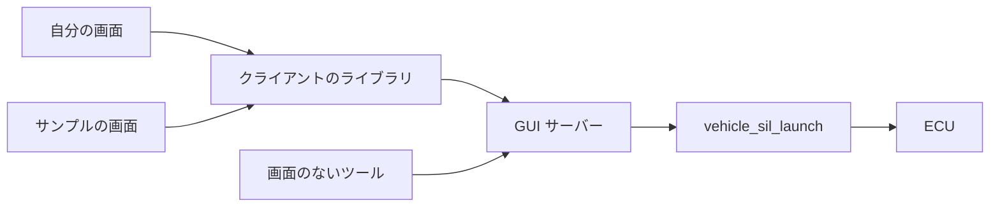
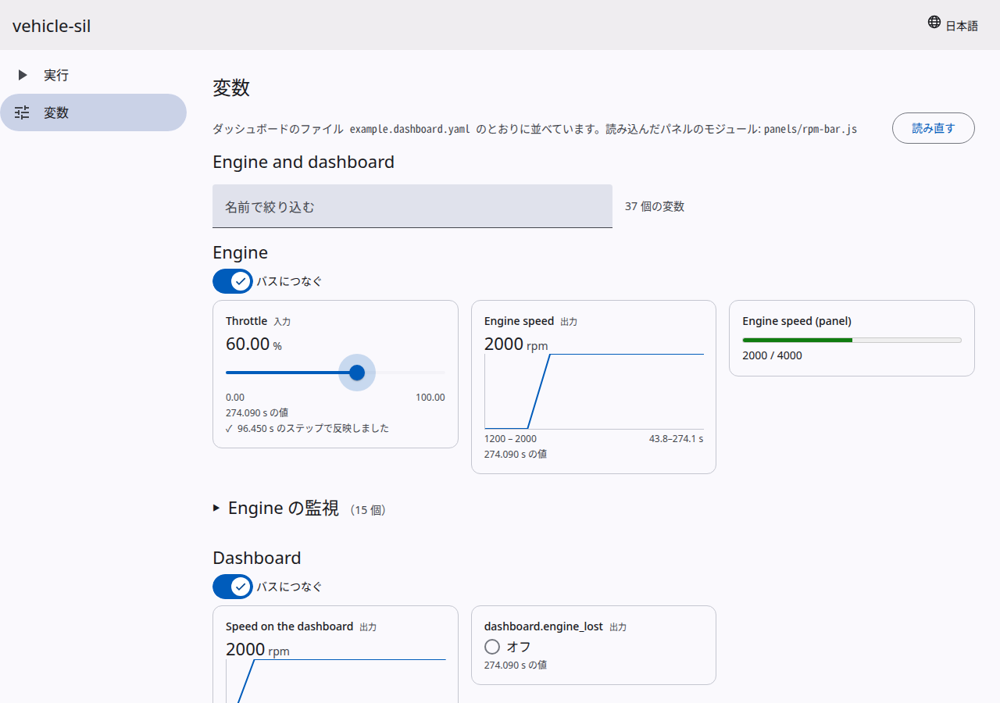

# ブラウザの GUI（`vehicle-sil-gui`）

[English](../gui.md)

`vehicle-sil-gui` は、ブラウザからシミュレーションを開始し、ECU の変数をスライダーやグラフで読み書きするツールです。このドキュメントには、GUI の使い方の手順と、引数、セキュリティ、画面の機能のリファレンスがあります。

| したいこと | 読む所 |
|---|---|
| ブラウザで値を見て操作する | 「[GUI を使う](#gui-を使う)」 |
| 自分の画面を作って GUI サーバーに配信させる | ガイド [ブラウザの GUI に自分の画面を作る](howto/gui-screen.md) |
| 引数、終了コード、止まり方を調べる | 「[起動の引数と終了コード](#起動の引数と終了コード)」「[停止と終了](#停止と終了)」 |
| 何を守り、何を守らないかを確認する | 「[セキュリティ](#セキュリティ)」 |
| 「変数」の画面の並べ方をファイルに書く | 「[ダッシュボードのファイル](#ダッシュボードのファイル)」 |
| 自分の画面に適用されるルールを調べる | 「[自分の画面のリファレンス](#自分の画面のリファレンス)」 |
| 外部 API の仕様・OpenAPI / JSON Schema・サンプルをまとめて探す | [外部 API とスキーマ](external-api.md) |
| GUI 自体を開発する | 「[開発](#開発)」 |

## 構成

GUI サーバー（Python）が同じ PC で `vehicle_sil_launch` を起動し、その経過と ECU の変数を、HTTP と WebSocket で画面に中継します。シミュレーションを動かすのはランチャーで、GUI はそれを表示するだけです。テストや AI エージェントから使う正式なインターフェースは、`vehicle_sil_launch` と Control API のままです。



矢印は「呼び出す」向きです。GUI は、自分の画面を作るための SDK でもあり、次の 4 つからできています。

| 部分 | 場所 | 役目 |
|---|---|---|
| GUI サーバー | `gui/server`（コマンドは `vehicle-sil-gui`） | ランチャーを起動し、API を提供し、画面の静的なファイルを配信します。 |
| サーバーの API | [gui/protocol](../../gui/protocol/README.ja.md) | HTTP と WebSocket の形、バージョンと互換性のルール、認証を定めており、オフラインの OpenAPI 3.1（`openapi.yaml`）および Draft 2020-12 の WebSocket / CLI JSON Schema（`schemas/*.schema.json`、ビルド済みツールアーカイブの `protocol/` にも同梱）を備えています。どの言語からでも使えます。 |
| クライアントのライブラリ | [gui/client](../../gui/client/README.ja.md)（`@vehicle-sil/gui-client`） | 接続、実行と時間の操作、ECU の変数を扱う TypeScript のライブラリで、フレームワークに依存しません。`connect()` が返す正面の口は、画面が見せるもの（`status`、`clock`、`controls`）、Promise で返す操作、変数 1 つを持ちます。 |
| サンプルの画面 | `gui/web`（Angular） | 上の 3 つだけで作ったリファレンス実装で、`--web` を指定しなければ GUI サーバーはこれを配信します。 |

ライブラリと GUI サーバーの間は HTTP と WebSocket（[gui/protocol](../../gui/protocol/README.ja.md) が仕様）、GUI サーバーとランチャーの間は、ランチャーの標準入出力と Control Server（gRPC）です。

## GUI を使う

サンプルの画面で、シミュレーションを開始し、変数を読み書きし、時間を止めて進め、シナリオを実行する手順です。

### 前提

| 必要なもの | 条件 |
|---|---|
| テンプレートのプロジェクト | [最初の ECU を作る](howto/first-ecu.md) の手順 1 まで済ませて、ECU をビルドし、ツールの `bin` を `PATH` に追加しておきます。 |
| Python | 3.11 以上が必要で、[uv](https://docs.astral.sh/uv/) があれば、Python とパッケージは uv がインストールします。 |
| ブラウザ | GUI サーバーと同じ PC のブラウザを使います。 |

コマンドは、テンプレートのプロジェクトのディレクトリ（`simulation.yaml` のある所）で実行します。リポジトリをビルドして使う場合は、次のように読み替えます。

| | テンプレートのプロジェクト | リポジトリ（README の「[クイックスタート](../../README.ja.md#クイックスタート)」の後） |
|---|---|---|
| 実行するディレクトリ | `simulation.yaml` のある所 | リポジトリのルート |
| 起動するコマンド | `vehicle-sil-gui simulation.live.yaml` | `scripts/run-gui.py` |
| 使われる設定ファイル | `simulation.live.yaml` | `build/<preset>/examples/ecu_main/simulation.live.yaml` |

`simulation.live.yaml` は、`simulation.yaml` と同じ 2 台の ECU を使います。停止時刻は実行時に指定します。

### 全体の流れ

| 手順 | すること | 見えるもの |
|---|---|---|
| 1 | GUI サーバーを起動する | ブラウザの「実行」の画面と、照合の結果 |
| 2 | シミュレーションを開始する | 状態「実行中」と、ECU のログ |
| 3 | 変数を見て、書き込む | 「変数」の画面のスライダーとグラフ |
| 4 | 時間を止めて、1 ステップずつ進める | 止まった仮想時間と、進めた量 |
| 5 | 停止して、終了する | 結果「操作で停止」 |
| 6 | シナリオを実行する | 手順ごとの合否の表 |

画面の表示には、このドキュメントと違う言葉がいくつかあります。「」の中は、画面の表示のままです。

| 画面の表示 | このドキュメントの言葉 |
|---|---|
| 構成ファイル | 設定ファイル |
| 所見、誤り | 指摘、エラー |
| 時刻、仮想時刻 | 時間、仮想時間 |
| ステップ送り | ステップ実行 |
| 刻み | ステップ（遅れを数える単位）、ステップ幅 |

### 手順 1: GUI サーバーを起動する

```sh
vehicle-sil-gui simulation.live.yaml
```

#### 確認

端末に URL が 1 行表示され、ブラウザが開きます。

```text
http://127.0.0.1:34457/#token=<token that changes on every start>
vehicle-sil-gui: open the URL above (it has the token); Ctrl+C stops the server
```

ブラウザには「実行」の画面が開き、「構成ファイル」に `simulation.live.yaml` が選ばれています。GUI は選んだ設定ファイルをすぐに照合するので、「照合」のカードに「✓照合: 通った（誤り 0、警告 0、注記 0）」と、participant の `Engine` と `Dashboard` が表示されます。

#### うまくいかないとき

| 症状 | 原因 | 直し方 |
|---|---|---|
| `vehicle-sil-gui` が見つからない | ツールの `bin` が `PATH` にありません。 | `get_tools.py` が表示した `export PATH=...` の行を実行します。 |
| ブラウザが開かない | ブラウザを起動できない環境か、ブラウザが一時ファイルを開けません。 | 表示された URL を、`#token=` の後ろまで含めてブラウザに貼ります。 |
| 終了コード 2 で終わる | 引数のエラーか、ランチャー、Python のパッケージ、ポートを使えません。 | 表示されたメッセージに従います（「[起動の引数と終了コード](#起動の引数と終了コード)」）。 |
| ほかの PC のブラウザから開けない | GUI サーバーは 127.0.0.1 だけで待ち受けます。 | SSH のポート転送を使います（[複数の PC で動かす](howto/multi-pc.md)）。 |

### 手順 2: シミュレーションを開始する

「実行」の画面の上にある「開始」を押します。

#### 確認

| 見る所 | 表示 |
|---|---|
| 上の状態の帯 | 「●実行中」になり、段階が「照合」「起動」「参加を待つ」「実行」の順に進みます。 |
| 「participant の状態」 | `Engine` と `Dashboard` が「● 参加した」「変数: つながった（18 個）」になります。 |
| 「ログ」 | `Dashboard` の行（`t=500 ms engine speed 1200 rpm (5 messages)` など）が増えていきます。 |

#### うまくいかないとき

| 症状 | 原因 | 直し方 |
|---|---|---|
| 「開始」を押せない | 照合にエラーがあります。 | 「所見」の文を読んで設定ファイルか ECU を直し、「照合し直す」を押します（[simulation-check.md](simulation-check.md)）。 |
| 「変数: つながった」にならない | ランチャーか ECU が、変数の読み書きに対応していません。 | 「[必要なもの](#必要なもの)」の「ECU の変数の読み書き」を確認します。 |

### 手順 3: 変数を見て、書き込む

ナビゲーションの「変数」を開きます。テンプレートにはダッシュボードのファイル（`simulation.live.dashboard.yaml`）があるので、`Engine` のスロットル（`Engine.engine.throttle`）がスライダー、回転数（`Engine.engine.speed`）がグラフで並びます。「Throttle」のスライダーを 20 % から 40 % に動かします。

#### 確認

スライダーの下に「✓ 6.600 s のステップで反映しました」のように反映された仮想時間が表示され、「Engine speed」が 1200 rpm から 1600 rpm に上がります。値の下の「8.870 s の値」は、その値を読んだステップの仮想時間です。



#### うまくいかないとき

| 症状 | 原因 | 直し方 |
|---|---|---|
| 変数の代わりに理由が表示される | 実行がないか、変数を読み書きできない構成です。 | 手順 2 で実行を開始し、それでも表示されるなら「[必要なもの](#必要なもの)」を確認します。 |
| スライダーやスイッチを操作できない | 出力の変数、終わった実行、切断された ECU などには書き込めません。 | コンポーネントに表示された理由を読みます（「[コンポーネントに共通の動作](#コンポーネントに共通の動作)」）。 |
| 探している変数が見当たらない | ダッシュボードのファイルに書いていない変数や、監視用の変数は、後ろや畳んだセクションに並びます。 | 上の「名前で絞り込む」に、変数の名前の一部を入力します。 |

### 手順 4: 時間を止めて、1 ステップずつ進める

1. 「実行」の画面に戻り、状態の帯の「‖一時停止」を押します。
2. 「時刻」のカードの「ステップ送りの量（ms）」に `100` を入力し、「ステップ送り」を押します。
3. 「▶再開」を押します。

#### 確認

| 操作の後 | 表示 |
|---|---|
| 一時停止 | 状態の帯と「時刻」のカードの状態が「一時停止中」になり、「仮想時刻」が止まります。 |
| ステップ実行 | 「仮想時刻」が 100 ms 進み（例: 10.175 s から 10.275 s）、「前のステップ送りで進む量: 100 ms（ランチャーが刻みの倍数に切り上げます）。」と表示されます。 |
| 再開 | 状態が「実行中」に戻り、「仮想時刻」が進みます。 |

止まっている間も「変数」の画面で書き込めます。書き込みは次のステップで反映されるので、ステップ実行か再開をするまでは「受け付けた」のままです。最初のステップの前に値を設定したいときは、開始の前に「止めた状態で始める」を選びます（「[時間の操作](#時間の操作)」）。

### 手順 5: 停止して、終了する

「停止」を押してシミュレーションを止め、端末で Ctrl+C を押して GUI サーバーを終了します。

#### 確認

「結果」のカードに「■ 操作で停止」「終わり方: 止めた」と表示されます。自分で止めた実行は、失敗ではなく「操作で停止」です。Ctrl+C の後、`vehicle-sil-gui` は終了コード 0 で終わります。実行中に Ctrl+C を押したときは、シミュレーションを先に止めてから終わります（「[停止と終了](#停止と終了)」）。

### 手順 6: シナリオを実行する

シナリオ（[scenario.md](scenario.md)）は、変数に決まった手順で値を設定し、結果を確認するファイルです。設定ファイルの隣の `scenarios/` に置いたものを、画面から選べます。

1. `vehicle-sil-gui simulation.yaml` で起動します（起動したままなら、「構成ファイル」で `simulation.yaml` を選びます）。
2. 「シナリオ」で `throttle_step.yaml` を選びます。
3. 「開始」を押します。

#### 確認

| 見る所 | 表示 |
|---|---|
| 「照合」のカード（開始の前） | 「シナリオ scenarios/throttle_step.yaml も照合しました（6 手順）。」 |
| 「結果」のカード | 「✓ 成功」「終わり方: シナリオが終わった」 |
| 「シナリオ」のカード | 「✓ シナリオは通りました」と、手順ごとの行、状態、仮想時間の表（`set Engine.engine.throttle = 50` が「✓ 通った」「0 ms」など） |
| 「シナリオ」のカードのリンク「時間の軸」 | 新しいタブで、手順と、シナリオが書いた値と見た値を、仮想時刻で並べた図を、GUI の言語で開きます（「[シナリオの実行の時間の軸](#シナリオの実行の時間の軸)」） |

シナリオの実行中は、変数に書き込めません。細かいルールは「[シナリオ](#シナリオ)」にあります。

### 次に読むもの

- 「変数」の画面の並べ方を決める → 「[ダッシュボードのファイル](#ダッシュボードのファイル)」
- GUI での操作を、シナリオのファイルとして保存する → 「[操作をシナリオとして保存する](#操作をシナリオとして保存する)」
- サンプルの画面に部品を足す、自分の画面を作る、ツールから GUI を動かす → 3 つの道を「[自分の画面を作る](#自分の画面を作る)」で比べています

## 自分の画面を作る

GUI に自分のコードを足す道は 3 つあります。サンプルの画面の何が残るかと、自分のコードが何を受け取るかが違います。

| 道 | 使うとき | 書くもの | 自分のコードが受け取るもの | サンプルの画面 | 出発点 |
|---|---|---|---|---|---|
| カスタムパネル | サンプルの画面に、自分の ECU の部品を足すとき。複数のチームが、それぞれの ECU の部品を持ち寄るときにも合います。 | カスタム要素を定義する ES モジュール。構成ファイルの横の `panels/` に置き、ダッシュボードのファイルに書きます。 | プロパティの `client`（つながった `GuiClient`）と、ダッシュボードの項目の `options` と `variables`。 | 残ります。パネルは「変数」の画面に出ます。 | 「[カスタムパネル](#カスタムパネル)」 |
| 自分の画面（`--web`） | 画面の全体を、自分の画面に置き換えるとき。 | 静的なファイル。クライアントのライブラリの部品を並べた HTML と、要るならスクリプト（フレームワークは自由）。 | ページの全体。GUI サーバーの origin から、URL にトークンを付けて開かれます。 | 置き換わります。実行の画面、時間の操作、「変数」の画面は、自分の画面に作らなければなくなります。 | ガイド [ブラウザの GUI に自分の画面を作る](howto/gui-screen.md) |
| 画面のないツール | テストの駆動や記録を、プログラムからするとき。 | クライアントのライブラリか、サーバーの API を使うプログラム。 | サーバーが表示した、トークン付きの URL（環境変数で渡します）。 | 残ります。ツールは、画面と同じ GUI サーバーを並んで使います。 | 「[画面のないツールから使う](#画面のないツールから使う)」 |

- `--web` に渡すのは 1 つのディレクトリで、GUI サーバーはサンプルの画面の代わりにそれを配信します。2 つ目の GUI サーバーは自分のランチャーを起動するので、1 つ目の実行を見せることはできません。
- パネルはサンプルの画面の機能です。`--web` で配信する自分の画面には、自動では付きません。
- 自分の画面は GUI サーバーと同じ origin から開くので、サーバーのセキュリティの検査（トークン、`Host`、`Origin`、CSP）がそのまま適用されます。

自分の画面は、次の 3 つの層のうち、必要なところまで使えば足ります。前の層で書いたものは、次の層でもそのまま使えます。

| 層 | 書くもの | 手に入るもの | 出発点 |
|---|---|---|---|
| 部品だけ | HTML と CSS。`<vsil-run-controls>`、`<vsil-slider variable="Engine.engine.throttle">`、`<vsil-value>` のような要素 | 開始と停止、時間の操作、状態、値、スライダー、書き込むボタン、次の実行のシナリオとその結果、実行の時間の軸。スクリプトもビルドも要りません | ガイド [ブラウザの GUI に自分の画面を作る](howto/gui-screen.md) |
| 自分のスクリプト | `connect()`、`watch`、`client.variable()` と、操作（Promise）を呼ぶスクリプト | 部品にないもの。自分の表示やボタン、ルール。部品と同じ接続を使うので、断られた開始、停止、時間の操作は `<vsil-status>` に出て、断られた変数の書き込みは、その変数を出している部品の所に出ます | 画面のテンプレートの `main.js` と、[gui/client/README.md](../../gui/client/README.ja.md#正面の口connect) の「正面の口（`connect()`）」 |
| フレームワークのプロジェクト | ビルドのあるプロジェクトと、ライブラリのパッケージ（`.tgz`） | React、Vue、Svelte、Angular などのテンプレートの中の、同じ部品とライブラリ（部品は custom element です） | [examples/gui_starter/README.md](../../examples/gui_starter/README.ja.md#フレームワークのプロジェクト) の「フレームワークのプロジェクト」（パッケージ、正面の口だけでの実行の一巡、Angular の signal） |

最初の 2 つの層では、部品とライブラリを GUI サーバー（`/vsil/`）から読むので、コピーするものはありません。フレームワークのプロジェクトはパッケージを使います。サンプルの画面（`gui/web` の Angular のアプリ）のコンポーネントを再利用することは、想定していません。部品を使ってください。

配信されるファイル、CSP、トークン、開発サーバー、ライブラリが代行しないルールは、「[自分の画面のリファレンス](#自分の画面のリファレンス)」にあります。

## 必要なもの

| 機能 | 必要なもの |
|---|---|
| GUI サーバーの起動 | Python 3.11 以上と [uv](https://docs.astral.sh/uv/) |
| シミュレーションの照合と実行 | `version --json` の `features` に `events`、`stdin-commands`、`request`、`time-commands`、`stdin-run-until`、`state`、`speed`、`start-paused`、`scenario`、`manual-participants` がある `vehicle_sil_launch`（同じ版の vehicle-sil のランチャーなら、すべてあります。[simulation-events.md](simulation-events.md) の「プログラムから使う」） |
| 時間の操作 | `features` の `time-commands`、`speed`、`start-paused`（すべて必須。上を参照） |
| ECU の変数の読み書き | Control Server を持つランチャー（`features` に `control-server`。`-DVEHICLE_SIL_BUILD_CONTROL_SERVER=ON` でビルドしたもの。[control-api.md](control-api.md)）と、GUI サーバーの Python の gRPC（`grpcio`、`protobuf`。`uv sync` がインストールします） |
| 実行するシミュレーション | 設定ファイルと、そこに書いた ECU の実行ファイル（ランチャーが照合と実行で起動します） |
| 画面 | サンプルの画面のビルド（`gui/web` の `npm run build` の出力）か、自分の画面のビルド（`--web`） |
| ブラウザー | デスクトップのブラウザー。新しい版の Chromium 系（Chrome、Edge。試験はこれで回します）。Firefox でも動くはずです。画面と時間の軸が使う機能には、Chrome か Edge の 123 以降（`light-dark()`）、Firefox の 121 以降（`:has()`）が要ります |

- ビルド済みのツール（README の「[クイックスタート](../../README.ja.md#クイックスタート)」）には、Python 以外の全部（Control Server を持つランチャー、GUI サーバー、ビルドした画面、gRPC のスタブ）が入っています。必要なのは Python 3.11 以上だけで、uv があれば、Python とパッケージも uv がインストールします。Windows では `uv`（`mingw-w64-ucrt-x86_64-uv` または Windows 版 `uv`）を使い、PyPI のビルド済み wheel（`aiohttp`、`pydantic-core`、`grpcio`）が動く標準 Windows 版 Python で実行してください。MSYS2 の `mingw-w64-ucrt-x86_64-python` には GUI のパッケージをインストールできません（[build.md](build.md) の「Windows の Python と `uv` の使い分け」）。
- 変数の読み書きに必要なもののどちらかがなくても、ほかの機能はそのまま使えます。変数だけが「使えない」になり、理由を表示します。
- 画面を使うだけなら Node.js は不要です。画面のビルドには、`gui/web/package.json` が定め `gui/web/.npmrc`（`engine-strict=true`）が強制する Node.js `^24.15.0 || ^26.0.0`（`gui/web/.nvmrc`: `24`）と npm `>= 11.12.1` が必要です（[gui/web/README.md](../../gui/web/README.ja.md)）。

## 起動の引数と終了コード

```sh
vehicle-sil-gui [options] [<configuration file>]
```

| 引数 | 意味 |
|---|---|
| `<configuration file>` | 最初に選んでおくファイル（`--root` の下） |
| `--root <dir>` | 画面で選べるファイルの範囲。既定は、渡した設定ファイルのディレクトリ、なければカレントディレクトリ |
| `--port <n>` | 待ち受けるポート（127.0.0.1）。既定の 0 は空いているポート。80 は使えない（ブラウザが `Host` からポートを省くため） |
| `--no-browser` | ブラウザを開かない |
| `--launcher <path>` | `vehicle_sil_launch` のパス（`.py` で終わるパスは、この Python で実行する） |
| `--external-registry <uri>` | 各実行を起動済みのループバック SIL Kit registry（`silkit://<loopback-host>:<port>`。ポートは 1 から 65535、パスなし。`--dashboard-uri` を付けた公式 `sil-kit-registry` など）へ接続する（「[Vector SIL Kit Dashboard で GUI の実行を観測する](#vector-sil-kit-dashboard-で-gui-の実行を観測する)」） |
| `--web <dir>` | 自分の画面を配信する: そのビルドの出力のディレクトリ（`index.html` があること）。既定はサンプルの画面（「[`--web` で配信するファイル](#--web-で配信するファイル)」） |
| `--dev-origin <origin>` | 画面の開発サーバー（`ng serve`、Vite など。`http://127.0.0.1:<port>` の形だけ）からのリクエストも受け付ける（「[開発サーバーを使う](#開発サーバーを使う)」） |
| `--json` | URL の代わりに `{"vehicle_sil_gui": 4, "url": ..., "port": ..., "pid": ..., "instance": ...}` を 1 行で表示する（ツールから起動するとき。`--no-auth` のときは `"auth": false` も入り、`url`/`dev_url` に `#token=...` は付かない） |
| `--keep-runs <n>` | サーバーが保持する完了済みシナリオのタイムラインファイル数（既定 4、最小 1）。上限超過時は過去の成功 run より失敗 run を優先して残す |
| `--stop-timeout <seconds>` | 終了するとき、実行中のシミュレーションが止まるのを待ち、ランチャーにシグナルを送るまでの時間。既定ではランチャーの終了を待つ |
| `--participant-start-timeout-ms <ms>` | 起動時に必須 participant を待つ実時間（既定 30000 ms） |
| `--participant-stop-timeout-ms <ms>` | ランチャーが participant の停止を段階ごとに待つ実時間（既定 10000 ms） |
| `--check-timeout <seconds>` | 照合（各 ECU の `--describe` を含む）の時間の上限（既定 120）。過ぎたら照合を止める |
| `--silent-after <seconds>` | 実行中のランチャーがこの時間より長く何も出力しなければ（ハートビートも来なければ）、画面に通知する（既定 5。1 以上） |
| `--no-variables` | ランチャーの Control Server を起動しない（ECU の変数を読み書きしない） |
| `--no-save` | 画面は構成ファイルを保存しない。見るだけに使うとき、またはトークンがほかの人に見えうるときに（「[セキュリティ](#セキュリティ)」） |
| `--allow-command-changes` | 実行されるコマンドを変える編集と新しいファイルも、画面が保存する。そのとき、トークンを持つ人は、あなたとして任意のコマンドを実行できる（「[セキュリティ](#セキュリティ)」）。`--no-save` と一緒には使えない |
| `--no-auth` | HTTP API と WebSocket のトークン認証を無効にする（標準エラーに警告を出し、URL から `#token=...` を省く）。同じ PC 上の任意のローカルプロセスがシミュレーションの操作や `--root` 下の構成の編集を行えるようになる。`127.0.0.1`、`Host`、`Origin`、CSP、`--root` の検査はそのまま残る（「[セキュリティ](#セキュリティ)」） |

| 終了コード | 意味 |
|---|---|
| 0 | 止めた（Ctrl+C、SIGTERM） |
| 1 | 動いている間の失敗 |
| 2 | 引数のエラーか、ランチャーやポートを使えない |

### 起動したときの動作

- `http://127.0.0.1:<port>/#token=<...>` を 1 行表示して、ブラウザで開きます。
- ブラウザには URL を直接渡さず、自分だけが読める一時ファイル（URL へ移るだけのページ。30 秒後かサーバーの終了時に消します）を開かせます。
- `--no-auth` を付けたときは、`http://127.0.0.1:<port>/`（`#token=...` なし）を表示し、一時ファイルを使わずにブラウザで直接開きます。標準エラーに警告を出し、`--json` には `"auth": false` が入ります。
- ブラウザがそのファイルを開けない（一時ディレクトリを読めないブラウザなど）ときや、ブラウザが開かないときは、表示した URL をブラウザに貼ります。
- Ctrl+C でサーバーを止めます。実行中のシミュレーションは、先に止めます。
- 画面で設定ファイルを選ぶと、ランチャーが各 ECU の `--describe` で照合し、participant ごとの `--describe` の出力（ステップ幅、ネットワーク、変数の数）を表示します。
- 設定ファイルの中の実行ファイルの相対パスは、設定ファイルのあるディレクトリが基準です（ランチャーのルール）。
- `--web` を指定せずに起動して、サンプルの画面のビルド（`gui/web` の `npm run build`）がないときは、ビルドの手順を書いたページを表示します。

### Hot 起動と Cold 起動

GUI サーバーは、対応する構成では `POST api/prepare` で常駐の `vehicle_sil_launch serve` プロセスを事前準備（Hot 起動）し、非対応の構成では実行ごとの Cold 起動（`serve --once`）へ自動で切り替えます。

- Hot 起動が省くのは `vehicle_sil_launch` プロセス自体の再起動だけです。`--describe`、Control Server、SIL Kit registry / controller、各 ECU の起動は毎ラン仮想時刻 0 から走り、起動内訳は Events v4 の `phase` イベントの `t_ms` で確認できます（[simulation-events.md](simulation-events.md#イベントserve---once) の「イベント（`serve [--once]`）」）。
- 設定が `registry_uri` を固定している場合、participant に `manual: true` がある場合、実行時に手動の participant を指定した場合（GUI/API の `manual`、CLI の `--manual` に相当）、`VEHICLE_SIL_TRACE` が設定されている場合、または常駐ランチャーが予期せず終了した場合は、自動で Cold 起動（`serve --once`）へ切り替わります（[simulation-run.md](simulation-run.md#1-つのランチャーで順に実行するvehicle_sil_launch-serve) の「1 つのランチャーで順に実行する（`vehicle_sil_launch serve`）」）。

### ランチャーの探し方

ランチャーは `--launcher <path>`、環境変数 `VEHICLE_SIL_LAUNCH`、`PATH` の順に探します。

| 場合 | 動作 |
|---|---|
| `PATH` で見つけたランチャーがカレントディレクトリにある | 使わずに、終了コード 2 で終わります。 |
| ランチャーの vehicle-sil の版が、この GUI サーバーの版と違う（プレリリースを含む文字列全体で比べます） | 両方の版を表示して（同じ版の `vehicle_sil_launch` を使ってください）、終了コード 2 で終わります。サーバーの実行中に差し替えられたランチャーも、同じように断ります（`launcher-unusable`）。 |
| ランチャーの `features` に、上の機能のどれかがない | 何が足りないかを表示して（同じ版の vehicle-sil の `vehicle_sil_launch` を使ってください）、終了コード 2 で終わります。サーバーの実行中に差し替えられたランチャーも、同じように断ります（`launcher-unusable`）。 |

カレントディレクトリのランチャーを使わないのは、Windows がカレントディレクトリを `PATH` より先に探すためです。人から受け取ったフォルダで起動すると、そこにあるプログラムが動いてしまいます。そのランチャーを使うときは `--launcher` で指定します。

### ビルド済みのツールの起動スクリプト

ビルド済みのツールでは、その `bin` を `PATH` に追加して、設定ファイルのあるディレクトリで `vehicle-sil-gui simulation.yaml` のように起動します。`bin/vehicle-sil-gui`（Windows のコマンドプロンプトでは `bin\vehicle-sil-gui.cmd`）は、次のことをします。

| すること | 内容 |
|---|---|
| ランチャーを渡す | ツールの `vehicle_sil_launch` を、環境変数 `VEHICLE_SIL_LAUNCH` で GUI サーバーに渡します。 |
| gRPC のスタブを渡す | ツールのスタブを、環境変数 `VEHICLE_SIL_CONTROL_STUBS` で渡します。 |
| パッケージをインストールして起動する | `uv run` で `python/requirements.txt` のパッケージ（バージョンとハッシュを固定）をインストールして起動します（2 回目からは uv のキャッシュを使います）。 |
| Python を選ぶ | 固定したパッケージの wheel があるバージョン（3.11 から、テストしている `.python-version` のバージョンまで）を uv が選び、なければダウンロードします。 |

- パッケージをソースからビルドはしません。
- uv がないときは、Python 3.11 以上の仮想環境に `python -m pip install --require-hashes -r <tools>/python/requirements.txt` でインストールし、その Python を環境変数 `VEHICLE_SIL_PYTHON` で指定します。足りなければ、そのことを表示して終了コード 2 で終わります。
- `bin/vehicle-sil-gui` は `uv run` を介してサーバーを起動するため、自動化スクリプトから停止するときは `uv` の PID だけへ `SIGKILL` を送らず、プロセスグループへの終了シグナル（POSIX は `killpg`、Windows は `taskkill /T`）を使ってください。また `--json` を標準出力パイプで受けるラッパーからは、無関係な孫プロセスへパイプの書込み側ハンドルを引き継いだまま EOF を待ち続けないよう、最初の 1 行を読んだ時点で扱うようにしてください（`--port` 競合時は即座に終了コード `2` で終了します）。
- GUI サーバーの Python は、カレントディレクトリのモジュールを読み込みません（`python -P`）。
- `bin/vehicle-sil-gui` は `uv run` 経由でサーバーを起動するため、自動化から停止するときは `uv` の PID だけに `SIGKILL` を送る（子プロセスの Python が残ります）のではなく、`SIGTERM` を送るかプロセスグループにシグナルを送ってください（POSIX は `killpg`、Windows は `taskkill /T`）。

### リポジトリから起動する

リポジトリのルートで `uv sync` をしてから、ビルドしたランチャーを `--launcher` で渡して起動します。例は、ビルドした ECU の例（`build/<preset>/examples/ecu_main/`。CMake が設定ファイルを実行ファイルの隣にコピーします）です。

```sh
uv run vehicle-sil-gui --launcher build/<preset>/tools/launch/vehicle_sil_launch \
  build/<preset>/examples/ecu_main/simulation.yaml
```

`scripts/run-gui.py` は、この起動を 1 つのコマンドにしたものです。`build/` の下から Control Server を持つランチャーを探し、その隣の例の `simulation.live.yaml` で GUI サーバーを起動します。ビルドはしません。

```sh
scripts/run-gui.py
```

| 場合 | `scripts/run-gui.py` の動作 |
|---|---|
| ランチャー、例、画面のビルド、uv のどれかがない | それを作るコマンドを表示して、終了コード 1 で終わります。 |
| `--launcher` や設定ファイルに渡したファイルがない | 引数のエラー（終了コード 2）です。 |
| `build/` の外のランチャー（展開したツールのものなど）を `--launcher` で渡す | 隣に例がないので、設定ファイルも渡します。 |
| `--dry-run` を付ける | 探した結果と、起動するコマンドだけを表示します。 |

- 表示するコマンドは、リポジトリのルートで実行する形です。ほかのディレクトリから呼んだときは、実行する場所を最初の行で示します。
- ビルドでは、ブリッジはそれぞれ自分のディレクトリ（`build/<preset>/bridges/<name>/`）にあり、ランチャーはブリッジを自分の隣か `PATH` から探します。このスクリプトは、ランチャーのビルドにあるブリッジのディレクトリを GUI サーバーの `PATH` の先頭に足すので、外部につなぐ実行（`--connect`）と接続先の一覧がブリッジを見つけられます。`build/` の外のランチャーでは、ブリッジは隣にあります。
- Windows では、Ctrl+C で全部が止まります。このスクリプトのプロセスだけを終了させると（ツールからの終了、タスクの終了）、GUI サーバーと実行中のシミュレーションが残ります。ツールから止めるときは、プロセスツリーごと止めます（`taskkill /T /PID <pid>`）。

### Workbench

リポジトリのルートで、別画面の Workbench をビルドして起動します。

~~~sh
npm --prefix gui/web/workbench ci
npm --prefix gui/web/workbench run build
scripts/run-gui.py --workbench
~~~

上部の **Network** でシミュレーション構成を選ぶと、対応構成では `POST api/prepare` で Hot 起動を使います（[Hot 起動と Cold 起動](#hot-起動と-cold-起動)）。構成に `variants:` があるときは **Variant** メニューが現れ、選択時に `{ file, variant }` で `POST api/prepare` を呼び出します。開始時は単一のチェックで判定し、Workbench 画面では数値の Run ID ではなく構成ファイルと状態で実行を示します。**Network Designer** では、その構成のバスと ECU チャネルの接続先を編集できます。上部の **Scenario** には、構成ファイルと同じ階層にあるサーバー側の `scenarios/` から実行できる YAML が並びます。シナリオに `cases:` があるときは **Case** メニューが現れ（選択中バリアントを `only:` で除外するケースは無効化）、**Scenario** タブに由来バッジ・型別入力・個別/一括リセット付きの **Scenario parameters** 表が表示されます。**Free run** と **Record & start** は、**Stop at (ms)** を空欄にすると、仮想時間で自動停止しません。時刻を入力すると、Check と再生に同じ設定が適用されます。

**Record & start** で開始した実行では、**Scenario** タブの **Load recording** で記録されたシナリオ YAML を読み込めます。実行中に読み込むと `end_ms` は省かれて最後の `set` 手順で止まり、実行終了後に読み込むと記録元の終了仮想時刻から確定した `end_ms` が入ります。シナリオを選び、ランチャーが `scenario-handover` に対応しているときは、**After scenario** で **Stop run**（既定）または **Pause for manual control** を選べます。**Pause for manual control** を選ぶと **Stop at (ms)** は無効になり送信されません。引き継ぎが成立した後は、同じ実行のまま **ECU I/O** がアンロックされ、手動書き込みと **1 step** / **Resume** / **Speed** を続けられます。

**Settings → Scenario folder** では、**Scenario** タブで YAML を開いたり保存したりするローカルフォルダを選びます。ブラウザーが読み取り専用でフォルダを開く場合、**Save YAML** はファイルをダウンロードします。ローカルの YAML をサーバーで実行するには、選択中の Network のサーバー側 `scenarios/` に置き、実行リストを更新します。

### Vector SIL Kit Dashboard で GUI の実行を観測する

`vehicle-sil-gui`（または `scripts/run-gui.py`）に `--external-registry silkit://<loopback-host>:<port>` を渡すと、ブラウザ GUI や Workbench の通常の **Start** による実行を、Vector SIL Kit Dashboard につないだ起動済みの公式 `sil-kit-registry` へ接続できます（[simulation-run.md](simulation-run.md#vector-sil-kit-dashboard-で実行を観測する--external-registry) の「Vector SIL Kit Dashboard で実行を観測する（`--external-registry`）」）。

```sh
sil-kit-registry --listen-uri silkit://127.0.0.1:8500 --dashboard-uri http://localhost:8082
vehicle-sil-gui --external-registry silkit://127.0.0.1:8500 simulation.live.yaml
# or, from a repository build:
scripts/run-gui.py --external-registry silkit://127.0.0.1:8500
```

- 待機中（Hot 起動の `POST api/prepare` を含む）は外部 registry へ接続しません。**Start** を押すたびに新しい `silkit://<host>:<port>/vsil-<16hex>` の URI が採番され、**Stop** してから再び **Start** を押すと、前の実行とデータが混ざらずに Vector SIL Kit Dashboard 上で新しい Simulation として表示されます。
- 設定ファイル（または選んだ機種）の `command` に `Remote` メトリクスシンク付きの `--silkit-config` を指定した participant は、GUI での実行中に標準の SIL Kit メトリクスも Vector SIL Kit Dashboard へ送信します。

## 停止と終了

| 操作 | 起きること |
|---|---|
| 画面の「停止」 | ランチャーの標準入力に `stop` を送り、順に止めます。 |
| 画面の「待たずに止める」 | もう一度 `stop` を送り、ランチャーは participant の終了を待たずに止めます。 |
| サーバーの終了（Ctrl+C、SIGTERM、端末を閉じた） | 照合をすぐ止め、ランチャーの標準入力を閉じて順に止めさせます。 |
| 2 回目の Ctrl+C | 待ちを省きます。 |
| サーバーの強制終了 | ランチャーは標準入力の終わりを受け取って、自分で止まります。 |

- 標準入力を読まないランチャーは、「停止」でも「待たずに止める」でも止まりません。そのときはサーバーを止めます。
- サーバーの終了では、ランチャーの入力を閉じて終了を待ちます。`--stop-timeout` を指定してその時間内に止まらなければ、ランチャーのプロセスグループに SIGTERM（Windows は Ctrl+Break）を送り、5 秒後にグループを強制終了します（Windows は `taskkill /T /F`）。2 回目のシグナルは最初の待機と、その後の 5 秒の待機をどちらも打ち切ります。タイムアウトを指定せず、ランチャーが終了できない場合は、2 回目のシグナルで強制停止できます。
- サーバーが止められるのは、ランチャーと、ランチャーと同じプロセスグループにいるものまでです。participant の後始末はランチャーの役目です（ランチャーは participant を別のプロセスグループで起動します）。
- ランチャーが終わっても、ランチャーが起動したプロセスが出力を開いたままのときは、2 秒待ってから実行を終わりにし、画面に通知します。そのプロセスは残っているかもしれません。
- 自動化から `uv run` 経由で `bin/vehicle-sil-gui` を動かしているときは、`uv` の PID だけに `SIGKILL` を送るのではなく、`SIGTERM` を送るかプロセスグループ（POSIX は `killpg`、Windows は `taskkill /T`）を終了させてください。

## セキュリティ

GUI サーバーはプロセスを起動できます（設定ファイルに書いたコマンドを、ランチャーが起動します）。そのため、自分の PC の上で自分だけが使う前提で、次のように守っています。

- **待ち受けるアドレス**: 127.0.0.1 だけで待ち受けます。ほかの PC からは開けません（SSH のポート転送で見る手順は [howto/multi-pc.md](howto/multi-pc.md)。転送は同じポート番号で）。`Host` は `127.0.0.1:<port>` だけを受け付けます（`localhost` は、ブラウザが先に `::1` へ接続することがあり、そこで別のプログラムが待ち受けられるので受け付けません）。
- **トークン**: 既定では、起動のたびに新しいトークンを作ります。トークンは表示した URL の `#token=` の後ろにだけあり、画面はそれを読んだら URL から消します。API と WebSocket はトークンがないと応答しません。URL を人に渡さないでください。明示的に `--no-auth` を渡したときだけ HTTP API と WebSocket のトークン認証を無効にします。その場合も、それ以外の保護（`127.0.0.1`、`Host`、`Origin`、CORS 不許可、CSP、`--root`、`--no-save`、`--allow-command-changes`、外部接続先の検査、ランチャーの gRPC Control Server トークン）はすべて有効なままです。
- **ほかのウェブページ**: ほかのウェブページからのリクエストを拒否します（`Host` と `Origin` の検査。CORS は許可しません）。
- **設定ファイル**: 画面から使えるのは `--root` の下の設定ファイルだけです。外へ出るパスや、root の外へのシンボリックリンクは、検査の時点で拒否します（検査の後に root の中でリンクを差し替えることは防げませんが、root に書ける人は設定ファイルをそのまま置けます）。ランチャーに渡す引数はサーバーが決まった形で組み立て、任意のコマンドは受け取りません。ただし、`--allow-command-changes` で起動したときを除きます（下の「文の保存」）。
- **保存していない文の照合**: 画面が送った構成の文の照合（`POST api/check` の `text`）は、何も起動しません。ランチャーは、各実行ファイルの `--describe` の出力を、サーバーが保存したファイルの照合から取っておいた説明から取ります。サーバーにその説明がないとき、またはその後に保存したファイルが変わったときは、サーバーが先に保存したファイルを照合するので、その実行ファイルが `--describe` で起動します（実行の画面がファイルを開いたときと同じです）。サーバーは画面のために構成ファイルの文を読みます（`GET api/config`）。画面が読めるのは根の中の構成ファイルの文だけです（`.` で始まる部分のあるパスと、先頭の近くに `vehicle_sil_simulation` のないファイルは読みません）。説明はサーバーの一時ディレクトリにあり、サーバーが止まるときに消します（[gui/protocol/README.md](../../gui/protocol/README.ja.md#構成ファイルの文apiconfigapicheck-の-textapidescribe) の「構成ファイルの文」）。
- **文の保存**: 画面は構成ファイルの文を保存できます（`POST api/config`）。既定では、サーバーが保存するのは、実行されるコマンドを変えない編集だけです。ランチャーが文を照合して保存したファイルと比べ（`check --compare-commands`）、ランチャーが `"same"` と言ったときだけ保存します（ネットワーク、その写像、`external` の編集）。サーバー自身は YAML を比べず、比べられないものは保存しません。書くのは根の中の構成ファイルだけです。`GET api/configs` がシミュレーションの構成として出す、いまあるファイルを、画面が読んだ印で、同じディレクトリーの新しいファイルから置き換えます。ほかに書くファイルは、すべて一時ディレクトリーの中です。`--no-save` では何も保存しません。`--allow-command-changes` では、実行されるコマンドを変える編集も保存し、新しいファイルも作ります（ダッシュボードのファイルと、`scenarios` ディレクトリーの中は除く）。そのとき、トークンを持つ人は、あなたとして任意のコマンドを実行できます。構成ファイルに保存すれば、次の照合で `--describe` つきで起動するからです。`--web` で出した画面とそのパネルのコードも同じ origin で動くので、これに含まれます。既定のままでも、トークンを持つ人は、画面の一覧に出る構成ファイルのうちランチャーが比べない所（ネットワーク、`external`、`params`、コメント、照合が失敗する文）を書き換えられ、サーバーは前の中身の控えを残しません。見るだけに使うとき、またはトークンがほかの人に見えうるときは、`--no-save` で起動してください。`--allow-command-changes` のとき、サーバーは起動時に標準エラーにそう出し、API の `allowed.save` が同じ注意を画面に渡します（[gui/protocol/README.md](../../gui/protocol/README.ja.md#文を保存するpost-apiconfig) の「文を保存する」）。
- **ECU の変数**: ランチャーの Control Server（127.0.0.1 の空いているポート）から読み書きします。
  - ランチャーのプロセスごとに新しいトークンを作り、自分だけが読めるファイル（一時ディレクトリの `vehicle-sil-gui-control-*.txt`。POSIX では権限 0600）でランチャーに渡します。
  - 1 回の実行のために起動したランチャー（`vehicle_sil_launch serve --once`）: ファイルは、ランチャーが読んだ後（Control Server が待ち受けを始めたとき）に消し、実行の終了時にも消します。
  - 常駐するランチャー（`vehicle_sil_launch serve`。`POST api/prepare` で準備します）: ランチャーは実行を始めるたびにファイルを読み直すので、ファイルはそのランチャーが動いている間は残り、ランチャーが終わったとき（設定ファイルが変わったとき、失敗したとき、GUI サーバーが止まるとき）に消します。
  - このトークンは、ランチャーの引数、イベント、画面への通知、エラーの文のどこにも出しません。同じ PC のほかのプロセスは、このトークンなしでは Control Server を使えません。
  - GUI サーバーが接続するのは、ランチャーが通知した `127.0.0.1:<port>` だけです。
  - 画面からの書き込みは、ほかの API と同じ検査（トークン、`Host`、`Origin`）を通り、変数の一覧にある書き込める変数へ、型と範囲の合う値だけを渡します。
- **ネットワークを外につなぐ**: `connect` の先（ファイルのネットワークを実機のバスにつなぐ先）は、そのファイルのそのネットワークの直近の `POST api/connections` が、ちょうど同じ文字列で使えると一覧に載せ、その後にファイルが変わっていないときだけ、ランチャーに渡ります。実行は、ランチャーを起こす直前に照らします（そうでなければ 400 `target-not-listed`。`none` に一覧は要りません）。こうして画面が送る先は、ランチャーがこのコンピューターで見つけたデバイスだけで、一覧は画面が尋ねたネットワークの分だけ作ります。構成ファイルに書かれたブリッジ（`role: bridge`。`enable` や variant で取り込めます）は、ファイルのほかのコマンドと同じくファイルの中身で、照らしません（[gui/protocol/README.ja.md](../../gui/protocol/README.ja.md#ネットワークを外につなぐconnecttime_policyapiconnections) の「ネットワークを外につなぐ」）。
- **シナリオ**: シナリオ（設定ファイルの隣の `scenarios` の `.yaml` / `.yml`）は、その一覧にあるものだけをランチャーに渡します。`..`、絶対パス、NUL、長すぎる名前、`.` で始まる名前、シンボリックリンク（ファイルも、`scenarios` とその上のディレクトリも）は一覧に入らず、指定しても拒否します。保存するシナリオの YAML は、サーバーが文字列として返すだけで、ファイルを書きません。
- **ダッシュボードのファイルとカスタムパネル**: ダッシュボードのファイル（設定ファイルの隣の `.dashboard.yaml`）とカスタムパネル（`panels/` の `.js` / `.mjs`）は、設定ファイルと同じく root の中のものだけを読み、配信します。ダッシュボードのファイルは YAML の安全な読み方で、大きさと入れ子と値の数に上限を設け、別名（`*name`）を使わせません。パネルは同じ origin から配信するので、CSP（`script-src 'self'`）は緩めません。パネルのモジュールの URL には、トークンの代わりに起動ごとの別の乱数が入ります（「[カスタムパネル](#カスタムパネル)」）。
- **時間の軸のファイル**: シナリオの実行のファイルは、サーバーの一時ディレクトリ（POSIX では自分だけが読める）に置き、トークンを付けたときだけ配り（`api/timeline/<run_id>`）、サーバーが止まるときに消します。`timeline/` の時間の軸のページは、画面のファイルと同じく、トークンなしで配ります。ページは、画面がトークンを持つ所からトークンを読みます（「[シナリオの実行の時間の軸](#シナリオの実行の時間の軸)」）。トークンをアドレスに入れることはありません。
- **画面のファイル**: 画面は、起動した人が指定したディレクトリ（`--web`。なければサンプルの画面）の中のファイルだけを配信します（「[`--web` で配信するファイル](#--web-で配信するファイル)」）。その画面は、同じ origin で、トークンを持って動き、GUI でできることを全部できます（`--allow-command-changes` では、あなたとして任意のコマンドを実行することも含みます）。`--web` には、自分が信頼する画面だけを渡します（root と同じく、人からもらったものは先に読みます）。
- **同時の実行**: 実行は、サーバー 1 つにつき一度に 1 つです。同時に開始を頼まれても、開始するのは 1 つだけです。サーバーを 2 つ起動すれば、実行も 2 つ動きます。

守れないもの:

- **同じ PC のほかの利用者**。トークンは、表示した URL（端末、`--json` の出力、それを読んだツールのログ）を見られる人には見えます。トークンを持つ人は、ブラウザを使わずに `Host` と `Origin` を自由に書けるので、API を全部使えます。ブラウザのコマンドラインにはトークンを載せません（ほかの利用者はプロセスの引数を読めることがあるため）が、端末の表示は守りません。トークンを持たない人でも、WebSocket の接続を開き続ければ、画面が接続するのを妨げられます（認証前の接続は 16 本までで、あふれると古いものから閉じるので、画面は何度か試せば接続できますが、妨げる側が開く速度には勝てません）。
- **root の中身**。root の中のものは、画面で開いただけで動きます。実行の画面は、選んだ設定ファイルをすぐに照合し、照合は各 ECU の実行ファイルを `--describe` で起動します。ネットワークの設計の画面も、開いたファイルについて同じことをします。変数の画面は、ダッシュボードのファイルの `panels:` のモジュールを読み込み、パネルは画面の中でトークンを持って動きます（実行を開始できるので、root の中の設定ファイルに書いたコマンドを動かせます）。root に書ける人は、GUI を使う人の権限でコマンドを動かせます。信頼できないリポジトリやディレクトリを root にしないでください（人からもらったものは、先に設定ファイル、`*.dashboard.yaml` の `panels:`、`panels/` の中身を読みます）。ほかの人が書ける場所（共有のディレクトリ、`/tmp` の下など）も root にしないでください。
- **ブラウザの拡張機能**。拡張機能は画面とその `sessionStorage`（トークンを持つ）を読めます。
- **`--allow-command-changes` のときのトークン**。これで起動すると、トークンを持つ人は、構成ファイルに任意のコマンドを書けます。トークンを見たほかの利用者、ブラウザの拡張機能、`--web` の画面やパネルのコードが、あなたとしてコマンドを実行できるようになります。1 人で使い、参加者やコマンドも画面で変えたいときだけ、これで起動してください。
- **`--no-auth` で起動したとき**。HTTP API と WebSocket のトークン認証が無効になるため、同じ PC 上の任意のローカルプロセス（`127.0.0.1:<port>` に接続して `Host` と `Origin` を付けられるほかのローカル利用者のプロセスを含む）が、シミュレーションの開始・停止、ECU 変数の読み書き、`--root` 下の構成ファイルの保存（`--no-save` がない限り）を行えます。さらに `--allow-command-changes` と組み合わせると、**同じ PC 上の任意のローカルプロセスが、あなたのユーザー権限で任意のコマンドを実行できます**（サーバーは標準エラーに追加の警告を出し、`allowed.save.caution` にも反映します）。`--no-auth` は信頼できるローカル環境だけで使い、保存が不要な場合は `--no-save` を併用し、`--allow-command-changes` との併用は避けてください。
- 同じ利用者の権限で動くプログラムは、もともと何でもできるので、対象にしていません。

## 時間の操作

時間を進めるのはランチャーで、GUI はコマンドを渡して、その結果を表示するだけです。コマンドの意味と遅れの数え方は、ランチャーのルールのとおりです（[simulation-run.md](simulation-run.md) の「速度を指定して動かす」と、[simulation-events.md](simulation-events.md) の「標準入力のコマンド」）。

| 場面 | 画面の場所 | できること |
|---|---|---|
| 開始の前 | 「構成ファイル」のカード | 速度（構成のとおり、最速、等速、倍率）と「止めた状態で始める」を選びます。 |
| 実行中 | 状態の帯 | 「一時停止」と「再開」を押します。 |
| 実行中 | 「時刻」のカード | 仮想時間、いまの速度、実際の速度、一時停止しているかを見て、ステップ実行（ミリ秒を入力）と速度の変更をします。 |
| 終了の後 | 「結果」のカード | 時間の進み方（速度、仮想時間、かかった実時間、実際の速度、一時停止していた時間、速度を合わせたときの遅れ）を見ます。 |

- ランチャーの `time-commands`、`stdin-run-until`、`state`、`speed`、`start-paused` は起動時に必須として確かめるので、サーバーはコマンドごとには確かめません。
- シミュレーションの外につながる実行（ファイルに `role: bridge` の participant がいる、または実行の要求に `connect` がある）では、ランチャーが、一時停止、ステップ、1 以外の速さを、理由 `outside-real-time` で断ります。コマンドラインのときと同じです（[simulation-run.md](simulation-run.md) の「外につながる実行の時間」）。これはランチャーの規則です。GUI サーバーは自分の規則を持たず、答えを中継します。要求の `time_policy`（`"free"`）がこれを外し、実行が実時間を守るかは、照合の `time_lock` が言います。「時刻」のカードは、一時停止とステップの下にランチャーの理由を出し、「等速」のほかの速さは選べません（カードが、この実行で選べる速さは等速だけだと言います）。
- 時間の操作ごとの、使えるか、使えない理由、ステップと速さの範囲は、クライアントのライブラリの `controls` から来ます（[gui/client/README.ja.md](../../gui/client/README.ja.md) および下の「[操作の理由コード・注意コードと `--time-policy`](#操作の理由コード注意コードと---time-policy)」）。画面は自分の規則を持ちません。画面に言葉のある理由は画面の言語で、ほかの理由はランチャーの英語の文のままで出ます。注意（コマンドは受け付けるが、先に知っておくとよいこと。`outside-not-real-time` など）も同じ場所に出ます。
- 途中から開いた画面や、別のタブも、同じ時間の状態を表示します（サーバーの要約に、最後の `time` と `command` のイベントがあるため）。
- 指摘 `behind-real-time` と `coarse-time-step` は、ほかの指摘と同じく結果の指摘に表示されます。

### 操作の理由コード・注意コードと `--time-policy`

`front.controls` の各項目（`start`、`stop`、`force_stop`、`pause`、`resume`、`step`、`run_until`、`speed`、`save`）は `{ ok, reason, caution }` です。英語の `message` ではなく、必ず `reason.code` と `caution.code` で分岐してください。

**`controls.*.reason.code`（`ok` が `false` のとき）:**

| コード | 発行元 | 対象の操作 | 意味 |
|---|---|---|---|
| `connecting` | クライアント | `stop`/`force_stop` 以外すべて | WebSocket が接続中または初回同期（`hello` + `synced`）待ち。 |
| `offline` | クライアント | `stop`/`force_stop` 以外すべて | GUI サーバーとの接続が切断中（クライアントが自動再接続する）。 |
| `rejected` | クライアント | `stop`/`force_stop` 以外すべて | GUI サーバーがトークンを拒否した（サーバーが表示した URL を開き直す）。 |
| `incompatible` | クライアント | `stop`/`force_stop` 以外すべて | クライアントと GUI サーバーの GUI プロトコル版が一致しない。 |
| `busy` | クライアント | `save` 以外すべて | このページから送った同じ操作の応答がまだ返っていない。 |
| `starting` | GUI サーバー / クライアント | `start`、`stop`、`force_stop` | 開始処理が進行中で、実行を識別または重複開始できない。 |
| `already-running` | GUI サーバー / クライアント | `start` | すでに実行が動いている。停止して終了を待ってから次を開始する。 |
| `launcher-unusable` | GUI サーバー | `start` | 指定された `vehicle_sil_launch` がプローブまたは版・機能検査に失敗した。 |
| `shutting-down` | GUI サーバー | `start`、`stop`、`force_stop`、`save` | GUI サーバーが終了処理中のため新しい操作を受け付けない。 |
| `not-running` | GUI サーバー / クライアント / ランチャー | `stop`、`force_stop`、`pause`、`resume`、`step`、`run_until`、`speed` | 実行中のシミュレーションがない（またはすでに終了した）。 |
| `already-stopping` | GUI サーバー / クライアント | `stop` | すでに停止要求を送った。終了を待つか、`force_stop` を使う。 |
| `not-stopping` | クライアント | `force_stop` | 先に通常の `stop` を送る必要がある（`force_stop` は 2 段階目）。 |
| `already-forced` | GUI サーバー | `force_stop` | すでに強制停止を要求済み。ランチャーの終了を待つ。 |
| `save-disabled` | GUI サーバー | `save` | GUI サーバーが `--no-save` で起動されている。 |
| `paused` | クライアント | `pause` | すでに一時停止中（Pause を押しても何も変わらない）。 |
| `not-paused` | クライアント / ランチャー | `resume`、`step` | `resume`（クライアント）: 一時停止していない。`step`（ランチャー）: ステップ実行には一時停止が必要。 |
| `not-set-up` | ランチャー | `step`、`run_until` | 参加者の立ち上げがまだ終わっていない（セットアップ完了後に解放される）。 |
| `outside-real-time` | ランチャー | `pause`、`step`、`run_until` | シミュレーションの外につながる実行（`--connect` または有効な `role: bridge`）が既定の `--time-policy realtime` で動いている。`controls.speed` は `ok: true` のまま `min: 1, max: 1, fastest: false` になる（`1` 以外の速度を送るとランチャーから `outside-real-time` で拒否される）。受け付けるのは `resume`、`speed: 1`、`stop` のみ。 |
| `unsupported` | クライアント | `pause`、`resume`、`step`、`run_until`、`speed`（および変数の `write`） | この実行の `state` イベントがランチャーからまだ届いていない、または `state.allowed` にその操作の項目がない。 |
| `refused` | クライアント（フォールバック） | 任意 | サーバーまたはランチャーの `allowed` が `reason` コードなしで `ok: false` を返した場合のフォールバック。 |

変数の書き込み（`front.variable(ref).get().why.code` / `state.allowed.write`）では、ランチャーが `scenario-running`（`after_scenario: 'pause'` で合格引き継ぎされるまでのシナリオ実行中）と `no-control-server`（実行に Control Server がない）も返します。不正な引数でコマンドを送った場合はランチャーから `out-of-range`、`missing-argument`、`not-a-time-command` で拒否されることもあります（[simulation-events.md](simulation-events.md#理由のコード) の「理由のコード」）。

**`controls.*.caution.code`（`ok` が `true` だが事前に知らせるべき注意があるとき）:**

| コード | 発行元 | 対象の操作 | 意味 |
|---|---|---|---|
| `outside-not-real-time` | ランチャー | `pause`、`step`、`run_until`、`speed` | 外部接続された実行が `time_policy: 'free'` で動いている。操作は受け付けられるが、外部機器は仮想時間を待たずブリッジは双方向転送を続ける（最初の操作後、実行終了時に注記 `outside-time-changed` が付く）。 |
| `command-changes-allowed` | GUI サーバー | `save` | GUI サーバーが `--allow-command-changes` で起動されている。保存で実行コマンドの変更や新規ファイル作成が可能になり、トークンを持つ者（`--no-auth` 下では任意のローカルプロセス）がこのユーザー権限でコマンドを実行できる。 |

**`--time-policy` の優先順位と `free` 時の既定速度（`max`）:**

- **優先順位**: CLI で明示した `--time-policy`（`--time-policy realtime` を明示した場合を含む）は、`--request` ファイル内の `time_policy` より優先されます。どちらにも指定がない場合（または GUI の `Intent.time_policy` を省略した場合）の既定は `realtime` です。
- **`realtime`（既定）のとき**: 外部接続がある場合（`connect` または有効な `role: bridge`）、速度は `1`（実時間）に固定されます。速度を省略すると注記 `outside-speed-set` 付きで `1` で実行され、`1` 以外の速度・`start_paused: true`・`after_scenario: 'pause'` は照合エラー `outside-real-time` になります。
- **`free` のとき**: 時間ロックが外れるため、速度は通常の非ロック時と同じ規則に従います — 明示した `speed` / `--speed`、なければ構成の既定、それもなければ `1` ではなく **`max`（最速）** になります。一時停止・ステップを許可しつつ等速で動かしたい場合は、`time_policy: 'free'` と `speed: 1` の両方を明示してください。

### 止めた状態で始める

- 止めた状態で始めると、全員がそろったところで仮想時間 0 に止まり、再開かステップ実行を待ちます。
- 速度は前の実行のものが選ばれていますが、「止めた状態で始める」は前の実行から引き継ぎません（気づかずに止まったまま始まらないように）。
- 変数を読み書きできる実行（ランチャーが Control Server を持つ）では、最初のステップの前（時刻 0 のステップが走る前）で止まります（ランチャーのルール。[control-api.md](control-api.md) の「始まる前に書く」）。この間に書き込んだ変数は、時刻 0 のステップで反映されます。
- ランチャーは、最初のステップの前で止まっている間は `time` のイベントを出力しませんが、再開とステップ実行を受け付けます（ランチャーの `state` のイベントの `holding`。ライブラリでは `isHolding(session)`）。
- `--no-variables` で起動したときと、Control Server を持たないランチャーでは、時刻 0 のステップの後に止まります。

### 一時停止、再開、ステップ実行

- 「一時停止」と「再開」は別のボタンで、開始してから結果が出るまで、いつも「開始」と「停止」の後の同じ場所にあります。「開始」と「停止」の位置は動かず、停止を頼んだ後も、押せないまま残ります。
- 使えない方のボタンは押せません（押している最中に、同じ場所のボタンの意味が入れ替わりません）。フォーカスは受け、説明が理由を言います。押しても何も変わらないとき（すでに一時停止している、一時停止していない）のほかは、「時刻」のカードにも理由が出ます。
- とても狭いウィンドウでは、ボタンは記号（‖ と ▶）だけになります（名前はスクリーンリーダーに残ります）。
- ステップ実行は一時停止している間だけできます。ステップ実行の途中も、ランチャーと同じく一時停止の扱いで、再開とステップ実行ができます。
- ステップ実行では、ランチャーがステップ幅の倍数に切り上げた、実際に進む量を表示します。
- 送ったコマンドにランチャーが応答する（`command` のイベントが届く）までは、次のコマンドを送りません（ダブルクリックで 2 回進まないように）。
- 5 秒たっても応答がなければ（入力を読まないランチャー）、待つのをやめて操作を押せるように戻し、応答がないことを表示します（帯のボタンの説明も同じ理由を指します）。
- シミュレーションが終了に入ったら（段階が「停止中」）、時間の操作はできません。
- ランチャーが受け付けなかったコマンドは、その理由を表示します。

### 遅れの表示

速度を数値で指定して動かしている間（最速ではない間）、遅れたステップの数、最大の遅れ、ずれの合計、いまの遅れを表示します。

- 許容（`late_tolerance_ms`）を超えて遅れたステップがあるときだけ、色だけでなく文で通知します（状態の帯と「時刻」のカード。途中で最速に変えても残ります）。
- いまの遅れ（`late_ms`）は、数値として表示するだけで、文の条件にしません。ステップの同期のたびに、許容の範囲内の小さな値が出たり消えたりするためです（許容を超えて止まっているステップは、ランチャーが遅れたステップにその場で数えます）。
- スクリーンリーダーが読み上げるのは状態の帯の 1 か所だけで、遅れが「ある」になったときに 1 回です（数が変わるたびには読み上げません）。

### 時間の操作の API

| リクエスト | すること |
|---|---|
| `POST api/run` の `speed`、`start_paused` | ランチャーの `--speed`、`--start-paused`（成功時は `{instance, run_id}` の Ack を返し、照合失敗時は前の実行画面を消さずに同期で `422 check-failed` を返します） |
| `POST api/time` `{"run_id": "<run_id>", "instance": "<instance>", "command": "pause"}` または `"resume"` | 一時停止、再開（`{run_id, command}` の Ack を返す） |
| `POST api/time` `{"run_id": "<run_id>", "instance": "<instance>", "command": "step", "ms": <ms>}` | ステップ実行（一時停止している間だけ。ランチャーがステップ幅の倍数に切り上げ、`{run_id, command}` の Ack を返す） |
| `POST api/time` `{"run_id": "<run_id>", "instance": "<instance>", "command": "run_until", "at_ms": <ms>}` | `at_ms` まで進めて一時停止（一時停止中・実行中のどちらでも可。`{run_id, command}` の Ack を返す） |
| `POST api/time` `{"run_id": "<run_id>", "instance": "<instance>", "command": "speed", "value": <number or "max">}` | 速度の変更（一時停止はそのまま。`{run_id, command}` の Ack を返す） |
| `POST api/stop-session` `{"force": <bool>, "run_id": "<run_id>", "instance": "<instance>"}` | 指定した実行の停止（`{instance, run_id}` の Ack を返す。非ターゲットの `POST api/stop` は廃止） |
| `POST api/prepare` `{"file": ...}` | 常駐ランチャーの準備（`{instance}` の Ack を返す） |

`api/time` は、ほかの API と同じ検査（トークン、`Host`、`Origin`、JSON の本文）を通ります。サーバーはコマンドをランチャーの標準入力に 1 行で書いて `{run_id, command}` をすぐ返し、ランチャーの応答は待ちません（止まっているランチャーでリクエストが固まらないように。入力を読まないランチャーでも、長くて約 2 秒で返ります）。状態の更新は `(instance, run_id, stream_seq)`（`run_id` は `"<instance>-<n>"`）で番号付けされた単一の WebSocket ストリームで届きます（再接続の差分ログ再生は `auth` の `{token, instance, run_id, after_stream_seq}` と `hello.replay.after_stream_seq` を使い、`GET api/session` は静止読み取りエンドポイントとして残ります）。受け付けたかどうかは、ランチャーの `command` のイベントで届きます。コマンドには `id`（0 から 2^53 までの整数）を付けられ、ランチャーはその答えの `command` のイベントに同じ `id` を返すので、画面は、ほかのコマンドへの答えと見分けられます。形とエラーの `code` は [gui/protocol/README.md](../../gui/protocol/README.ja.md) にあります。

## シナリオ

シナリオ（[scenario.md](scenario.md)。ECU の変数に決まった手順で値を設定し、結果を確認するファイル）を、画面から選んで実行します。「構成ファイル」のカードに「シナリオ」のフィールドがあります。

| 項目 | 内容 |
|---|---|
| 置き場所 | 設定ファイルの隣の `scenarios`（`simulation.yaml` なら同じディレクトリの `scenarios/`）直下の `.yaml` と `.yml` が一覧に出ます。`scenarios/templates/` などのサブディレクトリは除外されるため、再利用用のテンプレートファイルが選択欄に混ざりません。 |
| バリアントとケース | 設定ファイルに `variants:` があると「バリアント」欄が、シナリオに `cases:` があると「ケース」欄が表示されます。選択中バリアントが `only:` の対象外となるケースは理由付きで選択不可になります。必須のバリアントやケースが未選択のときは、赤い誤り件数ではなく「バリアントを選んでください。」「シナリオのケースを選んでください。」と案内します。GUI の 1 回の実行は選んだ 1 ケースを実行します（`1 POST /api/run = 1 Session = 1 Timeline`）。全ケース一括実行は CLI の `vehicle_sil_launch test` を使います。 |
| パラメータ | シナリオにパラメータやテンプレートの型定義（`params`・`param_meta`・`missing_params`）がある場合、「パラメータ」表に実効値・由来バッジ（`シナリオ`・`構成`・`バリアント`・`ケース`・`上書き`・`未指定（必須）`）・型に応じた入力欄（`values` は選択欄、`boolean` は選択、`integer`/`number` は数値、`string` は `"0123"` などを文字列のまま保持）と個別「戻す」・「すべてリセット」が表示されます。未指定の必須パラメータは強調表示されます。 |
| 照合 | シナリオを選ぶと、選んだ `variant`・`case`・型付き `params` を含めてシナリオつきで照合（`check --scenario`）し、シナリオのエラーは元のファイルと行（テンプレート内の `file:line` や呼び出し履歴を含む）の付いた指摘として表示されます。 |
| シナリオ終了後 | 「停止して終了する」（既定: シナリオ終了時にシミュレーションを止める）または、ランチャーが `scenario-handover` に対応している場合は「一時停止して手動操作へ引き継ぐ」（ECU を再起動せず、同じ実行のまま終了仮想時刻で一時停止する）を選びます。引き継ぎを選ぶと「停止時刻（仮想時間 ms、任意）」は無効になって消去されます。 |
| 実行 | 「停止して終了する」では、ランチャーがシナリオを時刻 0 から最後まで進め、終わったところでシミュレーションを止めます。「一時停止して手動操作へ引き継ぐ」では、シナリオが通ると終了仮想時刻で一時停止し（速度が「最速」でも）、ユーザーが「ステップ送り」か「再開」を行うまでその時刻に留まります。 |
| 結果と再実行 | 実行が終わると、「シナリオ」および「結果」のカードに、全体の合否、ケース名、適用パラメータ、失敗手順の `file:line`、展開可能なテンプレート `call_stack`、失敗メッセージ（信号間比較の両辺値とサンプル時刻を含む）、および手順の表（`<file>:<line>`、任意の `name`、`skipped` を含む状態、仮想時刻、「タイムラインで表示」ボタン）が表示されます。「同じ条件で再実行」は `session.intent` をそのまま通常の `POST api/run` へ渡して仮想時刻 0 から新しい単独実行を開始し、外部接続 `connect` の検査や Hot 起動の再利用をそのまま維持します。 |
| 変数 | シナリオの実行中は、変数に書き込めません（シナリオの結果を変えないため。サーバーも `scenario-running` で拒否します）。引き継ぎが成立した後は、同じ実行のまま通常の書き込みと時間操作（「ステップ送り」「再開」「速度」）が使えるようになります。 |
| 時間の軸 | 実行が終わったら、「シナリオ」のカードのリンク「時間の軸」で新しいタブに図を開け、シナリオ失敗時はカード内の `<vehicle-sil-timeline>` が自動展開して失敗手順へフォーカスします（「[シナリオの実行の時間の軸](#シナリオの実行の時間の軸)」）。 |
| 追加で記録する信号 | ランチャーが `record-signals` に対応している場合（シナリオ実行、およびランチャーが `manual-timeline` にも対応しているときの手動実行）、「構成ファイル」カード内の「追加で記録する信号」折りたたみ欄から、申告済み participant の `<participant>.<variable>` 信号を選んでタイムラインに記録できます（既定は空で、全信号を自動記録しません）。追加信号はシナリオの合否判定に影響せず、実行前に照合され（`api/check`・`api/run` の `record`）、再実行用に `session.intent` へ保持されます。手動実行で信号を選んで終了・停止すると手動タイムライン（`scenario: null`）が書き出され、シナリオ手順や合否なしの全幅「時間の軸」カードで自動展開されます。 |
| 失敗後の追加記録 | シナリオを選んでいてランチャーが `record-after-fail` に対応している場合、「構成ファイル」カード内の「失敗後の追加記録 (ms)」欄で、通常のシナリオ条件失敗または待機タイムアウト後にサンプリング記録を継続する仮想時間（`1`〜`600000` ms、空欄で無効）を指定できます（`api/check`・`api/run`・`session.intent` の `record_after_fail_ms`）。 |

- ほかの場所のシナリオのファイルは選べません（「[セキュリティ](#セキュリティ)」）。
- 手順の表は、ランチャーのイベント `scenario_step` で進み、結果が出たら、実行されなかった手順を含む全部の手順になります。途中から開いた画面も同じ表を表示します。
- シナリオは止めた状態では開始できず（「止めた状態で始める」は押せなくなります）、「一時停止して手動操作へ引き継ぐ」と「停止時刻（仮想時間 ms、任意）」は併用できません。
- 一時停止、ステップ実行、速度の変更、停止は、シナリオのない実行と同じです（シナリオの結果は変わりません）。GUI はこれらをランチャーの標準入力のコマンドで送ります。Control Server のクライアントの時間の呼び出しも、同じ答えになります。
- 引き継ぎが起きるのは、シナリオが `passed` で完了したときだけです。シナリオの失敗、途中での「停止」、`stop_at_ms` 到達、未完了や異常終了では決して引き継がれず、書き込み制限が維持され、引き継ぎ表示も出ません。
- ランチャーに Control Server があれば（`features` に `control-server`）、「変数」の画面で値を見られます（再生中は書き込むコンポーネントが押せず「シナリオの実行中は書けません（見るだけです）」と表示され、引き継ぎ成立後に書けるようになります）。Control Server のないランチャーでは、シナリオの実行を含めてどの実行にも変数はなく、「変数」の画面はほかの実行と同じく理由を表示します。
- サーバーの API は `GET api/scenarios?file=<configuration file>` と、`api/check`・`api/run` の `variant`・`scenario`・`case`・`params`・`after_scenario`・`record`・`record_after_fail_ms`、セッション要約の `session.intent`（[gui/protocol/README.md](../../gui/protocol/README.ja.md#シナリオ) の「シナリオ」）、ライブラリでは `front.scenarios({ file })`（その下の 1 回の呼び出しが `client.low.scenarios(file)`）、`Intent` の `variant`・`scenario`・`case`・`params`・`after_scenario`・`record`・`record_after_fail_ms`、正面の口の `scenario`（`case`・`params`・`handed_over`・`over_at_ms` を持つ `FrontScenario`）、`session.intent`、`isScenarioHandedOver` / `isScenarioRunning` です。

### シナリオの実行の時間の軸

ランチャーの `features` に `timeline` があると、GUI サーバーはシナリオつきの実行のすべてで時間の軸を記録します（ランチャーに `--timeline` を渡します。「[シナリオの実行を時間の軸で記録する](simulation-run.md#シナリオの実行を時間の軸で記録する--timeline)」）。実行が終わったら、通っても失敗しても、「シナリオ」のカードにリンク「時間の軸」が出ます。新しいタブで時間の軸のページを開きます。手順と、シナリオが書いた値と見た値を仮想時刻で並べ、失敗したシナリオなら、失敗した手順、成り立たなかった条件と、そのとき見た値を出します（「[時間の軸のファイルを見る](simulation-run.md#時間の軸のファイルを見る)」）。ページは GUI と同じ言語です。

| 項目 | 内容 |
|---|---|
| ページ | GUI サーバーの `timeline/`（`gui/timeline` の `timeline.html`、`page.js`、`vehicle-sil-timeline.js`。ビルド済みの道具の圧縮ファイルでは GUI の中にあります）。リンクは `timeline/?src=/api/timeline/<run_id>&lang=<ja か en>` です。ページは要素 `<vehicle-sil-timeline>` 1 つで、この要素は自分の画面にも置けます（「[自分の画面に時間の軸を置く](#自分の画面に時間の軸を置く)」）。 |
| ファイル | `GET api/timeline/<run_id>`（ほかの API と同じく、トークンが要ります）。既定では最後の 4 つ（`--keep-runs N` で変更可、過去の成功 run より失敗 run を優先保持）のシナリオ実行のファイルを自分の一時ディレクトリ（`vehicle-sil-gui-timelines-*`）に置き、止まるときに消します。ファイルがなくなった実行は、ページが 404 `no-timeline` と言います。 |
| `timeline` のないランチャー | サーバーは `--timeline` を渡さず、カードにリンクは出ません。 |
| トークン | リンクにトークンは入れません。新しいタブは、GUI のタブの `sessionStorage`（GUI がトークンを持つ所）の写しを持って始まり、ページはそこからトークンを読んで `Authorization: Bearer` で送ります。ほかの開き方（アドレスのコピー、ブックマーク、ブラウザによっては中ボタンなど、開いたタブとのつながりのない開き方）ではトークンがなく、ページがそう言います（HTTP 401）。リンクを左クリックで開くか、サーバーが表示したアドレスの `#token=<トークン>` を、ページのアドレスの末尾に付けてください。ページはそれを読んでアドレスから消し、ファイルを読み込みます。 |

- **完了済み・`--speed max` 実行の詳細調査**: ライブポーリング（`variables` / `watch`）は実時間間隔でサンプリングするため、完了後の実行や `--speed max` での実行は `timeline_url` / `scenario.timeline_url` / `GET api/timeline/<run_id>`（全ステップのサンプルを保持）で調査してください。
- ファイルは `--keep-runs`（既定 4、失敗 run を優先保持）の件数まで保持され、サーバー停止時に削除されます。残したいときは、押し出される前にトークンを付けて `api/timeline/<run_id>` を取得するか、`vehicle_sil_launch run --scenario <シナリオ> --timeline <ファイル>` で直接実行してください。
- サーバーの API は、要約のトップレベル `timeline_url`（シナリオ実行では `scenario.timeline_url` も）と `GET api/timeline/<run_id>`（[gui/protocol/README.md](../../gui/protocol/README.ja.md#シナリオの実行の時間の軸apitimeline) の「シナリオの実行の時間の軸（`api/timeline`）」）、ライブラリでは、セッションのコピーの `timelineUrl`（旧サーバーでは `scenario.timelineUrl` へフォールバック）です。
- 「シナリオ」のカードには「時間の軸をここに表示」もあり、時間の軸が利用可能になるとコンテンツ全幅で展開し、`<vehicle-sil-timeline>` 要素（`hide="header summary help tables toolbar"`。「[自分の画面に時間の軸を置く](#自分の画面に時間の軸を置く)」）を表示します。シナリオが失敗終了したときは自動で展開し、単一のコンパクトな操作バー、波形上の失敗要約ストリップ、ズーム維持の「失敗時刻へ移動」ボタン、明示的な失敗前プリセット（`-150 ms`、`-300 ms`、失敗後の追加記録があるときは「失敗前後」、「全体」）、および信号フィルタバー（検索、「すべて」・「失敗に関係」・「失敗直前に変化」・「入力」・「出力」プリセット、participant チップ、レーンの `×` 非表示とインライン復元チップ）を備えます。信号の検索・非表示・復元は表示のみを変え、ズーム・カーソル・選択イベントを維持します。別の実行へ切り替えると、選択・カーソル・表示範囲・フィルタ状態はすべて初期化されます。各手順行の「タイムラインで表示」を押すと展開して該当手順へジャンプします（拡大中はズーム幅を維持）。

### 操作をシナリオとして保存する

シナリオのない、変数を読み書きできる実行では、「操作をシナリオに」のカードに、この実行で反映された書き込みの数が表示されます。「この実行の操作をシナリオとして保存」を押すと、シナリオの YAML をブラウザで保存します（ファイル名は `<configuration file name>-run<run number>.yaml`。置き場所はブラウザで決めます）。実行が終わった後も、次の実行を開始するまで保存できます。

```yaml
# Written by vehicle-sil-gui: the writes made through the GUI server in the run named below (from every
# screen and tool that used it) that were applied, each at the time of the step it was applied at.
# Not here: pauses and steps of the time, writes that were not applied (docs/gui.md).
# Add expect and wait_until steps to check what the ECUs do (docs/scenario.md).
vehicle_sil_scenario: 1
name: "recorded from simulation.yaml (run 3)"
end_ms: 1000
steps:
  - at_ms: 0
    set:
      Engine.engine.throttle: 40.0
  - at_ms: 350
    set:
      Engine.engine.throttle: 12.5
```

| 項目 | 内容 |
|---|---|
| 入るもの | この実行で GUI サーバーを通したすべての書き込みのうち、反映されたものです。 |
| 入らないもの | 一時停止とステップ実行、反映されなかった書き込み、確認する手順（`expect`、`wait_until`）、GUI サーバーを通さずに Control Server に直接書き込んだものです。 |
| 手順の形 | 反映したステップの仮想時間（`at_ms`）ごとの `set` だけで、`ramp` にまとめることもしません。 |
| 上限 | 1 回の実行で記録するのは 2000 個の値までです。 |

- 同じ GUI サーバーを開いているほかの画面（ほかの人）の書き込みも、`api/write` を使うツール（リポジトリの `examples/gui_client/variables.mjs` など）の書き込みも入ります。画面や人ごとには分けません。
- **実行中の保存と終了後の保存（`end_ms`）**: 実行中に保存した場合（または異常終了や `not_started` など確定した `timing.sim_ms` なしで終わった場合）、YAML から `end_ms` は省かれ、最後の `set` 手順で終了する旨のコメントが入ります。実行が終了してランチャーが `timing.sim_ms` を報告した後に保存すると、確定したトップレベルの `end_ms` が入り、最後の `set` の後にも時間がある実行でも、手編集なしで記録元の終了仮想時刻まで再生できます。ダミーの書き込みや常に成功する `expect` 手順は生成しません。
- 保存したファイルを `scenarios/` に置けば、そのまま照合を通り、「シナリオ」で実行できます（ECU ごとにステップの時刻が違うので、同じ書き込みでも ECU ごとに手順が分かれることがあります）。
- 確認する手順（`expect`、`wait_until`）はエディターで追加できます。また、再生完了後に同じ実行のまま手動操作を続けたいときは「一時停止して手動操作へ引き継ぐ」を選んで実行します。
- 名前に `.` がある participant の変数は、シナリオで指定できない（最初の `.` までが participant の名前）ので入れません。入らなかった数はカードに、理由はファイルの先頭のコメントに表示されます。
- 保存される YAML は、手書きシナリオやテンプレート＋ケースのシナリオとまったく同じ `vehicle_sil_scenario: 1` の手順構文と `<participant>.<変数>` の信号表記を使います（[scenario.md](scenario.md#シナリオの-3-つの書き方を比べる) の「シナリオの 3 つの書き方を比べる」）。別の方言を覚えることなく、`expect`/`wait_until` の追記や `vehicle_sil_scenario_template: 1` と `cases:` への切り出しが行えます。
- サーバーの API は `GET api/recording`（`run_id`、`end_ms` とともに記録したシナリオの YAML を返します。[gui/protocol/README.md](../../gui/protocol/README.ja.md#操作の記録apirecording) の「操作の記録」）、ライブラリでは `client.recording()` です。

## ECU の変数

ECU が宣言した変数（[control-api.md](control-api.md) の「ECU の変数」）を、GUI サーバーを通して読み書きします。値を持っているのはランチャーの Control Server で、GUI サーバーは中継するだけです。画面と GUI サーバーの間は、値の購読（watch）と値の通知が WebSocket、書き込みが HTTP です。GUI サーバーとランチャーの間は、実行ごとのトークンを使う gRPC です。

| 項目 | 内容 |
|---|---|
| 開始 | ランチャーが Control Server を持てば、GUI サーバーはランチャー（`serve --once`。常駐するランチャーなら `serve`）を `--control 0 --control-credentials <file>` 付きで起動し、ランチャーのイベント `control_server` が通知したアドレスへ接続します。 |
| 状態 | 変数の機能の状態（`off`、`connecting`、`ready`、`failed`、`ended`）と理由は、要約の `variables` と `variables` の通知で届きます。 |
| 一覧 | participant ごとの変数（名前、型、役割、単位、範囲、刻み幅、説明、列挙の項目、書き込めるか）です。 |
| 値 | 画面が変数を選んで watch すると、選んだ間隔（20 ms 以上）で最後の値が `stream_seq` の外の遅延 `values` フレーム（`{id, watch_id, run_id, sim_ms, paused, peers}`）として届きます。 |
| 書き込み | `POST api/write` に、書き込み先の `run_id`（と任意の `instance`）を付けて送り、`{run_id, operation}` を受け取ります。 |
| 終了の後 | 状態は `ended` になり、最後に読めた値が残ります（次の実行を開始するまで）。 |

- **接続できないとき**: 接続できなくても、切断されても、実行はそのまま続きます。変数だけが `connecting` か `failed` になり、切断されたときは自動で再接続します。
- **値の読み方**: GUI サーバーは、watch されている participant の値だけを、頼まれた頻度でランチャーから読みます（シミュレーションが速くても、読む量は増えません）。値は最後の 1 組だけを持ち、履歴は持ちません（履歴は画面の側。ライブラリがリングバッファーで持ちます）。受信の遅い画面には、読めるようになったときの最後の値を送ります（古い値をためません）。
- **止まっている時刻の値**: `values` の通知の `paused` が真のとき、その通知の値には、`sim_ms` より前に始まったステップの値が全部入っています。`sim_ms` より後のステップの値は入っていません。
  - GUI サーバーは、時刻と値をランチャーの Control Server から 1 回の呼び出し（`GetSnapshot`。[control-api.md](control-api.md) の「時刻と値をまとめて読む」）で読み、そのレスポンスの印（`consistent`）が真のときだけ、真にします（止まったという通知だけでは真にしません）。
  - ちょうど `sim_ms` に始まるステップの値は、止まっている間に後から届くことがあり、そのときは同じ時刻の通知がもう 1 回届きます。
  - 動いている間は偽です。前提と制限は、[gui/protocol/README.md](../../gui/protocol/README.ja.md) の「ECU の変数」に書いてあります。
  - `GetSnapshot` を持たない古いランチャーでは、変数の機能は `failed`（理由つき）になります。
- **書き込みの検査**: サーバーは、`run_id`（または `instance`）が実行中の実行のものでなければ拒否します（`session-changed`。実行が替わる間に送った書き込みを、次の実行に書き込まないため）。シナリオを実行している実行にも書き込めません（`scenario-running`）。サーバーが、変数の一覧と照合して型と範囲を確認してから、ランチャーに渡します。
- **書き込みの結果**: 結果（操作）は、受け付けた（`queued`）、反映された（`applied` と、そのステップの時刻）、間に合わなかった（`late`）、ECU が拒否した（`rejected`、`invalid`）などとして、全部の画面に届きます。結果は捨てません。実行が終わるまでに結果が来なかった操作は、`unknown` で確定します。シナリオ自身の書き込みの結果は届きません。

| 調べたいこと | 読む所 |
|---|---|
| 通知とリクエストの形、上限 | [gui/protocol/README.md](../../gui/protocol/README.ja.md) の「ECU の変数」 |
| ライブラリの API（コンポーネントを作る `bind` も） | [docs/ja/gui-client-low-level.md](gui-client-low-level.md#ecu-の変数) の「ECU の変数」 |
| 動く例 | リポジトリの `examples/gui_client/variables.mjs` |
| Angular のラッパー | `EcuVariables`（`gui/web/src/app/core/session/ecu-variables.ts`） |

`EcuVariables` が持つのは、`session`、`status`、`reason`、`peers`、`operations`、`find(ref)`、`peerConnected(peer)`、コンポーネントが破棄されると自動で終了する `watch()`、呼び出し側が明示的に `close()` を呼んで終了する `open()`（自動では破棄されません）、`write()` です。

### ライブポーリングと決定論的記録の使い分け

目的に合わせて観測手段を選んでください。

| 手段 | 仕組み | 得られるもの | 保証**しない**こと |
|---|---|---|---|
| **ライブ GUI ポーリング**（`watchPeriodMs` / `FrontVariable.subscribe(fn, { periodMs })` + `batchMs`） | GUI サーバーが仮想時間を止めずに最新値スナップショット（`GetSnapshot`）を実時間ポーリングで取得する。既定は `100 ms` ポーリング・`100 ms` WebSocket バッチで、滑らかなメーターやアニメーション向けに `20 ms` ポーリング・`0..16 ms` バッチまで短縮できる。 | 低負荷かつシミュレーションの決定性に一切干渉しない高応答ライブ UI 表示。 | **ステップ精度の記録器ではない**: 20 ms ポーリングでも 20 ms 未満のパルスや全中間ステップの捕捉は保証**されない**（特に `speed > 1` や `max` の高速実行では実時間 1 周期の間に多数の仮想ステップが進む）。実際の更新頻度や帯域はホスト負荷・変数数・実行速度に依存する。 |
| **決定論的記録（`--timeline`、シナリオ、`Spy`）** | シミュレーション内部の仮想時間ステップ境界で記録する（`vehicle_sil_launch --timeline` を `<vehicle-sil-timeline>` で閲覧、シナリオの `expect`/`wait_until`、または `count`・`last_ms`・`period_ms`・`spy.missed` を出す `Spy::watch<M>()` participant）。 | ブラウザや実時間負荷に依存しない、ステップ精度の状態遷移・短パルス（例: 1 ms ECU パルス）の確実な検知・バスフレーム統計。 | ライブブラウザ向けポーリング経路での無制限な生フレーム連続ストリームではない。 |

短いパルスの確認やステップ単位の正確な波形検証には、20 ms の GUI ポーリングに頼らず、シナリオの `--timeline` 記録（または `Spy` participant・Control API テスト）を使ってください。

## サンプルの画面

`gui/web` の Angular のアプリです。クライアントのライブラリと、その Angular のラッパー（`gui/web/src/app/core/session/`。ライブラリの `Readable` を signal にする、自分の規則を持たない薄い層）だけで作っていて、`--web` を指定せずに起動すると、GUI サーバーがこれを配信します。そのまま使えます。画面の開発のルールは [gui/web/README.md](../../gui/web/README.ja.md) にあります。

「変数の画面とコンポーネント」「ダッシュボードのファイル」「カスタムパネル」は、サンプルの画面の機能です。自分の画面には自動では付きません。

### 機能の一覧

| 機能 | 内容 |
|---|---|
| 設定ファイルを選ぶ | 起動のときに渡したファイルか、`--root` の下の `.yaml` / `.yml` を一覧から選びます。 |
| 照合の結果を見る | 指摘と participant の表を見て、participant を無効にして（`--disable`）照合し直せます。 |
| participant を自分で起動する | `--manual` に当たる機能で、デバッガーから ECU を動かすときなどに使います（下の「participant を自分で起動する」）。 |
| 実行を開始する、止める | 順に止めるか、待たずに止めるかを選べます。 |
| 実行の経過を見る | 段階、participant ごとの状態と終了コード、ログ、指摘、結果を見ます。 |
| 時間を操作する | 速度を決めて開始する、止めた状態で始める、一時停止、再開、ステップ実行、速度の変更ができ、仮想時間、いまの速度、実際の速度、実時間への遅れを見られます（「[時間の操作](#時間の操作)」）。 |
| Control Server との接続を見る | participant ごとに、変数を読み書きする接続の状態（ランチャーの `control-links`）を見ます。 |
| ECU の変数を見る、書き込む | 「変数」の画面に、いまの実行の変数が ECU ごとに、型に合ったコンポーネントで並び、名前で絞り込めます（「[変数の画面とコンポーネント](#変数の画面とコンポーネント)」）。 |
| 変数の並べ方をファイルに書く | 設定ファイルの隣の `<name>.dashboard.yaml` に書くと、「変数」の画面がそのとおりに並べます（「[ダッシュボードのファイル](#ダッシュボードのファイル)」）。 |
| 自分で書いたコンポーネントを置く | custom element を、ダッシュボードに置けます（「[カスタムパネル](#カスタムパネル)」）。 |
| シナリオを選んで実行する | バリアント、設定ファイルの隣の `scenarios` の `.yaml`、名前付きケース、型付きパラメータ上書きを選ぶと、照合でこれらを確認し、実行では手順の表が進み、失敗時はカード内のタイムラインが失敗手順へ自動展開され、同じ条件で再実行できます（「[シナリオ](#シナリオ)」）。 |
| 操作をシナリオとして保存する | GUI で書き込んで反映された値を、シナリオの YAML としてブラウザで保存します（「[操作をシナリオとして保存する](#操作をシナリオとして保存する)」）。 |
| ネットワークを外につなぐ | 次の実行で `can` か `ethernet` のネットワークをシミュレーションの外のどこにつなぐか（`--connect`）を選び、実行中はつないだネットワークを見ます（「[ネットワークを外につなぐ](#ネットワークを外につなぐ)」）。 |
| ネットワークを設計する | 「ネットワークの設計」の画面で、設定ファイルの文の `networks` と participant の `network_names` を表で書き、その文の照合を隣で見ます（「[ネットワークの設計の画面](#ネットワークの設計の画面)」）。 |
| 画面を開き直す、別のタブで開く | 同じ実行の状態を見られます。 |
| 言語を切り替える | 画面の言葉は日本語と英語で、ブラウザの言語で決まり、ツールバーの言語のメニューで変えられます（選んだ言語はブラウザに残ります）。 |

ECU の変数の読み書きは、サーバーの API とクライアントのライブラリでも同じことができます。ランチャーと ECU が出力する文（指摘、ログ）は、どちらの言語でも英語のまま表示します。

### 実行の画面の表示

- **指摘**: code ごとのルールを持たず、重大度（エラー、警告、注記。知らない重大度はエラー）の順に、code と文をそのまま表示します（ランチャーに新しい指摘が増えても、そのまま表示されます）。
- **participant の失敗**: ランチャーが participant を失敗と判定したら（`failed`）、プロセスが終わる前でもすぐに失敗として表示します。
- **操作で停止**: 自分で止めた実行は「操作で停止」として、失敗の色にせずに表示します（シナリオの実行中なら「シナリオの途中で停止」。シナリオの判定はありません）。シグナルで終わった実行と、ランチャーが GUI サーバーを失った実行は「中断」です。
- **Control Server との接続**: 状態は、つながった、hello が来なかった、形式のバージョンが違う、変数はあるが API を提供していない、なし、のどれかです。読み書きできない状態は、色だけでなく ⚠ と文で表示します。
- **ランチャーが黙ったとき**: ランチャーが 1 秒ごとのハートビートも出力しなくなったら（既定で 5 秒。`--silent-after`）、止まっているかもしれないことを状態の帯に表示します。
- **落ちたログの行**: ランチャーが、読む側の遅さで書けなかったログの行（`log_dropped`）は、その位置に、落ちた行の数として表示します。
- **ランチャーの異常終了**: ランチャーが結果を出さずに終わったら、異常終了と終了コード、ランチャーが標準エラーに書いた行（最初の 20 行と最後の 30 行）を表示します。終了を通知してこなかった participant の状態は「不明」になります（ランチャーが先に終わったので、その後どうなったかは画面にはわかりません）。
- **ログの量**: ログは、participant ごとに直近の 2000 行（1 MiB まで）を見られます。それより古い行は、落とした行の数だけを表示します。

### participant を自分で起動する

ルールは [simulation-config.md](simulation-config.md) の「participant を自分で起動する」にあります。

| 手順 | すること | 画面の表示 |
|---|---|---|
| 1 | 照合の表で「自分で起動する」にして開始する | ランチャーはその participant を起動せず、「participant の状態」に、起動するコマンドとそのディレクトリを表示します。 |
| 2 | 表示されたコマンドを実行する | 「参加した（自分で起動）」になります。 |

- コマンドは選択してコピーでき、コピーのボタンもあります。シミュレーションは、participant が参加するまで待ちます。
- registry がループバックのアドレスでない設定では、設定する環境変数（`VEHICLE_SIL_LISTEN_ON_NETWORK` と値 `1`）も、名前と値を分けてコマンドの上に表示します。設定の書き方はシェルや IDE によって違うので、変数ごとのボタンで `name=value` をコピーし、それぞれの書き方で設定します（コマンドのボタンは変数をコピーしません）。
- 設定ファイルに `manual: true` と書いた participant は、最初から「自分で起動する」になっています（画面からは戻せません）。
- 参加しないまま止めると、シミュレーションは始まらず「参加しなかった」と表示します。
- ランチャーは自分で起動した participant を終了させません。終わった後も残っているとランチャーが通知したら、そのことを表示します。

### ネットワークを外につなぐ

選んだファイルの照合に `can` か `ethernet` のネットワークがあるときに出ます。ランチャーがすることは、[simulation-run.md](simulation-run.md#バスを外につなぐ--connect) の「バスを外につなぐ（`--connect`）」にあります。

- **選ぶ**: 「構成ファイル」の下に、そのネットワークごとの選択があり、最初は `SIL Kit only (not connected)` です。先の一覧は、選択を開いたとき（マウスか、Tab と Escape 以外のキー）にだけ尋ねるので、SIL Kit だけを動かす PC ではブリッジを起こしません。一覧は GUI サーバーが動いている PC のもので、ブラウザーの PC のものではありません。使えない先は選べず、理由が出ます。先ごとのブリッジの文（たとえば、別の vehicle-sil のブリッジがそのデバイスを使っていること）は、ブリッジが書いたとおりに出ます。選択の言葉は、どちらの言語でも英語です（クライアントのライブラリの部品 `<vsil-connect>` のもの）。
- **始める前**: 状態の帯の下に、始めるとどのネットワークをどこにつなぐかを出します。照合は選択を含めてやり直し、その所見（`connect-*`、`outside-*`。実行が実時間を保つという注記など）が、選択の下と「照合」のカードに出ます。どちらも同じ照合で、画面の選択（participant、シナリオ、速度、「止めた状態で始める」、ネットワーク）を、開始が送るとおりに全部含みます。実時間を保つ実行は、等速以外の速度と「止めた状態で始める」を断ります: 照合が始める前にそう言い（誤り `outside-real-time`）、「開始」は押せないままです。
- **実行中**: 選択は隠します（変えられず、一覧も尋ねません）。状態の帯の下の 1 行も出しません。「外につないだネットワーク」のカードに、つないだネットワークごとに 1 行が出ます。リンクかバス、状態とその理由、フレームの数です（部品 `<vsil-outside>`）。外につないだ実行は実時間を保つので、一時停止、ステップ、1 以外の速さは使えず、「時刻」のカードにランチャーの理由が出ます。「停止」はいつでも使えます。ブリッジの失敗（`connect-failed`、`connect-lost`）と終わりの所見は、結果に出ます。
- **ページを開いている間は残る**: 実行の後も選択はそのままで、状態の帯の下の 1 行が、次に始めるとつなぐ先をまた言い、「もう一度実行」もそこにつなぎます。別の構成ファイルを選ぶと消えます。画面は選択を保存しません。画面を読み込み直した後と、言語を切り替えた後は、どのネットワークも `SIL Kit only (not connected)` に戻ります。
- **時間の方針**: この画面は、いつも実時間を保ちます。`time_policy: free` は、コマンドライン（`--time-policy free`）か自作の画面から実行します。

### ネットワークの設計の画面

設定ファイルを文として開き、表で `networks`（ネットワークの追加と削除）と、participant ごとの `network_names`（実行ファイルのネットワークを、シミュレーションのどのネットワークにつなぐか）を書き換えます。操作のたびに、また文を打つのを止めてから 300 ms 後に、その文を照合します（`check` の `text`。何も保存せず、まだ申告を保存していない実行ファイルの `--describe` のほかは、ECU を起動しません）。表、所見、照合の結果はすべてこの照合から作ります。画面は自分の規則を持たないので、誤りはランチャーの所見として、その participant かネットワークの行と、文の行に出ます。

| 欄 | 内容 |
|---|---|
| ネットワーク | ネットワークごとに、名前、種類、つながっている participant（照合が言うもの）。「足す」は名前と `can`、`lin`、`ethernet` を取ります。「消す」は、ファイルの共通の部分の `network_names` のうち、そのネットワークを鍵にする行も消します。そのネットワークを指す `j1939_nodes` の項目と variant の中の行は残り、照合が言う（たとえば `j1939-node-undeclared`）ので、文で直します。名前は変えられません（消して足してください）。 |
| participant のチャネル | participant ごとに、実行ファイルが申告するネットワーク（名前ごと。同じ名前の `can` と `j1939` は 1 つのチャネル）、申告された MAC（なければ「報告なし」）、つなぐネットワークの選択。種類に関わらずすべてのネットワークを選べます（合わない種類は所見になります）。実行ファイルの名前のままにすると、行は書きません。 |
| 文 | YAML の文。手で直すと、表を読み直します。コメントと、表が触らない値の綴りは残ります（`007` や `0x1F` は、ランチャーが読むとおり文字列のままです）。字下げの幅と改行（CRLF）も元のとおりです。YAML のライブラリが保てないもの（行末のコメントの揃え、続く空行（1 行になります）、`>-` の折り返し）は整えられることがあります。表が書かないもの（`command`、`variables`、`variants`、`external` など）は、ここで直します。 |

- 照合が通っても、すべてのつなぎ方を確かめたとは限りません。申告を読んでいない participant（「申告を読んでいない」）と `describe: false` の participant は、チャネルが分かりません。画面は、申告を読んでいない participant の数を出し、保存したファイルにいるものには「ECU を読み直す」を出します。読み直すのは保存したファイルの ECU です。文で足した participant や、`command` を変えた participant は、ファイルに保存するまで照合できません（「保存」を押してください。サーバーが保存しないときは、「ダウンロード」して、ファイルを置いてください）。
- `variants` があるときは、表は共通の部分だけを直し、照合は選んだ variant で行います。選んだ variant が上書きする行はそのとおりに出し、選択は止めます（文で直します）。
- JSON の設定ファイル（文が `{` で始まる）と、YAML として読めない文は、文の欄だけで直します。
- 「保存」は、画面が読んだときの stamp を付けて、文をファイルに書き込み（`POST api/config`）、ファイルを読み直して照合します。サーバーがいま保存するときだけ押せます（`--no-save` では押せません。押せない理由を出し、`--allow-command-changes` では注意を出します）。既定では、サーバーは実行されるコマンドを変えない編集だけを保存します（「[セキュリティ](#セキュリティ)」）。`command` を変える編集は、ランチャーの所見つきで断られるので、テキストエディターで直すか、GUI を `--allow-command-changes` で起動します。ファイルが、画面が読んだ後に外で変わったときは、読み直すかを確かめます（直した文は消えます）。文で足した participant は、保存すると照合できます。`command` を変えた participant は、ECU の読み直しでも照合できず（読み直しは保存したファイルを読みます）、既定ではサーバーが変えた `command` を保存しないので、読み直しで直らなかった participant は、画面が「保存してから」の側に出します。保存した文が、画面が編集と比べる文になり、ファイルは読み直さないので、保存の間に打った分は残ります。「ダウンロード」は、同じ文をファイルとしてブラウザに渡します。ファイルの読み直しとファイルの選び直しは、直した文があるとき、消えてしまうので先に確かめます。表は、1 つの実行ファイルのネットワークを 2 つのシミュレーションのネットワークにつなぐこと（そう書いた文は照合が `network-map-collision` を言います）も、1 つの participant の 2 つの口を 1 つのネットワークにつなぐこと（`network_names` はネットワークの名前ごとに 1 行の写像なので、画面は断り、どの口が使っているかを言います）もしません。ネットワークの名前を変えたときの、variant の `network_names` の名前の直しもしません。

### 変数の画面とコンポーネント

ナビゲーションの「変数」は、いまの実行の変数をコンポーネントで並べる画面です。

| 場合 | 並べ方 |
|---|---|
| 設定ファイルの隣にダッシュボードのファイルがある | そのファイルのとおりに並べます（「[ダッシュボードのファイル](#ダッシュボードのファイル)」）。 |
| ダッシュボードのファイルがない | 変数を ECU ごとにまとめ、変数ごとに既定のコンポーネントを並べます（自動のダッシュボード）。 |
| 実行がない、変数を読み書きできない | 理由を表示します（Control Server のないランチャー、gRPC のない GUI サーバー、接続できない）。 |

- 設定ファイルは、いまの実行か最後の実行のものです。実行がなければ、起動のときに渡したものです。
- 上のフィールドで名前を絞り込めます（空白で区切った語のすべてが、ECU の名前か変数の名前に含まれているもの）。
- 止めた状態で始めた実行が最初のステップの前で待っている間も、コンポーネントから書き込めます（パラメーターを含む。時刻 0 のステップで反映されます。再開は「実行」の画面で行います）。

#### 監視用の変数

ECU が宣言したのではない変数は、ECU ごとに、アプリの変数の後の畳んだセクション（「<ECU> の監視」）にまとめます。対象は、vehicle-sil が付ける変数と、ECU の実行ファイルが自分で追加する監視用の変数（`peer.steps` などの `peer.` と、J1939 の統計の `j1939.<network>.`。[internals/control.md](internals/control.md) の「Control Agent」の「Peer の監視」）です。

- 畳んでいる間はコンポーネントを作らず、値も受信しません。
- 名前の絞り込みは畳んだセクションの中も探し、一致したコンポーネントを開いて表示します。
- 判定は `dashboard-spec.ts` の `isMonitoring` の 1 か所で行います。実行の照合の結果（`check --json` の `participants[].variables[].builtin`）にある変数はそれで決めます。ない変数（実行中に追加される監視用の変数）と、`builtin` を出力しない古いランチャーでは、名前の接頭辞（`ecu.`、`peer.`、`j1939.`）で分けます。

#### バスへの接続（`ecu.connected`）

どの ECU にもある入力 `ecu.connected` は、ECU の見出しの「バスにつなぐ」のスイッチになります（スクリーンリーダーが読む名前は「<ECU> をバスにつなぐ」）。false の間、ECU はすべてのバスから切断され、ステップは動き続けます（[internals/execution.md](internals/execution.md) の「`Ecu` クラス」の「バスからの切断」）。

- 切断されている間は、そのセクションの横に線を引き、スイッチの横に記号（⚠）と文で通知します。
- ダッシュボードのファイルでは、`auto:` で並べたセクションの見出しに付きます（1 つのセクションに 1 つ。2 つ目の ECU の分はスイッチのコンポーネントとして並びます）。
- `variable: Engine.ecu.connected` と書けば、ほかの変数と同じくスイッチのコンポーネントとして置けます。

#### コンポーネントの種類

| コンポーネント | 種類（`WidgetKind`） | 内容 |
|---|---|---|
| 値の表示 | `value` | 最後の値と単位。列挙は項目の名前、bool はオン・オフ |
| 数値の入力 | `number` | 書き込める数。入力して Enter か「書く」で書き込む。整数と範囲は送る前に確認し、合わなければ送らずに理由を表示する |
| スライダー | `slider` | 範囲（`min` と `max`）が決まっている書き込める数。動かしている間は書き込まず、離したとき（キーボードではキーを押すたび）に書き込む。範囲のない変数と、値がまだない間（最初のステップの前など）は動かせない |
| スイッチ | `switch` | 書き込める bool。押すとすぐに書き込む |
| ランプ | `lamp` | 読み取り専用の bool。点いているかを、色のほかに塗りつぶしと文字（オン・オフ）で表示する |
| 選択肢 | `select` | 書き込める列挙。一覧を開いて項目を選んだときだけ書き込む（閉じたまま矢印キーや文字を押しても書き込まない） |
| グラフ | `graph` | 数の時間の変化（横軸は値を読んだステップの仮想時間）。最後の値と単位も表示する。履歴はクライアントのライブラリが持ち、見えている間の最後の 600 点を描く |

#### 既定のコンポーネント

変数の型、範囲、列挙の項目、書き込めるか（`writable`。`role` が `input` か `parameter`）から、1 つの関数（`gui/web/src/app/widgets/dashboard-spec.ts` の `defaultWidget`）が決めます。

| 型 | 書き込める | 読み取り専用 |
|---|---|---|
| `bool` | スイッチ | ランプ |
| `enum`（項目がある） | 選択肢 | 値の表示（項目の名前） |
| `integer`、`real`（`min` と `max` があり、`min` < `max`） | スライダー | グラフ |
| `integer`、`real`（範囲がない、片方だけ） | 数値の入力 | グラフ |
| 知らない型、項目のない `enum` | 値の表示 | 値の表示 |

`parameter` は書き込めるコンポーネントになりますが、書き込めるのは最初のステップの前だけで、その後はコンポーネントが理由を表示して操作を止めます。

#### コンポーネントに共通の動作

**値の状態**: 値の下に、いつの値かを文で表示します（色だけに頼らず、記号も添えます）。

| 状態 | 表示 |
|---|---|
| 動いている | 値を読んだステップの時刻 |
| 止まっている | 「止まっている時刻 … s の値」（ライブラリの `paused` が真の値） |
| まだ届いていない | 「値はまだありません」 |
| いまの実行にない変数 | 「この実行にない変数です」 |
| 画面とサーバーの接続が切断された、ランチャーに再接続している、ECU が切断された、値の読み取りが失敗し続けている | 値を残して「古い値」と理由 |
| 実行が終わった | 「終わった実行の最後の値」 |

値の読み取りが失敗し続けている（Control Server が期限までに応答しないなど）とき、サーバーの変数の状態は `ready` のままで、`reason` に理由があります。このときは、「変数」の画面の上にもその理由（サーバーの英語の文）を表示します。

**書き込みの状態**: 次の順に表示します。

| 状態 | 意味 |
|---|---|
| 送った | サーバーのレスポンスを待っています。 |
| 受け付けた | ECU のステップで反映されるのを待っています（止まっている間はここで待ちます）。 |
| 反映した | そのステップの時刻を表示します。 |
| 失敗した | ライブラリの `WriteError` の `kind` ごとに、サーバーが拒否した、反映されなかった、応答がなかった（反映されたかわからない）、接続を閉じた、をスクリーンリーダー向けの `alert` で通知し、表示を読んだ値に戻します。 |

**応答がなかった書き込みは、自動で送り直しません**（二重に書き込まないため。値を確認してから書き込み直します）。

**書き込めないとき**: 次の場合は、操作を押せなくして理由を表示します: 読み取り専用の変数、実行がない、変数の機能が使えない、実行が終わった、画面とサーバーの接続が切断された、ECU が接続していない、最初のステップの後のパラメーター。

**書き込みをためない**:

- 前の書き込みをサーバーがまだ受け取っていない間に次の値が来たら（スライダーやキーの連打）、送らずに覚えておき、受け取ったら最後の値だけを送ります。
- 送る前に、同じ実行で、まだ書き込めるかを確認し直し、書き込めなくなっていれば送らずにそのことを表示します。
- 状態の表示は、最後の操作（最後に送った書き込み、または送る前に拒否した入力）のものです。
- 送る前に拒否した入力（数でない文字、範囲の外）は、送っている書き込みと結果を待っている書き込みに影響しません。
- 「送った値」の表示は、最後に送った書き込みが確定したときに、状態の表示が何であっても消えます。

**書き込みは変数ごとに 1 つ、実行ごと**:

- 書き込みの状態はコンポーネントでなく変数ごとに持つので、同じ変数を 2 つのコンポーネントに置いても重ねて送らず、絞り込みでコンポーネントが作り直されても、送っている途中・失敗の通知は残ります。
- 実行が替わると、前の実行の状態と「送った値」は消えます。
- 書き込みは、そのときの実行に向けて送り（`api/write` の `run_id`）、サーバーに着く前に実行が替わっていれば、次の実行には書き込まれません。

**ECU がいま使っていない変数**: ECU が、ある変数をいま使っていないと知らせたとき（たとえば設定のため）、コンポーネントの枠に `data-availability="inactive"` が付き、値と操作が薄く表示され、見出しにその旨が出ます（小さな印。title は「この ECU はいま使っていません」。読み上げでは操作の説明と一緒に読まれます）。表示だけの情報です。操作は止まらず、書き込みはほかの変数と同じように送られ、値も届き続けます。まだ分からない変数は、ふつうに表示します。

**負荷を抑える**: コンポーネントは、画面に見えている間（と、その少し外）だけ値を watch します。数百の変数を並べても、値を受信するのは見えているコンポーネントの分だけです。「変数」の画面は、コンポーネントそのものも、表示している範囲から 1 画面ほどの所に近づいたときに初めて作ります。それまでは変数の名前だけの枠を置くので、ページ内検索で名前を探せます。

**操作**: キーボードで全部を操作できます。スクリーンリーダーでは、コンポーネントが変数の名前のグループになり、操作の名前も変数の名前です（スライダーは単位つきの値を読みます）。速く変わる値に `aria-live` を付けません。コンポーネントは自分の幅で並び、360 px のウィンドウから全画面まで崩れません。

#### ダッシュボードのデータ

画面は、「どの変数をどのコンポーネントでどこに置くか」を 1 つのプレーンなオブジェクト（`DashboardSpec`）で受け取って描きます（`DashboardView`）。

| 作る関数 | 元にするもの |
|---|---|
| `autoDashboard` | 変数の一覧（自動のダッシュボード） |
| `fileDashboard` | サーバーが確認したダッシュボードのファイルの形と、変数の一覧 |

セクションには、コンポーネントのほかにカスタムパネル（`{ panel, label, options, variables }`）も置けます。`title` は画面の上に表示する題、`modules` はパネルを定義するモジュールの URL です。

```ts
const spec: DashboardSpec = {
  sections: [
    {
      title: 'Engine',
      items: [
        { peer: 'Engine', name: 'engine.throttle', widget: 'slider', options: { step: 5 } },
        { peer: 'Engine', name: 'engine.speed', widget: 'graph', label: 'Engine speed' },
      ],
    },
    { title: 'Engine の監視', collapsed: true, items: [{ peer: 'Engine', name: 'peer.steps', widget: 'graph' }] },
  ],
};
```

置き場所は、セクション（`sections`）の順と、セクションの中のコンポーネント（`items`）の順で決まります。並べ方（列の数）は画面の幅に合わせて決まります。`label` を省くと変数の名前を表示します。`collapsed: true` のセクションは畳んだ状態で始まります。

コンポーネントごとの設定は `options`（プレーンなオブジェクト）に書きます。受け付けるフィールドはコンポーネントごとに決まっています（`WIDGET_OPTIONS`）。

| コンポーネント | 設定 |
|---|---|
| スライダー | `step`: 刻み幅（正の数。省くと宣言の刻み幅、なければ整数は 1、実数は範囲の 1/100） |
| グラフ | `points`: 記録して描く点の数（2 以上の整数。既定 600） |

描く前に、コンポーネントの種類が変数に合うかを確認します（`checkItem`、まとめては `checkDashboard`）。合わなければ、その場所に理由と直し方を表示し、ほかのコンポーネントは描きます。

| コンポーネント | 使える変数 |
|---|---|
| 値の表示 | どれでも |
| ランプ | `bool` |
| グラフ | `integer`、`real`、`bool` |
| スイッチ | 書き込める `bool` |
| 選択肢 | 書き込める `enum`（項目がある） |
| スライダー | 書き込める `integer`、`real`（範囲がある） |
| 数値の入力 | 書き込める `integer`、`real` |

知らないコンポーネントの種類、コンポーネントが知らない設定、値の合わない設定も、その場所に表示します。いまの実行にない変数は、確認せずにコンポーネントが「この実行にない変数です」と表示します。

#### コンポーネントを追加する

コンポーネントは `gui/web/src/app/widgets/` にあり、どれもライブラリの公開 API と Angular のラッパーだけを使います。値の状態、書き込めるかどうか、書き込みの管理（上の「コンポーネントに共通の動作」のうち、見た目でないもの）は、ライブラリの `client.variables.bind` にあります。`bindVariable`（`variable-binding.ts`）は、それを signal に変換し、コンポーネントが見えているか（IntersectionObserver）を伝え、値を画面の言葉にするだけです。自分のコンポーネントも同じ方法で作れます。

1. コンポーネントを作り（`ChangeDetectionStrategy.OnPush`）、input の `ref`（`VariableRef`）、`label`、`options`（設定）を持たせる。
2. field の初期化で `bindVariable(this.ref)` を呼ぶ（`variable-binding.ts`）。
3. テンプレートを `<app-variable-frame [variable]="variable" [label]="label()" [writable]="true">` で囲む（`variable-frame.ts`。名前、役割、値の状態、書き込みの状態、書き込めない理由を表示する）。操作には `[attr.aria-labelledby]="variable.id + '-name'"` を付ける。
4. `dashboard-spec.ts` の `WidgetKind` と `widgets.ts` の `WIDGETS` に追加する（ダッシュボードのデータから使えるように）。既定にするなら `defaultWidget` と上の表も変える。

`bindVariable` が返す `VariableBinding` は、次のものを signal で持ちます（中身は、ライブラリの `BoundVariable` のフィールド）。

| signal | 内容 |
|---|---|
| `info` | 変数の定義 |
| `reading` | 最後の値 |
| `condition` | 値の状態 |
| `block`、`launcherReason` | 書き込めない理由（`launcherReason`: `block` が `launcher` のときの、ランチャーの code と文） |
| `write(value)`、`writeStatus`、`pending` | 書き込みと、その状態 |

- 値は、コンポーネントが見えている間だけ watch されます。
- 履歴が必要なときは `bindVariable(this.ref, { history: 600 })` とします。
- `bindVariable` は 1 つのコンポーネントで何度呼んでもかまいません（2 つの変数を描くコンポーネントなど）。
- 範囲が必要なコンポーネントは `bindVariable(this.ref, { needsRange: true })`、値から動かすコンポーネントは `needsValue: true` とします。条件に合わない間は `block` が理由（`no-range`、`no-value`）になります。
- 値の表示（`value-widget.ts`）がいちばん小さい見本、書き込むコンポーネントはスイッチ（`switch-widget.ts`）が見本です。

### 時間の操作のラッパー

時間の状態とコマンドは、アプリ全体で 1 つのサービスにあります（中身はクライアントのライブラリの `TimeControl`）。コンポーネントはここの signal を読むだけにして、状態を自分で持ちません（どのコンポーネントも同じ状態を見ます）。

`ServerInfo`（`gui/web/src/app/core/session/server-info.ts`）:

| メンバー | 内容 |
|---|---|
| `app` | `GET api/app` のレスポンス |
| `limits` | 速度の範囲、ステップ実行の上限 |

`SimulationTime`（`gui/web/src/app/core/session/simulation-time.ts`）:

| signal | 内容 |
|---|---|
| `time` | 最後の `time` のイベント（まだなければ `null`） |
| `simMs`、`actualSpeed` | 仮想時刻と実際の速度: ライブラリの `connect()` の `clock` の `sim_ms` と `actual_speed`（一時停止中は、ランチャーの `state` が言う止まった時刻と、`null`） |
| `speed`、`paused` | 指定の速度と、一時停止しているか: ランチャーの最後の `state` のイベントの `speed` と `paused`（最初の `state` の前と、ランチャーが動いていないときは `null`） |
| `paced` | 速度が数値か（遅れを数えているか） |
| `lateness`、`behind` | 遅れの数と、実時間に遅れたか（許容を超えて遅れたステップがある） |
| `lastCommand` | 最後の `command` のイベント（`name`、`accepted`、`message`、`ms`、`atMs`） |
| `beforeStart` | 最初のステップの前で、再開かステップ実行を待っているか（ランチャーの `state` の `holding`） |
| `controls` | 操作ごとに、いま押してよいか、押せない理由、範囲（ライブラリの `connect()` の `controls`） |
| `waiting` | 送って、応答をまだ見ていないコマンドがあるか |
| `failure` | アプリの最後の操作が時間のコマンドのとき、そのコマンドと、ライブラリの `status` の `problem`（問題がないときと、最後の操作が開始か停止のときは `null`） |

- `time` のフィールドは `simMs`、`actualSpeed`、`lateSteps`、`maxLateMs`、`slippedMs`、`lateMs` です。
- 画面は、押してよいかを自分で判断しません。`controls` が、ランチャーが受け付けると言っていること（`state` のイベントの `allowed`）、GUI サーバーが言っていること、接続の状態を合わせます。
- `beforeStart` が真になるのは、止めた状態で始めた実行で、ランチャーが変数を読み書きする API を持つときです。このとき `time` はまだ `null` で、`controls.resume` と `controls.step` が `ok` です。
- `waiting` は、応答が届く、ランチャーが終わる、実行が替わる、サーバーが拒否する、のどれかで解除されます。5 秒（`ANSWER_TIMEOUT_MS`）たっても応答がなければ、コマンドは `no-answer` のコードで失敗します。
- 失敗がいつ消えるかは、ライブラリが決めます（次の操作か、`status.run` が変わったとき）。`failureLine`（`gui/web/src/app/run/labels.ts`）が、それを画面の文にします: 応答がなかったときは画面の文、それ以外はサーバーかランチャーの英語の文です。状態の帯や結果のカードが言うこと（接続、異常終了、失敗した実行）と、時間のコマンドの `interrupted` と `not-running`（ほかの送り手のコマンドが先に来た、実行が先に終わった。押した人の誤りではない）は出しません。

コマンドは `pause()`、`resume()`、`step(ms)`、`setSpeed(value)` です。どれも Promise を返し、コマンドが済んだときに完了します（ステップ実行は、その時刻でまた一時停止したとき）。失敗は `status.problem`（と `failure`）に出て、Promise は失敗しません。送る前に `controls` を確認します。

状態の帯に操作を追加するときは、`<app-run-status>` の中に `runStatusActions` の属性を付けた要素を置きます（「開始」と「停止」の後、「待たずに止める」の前に並びます。「開始」と「停止」の位置は動きません）。

### ダッシュボードのファイル

サンプルの画面の機能です（自分の画面には自動では付きません。ファイルの中身は `client.dashboard(file)` で読めるので、自分の画面で使うこともできます）。

設定ファイルの隣に `<configuration file name without extension>.dashboard.yaml`（`simulation.yaml` なら `simulation.dashboard.yaml`）を置くと、「変数」の画面がそのとおりに並べます。手で書いても、AI に書かせてもかまいません。例は [examples/ecu_main/simulation.dashboard.yaml](../../examples/ecu_main/simulation.dashboard.yaml) です。

```yaml
vehicle_sil_dashboard: 1
title: Engine and dashboard            # 任意: 画面の上に表示する題
panels: [panels/rpm-bar.js]            # 任意: カスタムパネルのモジュール
sections:
  - title: Engine
    items:
      - variable: Engine.engine.throttle # <participant>.<variable name>
        widget: slider                   # 任意: 省くと既定のコンポーネント
        label: Throttle                  # 任意: 省くと変数の名前
        options: { step: 5 }             # 任意: コンポーネントごとの設定
      - panel: rpm-bar                   # カスタムパネル（custom element の名前）
        variables: [Engine.engine.speed]
        options: { max: 4000 }
      - auto: Engine                     # Engine の残りの変数
  - title: Dashboard
    collapsed: true                      # 任意: 畳んだ状態で始める
    items:
      - auto: Dashboard
```

| キー | 内容 |
|---|---|
| `vehicle_sil_dashboard` | 形式のバージョン。いまは `1` |
| `title` | 画面の上に表示する題（任意） |
| `panels` | カスタムパネルを定義するモジュール。ファイルの隣の `panels/` の中の `.js` / `.mjs`（任意。16 個まで） |
| `sections` | セクションの並び。セクションは `title`、`items`、`collapsed`（任意） |
| `items` の `variable` | 変数をコンポーネントで表示する。値は `<participant>.<variable name>` |
| `items` の `panel` | カスタムパネルを置く（「[カスタムパネル](#カスタムパネル)」） |
| `items` の `auto` | その participant の変数のうち、ファイルのほかの所に書いていないものを、その場所に既定のコンポーネントで並べる |

項目は `variable`、`panel`、`auto` のどれか 1 つを持ちます。知らないキー、型の違う値、同じキーの 2 回目はエラーです。

| 項目 | 一緒に書けるキー |
|---|---|
| `variable` | `widget`（「[コンポーネントの種類](#コンポーネントの種類)」の種類。省くと既定のコンポーネント）、`label`、`options`（「[ダッシュボードのデータ](#ダッシュボードのデータ)」の設定） |
| `panel` | `label`、`variables`（`<participant>.<variable name>` の並び）、`options`（パネルが決める） |
| `auto` | なし |

- `<participant>.<variable name>` は、最初の `.` までが participant の名前です（シナリオと同じ書き方）。
- `auto` の「ファイルのほかの所」は、`variable` とパネルの `variables` です。全部の変数を書かなくて済むようにするためのキーです。監視用の変数は、そのセクションの後の畳んだセクションにします。いまの実行にない participant なら、その場所に理由を表示します。
- **エラー**: GUI サーバーが読むときに、YAML のエラーと形のエラーを、ファイルの行と桁、データの中の場所、直し方とともに返します。画面はエラーの一覧を表示して、変数を自動で並べます。
- **変数との照合**: 変数があるか、コンポーネントが変数に合うかは、画面がいまの変数の一覧で確認し、合わないコンポーネントの場所に理由を表示します（ほかは描きます）。いまの実行にない変数は「この実行にない変数です」と表示します。実行を開始する前でも、ファイルのとおりに並んだコンポーネントを見られます。
- **読み直す**: 画面は、実行が替わるたびにファイルを読み直します。直した後すぐに見るには、画面の「読み直す」を押します。パネルのモジュールを直したときは、ページを読み込み直します（ブラウザは一度定義した custom element を差し替えられないため）。
- **エディターの補完**: JSON Schema は [gui/protocol/dashboard.schema.json](../../gui/protocol/dashboard.schema.json) です。YAML の言語サーバーを使うエディターでは、ファイルの先頭に `# yaml-language-server: $schema=<path to that file>` と書くと補完と検査が効きます。
- **上限**: 256 KiB、入れ子 16 段、値 50000 個、セクション 200 個、項目は全部で 2000 個（多いときは `auto` を使います）、1 つの値は 1024 文字。YAML の別名（`&name` と `*name`）とタグ（`!!python/...` など）、2 つ目の文書（`---`）は使えません。
- **保存**: 画面で並べ替えて保存することはできません（ファイルを書き換えます）。
- サーバーの API は `GET api/dashboard?file=<configuration file>`（[gui/protocol/README.md](../../gui/protocol/README.ja.md) の「ダッシュボードのファイル」）、ライブラリでは `client.dashboard(file)` です。

### カスタムパネル

サンプルの画面の機能です（ダッシュボードのファイルから使います）。

自分で書いた画面のコンポーネントを、ダッシュボードに置けます。パネルは custom element を定義する ES モジュールで、設定ファイルの隣の `panels/` に置き、ダッシュボードのファイルの `panels:` に書きます（書いたものだけを読み込みます）。例は [examples/ecu_main/panels/rpm-bar.js](../../examples/ecu_main/panels/rpm-bar.js)（素の JavaScript。回転数を棒で表示する）です。

画面は、`panels:` のモジュールを全部読み込み終えてから、`panel:` の名前の要素を作り、次のプロパティを渡してから、ページに挿入します（`connectedCallback` で使えます）。

| プロパティ | 内容 |
|---|---|
| `client` | クライアントのライブラリの `GuiClient`（[gui/client/README.md](../../gui/client/README.ja.md)） |
| `options` | 項目の `options`（プレーンなオブジェクト） |
| `variables` | 項目の `variables`（`[{peer, name}]`） |

- `client` は、パネルが自分で import しなくても使えます。値は `client.variables.watch(...)`、書き込みは `client.variables.write(...)` を使います。
- 要素がページから外れたら（画面を移動した、セクションを畳んだ、絞り込みで隠れた）、`disconnectedCallback` で watch を `close()` します。
- モジュールを読み込めない、`panel:` の名前の要素が定義されていない、要素を作れないときは、その場所に理由を表示します（ほかのコンポーネントは描きます）。
- 別の設定ファイルの同じ名前のパネルを前に読み込んでいると、このファイルのモジュールは定義に失敗し、前の定義で描きます。そのときも、その場所に通知を表示します（ページを読み込み直すと、このファイルのモジュールで描きます）。
- パネルの中で起きたエラーは、ブラウザの開発者ツールのコンソールに表示されます。
- モジュールは 1 MiB までです。ほかのモジュールを相対パスで import できます。
- GUI サーバーが配信するのは、root の下の `panels` という名前のディレクトリ（どの場所のものでも。`panels` やその上のディレクトリがシンボリックリンクのものは除く）の中の `.js` / `.mjs` です。

**信頼**: パネルは、自分の PC に置いたコードとして信頼します。

- パネルは画面と同じページの中で、トークンを持ったクライアントで動き、GUI でできることを全部できます: 実行を開始する（root の中の設定ファイルに書いたコマンドを動かす）、止める、時間を操作する、変数に書き込む。
- 変数の画面を開いただけで読み込むので、信頼できないリポジトリを root にしないでください（「[セキュリティ](#セキュリティ)」）。
- 読み込んだモジュールの名前は、変数の画面の「ダッシュボードのファイル … のとおりに並べています」の行に表示されます。
- GUI サーバーは、`--root` の下の `panels` という名前のディレクトリの中の `.js` / `.mjs` しか配信しません（`..`、`panels` の外を指すリンク、リンクの `panels`、`.` で始まる名前、ほかの拡張子は配信しません）。
- パネルを同じ origin から配信するので、CSP（`script-src 'self'`）はそのままで、インラインのスクリプトと `eval` は使えません。

**配信の方法**: ブラウザはモジュールの import に `Authorization` のヘッダーを付けられないので、モジュールの URL（`panels/<key>/...`）に、起動ごとの乱数 `<key>` を入れます。`<key>` はトークンとは別の値で、トークンのある `api/dashboard` のレスポンスにだけ入っています。知った人が読めるのは、パネルのモジュールだけです（API は使えません）。

## 自分の画面のリファレンス

`--web` で配信する自分の画面に適用されるルールです。作る手順は、ガイド [ブラウザの GUI に自分の画面を作る](howto/gui-screen.md) にあります。

| 調べたいこと | 節 |
|---|---|
| ライブラリのファイルやパッケージの入手 | 「[ライブラリを入手する](#ライブラリを入手する)」 |
| 配信されるファイルと、されないファイル | 「[`--web` で配信するファイル](#--web-で配信するファイル)」 |
| サーバーからライブラリと部品を読む | 「[`vsil/` で配るファイル](#vsil-で配るファイル)」 |
| 画面で使えないもの（インラインのスクリプト、CDN など） | 「[CSP による制限](#csp-による制限)」 |
| トークンの扱い | 「[トークンの受け取り](#トークンの受け取り)」 |
| Vite などの開発サーバーとの併用 | 「[開発サーバーを使う](#開発サーバーを使う)」 |
| 部品（HTML に並べる要素）と、部品が守ること | [gui/client/README.md](../../gui/client/README.ja.md#部品custom-element) の「部品（custom element）」 |
| 部品にないコンポーネントの作り方 | 「[変数のコンポーネントを作る](#変数のコンポーネントを作る)」 |
| ライブラリの型にない、ランチャーの結果のキーを読む | 「[ランチャーの結果を読む](#ランチャーの結果を読む)」 |
| ライブラリが代行しないルール | 「[画面を作るときのルール](#画面を作るときのルール)」 |
| 画面なしで API を使う方法 | 「[画面のないツールから使う](#画面のないツールから使う)」 |

### ライブラリを入手する

| 形 | ビルド済みのツールでの場所 | リポジトリで作るコマンド（`gui/web` で実行） |
|---|---|---|
| 1 つにまとめたファイル（`vehicle-sil-gui-client.mjs`） | `client/` | `npm run build:client`（`build/gui-client/vehicle-sil-gui-client.mjs` ができます） |
| 部品（`vehicle-sil-gui-elements.mjs`。上のファイルを import します） | `client/` | `npm run build:client`（`build/gui-client/vehicle-sil-gui-elements.mjs` ができます） |
| npm のパッケージ（`vehicle-sil-gui-client-<version>.tgz`） | `client/`（リリースのページと npm のレジストリにも同じファイルがあります） | `npm run pack:client`（`build/gui-client/vehicle-sil-gui-client-<version>.tgz` ができます） |

- **GUI サーバーから**: サーバーは、1 つにまとめたファイルと部品を `/vsil/vehicle-sil-gui-client.mjs` と `/vsil/vehicle-sil-gui-elements.mjs` で配ります。ビルドなしの画面は、写さずに使えます（`<script type="module" src="/vsil/vehicle-sil-gui-elements.mjs">`、`import { connect } from '/vsil/vehicle-sil-gui-client.mjs'`）。2 つとも `/vsil/` から読むか、2 つとも写しを読むかのどちらかにして、片方ずつは使いません。部品は client ライブラリをファイル名で import するので、写しが 2 つあると接続が 2 本になります。「[`vsil/` で配るファイル](#vsil-で配るファイル)」を見てください。
- **1 つにまとめたファイル**: 画面の外で動かすツール（Node 22 以上）や、GUI サーバーが配信しない画面のためのものです。部品（これを `./vehicle-sil-gui-client.mjs` という名前で import します）と同じディレクトリに置いて、相対パスで import します。
- **パッケージ**: 自分のプロジェクトで、GUI サーバーと同じ版を `npm install @vehicle-sil/gui-client@<version>` でインストールすると、`@vehicle-sil/gui-client` として import できます。`npm install <that .tgz>` や `npm install <its URL>` でもインストールできます。npm のレジストリでは、dist-tag の `latest` が最新のリリース、`next` が最新のプレリリースで（正式版の後は `next` が `latest` より古いので、版は番号で指定します）、どちらもリリースに添付したファイルと同じです。
  - 中身は、1 つにまとめた ESM（`dist/index.js`、`dist/elements.js`）、型（`types/`。型専用の `./react`・`./vue`・`./svelte` フレームワークアダプタを含む）、`<vehicle-sil-timeline>`（`timeline/`）、`exports` を書いた `package.json`、README、LICENSE で、依存はありません。バージョンは GUI サーバーと同じです。
  - 型は、ブラウザの型（`lib` の `DOM`。`WebSocket` など）を使います。
  - `npm run pack:client` は、作ったパッケージをインストールした形で Node から import し、TypeScript の例を型の解決 `nodenext` と `bundler` で検査してから終わります（さらに `npm run verify:consumers` が実 `.tgz` を Vanilla TS・Angular・React 18/19・Vue 3・Svelte 5 で検証します）。
  - `--out <dir>` で置き場所を、`--version <version>` でバージョンを変えられます（`node gui/client/pack.mjs --help`）。
- 低水準の公開 API 全一覧は [docs/ja/gui-client-low-level.md](gui-client-low-level.md#公開-api) の「公開 API」にあります。

### `--web` で配信するファイル

`--web` に渡すのは、画面のビルドの出力のディレクトリ（Angular のビルドなら `dist/<project>/browser`。ほかのツールは名前が違います）です。`--web` を指定しなければ、サンプルの画面を配信します。

| 渡したディレクトリ | 動作 |
|---|---|
| `index.html`（シンボリックリンクでないファイル）がない | 何を渡すかを表示して、終了コード 2 で終わります。 |
| `package.json` か `node_modules` がある（ビルドの出力でなく、プロジェクトそのもの） | 同じく、終了コード 2 で終わります。 |

**信頼**: 画面のファイルは、トークンなしで読めます（ブラウザはページとスクリプトの読み込みにトークンを付けられないため）。同じ PC のほかのプロセスも読めるので、秘密をビルドの出力に入れないでください。ほかの人が書ける場所（共有のディレクトリ、`/tmp` の下など）を `--web` にしないでください（そこに置かれたスクリプトは、画面としてトークンを持って動きます）。`--allow-command-changes` では、画面のコード（とそこに紛れ込んだもの）が、コマンドの変わる構成ファイルを保存できるので、あなたとして任意のコマンドを実行できます（「[セキュリティ](#セキュリティ)」）。

**配信するファイル**: 配信するのは、そのディレクトリの中のファイルだけで、種類は拡張子で決めます。

| 対象 | 動作 |
|---|---|
| 拡張子が `.html`、`.js`、`.mjs`、`.css`、`.json`、`.map`、`.webmanifest`、`.txt`、`.svg`、`.ico`、`.png`、`.jpg`、`.jpeg`、`.gif`、`.webp`、`.avif`、`.woff`、`.woff2`、`.ttf`、`.otf` のファイル | 配信します。 |
| ほかの拡張子、`..` と絶対パス、`.` で始まる名前（隠しファイルと隠しディレクトリの中） | 配信せずに 404 を返します。 |
| シンボリックリンク（ディレクトリの中を指すものも）とジャンクション、同じファイルの別の名前（Windows の短い名前など） | 配信せずに 404 を返します。 |
| 64 MiB を超えるファイル | そのことを書いた 404 を返し、標準エラーにも 1 行出力します（ビルドで分割するか、ソースマップを外します）。 |
| 隣の圧縮したファイル（`.gz`、`.br`） | 使いません。 |

ファイルは開いてから、確認したものと同じかを確認し直します（確認した後にリンクへ差し替えられても読みません）。

**拡張子のないパス**: `/settings/foo` のようなパスは、画面のルーティング用です（1 つのページで動く画面のため）。

| リクエスト | レスポンス |
|---|---|
| ブラウザがページを読み込むとき（アドレスの入力、リンク、再読み込み） | `index.html` を返します。 |
| ページの読み込みでないリクエスト（`fetch` など） | 404 です（API の URL を画面のパスの下に作ってしまったとき、JSON の代わりにページが返らないように）。 |
| 拡張子のあるパスで、ファイルがない | 404 です。 |

- ページの読み込みかどうかは、`Sec-Fetch-Mode: navigate`、それを送らないブラウザでは `Accept` に `text/html` があるかで判定します。
- 拡張子のないファイルは、あっても配信しません。
- ルートの直下の `api/`、`ws`、`panels/`、`timeline/`、`vsil/` はサーバー自身のものなので、画面のパスに使えません。

**キャッシュと Service Worker**: 画面のファイルには `Cache-Control: no-cache` を付けます（ブラウザは毎回確認するので、ビルドし直したらページを読み込み直せば新しいものが表示されます）。Service Worker は登録できません（`Service-Worker: script` の付いたリクエストは 404）。登録した Service Worker は、後で同じポートで起動したサーバーでも古い画面を表示し、その画面が新しいトークンを受け取ってしまうためです。

**`baseUrl`**: クライアントの `baseUrl` は、サーバーのルートにします（`createClient({ baseUrl: new URL('/', location.href).href, ... })`）。`document.baseURI` は、`<base href="/">` のないページでは、そのときの画面のパス（`/settings/foo` など）になり、API の URL が `/settings/api/app` になってしまいます（サンプルの画面は `<base href="/">` を持つので、`document.baseURI` を使っています）。

### `vsil/` で配るファイル

サーバーは、自分の画面に client ライブラリと部品を配ります。ヘッダーはサンプルの画面と同じで、トークンは要りません（公開のライブラリのコードなので、時間の軸のページと同じ扱いです）。`--web` のディレクトリに `vsil/` があっても、`vsil/` はサーバーのもので、そのディレクトリのファイルは配りません。

| リクエスト | 応答 |
|---|---|
| `GET /vsil/vehicle-sil-gui-client.mjs` | 1 つにまとめた client ライブラリ（`text/javascript`）。 |
| `GET /vsil/vehicle-sil-gui-elements.mjs` | 部品。`./vehicle-sil-gui-client.mjs`（上の URL）を import します。 |
| `vsil/` の下のほかの名前（ディレクトリの別のファイル、大文字小文字の違い、`..` や符号化したパス） | 404。配るのはこの 2 つの名前だけで、リクエストからパスを組み立てません。 |
| ファイルがビルドされていない（リポジトリでは `build/gui-client/`） | 2 つのファイルの名前と、すること（リポジトリでは `gui/web` で `npm ci && npm run build:client`、ビルド済みのツールの圧縮ファイルでは展開し直す）を書いた 404。サーバーはリクエストのたびに探し直すので、起動した後に作ったビルドも見つかります。最初にそのリクエストを受けたときに、標準エラーにも同じことを、探した 2 つの場所とともに 1 回だけ書きます。ビルド済みのツールの圧縮ファイルでは、GUI の中にあります。 |

### CSP による制限

自分の画面にも、サンプルの画面と同じセキュリティの検査が適用されます（「[セキュリティ](#セキュリティ)」）。API と WebSocket はトークンがないと応答せず、`Host` と `Origin` を検査し、ほかの origin からのリクエスト（CORS）には応答しません。画面のファイルには、次の CSP が付きます。

```text
default-src 'self'; script-src 'self'; style-src 'self' 'unsafe-inline'; img-src 'self' data:; font-src 'self'; connect-src 'self'; object-src 'none'; base-uri 'self'; form-action 'none'; frame-ancestors 'none'
```

| 対象 | 使えるもの | 使えないもの |
|---|---|---|
| スクリプト | ファイルから読み込むもの | インラインの `<script>`、`onclick="..."` などの属性、`eval` と `new Function` |
| ほかの場所（CDN など） | なし | スクリプト、スタイル、フォント、画像の読み込みと、接続 |
| スタイル | ファイル、`<style>`、`style` の属性 | なし |
| 画像 | 同じ origin と `data:` の URL | `blob:` の URL |
| フォント | 同じ origin | `data:` のフォント |
| そのほか | なし | WebAssembly、`blob:` の URL の Worker、フォームの送信、frame、Service Worker |

- テンプレートを実行時に組み立てる作り方（Vue のテンプレートを実行時にコンパイルするビルドなど）は使えないので、ビルドの時点でコンパイルします。
- `<form>` は、`submit` の処理で `preventDefault()` を呼べば使えます（どこにも送りません）。欄を Enter で送るときは、これがいちばん簡単です。日本語入力の変換を確定する Enter では、ブラウザーは送信しません（Enter の `keydown` で送る作りは、`isComposing` を見ないと、確定の Enter でも送ります）。
- **外部 CDN**: CDN から読み込んでいたパッケージは npm でインストールし、`--web` のビルド出力に含めます（外部オリジンは `default-src 'self'` でブロックされます）。
- **ローカルフォント（`font-src 'self'`）**: `data:` URL のフォントと外部フォントホスト（Google Fonts 等）はブロックされます。`.woff2`・`.woff`・`.ttf`・`.otf` は `--web` ディレクトリ内の静的ファイルとして出力してください（Vite では `build: { assetsInlineLimit: 0 }` を設定するなど、フォントが CSS へ `data:` URL としてインライン展開されないようにします）。
- **ローカル画像（`img-src 'self' data:`）**: 同一オリジンの画像ファイル（`.svg`・`.png`・`.jpg`・`.jpeg`・`.gif`・`.webp`・`.avif`・`.ico`）と `data:` URL は許可されますが、`` 向けの `blob:` URL と外部画像ホストはブロックされます。描画画像には `URL.createObjectURL` ではなく静的ファイルまたは `data:` URL を使ってください（JSON/YAML 保存用の `<a download>` にだけ `URL.createObjectURL` を使うのは動作します）。
- **インラインスタイル（`style-src 'self' 'unsafe-inline'`）**: `<style>` タグと `style="..."` 属性は許可されます（Angular・Vue・Svelte のコンポーネントスタイルや CSS-in-JS の実行時スタイル注入に対応）。一方 `script-src 'self'` によりインラインの `<script>` や `onclick="..."` 等の HTML イベント属性は引き続きブロックされます。
- 画面を frame に入れることはできません（ほかのページの中にも、自分の画面の `<iframe>` の中にも。どのレスポンスにも `X-Frame-Options: DENY` と `frame-ancestors 'none'` が付きます）。
- CSP を変える方法はありません。この範囲で動かない画面は、何が必要かを issue に書いてください。

### トークンの受け取り

| 段階 | 起きること |
|---|---|
| サーバーの起動 | 起動のたびに作るトークンを、表示する URL（`http://127.0.0.1:<port>/#token=<token>`）の `#` の後ろに付けます。 |
| 画面の最初の処理 | `takeToken(window)` を呼ぶと、URL の `#token=` を読み、すぐに URL から消し、タブの sessionStorage（キーは `TOKEN_STORAGE_KEY`）に置いて返します。 |
| 再読み込み | `takeToken(window)` は、sessionStorage のトークンを返します。 |
| クライアントの作成 | トークンを `createClient({ token })` に渡せば、ライブラリが API には `Authorization: Bearer`、WebSocket には最初のメッセージで送ります。 |
| トークンの拒否（サーバーを起動し直した、など） | `client.session.rejected` が真になり（WebSocket）、HTTP のリクエストは状態 401 の `HttpError` で拒否されます。 |

- URL の `#` の後ろはサーバーに送られず、アクセスのログにも残りません。
- URL から消すのは `history.replaceState` で、タブの「戻る」「進む」の履歴からも消えます。ブラウザの閲覧履歴には、開いた URL が残ることがあります。
- URL にも sessionStorage にもなければ `takeToken` は `null` を返すので、「サーバーが表示した URL から開く」と表示します。
- 画面のルーティング（router）が URL を書き換えると `#token=` が消えるので、ルーティングを開始する前に呼びます。
- トークンを URL の query、ログ、画面の表示に出さないでください。
- トークンを拒否されたら、サーバーが新しく表示した URL から開き直します。

### 開発サーバーを使う

画面を作っている間は、自分の開発サーバー（Vite など。保存すると画面が更新される）で画面を配信し、API（`api/` と `ws`）だけを GUI サーバーへ転送します。GUI サーバーは `--dev-origin` で、開発サーバーからのリクエスト（開発サーバーの `Host` と `Origin`）も受け付けます。開発サーバーは `127.0.0.1` で待ち受けさせます（`--dev-origin` は `http://127.0.0.1:<port>` の形だけです）。

```js
// vite.config.js
const gui = 'http://127.0.0.1:8765'; // GUI サーバーの --port
export default {
  server: {
    host: '127.0.0.1',
    port: 5173,
    strictPort: true,
    proxy: {
      '/api/': { target: gui },
      '/vsil/': { target: gui }, // only for a screen that loads the library and the parts from the server
      '^/ws$': { target: gui, ws: true },
    },
  },
};
```

```sh
uv run vehicle-sil-gui --port 8765 --dev-origin http://127.0.0.1:5173 simulation.yaml
```

上のコマンドは、リポジトリで実行する形です。ビルド済みのツールでは、`uv run` を付けずに `vehicle-sil-gui --port 8765 ...` とします。

- GUI サーバーは、開発サーバーを通す URL（`http://127.0.0.1:5173/#token=...`）を標準エラーに出力し（`--json` では `dev_url`）、ブラウザでそれを開きます。
- GUI サーバーを頻繁に再起動するローカル開発では、`--no-auth` を付けると再起動のたびに新しい `#token=...` の URL を開き直さずに済みます（`127.0.0.1`、`Host`、`Origin`、非 CORS、`--root` の検査は残りますが、同じ PC 上の任意のローカルプロセスが API を呼べます。[セキュリティ](#セキュリティ)）。
- 開発サーバーのポートで、開発サーバーより先に別のプログラム（同じ PC のほかの利用者のものも）が待ち受けていると、そのページがトークンを受け取ります。開発サーバーが `strictPort` で待ち受けを始めてから GUI サーバーを起動し、開いたページが自分の開発サーバーのものかを確認します。
- 開発サーバーが配信するページには GUI サーバーの CSP が付きません。Vite の HMR を壊さずに開発中に CSP 違反を早く見つけるには、`vite.config.js` の `server.headers` に report-only ヘッダーを足し、仕上げは引き続きビルドして `--web` で確認します。

```js
headers: {
  'Content-Security-Policy-Report-Only':
    "default-src 'self'; script-src 'self'; style-src 'self' 'unsafe-inline'; img-src 'self' data:; font-src 'self'; connect-src 'self'; object-src 'none'; base-uri 'self'; form-action 'none'; frame-ancestors 'none'",
},
```

- サンプルの画面の開発（`ng serve`）も同じ形です（`gui/web/proxy.conf.mjs`）。

### 変数のコンポーネントを作る

スライダー、スイッチ、ランプのように、変数 1 つを表示して書き込むコンポーネントのロジックは、ライブラリの `client.variables.bind(ref, options)` が持っています。フレームワークに依存しないので、自分の画面のコンポーネントは、返る `state`（`Readable`）を描き、`write(value)` を呼ぶだけで作れます。

| `state` のフィールド | 内容 | コードで比較する値 |
|---|---|---|
| `info`、`reading` | 変数の定義と、最後の値（いつの値かつき） | なし |
| `condition` | 値の状態 | `condition.kind`: `unavailable`、`missing`、`waiting`、`live`、`paused`、`stale`、`ended` |
| `block` | いま書き込めない理由（書き込めるなら `null`） | `read-only`、`disconnected`、`ended`、`not-ready`、`missing`、`peer-disconnected`、`launcher`（ランチャーが書き込みを受けない、または受けるとまだ言っていない。理由は `launcherReason`）、`parameter`、`no-range`、`no-value` |
| `writeStatus`、`pending` | 最後の書き込みの状態と、送って結果を待っている値 | `writeStatus.kind`: `idle`、`sending`、`queued`、`applied` など |

`condition.kind` の意味は次のとおりです。`block` と `writeStatus` の値の意味と細かいルールは、[docs/ja/gui-client-low-level.md](gui-client-low-level.md#コンポーネントを作るbind) の「コンポーネントを作る（`bind`）」にあります。

| `condition.kind` | 意味 |
|---|---|
| `unavailable` | 変数の機能が使えない（実行していない、など） |
| `missing` | この実行にない変数 |
| `waiting` | まだ値がない |
| `live` | 動いている途中の値 |
| `paused` | 止まっている時刻の値 |
| `stale` | 古い値（理由つき） |
| `ended` | 終わった実行の最後の値 |

- 書き込みは、変数ごと・実行ごとに 1 つにまとめます。同じ変数を何か所で `bind` しても重ねて送らず、どこからも同じ状態が見えます。
- サーバーが前の書き込みを受け取るまでの次の値は、最後の 1 つだけを覚えて後から送ります。
- 応答がなかった書き込みを、自動で送り直すことはしません。
- 変数の時系列のグラフには、`{ history: 600 }` で作ります。`history()` が点（`sampleMs`、`value`）を古い順に返すので、好きな描画のコードで描きます。点はライブラリが持ちます。上限は [docs/ja/gui-client-low-level.md](gui-client-low-level.md#履歴) の「履歴」にあります。走っている間の値をグラフにする部品はありません。`<vsil-timeline>` が見せるのは、実行の後の、シナリオの値です。
- コンポーネントが多い画面では、`{ visible: false }` で作って `setVisible()` を呼ぶと、見えているコンポーネントだけが値を受信します。
- 部品 `<vsil-slider>`、`<vsil-value>`、`<vsil-write>` が、よく使うコンポーネントをまかない、この API の上に作ってあります（動く見本は `gui/client/src/elements/variable-parts.ts`）。部品にないもの（スイッチ、数値の欄、選択肢）には `bind` を使います。サンプルの画面のコンポーネント（Angular）も、この API を signal に変換して使っています（「[コンポーネントを追加する](#コンポーネントを追加する)」）。

### 部品のスタイリングと書き込みイベントの購読

`<vsil-slider>` と `<vsil-write>` は、バブリング・composed のカスタムイベント（`vsil-write-queued` と `vsil-write-result`）を発火し、`data-write-status`（`idle`、`sending`、`queued`、`applied`、`failed`）を更新します。部品を書き換えずに書き込み結果のログ記録・トースト表示・保留中や失敗時の装飾を行えます。

```js
// 部品に直接、または親コンテナで購読できる（両イベントともバブリング・composed）。
const panel = document.querySelector('#controls-panel');
panel.addEventListener('vsil-write-queued', (event) => {
  const { seq, peer, name, value } = event.detail; // WriteQueuedInfo
  console.log(`Queued #${seq}: ${peer}.${name} = ${value}`);
});
panel.addEventListener('vsil-write-result', (event) => {
  const outcome = event.detail; // WriteOutcome (WriteSuccess | WriteFailure)
  if (outcome.ok) {
    console.log(`Applied #${outcome.seq} at ${outcome.appliedAtMs} ms (late=${outcome.late})`);
  } else {
    console.error(`Write failed (${outcome.error.code}): ${outcome.error.message}`);
  }
});
```

操作部品と変数部品は、理由テキストを `aria-describedby` で紐づけた `<small class="vsil-why">` と `<small class="vsil-note">` に出します。空の説明や自明な `QUIET` コード（`not-running`、`offline`、`connecting`、`already-running`、`paused`、`not-paused`、`not-stopping`、`already-stopping`、`starting`、および `<vsil-write>` の `already`）には HTML の `hidden` 属性が付くため、スクリーンリーダーには読まれつつ見た目のレイアウトを崩しません。CSS で `.vsil-why` / `.vsil-note` に `display` 等を当てるときは、非表示の `QUIET` 説明を誤って表示しないよう必ず `:not([hidden])` と組み合わせてください（[examples/gui_starter/style.css](../../examples/gui_starter/style.css) も参照）。

```css
/* [hidden] の説明は非表示のまま保ち、表示中の理由だけ装飾する */
.vsil-why:not([hidden]),
.vsil-note:not([hidden]) {
  margin-left: 0.4rem;
  font-size: 0.85em;
  color: light-dark(#555, #bbb);
}
[aria-disabled='true'] {
  opacity: 0.5;
}
[data-write-status='sending'],
[data-write-status='queued'] {
  opacity: 0.75;
}
[data-write-status='applied'] {
  outline: 1px solid light-dark(#1b7a3d, #6ee7a0);
  outline-offset: 2px;
}
[data-write-status='failed'] {
  outline: 1px solid light-dark(#b00020, #ff8a80);
  outline-offset: 2px;
}
```

### 自分の画面に時間の軸を置く

要素 `<vehicle-sil-timeline>` は、時間の軸のファイルを自分の画面に描きます。手順と値の図、失敗、表を、時間の軸のページと同じに出します。標準のカスタム要素なので、素の HTML でもフレームワークでも使えます（試験で確かめている手本は下の Angular。React は「[React で使う](#react-で使う)」）。スクリプトを 1 つ読み、タグを 1 つ置きます。

```html
<script src="/timeline/vehicle-sil-timeline.js"></script>
<vehicle-sil-timeline src="/api/timeline/3"></vehicle-sil-timeline>
```

| 要素を手に入れる所 | ファイル |
|---|---|
| GUI サーバーが配る画面（`--web`、カスタムパネル） | サーバーの `timeline/vehicle-sil-timeline.js`（画面のファイルと同じく、トークンなしで配ります） |
| ビルド済みのツール | `client/vehicle-sil-timeline.js`。型は `client/vehicle-sil-timeline.d.ts` |
| クライアントのライブラリの npm パッケージ | `import '@vehicle-sil/gui-client/timeline'`（型つきの ES モジュール。要素を定義し、何も export しません） |
| リポジトリ | `gui/timeline/vehicle-sil-timeline.js` と `.d.ts`。最小のページは `gui/timeline/example.html` |

- GUI サーバーの実行: `src` は、`/` とセッションの要約の `scenario.timeline_url`（ライブラリでは `timelineUrl`）です。スクリプトなしなら、要素を `<vsil-timeline>`（クライアントライブラリの部品。`examples/gui_starter/index.html` のとおり）の中に置きます。部品が、実行のシナリオに合わせて要素の `src` と `hidden` を設定し、ほかの属性は自分で決められます。
- トークン: 要素は、プロパティの `token`、なければ GUI の画面がタブに持つトークン（ライブラリの `takeToken` がそこに置きます）を、`Authorization: Bearer` で送ります。トークンがないとサーバーは 401 を返し、要素がそう言います。
- `src` は、ページと同じサーバー（同じ出どころ）を指す必要があります。要素は転送をたどりません（トークンとヘッダーを別のアドレスへ送らないため）。転送されたときは、そう言います。ほかの所のファイルは、自分で取得して `data` に渡します。
- 要素は、インラインのスタイルを許さない CSP（`style-src 'self'`。GUI サーバーのものはこれより緩い）の下でも動きます。CSS は `<style>` の要素ではなく、組み立てたスタイルシート（constructable stylesheet）で入れます。
- `src` を読んでいる間、要素は `aria-busy="true"` を持ち、前に出していたファイルを薄く出します。

グラフにマウスを重ねると、同じ仮想時刻での各信号の値が波形の横に出ます。プロットをクリックするとカーソルを固定でき、`Shift+クリック` で `Δt` 基準線、`Shift+ドラッグ` やツールバーのボタンで横移動、`Ctrl+ホイール` / `Meta+ホイール` でポインター位置中心の拡大縮小、`Esc` で固定解除ができます。書き込みとサンプルの両方が記録されていれば、「送った値」と「見た値」を表示します。その時刻の値がなければ「—」を表示します。

手順（イベント）レーンは同じ仮想時刻軸のまま波形レーンの下に配置されます（手順がない記録では省略されます）。同一仮想時刻に開始する複数イベントは縦のタイ線と `×N` バッジで示され、グラフ下の手順の詳細トレイに同時刻のすべてのイベントを並べ、表示順は因果関係を示さないことを明記します。各変数レーンの見出しにある `×` ボタンは、キャンセル可能な `variablehide` 事象を出します（`variables` を外部制御していない場合は要素内でレーンを隠し、インライン復元チップを出します）。いずれもズーム・カーソル・手順の選択を維持します。

変数同士の比較（`compare[].variable`）では、数値レーンでも `bool` / `enum` レーンでも、右辺変数の記録された `sampled` 値をゼロ次ホールドのスライスとして追従する動的許容帯を描きます。1 つの条件に複数の比較がある場合はスライスごとに積集合を描き、空集合となる区間は塗りません。右辺変数のサンプルが未着の区間、ファイルの上限でサンプルが欠落した区間（`dropped`）、および `during` モードで `from_ms` より前のサンプルしかない区間も帯として塗りません。変数間比較が失敗すると、失敗バナーに両辺の値とサンプル時刻が表示され、左辺レーンと未達右辺レーンの双方に失敗マーカーが付きます。JavaScript の数値は `±9007199254740991` を超える 64 ビット整数を丸めるため、丸めが生じた場合は注記を出し、失敗メッセージ上で正確な 64 ビット整数を確認できます。

下の設定は、どれも要素を置いた後に変えられます。同時に変えたものは、まとめて 1 回で描き直します。単純な設定は、属性（ケバブケース）とプロパティ（キャメルケース）の両方です。オブジェクトはプロパティだけです。使えない値（数でない数、知らない `hide` の語や `theme`、`to` より前でない `from`）は使わず、ブラウザーのコンソールに警告を出します。`variables` の名前のうち、どの変数にも当たらないものは、図の上に出します。

| 属性 | プロパティ | 型 | 既定 | 働き |
|---|---|---|---|---|
| `src` | `src` | 文字列 | なし | ページと同じサーバーの、時間の軸のファイルのアドレス。変えると読み込みます |
| `file-name` | `fileName` | 文字列 | サーバーが付けた名前、なければ `src` の最後の部分 | ファイルの名前として出すもの |
| | `data` | オブジェクトか文字列 | `null` | ファイルそのもの（読み取った JSON か、その文字列）。`null` でない間は、`src` の代わりにこれを出します |
| | `token` | 文字列 | タブにある GUI のトークン | `src` と一緒に送るトークン。ページのマークアップに出ないように、プロパティだけです |
| | `headers` | オブジェクト | `null` | `src` と一緒に送る、ほかのリクエストヘッダー（値は文字列）。自分のサーバーの後ろにあるファイル用 |
| `lang` | `lang` | `en`、`ja`、または `messages` の言語 | ブラウザーの言語、なければ `en` | 文の言語 |
| | `messages` | オブジェクト | `null` | 足す・変える文: `{ <言語>: { <キー>: <文か関数> } }`。キーは `VehicleSilTimeline.MESSAGES.en` のもの（スクリプトを読むと `globalThis` にあります。元は `gui/timeline/messages.js`）。ここの言語は `lang` に書けます。ない文は英語で出します |
| `cursor` | `cursor` | 数（ms） | なし | カーソルの時刻 |
| `step` | `step` | 数 | なし | 選んだ手順（その `index`）。図と表で印を付け、そこを出します |
| `from`、`to` | `from`、`to` | 数（ms） | 失敗の前後、なければ実行の全体 | 出す範囲 |
| `variables` | `variables` | コンマか空白で区切った名前。文字列の配列 | 全部 | 描くレーンとその順: 変数の名前か、`*` で終わる頭の部分。ないときは、シナリオの入力が先、その後にほかのもの |
| | `labels` | オブジェクト | `null` | 変数の名前ごとのラベル。レーンの名前の上に出します |
| `hide` | `hide` | 空白（かコンマ）で区切った語 | なし | 出さない部分: `header`、`summary`、`toolbar`、`help`、`steps`（手順のレーン）、`readout`、`legend`、`tables` |
| `compact` | `compact` | 真偽（属性があれば真） | 偽 | 狭い所向け: レーンの見出しを狭く、数のレーンを低く、文字を小さく |
| `theme` | `theme` | `light`、`dark`、`auto` | `auto` | 色。`auto` は、要素を置いたページの `color-scheme` に従います。`light dark`（サンプルの画面と時間の軸のページの宣言）ならブラウザーの明るい・暗いの設定に、ページが宣言していなければ明るい色になります |

`cursor`、`step`、`from`、`to` のゲッターは、いま出しているもの（利用者が動かした後も）を返します。メソッドは `reload()`（`src` を読み直す）、`jumpToFailure(options?)`（失敗時刻へ移動してカーソルを固定・失敗手順を選択。拡大中は既定でズーム幅を維持、`leadMs` / `trailMs` 指定時は `from`/`to` を固定せず失敗前後のウィンドウを表示）、`focusStep(index, options?)`（1 始まりの手順番号にフォーカスしてカーソルを固定。`{ preserveZoom: true }` で表示範囲を維持）、`resetView()`（実行の全体を表示）、`pan(fraction)`（現在の表示幅の割合で横移動）、`zoomOut()`（中央基準で縮小）、`unpinCursor()`（カーソル固定と `Δt` 基準を解除）です。`variables` を設定している間、要素内の participant チェックボックスは自動で隠れ、呼び出し側のフィルタと競合しません。

| 事象 | いつ | `detail` |
|---|---|---|
| `load` | ファイルを出した | `{ file, scenario, status, start, end, recordedTo, stepCount, failure, variables }`（`status` はファイルのとおり。`start` と `end` は実行の全体、ms。`variables` は `relatedToFailure`・`changedNearFailure` を含む変数メタデータ） |
| `error` | ファイルを出せない。理由は要素の中にも出します | `{ message, status }`（`status` は HTTP の状態、または `null`） |
| `cursorchange` | 利用者がカーソルを動かした・固定した（ポインター、矢印のキー、ジャンプメソッド） | `{ cursor }` |
| `stepselect` | 利用者が手順を選んだ（図の上、表の番号、または `jumpToFailure()` / `focusStep()`） | `{ step }` |
| `viewchange` | 利用者が拡大・縮小した、出す範囲を動かした（`jumpToFailure()`・`focusStep()`・`resetView()`・`pan()`・`zoomOut()` を含む） | `{ from, to }` |
| `variablehide` | 利用者が変数レーンの非表示（`×`）ボタンを押した（バブルしキャンセル可能。呼び出し側が `variables` を管理する場合は `preventDefault()` を呼ぶ） | `{ variable }` |

- 事象は `CustomEvent` です。`load` と `error` は親へ伝わりません（bubbles が偽）。ほかは伝わります。
- プロパティや属性で変えたことでは、事象は出ません。なので、2 つの時間の軸、または時間の軸と自分の図を、繰り返しにならずに揃えられます: `a.addEventListener('viewchange', (e) => Object.assign(b, e.detail));`。
- 大きさ: 要素はブロックで、幅は入れ物いっぱい、高さは中身のとおりです。高さ（`max-height` など）を与えると、中でスクロールします。
- スロットの `actions` に置いたボタンは、見出しの右に出ます（時間の軸のページは、そこに「ファイルを開く」を置きます）。
- 要素の見出しは `h2` です（中の部分は `h3` と `h4`）。自分のページの `h1` の下に入ります。

見た目は要素の shadow root の中にあります。自分のページの CSS は中に届かず、要素の CSS は外に出ません。色を変えるときは、その色のカスタムプロパティ（`--vst-` と下の表の名前）を、要素か、要素を囲むどの要素（`:root` など）にでも設定します。明るい色と暗い色を `light-dark()` で書くと、要素は `theme` に合う方を使います。例: `:root { --vst-bad: light-dark(#b00020, #ff8080); }`。色を 1 つだけ書くと、両方で使います。

| カスタムプロパティ | 使う所 |
|---|---|
| `--vst-bg`、`--vst-panel`、`--vst-fg`、`--vst-muted`、`--vst-border`、`--vst-grid` | 背景、枠の中、文字、線 |
| `--vst-sent`、`--vst-seen`、`--vst-base`、`--vst-true` | シナリオが送った値、見た値、線の基準、真の bool |
| `--vst-ok`、`--vst-ok-fill`、`--vst-ok-bg`、`--vst-bad`、`--vst-bad-fill`、`--vst-bad-bg`、`--vst-warn`、`--vst-warn-fill`、`--vst-warn-bg`、`--vst-neutral`、`--vst-neutral-fill` | 通った、失敗した、注意、結果のない手順 |
| `--vst-unrecorded`、`--vst-e0`、`--vst-e1`、`--vst-e2`、`--vst-cursor`、`--vst-selection` | 記録の後の時間、列挙の状態、カーソル、範囲の選択 |

Angular では、`CUSTOM_ELEMENTS_SCHEMA` で要素を許し、スクリプトを 1 回 import し、プロパティは signal に、事象はメソッドにつなぎます。動く見本は `gui/web/src/app/run/timeline-view.ts` です（サンプルの画面の「時間の軸をここに表示」。初めて出すときにスクリプトを import します）。

```ts
import { CUSTOM_ELEMENTS_SCHEMA, Component, input, signal } from '@angular/core';
import '@vehicle-sil/gui-client/timeline';
import type { VehicleSilTimelineEventMap } from '@vehicle-sil/gui-client/timeline';

@Component({
  selector: 'app-run-timeline',
  schemas: [CUSTOM_ELEMENTS_SCHEMA],
  template: `<vehicle-sil-timeline
    [src]="src()" [cursor]="cursor()" [variables]="['Engine.*']" [compact]="true"
    (cursorchange)="onCursor($event)" />`,
})
export class RunTimeline {
  readonly src = input.required<string>();
  readonly cursor = signal<number | null>(null);
  onCursor(event: Event): void {
    this.cursor.set((event as VehicleSilTimelineEventMap['cursorchange']).detail.cursor);
  }
}
```

- npm パッケージは、要素を ES モジュールで渡します。代わりに素のスクリプト（`client/vehicle-sil-timeline.js`）を import すると、Angular のビルドが「ES モジュールでない」と警告します。import するモジュールを `allowedCommonJsDependencies` に足します（`gui/web/angular.json` は `@vehicle-sil/gui-client/timeline` を足しています）。

#### React で使う

`@vehicle-sil/gui-client/react` を 1 回 import すると、全 `vsil-*` 部品と `<vehicle-sil-timeline>` の検証済み JSX 要素型が登録されます（CI の `npm run verify:consumers` で React 18・19 に対して検証済み）。

- **React 19**: プロパティ（`variables`、`labels`、`compact`）と小文字カスタムイベント prop（`onload`、`onerror`、`oncursorchange`）を JSX にそのまま書けます。小文字の `onload` / `onerror` を使ってください（PascalCase の `onLoad` / `onError` は React が合成イベントとして横取りするため、カスタム要素の `CustomEvent` では発火しません）。
- **React 18（および 19）**: `ref` と `useEffect` でオブジェクトのプロパティ（`data`、`labels`、`messages`、`headers`、`token`）、真偽の `compact`、および `addEventListener` リスナーを設定します。

```tsx
import { useEffect, useRef } from 'react';
import '@vehicle-sil/gui-client/react';
import '@vehicle-sil/gui-client/timeline';
import type { VehicleSilTimelineElement } from '@vehicle-sil/gui-client/timeline';

export function RunTimeline(props: { src: string; onCursor: (ms: number | null) => void }) {
  const ref = useRef<VehicleSilTimelineElement>(null);
  const { onCursor } = props;
  useEffect(() => {
    const timeline = ref.current;
    if (!timeline) return;
    timeline.labels = { 'Engine.engine.speed': 'Speed' };
    timeline.compact = true;
    const listener = (e: Event) =>
      onCursor((e as CustomEvent<{ cursor: number | null }>).detail.cursor);
    timeline.addEventListener('cursorchange', listener);
    return () => timeline.removeEventListener('cursorchange', listener);
  }, [onCursor]);
  return <vehicle-sil-timeline ref={ref} src={props.src} hide="help" />;
}
```

5 フレームワーク全体（Vanilla TS・Angular・React 18/19・Vue 3・Svelte 5）の完全な設定例は [gui/client/README.ja.md](../../gui/client/README.ja.md#5-フレームワークでのセットアップ) の「5 フレームワークでのセットアップ」にあります。

### 画面のテンプレート（`gui_starter`）

[examples/gui_starter](../../examples/gui_starter/) は、コピーして変えて使う、部品でできた画面です。HTML に並べた部品（状態、実行と時間の操作、スライダー、値、ランプ、書き込むボタン、次の実行のシナリオとその結果、時間の軸の要素）と、短い自分のスクリプトと、スタイルシートが入っています。ビルドは要らず、ライブラリのコピーも持ちません（部品とライブラリを `vsil/` から読みます）。ビルド済みのツールでは、`gui_starter/` にあります。

- `examples/ecu_main` の例の ECU に合わせて書いてあります。自分の ECU に使うには、`variable` 属性を書き換えます（やり方はガイドにあります）。
- `main.js` は、「[自分の画面を作る](#自分の画面を作る)」の「自分のスクリプト」の層です。`watch` で作った自分の表示、操作の失敗を扱う自分のボタンがあります。
- 使い方は、その README にあります。
- `scripts/verify-web.py` が、スタブランチャー（`gui/server/tests/stub_launcher.py`）と偽の Control Server を相手に、`--web` で配信したこのテンプレートをブラウザで動かして確認します（e2e の `starter.spec.ts`）。

### 画面のないツールから使う

リポジトリの [examples/gui_client](../../examples/gui_client/) に、画面を使わずに API を呼ぶ、素の JavaScript の 1 ファイルの例があります（Node 22 以上）。ビルド済みのツールのアーカイブには入っていません。

| ファイル | 内容 |
|---|---|
| `run.mjs` | ライブラリを使わず、標準の `fetch` と `WebSocket` だけで書いたものです。 |
| `run-with-library.mjs` | ライブラリを 1 つにまとめたファイルを使うものです。 |
| `front.mjs` | ライブラリの正面の口（`connect()`、`status`）で実行を開始し、結果を待ちます。 |
| `variables.mjs` | ライブラリで ECU の変数を読み書きします。 |

- `run.mjs` と `run-with-library.mjs` は、照合して実行を開始し、イベントを読み、終了を待って、結果で終了コードを返します。
- `front.mjs` は、`client.run.start()` で実行を開始し、`client.status` の変化を 1 行ずつ表示し、`result.ok` で終了コードを返します（開始が断られたら、`ActionError` のコードと所見を表示します）。見せるものと各操作の終わり方は、[gui/client/README.ja.md](../../gui/client/README.ja.md#正面の口connect) の「正面の口（`connect()`）」にあります。
- `variables.mjs` は、止めた状態で始め、最初のステップの前に 1 つ書き込み、進めて止め、止まっている時刻の値を確認します（期待どおりなら終了コード 0）。
- URL は環境変数で渡します（引数に書くと、トークンがほかの利用者のプロセスの一覧に見えるため）。

  ```sh
  VEHICLE_SIL_GUI_URL='<URL the server printed>' node examples/gui_client/run.mjs simulation.yaml --stop-at-ms 1000
  ```

- 有限時間で実行するには、`--stop-at-ms` に停止する仮想時刻をミリ秒（1 から 1000000000000 までの整数）で指定します。省略すると、停止するまで実行が続きます。

- ブラウザの外から使うので、`Origin` をサーバー自身の origin にして送ります。

### ランチャーの結果を読む

チェックの結果、実行の結果、指摘、ランチャーのイベントはランチャーが書いたものです。GUI サーバーはそのまま中継し、クライアントのライブラリはそのキーをすべて渡します。型のあるフィールド（例: 実行の結果の `traffic`）は、ランチャーの形式の版（`vehicle_sil_check`、`vehicle_sil_run`、`vehicle_sil_events`）に従います。ランチャーから読んだオブジェクトには、どれにも `raw`（届いたままのランチャーのオブジェクト）があるので、画面やパネルは、型にないキーもライブラリの更新を待たずに読めます。`raw` の値は確かめていません。型を確かめ、文字列として出してください。ライブラリの知らないイベントは、`client.connection.onBatch` にだけ届きます。詳しくは [docs/ja/gui-client-low-level.md](gui-client-low-level.md#ランチャーのキーraw) の「ランチャーのキー（`raw`）」にあります。

```ts
const result = client.session.session.get()?.result; // RunResult | null
for (const network of result?.traffic?.networks ?? []) console.log(network.name, network.delivered);
const strict = result?.raw?.['strict']; // 型のないキー: unknown
```

### 画面を作るときのルール

次のルールは、ライブラリが代行しません。サンプルの画面はこれを守っているので、自分の画面でも同じにします。

| ルール | 守らないとき |
|---|---|
| 照合と開始のリクエストで、選ばないものは書かない（`null` を送らない） | サーバーが 400 `invalid-field` で拒否します。 |
| 書き込む前に、変数に書き込めるかを確認する | サーバーが拒否しますが（`WriteError` の `refused`）、押せないことを先に見せられません。 |
| 値が古いかを確認して表示する | 古い値が、いまの値に見えます。 |
| 監視用の変数を、ECU が宣言した変数と区別する | 監視用の変数が、アプリの変数に混ざって並びます。 |
| ハンドシェイクが拒否された理由を HTTP で調べる | ブラウザには理由が見えません。 |

**照合と開始のリクエスト**:

- 選ばないものは、フィールドを書きません（サーバーは `null` を断ります）。 照合では実行の刻みを決め、指定された停止時刻、速度、一時停止開始を検証します。
- `manual` に `disable` の名前を入れません（ランチャーが拒否します）。
- シナリオを選んだら `start_paused` は偽にします（シナリオは止めた状態では開始できません）。
- 照合は、前の照合のレスポンスを待ってから送ります（サーバーは 1 つずつ実行します）。正面の口の `check()` はこれを代わりに行い、待っているか送っている途中の、同じ意図と同じファイルの照合を分け合います。下の口の `client.check()` では自分で行います。

**変数に書き込めるか**: コンポーネントを `client.variables.bind` で作れば、`state` の `block` がこのルールを確認します。`write` を直接呼ぶ画面は、自分で確認します。

- `writable` が偽の変数（`output`）には書き込めません。
- `parameter` は最初のステップの前（ランチャーの `state` の `holding`。ライブラリでは `isHolding(session)`）だけです。これは ECU の規則のライブラリによる予測です（ランチャーは変数ごとには言いません）。
- ランチャーがいま受けない書き込みはできません: ランチャーの `state`（セッションのコピーの `launcherState`）の `allowed.write` が `ok` でないとき（たとえば、シナリオの実行中の `scenario-running`）。`allowed.write` のある `state` が届くまでは、ランチャーは受けるとまだ言っていません（`unsupported`）。`launcherAnswer(launcherState, 'write')` で読みます（`block` は `launcher`、code と文は `launcherReason`）。ランチャーの規則が変わっても画面が従うように、セッションのコピーの `scenario` から決めません。これは `parameter` の予測より先です。
- Control Server と接続していない participant（`client.variables.state` の `peers[].connected` が偽）にも書き込めません。

**値が古いか**: `bind` の `state` の `condition` が `stale` と理由で通知します。`watch` を直接使う画面は、自分で確認します。

- `client.variables.state` が `ready` で `reason` があるときは、値の読み取りが失敗し続けています（値は最後に読めたもの）。
- participant が接続していない間の値も古いものです。

**監視用の変数**: ECU が宣言したのではない変数（`ecu.connected`、`peer.*`、`j1939.*`、`can.*`、`lin.*`、`eth.*`）は、`builtin` で判定します（実行前は `check` の `participants[].variables[].builtin`、実行中は `client.variables.state.peers[].variables[].builtin`〔`VariableInfo.builtin`〕に入ります）。名前の接頭辞（`ecu.`、`peer.`、`j1939.`、`can.`、`lin.`、`eth.`）にフォールバックするのは、`builtin` を送らない古いランチャーやサーバーのときだけです。

**ハンドシェイクで拒否された理由**: WebSocket のハンドシェイクが拒否されると、ブラウザには理由が見えません。`client.connection.failures` が増えたら、`client.loadApp()` を呼び直すと、HTTP のレスポンス（エラーの文）で理由がわかります。

**自分で起動した participant が残っている**: 実行の後も participant が残っていることは、いまはランチャーのログ（`vehicle_sil_launch` の行）の英語の文でだけ通知します。機械が読むフィールドはありません。

#### 保持入力・切断復帰・バス観測

- **保持入力・モーメンタリ操作**: GUI サーバーは、ブラウザのタブが閉じたり WebSocket が切れたりしたときに変数の値を自動で戻しません（`POST api/write` は `/ws` とは独立したステートレス HTTP であり、サーバー側の自動リセットは別タブやスクリプトの設定値を上書きしたり、無通知切断の後に遅れて発火したりするためです）。用途に合わせて次の 2 つを使い分けます。
  1. **押している間だけ効く GUI 操作（ホールドボタン・ペダル）**: `blur` と `visibilitychange` では `front.variable(ref).write(0)`（または `front.low.variables.write(...)`）で解除します。`pagehide` では `{ keepalive: true }` を渡します（`front.variable(ref).write(value, { keepalive: true })` と `front.low.variables.write(writes, { keepalive: true })` の両方で指定できます）。これによりページ離脱時も `Authorization` と `Origin` を付けたまま `fetch()` が完了できます（認証有効時の `navigator.sendBeacon` は 401 で失敗し、開発プロキシを迂回したクロスオリジン `fetch` は 403 になります）。限界として、突然の回線断やブラウザのクラッシュでは最後に書いた値が残ります。クラッシュまで防ぐには ECU 側のウォッチドッグ（ハートビート変数）が必要ですが、対象 ECU の変更が要る点、仮想時間ウォッチドッグに対するブラウザの実時間送信は `x1` 付近に限られる点（`x4`/`max` では誤検知、`x0.1` では遅延）、定期書き込みが操作履歴上限（サーバー 256 件・クライアント 64 件）と記録上限（`MAX_WRITES = 2000`）を圧迫する点、複数タブ時は操作中のタブだけ送る配慮が要る点に注意してください。
  2. **仮想時間で長さを決める決定的なパルス（一時停止中）**: 高レベルの `front.variable(ref).enqueue(value, { atMs, late })`（複数変数の同時書き込みには `front.low.variables.enqueue(...)`）を使います。一時停止中に `atMs: T` と `atMs: T + holdMs` の両エッジを `await enqueue(...)` してから `front.time.runUntil(...)` または `front.time.step(...)` で時間を進め、最後にそれぞれの `queued.applied()` を `await` します。`enqueue()` が ECU キュー到達（`WAIT_FOR_QUEUED`）まで待ち、仮想時間連動ウォッチドッグは健全かつ一時停止・保持中はタイマーを停止する（有限の `timeoutMs` で `Infinity` は不可。一時停止中の実時間上限が必要なら `signal: AbortSignal.timeout(ms)` を渡す）ため、`sleep()` なしで決定論的に完了し、キュー投入後にブラウザが切断してもパルスが完走します。走行中（`x1`/`x4`/`max`）のボタンには使わないでください。`front.clock.sim_ms` は WebSocket のバッチ間隔（`batchMs`、既定 100 ms）と RTT 分だけ遅れるため、`late: 'reject'` では落ち、`late: 'apply'` では 2 回の書き込みが同じステップの先頭に潰れて幅 0 ms になります。
- **切断復帰**: GUI サーバーは 30 秒ごとに WebSocket の `heartbeat` を送ります（クライアント側から ping を送る必要はなく、無通知切断の検知には実時間で最大約 30 秒かかります）。再接続中（ソケットが開いてから `hello` と `synced` が届くまでの間を含む）は `session.ready` が `false`、`status.link` が `online` 以外、`bind` の `block` が `'disconnected'` のままになります。`hello` と `synced` が届くと、`session.ready` を `true` にする（`status.link` が `'online'` になる）前に変数状態が更新されるため、再接続に反応するコードは直ちに現在の実行の変数を参照できます。同じ実行中のシミュレーションへ再接続したときは、セッション同期（`session.ready` / `can_write`）で書き込みが直ちに可能になる一方、キャッシュされた変数の値は再接続後最初の `values` サンプルが届くまで `stale`（`why: 'connection'`）のままになります（すでに終了した実行は `ended` になります）。
- **バス観測（`ecu.connected` と `Spy`）**: ECU の `ecu.connected` を `false` にすると、その participant だけがステップを続けたままバスから切り離されますが、ほかの ECU が実際にバスへ流している内容は分かりません。GUI で実際のバストラフィックを監視するには、`Spy` participant（`Spy::watch<M>()`。[j1939-guide.md](j1939-guide.md)）を追加します。出力変数（`count`、`last_ms`、`period_ms`、`size`、`invalid`、`spy.missed`、`stale`、`.state`）が自動でダッシュボードに載ります。なお GUI はすべての生フレームをストリーム配信するのではなく最新値をポーリングする仕組みです（「[ライブポーリングと決定論的記録の使い分け](#ライブポーリングと決定論的記録の使い分け)」）。

## 既知の制限

| 対象 | 制限 |
|---|---|
| コンポーネントの並べ替え | 変数の画面でコンポーネントを並べ替えて保存することはできません。並べ方はダッシュボードのファイルに書きます。 |
| 変数の値 | GUI サーバーが読んだ時点の最後の値で、全部の値の記録ではありません（速いシミュレーションでは、間の値は届きません）。 |
| 終了の後に残る値 | 最後に読めた値で、ランチャーが Control Server を閉じるのが早ければ、終了時の値より少し古いことがあります。 |
| リポジトリの外にインストールした GUI サーバー | 任意の依存 `vehicle-sil-gui[variables]`（grpcio、protobuf）だけでは変数を使えません。 |
| ネットワークを外につなぐ | 見本の画面は、つなぐ先を選ぶだけで、いつも実時間を保ちます（`time_policy` を送りません）。自作の画面は送れます（gui/protocol/README.ja.md の「ネットワークを外につなぐ」）。 |
| Windows | 起動と照合だけを確認しています（`scripts/package.py verify`）。 |

- **gRPC のスタブ**: 変数の読み書きは、ビルド済みのツールの `vehicle-sil-gui`（スタブを同梱）か、リポジトリの中で動かす GUI サーバー（`uv sync` の後の `uv run vehicle-sil-gui`）が前提です。gRPC のスタブを、リポジトリの `proto/` から `grpcio-tools` で作る（なければ `python -m vehicle_sil_control.generate` が作ったものを使う）ためです。
  - リポジトリの外にインストールした GUI サーバーでは、スタブを自分で作って `VEHICLE_SIL_CONTROL_STUBS` で渡します（`PYTHONPATH` と同じく、そこに置いたコードを GUI サーバーが読み込みます。自分のディレクトリだけを指定します）。
  - スタブは、Python のパッケージ（`vehicle-sil-gui`）には入っていません（ビルド済みのツールには入っています）。
- **Windows**: 実行中のランチャーの止め方（Ctrl+Break、`taskkill`）と一時ファイルの権限は、動かして確認していません。Windows はコンソールを閉じると約 5 秒でプロセスを終了させるので、`--stop-timeout` を待たずに終わります（ランチャーには標準入力の終わりが届きます）。

## 開発

GUI 自体を開発するときの、ディレクトリとテストです。

| 部分 | 場所 |
|---|---|
| GUI サーバー | `gui/server`（Python パッケージ `vehicle_sil_gui`、uv の workspace のメンバー） |
| サンプルの画面 | `gui/web` |
| クライアントのライブラリ | `gui/client`（画面はこれを通してサーバーを使う） |
| サーバーの API のリファレンス | `gui/protocol`（README と実例） |

### テストの実行

`scripts/verify-gui.py` が全体を実行します。サーバーだけなら `--skip-web` を付けます。

| テスト | 実行するもの |
|---|---|
| サーバーのテスト | `scripts/verify-gui.py` |
| 画面のテスト | `scripts/verify-web.py`（`verify-gui.py` が呼びます） |
| 最小の例 `examples/gui_client/` を、スタブランチャーで動かすテスト | `scripts/verify-gui.py` |
| ライブラリのテスト | `verify-web.py` の `client` の手順 |
| ライブラリを 1 つにまとめる | `verify-web.py` の `bundle` の手順 |
| パッケージ | `verify-web.py` の `package` の手順 |
| 時間の軸のページと要素 `gui/timeline` の単体テスト、`vehicle-sil-timeline.js` が元のファイルから作ったものと同じか | `verify-web.py` の `timeline` の手順（ページのブラウザのテストは `--e2e-grep 'timeline page'`、要素は `--e2e-grep 'timeline element'`、GUI からも開くものは `--e2e-grep 'timeline'`）。`messages.js`、`timeline.css`、`viewer.js` を変えたら、`gui/web` で `npm run bundle:timeline` を実行します |
| 画面のテンプレート `examples/gui_starter` を `--web` で配信してブラウザで動かす | e2e の `starter.spec.ts` |

サーバーのテストは、起きるはずのことを `conftest.py` の `wait_until` と `Socket.until` で待ちます。ほかに待ちの上限を書くときは `scaled(seconds)` を通します。どれにも環境変数 `VEHICLE_SIL_TEST_TIMEOUT_SCALE` の倍率が掛かります（ルールは [code-map-testing.md](code-map-testing.md#待ち時間と倍率) の「テストの名前と実行方法」の「待ち時間と倍率」）。

### スタブランチャーとプロセス内のランタイムハーネス

テストごとに C++ のランチャーを起動する代わりに、GUI のテストはプロセス内の Events v4 ランタイムハーネス（`gui/server/tests/fake_runtime.py`）と決定論的な Events v4 シナリオのスタブランチャー（`gui/server/tests/stub_launcher.py`）を使います。

| 項目 | 内容 |
|---|---|
| プロセス内のランタイムハーネス（`gui/server/tests/fake_runtime.py`） | `LauncherRuntime` と `RunHandle` の境界をプロセス内で実装し、サーバーの単体・統合テストが子プロセスを起動せずに Events v4（`vehicle_sil_events: 4`）のライフサイクル、`LauncherState` の遷移、`prepare` / `status` / `result` イベント、時刻と停止のコマンドを決定論的に動かせるようにします。 |
| 決定論的なシナリオのスタブランチャー（`gui/server/tests/stub_launcher.py`） | `gui/server/tests/configs/` の設定ファイルに対する `vehicle_sil_launch`（`version --json`、`check --json`、`connections --json`、`serve`、`serve --once`）の軽量な代役で、サブプロセスと Playwright の e2e テストが使います。 |
| 故障注入 | 設定ファイルの `# replay-fault:` の行（または `REPLAY_FAULT`）で、プロトコル、プロセス、タイミングの異常（壊れた行、異常終了、遅れ、標準入力を読まない、止まらないなど）を注入します。 |

- スタブランチャーは、既定では Control Server を持たないランチャーの代わりです（変数は「使えない」になります）。
- 変数のテストは、`REPLAY_FEATURES` に `control-server` を追加し、偽の Control Server（`gui/server/tests/fake_control.py`。gRPC）を起動させて行います。変数の `--describe` の出力は、偽の Control Server の値の作り方に合わせています。`REPLAY_VARIABLES=more` で、コンポーネントの種類がそろう変数を追加します。
- GUI サーバーの中の変数の取得元（`vehicle_sil_gui/source.py` の `Source`）は差し替えられ、順序のテスト（`test_variable_units.py`）は、決めたとおりに応答する取得元を使います。
- スタブランチャーでも GUI を動かせます。

  ```sh
  uv run vehicle-sil-gui --launcher gui/server/tests/stub_launcher.py gui/server/tests/configs/simulation.yaml
  ```

### 本物のランチャーで確認する

`scripts/verify-gui.py --launcher build/<preset>/tools/launch/vehicle_sil_launch`（または環境変数 `VEHICLE_SIL_GUI_LAUNCHER`）で、そのランチャーの隣にビルドした ecu_main の例の ECU を使って、次のテストを実行します。ランチャーを渡さなければ、これらは「skipped」と表示して省きます。

| テスト | 確認すること |
|---|---|
| `gui/server/tests/test_real_launcher.py` | 本物のランチャーの Events v4（`serve` と `serve --once`）および `check --json` の契約が GUI サーバーと一通り動くか |
| `test_real_text_check.py` | 保存していない構成ファイルの文の照合とコマンドの比較（`--text-from-stdin`、`--write-descriptions`、`--compare-commands`）が本物のランチャーで動くか |
| `test_real_variables.py`（Control Server を持つランチャーのとき） | 変数の読み書きと、保存したシナリオが本物の照合を通って実行できること、例 `examples/gui_client/variables.mjs` |
| 画面の e2e（`gui/web/e2e/real/`） | 変数の画面で Engine のスロットルに書き込んで回転数が変わること、例のダッシュボードのファイルのとおりに並び、カスタムパネルが回転数を表示すること |

ランチャーに Control Server があれば、画面の e2e は、シナリオの実行中に値が見え、書き込むコンポーネントが理由を表示して書き込まず、一時停止、再開、停止ができることも確認します。

## 関連するドキュメント

| ドキュメント | 内容 |
|---|---|
| [external-api.md](external-api.md) | 外部 API の仕様、OpenAPI・JSON Schema、マニュアル、実行可能なサンプルへのタグ固定の入口 |
| [ブラウザの GUI に自分の画面を作る](howto/gui-screen.md) | 画面のテンプレートから、変数を 1 つ表示する画面を作る手順 |
| [gui/client/README.md](../../gui/client/README.ja.md) | クライアントのライブラリ（`connect()`、レシピ、12 部品、5 フレームワーク） |
| [gui-client-low-level.md](gui-client-low-level.md) | 低水準 `createClient()` API、公開エクスポート全一覧、`variables.bind()`、ライフサイクル |
| [gui/protocol/README.md](../../gui/protocol/README.ja.md) | サーバーの HTTP と WebSocket の API |
| [gui/web/README.md](../../gui/web/README.ja.md) | サンプルの画面の開発 |
| [examples/gui_starter/README.md](../../examples/gui_starter/README.ja.md) | 画面のテンプレートの使い方 |
| [simulation-run.md](simulation-run.md) | ランチャーの `run` と用語 |
| [control-api.md](control-api.md) | ECU の変数と Control API |
| [scenario.md](scenario.md) | シナリオのファイルの書き方 |
