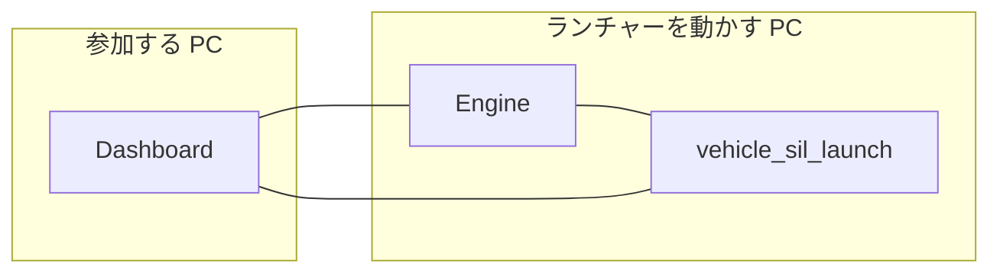

# 複数の PC で動かす

[English](../../howto/multi-pc.md)

1 つのシミュレーションを 2 台の PC に分けて動かす手順です。1 台で `vehicle_sil_launch`（以下、ランチャー）を動かし、もう 1 台で起動した ECU をそのシミュレーションに参加させます。後半で、ほかの PC から Control API と GUI を使う方法も説明します。

> [!WARNING]
> **SIL Kit には認証がありません。** registry（参加するプロセスどうしを引き合わせる SIL Kit のサーバー）に接続できる人は、誰でもシミュレーションに参加でき、ECU の変数にも書き込めます。閉じたネットワークで使います。

## 前提

| 必要なもの | 条件 |
|---|---|
| PC | 同じ閉じたネットワークにある 2 台です。 |
| ビルド | 2 台とも、[README](../../../README.ja.md#リポジトリからビルドする) の「リポジトリからビルドする」のとおりにビルドしてあります。 |
| ランチャーを動かす PC のアドレス | この文書では `192.0.2.10` と書きます。自分の PC のアドレスに読み替えます。 |

2 台とも、リポジトリのルートで次の 2 行を実行し、これ以降のコマンドをそのディレクトリ（`simulation.yaml` のある所）で実行します。

```sh
export PATH="$PWD/build/linux-gcc-control/tools/launch:$PATH"
cd build/linux-gcc-control/examples/ecu_main
```

コマンドは Linux のものです。Windows で変わる所は「Windows で変わること」の表にあります。テンプレートのプロジェクトで試すときは、次の表のように読み替えます。

| もの | この文書（リポジトリのビルド） | テンプレートのプロジェクト |
|---|---|---|
| 実行するディレクトリ | `build/linux-gcc-control/examples/ecu_main` | プロジェクトのディレクトリ |
| `vehicle_sil_launch` のある所 | `build/linux-gcc-control/tools/launch` | `tools/vehicle-sil-tools-<version>-linux-x86_64/bin` |
| ECU の実行ファイル | `engine/vehicle_sil_engine_ecu`、`dashboard/vehicle_sil_dashboard_ecu` | `bin/engine_ecu`、`bin/dashboard_ecu` |
| 設定ファイル | `simulation.two-pcs.yaml` | `simulation.yaml` をコピーし、手順 1 の表の 2 つのキーを追加したもの |
| GUI サーバーの起動 | リポジトリのルートで `scripts/run-gui.py` | `vehicle-sil-gui simulation.yaml` |

## 配置

この文書の例では、エンジンの ECU（`Engine`）をランチャーと同じ PC で、表示の ECU（`Dashboard`）をもう 1 台の PC で動かします。図の線は、TCP で接続することを表します。



| 図の箱 | 動かす方法 | 接続する相手 |
|---|---|---|
| `vehicle_sil_launch` | 手順 2 の `run` で起動します。 | registry を自分の中で動かし、ほかの 2 つからの接続を待ち受けます。 |
| `Engine` | ランチャーが起動します。 | 同じ PC の registry に接続します。 |
| `Dashboard` | 参加する PC で、手順 3 のコマンドで起動します。 | `--registry-uri` で指定した registry に接続し、続けて `Engine` にも接続します。 |

## 全体の流れ

| 手順 | PC | すること | できるもの |
|---|---|---|---|
| 1 | ランチャーを動かす PC | 設定ファイルを照合する | ネットワークで待ち受けることを通知する `check` の出力 |
| 2 | ランチャーを動かす PC | `run` を起動する | ほかの PC から参加するための URI |
| 3 | 参加する PC | ほかの PC から参加する | 2 台にまたがって進むシミュレーション |
| 4 | ランチャーを動かす PC | 結果を確認する | 2 つの ECU がどう終わったかを示す表 |

手順 1〜4 は順に進めます。その後の節は、必要になったときに読みます。

| したいこと | 読む節 |
|---|---|
| 参加する ECU が待ち受けるポートを決める | 決まったポートで待ち受ける |
| Windows で動かす | Windows で変わること |
| ほかの PC の Python から値を読み書きする | ほかの PC から Control API を使う |
| ほかの PC のブラウザで画面を開く | ほかの PC のブラウザで GUI を開く |

## 手順 1: 設定ファイルを照合する

ランチャーを動かす PC で作業します。使う設定ファイルは `simulation.two-pcs.yaml` で、ビルドしたディレクトリにあります。先頭のコメントを除いた内容は、次のとおりです。

<!-- examples/ecu_main/simulation.two-pcs.yaml -->
```yaml
vehicle_sil_simulation: 2

registry_uri: silkit://0.0.0.0:8500
networks:
  - name: J1939_CAN
    kind: can
participants:
  - name: Engine
    command: [engine/vehicle_sil_engine_ecu]
    step_ms: 10
  - name: Dashboard
    command: [dashboard/vehicle_sil_dashboard_ecu]
    step_ms: 5
    manual: true
```

1 台で動かす `simulation.yaml` との違いは、次の 2 つのキーです。

| キー | 意味 |
|---|---|
| `registry_uri: silkit://0.0.0.0:8500` | registry が、この PC のすべてのアドレスのポート 8500 で待ち受けます。 |
| `manual: true` | `run` はその ECU を起動せず、参加するまで待ちます。 |

`registry_uri` には、`silkit://192.0.2.10:8500` のように、この PC のアドレスを 1 つ書いてもかまいません。`manual: true` は、設定ファイルに書く代わりに、`run --manual Dashboard` でも指定できます。

`Dashboard` の実行ファイルは、ランチャーを動かす PC にも置いておきます。`check` と `run` が、その実行ファイルを `--describe` を付けて実行し、設定ファイルと照合するためです。

設定ファイルを照合します。

```sh
vehicle_sil_launch check simulation.two-pcs.yaml
```

### 確認

最後の行が `passed:` で、`note:` が 2 行あれば成功です。終了コードは 0 です。

<!-- multi-pc guide: check simulation.two-pcs.yaml -->
```text
simulation.two-pcs.yaml: 2 participants, 1 network

participant  step   networks
Engine       10 ms  J1939_CAN (j1939 0x00)
Dashboard    5 ms   J1939_CAN (j1939 0x28)

network    kind  participants
J1939_CAN  can   Engine, Dashboard

note: simulation.two-pcs.yaml:10: registry_uri silkit://0.0.0.0:8500 is not a loopback address: the registry and the participants listen on the network, where anyone who reaches this computer can join the simulation (SIL Kit does not authenticate); run gives the participants it starts VEHICLE_SIL_LISTEN_ON_NETWORK=1 and shows it with the command of a participant you start yourself: set it for every participant on this computer that connects to the registry at a loopback address; to keep the simulation on this computer, use 127.0.0.1 or leave registry_uri out [registry-on-network]
note: simulation.two-pcs.yaml:18: participant 'Dashboard': you start it yourself (manual: true, or --manual): run does not start it, but prints the command to start it with, and waits for it to join without a time limit (with --timeout-ms, at most that long); start it with VEHICLE_SIL_LISTEN_ON_NETWORK=1 in its environment, so that the other computers reach it (registry_uri is not a loopback address) [participant-manual]

passed: 0 errors, 0 warnings, 2 notes
```

`note:` の行の末尾の `[...]` は、その注記のコードです。

| コード | 通知していること |
|---|---|
| `registry-on-network` | registry と ECU がネットワークで待ち受けることと、SIL Kit に認証がないことです。 |
| `participant-manual` | `Dashboard` を `run` が起動せず、参加するまで時間の制限なく待つことです。 |

どちらの注記にもある環境変数 `VEHICLE_SIL_LISTEN_ON_NETWORK=1` は、`Dashboard` をランチャーと同じ PC で起動するときに設定するものです。ほかの PC で起動するこの手順では、設定しません。

## 手順 2: `run` を起動する

ランチャーを動かす PC で、次のコマンドを実行します。

```sh
vehicle_sil_launch run simulation.two-pcs.yaml --stop-at-ms 1000
```

Windows では、ファイアウォールの許可が必要です（「Windows で変わること」）。

### 確認

標準エラーに次の行を表示し、`waiting for Dashboard to join` の行で待ちます。`/home/you/vehicle-sil/.../ecu_main` と書いた所には、実行したディレクトリの絶対パスが表示されます。

```text
[vehicle_sil_launch] registry at silkit://127.0.0.1:8500
[vehicle_sil_launch] from other computers, join at silkit://192.0.2.10:8500 (this computer's address): give it as --registry-uri to a participant started by hand on another computer (instead of the loopback address in its command; it needs no VEHICLE_SIL_LISTEN_ON_NETWORK)
[vehicle_sil_launch] starting Engine: /home/you/vehicle-sil/.../ecu_main/engine/vehicle_sil_engine_ecu --name Engine --registry-uri silkit://127.0.0.1:8500 --start-timeout-ms 1000000000000
[vehicle_sil_launch] not starting Dashboard: start it yourself (manual: true, or --manual); the simulation waits for it to join. In the directory /home/you/vehicle-sil/.../ecu_main, with VEHICLE_SIL_LISTEN_ON_NETWORK=1 in its environment, run:
[vehicle_sil_launch]   /home/you/vehicle-sil/.../ecu_main/dashboard/vehicle_sil_dashboard_ecu --name Dashboard --registry-uri silkit://127.0.0.1:8500 --start-timeout-ms 1000000000000
[vehicle_sil_launch] waiting for Dashboard to join (manual): start it with the command above; Ctrl+C stops the run
```

| 行 | 読み取ること |
|---|---|
| `from other computers, join at silkit://192.0.2.10:8500` | ほかの PC から参加するときの URI です。手順 3 で `--registry-uri` に指定します。 |
| `not starting Dashboard: ...` と次の行 | この PC で `Dashboard` を起動するときのコマンドです。ほかの PC で起動するときは、`--registry-uri` を上の URI に変えます。 |
| `waiting for Dashboard to join (manual)` | `Dashboard` が参加するのを待っています。 |

`registry_uri` が `0.0.0.0` のとき、ランチャーは `join at` の後に、この PC の動いているネットワークの IPv4 アドレスを並べます。アドレスが 2 つ以上あるときの選び方は、次のとおりです。

| 表示 | 選び方 |
|---|---|
| 先頭のアドレス | 既定の経路のあるネットワークのアドレスで、ふつうは相手と同じ LAN のものです。ほかにもアドレスがあれば、ランチャーは先頭がそれだと書き添えます。 |
| `172.x.x.x` などのアドレス | WSL、Docker、仮想マシンの仮想のネットワークのアドレスは、ほかの PC から接続できないことが多いので、相手と同じ LAN のアドレスを選びます。 |

### うまくいかないとき

| 症状 | 原因 | 直し方 |
|---|---|---|
| `the registry cannot listen at silkit://...: ... (does another registry run there? ...)` と表示して、終了コード 3 で終わる | そのポートを、別のプログラムか別の `run` が使っています。 | `registry_uri` のポートを変えるか、別の `run` を終了させます。ほかの PC はそのポートにつなぐので、ポートは決まった値にします。 |
| `the registry cannot listen at silkit://...: ... (<アドレス> is not an address of this computer ...)` と表示して、終了コード 3 で終わる | `registry_uri` に、ほかの PC のアドレスを書いています。registry は、`run` を動かす PC で待ち受けます。 | メッセージが挙げるアドレスのどれか、または `0.0.0.0` を書きます。 |

## 手順 3: ほかの PC から参加する

参加する PC で作業します。ランチャーが `waiting for Dashboard to join` を表示した後に、次のコマンドで `Dashboard` を起動します。

```sh
dashboard/vehicle_sil_dashboard_ecu --name Dashboard --registry-uri silkit://192.0.2.10:8500 --start-timeout-ms 1000000000000
```

| 引数 | 意味 |
|---|---|
| `--name Dashboard` | 設定ファイルの `name` と、大文字と小文字も含めて同じにします。 |
| `--registry-uri silkit://192.0.2.10:8500` | 手順 2 で `join at` の後に表示された URI です。 |
| `--start-timeout-ms 1000000000000` | シミュレーションの開始を待つ時間の上限です。ランチャーが表示するコマンドと同じ値で、実質的に制限なく待ちます。 |

環境変数 `VEHICLE_SIL_LISTEN_ON_NETWORK` は設定しません。ループバックでないアドレスの registry に接続する ECU は、設定しなくても、すべてのアドレスで待ち受けます。

参加する PC のファイアウォールの許可は、確認している構成では、Windows の仮想マシンでも不要でした。ECU のほうから、ランチャーを動かす PC に接続するためです。

### 確認

必須の ECU がそろうと、シミュレーションが始まります。`Dashboard` は標準出力に次の 3 行を表示し、シミュレーションが終わると、終了コード 0 で自分から終わります。

```text
t=0 ms engine speed 0 rpm (0 messages)
t=500 ms engine speed 1200 rpm (5 messages)
t=1000 ms engine speed 1200 rpm (10 messages)
```

`engine speed 1200 rpm` は、もう 1 台の PC の `Engine` が CAN で送信した回転数を、`Dashboard` が受信したことを表します。

### うまくいかないとき

どの行も、参加する PC の `Dashboard` が終了コード 3 で終わるか、ランチャーが標準エラーに表示する症状です。

| 症状 | 原因 | 直し方 |
|---|---|---|
| ECU がすぐに終わり、`cannot join the simulation at ...: ... Failed to connect to SIL Kit Registry` と表示する | ランチャーがまだ動いていないか、アドレスかポートが違います。 | ランチャーを先に起動し、`join at` の後の URI を指定します。 |
| ECU が約 5 秒後に終わり、`Timeout during connection handshake ...` と表示する | ランチャーを動かす PC のファイアウォールが、接続を止めています。 | 「Windows で変わること」の `netsh` の 1 行を実行します。 |
| ECU が約 5 秒後に終わり、`... already exists ... (the registry refused the name "<名前>" for 5000 ms: ...)` と表示する | 同じ名前の participant が、すでに参加しています。 | `--name` を確認します。 |
| ランチャーが `participant 'x' joined the simulation, but this run has no participant of that name (...)` と表示する | `--name` が、設定ファイルの名前と違います。 | その ECU を Ctrl+C で止め、設定ファイルの名前で起動し直します。 |

2 行目の `Timeout during connection handshake` は SIL Kit のメッセージで、同じ名前の participant を疑う文が続きます。ポートを転送した構成で、ファイアウォールが接続を止めたときに表示されました。3 行目は、同じ名前ですぐに起動し直しただけのときにも表示されます。ECU は、registry に名前を断られている間、5 秒まで参加をやり直します（`--start-timeout-ms` がそれより短ければ、その時間まで）。その間に registry が前の participant の終わりを知れば、そのまま参加できます。4 行目の、名前を間違えた ECU は、シミュレーションが始まらないまま待ち続けます。

## 手順 4: 結果を確認する

シミュレーションは、仮想時間の 1000 ms で終わります。ランチャーは、標準出力の最後に次の結果を表示し、終了コード 0 で終わります。

```text
run: the simulation ran to stop_at_ms (1000 ms) and ended

participant  required  ended
Engine       yes       exit code 0
Dashboard    yes       started by you (manual)

traffic: J1939_CAN: 1 participant sent, 1 received (2 counted) (steps before 1000 ms)

network    participant  sent  received
J1939_CAN  Engine         11         0
J1939_CAN  Dashboard       0        11

passed: 0 errors, 0 warnings, 2 notes
```

`Dashboard` の `started by you (manual)` は、自分で起動した ECU がシミュレーションに参加したことを表します。どう終わったかはランチャーにはわからないので、終了コードは参加する PC の側で確認します。

途中で止めるときは、1 台のときと同じで、ランチャーを Ctrl+C で止めるか、`stop` のコマンドを送ります。参加した ECU も、シミュレーションが終われば自分から終わります。

### うまくいかないとき

| 症状 | 原因 | 直し方 |
|---|---|---|
| ランチャーが終わった後も、参加した ECU が残る | ランチャーが強制終了（クラッシュ、電源断、SIGKILL）されると、ECU は待ち続けます。 | ECU を Ctrl+C で止めます。 |
| ランチャーが `virtual time has not advanced for 10 s ...` と表示する | ネットワークが切れたか、デバッガーで止めているか、ECU がステップの中で固まっています。 | ネットワークを戻すか、デバッガーで止めたプロセスを進めるか、ステップの中で固まった ECU を探します。戻れば、止まった所から続きます（`virtual time advances again`）。 |
| 参加のたびに 5 秒ほどかかる | ランチャーを動かす PC の ECU に、相手から直接接続できません（ファイアウォールの許可がランチャーだけ、または NAT）。 | そのままにするか、その PC の ECU の実行ファイルもファイアウォールで許可します。 |

SIL Kit は、切れた接続に長い間気づきません。Linux では十数分かかります。仮想時間が止まったまま待たないなら、ランチャーを Ctrl+C で止めます。人が見ていない実行には、`run` に `--timeout-ms` を付けます。

## 決まったポートで待ち受ける

ファイアウォールやポートの転送のために、参加する ECU が待ち受けるポートを決めたいときは、SIL Kit の設定ファイルを `--silkit-config` で渡します。接続を試す回数も、同じファイルで増やせます。

`dashboard.silkit.yaml` に次の内容を書きます。

```yaml
Middleware:
  AcceptorUris: ["tcp://0.0.0.0:8601"]
  ConnectAttempts: 5
```

手順 3 のコマンドに、`--silkit-config` を追加して起動します。

```sh
dashboard/vehicle_sil_dashboard_ecu --name Dashboard --registry-uri silkit://192.0.2.10:8500 --start-timeout-ms 1000000000000 --silkit-config dashboard.silkit.yaml
```

確認することは手順 3 と同じです。ファイルに書いていない設定は、既定のままです。ルールは [ecu-executable.md](../ecu-executable.md) の「SIL Kit の設定ファイルを渡す」にあります。

## Windows で変わること

手順は同じです。変わるのは次の所です。

| もの | Linux | Windows |
|---|---|---|
| ビルドとシェル | README の「リポジトリからビルドする」 | [build.md](../build.md) の「Windows（MSYS2 UCRT64）」 |
| 実行ファイルの名前 | `vehicle_sil_launch`、`vehicle_sil_dashboard_ecu` | 末尾に `.exe` が付きます。 |
| ランチャーを動かす PC のファイアウォール | firewalld などでは確認していません。 | `vehicle_sil_launch.exe` を 1 回許可します。 |
| `openssl` | あります。 | MSYS2 と Git for Windows にあります。 |
| Python の起動 | `python3` | `python` |
| GUI サーバーを動かす PC の SSH のサーバー | 必要です。 | OpenSSH Server の機能を使います。 |

### ファイアウォールの許可

Windows でランチャーを動かすときは、ファイアウォールに `vehicle_sil_launch.exe` を 1 回許可します。確認の画面が表示されたら、許可します。表示されないとき、または許可しなかったときは、管理者のコマンドプロンプトで次の 1 行を実行します。パスは自分のものに変えます。

```bat
netsh advfirewall firewall add rule name="vehicle-sil launch" dir=in action=allow program="C:\vehicle-sil\bin\vehicle_sil_launch.exe" enable=yes
```

| 状態 | 起きること |
|---|---|
| `vehicle_sil_launch.exe` の許可がない | 参加する ECU が、約 5 秒で失敗します（手順 3 の表の 2 行目）。 |
| ランチャーが起動する ECU（`Engine` など）の許可がない | 動きますが、参加のたびに 5 秒ほど余計にかかります。 |

ランチャーが起動する ECU の許可は、必須ではありません。許可がないと、参加する ECU からの直接の接続は約 5 秒で打ち切られ、ランチャーを動かす PC の側から相手に接続し直します。ランチャーを動かす PC が NAT の内側にあり、相手から接続できるのが転送したポートだけのときも、同じです。

## ほかの PC から Control API を使う

ランチャーの Control Server を、ほかの PC から接続できるアドレスで開きます。そのアドレスでは、TLS と認証情報が必要です。ルールは [control-api.md](../control-api.md) の「認証」にあります。

次の 1 と 2 はランチャーを動かす PC で、3 はクライアントの PC で作業します。

1. 証明書を作ります。`subjectAltName` には、クライアントが接続するアドレスを書きます。

   ```sh
   openssl req -x509 -newkey ec -pkeyopt ec_paramgen_curve:prime256v1 -nodes -days 30 -subj "/CN=vehicle-sil" \
     -addext "subjectAltName=IP:192.0.2.10" -keyout server.key -out server.crt
   ```

   `server.key`（鍵）と `server.crt`（証明書）ができます。

2. 認証情報のファイル `credentials.txt` を作り、`run` に渡します。ファイルは 1 行に 1 つで、`<role> <name> <token>` の形です。`role` は `viewer`、`operator`、`admin` のどれかで、トークンは 16 文字以上の秘密の文字列です。次の 1 行は、乱数のトークンで `admin` の行を作ります。

   ```sh
   python3 -c "import secrets; print('admin', 'lead', secrets.token_hex(16))" > credentials.txt
   ```

   ```sh
   vehicle_sil_launch run simulation.live.yaml --control 0.0.0.0:8510 --control-tls-cert server.crt --control-tls-key server.key --control-credentials credentials.txt
   ```

   `simulation.live.yaml` は、同じ 2 つの ECU を、止めるまで動かし続ける設定ファイルです。ランチャーは、標準エラーに `[vehicle_sil_launch] control server at 0.0.0.0:8510` と表示します。`0.0.0.0` は、この PC のアドレスに読み替えます。

3. クライアントの PC に、`server.crt` とトークンを渡します。鍵（`server.key`）は渡しません。トークンは `credentials.txt` の 3 つ目の語で、クライアントの PC では `token.txt` に保存します。`list_peers.py` に次の内容を書きます。

   ```python
   from vehicle_sil_control import Control

   token = open("token.txt").read().strip()
   with Control("192.0.2.10:8510", token=token, root_certificates=open("server.crt", "rb").read()) as c:
       print(sorted(p.participant for p in c.peers()))
   ```

   どの PC でも、ランチャーと同じ vehicle-sil のリリースの `vehicle_sil_control` を使います（クライアントは、別のリリースのランチャーを最初の呼び出しで断ります）。[control-api.md](../control-api.md) の「Python」のコマンドでクライアントを準備したシェルで、実行します。

   ```sh
   python list_peers.py
   ```

### 確認

設定ファイルの participant の名前を表示すれば、接続できています。

```text
['Dashboard', 'Engine']
```

### うまくいかないとき

| クライアントのエラー | 原因 |
|---|---|
| `Hostname Verification Check failed` | 証明書の `subjectAltName` に、接続したアドレスがありません。 |
| `CERTIFICATE_VERIFY_FAILED` | クライアントに渡した証明書が、サーバーのものと違います。 |
| `Connection refused` | ポートが違うか、ランチャーが動いていません。 |
| `UNAUTHENTICATED: a valid token is required` | トークンが、`credentials.txt` のものと違います。 |

## ほかの PC のブラウザで GUI を開く

GUI サーバーは、127.0.0.1 だけで待ち受けます。ほかの PC からは、SSH のポート転送を使って開きます。GUI サーバーを動かす PC に、SSH のサーバーが必要です。

1. GUI サーバーを動かす PC で、ポートを決めて起動します。リポジトリのルートで、次のコマンドを実行します。

   ```sh
   scripts/run-gui.py --port 8765 --no-browser
   ```

   テンプレートのプロジェクトでは、`vehicle-sil-gui --port 8765 --no-browser simulation.yaml` です。表示された URL を、ブラウザを開く PC に伝えます。

   ```text
   http://127.0.0.1:8765/#token=...
   vehicle-sil-gui: open the URL above (it has the token); Ctrl+C stops the server
   ```

2. ブラウザを開く PC で、**同じポート番号**で転送します。

   ```sh
   ssh -L 8765:127.0.0.1:8765 <ユーザー>@<GUI サーバーを動かす PC>
   ```

3. その PC のブラウザで、伝えられた URL を開きます。

### うまくいかないとき

| 症状 | 原因 | 直し方 |
|---|---|---|
| ブラウザに 403 が表示される | GUI サーバーは、`Host` が `127.0.0.1:<自分のポート>` のリクエストだけを受け付けます。 | GUI サーバーと同じポート番号で転送します。 |

GUI サーバーが待ち受けるアドレスと受け付けるリクエストのルールは、[gui.md](../gui.md) にあります。

## 速度

ステップごとに、PC の間を往復する時間がかかります。

| 実行 | 影響 |
|---|---|
| 最速で動かす（`--speed` を指定しない） | 1 台で動かすより遅くなります。 |
| 速度を指定する（`--speed 1` など） | 往復の時間が、1 ステップに使える実時間より十分短ければ、影響しません。 |

遅れは、結果の `time:` の行に表示されます。

## 確認している構成

| 構成 | 確認 |
|---|---|
| Linux 2 台 | ネットワーク名前空間で作った 2 台で、自動のテスト `multi_host.two_hosts` が確認しています。 |
| Linux と Windows | Windows は仮想マシンで、NAT の内側にあり、片方向にしか接続できない構成です。どちらの側でランチャーを動かす場合も確認しています。 |
| SSH での GUI の転送 | 転送の形は確認しています。ssh そのものでは確認していません。 |
| 本物の 2 台の PC の LAN、Windows 同士、VPN、拠点をまたぐネットワーク、3 台以上 | 確認していません。 |
| Linux のファイアウォール（firewalld など） | 確認していません。 |

## 次に読むもの

- `manual` の ECU の待ち方と止め方のルールを調べる → [simulation-config.md](../simulation-config.md) の「participant を自分で起動する」
- どのアドレスで待ち受けるかのルールと、`VEHICLE_SIL_LISTEN_ON_NETWORK` を調べる → [simulation-run.md](../simulation-run.md) の「待ち受けるアドレス」
- 設定ファイル、`check`、`run` の使い方に戻る → [複数の ECU をつないで動かす](integrate-ecus.md)
