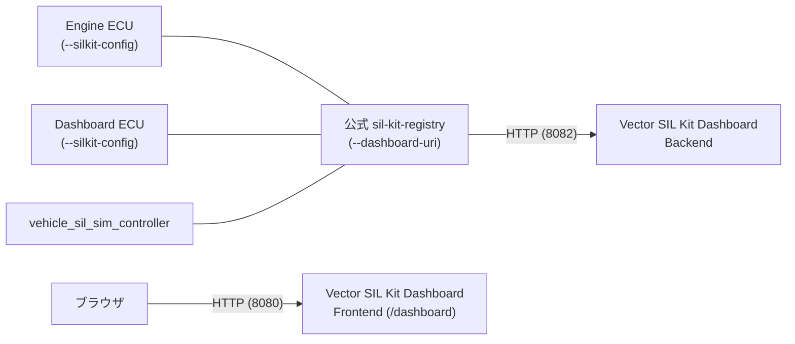

# Vector SIL Kit Dashboard でシミュレーションを観測する

[English](../../howto/vector-dashboard.md)

既存の ECU 実行ファイル、`vehicle_sil_sim_controller`、および Vector 公式の `sil-kit-registry` を使って、vehicle-sil のシミュレーションを [Vector SIL Kit Dashboard](https://vector.com/sil-kit-dashboard) で観測する手順です。vehicle-sil 自体に変更を加えずに、Dashboard のブラウザ画面で participant の状態遷移、CAN ネットワーク構成、SIL Kit の Remote Metrics を確認できます。

> [!NOTE]
> vehicle-sil は Vector SIL Kit Dashboard や Vector 公式 SIL Kit SDK のバイナリを同梱せず、CI でも Dashboard に依存しません。どちらも各自のライセンスのもとで Vector から別途入手してください。

## 別途、公式の `sil-kit-registry` が必要な理由

vehicle-sil のビルドで作られる `sil-kit-registry` は `SILKIT_BUILD_DASHBOARD=OFF`（`cmake/VehicleSilDependencies.cmake`）でコンパイルされているため、`--dashboard-uri` を無視します。また、`vehicle_sil_launch run` も Dashboard 非対応のプロセス内 registry を起動します。

Vector SIL Kit Dashboard へシミュレーションの情報を送るには、Vector 公式の `sil-kit-registry`（`--dashboard-uri` または registry 設定ファイル指定）を別に起動し、各 ECU と `vehicle_sil_sim_controller` を `--registry-uri` で接続します。



この構成では vehicle-sil のパッチ済み registry の代わりに公式の上流バイナリを使うため、registry プロセス側には vehicle-sil の 2 つの registry パッチ（[dependencies.md](../dependencies.md#利用側が-silkitsilkit-を定義しているとき) の「利用側が `SilKit::SilKit` を定義しているとき」にある `0003` と `0005`）は適用されません。

## 前提と入手先

| 必要なもの | バージョン（確認済み） | 入手先 | 補足 |
|---|---|---|---|
| vehicle-sil のビルド | このリポジトリの最新版 | [README](../../../README.ja.md#リポジトリからビルドする) の「リポジトリからビルドする」のとおりにビルド | `vehicle_sil_sim_controller`、`vehicle_sil_engine_ecu`、`vehicle_sil_dashboard_ecu` を使います。 |
| Vector SIL Kit SDK（`sil-kit-registry`） | `v5.0.8` | [SIL Kit GitHub Releases](https://github.com/vectorgrp/sil-kit/releases/tag/v5.0.8)（Linux x86_64 は `SilKit-5.0.8-ubuntu-24.04-x86_64-gcc.zip`） | 展開すると `SilKit/bin/sil-kit-registry` に実行ファイルがあります。 |
| Vector SIL Kit Dashboard | `1.3.1` | [Vector SIL Kit 製品ページ](https://www.vector.com/en/product/sil-kit/) または [`vector.com/sil-kit-dashboard`](https://vector.com/sil-kit-dashboard) | Vector Free Software License のクローズドソース・フリーウェアです。Vector のダウンロードセンターでフォーム送信が必要です。 |
| ASP.NET Core Runtime（Linux ポータブル版） | `10.0`（`10.0.15` で確認） | [Microsoft .NET 10 ダウンロード](https://dotnet.microsoft.com/en-us/download/dotnet/10.0)（`aspnetcore-runtime-10.0.x-linux-x64.tar.gz`） | Linux で Dashboard 1.3.1 のポータブル版を動かすのに必要です（ローカルディレクトリへ展開すれば root 権限は不要です）。 |

Vector のパッケージ文書による互換性情報です。

- Vector SIL Kit Dashboard 1.3.1 は SIL Kit 4.0.51 以上に対応しています。
- Attributes および Metrics 機能には SIL Kit 5.0.2 以上が必要です。

以降の手順で使うパスをシェル変数に設定します（プリセット名やディレクトリは自分の環境に合わせて読み替えてください）。

```sh
REPO=/path/to/vehicle-sil
BUILD="$REPO/build/linux-gcc-release"          # または build/linux-gcc-control
SILKIT_REG=/path/to/SilKit-5.0.8-ubuntu-24.04-x86_64-gcc/SilKit/bin/sil-kit-registry
DASHBOARD_DIR=/path/to/vector-sil-kit-dashboard-1.3.1  # SILKitDashboard.Backend.dll があるディレクトリ
DOTNET_ROOT="$HOME/tools/dotnet-10"            # aspnetcore-runtime-10.0.x を展開したディレクトリ
```

> [!NOTE]
> `vehicle_sil_sim_controller` はビルド済みのツールアーカイブには含まれません。このリポジトリのビルドでは `build/<preset>/tools/sim_controller/` に置かれます。`template/` のような FetchContent プロジェクトでは明示的にビルドしてください（`--target vehicle_sil_sim_controller`）。

## 全体の流れ

| 手順 | すること | できるもの |
|---|---|---|
| 1 | Vector SIL Kit Dashboard（ポータブル版）を起動する | `http://localhost:8080/dashboard`（画面）と `http://localhost:8082`（受信用） |
| 2 | 公式の `sil-kit-registry` を `--dashboard-uri` 付きで起動する | `silkit://127.0.0.1:8500` で待ち受け、Dashboard へ送信する registry |
| 3 | Remote Metrics とペーシング用の `--silkit-config` ファイルを書く | `engine_metrics.yaml` と `dashboard_metrics.yaml` |
| 4 | ECU と `vehicle_sil_sim_controller` を実行する | J1939 CAN 通信と Remote Metrics を伴う 10 秒間の等速実行 |
| 5 | Dashboard のブラウザ画面で結果を見る | participant の状態遷移、`J1939_CAN` トポロジ、Metrics グラフ |

手順 1〜5 は順に進めます。「手順 1」〜「手順 5」はこのガイドの段階を指し、それ以外の箇所の「ステップ」はシミュレーションのステップを指します。

## 手順 1: Vector SIL Kit Dashboard（ポータブル版）を起動する

ダウンロードした `vector-sil-kit-dashboard-1.3.1.zip` には、次の 3 種類の配布物が入っています。

- `portable/vector-sil-kit-dashboard-1.3.1.zip`（クロスプラットフォームのフレームワーク依存バイナリ。root 権限不要）
- `linux-x64/*.deb`（Ubuntu 向けパッケージ）
- `win-x64/*.msi`（Windows 向けインストーラー）

Fedora 44（`.deb` パッケージが使えず、既定で .NET 10 が入っていない環境）では、`portable/vector-sil-kit-dashboard-1.3.1.zip` を展開し（展開先にトップレベルの `vector-sil-kit-dashboard-1.3.1/` ディレクトリが作られ、その中に `SILKitDashboard.Backend.dll` が入ります。このディレクトリを `$DASHBOARD_DIR` に指定します）、`aspnetcore-runtime-10.0.x-linux-x64.tar.gz` を `$DOTNET_ROOT` に展開したうえで、端末 1 で Dashboard を起動します。

```sh
export DOTNET_ROOT="$HOME/tools/dotnet-10"
cd "$DASHBOARD_DIR"
"$DOTNET_ROOT/dotnet" SILKitDashboard.Backend.dll
```

システムに ASP.NET Core Runtime 10.0 がすでに入っている場合は、`dotnet SILKitDashboard.Backend.dll` で起動できます。

### Dashboard の起動を確認する

起動すると、有効な機能、URL、SQLite データベースの保存先、ログファイルの場所が表示されます。

```text
================================================================================
== SIL Kit Dashboard v1.3.1
== Copyright © 2025 Vector Informatik GmbH.
== All rights reserved.
================================================================================

 Features:  AttributesAndMetrics
 Dashboard: http://localhost:8080
 Frontend:  http://localhost:8080
 Backend:   http://localhost:8082/system-service
 Database:  /home/you/.local/share/sil-kit-dashboard/database/Simulation.db
 Log file:  /home/you/.local/share/sil-kit-dashboard/logs/sil-kit-dashboard_....log

================================================================================
Press Ctrl+C to shut down.
```

HTTP のヘルスチェックでも起動を確認できます。

```sh
curl -s http://localhost:8080/actuator/health
```

正常に起動していれば HTTP 200 で `"status":"UP"` が返ります。

### ブラウザ URL と Registry 送信先の違い

Dashboard は既定で 2 つの HTTP エンドポイントを開きます。用途を混同しないでください。

| エンドポイント | 既定の URL | 使う側 | 補足 |
|---|---|---|---|
| ブラウザ UI（Frontend） | `http://localhost:8080/dashboard` | Web ブラウザ | 起動バナーには `Frontend: http://localhost:8080` と出ます。`/` でも `/dashboard` でも UI を開けます。 |
| テレメトリ受信（Backend） | `http://localhost:8082` | `sil-kit-registry`（`--dashboard-uri` または `DashboardUri`） | `/system-service` を**付けず**に `http://localhost:8082` を渡します（registry 側で `/system-service/v1.0/...` や `/v1.1/...` を付与します）。SIL Kit v5.0.8 は平文の `http://` のみ対応で、`https://` は受け付けません。 |

> [!IMPORTANT]
> Dashboard の既定の `appsettings.json` は `"AllowedHosts": "localhost"` です。`--dashboard-uri` には `http://127.0.0.1:8082` ではなく `http://localhost:8082` を、ブラウザには `http://localhost:8080/dashboard` を使ってください。`Host: 127.0.0.1:...` で送られたリクエストは、`appsettings.Production.json` に `"AllowedHosts": "localhost;127.0.0.1"` を書く（または環境変数 `AllowedHosts='localhost;127.0.0.1'` を渡す）まで HTTP 400 で拒否されます。

8080 や 8082 が使用中のときにポートを変えたい場合や、`appsettings.json` を書き換えずに SQLite データベースとログの保存先を分けたい場合は、ASP.NET Core の環境変数を付けて起動します。

```sh
XDG_DATA_HOME=/tmp/silkit-dash-data \
Kestrel__Endpoints__Frontend__Url=http://localhost:18080 \
Kestrel__Endpoints__Backend__Url=http://localhost:18082 \
Frontend__BaseUri=http://localhost:18080 \
"$DOTNET_ROOT/dotnet" SILKitDashboard.Backend.dll
```

## 手順 2: 公式の `sil-kit-registry` を起動する

端末 2 で、Vector 公式の `sil-kit-registry` v5.0.8 を Dashboard の Backend URL（`http://localhost:8082`）に向けて起動します。

```sh
"$SILKIT_REG" --listen-uri silkit://127.0.0.1:8500 --dashboard-uri http://localhost:8082
```

コマンドライン引数の代わりに、registry 設定ファイル（`registry.yaml`）に書いて `--registry-configuration` で渡すこともできます。

```yaml
ListenUri: silkit://127.0.0.1:8500
DashboardUri: http://localhost:8082
```

```sh
"$SILKIT_REG" --registry-configuration registry.yaml
```

`sil-kit-registry` に関する注意点です。

- SIL Kit v5.0.8 では `--dashboard-uri`（または `DashboardUri:`）の指定だけで Dashboard 送信が有効になります。Vector の Dashboard README には `--enable-dashboard` の記載がありますが、v5.0.8 の `sil-kit-registry --help` にはこのオプションはありません。
- `sil-kit-registry` は既定でリモートメトリクス収集（`Experimental.Metrics.CollectFromRemote: true`）を有効にします。
- `SIL Kit Dashboard support is not compiled into this build` と表示された場合は、Vector 公式バイナリではなく vehicle-sil がビルドした `sil-kit-registry` を起動しています。
- **`sil-kit-registry` の標準出力・標準エラーを誰も読まないパイプにつながないでください。** `sil-kit-registry` は既定の `info` レベルで動作し、Remote Metrics 有効時は大量のログを出します。スクリプトやバックグラウンド実行から起動するときは、ログファイルへリダイレクトする（例: `> registry.log 2>&1`）か `--log warn` を指定しないと、OS のパイプバッファが埋まった時点で registry がブロックします。

## 手順 3: Remote Metrics 用の `--silkit-config` ファイルを書く

作業ディレクトリ（例: `/tmp/dashboard-demo`）を作り、SIL Kit の participant 設定ファイルを 2 つ保存します。

`engine_metrics.yaml`:

```yaml
Experimental:
  TimeSynchronization:
    AnimationFactor: 1.0
  Metrics:
    UpdateInterval: 1
    Sinks:
      - Type: Remote
        Name: EngineRemoteMetrics
```

`dashboard_metrics.yaml`:

```yaml
Experimental:
  Metrics:
    UpdateInterval: 1
    Sinks:
      - Type: Remote
        Name: DashboardRemoteMetrics
```

主な設定項目と役割です。

| キー | 設定値 | 理由 |
|---|---|---|
| `Experimental.Metrics.UpdateInterval` | `1`（整数の秒、最小 `1`。先頭の `U` は大文字） | SIL Kit のメトリクスタイマースレッドが registry へ更新を送る間隔です。 |
| `Experimental.Metrics.Sinks[].Type` | `Remote` | participant の属性とメトリクスを SIL Kit 経由で `sil-kit-registry` に送り、Dashboard へ転送します。 |
| `Experimental.TimeSynchronization.AnimationFactor` | `1.0`（`Engine` 側） | 仮想時間を実時間の等速（1 倍）にペーシングします。協調参加する全 participant が仮想時刻を同期するため、1 つの ECU に設定するだけでシミュレーション全体が等速になります。 |

### 実時間で数秒以上実行する必要がある理由

SIL Kit のメトリクスタイマーは、最初の更新を送るまでに実時間で `UpdateInterval` 秒（最小 1 秒）待機し、participant の破棄時に未送信のメトリクスをフラッシュしません。

`AnimationFactor: 1.0` なし（または短い実行）で `vehicle_sil_sim_controller --stop-at-ms 1000` を実行すると、実時間では数ミリ秒で終了してしまい、1 回目の 1 秒タイマーが発火する前に終わるため **Dashboard に Metrics が一切表示されません**（Network Setup と Status History は表示されます）。`AnimationFactor: 1.0` で 5〜10 秒ほど実行するか、`--stop-at-ms` を省いて見終えたタイミングで Ctrl+C で止めると、Dashboard 上で複数のメトリクス点が記録・表示されます。

`--silkit-config` の一般的なルール（検証、vehicle-sil が補う既定値、書いてはいけないキー）は、[ecu-executable.md](../ecu-executable.md#sil-kit-の設定ファイルを渡す--silkit-config) の「SIL Kit の設定ファイルを渡す（`--silkit-config`）」を参照してください。

## 手順 4: ECU と `vehicle_sil_sim_controller` を実行する

端末 3（`engine_metrics.yaml` と `dashboard_metrics.yaml` があるディレクトリ）で、2 つの ECU と `vehicle_sil_sim_controller` を起動します。

```sh
"$BUILD/examples/ecu_main/engine/vehicle_sil_engine_ecu" \
  --registry-uri silkit://127.0.0.1:8500 \
  --silkit-config engine_metrics.yaml &
PID_ENGINE=$!

"$BUILD/examples/ecu_main/dashboard/vehicle_sil_dashboard_ecu" \
  --registry-uri silkit://127.0.0.1:8500 \
  --silkit-config dashboard_metrics.yaml &
PID_DASH=$!

"$BUILD/tools/sim_controller/vehicle_sil_sim_controller" \
  --registry-uri silkit://127.0.0.1:8500 \
  --required Engine,Dashboard \
  --stop-at-ms 10000 \
  --timeout-ms 30000

wait "$PID_ENGINE" "$PID_DASH"
```

10 秒で止めずに対話的に見続けたい場合は、`--stop-at-ms 10000` を省いて起動し、見終えたら Ctrl+C で止めます。

### 実行結果を確認する

`vehicle_sil_sim_controller` は実時間で約 10 秒間動き（`speed=1.000`）、終了コード 0 で終了します。2 つの ECU も自動で終了コード 0 で終わります。

`vehicle_sil_sim_controller` の出力です。

```text
[sim-controller] waiting for Engine,Dashboard
[sim-controller] simulation running
[sim-controller] result sim_ms=10000 wall_us=10000500 speed=1.000
[sim-controller] simulation shut down
```

`vehicle_sil_dashboard_ecu` は、J1939 で受信したエンジン回転数を仮想時間 500 ms ごとに出力します（抜粋）。

```text
t=0 ms engine speed 0 rpm (0 messages)
t=500 ms engine speed 1200 rpm (5 messages)
t=1000 ms engine speed 1200 rpm (10 messages)
...
t=10000 ms engine speed 1200 rpm (100 messages)
```

シミュレーション終了後、1〜2 秒待ってから端末 2 の `sil-kit-registry` を Ctrl+C で止めると、最終的な `stopped` 状態が Dashboard へ確実に送信されます。

## 手順 5: Vector SIL Kit Dashboard で結果を見る

ブラウザで `http://localhost:8080/dashboard` を開きます。**Simulations** 一覧から該当のシミュレーション（`silkit://127.0.0.1:8500/`）を選び、上部ナビゲーションの 3 つの画面を確認します。

| 画面 | 表示される内容 | 補足 |
|---|---|---|
| **Network Setup** | participant（`SimulationController`、`Engine`、`Dashboard`）と、`Engine`・`Dashboard` を結ぶ CAN ネットワーク `J1939_CAN` | `ecu_main` の ECU は既定で `vehicle_sil.control.*` の pub/sub トピックも公開します。グラフを `J1939_CAN` だけに絞りたいときは各 ECU に `--no-control` を渡してください。Remote Metrics が有効な `Engine` や `Dashboard` を選ぶと静的な **Attributes** も表示されます。 |
| **Status History** | 3 つの participant それぞれのライフサイクル遷移（`ServicesCreated` → `CommunicationInitializing` → `CommunicationInitialized` → `ReadyToRun` → `Running` → `Stopping` → `Stopped` → `ShuttingDown` → `Shutdown`） | 正常に `Shutdown` へ到達したか、`Error` に遷移したかを確認できます。 |
| **Metrics** | カウンター（`rx_packets`、`tx_packets`、`rx_bytes`、`tx_bytes`）および統計値（`rx_bandwidth`、`tx_bandwidth`、`tx_queue_size`、`execution_duration`、`waiting_duration`、`completion_duration`）の時系列グラフ | `--silkit-config` を渡した `Engine` と `Dashboard` のメトリクスが表示されます。`vehicle_sil_sim_controller` には `--silkit-config` オプションがないため、自身の Remote Metrics は出力しません。 |

> [!NOTE]
> Vector SIL Kit Dashboard はシミュレーション一覧、ネットワーク構成、状態履歴を SQLite データベース（`Simulation.db`）に永続化しますが、**Attributes と Metrics はメモリ上にのみ保持**します。Dashboard を停止・再起動すると、過去に収集した Metrics グラフは消去されます。

確認が終わったら、`sil-kit-registry`（端末 2 で Ctrl+C）と Dashboard（端末 1 で Ctrl+C）を停止します。

## トラブルシューティング

| 症状 | 原因 | 対処 |
|---|---|---|
| `sil-kit-registry` が `SIL Kit Dashboard support is not compiled into this build` と出力する | vehicle-sil がビルドした `sil-kit-registry`（`SILKIT_BUILD_DASHBOARD=OFF`）を起動している。 | Vector 公式の `sil-kit-registry` v5.0.8 バイナリを起動します。 |
| Dashboard にシミュレーションが表示されず、`sil-kit-registry` に HTTP 400 のログが出る | Dashboard の `AllowedHosts` が `"localhost"` なのに `--dashboard-uri` へ `http://127.0.0.1:8082` を渡した。 | `http://localhost:8082` を使うか、`appsettings.Production.json` に `"AllowedHosts": "localhost;127.0.0.1"` を追加します。 |
| **Network Setup** と **Status History** は出るが **Metrics** が空 | 実行時間が `UpdateInterval`（実時間 1 秒）未満で終わった、`--silkit-config` を渡し忘れた、または実行後に Dashboard を再起動した。 | `AnimationFactor: 1.0` を設定して実時間 5〜10 秒以上実行し、`UpdateInterval`（大文字の `U`）と `Type: Remote` を確認し、Dashboard を再起動する前に Metrics を見ます。 |
| スクリプトから起動したときに途中からシミュレーションが進まなくなる | `sil-kit-registry` の標準出力・標準エラーが誰も読まないパイプにつながっている。 | `sil-kit-registry` の出力をログファイル（または `/dev/null`）へリダイレクトするか、`--log warn` を使います。 |
| `dotnet` が `Microsoft.AspNetCore.App` 10.0 不足で `SILKitDashboard.Backend.dll` を起動できない | ASP.NET Core Runtime 10.0 がない、または `DOTNET_ROOT` が未設定。 | `aspnetcore-runtime-10.0.x-linux-x64.tar.gz` を導入または展開し、そのディレクトリを `DOTNET_ROOT` に設定します。 |
| 終了後も Dashboard 上で `Running` のまま残る | `vehicle_sil_sim_controller` の終了直後に `sil-kit-registry` を止めた。 | `sil-kit-registry` に SIGTERM / Ctrl+C を送る前に 1〜2 秒待ちます。 |

## 確認済み・未確認の環境

| 環境・機能 | 状態 | 補足 |
|---|---|---|
| Fedora Linux 44 x86_64、公式 SIL Kit `v5.0.8`（`SilKit-5.0.8-ubuntu-24.04-x86_64-gcc.zip`）、SIL Kit Dashboard `1.3.1` ポータブル版 + ASP.NET Core Runtime `10.0.15` | 確認済み | `vehicle_sil_engine_ecu`、`vehicle_sil_dashboard_ecu`、`vehicle_sil_sim_controller` でエンドツーエンド確認済み（Dashboard のヘルスチェックと UI、`SimulationController`/`Engine`/`Dashboard` の参加、`J1939_CAN` トポロジ、状態遷移履歴、Remote Metrics の `counters` と `statistics`）。`--dashboard-uri` と `--registry-configuration` の両方、および等速ペーシングなしの 1 秒実行で Metrics が 0 件になることも確認済み。 |
| Ubuntu / Debian の `.deb` パッケージ（`linux-x64`） | 未確認 | Vector のパッケージ付属 `README.md` に従って導入してください。`sil-kit-registry` と ECU の手順は同じです。 |
| Windows（`win-x64` の `.msi` またはポータブル版）および macOS | 未確認 | Windows の `.msi` は ASP.NET Core Runtime を同梱しサービス登録します。vehicle-sil 側の実行ファイル名は `.exe` 付きになります。 |
| ほかの SIL Kit バージョン（4.x や他の 5.x）やほかの Dashboard バージョン | 未確認 | Vector の互換性情報によると、Attributes と Metrics には SIL Kit 5.0.2 以上が必要です。 |
| HTTPS/TLS（`appsettings.ProductionSSL.json`）、別ホストからのアクセス（`AllowedHosts: "*"`）、LDAP/IAM（`IdentityAndAccessManagement: true`） | 未確認 | SIL Kit v5.0.8 の Dashboard クライアントは平文の `http://` のみに対応しています。 |
| `vehicle_sil_launch` や `vehicle-sil-gui` との組み合わせ | このガイドの対象外 | 現在の `vehicle_sil_launch run` は Dashboard 非対応のプロセス内 registry を使います。 |

## 次に読むドキュメント

- `--silkit-config` のルールとランチャーを使わない ECU 起動: [ecu-executable.md](../ecu-executable.md)
- `Peer` と `vehicle_sil_sim_controller` を手動で動かす手順: [peers.md](../peers.md)
- SIL Kit のビルド設定と registry パッチ: [dependencies.md](../dependencies.md)
- vehicle-sil 自身のブラウザ GUI で ECU 変数を観測・操作する手順: [gui.md](../gui.md)
