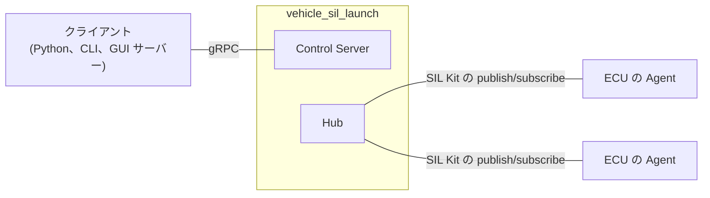
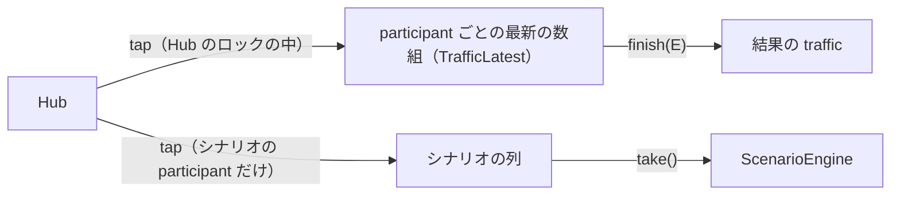
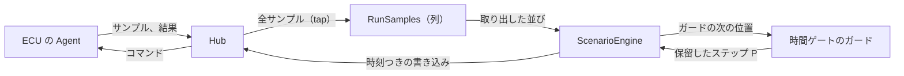

# 外部操作（Control API）

[English](../../internals/control.md)

Control API の Control Agent、Hub、SIL Kit の上のトランスポート、Control Server、ランチャーの Control Server、シナリオについて、反映の時刻、順序、上限、スレッドの保証と制限を書きます。使い方は [control-api.md](../control-api.md) にあります。

| 節 | 書いてあること |
|---|---|
| [全体の構成](#全体の構成) | 構成要素と、それぞれの接続の方式 |
| [扱う機能](#扱う機能) | Control API でできること、できないこと |
| [設計の方針](#設計の方針) | ステップを待たせない、仮想時刻、上限、認証の範囲、自己記述、GUI の分離 |
| [Control Agent](#control-agentvehicle_silcontrol) | 変数、書き込みの反映の時刻と結果、値の読み出し、スレッドと上限、決定論性、Peer の監視 |
| [Control Server の中核](#control-server-の中核vehicle_silcontrolhub) | Agent の接続の管理、書き込みと操作の状態、購読、まとめて読む、変数の対応表 |
| [SIL Kit の上のトランスポート](#sil-kit-の上のトランスポートvehicle_silcontrol_silkit) | メッセージ、スレッド、受信の順序の保証、最初のステップの前で待つ区間、接続の終わり |
| [Control Server と通信の層](#control-server-と通信の層vehicle_silcontrol_grpc) | gRPC のサービス、シミュレーションの監視、`GetSnapshot`、`Watch`、認証、上限 |
| [ランチャーの Control Server](#ランチャーの-control-servervehicle_sil_launch-run---control) | 時間の操作の経路、`--start-paused`、開始の期限、終わり方 |
| [ランチャーが受け取るサンプル](#ランチャーが受け取るサンプルrunsamples) | 実行の tap、`traffic` の数、シナリオの列、ロック |
| [シナリオ](#シナリオvehicle_sil_launch-run---scenario) | ガード、全サンプル、進め方、結果が決まる根拠、制限 |

## 全体の構成

担当は次のように分けています。

| 担当 | 受け持つもの |
|---|---|
| SIL Kit | CAN/LIN の通信と仮想時間の同期（データプレーン） |
| Control API | 操作と監視 |

クライアント（Python、CLI、GUI サーバー）が使う Control API は gRPC（Protocol Buffers、`proto/vehicle_sil/control/v1/control.proto` の v1）で、SIL Kit とは別の接続です。Server は、シミュレーションを実行する `vehicle_sil_launch run --control` の中にあります（下の「ランチャーの Control Server」）。

ECU の Agent と Hub の間のトランスポートは、SIL Kit の publish/subscribe（`vehicle_sil::control_silkit`）だけです。`ecu_main()` で作った ECU が Agent の側を付け、`vehicle_sil_launch run` が Hub の側を自分の participant に持ちます。ECU の実行ファイルは gRPC にも Protocol Buffers にも依存しません。Hub は、値と結果を仮想時刻に合わせて受信します（下の「SIL Kit の上のトランスポート」）。

プロセスと接続は次のとおりです。線は、接続と、その通信の方式です。



| 構成要素 | すること | 実装 | 接続 |
|---|---|---|---|
| Control Agent | 各 ECU が持ち、ECU の変数（と Peer の状態）を公開して操作を受け付ける | `vehicle_sil::control::Agent`、`Ecu::input()`、`output()`、`agent()` | Hub へは `vehicle_sil::control_silkit::AgentTransport`（`ecu_main()` が付ける） |
| Control Server | Peer の Agent を受け付け、操作を中継して状態を集約し、時間ゲートで時間を操作する | `vehicle_sil::control::Hub` | Agent の側は `vehicle_sil::control_silkit::HubTransport`（`vehicle_sil_launch run` が controller の participant に持つ）、クライアントの側は `vehicle_sil::control_grpc::ControlServer` の `ControlService`（`vehicle_sil_launch run --control`） |
| クライアント | Python、CLI、GUI サーバーのどれも、共通の Control API を使う | Python のパッケージと CLI（`python/vehicle_sil_control`）、GUI サーバー（`gui/server`）の自分のクライアント（`vehicle_sil_gui/control.py`） | Control Server へ gRPC で接続する（GUI サーバーは、画面へ HTTP と WebSocket で中継する。[gui.md](../gui.md)） |

## 扱う機能

| 機能 | RPC |
|---|---|
| Peer の一覧と状態 | `ListPeers` |
| 時間: 取得、一時停止、再開、ステップ実行、指定時刻まで実行、速度、止まるのを待つ、停止 | `GetTime`、`Pause`、`Resume`、`Step`、`RunUntil`、`SetSpeed`、`WaitPaused`、`Stop` |
| 変数の読み書き（スイッチ、レバー、センサー値など。仮想時刻を指定した書き込みを含む） | `GetValues`、`Write`、`GetOperation`、`WaitOperation` |
| 時刻と値をまとめて読む | `GetSnapshot` |
| 通信状態（J1939 のアドレスと統計、バスの状態）、エラー、イベント、性能情報の監視 | 変数として読む（下の「Control Agent」の「Peer の監視」） |
| 状態の変化の通知（購読） | `Watch` |
| 切断した Peer を忘れる | `ForgetPeer` |

- 開始はランチャーが決めます（必須の participant がそろったとき。`--start-paused` では `Resume`、`Step`、`RunUntil` で始まります）。
- リセットはありません。やり直すには、プロセスを起動し直します。
- CAN/LIN のチャネルと Vector のデバイスは選べません（[bridges.md](../bridges.md) の「引数」）。

## 設計の方針

| 方針 | 内容 | 詳しい節 |
|---|---|---|
| ステップを待たせない | Agent のステップのスレッドはトランスポートを待たず、操作は上限つきのキューで受け渡す | 「Control Agent」の「スレッドと上限」 |
| 仮想時刻に合わせる | 書き込みは、指定した仮想時刻以後の最初のステップで反映する | 「Control Agent」の「反映の時刻」 |
| 上限を設ける | キューとメモリの使用量には上限がある | 各節の上限 |
| クライアントの API だけを認証する | クライアント向けの gRPC（Control Server）は、TLS、トークン、ロールによる認可を持つ | 「Control Server と通信の層」の「認証とアクセス制御」 |
| 変数を自己記述する | 各 ECU は、変数の名前、型、範囲、単位を公開する（`Agent::schema()`、`--describe` の `variables`） | 「Control Agent」の「変数」 |
| GUI を分ける | GUI はシミュレーションと別のプロセスで、GUI サーバー（`gui/server`、Python）がランチャーを動かし、Control API のクライアントになって画面に中継する | [gui.md](../gui.md) |

- Agent と Hub の間（SIL Kit の上のトランスポート）と、SIL Kit の registry とデータプレーンには認証がありません。閉じたネットワークで使います。
- GUI のサンプルの画面は、ダッシュボードのファイルがなければ、公開された変数の情報を使って変数ごとにコンポーネントを並べます（[gui.md](../gui.md) の「変数の画面とコンポーネント」）。
- 公開ライブラリ（`vehicle_sil::*`）は GUI に依存しません。

## Control Agent（`vehicle_sil::control`）

ECU の中で、外から操作できる変数を公開し、外からの書き込みをステップの中の決まった時刻に反映します。通信（Control Server との接続）は含まず、SIL Kit にも依存しません。ECU（`Ecu`）が 1 つ持ち、ECU のクラスが変数を宣言します（[execution.md](execution.md) の「`Ecu` クラス（`vehicle_sil::Ecu`）」の「変数の宣言」）。

```cpp
class Body {
public:
    explicit Body(vehicle_sil::Ecu& ecu) {
        ecu.input("cabin.parking_brake", &parking_brake_, {.description = "Parking brake switch"});
        ecu.input("engine.coolant", &coolant_, {.unit = "degC", .min = -40.0, .max = 210.0});
        ecu.input_enum("trans.gear", &gear_, {{"P", 0}, {"R", 1}, {"N", 2}, {"D", 3}});
        ecu.output("vehicle.speed", [this] { return speed_; }, {.unit = "km/h"});
    }
    // ...
};
```

### 変数

| 型 | 検査と制限 |
|---|---|
| bool | なし |
| 整数 | C++ の型の範囲で検査する（64 ビットの符号なしは入力にできず、出力では int64 の最大で止めて読む） |
| 実数 | `float` は `float` の範囲で検査する |
| 列挙 | 値の一覧を持ち、値は型に収まり、名前と値が重複しないこと |

| causality（FMI に合わせる） | 書き込み |
|---|---|
| Input | 走行中も書ける |
| Output | 読むだけ |
| Parameter | 最初のステップより前だけ書ける |

メタデータは、名前（`.` で階層）、単位、最小、最大（どちらも含む。NaN は不可）、値の刻み幅（`step`。編集の目安で、強制しない）、説明、列挙の項目です。`schema()` が登録順に返します。

#### スキーマの確定

変数は、スキーマが確定する前に登録します。確定した後の登録は `std::logic_error` です。これは誤用の検出で、同期ではないので、登録と `submit()` を別のスレッドで同時に行いません。

スキーマは、次のうち最初のもので確定します。

| 契機 | 備考 |
|---|---|
| `complete_schema()` | トランスポートが `schema()` を初めて読む前に呼ぶ（`control_silkit::AgentTransport` はコンストラクターで、ドライバーは最初のステップの前に呼ぶ） |
| 最初の `submit()` | |
| 最初のステップ | |

`complete_schema()` は、`bind_driver()` に渡された関数（ドライバーが追加する変数。Peer の監視の出力）を 1 回呼んでから登録を閉じます。その関数が例外を投げれば、例外が伝わり、スキーマは確定しません。

ポインタや関数の参照先は、Agent より長く生かします（ECU の Agent では、ECU が持つもの）。

### 書き込み（`Command`）

- 1 つ以上の書き込みを、同じステップでまとめて反映します。
- `submit()` が名前、型、範囲、列挙、書き込めるかを確認し、通らなければ `Invalid` を返して何も積みません。
- 整数の変数の最小と最大が型の範囲の外にあれば、登録のときに `std::invalid_argument` です。
- 範囲外の値は丸めません（整数の範囲は整数のまま比べます）。
- `finish()` の後の `submit()` も `Invalid` です。

| 変数の型 | 受け付ける値 |
|---|---|
| 整数 | 整数か、整数値の実数 |
| 実数 | 整数か、有限の実数 |

### 反映の時刻

書き込みは、`Command::at` 以上の開始時刻を持つ最初のステップで、アプリの処理の前に反映します。アプリはそのステップで新しい値を見ます。`at` がなければ次のステップです。

Peer では、J1939 の受信処理、ハンドラー、タイマー（`PeriodicSender` の Encoder など）はアプリの処理より前に動くので、それらが新しい値を使うのは次のステップからです。

同じステップで反映するものは (at, seq) の順です（`at` のないものは、そのステップの時刻として並べます）。

| 条件 | 結果 |
|---|---|
| 操作を受信する前に、participant が `at` 以降に始まるステップを実行していた（遅すぎる操作）。既定 | 反映せずに `Late` |
| 遅すぎる操作で、`LatePolicy::ApplyNext` | 次のステップで反映し、`late` を立てる |
| Parameter への書き込みで、最初のステップが始まった後に `submit()` した | `Invalid` |
| Parameter への書き込みで、始まる前に積み、時刻が最初のステップより後 | `Rejected` |
| 関数で登録した入力の setter が例外を投げた | その操作は `Rejected` で、同じ操作の中で先に書いた値は残る（ステップは失敗しない） |

### 結果

- キューに積んだ操作には、必ず 1 つの `CommandResult`（`Applied` と反映したステップの時刻、`Late`、`Rejected`、`Cancelled`）が返ります。
- シミュレーションが終わると、`finish()` が残っている操作を `Cancelled` にします（ECU の Agent では ECU が呼びます。[execution.md](execution.md) の「変数が反映される時点」）。
- `VirtualTimeOptions::end` 以降の時刻を指定した操作と、ステップが失敗した Peer への操作も、`finish()` まで確定しません。
- 実時間の Peer では、`at` はその Peer のドライバーの時計の時刻です。

### 値の読み出し

ステップの終わり（Peer では LIN の処理の後）に全変数を読み、`latest()` で最新の 1 組を返します。読むのは、0、`sample_period`、2 `sample_period` … の時刻以後の最初のステップです（`Ecu::every()` と同じ数え方。既定 10 ms、0 なら毎ステップ）。受け渡しは 3 つのバッファで、ロックはありません。

### ステップの中からの送信（`set_step_sink()`）

関数を 1 つ登録すると、毎ステップの終わり（読み出しの直後）に、ステップのスレッドで呼びます。渡すのは、ステップの時刻と、そのステップが読んだ 1 組（読まなかったステップでは空）です。関数の中から `drain_results()` と `drain_events()` を呼べます。そのステップが作ったもの（反映の結果、イベント、値）を、そのステップの中で送信するための API で、`control_silkit::AgentTransport` が使います。

- 登録は最初のステップの前に 1 回だけで、後からの登録と 2 つ目の登録は `std::logic_error` です。
- 登録は外せません。
- 登録がなければ、ステップの負担は分岐 1 つです。
- 関数が投げた例外は、そのステップの失敗です。

### スレッドと上限

| スレッド | 呼ぶ関数 |
|---|---|
| ステップのスレッド（1 本） | `on_step_begin`、`on_step_end`、`log`、`finish` |
| トランスポートの側 | `submit`、`drain_results`、`drain_events`、`latest`、`stats`（互いにスレッド安全で、複数のスレッドから呼べる） |

- ステップのスレッドは、トランスポートの側を待ちません。
- トランスポートの側は、`finish()` の間と、実時間のドライバーを起こす `Host::post()` の短いロックを待つことがあります。
- `bind_driver()` に渡す起こしの関数の中から、`submit()` と `clear_wakeup()` は呼びません。
- 受け渡しは固定容量の SPSC リングです。
- 変数のアクセサはステップのスレッドだけで呼ぶので、モデルにロックは必要ありません。
- ステップのスレッドは、トランスポートのスレッドが持つロックを取りません。
- 使い終えた操作の解放と、結果の理由の文字列の確保は、ステップのスレッドで行います（量は 1 ステップに `max_pending` まで）。

| 上限 | 既定 | 超えたとき |
|---|---|---|
| 処理中の操作（積んでから、結果を `drain_results()` で受け取るまで）: `max_pending` | 256 | `submit()` がすぐ `Busy` を返す（そのため、結果は捨てない） |
| イベント: `max_events` | 1024 | あふれたものは捨てて数える |

### 決定論性

Agent は反映の時刻を決めるだけで、ステップの並びとデータを変えません。Agent がない実行と、Agent があって値を読み続けている実行で、通信の結果は同じです。時刻を指定した書き込みは、participant がその時刻以降に始まるステップを実行する前に受信すれば、何度実行しても同じステップで反映されます。保証はこの範囲だけです。

時間ゲートで止めてから書くとき、止まっている位置 P（`TimeState::now`）に始まるステップを、すでに実行した、または実行中の participant があります。そのため、`at` は P より後（たとえば P + 1 ns）にします。`at` が P 以下なら `Late` になりえます。`at` がなければ、P と次のステップのどちらで反映されるかは、受信した時刻で決まります。

同じステップで反映する操作の順（seq）は、Hub が受け付けた順です。複数のクライアントが同じ変数に同じ時刻で書くと、残る値は受信した順で決まり、実行ごとに変わりえます。

### ECU からの駆動

- ECU は、Agent を作ったときに自分をドライバーとして結び付けます（`bind_driver()`）。
- ECU は、アプリの処理の直前に `on_step_begin()`、LIN の処理の直後に `on_step_end()`、止まるときに `finish()` を呼びます（[execution.md](execution.md) の「1 ステップの順序」）。
- 実時間の Peer では、操作を積むとドライバーを起こします（`Host::post()`。未処理の起こしは 1 つまで）。
- Peer は止まり始めると起こさせるのをやめ、ステップがもう実行されなくなってから `finish()` を呼ぶので、その後の `submit()` は `Invalid` で、Peer を操作しません。
- Peer は `start()` で、Agent があればスキーマを確定させます。

### Peer の監視

`PeerOptions::monitor`（既定で有効）のとき、Agent のスキーマが確定する時点で、Peer が ECU の変数の後に次の出力を追加します。値は、Agent の読み出しのときにステップのスレッドで読みます。どの Peer も `start()` までに Agent を作るので（`ecu.connected`）、変数を宣言しない Peer にも付き、ステップごとの記録も実行されます。不要なら `PeerOptions::monitor = false` にします。

| 出力 | 内容 |
|---|---|
| `peer.steps` | ステップの数 |
| `peer.speed` | 前の読み出しからの仮想時間の秒 / 壁時計の秒（最初の読み出しでは 0、止まっていた後は小さくなる） |
| `peer.app_time_max_us` | 前の読み出しから、アプリと LIN の処理にかかった最長の時間（J1939 の処理と書き込みの反映は含まない） |
| `j1939.N.bus_state`（J1939 のネットワーク N ごと） | 列挙: unknown、error_active、error_passive、bus_off |
| ネットワーク N ごとの統計 | `frames_received`、`frames_sent`、`send_failures`、`send_queue_full`、`receive_overflows`、`held_dropped`、`address_violations`、`transport_aborts_sent`、`transport_aborts_received` |
| `j1939.N.node<i>.address`（N のノード i ごと） | ノードのアドレス |
| `j1939.N.node<i>.address_state`（N のノード i ごと） | 列挙: fixed、not_started、claiming、claimed、cannot_claim |

ノードのアドレスの状態かアドレスが変わったときは、イベントを出します。本文は「j1939.N.node<i>: <状態> at address <a>」で、状態の名前は列挙の項目と同じです。cannot_claim は Warning です。

N は、シミュレーションでのネットワークの名前です。`PeerOptions::network_names`（ECU の実行ファイルの `--map-network`。[ecu-executable.md](../ecu-executable.md) の「ネットワークの名前を替える」）で名前を替えたネットワークは、変数もイベントの本文も、替えた後の名前になります（どの実行ファイルのネットワークも、画面と Control API から同じ名前で見えます）。対応のないネットワークと、`--local` の実行では、コードの名前です。

監視の対象は、スキーマが確定する時点（トランスポートの `control_silkit::AgentTransport` を作る、最初の `submit()`、`start()` のうち最初のもの）にあるネットワークとノードです。

| 条件 | 起きること |
|---|---|
| 確定した後に `Peer::j1939()`（両方の形）を呼ぶ | 監視されないネットワークになるので `std::logic_error`（文言に Peer とネットワークの名前と、直し方: トランスポートを作る前、最初の `submit()` の前に追加するか、`PeerOptions::monitor = false`） |
| 確定した後にノードを追加する | そのノードは監視されない |
| 生の CAN と LIN | 監視の対象ではない |
| ECU の変数を `peer.` か `j1939.` で始まる名前で宣言する（`input()`、`output()` など） | この接頭辞は予約なので（ほかのバスのための `can.`、`lin.`、`eth.` も。`ecu/monitor_names.hpp` の `monitor_names::kReservedPrefixes`）、`monitor` の設定と実装（`Peer`、`LocalBench`）によらず、宣言のときに `std::invalid_argument`（文言に ECU と変数の名前、ルール） |
| `agent()` に直接登録した変数が監視の出力と重なる | 確定させる呼び出しが `std::invalid_argument`（何も変えず、スキーマは確定しない。文言に Peer の名前と `PeerOptions::monitor = false`） |

最後の行の場合、スキーマは開いたままなので、確定させる呼び出しが例外を投げた後に宣言した変数も、`describe()` の ECU の変数です。

ステップの失敗はここでは通知しません（失敗の後はステップが実行されないため）。`Peer::failed()` と `error()`（スレッド安全）を、トランスポートの側で読みます。

## Control Server の中核（`vehicle_sil::control::Hub`）

Control Server の、通信の方式によらない部分です。接続した Agent の一覧、書き込みの振り分け、Peer ごとの結果、最新の値、上限つきの購読を受け持ちます。全関数がスレッド安全です。

### トランスポートからの呼び出し

- トランスポートは、接続ごとに `agent_connected(hello, link)` を呼んで `ConnectionId` を受け取ります。
- 以後、Agent から受信したもの（`agent_submitted`、`agent_result`、`agent_values`、`agent_events`、`agent_status`）と切断（`agent_disconnected`）を、その ID で渡します。
- `hello` は、Agent を Peer に `attach()` した後で作ります（監視の出力がスキーマに入るため）。
- `agent_status` には `Peer::failed()` と `error()` を渡します（ステップの失敗は、監視の出力では届かないため）。
- SIL Kit のトランスポートは `agent_status` を呼ばない（Hub の API としては残っている）ので、クライアントに見える Peer の `status` はいつも空で、participant の失敗はシミュレーションの監視（`SimulationMonitor`）が通知します。
- `agent_connected()` には、空でない名前、リンク、0 より大きい `max_pending` が必要です。

### `AgentLink::send()`

- Hub は、自分のロックを持たずに呼びます。
- 1 つの Peer には 1 本のスレッドから、通し番号の順に 1 つずつ呼ぶので、短く待っても、中から Hub を呼び返してもかまいません。
- `false` を返せばその操作は Invalid、例外なら Unknown になります。
- `write()` を呼んだスレッドが、同じ Peer への前の操作の送信も引き受けることがあるので、`write()` は `send()` の分だけ待つことがあります。
- Hub はリンクの最後の参照を、ロックの外で手放します。

### Agent の識別と再接続

Agent は、participant 名（空は不可）と、起動ごとの ID（incarnation）で名乗ります。

#### 同じ名前と同じ ID（再接続）

同じプロセスの再接続です。SIL Kit のトランスポートは、トランスポートごとに新しいセッションで名乗るので、この形を使いません。再接続するトランスポートのための API です。

新しい接続が古い接続に代わり、未完了の操作は続きます。古い接続の切断の通知が後から届いても、Peer は切断になりません（その接続に渡して、積まれたと通知されていない操作だけが Unknown になります）。トランスポートは、届けられなかった結果を次の接続で送り直します。

| hello の `open_seqs` | 扱い |
|---|---|
| Agent がまだ持っている操作（積んだが、結果をトランスポートがまだ届けていないもの）を入れる | それらは新しい接続で Queued になり（古い接続の終わりの影響を受けない）、それ以外の未確定の操作は Unknown で確定する |
| 入れない | 何も確定させないので、結果を失った操作は未確定のまま残り、その Peer の `max_pending` に数えられ続ける |

#### 同じ名前で別の ID（再起動）

プロセスの再起動です。前の ID の未完了の操作は Unknown になり、前の ID の値は消えます。

#### 置き換えた古い接続

どちらの場合も、置き換えた古い接続は `AgentLink::close()` で閉じます。同じ名前の 2 つのプロセスが同時に動いている（設定のエラー）ときも、古いほうは黙って無視されるのではなく、接続が切れたことを知ります。新しい接続が優先されます。

#### 終わり（`agent_ended(connection, reason)`）

同じ ID ではもう接続しないとトランスポートがわかっているとき（participant がシミュレーションを去った、Agent が最後の通知を送信した）に呼びます。切断と同じ処理をしたうえで、その ID の未確定の操作をすべて Unknown（理由つき）で確定させるので、待っている呼び出しは残りません。

#### 切断

| 操作 | 切断したときの扱い |
|---|---|
| Agent が積んだ操作 | Disconnected（未確定）になり、同じ ID で再接続した後に結果を受信すれば、それで確定する |
| リンクに渡したが、積まれたと通知されていない操作 | Unknown |
| まだリンクに渡していない操作 | Invalid |

`forget_peer()` で切断した Peer を消すと、その未確定の操作は Unknown になり、購読者には `removed` のフラグつきの PeerUpdate が届きます。

#### どの接続のデータを使うか

- 結果は、操作を送信した ID のどの接続から受信しても受け付け、別の ID からの結果は使いません。
- 値、イベント、状態は、いまの接続からのものだけを使います。
- スキーマと数が合わない値と、前より古い値は捨てます。

### 書き込みと操作の状態（`write()`）

- `write(request)` は、Peer ごとのまとめをロックの外で行います。
- 操作には、Hub 全体で増える通し番号を振ります（既定の初めの値は壁時計のマイクロ秒で、Server を起動し直しても前より大きい）。
- Peer ごとにまとめた `Command`（その番号を `seq` に持つ）を送信します。
- Hub が確認するのは、Peer が接続していること、変数があって書けること、その Peer の未完了の操作が `max_pending`（hello で受け取る）より少ないこと（多ければ Busy）だけです。
- 型、範囲、反映するステップは Agent が決めます。

Peer ごとの状態は Sent → Queued（Agent が積んだ）→ Applied、Late、Rejected、Cancelled のどれか、または Disconnected、Invalid、Busy、Unknown です。Sent、Queued、Disconnected 以外は確定で、二度と変わりません。

### 受け付けと確定を待つ（`wait_queued()`、`wait_done()`）

- `wait_queued(seq)` は、Sent の目標がなくなるまで待ち、そのときの操作を返します（タイムアウトと、知らない番号は空）。
- 止まっている位置より後の時刻を指定して書き込み（「Control Agent」の「決定論性」）、すべての目標が Queued になったことを確認してから再開すれば、遅すぎる書き込みは起きません。
- `wait_done(seq)` は確定まで待って操作を返すので、直後に操作が忘れられても結果はわかります。
- 待っている間に忘れられたときも空を返すので、`max_operations` は待つ操作の数より大きくします。

### 購読（`subscribe()`）

- 始めると、その時点の Peer の一覧と最新の値がまず届きます。
- Peer、値、操作は、それぞれ Peer ごと・操作ごとに最新の状態だけを持ちます（読む前に変われば置き換える）。
- 上限（`capacity`）があるのはイベントと操作で、あふれたら、イベントは古いものから、操作はいちばん前に変わったものから捨てて数えます。
- 値には、そのスキーマの incarnation が付きます。
- `poll()` の順は、Peer、操作（番号の順）、イベント（受信した順）、値です。
- `close()` で、待っている `poll()` を起こして終えます。

### まとめて読む（`latest_of()`）

- `latest_of(peers)` は、複数の Peer（空なら全部）の最新の値を、Hub のロックを 1 回取って、同じ瞬間のものとして返します（値は共有で、コピーしません）。
- 時刻と値を 1 組で読みたい側は、時間の状態を先に読んでから、これを呼びます。
- 値は新しくなる一方なので、時間の状態を読んだ時点で Hub にあったものは必ず入っています。
- `none_after(values, now)` は、`now` より後のステップの値が混ざっていないかを返します。

### 変数の対応表（`set_variable_map()`）

`set_variable_map(participant, map)`（`control/variable_map.hpp` の `MappedSchema`）は、その participant の変数を、読む側と書く側の全員に、対応の後の名前と値で見せます。ランチャーが、設定ファイルの `participants[].variables` から渡します（`RunControl::hub()` の最初の呼び出しで、Agent が接続する前）。

変換は Hub の中の 4 か所だけです。見せる一覧はロックの外で作ってロックの中で入れ替え、ほかの 3 つはロックの中で行います。トランスポートと読む API（tap、最新の値、購読、Control Server）は、変換を知りません。

| 変換する所 | すること |
|---|---|
| 一覧（`agent_connected()`） | hello の一覧から、見せる一覧を接続ごとに 1 回作る |
| 値（`agent_values()`） | Hub が持つ前に変換する |
| 書き込み（`write()`） | 名前と向きを確認する所で、実行ファイルの名前と値に直してから `Command` に入れる |
| 理由 | Agent が返す理由の先頭の変数名を、見せる名前に直す |

一覧:

- 並びと数は変えません（値は並びで対応するため）。
- 合わない対応は適用せず、`PeerInfo::map_problems` に理由を入れます。
- 対応が掛かった変数の、実行ファイルでの名前は `PeerInfo::sources` です。
- すでに接続している接続には、後から渡した対応表は反映されません。

値:

- tap、`latest()`、`latest_of()`、購読は同じ 1 つの変換済みの値を共有するので、API によって値が違うことはありません。
- 時刻と通し番号は Agent のままで、順序の保証は変わりません。

書き込み:

- 確認する所で直すので、確認した一覧と直す一覧は同じ時点のものです。
- 直す処理は、一次式の逆、整数への丸め（半分は 0 から遠いほうへ。浮動小数点の丸めモードによらない）、範囲と `map` の値の確認で、直せない値は Invalid です。
- 範囲は実行ファイルの値で比べます（見せる範囲の端は積なので、10 進で書いた値から 1 ulp ずれうる。一覧に出す端は 15 桁に丸めた値）。
- シナリオの照合も同じ判定を使います（`MappedSchema::in_range()` が `to_actual()` を呼ぶ）。
- 適用されなかった対応の `name` と `from` への書き込みは、一覧を探す前に拒否します（`MappedSchema::not_writable()`）。読むのはそのままです。
- ランチャーは、適用されなかった対応を、実行の行と結果で 1 回通知します。開始時に接続していた participant は開始のとき（`RunControl::note_links()`。開始の窓が待たなかった participant は、開始の後の接続をもう一度見ます）、その後に接続した participant は実行の終わり（`RunControl::note_late_maps()`）です。
- 直した `Command` は、その incarnation にだけ送信します（再起動なら捨てます）。
- 操作の記録（`request`）は、クライアントが書いた名前と値のままです。

ルール（型、範囲、衝突）は `MappedSchema::make()` の 1 か所にあり、照合（`launch::seen_variables()`）も同じ関数を `--describe` の一覧に掛けます。対応の形を追加するときは、次を直します。

- `VariableMapping` のメンバー
- `MappedSchema::make()` と変換
- 設定ファイルを読む所（`libs/launch/src/config.cpp` の `kVariableMapKeys` と `read_variable()`）
- `check --json` の `variable_map`（`check_format.cpp`）

### 覚えておく操作

確定した操作は `max_operations` までで、超えたら古いものから忘れます。未確定の操作は忘れません（数は Peer ごとの `max_pending` で決まります）。

## SIL Kit の上のトランスポート（`vehicle_sil::control_silkit`）

Agent と Hub の間のメッセージを、SIL Kit の publish/subscribe で運びます。新しい participant は作りません。ECU の側（`AgentTransport`）は ECU の participant に、Hub の側（`HubTransport`）は Hub を持つ側の participant（`vehicle_sil_launch run` では controller）に、発行者と購読者を作ります。

### メッセージの種類

メッセージの流れは、hello、最初のステップの前で待つ区間（全員が最初のステップの前で待つ）、コマンドと受け付け、ステップごとのステップのメッセージ、最後の通知（トランスポートを破棄するとき）とそのレスポンス、の順です。

| メッセージ | 向き | 送信する時点 |
|---|---|---|
| hello | ECU → Hub | 開始の前（後から購読した相手のために、最後の 1 つを残す） |
| コマンド | Hub → ECU | `Hub::write()` を呼んだとき |
| 受け付け（`submit()` のレスポンス） | ECU → Hub | コマンドを受信したとき（受信のハンドラーから） |
| ステップのメッセージ（結果、イベント、値） | ECU → Hub | ステップの中 |
| 問い合わせ（probe） | Hub → ECU | 下の「コマンドを送信できるようになるまで」 |
| ready（問い合わせへのレスポンス） | ECU → Hub | 問い合わせへのレスポンスとして |
| last word received（最後の通知へのレスポンス） | Hub → ECU | 最後の通知を受信して接続を終えた後（下の「接続の終わり」） |

### メッセージの形式（`control/wire.hpp`）

形式は `vehicle_sil::control` の `control/wire.hpp` にあります。依存のないバイト列で、数はリトルエンディアンです。

どのメッセージも、先頭に形式のバージョン `kVersion`（2）を持ちます。どちらの側も `kVersion` で書き、`kVersion` だけを読みます。バージョンの交渉はしません。hello は、どのバージョンでも participant 名までが同じ並びなので、別のバージョンの hello からも名前を読めます。Hub はそれを報告し（`LinkState::VersionMismatch`）、Peer にしません。Agent は、別のバージョンのメッセージをすべて捨てます。

- バージョン 1（vehicle-sil 0.1.0）は、もう読みません。vehicle-sil 0.1.0 でビルドした ECU と新しい Hub、新しい ECU と 0.1.0 の Hub の組み合わせでは、ECU はシミュレーションに加わりますが、変数を読み書きできません。
- 形式は、バージョンを上げずに項目を追加できます。
  - 変数、書き込み、結果、イベントは、先頭に自分の大きさ（バイト数）を持ちます。
  - ヘッダーの最後の 1 バイトは、書いた側の改訂番号（`kRevision`）です。
  - 新しい項目は、その要素の末尾に追加します。メッセージ全体の項目なら、メッセージの末尾に追加します。追加したら `kRevision` を 1 上げます。
  - 復号が知らないもの（要素の残り、メッセージの残り、フラグのビット）を読み飛ばすのは、書いた側の改訂番号が自分より新しいときだけです。改訂番号が同じか古い相手からは、大きさが自分の読む分とちょうど同じでなければならず、余ったバイトはエラーです。
  - 読み飛ばしてはいけない値（知らない列挙の値）は、どの改訂番号からでもエラーです。書く側は、送る前に相手の改訂番号を見ます。
- 結果は、コマンドの書き込みのうち反映した数（`CommandResult::applied_writes`）を、断りは、理由がどの書き込みについてか（`SubmitResult::failed_write`）を持ちます。どちらも空（言わない）のことがあります。
- 相手が知らなくても困らない種類を追加するだけなら、バージョンも改訂番号も上げません。知らない種類は、読めないメッセージとして数えて捨てます（最後の通知へのレスポンスは、こうして追加しました）。

- 復号は例外を投げず、渡されたバイト列の外を読みません。
- 切れた入力、種類の違い、バージョンの違い、大きすぎる入力、範囲の外の値を、それぞれ別のエラーで返します。
- 大きさの上限はバージョンより先に見ます（バージョンの違うメッセージも、上限を超えて読みません）。
- 数のフィールドは、残りのバイト数に収まるかを確認し、申告された数の分の領域を先に取りません。
- 同じメッセージのオブジェクトに続けて復号すると、領域を使い回します。
- 宛先（セッション）だけを先に読む関数（`addressed()`）があり、ECU は自分宛てでないコマンドを復号しません。

### 大きさの上限

| 対象 | 上限 | 超えたとき |
|---|---|---|
| コマンド、受け付け、ステップのメッセージ | 64 KiB（`kMaxMessageBytes`） | 下の表 |
| hello | 4 MiB（`kMaxHelloBytes`）、変数 65536 個（`kMaxVariables`） | `AgentTransport` を作れない（`std::invalid_argument`） |
| participant 名と変数名 | 1〜256 バイト（`kMaxNameBytes`） | `AgentTransport` を作れない（`std::invalid_argument`） |
| 理由とイベントの文 | 1024 バイト | 切る |

復号も、同じ上限で拒否します。

| 64 KiB を超えるもの | 扱い |
|---|---|
| 1 ステップの分（結果、イベント、値） | 複数のステップのメッセージに分けて同じステップの中で送信し、Hub の側が 1 組の値に組み立てる |
| コマンド | 分けない（1 つのコマンドの書き込みは同じステップで反映するため）ので、送信せず、その操作は Invalid |

hello は 1 つのメッセージです（後から購読した相手には、最後に送信した 1 つしか届かないため）。

### トピック

- トピックは向きと種類ごとに 1 つで、全 participant で共通です（`vehicle_sil.control.hello`、`.step`、`.submitted`、`.command`）。
- participant 名はトピックに入れません。
- メッセージは、送信元か宛先の Agent を、`AgentTransport` ごとに新しく作る 64 ビットの番号（セッション。Hub から見た incarnation）で示します。
- コマンドは全 ECU に届き、宛先でない ECU は捨てます。
- この名前で始まる SIL Kit のサービスは、利用者が作らないでください。

### ECU の側のスレッド（`AgentTransport`）

| 場所 | すること |
|---|---|
| コンストラクター | Agent のスキーマを確定させ（`complete_schema()`）、hello を履歴 1 の発行者で送信する |
| ステップのスレッド | ステップが作ったもの（反映の結果、イベント、読んだ値）を、値を読んだ直後に、そのステップの中で送信する（`Agent::set_step_sink()`） |
| SIL Kit の受信のハンドラー | コマンドを `submit()` し、そのレスポンスをその場で送信する（ステップの外） |
| デストラクター | まだ送信していない結果（`Peer::stop()` の後なら、取り消された書き込み）を「最後の通知」として送信し、Hub のレスポンスを待ってから戻る（下の「接続の終わり」） |

- コンストラクターは、ECU を作った後、ECU を始める前に、組み立てのスレッドで呼びます（始めた後は `std::logic_error`）。
- `AgentTransport` は Agent に 1 つだけです。
- ほかのスレッドからは送信しません。
- 何も作らなかったステップは、何も送信しません。
- デストラクターが待つのは、長くても `AgentTransportOptions::last_word_wait`（既定 500 ms）です。
- ECU を止めてから破棄し、ECU より先に破棄します（`control::TransportLease` を持ちます）。
- SIL Kit のハンドラーの中からは破棄しません（レスポンスを受信するスレッドなので、上限まで待つことになります）。

### Hub の側のスレッド（`HubTransport`）

- 受信のハンドラーは、メッセージを復号して Hub に渡すだけです。
- 受信のハンドラーは participant の SIL Kit のスレッドで動き、そのスレッドは participant のステップも動かすので、ハンドラーが遅いとシミュレーション全体が待ちます。
- 待ち行列は持たず、何も捨てません（遅さは値の欠けではなく、実行の遅れになります。`HubTransportStats::handler_time`）。
- Hub の購読者への配布は、購読者のスレッドが `Subscription::poll()` で行います。
- コマンドの送信は、`Hub::write()` を呼んだスレッドがそのまま発行します。
- `HubTransport` は、participant を始める前に作ります。

### Hub の側の検査と上限

- 値の組は、hello のスキーマと、個数、順（分けた部分が先頭から続いていること）、変数ごとの型が合うものだけを Hub に渡し、合わないものは捨てて数えます（`HubTransportStats::unknown`）。
- 覚える participant は `HubTransportOptions::max_links`（既定 256）までです（接続しているもの、終わったもの、バージョンの違うものの合計）。
- 上限を超えた hello と、ほかの participant が接続しているセッション番号を名乗る hello は、捨てて数えます（`refused_hellos`）。
- 1 つの hello が Hub に残すのは、上の hello の上限までです。

### コマンドを送信できるようになるまで

hello を受信しただけでは、ECU の側のコマンドの購読が確立しているとは限りません（向きごとに別々に接続するため）。`HubTransport` は問い合わせ（probe）を送信し、ECU のレスポンス（ready）を受信してから、その Agent へコマンドを送信します（`LinkInfo::ready`）。問い合わせを送信するのは、hello のとき、ready が来るまでのステップのメッセージ（8 通に 1 回）のとき、`wait_for_hellos()` の中です。

次の書き込みは、`AgentLink::send()` が拒否し、Hub がその場で Invalid にします。誰にも届かないコマンドを送信して、操作が確定しないまま残ることがないようにするためです。

- ready の前の書き込み
- ライフサイクルが止まり始めた（Stopping 以降、Error）participant への書き込み

最初のステップの前で待つ区間の中では、必須の participant への問い合わせは必ず届きます。

### 受信の順序の保証

Hub の側の participant が時刻同期に参加し、ECU が仮想時間で動くとき（`vehicle_sil_launch run` はいつもそうです）、Hub の側の participant のステップ P が始まった時点で（したがって、時間ゲートが P で止まった時点で）、次のことが保証されます。

| ECU のステップの開始時刻 | その分の結果と値 |
|---|---|
| P より前 | すべて Hub に入っている |
| ちょうど P | 入っているかどうか決まらない（止まっている間に受信する） |
| P より後 | シミュレーションを進めるまで受信しない |

「P まで」ではなく「P より前まで」として扱います（`StepInbox` と同じルール）。

- 受け付けのレスポンス（Queued など）とコマンドはステップの外で送信するので、順序は保たれますが、時刻の保証はありません。
- 止めてから `at` > P で書き、全員の Queued を待ってから進める手順（「Control Agent」の「決定論性」）は、そのまま使えます。
- `HubTransport` は、この保証に反して受信したステップのメッセージ（Hub の側がすでに後のステップを始めていた）を数えます（`HubTransportStats::late_messages`、`LinkInfo::late_messages`）。
- ECU がステップの中から送信している限り、`late_messages` は 0 です。

### 最初のステップの前で待つ区間（`set_start_window()`）

`SimulationController::set_start_window()` で関数を登録すると、controller は、必須の participant が全員最初のステップの前で待っている間（SIL Kit の CommunicationReady の非同期のハンドラー。`ParticipantRuntime::set_communication_ready_handler_async()`）に、その関数を自分のスレッド（SIL Kit のスレッドでも、`start()` を呼んだスレッドでもない）で呼びます。関数が戻ってから、シミュレーションを始めます。

この間に `HubTransport::wait_for_hellos()` で Agent の hello を待ち、`Hub::write()` で Parameter を書いて `wait_queued()` で受け付けを待てば、その値は各 ECU の時刻 0 のステップで反映され、アプリはそのステップで見ます。ECU と controller がどの順に起動しても同じです。

#### 開始との関係

- この区間は開始の一部です。
- `start()` のタイムアウトはこの区間を含み（`StartWindow::deadline()`）、全 participant の `start()` が区間の終わりを待ちます。
- 関数を外から止める手段はないので、関数は待つたびに `StartWindow::cancelled()`（停止の要求、ライフサイクルの終わり、`start()` のタイムアウト）を見て、すぐ戻ります。
- `start()` は、戻るときも投げるときも、関数の終わりを待ちます。
- 関数が投げても区間は閉じて全員が始まり、`start()` がその文言で `std::runtime_error` を投げます。
- 区間より前（controller が SIL Kit の workflow の構成（`SetWorkflowConfiguration`）を公開する前や、hello を受信した直後）に書いたコマンドは、届く保証がありません。

#### 区間を必ず完了させる

この区間は必ず完了させます。`start()` があきらめた後で区間が始まったとき（必須の participant の準備が遅かった）は、関数を呼ばずに完了だけします。全員が最初のステップまで進むので、その後の controller の停止で、区間のないときと同じに順に終わります。controller のデストラクターは、停止を待つ間も、始まった区間を完了させます。

#### participant がいなくなったとき

- `vehicle_sil_launch` の `start()` は、開始を待つ間、必須の participant がシミュレーションを去っていないか（`has_finished()`。プロセスが終われば Error）を見て、去っていればすぐにあきらめます（`SimulationController::start()` の `give_up`）。区間の中で participant がいなくなると、残りの participant はタイムアウトまで待つためです。
- `wait_for_hellos()` は、挙げた participant のそれぞれが、接続してコマンドを受信できるとレスポンスする、バージョンの違う hello を送信する、シミュレーションを去る、のどれかになるまで待ちます（期限と取り消しつき）。
- 区間の中で participant がいなくなっても、`wait_for_hellos()` の待ちは終わります（その後の開始は、ほかの開始の失敗と同じにタイムアウトになります）。

### 接続の終わり

`HubTransport` は、次のときに `Hub::agent_ended()` で接続を終えます。

- Agent の「最後の通知」を受信したとき
- その participant のライフサイクルが Error になったとき（ステップの失敗、接続が切れた＝プロセスが終わった）
- `HubTransport` を破棄したとき

その Agent を待っていた操作は、最後の通知に入っていた結果（Cancelled など）か Unknown で確定します。

#### 最後の通知が届く保証

`HubTransport` は、最後の通知を受信して接続を終えた後に、その Agent へレスポンスを送信します（すでに終わった接続の最後の通知にもレスポンスします）。`AgentTransport` のデストラクターは、そのレスポンスを待ってから戻ります。ECU のプロセスはトランスポートの直後に participant を破棄し、SIL Kit は participant を破棄するときに、まだソケットに書いていない送信を捨てるためです。

Hub の側のトランスポートがいて、待つ時間の中にレスポンスができる限り、デストラクターが戻った時点で、最後の通知は届いていて、その Agent を待っていた操作は確定しています。

#### 待つ時間

- 長くても `AgentTransportOptions::last_word_wait` です（既定 500 ms、0 で待たない。`ecu_main()` では `EcuMainOptions::last_word_wait`）。
- レスポンスはふつうすぐ来るので、この時間いっぱい待つのは、Hub の側がいなくなったか、レスポンスをしないバージョンのときだけです。
- 壁時計で、ステップが止まった後に 1 回だけ待つので、仮想時間と実行の速度には関係しません。
- Hub から問い合わせもコマンドも受信したことのない Agent（Hub のいないシミュレーション）は待ちません。

#### 保証しないこと

次のどれかのときは、最後の通知は届かないことがあります。

- Hub の側のトランスポートがいない、または先に破棄された。
- レスポンスをしないバージョンである。
- 待つ時間の中にレスポンスが来なかった。
- Hub の問い合わせ（probe）がまだその Agent に届いていない（hello の直後に終わる ECU。待ちません）。

順に終わった（Shutdown になった）のに最後の通知が届かなかった participant の接続は、`HubTransport` を破棄するまで残り、そのときに Unknown で確定します。その間も、その participant への新しい書き込みは上の「コマンドを送信できるようになるまで」のとおり拒否するので、確定しない操作は増えません。

#### バージョンを混ぜたとき

| 組み合わせ | 動き |
|---|---|
| レスポンスを知らない Agent | レスポンスを捨てて、今までどおりに終わる |
| レスポンスをしない Hub が相手の Agent | 待つ時間いっぱい待って終わる |

どちらも、形式のバージョンには関係しません。返事は独立した種類のメッセージで、バージョンを上げずに追加したものです。

### hello が来ない相手

- トランスポートを付けていない ECU（`--no-control`、Agent のない古い vehicle-sil の実行ファイル、Agent を持たない participant）は hello を送信しないので、Hub の Peer になりません。
- バージョンの違う hello を送信した相手は、Peer にならず、`HubTransport::links()` に participant 名とバージョンつきで残ります。
- どちらも、待つ側には「来ない」ではなく別の結果として見えます（`HelloReport` の `connected`、`mismatched`、`ended`、`missing`）。

### 実時間の Peer と、起動し直した participant

実時間の Peer（仮想時間なし）にも `AgentTransport` を付けられます。同じメッセージが流れますが、受信する時刻と Hub の側の仮想時刻の間に保証はありません（値は受信した時点のものとして扱い、`late_messages` にも数えません）。

同じ名前で起動し直した participant は、新しいセッションの hello で古い接続に代わります。落ちた後の起動し直しでも同じです。hello を受信するときに、その名前のライフサイクルの状態は見ません（前のプロセスの状態かもしれないため）。

### 認証がないこと

この区間に認証はありません。registry に参加できる者は、コマンドのトピックへ書けます（シミュレーションのバスにフレームを送信できるのと同じです）。閉じたネットワークで使います。クライアント向けの gRPC の認証は、この区間に及びません。

### 量

値は間引きません。送信する量は「ECU の数 × `sample_period` ごとの 1 組」で、シミュレーションの速度に比例して増えます。量を減らすには、`AgentOptions::sample_period` を大きくします（`Ecu::set_agent_options()`）。

## Control Server と通信の層（`vehicle_sil::control_grpc`）

`VEHICLE_SIL_BUILD_CONTROL_SERVER`（既定 OFF）のときだけビルドします。gRPC は `find_package(gRPC CONFIG)` で探し、なければ FetchContent でバージョンを固定して取り込みます（[dependencies.md](../dependencies.md)）。ほかのライブラリは gRPC に依存しません。

### サービス

- サービスは、クライアント向けの `ControlService`（Peer の一覧、値、時刻と値をまとめて読む、書き込み、操作の結果と待ち、購読、Peer を忘れる、時間の操作）だけです。
- Agent は gRPC で接続しません（Hub の側のトランスポートは `HubTransport` で、Server を使う側が付けます）。
- 列挙はどれも 0 が UNSPECIFIED で、クライアントから来た知らない値は安全側に読みます（書き込みの遅れの扱いは Reject として）。

### `ControlServer`

Hub にサービスを載せます。Hub は自分で持つか、呼ぶ側のもの（`ServerOptions::external_hub`。Server より長く生かすこと）を使います。

### 時間の操作

- `TimeControl`（`time_control_of(controller)` で SimulationController の時間ゲートを使う）があれば、時間の操作を受け付けます。
- `TimeControl` がなければ、時間の操作は `FAILED_PRECONDITION` で、`GetTime` は `available = false` を返します。
- `Stop` は停止を要求するだけで待ちません（複数のクライアントから同時に呼べます）。
- `Stop` の理由は全 participant と SIL Kit のログに渡るので、制御文字を `?` にして 200 バイトまで（UTF-8 の文字の途中では切らない）にし、監査にも残します。
- シミュレーションが始まる前の `Stop` は、始まった直後に止めます（`ParticipantRuntime::request_stop()` は、lifecycle が Running になる前の要求を保ち、最初のステップで渡します。SIL Kit は Running の前の Stop を無視するためです）。

### シミュレーションの監視（`SimulationMonitor`）

`TimeControl` があれば、Server は 1 本のスレッドで `ServerOptions::monitor_period`（既定 50 ms）ごとに `TimeControl` を読み、次を 1 つのスナップショットに持ちます（`ControlServer::simulation()`）。

- 時間の状態
- participant ごとの SIL Kit の状態
- 失敗した participant と理由（`FailureCheck`。猶予は `leave_grace`。一度失敗を見たら消さない）
- 終わったか

| ルール | 内容 |
|---|---|
| 購読者への通知 | 変わったときだけ通知する |
| 購読者を呼ぶスレッド | 監視のスレッドか、`poll()` を呼んだスレッド（つまり、時間の呼び出しを処理する gRPC のスレッド）で、1 つずつ呼ぶ |
| 購読者の制約 | 短くし、中から購読の登録や解除をしない |
| `TimeControl` を読む所 | `ListPeers` と `Watch` はどちらもこのスナップショットを使うので、購読の数によらず、監視の 1 か所だけ |
| 状態を読めなかったとき（`TimeControl` が投げた） | 前に読めた値を残し、理由を添える（`ListPeers` の `simulation_error`、`SimulationState::error`。participant と時間の両方を読めなければ両方の理由） |
| participant を読めなかった回 | 失敗を判定しないので、いなくなった participant の猶予は数え直さずに続く |

- `SimulationMonitor` は `TimeControl` だけに依存します。
- `TimeControl::left_participant()` は純粋仮想です（実装し忘れると、失敗を判定しないまま動くため）。
- SIL Kit の実装は、participant の状態を最初の 1 回だけ SIL Kit から読み直し（ハンドラーの登録中に届いた状態を SIL Kit が渡さないことがあるため）、以後はハンドラーが受信した状態を読みます。

### Peer の一覧（`ListPeers`）

- 一覧は、接続した Agent に、controller の必須の participant（`SimulationControllerOptions::required_participants`。Agent がなくても）を合わせたものです。
- 必須でない participant は、Agent があるときだけ（`simulation_state` は空で）出ます。
- 各 Peer に、Agent の有無（`has_agent`）と SIL Kit のライフサイクルの状態（`simulation_state`。まだ見えていなければ空）が付きます。
- `Watch` の Peer も同じ変換で作るので、同じ Peer は `ListPeers` と同じ内容で届きます。

### 時刻と値をまとめて読む（`GetSnapshot`）

時間の状態（`TimeControl::state()`）を先に読み、その後で `Hub::latest_of()` を呼びます。2 つの読み取りにまたがるロックは持ちません（`TimeControl` の側のロックを放してから、Hub のロックを取る）。

それでも、次のことが言えます。Hub の側の participant が時刻同期に参加していれば、ゲートが時刻 P を示した時点で、P より前に始まった各 Peer のステップの値は Hub に入っています（「SIL Kit の上のトランスポート」の「受信の順序の保証」）。Hub の値は新しくなる一方なので、後から読んだ値は時刻より古くなりません。

レスポンスの `consistent` は、読んだ時間の状態が止まっていて（終わっておらず）、どの値も P より後のステップのものでない（`none_after()`）ときだけ真です。

| 場合 | `consistent` |
|---|---|
| 2 つの読み取りの間に再開され、その後のステップの値が入っている | 偽 |
| 2 つの読み取りの間に再開されたが、その後のステップの値が入っていない | 真（値は P のもののままなので、フラグは正しい） |
| 実時間の Peer の値の時刻（その Peer の時計の時刻）が P より後 | 偽 |
| `TimeControl` がない | 偽（値だけを返し、`available` も偽） |

- ちょうど P に始まるステップの値は、入っているかどうか決まりません。
- 時間の状態を読めなければ（`state()` が投げた）、呼び出しは失敗します。
- 名前は `max_peers_per_request`（既定 1024）までです。
- レスポンスが `max_snapshot_bytes`（既定 4 MiB。gRPC のクライアントが受け取れる既定の大きさ）を超えるときは、Peer を分けるように言って `RESOURCE_EXHAUSTED` を返します。

### エラー

gRPC の状態コードで返します。

| 場合 | コード |
|---|---|
| 引数のエラー | `INVALID_ARGUMENT` |
| ない操作や Peer | `NOT_FOUND` |
| 待ちのタイムアウト | `DEADLINE_EXCEEDED` |

### 待つ呼び出し（`WaitOperation`、`WaitPaused`）

- `max_wait`（既定 60 秒）で打ち切り、クライアントの取り消しと Server の終了でもすぐに終わります。
- シミュレーションが終わった後の `WaitPaused` は、待たずに `FAILED_PRECONDITION` を返します。
- 待つ呼び出しと `Watch` は、それぞれ Server のスレッドを 1 本使い、同時に `max_waiting_calls`（既定 256）までで、超えたら `RESOURCE_EXHAUSTED` です。

### 購読（`Watch`）

始めに、その時点の Peer と最新値（`time` を求めれば時間の状態、`simulation` を求めればシミュレーションの状態も）を送信してから `initial_done` を送信し、以後は変化を送信します。

時間とシミュレーションの状態は、監視が通知したスナップショットを購読ごとの待ち行列（64 件）に入れておき、Hub の変化を待つ間（最長 100 ms）ごとに、順に、変わったものを送信します。

- 待ち行列があふれると古いものから捨て、捨てた数を `dropped` に加えます（遅いクライアントには途中の状態が届かないことがあります。止まるのを待つには `WaitPaused` を使います）。
- 失敗と終わりは、一度立つと後のスナップショットすべてに残るので、捨てられても失われません。
- 時間を変える呼び出し（一時停止、再開、ステップ、指定時刻まで、速度、停止）と `WaitPaused` は、その場で監視に読ませるので、その結果の状態は、待ち行列があふれない限り購読に届きます。
- シミュレーションの状態（`SimulationState`）は、必須の participant とその SIL Kit の状態、失敗した participant とその状態と理由、終わったか、読めなかった理由です。
- シミュレーションを調停しない Server は、`simulation` を求めた購読に `available = false` を 1 回だけ送信します。
- 時間の状態の `running` が偽のとき、`ended` で「まだ始まっていない」と「終わった」を区別します。
- Peer は `ListPeers` と同じ一覧（Agent のない必須の participant を含む）で、SIL Kit の状態が変わった Peer は送り直します。
- Agent の Peer が忘れられても、必須の participant なら、Agent のない Peer として送信します（`removed_peer` は一覧から消えたときだけ）。
- `capacity` は `max_watch_capacity`（既定 65536）までです。

### 接続

keepalive（10 秒ごと、5 秒で応答がなければ切断）を使うので、黙って切れた接続も数十秒以内に見つかります。

### 認証とアクセス制御

#### TLS

`SecurityOptions` にサーバーの証明書と秘密鍵（PEM）を渡すと、TLS で待ち受けます。クライアントは、ルート証明書（PEM）を渡して TLS で接続します。

#### トークン

認証情報（`Credential`: 名前、トークン、ロール）を渡すと、すべての呼び出しに `authorization: Bearer <token>`（`Bearer` の大文字と小文字は問わない）が必要です。認証情報を渡さなければ、誰でも何でもできます。トークンは、どこで違うかによらない時間で比べます。

| 場合 | 結果 |
|---|---|
| 資格情報のファイル（`load_credentials()`）に、同じトークンの重複がある | エラー |
| 資格情報のファイルに、3 語でない行がある | エラー |
| 資格情報のファイルに、ロール `agent` の行（Agent がトークンで gRPC に接続していたときのもの）がある | エラー（もう使わないので消すように、文言で言う） |
| `SecurityOptions` に認証情報を直接渡す | 同じ検査をする（`std::invalid_argument`） |
| `SecurityOptions` に、証明書と秘密鍵の片方だけを渡す | `std::invalid_argument` |
| トークンがないか、合わない | `UNAUTHENTICATED` |
| ロールが足りない | `PERMISSION_DENIED` |

#### ロール

ロールは viewer < operator < admin の順で、後のロールは前のロールのできることを含みます。

| ロール | できること |
|---|---|
| viewer | 読む: 一覧、値、操作、購読、時刻、時刻と値をまとめて読む |
| operator | 変える: 書き込み、一時停止、再開、ステップ、速度、Peer を忘れる |
| admin | 停止 |

- viewer は、値、スキーマ、イベント、操作（書いた人の認証情報の名前と接続元を含む）を読めます。
- RPC ごとに必要なロールと監査の有無は、Server の 1 つの表（`rpc_rules()`）にあり、各 RPC はその表で認可してから処理します。
- 表にない RPC は、誰が呼んでも `PERMISSION_DENIED` です（RPC を追加して表を忘れると、テストが失敗します）。

#### ループバック以外のアドレス

ループバック以外のアドレスで待ち受けるには、TLS と認証情報の両方が必要です（`allow_insecure` を明示しない限り、`std::invalid_argument` で起動しません）。ループバックとみなすのは、`localhost`、`[::1]`、数字の `127.x.y.z`、`unix:` のアドレスだけです（`is_loopback_address()`）。

#### 監査

- `audit` に、変更する呼び出し（書き込み、時間の操作、Peer を忘れる）と、拒否した呼び出しを、誰が（認証情報の名前と接続元）、何を、結果、の 1 行で渡します。
- 制御文字は `?` に置き換えます（名前に改行を入れて、偽の行を書けない）。
- 1 行は約 1000 バイトで切ります。
- 書き込みの行は、最初の 16 個の名前と、残りの数です。
- 拒否した呼び出しはポートに接続できる誰でも起こせるので、1 秒に 20 行までにします。
- 記録しなかった数は、次に記録する拒否した呼び出しの行の前に通知します。
- 監査の関数が投げた例外は無視します。

#### 認証のない区間

SIL Kit の registry とデータプレーンには認証がありません。閉じたネットワークで使います。SIL Kit の上のトランスポート（`vehicle_sil::control_silkit`）で運ぶ Agent と Hub の間も同じです。

### 上限

| 対象 | 上限 | 超えたとき |
|---|---|---|
| Server の未完了の操作 | Peer ごとの `max_pending`（hello の値。65536 まで） | Busy（「Control Server の中核」の「書き込みと操作の状態」） |
| 確定した操作 | `max_operations` | 古いものから忘れる |
| 購読ごとの、読んでいないイベントと操作の更新 | `capacity`（既定 1024。`max_watch_capacity` を超える値は、それに切り詰める） | 古いものから捨て、捨てた数を `dropped` に加える |
| 1 回の `Write` の書き込み | `max_writes_per_request`（既定 4096） | `INVALID_ARGUMENT` |
| 1 回の `GetSnapshot` の名前 | `max_peers_per_request`（既定 1024） | `INVALID_ARGUMENT` |
| 待つ呼び出しと `Watch` | `max_waiting_calls` | `RESOURCE_EXHAUSTED` |
| 1 つのメッセージ | gRPC の既定の 4 MiB | gRPC がメッセージを断り、`RESOURCE_EXHAUSTED` になります。`GetSnapshot` の応答は、先に Server が自分で確かめます（`max_snapshot_bytes`。[時刻と値をまとめて読む](#時刻と値をまとめて読むgetsnapshot)） |

Agent の hello の上限は、「SIL Kit の上のトランスポート」の「大きさの上限」にあります。

### Server の再起動

- Hub の状態（操作、値）は引き継ぎません。
- 前の Server の操作の番号を問い合わせると `NOT_FOUND` です。
- Agent がまだ持っている前の Server の操作（時刻つきを含む）は、そのまま反映されます。

## ランチャーの Control Server（`vehicle_sil_launch run --control`）

`VEHICLE_SIL_BUILD_CONTROL_SERVER` のビルドの `vehicle_sil_launch` だけが持ちます（`tools/launch/control_server.cpp`）。`libs/launch` は gRPC に依存しません。ランチャーは、`run` の Hub（ECU の Agent が SIL Kit で接続する。上の「SIL Kit の上のトランスポート」）を、`ServerOptions::external_hub` で `ControlServer` に渡します。

### スレッドと呼ぶもの

| スレッド | 呼ぶもの | 通るロック |
|---|---|---|
| 標準入力を読むスレッド | `TimeCommands::apply()`（`source` は `stdin`） | `TimeCommands` のミューテックスの中で、controller の時間ゲートに渡す |
| gRPC のスレッド（時間の操作） | `TimeCommands::apply()`（`source` は `control_server`） | `TimeCommands` のミューテックスの中で、controller の時間ゲートに渡す |
| gRPC のスレッド（値の読み書き） | Hub | Hub のロック |

### 見るだけのサーバー（`observe_only`）

- シナリオの実行（`run --scenario`）では、ランチャーが `ServerOptions::observe_only` を付けます。
- 呼び出しの表（`libs/control_grpc/src/auth.cpp` の `rpc_rules()`）の各行に、シミュレーションに何をするか（読む、変える、止める）があります。
- `observe_only` のサーバーは、「変える」呼び出しを、権限の確認の直後、本体に入る前の 1 か所で拒否します（`FAILED_PRECONDITION`、trailing metadata `vehicle-sil-reason`）。
- 拒否した呼び出しは、Hub にも `TimeControl` にも届きません。
- 読む呼び出しがアクセスするのは、Hub（スレッド安全。購読は上限つきで、トランスポートのスレッドを待たせない）と `TimeCommands::inspect()` だけで、シナリオの tap、書き込み、ガードとは何も共有しません。

### 起動と終了の時期

- 照合が通った後、registry より前に、`run_file()` が `RunOptions::serve_control` を呼びます（main のスレッド）。
- Server を起動できなければ、何も起動しません（`setup`）。
- 閉じるのは、`run_file()` が戻った後、結果を書く前です（main のスレッド。`ControlServer::shutdown()`）。

### 時間の操作の経路

- `TimeControl` の実装は、`launch::TimeCommands` に渡すだけです。
- 標準入力のコマンドと同じ `apply()` を、`source` を `control_server` にして呼びます。
- `apply()` は 1 つのミューテックスの中で、受け付けるかを決め、`command` のイベントを書き、ゲートに渡すので、標準入力と gRPC のコマンドは 1 列に並び、イベントの順が反映された順になります。
- ルールも同じです（`step` は一時停止中だけ、など）。
- 受け付けなかったコマンドは、`std::invalid_argument`（引数のエラー）か `std::logic_error` にして、`ControlServer` が `INVALID_ARGUMENT` か `FAILED_PRECONDITION` で返します。
- `Stop` も `apply()` で受け付けるかを決めてイベントを書きます（実行が終わった後は拒否します）。
- 受け付けた `Stop` は、標準入力の `stop` と同じ停止の要求にします（待ちません）。

### 状態の読み取り（`TimeCommands::inspect()`）

- 読むのは、時間の状態、必須の participant と SIL Kit の状態、去った participant です。
- `TimeCommands::inspect()` が、controller が付いている間だけ、ミューテックスの中で、呼び出し側が渡した関数（Server が controller を読む関数）を呼びます。
- 外れた後（`detach()`。controller を破棄する前に、どの終わり方でも呼ぶ）は、最後に読んだ値を返します（`ended` は真）。
- そのため、gRPC のスレッドが、破棄された controller にアクセスすることはありません。
- `WaitPaused` は `TimeCommands::wait_paused()` で、ミューテックスを持たずに待ち、外れたらすぐに戻ります。

### ランチャーの `GetSnapshot`

- 時間の状態は上の `inspect()` で読み（`TimeCommands` のミューテックス → ゲートのロック。戻るときに両方を放す）、その後で Hub を読みます。
- `TimeCommands` のミューテックスを持ったまま Hub のロックを取ることはないので、ロックの順序は増えません。

| 時点 | 返すもの | `consistent` |
|---|---|---|
| 最初のステップの前で待つ区間で止まっている間 | 0 で止まっていて、値はまだない | 真 |
| 実行が終わった後 | 最後の時刻と最後の値 | 偽 |

### 開始前に止める（`--start-paused`）

- 最初のステップの前で待つ区間の関数が、hello を待った後に `TimeCommands::hold_before_start()` で待ちます。
- `resume`、`step`、`run_until` のどれかを受け付けると戻り、区間が閉じてシミュレーションが始まります。
- 停止の要求、区間の取り消し、必須の participant が去ったこと、`--timeout-ms` でも戻ります（そのときは、時刻 0 のステップの後に 0 で止まる、ふつうの `--start-paused` になります）。
- 区間より前に受け付けたコマンドで、止まる時点に 0 で止まることになっていなければ、止まりません（`TimeCommands` が、最後の `pause` の後に `resume`、`step`、`run_until`、後の時刻への `pause` があったかを持つ）。
- この間、`GetTime` は 0 で止まって始まっていない状態を返し、`wait_paused()` はすぐに 0 を返します。

### 開始の期限

`vehicle_sil_launch` は、`SimulationController::start()` を期限なし（`kNoStartLimit`）で呼び、期限を `give_up` で自分で持ちます。

| 区間 | 期限 |
|---|---|
| 止まるまで | `start_timeout_ms` の残り（少なくとも hello の待ち + 1 秒） |
| 止まっている間 | なし |
| 止まるのをやめてから | 改めて `start_timeout_ms` |

利用者が起動する（manual の）必須の participant がいる実行では、manual の participant がすべて ReadyToRun 以上に着くまで期限なしで、着いた時点から `start_timeout_ms` です。その participant はデバッガーで止まっていることがあるためです。止まるまでの区間も同じです。

この実行では、どの段階でも、`give_up` は停止の要求（割り込み）と `--timeout-ms`（participant を待ち始めた時点から）を見ます。期限のない待ちから抜けるためです。manual のいない実行では、停止の要求は開始が終わってから反映されます。

- 期限は、main と区間のスレッドが 1 つのミューテックスで読み書きします。
- `give_up` は、main のスレッドで 5 ms ごとに見ます。
- 期限を過ぎたら、最初のステップに着いていない participant（ReadyToRun でないもの）と状態を文言に挙げて、`start()` を終わらせます。
- manual の必須の participant がいない実行では、`--timeout-ms` は止まった時点から数えます（止まるまでは見ません）。manual の participant がいる実行では、上のとおり、participant を待ち始めた時点から数えます。

### 終わった後の値

`TimeCommands::detach()` が、controller を外す前に `set_on_detach()` の関数を呼び、`LaunchTimeControl` がそこで最後の時刻（結果の `sim_ms` と同じ数え方）、participant、去った participant を読みます。外れた後の `GetTime` は、その値を返します。

### 終わり方

- ランチャーは、クライアントを待ちません。
- `run_file()` の中のどのスレッドも gRPC を待たず、gRPC のスレッドが取るのは `TimeCommands`、Hub、ゲートの短いロックだけです。
- `shutdown()` は、待つ呼び出しと購読に終わりを通知し（それぞれ 200 ms と 100 ms ごとに見る）、gRPC の Server を最長 2 秒の期限で止めます。
- `WaitOperation` は、Agent の接続の終わり（`Hub::agent_ended()`）で操作が確定して戻ります。

### ランチャーの認証

- `ControlServer` のルールのとおりです（ループバック以外は TLS と認証情報）。
- ランチャーは、ループバックでないアドレスに TLS と認証情報がなければ、引数のエラーにします（`allow_insecure` は出しません）。
- トークンは、ファイルでだけ受け取ります（引数はイベントの `hello` に出るため）。

## ランチャーが受け取るサンプル（`RunSamples`）

`vehicle_sil_launch run` は、どの実行でも Hub の tap を 1 つ付けます（`libs/launch/src/run_samples.hpp` の `RunSamples`）。使うのは、シナリオ（次の節）と、結果の `traffic`（[simulation-run.md](../simulation-run.md) の「ネットワークの送受信（`traffic:`）」）です。



- **`traffic` のために列は持ちません。** 数は積み上げなので、要るのは participant ごとの「実行の終わりの時刻 E より前に始まった最後のステップ」の 1 組だけです。tap は、サンプルを participant ごとの「最新の数組」（`libs/launch/src/run_traffic.hpp` の `TrafficLatest`）に入れます。実行の間は誰も取り出さず、終わりに主スレッドが 1 回読みます（`finish(E)`）。あふれることがないので、一時停止の間や始まる前の待ちの間に実時間の `Peer` がサンプルを送り続けても、何も失いません。
- **どの組を残すか**: E は controller のステップの始まりで、tap が呼ばれた時点の controller の時刻 N（`ParticipantRuntime::now()`。原子的に読めます）も同じです（N ≤ E）。N のステップが始まった時点で、N より前のステップのサンプルは全部届いているので（上の「[受信の順序の保証](#受信の順序の保証)」）、その中で残すのは最後の 1 組です。N 以後のサンプルは、controller のタイムステップごとに、そのタイムステップの中で始まった最後の 1 組を残します（E がどのタイムステップになっても、数に使う組はその中にあります）。仮想時間で動く participant は controller より 1 タイムステップほどしか先に進まないので、残るのは 2、3 組です。残る組は、N 以後のサンプルがいつ届いたかにも、誰も見ていなかった時間の長さにもよりません。
- **新しい上限が 1 つあります**: サンプルの時刻が controller より 64 タイムステップ（`TrafficLatest::kMaxAhead`）より先に進んだ participant は、実行の時刻に沿っていないとみなして、それ以後は何も残さず、数えません（`real-time`）。シミュレーションが止まっている間も進み続ける実時間の `Peer` がこうなります。仮想時間で動く participant は届きません。
- **シナリオの列**: シナリオが始まってから終わるまで、シナリオが始まったときにつながっていた Agent のサンプルだけを列に積みます。上限はありません（集計を追加する前と同じです。シナリオのスレッドは controller のステップを保留したまま取り出すので、ふつうは 1 タイムステップ分です。一時停止の間は、仮想時間の ECU はサンプルを送りません）。シナリオが使わない participant のサンプルは、この列に入りません。
- **数えない participant**: 仮想時間で動かないもの、起動し直されたもの（tap が 2 つ以上のプロセスのサンプルを見た。または、終わりの Hub の hello が、tap の見たプロセスのものでない）、そのネットワークの数の出力を持たないもの、数の出力に設定の `variables` の対応が当たっているもの（Hub が、tap に渡す前に値を書き換えるため）は、数えません。理由は結果の `not_counted` に出ます。
- **スキーマ**: どの変数が数かは、Agent の hello のスキーマで決まります。tap の中では Hub を呼べないので、終わりに `Hub::peers()` で引きます。
- ロック: `RunSamples` のミューテックスは 1 つです。順は Hub のロック → このミューテックス（tap）だけで、このミューテックスの下では、何も取らず、Hub も呼びません。

## シナリオ（`vehicle_sil_launch run --scenario`）

シナリオ（[scenario.md](../scenario.md)）は、ランチャーの中で、Hub と時間ゲートを直接使って進めます。gRPC は使いません。保証のリファレンスは、`libs/launch/include/vehicle_sil/launch/scenario_run.hpp` の `ScenarioEngine` のコメントです。

データの流れは次のとおりです。矢印は、渡すものです。



### ガード（`guard_from()`、`wait_guarded()`）

- `SimulationController::guard_from(t)` と `wait_guarded()` は、一時停止とペース調整とは別の保留です。
- t 以降に始まる controller のステップを、持ち主がガードを先へ動かすまで保留します。
- 保留している間の位置の意味は、一時停止と同じです（[virtual-time.md](virtual-time.md) の「一時停止、ステップ実行、速度（時間ゲート）」の「P で止まっている」）。
- `TimeState::paused` は変えず、ペース調整の期限も変えません。
- 持ち主が期限を過ぎて持っていた分は、次のステップの遅れとして、そのステップが始まったときに数えます。
- ガードが保留している間は、期限を過ぎたステップとして数えません。
- stop_at のステップは保留しません。

### 全サンプル（`set_values_tap()`）

- `control::Hub::set_values_tap()` は、Hub が受信したサンプルを、受信した順に 1 つずつ渡します。
- 購読は Peer ごとに最新の 1 つしか持たないので、条件の判定には使いません。
- tap はトランスポートのスレッド（ランチャーでは controller の SIL Kit のスレッド）で、Hub のロックの中から呼ばれるので、積むだけにします。
- tap は Hub に 1 つで、ランチャーではシナリオのものではなく実行のものです（上の「[ランチャーが受け取るサンプル](#ランチャーが受け取るサンプルrunsamples)」）。シナリオには、シナリオが始まった後に tap が受け取った、始まったときにつながっていた Agent のサンプルだけが渡ります。

### 進め方

ランチャーは、controller のステップ 0 からガードをかけます。シナリオのスレッドは、ステップ P が保留されるたびに、受信したサンプルを `ScenarioEngine` に渡して `tick(P)` を呼び、戻ったらガードを P の先へ動かします。`tick(P)` は次の順に処理します。

| 順 | すること |
|---|---|
| 1 | 結果が届いているはずの書き込みを確認する |
| 2 | P より前に始まったステップのサンプルだけを、時刻の順（同じ時刻は、シナリオに出てくる participant の順）に見て、条件を判定する |
| 3 | (P, P + controller のステップ幅] の時刻の書き込みを Hub に渡し、Agent が積むまで待つ（`wait_queued()`） |

時刻 0 の書き込みは、最初のステップの前で待つ区間（「SIL Kit の上のトランスポート」）で渡します。

### 時間をかける書き込み（`ramp`、`wave`）

- 値は、手順の始まりからの仮想時間だけの関数です（`Waveform`。`ramp` の直線も、波形の 1 つです）。
- `ScenarioEngine` は、相手の ECU のステップごとに、その時刻の値を、送信する直前に計算して書きます。
- 関数は状態を持たず、乱数も種、変数の名前、時刻から作るので、controller のステップ幅や受信の順を変えても、同じ時刻には同じ値が反映されます。

### 書き込みが遅れない根拠

P を保留している間、ECU は P より後のステップを始めません。P より後の時刻の書き込みを、その間に Agent が積めば、その時刻以降の最初のステップの先頭で反映されます（「Control Agent」の「決定論性」）。

### 結果が PC の速度によらない根拠

判定に使うのは、サンプルの時刻と controller のステップの時刻だけです。ステップ P が始まった時点で、P より前に始まった各 ECU のステップのサンプルと結果は、Hub にすべて届いています（「SIL Kit の上のトランスポート」の「受信の順序の保証」）。ちょうど P に始まるステップの分は、届いていることも、いないこともあるので、P では見ずに、次のステップで見ます。書き込みの結果も、届いているはずの決まったステップ（適用する ECU のステップより後の、最初の controller のステップ）で見ます。

controller のステップ幅は、シナリオのある実行では速度によりません。実時間の待ちとタイムアウトは、結果を決めません（書き込みを Agent が積むのを待つ所に期限はなく、相手がいなくなれば Hub が確定させ、実行が終われば待つのをやめます）。

### 終わり

- シナリオが終わる（全部通った、1 つ失敗した）と、シナリオのスレッドはガードを動かさずにフラグを立て、主スレッドがシミュレーションを順に止めます。
- 止まる位置は、その controller のステップです。
- stop_at で先に終わったときは、主スレッドが、最後のステップより前のサンプルで決められる所まで決めます。
- 停止の要求、participant の失敗、`--timeout-ms` で終わったときは、シナリオは途中で終わった扱いです。

### 前提が破れたとき

ECU がステップの外から送信するなどで、サンプルが遅れて届くと、判定が実行ごとに変わりえます。ランチャーは、遅れて届いたメッセージを数えて、警告 `control-link-late-values` を出します（`ecu_main` で作った ECU では起きません）。

### 制限

- シナリオが使えるのは、仮想時間で動く ECU の変数だけです。
- 待つ手順（`wait_until`、`within_ms`）の後の書き込みは、成り立ったサンプルから、controller のステップ幅で 2 つ先のステップより前には反映されません（サンプルを確かに持つのが次のステップ、書き込みが間に合うのがその次）。
- controller のステップごとに、シナリオのスレッドとの受け渡しが 1 往復入ります。

## 関連するドキュメント

- 使い方: [control-api.md](../control-api.md)
- シナリオの書き方: [scenario.md](../scenario.md)
- GUI: [gui.md](../gui.md)
- 全体像: [architecture.md](../architecture.md)
- どこに何があるか: [code-map.md](../code-map.md)
- ほかの内部の仕組みのドキュメント: architecture.md の「[内部の仕組み](../architecture.md#内部の仕組み)」
